# dino vs wof：游戏逻辑设计差异笔记

> 落盘原因：跨会话上下文会被压缩，此文件写成自包含笔记，不依赖对话记忆。
> 视角约定（用户 11-06）：**只谈游戏逻辑怎么组织**，不谈 Rust/C#、typed struct / WRAM 字节映像、大端序这类实现表相——"那不是游戏本意"。
> 证据来源：`g:/wof/dino/dino-rs/crates/dino-game/src/game/` 与 `g:/wof/wt1/wof_cs/src/` 的实际代码。
> 前提（用户给定）：dino 比 wof 更晚、更成熟。本笔记从代码验证这个"成熟"具体落在哪些系统上。

---

> ⚠️ **阅读顺序（11-06 追加）**：§9–§10 是当时"用 ROM 取证"的工作记录，其中**把 ROM 当成审 repo 结论**的框架（"重大更正""架构反转""维度差一个量级"）以及 `A5-0x3E / 0x3E62 = 全局 AI 行为档位` 的解释，已按用户反馈**作废/更正**，一律以 **§11 定位说明与勘误** 为准。表字节 / 跳表项 / 命令地址等 **data 部分保留有效**。§0–§8 不受影响。

---

## 导读 / 章节导航（11-06 整理，压缩上下文后先读这里）

> 规模：6295 行、40 轮、62 张 mermaid 图、1189 表格行、附录 A（A.1–A.14：A.8 当前文件核验 / A.9 引用一致性 / A.10 全笔记总核验 / A.11 规模与进度回执 / A.12 当前状态总核验 / A.13 作废结论残留审计 / A.14 规模与进度回执（§46 后）；A.8–A.13 位于 §33 之后、A.14 位于文末）。§0–§46 全部结论以两份 repo 源码为准；ROM 只在"必要时"用于补 data 表内容（见 §11.0）。**附录 A 是隔离存放的阶段 A 工程结论存档，非游戏设计正文**。
> 提交纪律（用户 11-06 提醒）：长会话单点损毁风险高，本笔记每完成一个分析块即提交一次，不攒到最后；提交号以 `git -C g:/wof/dino log -1` 为准。

| 轮次 | 章节 | 内容 | 状态 |
|---|---|---|---|
| 一 | §0–§8 | 读 repo 得出的游戏设计对照（状态机 / 打击 / 事件脚本 / 怪物策略）+ 边界 | 有效 |
| 二 | §9 | ROM 级验证，补 data | "重大更正"等**措辞作废**，见 §11.0 |
| 三 | §10 | 表字节 data | data **保留**；"架构反转 / 维度差一个量级"**作废**，见 §11.3 |
| 四 | §11 | **定位说明与勘误**（`A5-0x3E` = 活跃玩家位图、`0x3C6A` = 共享函数 + 各兵种表） | **必读，优先于 §9–§10** |
| 五 | §12 | 打击结算时序：命中 / 处决分帧 | 有效 |
| 六 | §13 | 怪物策略：census 一帧延迟反馈闭环 | 有效 |
| 七 | §14 | 输入层帧内优先权：`+$A0` 三层写入者 | 有效 |
| 八 | §15 | 附加玩法挂接：tag / car 不破坏固定帧循环 | 有效 |
| 九 | §16 | Boss 层：共享零件 + 每类自己的分派 | 有效 |
| 十 | §17 | 伤害结算多因子流水线 | 有效 |
| 十一 | §18 | data 待核项结清 + Boss 专属实现补读（Tyrog / Slice 攻击脚本） | 有效 |
| 十二 | §19 | 脚本系统全景对照（5 套脚本 / 推进时钟写在哪里） | 有效 |
| 十三 | §20 | 顶层流程任务机（5 任务 / `Scene` sleep / lag 记账）——直答"中断与函数执行次数" | 有效 |
| 十四 | §21 | 道具 / 武器状态机（pool E 12 class / 拾取双向迁移 / wof 三条线纠偏 / 主线闭环） | 有效 |
| 十五 | §22 | 受击反应（命中帧写编号 / dino act 字节 / wof 两层分派 / 结清 §12.6 标注） | 有效 |
| 十六 | §23 | 卷轴 / 摄像机显示延迟（`VIDEO_LATENCY=2` / 按通道分档 / 与附录 A.8 dump 点闭合） | 有效 |
| 十七 | §24 | 投技 / 抓取（双向互检的联合状态机 / 挣扎计时 / 投掷多步 / 主线最完整形态） | 有效 |
| 十八 | §25 | 动态难度 / rank（跨整局时间驱动状态机 / Markov aggression / wof 单字节 + 概率门） | 有效 |
| 十九 | §26 | HUD / 分数 / 奖命（脏标志帧末重绘 vs 事件队列投递；回扣用户最初「执行次数不确定」） | 有效 |
| 二十 | §27 | 搓招 / 指令技（独立三态时间窗 FSM vs 每角色主状态机入口 / `cmd_flag` / `RKey1`） | 有效 |
| 二十一 | §28 | 同屏预算与波次编排（人头 vs 权重 / 7200 帧预算 / 超时清场 / 相机门闩 / 64 条上限） | 有效 |
| 二十二 | §29 | 受击后的恢复链（14+ 反应分派 / 按角色查表无敌 / 起身决策 / 眩晕五重门与全局限流） | 有效 |
| 二十三 | §30 | 关卡结束 / 过关 / 续关（`flow.mode` 8 态 / 0xACEE 原子迁移 / wof 共享出口 `0x42C2` / `flow_lag(1)`） | 有效 |
| 二十四 | §31 | 角色差异化（`PlayerData` 按 `ch` 索引表族 / wof 5 武将各自主状态机入口 / 数据维 vs 结构维） | 有效 |
| 二十五 | §32 | 地形与载具（例程表按类别分入口 / dino Cadillac 4 态复合主体 / wof 6 槽马池 + 玩家骑马分支） | 有效 |
| 二十六~三十六 | §33 / §34 / §35 / §36 / §37 / §38 / §39 / §40 / §41 / §42 / §43 / §44 / §45 / §46 | 多人协作（`A5-0x3E` / `0x3E62` / 3 槽扫描 / 人数分档 + census；音频边界外）；一关内部的空间分段（`area` 状态字节 / `0xAA0E` 集中重置 / wof 脚本流 + 相机门闩）；非角色对象（pool B 统一契约 + 80 余 class vs wof 多池 `ObjId` 分派）；跨帧时序实例全表（`prev_input` / `latch` / `score_dirty`、§20.6 主线封顶）；命中反馈层（对象头 `hitstop` + 相机 `step_shake` 子状态机 vs wof `+0x62` 一字节三用 + 全局 VBlank 震动）；友军伤害与记分归属（`pass_10664` / 伤害 1 保底 1 HP / Z 差按人数分档 / HUD 归攻击者 `+$02`）；连击 / 连续技（`combo_t` 时间窗 + 4 段 finisher 接投技 vs wof `ComboLev` 按角色查表）；过关结算（tally 四分项 / 每帧 100 倒扣 / pool B class 25 数字对象按 sub step 对齐）；非战斗流程（Front 多 Scene / boot-attract 一条 Scene / 选人 3×12 字节记录 + 10 秒兜底 / join 四态）；生成帧跨帧契约（`spawn_script_tick` 帧最后 / 首帧 AI 下一帧 / wof `0x1082E` 在 `0x22D8E` 之后 / 宿主 pending 按 §0 隔离）；离场与回收（`mode=6` free next frame / `enemy_free_pool_a` / wof `0x14B8` 公共回收）；纵深空间与跳跃（`floor/floor2` 连续地面 / `jump[16][9]` 六分量 / 5 个地形入口 / 蹬墙跳 vs wof `Z=0x0C` 招式跳跃 + 地面带 `0x1E3C`）；渲染优先级与遮挡（`(depth,handle)` 单键排序 / `0x14EC0` 影子同序 vs wof 多队列分阶段消费 + `0x5DFBC` 冒泡排序）；一次攻击的数据表示（8 字段 `AttackRecord` 聚合 / 玩家·敌人共用 vs wof 一个 ID 散在多张表 `0xE4F02` / `0x1C20` / `0x7E68`） | 有效 |
| 附 | 附录 A | **阶段 A 工程路线结论存档**（三条路线 / VBCC·C89 / `AssetPack` / 帧存档 / lag / FBA vs MAME）+ **A.8 当前文件核验回执 / A.9 引用一致性核验 / A.10 全笔记总核验（§33 后、§34 前）/ A.11 规模与进度回执 / A.12 当前状态总核验 / A.13 作废结论残留审计 / A.14 规模与进度回执（§46 后，文末）** — 非设计正文 | 隔离存档 |

**按主题找**：
- 状态机 → §2、§14、§15、§16.3、**§20（顶层流程任务机）**、**§21（非角色对象）**、§22（受击态）、§23（显示延迟）、**§24（跨两对象）**、**§25（跨整局）**、**§26（反馈层）**、**§41（Front 多 Scene / 选人记录状态机）**
- 打击逻辑 → §3、§9.3、§12、§17、§21.5/§21.6（武器攻击几何）、**§22（受击反应）**、**§24（投技）**；一次攻击的数据表示 / 招式表 → **§46（8 字段 `AttackRecord` 聚合 / 5 个消费者 / 玩家·敌人共用 vs wof 一个 ID 散在多张表 / 按 pass 约定读字节）**
- 事件脚本 → §4、§9.4、§12.4、§14、**§19（5 套脚本全景）**、**§26（加分事件队列）**
- 怪物策略 → §5、§9.5、§11.5、§13、§16、§18.2、**§25（动态难度 / 概率门）**
- 道具 / 武器生命周期 → **§21（12 class / 拾取双向迁移 / 空枪降级 / 一帧延迟列表）**
- 受击 / 硬直 / 眩晕 / 反击 / 命中停顿 / 屏幕震动 → **§22（dino 12 张表族 / wof 9 项跳表 + 每兵种段表）**、**§37（两条独立反馈状态机 / `step_shake` 幅度递减方波 / `+0x62` 一字节三用）**
- 卷轴 / 摄像机 / 硬件时序 → **§23（`VIDEO_LATENCY` / VBlank shadow 提交 / 与 A.8 dump 点闭合）**
- 投技 / 抓取 / 挣扎 / 投掷 → **§24（双向互检协议 / 释放即落地 / 投掷多步状态机）**
- 动态难度 / rank / 时间驱动 → **§25（`rank_tick` / `RANK_PERIOD` / Markov aggression / wof `A5-0x5A`）**
- HUD / 分数 / 奖命 / 反馈时机 / 过关结算 → **§26（`score_dirty` 帧末重绘 vs `0xD000` 事件投递 / 回扣「执行次数不确定」）**、**§40（tally 四分项 / 每帧 100 倒扣进 score / `G.$735E` 与 intro 共享）**
- 搓招 / 指令技 / 输入序列 / 连击 → **§27（`player_command_fsm` 三态时间窗 / `cmd_flag` 结果位 / wof `RKey1` 符号三态）**、**§39（`combo_t` 时间窗 / 4 段链 / finisher 接投技 vs wof `ComboLev` 查表）**
- 关卡 / 波次 / 同屏预算 / 背压 / 生成帧时序 / 离场回收 → **§28（`g.alive` vs `A5+0x1AD` 权重和 / `wave_timer 0x1C20` / `kill_all=2` / 相机门闩 / `MaxRecordsPerFrame=64`）**、**§42（`spawn_script_tick` 帧最后 / 首帧 AI 落下一帧 / wof `0x1082E` 在 `0x22D8E` 之后）**、**§43（`mode=6` free next frame / `enemy_free_pool_a` / wof `0x14B8` 公共回收）**
- 受击恢复 / 倒地 / 起身 / 无敌 / 眩晕 → **§29（`b.act` 14+ 分支 / `invuln[16]` 查表 / `enemy_getup_or_die` / `dizzy_prev` 全局限流 / wof `+0x78`）**
- 整局流程 / 过关 / 续关 / game over / 结局 → **§30（`flow.mode` 8 态 / 0xACEE 原子迁移 / wof `0x42C2` + `A5+0x188` / `flow_lag(1)`）**；一关内部的空间分段 / 区域推进 / 段切换 → **§34（`area` 字节 / 相机 `mode/sub` FSM / `0xAA0E` 批量重置 / wof `trigger <= cameraX` + 门闩）**；非角色对象 / 可破坏物 / 关卡推进器 → **§35（一个 pool B + 共享契约 vs 多池 `ObjId` 跳表 / 波次控制器本身是对象）**；跨帧时序 / `prev` 快照 / 执行次数 → **§36（7 个 dino 实例全表 + wof 队列·shadow 并排 / §20.6 主线封顶）**
- 角色差异化 / 可选角色 / 按角色查表 → **§31（`PlayerData` 表族 `ch` 索引 / `invuln[d0+ch]` / wof 5 武将各自主状态机入口）**
- 地形 / 载具 / 骑马 / 空间约束 → **§32（`0x12CB4` 例程表 / `0x26AA` 每类自调 / `car_mode` 4 态 / 6 槽马池 `ActStatA`）**；纵深空间 / 跳跃 / 地形数据 → **§44（`floor/floor2` 连续地面 / `jump[16][9]` 六分量 / 5 个地形入口 / 蹬墙跳 vs wof `Z=0x0C` 招式跳跃 + 地面带 `0x1E3C`）**；渲染优先级 / 遮挡 / 绘制队列 → **§45（`(depth,handle)` 单键排序 / `0x13FA6` 全池一张表 / `0x14EC0` 影子同序 vs wof 多队列分阶段消费 + `0x5DFBC` 冒泡排序 + 三组背景优先级）**
- 多人协作 / 活跃位图 / 目标玩家 / 玩家数 / 友军伤害 / 记分归属 → **§33（`A5-0x3E` / `0x3E62` / `A5+0x3E1C` 三槽 / `players_minus_one` / census；§11 勘误主线）**、**§38（`pass_10664` 玩家互伤 / 伤害 1 保底 1 HP / `hud_hit` 归攻击者）**
- "dino 更成熟"逐条落地 → §6.1（7 条已全部展开）
- data 待核项结清 / Boss class 实现 → §18.1、§18.2
- 工程断言的当前文件核验 / 帧存档 dump 时机桥接点 → 附录 A.8（A.8.3）
- 笔记自身引用一致性 / 悬空引用核查 / 全笔记总核验 / 规模与进度 / 当前状态重跑 / 作废结论残留审计 → 附录 A.9、A.10、A.11、A.12、A.13

**三条状态标记**：
- ⚠️ 作废：§9.1 / §10.1 / §10.4 的「以 ROM 审 repo」结论；`A5-0x3E` = 全局 AI 档位（正确见 §11.1）
- ✅ 保留：§10.2 / §10.3 的表字节 data；§11 之后所有只读 repo 的章节
- ⏳ 仍开放（§18 结清后）：**仅"两款游戏发行先后"未考证**；`0x22DB0` 的 region set 地址差异按 §11.0 不主动追。§10.7 的 `0x3E82`/`0x7854`/`0x3F0C`/`0x22DB0`/9 项反应/档位来源 6 条里 5 条已在 §18.1 以 repo 为准结清

**旧待办回执**（§11.6 / §13.5 / §14.5 当时列的"下一步"均已完成，正文保留原貌不改）：
- §11.6「把 §4 事件脚本、§5 目标选择写成可对照的伪代码 / 流程图」→ §12.4、§13
- §13.5「搓招 FSM 与脚本覆写输入的时序图」→ §14；「换人 tag / car 挂进 §2」→ §15
- §14.5「换人 tag / car 挂接」→ §15；§6.1 第 2/3/4 条的"只列现象"→ §17 / §16
- 各轮末尾反复出现的"仍未做"：到 §17.6 只剩 ⏳ data 项；§18.1 又以 repo 为准结清其中 5/6 条，**现仅"发行先后"开放**，不再是设计分析欠账
- §21.8「`item/` 逐类展开 / wof `*ObjRuntime.cs` 全量普查 / 武器耐久是否原机都有」→ 本轮新增时即明列为**保留、不扩张**，非欠账
- §12.6 / §18.1「wof 9 项受击反应未逐条解析」→ §22.4 补读确认：repo 侧 `Cps1Collision.cs:4882` 已有 ROM 直译，当时所指为"未做额外 ROM 逐指令对照"，非 repo 缺实现
- 附录 A.8「dump 时机」→ §23.1 接回设计主线：`latch_*` 在 dump 点之前完成、vblank IRQ 写 k-2 的 shadow，画面延迟因此可逐帧对拍
- §23.6「wof 卷轴寄存器时序全量普查 / `Cps1StageTileStreamer` 逐段」→ 本轮新增时即明列为**保留、不扩张**，非欠账
- §24.7「`player_grabbed_mash` 逐函数 / `enemy_thrown_fly` 逐段 / wof `0x799A` 附着链全文」→ 本轮新增时即明列为**保留、不扩张**，非欠账
- §25.7「`rank_event_*` 逐事件 / BCD 时间链 / wof `A5-0x5A` 全量写入点」→ 本轮新增时即明列为**保留、不扩张**，非欠账
- §26.7「`hud_objects_tail` 逐行 / `0x12AE` 公共事件全文 / `0xD038` 跳表 / 奖命链路」→ 本轮新增时即明列为**保留、不扩张**，非欠账
- §27.6「`player_command_move_entry` / 各角色主状态机全文 / `0x1CAEC` 跳表 / 马上·载具下搓招」→ 本轮新增时即明列为**保留、不扩张**，非欠账
- §28.7「各关组表逐项数值 / 全部 `type` 命令 / `0x53B02` 与 `0x1066C` 逐字节 / 波次超时玩家侧提示」→ 本轮新增时即明列为**保留、不扩张**，非欠账
- §29.8「`player_knockdown` / `player_getup` 逐函数 / `invuln[16]` 与 `DIZZY_ROW` 表数值 / wof 倒地字段组完整状态机」→ 本轮新增时即明列为**保留、不扩张**，非欠账
- §30.7「`flow_*` 各 mode 全文 / `0x42C2` 后续链 / `A5+0x188` 全部消费点 / wof 续关与结局路径」→ 本轮新增时即明列为**保留、不扩张**，非欠账
- §31.6「`PlayerData` 各表逐项数值 / wof 5 角色主状态机全文 / `0x1F7C` 公共检测 / 骑马状态下角色差异」→ 本轮新增时即明列为**保留、不扩张**，非欠账
- §32.5「`car.rs` 各 `sub` 步 / 转向与 bump 表 / wof 马 4 态全文 / `shape_handler` 逐形状 / `0x26AA` 全部调用点」→ 本轮新增时即明列为**保留、不扩张**，非欠账
- §33.7「`0x3E62` 逐项数值 / `0x3D5E` 偏移表内容 / `PUSH_BY_PLAYERS` 与 `thr[3]` 数值 / wof 击杀归属」→ 本轮新增时即明列为**保留、不扩张**，非欠账；音频反馈已按 §0 登记为边界外，非欠账
- 用户最初「硬件中断 → 函数执行次数不确定」→ §26.4 给出反馈层的因果闭环，并与 §19 / §20 / 附录 A.5 / A.8.3 四处切面串联；§34.6 / §35.5 / §36.5 的未做项明列为**保留、不扩张**，非欠账

**主线（§14.5，§20.6 闭合）**：四大主题共享同一个设计习惯——把「这一帧做什么、下一帧读什么」做成显式结构（固定顺序 + 状态字节 + `prev` 快照）。§20 证明这个习惯从顶层任务机（5 任务 slot / `Scene` sleep / lag 记账）一路贯到碰撞 pass，不是某个子系统的局部技巧；也直答了用户最初的「硬件中断 / 函数执行次数」问题。

---

## 0. 先划边界：哪些**不是**设计差异

两款游戏同属 CPS1，底层机制是同构的。以下这些是公共底座，**不能**当作差异：

| 公共机制 | dino 侧证据 | wof 侧证据 |
|---|---|---|
| 对象池（player / pool A 敌 / pool B 机关 / pool C 特效 / pool E 道具），每槽 0xE0 字节 | `enemy.rs:1` `game/mod.rs:361-375` | `Cps1Types.cs:13-25` OBJ 槽视图 |
| 状态字节 + 跳表分派 | `class13_ai.rs:1` 表 `0x3E1AA` 40 words、states 0..0x4E | `Cps1EnemyAI.cs:44-49` STATE0/S1 常量 |
| 协作式任务内核（16 槽、trap#4 yield、vblank IRQ） | `flow.rs:5-9` 五任务按 slot 顺序 | `Cps1CoroutineScheduler.cs:18-25` IEnumerator + 16 槽 |
| 事件队列 | `combat.rs` Lists（帧末对象列表） | `Cps1EventQueueTask.cs:5-20` ROM 0xD000 |
| 帧末碰撞 pass | `combat.rs:70` `collision()` 0x10546 | `Cps1Collision.cs` |
| ROM 表驱动 hitbox / 伤害 | `collide.rs:1` 0x128F8 四种表形态 | `Cps1Collision.cs:21-44` 0xE4F02 / 0x6DB44 / 0x1C20 |

另外两类"看起来像差异、其实不是"的东西，必须剥掉：

- **wof 的"散"有一部分是未完成的直译工程**：全库 15064 处 `_对应ASM_`、1787 处 `_部分对应ASM_`、11109 处 `_无对应ASM_`（实测统计）。后者是宿主补偿逻辑，不是原版游戏设计。
- **dino 的"清晰分层"有一部分是重写时的工程组织**：按职责拆 `_ai` / `_states` / `_attack` / `_lib` 文件、文件头的 `Owner:` / `Spec:` / `Quirks kept`、typed `Handle` / `Lists` 抽象，都是移植者加的，不是 ROM 里的结构。`combat.rs:1` 自己写明 `collision()` 的固定 pass 顺序是 **原机顺序**（"keeps the original call order"），所以"管线化"是原机就有的，不是 dino 发明。

**结论：真正的游戏设计差异只在"上层系统的丰富度与切分方式"，不在底层机制。**

---

## 1. 总览对照

| 子系统 | dino（更晚） | wof（更早） | 差异性质 |
|---|---|---|---|
| 状态机 | 多层：顶层任务机 + 角色 mode/sub + 独立搓招 FSM + 敌人 act(40+) + 独立计时器；`IntroAfter` 显式建模跨帧续算点 | 扁平两级 `STATE0_*(4)` / `S1_*(5)`；靠 CharId/ObjId 大分派链区分行为 | 分层深度 |
| 打击 | 固定 16+ pass 管线；对象列表栈；纯几何 `boxes_hit`；**多因子伤害公式**（反击/弱点/等级/HP 缩放/两次 RNG） | 直接读 ROM hitbox 表 + RNG 查表；受击/特效/地形碰撞分文件 | 系统丰富度 |
| 事件脚本 | 26 scripts × 6 字节记录 × 41 actions 的解释器，管入场/过场/Boss 死亡/结局；**通过覆写输入驱动角色** | 关卡 wave 控制器（触发/敌人阈值/相机门）+ 协程事件队列（9 项跳表） | 脚本职责范围 |
| 怪物策略 | 决策与执行分离（decide → state entry → 共享动作）；Boss 按 aggression/form 分档选表；共享行为库厚 | 单一 31944 行大分派文件 + 16 个按对象号拆的 Runtime + 若干专用大文件；共享层薄 | 通用层 vs 特例层 |
| 附加系统（wof 无或弱） | 4 角色 + 换人 tag / 队伍技、搓招必杀、car 关卡、counter hit、弱点克制、Boss 多形态、8 关剧情 | 多人同屏、马战、Boss 波次 | 内容量 |

---

## 2. 状态机设计

### 2.1 dino：帧循环固定序列（无中断、无任务挂起）

证据：`game/mod.rs:331-358`、`flow.rs:1-15`

```
tick()  = 一个 video frame:
    flow_frame()            # 5 个顶层任务，按 slot 0/0x10/0x20/0x30/0x40 顺序，各带 sleep 计数
    run_fade_task()
    skip_wait_rounds()      # 脚本场景中按住攻击/跳时的额外推进
    latch_scroll / latch_sprites / latch_palette   # 视频硬件延迟 1~2 帧

game_frame()  = 0xAAF6，固定 8 步:
    rank_tick → objects_update → collision → hud_update
    → build_sprite_list → combat_lists_reset → time_limit → spawn_script_tick

objects_update() = 0xE90E，固定 13 步:
    enemy_census → players_update → items_reset → pool_e_update → enemies_update
    → screen_shake → pool_b_update → pool_c_update → held_players_update
    → terrain_obstacles_swap → tag_trigger → hud_objects_tail
```

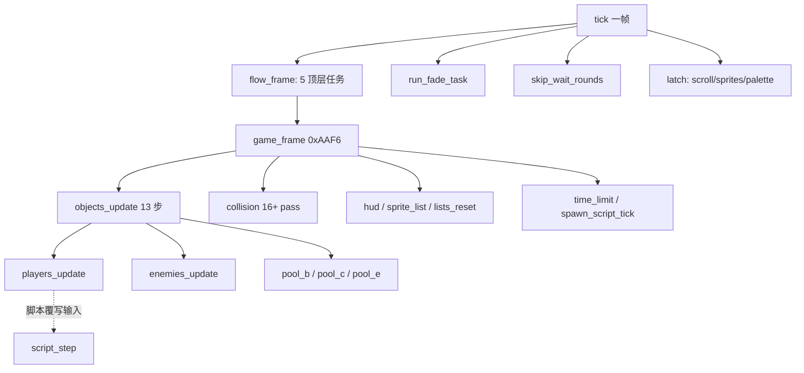

关键点：原机的协作式任务内核被压成**固定调用序列**，任务"睡几帧"改写成 `Flow` 状态字节分支。`flow.rs:78-95` 的 `IntroAfter` enum（Loop / State0 / Title / Wait60 / Redraw / SlideOutEnd）显式记录"一次 sleep 之后回到例程的哪一行"——即把跨帧续算点做成数据。

### 2.2 dino：角色状态机的分层

```
玩家对象字段（语义）:
    +$04 state word = (mode, sub)     # mode 4=死亡, mode 0=复活, sub>=2=受击反应
    +$A0 held pad / +$A8 pressed pad  # 可被脚本覆写
    cmd_state / cmd_t / cmd_flag      # 独立的搓招 FSM (0x6AC8)
    +$D1..+$DE HeroScript            # 脚本状态: state/act/step/ptr/timer/rank/count/tx/tz

敌人对象字段:
    +$06 act                         # 状态号，跳表 0x3E1AA，40 words，0..0x4E
    +$AC timer / +$A8 aim timer      # 独立计时器
    +$AB / +$84 等                   # 形态、弱点索引
```

**独立搓招 FSM**（`player.rs:960-1006`）——与主状态机并行、单独计时：

```
command_fsm():                          # 每帧先跑，识别"下、上、攻击"搓招
  状态0: 若上帧输入恰好是 DOWN 且本帧变化 → cmd_t = t1[角色]; 转状态2
  状态2: cmd_t -= 1
         超时(0xFF) → 回状态0
         held == UP  → cmd_t = t2[角色]; 转状态4，且同帧继续往下跑
         pressed ATK → 回状态0
  状态4: cmd_t -= 1
         超时 → 回状态0
         pressed ATK 且 held == UP → cmd_flag = 2  (发出必杀); 回状态0
```

**敌人状态机**（`class13_ai.rs:13-48`、`class4_states.rs:28-86`）：

```
enemy_state(e):                          # match e.b.act
    0x02 → 等待 +$7A 计时
    0x04 → 朝目标走 +$AC 帧 → decide()
    0x0E → 以速度 id 0xD 逼近槽位，每 30 帧重新瞄准，X 距目标 < 0xC0 提前结束 → decide()
    0x0A/0x0C/0x12/0x3E → 定时动画后 decide()
    0x18 → 爪击等待 → 蹲伏(0x385BA)
    0x1A → 落地判定 → decide()
    ... 40 个状态，每个对应原机一个例程
    未定义状态 → 表里指向数据/无入口（保留原样）

decide():                                # 0x4005C 状态结束决策；另有远决策 0x40118/0x40156
    → 选下一个 state entry (0x3F15E..0x3FC60)

state routine 内部调用共享动作:
    lib_target / lib_face_target / enemy_move_dir / enemy_step / enemy_anim / enemy_step_back
```

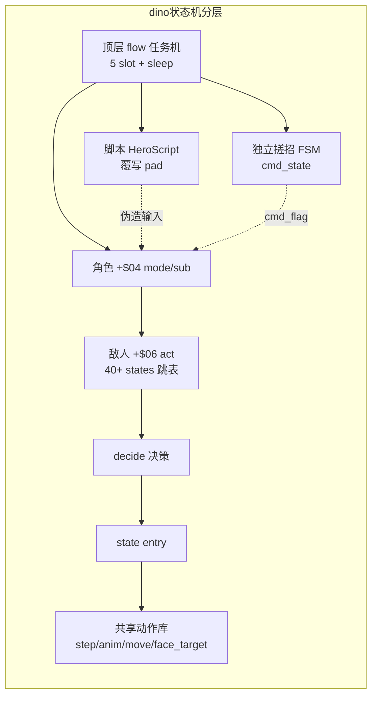

### 2.3 wof：扁平两级 + CharId 大分派

证据：`Cps1EnemyAI.cs:22-49, 61-85, 1595-1607, 2615-2619`、`Cps1PlayerLogic.cs:76`

```
敌人状态（两级）:
    ActStatA / STATE0: IDLE(0) / ACTIVE(2) / SPECIAL(4) / DEATH(6)
    ActStatB / S1   : MAIN_AI(0) / ATTACK(2) / THROW(4) / HIT(6) / FALL(8)

RunScriptSpawnAi(e):                     # 顶层是 if 链，按 ObjId / CharId 分派
    if 波次角色        → Cps1BossWaveEnemyRuntime.主状态分发
    elif ObjId == 24   → Cps1Actor24Runtime.主状态分发_494B4
    elif ObjId == 25   → Cps1Actor25Runtime.主状态分发_4996A
    elif ObjId == 20   → Cps1Actor20Runtime.主状态分发_470F8
    elif ObjId == 21   → Cps1Actor21Runtime.主状态分发_479AE
    ... 共 16 个 Cps1ActorNNRuntime.cs

兵种内分发:
    if ActStatB == S1_MAIN_AI → 正常状态分发
    elif ActStatB == S1_ATTACK → 攻击分支
    switch(ActStatB):
      0x00 主 AI / 0x02 受击入口(表 0x119C2) / 0x04 空(rts) / 0x06 被投 / 0x08 倒地
```

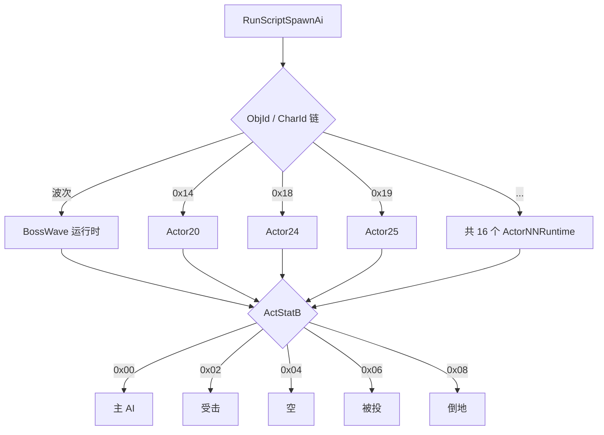

### 2.4 实质差异

- dino 把**输入识别（搓招）、动作状态（mode/sub）、受击/死亡/复活、脚本表演、顶层流程**拆成彼此独立、各自带计时器的层；层与层之间通过"覆写输入"和"状态字 == 0x0200"这类窄接口连接。
- wof 把大多数行为压在两级状态字节里，差异靠 **CharId → ActorNNRuntime** 的横向分派承载，纵向分层少。
- 结果：dino 加一个新系统（换人 tag、car、剧情脚本）是在层上挂新东西；wof 加一个特殊角色就多一个 Runtime 文件 / 一段大分派 if。这一点在下面的文件规模上体现得很直接。

---

## 3. 打击逻辑

### 3.1 dino：固定 pass 管线 + 对象列表栈 + 纯几何 + 多因子伤害

证据：`combat.rs:8-100`、`collide.rs:1-48`、`player_combat.rs:11-76`、`enemy_combat.rs:489,574,601,788,869`

```
collision():                              # 0x10546，顺序固定，不可换
    pass_10664()                          # 玩家 vs 玩家
    if not scripted: pass_10dcc()
    pass_10f96 / 1132a / 107f8(玩家攻击与抓 vs 敌) / 10cd0 / 11962
        / 11a9e / 11f86 / 1201c / 120d2 / 11e56
    if car_mode && car_on:                # car 关卡专属
        pass_121d8 / 122d8 / 12342 [+ pass_12454 if 镜头锁 0x7B4]
    if not scripted: pass_115b0(敌攻击 vs 玩家) / 11cec
    pass_1185a()

pass 内部:
    Lists 是按原机 RAM 地址键控的对象栈（0x6718 玩家表 / 0x671E / 0x69BA 上一帧 hurt list ...）
    push 插到头部 → 访问顺序是"最后 push 的先访问"（对应 68K 的 move.w a6,-(a4) 向下生长）
    特殊语义: combat_hurt_list_seen() 复现"上一帧 hurt 表的高位条目被本帧 push 覆盖"

boxes_hit(attacker, +$49 攻击框, defender, +$48 受击框):    # 纯几何，0x128F8
    table = body.box_table & 0xFFFFFF       # 忽略 24 位地址高字节里的标志位
    boxes = multi_box ? multi(table, idx) : single(table, idx)   # 四种表形态
    overlap = Z轴 && X轴 && Y轴
    每轴: (a0 - b0 + asz) as u16 <= (asz + bsz) as u16     # 16 位 wrapping + 无符号比较，边缘相切算命中
    facing != 0 时 X 框按 -xoff - xsize 镜像

player_damage(base, attack_id, power, level, enemy_kind, enemy_atk, w84, hp, r1, r2)
        -> (damage, counter_flag):          # 0x2B904，纯函数
    d = base
    if enemy_kind == 4 (敌人正在攻击):       # counter hit
        d = (d * counter_scale[enemy_atk]) >> 5 ; counter = true
    if attack_id 命中 w84 处的弱点对 (表 0xA32FA):
        d = (d * weakness_factor) >> 5 ; counter = true       # 弱点命中也算反击
    d = d * power
    d = d * level_type_scale[(w84 << 3) + level]              # 敌人种类 + 难度等级
    d = d >> 10 ; if d == 0: d = 1
    d = d * hp_hundreds_scale[(hp 百位*0x40 + (r1 & 0x3E)) / 2]
    ... 第二次 rand() r2 ...
    return (d, counter)                      # counter 触发第二火花 + 400 分
```

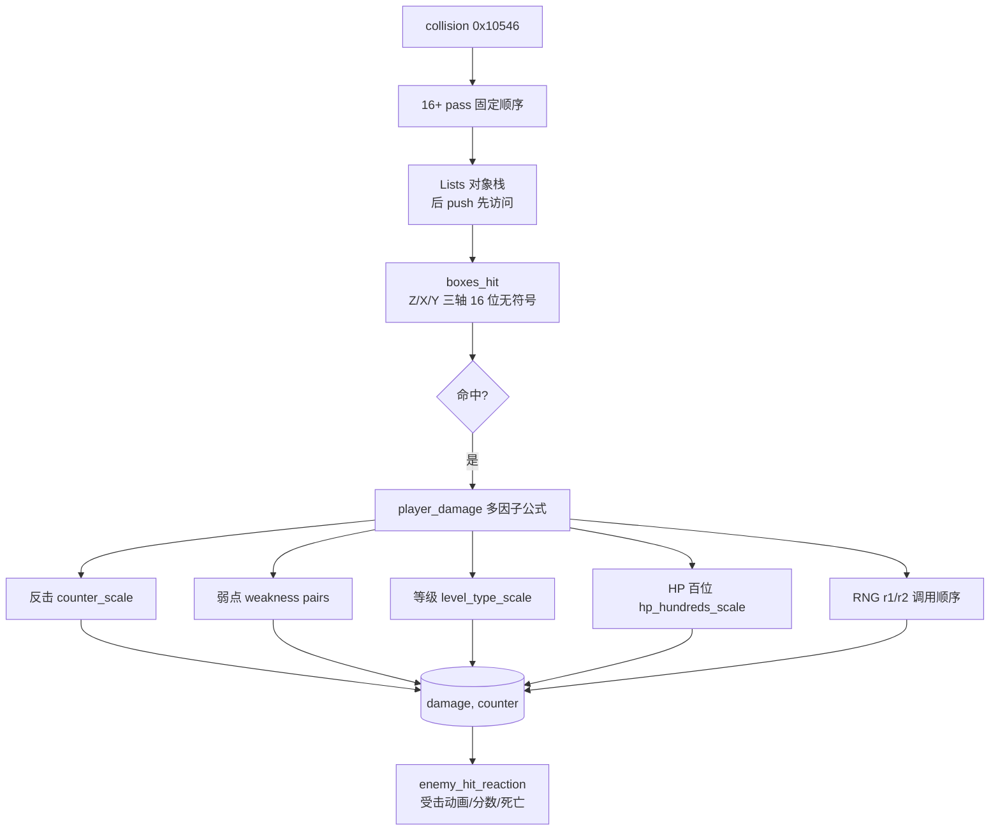

受击侧也拆成独立环节：`enemy_hit_by_player` / `enemy_hit_nonlethal` / `enemy_hit_score` / `enemy_hit_anim` / `enemy_hit_reaction`（`enemy_combat.rs`），而不是塞进攻击方。

### 3.2 wof：ROM 表直读

证据：`Cps1Collision.cs:21-76`

```
HitboxGet(id):
    base = 0xE4F02 + id                  # id 已是相对 A6 的字节偏移
    valX = be16[base]; radX = be16[base+2]; valY = be16[base+4]; radY = be16[base+6]
    X框宽 = be16[base - 2]               # 表项实为 [X框宽, valX, radX, valY, radY] 共 10 字节
                                          # id 指向 valX，故框宽在 id-2（曾系统性取错字段）

伤害参数:
    PLAYER_ATTACK_PARAMETER_TABLE = 0x6DB44
    STACK4_ATTACK_PARAMETER_TABLE = 0x6DB4A   # 奇数地址，ROM 原样
    DAMAGE_RANDOM_TABLE          = 0x1C20 + D6   # PC 相对寻址，(d16,PC,D6w*1)
    SCORE_OFFSET_TABLE           = 0x6933C
    RNG_INCREMENT                = 0x3711
```

`Cps1HitReaction124CA.cs` / `Cps1HitEffectRuntime.cs` / `Cps1TerrainCollision.cs` 也是分开的，所以 wof 并非"没有分层"；差别在**伤害构成**：wof 以查表 + RNG 索引为主，dino 在查表之上叠了 counter hit、弱点克制、等级/HP 缩放这些**显式系统**，且把它们收进一个纯函数。

---

## 4. 事件脚本

注意：两边"脚本"不是同一类东西，别直接对标。
- dino `script.rs` = **英雄过场表演脚本**（入场、走到下一区、Boss 死亡演出、结局）
- dino `spawn_script_tick` (0xFBF4, `game_frame` 第 8 步) = **生成/波次脚本**，这个才对应 wof 的 `Cps1LevelScript`

### 4.1 dino：数据驱动解释器，`script.rs:1-90`

```
数据: 表 0x1E6FC，26 个脚本 × 6 字节记录；41 个 action，各有原地址
      (assets.script / dino-extract/src/script.rs)

入口（只设状态，不执行任何动作）:
    script_area_start(0x1DA10) / script_area_end(0x1D95E) / script_boss_area(0x1DAC4)
        → G.$4DE = script id
        → G.$4DD = 位掩码 (bit i = 英雄 i 受脚本控制)
        → 清空英雄 +$D0

每帧（玩家 update 之后，只要 G.$4DD != 0）:
    for 每个置位英雄:
        if +$D0 == 0: script_hero_start(0x1DB0C)     # 一次性拷贝掩码
        script_step(0x1DB5E):
            if 状态字 +$04 != 0x0200: return          # 受击(sub>=2)/死亡(mode4)/复活(mode0) 期间挂起
            if +$D8 == 0xFFFF:                        # "wait until" 循环
                条件满足 ? 写 1 : 再写 0xFFFF
            else:
                +$D8 -= 1                              # 单位: game frame
                if +$D8 == 0: 读下一条记录 (action, G.$4F0, G.$4FD, G.$506, timer)
            执行 action（41 种）
            多数 action 以 script_pad_clear(0x1DEA6) 结束：清 +$A0 / +$A8 / +$BC

动作如何驱动角色:
    ★ 覆写输入字节 +$A0(held) / +$A8(pressed)，而不是直接改状态
    walk(0x1DF10): 保持上帧方向 +$A0 = +$A1，每 5 帧重算一次朝目标 X/Z
    ... 这样过场复用完整的玩家状态机，不另写一套表演逻辑

保留的怪癖（script.rs:30-36）:
    · 走路比较 X/Z 用无符号（bcs），目标在正、英雄在负 X 时会朝左走
    · 非领队英雄两端点位都被占时得 spot 0
    · action 0x26 只清自己的 bit，导致同帧更新较晚的英雄会从第一条记录重跑
    · G.$4F0 / G.$506 保留上一条记录的值（含 END 记录）直到下一个脚本首记录
```

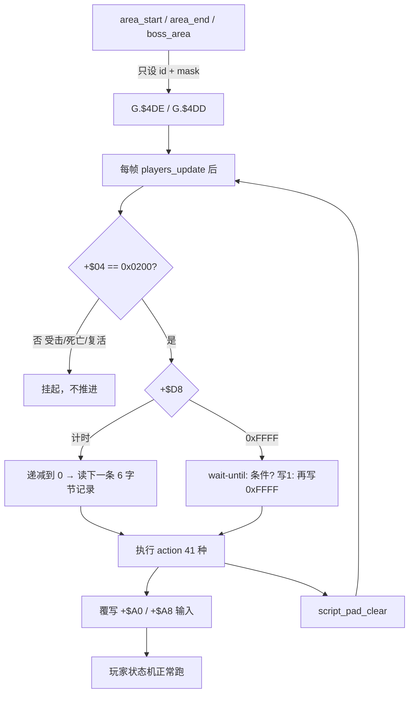

### 4.2 wof：关卡 wave 控制器 + 协程事件队列

证据：`Cps1LevelScript.cs:17-85`、`Cps1EventQueueTask.cs:5-90`

```
关卡脚本 0x106F4:
    记录 = trigger:word, type:byte, payload
    StageScriptTable = 0x1066C ; WaveScriptTable = 0x53B02
    StageSelectorStateTable = 0x1065E ; StageControllerBase = 0xFF7E88 (A5-0x178)
    控制器状态: gateWaiting / waveControllerActive / waveEnemyThreshold / waveTimer
               gateLockedMinX / gateLockedMaxX / MaxRecordsPerFrame = 64
    类型 0..0x55（loggedUnsupportedType[0x55]）
    语义: 敌人数量阈值门 → 锁相机区间 → 放下一波 / 推进关卡

事件队列 0xD000（调度器 slot15，协程任务体）:
    loop:
        if READ_INDEX == WRITE_INDEX: trap#4 让出（等待）
        event = QUEUE_BASE + read ; type = be16[event] ; param = be16[event+2]
        read = (read + 4) & 0xFF
        jmp 跳表[type]        # 9 项: 0x096E / 0x0AFA / 0x0B70 / 0x0B86 / 0x0B9C
                              #       / 0x0E8E / 0x0D34(BCD 加分) / 0x0A58 / 0x2E46(血条)
        pea 返回点 0xD006 → 回到 trap#4 让出
    ★ 一帧消费几项 = 本帧 0x0700 调度循环扫了几轮（由 VBlank 截断决定）
      宿主无法精确复现 → 加了 任务体_带上限_无对应ASM(task, 64) 和 A/B 开关
      （实测 u400 f=14：FBA 消费 2 项，宿主排空式消费 3 项，冷启动多吃一项）
```

**关键设计差异**：
- dino 的过场脚本**接管输入**，被脚本控制的角色仍走完整状态机，所以受击/死亡会自然中断脚本（`+$04 != 0x0200`）；这是把"表演"和"玩法"接在同一套状态机上。
- wof 的事件队列是**任务内核的一部分**，它的执行次数本身就是帧内物理量（VBlank 截断），因此脚本推进与 CPU 负载耦合；这正是前面十几轮讨论的"函数执行次数不确定"在**游戏设计层**的落点，不是实现层 bug。

---

## 5. 怪物策略

### 5.1 dino：决策/执行分离 + 表选择分档 + 厚共享层

证据：`boss_common.rs:1-69`、`class13_ai.rs:1-90`、`enemy.rs:1-10,524-544`、`game/enemy/` 目录统计

```
BossAi = { Morgan, Morgue, Tyrog, Tyrog2, Fessenden }

gate_table(form):        按 G.$5EC (aggression，不是 level) 与 form 选门控表
                         Morgan→0x73B14 / Morgue→0x73D54 / Tyrog→0x74542+form_idx*0x40 / Fessenden→0x74A42
action_table(form, ab):  按 form 与 +$AB 的符号选行为表
                         Morgan: +$AB<0 → 0x73B54 else 0x73C54
                         Tyrog: 0x74602 + form_idx*0x100
form_index(form):        SUBQ.B #1 → BMI/BEQ → 0 / 1 / 2 三档形态

★ boss_common.rs:1-3 原文: "Class handlers keep their own state dispatch, counterattacks and
  transformations. These helpers do not run an invented common AI."
  → 共享的是「选表机制」，不是统一 AI；每个 Boss 仍保留自己的状态分派、反击、变身
```

```
通用怪物循环:
    state dispatch (match +$06 act，跳表)
        → state routine（每个是原机一个例程）
            → 计时器到点 / 条件满足 → decide()
                → 选下一个 state entry
    state routine 内复用共享动作库:
        lib_target / lib_face_target / enemy_move_dir / enemy_step / enemy_anim
        / enemy_step_back / enemy_recover_other

文件按职责拆（game/enemy/ 共 96 个 .rs）:
    classNN.rs 纯实现 63 个
    _ai 7 / _states 3 / _attack 3 / _lib 2 / _tests 2 / _moves 2
    _parts 1 / _entry 1 / _foot 1
```

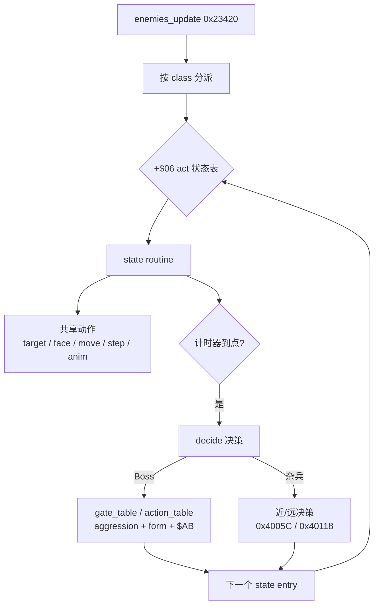

### 5.2 wof：CharId 大分派 + 专用大文件 + 薄共享层

证据：`Cps1EnemyAI.cs:22-49`、文件行数统计

```
Cps1EnemyAI.cs (31944 行) — 单一主入口:
    CHAR_GRUNT5/9 = 0x05/0x09, CHAR_LIDIAN(李典) = 0x06, CHAR_DAGGERSOLDIER = 0x07,
    CHAR_XUCHU(许褚) = 0x08, CHAR_GRUNTA/B = 0x0A/0x0B, CHAR_MEILING = 0x0C,
    CHAR_XIAHOUDUN = 0x0D, CHAR_ZHANGLIAO(张辽) = 0x0E, CHAR_CAOREN = 0x0F,
    CHAR_OBJ10/12/18/20 ...
    主表 0x22DB0 → 各角色 AI 入口（如 0x12 → 0x343B6 → Cps1Actor12Runtime）

按对象号拆的专用运行时（16 个 Cps1ActorNNRuntime.cs）:
    1B / 1C / 1F / 20 / 21 / 22 / 23 / 24 / 25 / 26 / 27 / 28 / 2B / 2C / 2D ...

专用大文件（特例厚）:
    Cps1LidianFinaleRuntime.cs     29107 行   # 李典收尾
    Cps1HardResetRuntime.cs        25320 行   # 硬重置
    Cps1SystemCoroutineRuntime.cs  17005 行   # 系统协程
    Cps1EventObjectRuntime.cs       8848 行
    Cps1PlayerLogic.cs             13906 行
    Cps1BossWaveEnemyRuntime.cs     3971 行
    Cps1ZhangLiaoRuntime.cs         2192 行

共享层（薄）:
    Cps1EnemySubs.cs  2838 行 / Cps1Subs.cs  1121 行
```

对比很直接：dino 的共享行为库（`enemy.rs` 2331 行 + 按职责拆的 96 个类文件）承担通用动作，专属策略按类分散；wof 的 2838 行共享层要托住 31944 行主分派 + 两个 2.5w~2.9w 行的专用文件。**通用层薄、特例层厚**，是 wof 这边最明显的结构特征。

---

## 6. "dino 更成熟"具体落在哪（必须分成两栏）

### 6.1 属于游戏本身的设计（能从 ROM 表/地址结构验证，不是移植者发明）

1. **搓招输入层独立**：`player_command_fsm` 0x6AC8 用 `t1/t2[角色]` 两个窗口计时识别"下→上→攻击"，是独立于动作状态机的必杀识别系统。
2. **反击 / 弱点克制**：伤害公式里 `enemy_kind==4`（敌正在攻击）触发 counter_scale；`0xA32FA + enemy+$84` 的弱点对按 attack_id 匹配。弱点命中同时置 counter（第二火花 + 400 分）。
3. **等级与 HP 缩放**：`level_type_scale[(w84<<3)+level]`、`hp_hundreds_scale[hp百位*0x40 + r1]`——伤害随难度等级、敌人剩余血量、RNG 变化，不是定值表。
4. **Boss 多形态 + aggression 分档**：`gate_table(form)` / `action_table(form, ab)` / `form_index` 三处，`G.$5EC` 明确是 aggression 而非 level；5 个 Boss 各自保留反击与变身。
5. **过场脚本系统**：26 scripts × 6 字节记录 × 41 actions，覆盖入场、走位、Boss 死亡、结局；通过覆写 pad 接到玩家状态机，因此受击/死亡自动中断。
6. **附加玩法系统**：4 角色 + 换人 tag（`player_tag.rs` / `ally.rs` / `tag_trigger`）、car 关卡（`car.rs` + 4 个专属碰撞 pass）、8 关剧情/开场影片/结局（`flow/` 20+ 子模块）。
7. **过场续算点显式化**：`IntroAfter` 把"sleep 后回到哪一行"列成 6 个枚举值，说明原机过场里跨帧续算点很多且被认真管理。

### 6.2 属于移植工程组织红利（**不能**算到游戏设计头上）

- 按职责把类拆成 `_ai` / `_states` / `_attack` / `_lib` / `_parts` / `_tests`
- 文件头的 `Owner:` / `Spec:` / `Quirks kept` 约定
- typed `Handle` / `Lists` / `BossAi` enum 这类命名抽象
- `collision()` 固定 pass 列表本身是**原机 0x10546 的顺序**（`combat.rs:1` 自述），不是 dino 新增的设计
- `ARCHITECTURE.md` 的 `Game` 单名字空间 + 方法前缀约定

### 6.3 一句话

dino 的"成熟"主要是**上层玩法系统的丰富度与切分粒度**（搓招、反击、弱点、多形态 Boss、正式过场脚本、换人、载具），底层引擎与 wof 同构；而代码里看起来的"架构清晰"有相当一部分是重写时 reorganize 出来的，不是 ROM 原本就长得那样。

---

## 7. 证据索引（file:line）

| 结论 | 位置 |
|---|---|
| 帧循环固定序列、game_frame 8 步、objects_update 13 步 | `dino-rs/.../game/mod.rs:331-375` |
| 顶层 5 任务 / sleep / IntroAfter | `dino-rs/.../game/flow.rs:1-15, 78-95` |
| 玩家搓招 FSM | `dino-rs/.../game/player.rs:960-1006` |
| 玩家状态字 mode/sub == 0x0200 | `dino-rs/.../game/script.rs:15-20` |
| 敌人 40 状态跳表 / decide | `dino-rs/.../game/enemy/class13_ai.rs:1-90` |
| 敌人状态分发 / 决策 / 共享动作 | `dino-rs/.../game/enemy/class4_states.rs:28-86` |
| 共享行为库 | `dino-rs/.../game/enemy.rs:1-10, 524-544, 1946` |
| 类文件按职责拆分 / 模块清单 | `dino-rs/.../game/enemy.rs:12-71` |
| 碰撞 pass 固定顺序 / Lists 栈 / hurt list 覆盖语义 | `dino-rs/.../game/combat.rs:8-100` |
| 三轴 hitbox 几何 / facing 镜像 / multi_box | `dino-rs/.../game/collide.rs:1-48` |
| 多因子伤害公式 | `dino-rs/.../game/player_combat.rs:11-76` |
| 受击侧拆分 | `dino-rs/.../game/enemy_combat.rs:489,574,601,788,869` |
| Boss 表选择 / aggression / form | `dino-rs/.../game/boss_common.rs:1-69` |
| 26 scripts / 41 actions / 6 字节记录 / 覆写 pad / 怪癖 | `dino-rs/.../game/script.rs:1-90` |
| wof 两级状态常量 / CharId 链 | `wt1/wof_cs/src/Cps1EnemyAI.cs:22-49, 61-85` |
| wof 状态分派 switch | `wt1/wof_cs/src/Cps1EnemyAI.cs:1595-1607, 2615-2619` |
| wof 玩家主分发 | `wt1/wof_cs/src/Cps1PlayerLogic.cs:76` |
| wof hitbox / 伤害表 | `wt1/wof_cs/src/Cps1Collision.cs:21-76` |
| wof 关卡脚本控制器 | `wt1/wof_cs/src/Cps1LevelScript.cs:17-85` |
| wof 事件队列 + 一帧消费数不确定 | `wt1/wof_cs/src/Cps1EventQueueTask.cs:5-20, 61-90` |
| wof 协程调度器 / 16 槽 | `wt1/wof_cs/src/Cps1CoroutineScheduler.cs:18-53` |
| wof OBJ 槽视图 | `wt1/wof_cs/src/Cps1Types.cs:13-25` |

量化统计（实测）：wof 100 个 .cs / 249041 行；`_对应ASM_` 15064、`_部分对应ASM_` 1787、`_无对应ASM_` 11109；`Cps1ActorNNRuntime` 16 个。dino `game/enemy/` 96 个 .rs，其中 63 个纯 `classNN.rs`，`_ai` 7 / `_states` 3 / `_attack` 3 / `_lib` 2 / `_tests` 2；`game/` 目录 28 个 .rs。

### 7.1 行号校准（第十轮逐行复核，只读 repo 源码）

§7 表格是第一轮写的，本轮用 `Read` 逐行复核：**一处需修正、多处可补精确位置**。原表保留不改，以下为校准。

| §7 原写法 | 校准 | 说明 |
|---|---|---|
| `mod.rs:331-375` 帧循环固定序列 | **`mod.rs:349-377`** | `331-346` 是外层 `Game::tick()`（flow / fade / scroll-sprite-pal 锁存）；`game_frame` 在 `349-358`（8 步），`objects_update` 在 `361-377`（13 步）。原行号把两者混进 331 起 |
| `player_combat.rs:11-76` 多因子伤害 | **`19-89`** | `19-89` = `player_damage` 完整连乘；`92-111` = `enemy_damage`（减算 + mercy），原表未列 |

**§12–§17 新增的精确位置**（原表没有，压缩后按此找最快）：

| 主题 | 精确位置 |
|---|---|
| 命中帧结算 / 击杀战败推迟 | `enemy_combat.rs:489-571`（`:569` 是"下一次 update"那句源码注释） |
| 受击反应 10+ 分派 | `enemy_combat.rs:869-905` |
| 死亡态 mode4 | `enemy.rs:978-1015` |
| `player_frame` 五段输入顺序 | `player.rs:569-607`；`players_update` `:539-549` |
| 脚本 hook / 挂起条件 / pad_clear | `script.rs:190-227,350` |
| census / pick_target / retarget_slot / steer_slot | `enemy.rs:770-805,828-921,1661-1685,1688-1703` |
| tag 换人 / 挂点 | `player_tag.rs:1-45`；`mod.rs:373` |
| car 载具 / 4 个 pass | `car.rs:1-38`；`combat.rs:85-94` |
| Boss 表选择 / 门控 / 抽取 / 续算点 | `boss_common.rs:11-68,96-117,135-168,71-87` |
| 伤害流水线（表地址） | `enemy_combat.rs:636-700,525-534`；`player_combat.rs:19-111` |
| wof 反应分派 9 项 | `Cps1Collision.cs:4882-4950` |
| wof 活跃玩家位图 / 选择锁 | `Cps1Actor1CRuntime.cs:2017-2041`、`Cps1Actor1BRuntime.cs:701-724`（§11.1） |

复核结论：§7 其余行号（`enemy_combat.rs:489,574,601,788,869`、`boss_common.rs:1-69`、`player.rs:960-1006`、`script.rs:15-20`）与当前 repo 一致，**未漂移**。

---

## 8. 不可推断 / 待核

- 两款游戏的发行年份、谁先谁后：本笔记按用户给的前提（dino 更晚）叙述，**未**从代码考证。
- wof_cs 是未完成的直译，其"特例厚、通用薄"里有多少是原版 ROM 本身如此、多少是直译过程中堆积的宿主补偿（`_无对应ASM`），无法仅凭代码区分；若要下结论需回查 `CODEMAP.md` / `REFERENCE.md` 的地址级对应。
- dino_rs 的 `script.rs` 只覆盖**英雄过场**；与 wof `Cps1LevelScript` 对位的 `spawn_script_tick` (0xFBF4) 本轮**未深入读**，若要做严格对拍需补读。
- `Cps1LidianFinaleRuntime.cs` 29107 行 / `Cps1HardResetRuntime.cs` 25320 行 的具体内容未读，仅按文件规模推断"特例厚"，需抽样确认。
- 本笔记刻意不含 Rust/C# 语法、typed/WRAM、端序等实现层对比；那部分见此前对话结论。

### 8.1 待核项结清回执（第十轮复核）

| §8 原待核 | 现状 |
|---|---|
| 发行年份 / 谁先谁后未考证 | **仍开放**：各轮末尾一致声明"全程沿用用户给定前提"，未从代码考证 |
| wof「特例厚」里 ROM 本身 vs 宿主补偿无法区分 | **仍开放，且不宜再扩大**：§11.0 已把 ROM 定位收敛为"只补 data、不审 repo"，此项本就属于被用户叫停的方向 |
| `spawn_script_tick 0xFBF4` 未深入读 | **部分触及**：§13 读了 `spawn.rs` 的 `census` 结构定义（`:51`），但生成脚本命令表本身仍未逐条展开 → 归入 ⏳ data 项 |
| `Cps1LidianFinaleRuntime.cs` / `Cps1HardResetRuntime.cs` 未抽样 | **仍开放**：仅按文件规模推断，按 §11.0 不主动扩大 |
| 实现层对比"见此前对话结论" | ✅ **缺口已补**：阶段 A 的工程结论（三条技术路线 / VBCC·C89 选型 / `AssetPack` 单向门 / FBA vs MAME / 渲染 / 冷启动 / lag 不可模拟 / 完成度 23-of-26）已整理进 **附录 A**，按视角约定隔离存放、不混进设计正文 |

结论：§8 的待核项**没有一条被"解决"**，但都已按 §11.0 重新定性为"刻意搁置"，不是分析欠账；第 5 条指向的会话资产也已落盘（附录 A），不再是压缩风险。

---

# 第二轮深挖：原版 ROM 级验证

> 用户 11-06 追加资源后重新调查。目的：**把"游戏本意"与"移植工程组织"彻底分开**——第 1 轮只读了 `dino_rs` / `wof_cs` 两份移植代码，无法判断哪些是原版 ROM 的设计、哪些是重写者 reorganize 出来的。本轮直接对两款游戏的 68000 原码取证。

## 9.0 取证方法与资源

| | dino | wof |
|---|---|---|
| ROM | `G:/Game/Mame32/roms/dino.zip`（用户提供） | Ghidra 已载入 `wofj.68k.xml` |
| 重组 | 3 片 EPROM 按 `cde_23a.rom → cde_22a.rom → cde_21a.rom` 顺序拼接，每片内 16 位字**字节交换**（`ROM_LOAD16_WORD_SWAP`），得 0x180000 字节大端镜像，加载到 0 | 无需重组 |
| CRC 校验 | `cde_21a.rom`=66d23de2 / `cde_22a.rom`=9278aa12 / `cde_23a.rom`=8f4e585e，与 `dino-extract/src/rom.rs:19-43` 完全一致 | — |
| 反汇编 | capstone 5.0.7，`CS_ARCH_M68K \| CS_MODE_M68K_000 \| CS_MODE_BIG_ENDIAN`；直接对内存镜像切片，未落盘任何中间文件 | **GhidraMCP 7.0** `http://127.0.0.1:8089`，`wt1/agent_scripts/ghidra_http_query.py`（`disassemble`/`decompile`/`find`）；`GET /check_connection?program=wofj.68k.xml` 返回 `{"status":"ok","server_kind":"gui","version":"7.0.0"}` |
| 设计文档交叉验证 | `re/specs/enemy/SPEC.md`（112 KB，§5 census / §6 difficulty / §7 class2 AI / §10 hit reaction / §14 AI design answers） | `wt1/wof_cs/src/*.cs` 里的 `_对应ASM_` 注释 |

**重要**：Ghidra 8089 的 GET `/` `/sse` `/mcp` `/health` 等全部 404；正确方式是**带 `program=wofj.68k.xml` 参数的 `POST /disassemble_bytes` 或 `GET /check_connection`**，见 `ghidra_http_query.py:22-64`（7.0 把 `get_function_*` 全族合并进 `/get_functions?fields=`）。

---

## 9.1 重大更正：wof **也有**这些系统（⚠️ 本节及 §9.5/§9.6 的"重大更正 / 维度更浅 / 全局档位"结论已作废，以 §11.4 为准）

第 1 轮把"wof 缺动态难度 / RNG 表驱动 AI / 目标选择"当成设计差异，**错了**。ROM 反汇编证明两款游戏都有，只是**维度更浅、以分散的 ROM 例程存在**：

| 系统 | dino 原版 ROM | wof 原版 ROM | 第 1 轮判断 |
|---|---|---|---|
| 动态难度 | `Rank` 结构 G.$5EC 起，`rank_tick 0x186CC` 每帧维护，aggression `0x182A2` Markov 重掷 | `A5-0x5A` 单字节，`0x170E` 死亡降、`0xBC04` 按玩家数上下限钳位、`0x7DDA` 伤害难度索引、`0x3B94` 难度概率比较 | 错 |
| RNG 表驱动 AI 决策 | `0x4005C` / `0x40118` / `0x40156`，`rng&0x1F` × variant × X距离 × aggression 查 32 行表 | `0x3E1E` 查行为表 `0x3E62` → 行为 ID → `0x3E82` 参数表；`0x4070` 决策回写 CF；`0x3B94` 概率门 | 错 |
| 目标选择 | `0x32032 pick_target`：census 负载均衡 + 多维加权 | `0x4146 近身抢占写 A06 目标`：3 玩家参数块（0x3E1C/0x3EFC/0x3FDC，间隔 0xE0）轮询 + 位标志；`0x3E1E` 内含 `bsr 0x3F0C` 算目标 | 错 |
| 受击反应分派 | `0x2A606` 表 `0x2A620` 按 `+$06`，10+ 种 | `0x7E4A` 表 `0x7E68` 9 项跳表 | 漏 |
| 关卡/生成脚本 | `0x1DB5E` 过场 + `0xFBF4` 生成 | `0x106F4` 解释器 + 命令表 `0x10744` | 已对，但深度不足 |

**root cause**：第 1 轮看到的是 `wof_cs` 直译工程把同一套 ROM 机制打散成 31944 行 `Cps1EnemyAI.cs` + 16 个 `ActorNNRuntime` + 一堆 `_无对应ASM` 补偿，误把"实现的散"读成"设计的少"。**这是方法论错误，本轮用 ROM 纠正。**

---

## 9.2 状态机（ROM 级）

### dino：四层状态字节是原版布局，不是移植者发明

`body.rs:33-36` 的 `mode/sub/act/step` 对应 ROM 的 `+$04..+$07`，常被当成一个 long 写。ROM 里到处是这种字面量，capstone/反编译多处可见：

| 值 | 含义 | 出处 |
|---|---|---|
| `0x0200_0000` | mode=2 alive, sub=0, act=0, step=0（`reset_ai` 回到状态 0） | `SPEC.md:634` |
| `0x0202_0000` | mode=2 alive, **sub=2 受击** | `SPEC.md:1102`、`enemy_combat.rs:514` |
| `0x0202_1A00` | 受击后起身/眩晕 | `SPEC.md:1177` |
| `0x0400_0000` | mode=4 死亡 → class death routine | `SPEC.md:1173` |
| `0x0200_0202` / `0x0200_0806` / `0x0200_0C00` / `0x0200_1000` | AI 状态 2 / 8 / C / 10 入口 | `SPEC.md:630,637,643,654` |

`0x1DB5E script_step` 的状态字 `== 0x0200` 检查（受击/死亡/复活挂起脚本）也是原版行为：**ROM `0x1DB76` 读 `+$2(a6)` 判 G.$4DD 位、`0x1DB82 subq.w #1,$d8` 递减计时器**。

顶层任务机同样是原版：`flow/scene.rs` 的 `Scene{state,sub,count,sleep,suspended,live}` 复刻 ROM 的 `0x95A sleep` 与 `0xA76=1 / 0xA7A=2 / 0xA7E=30 / 0xA82=60 / 0xA86=120 / 0xA8C=180` 辅助函数（`scene.rs:5-9`）。`flow.rs:490` 的 mode 分派（0x0C → `game_frame`）也是 ROM 0xA914 的模式字节。

### wof：输入边沿 + 计时器 + 状态字

`0x1AA58 玩家主分发` ROM 反汇编（Ghidra）：

```
bsr  $1AAF0                      ; 读输入
move.b (0xa1,A0),D5b             ; prev input
not.b D5b
and.b (0xa0,A0),D5b              ; pressed = held & ~prev
move.b D5b,(0xa2,A0)
btst.l #4,D5 ; beq ... ; st (0xa4,A0)   ; 攻击键边沿 → 标志
tst.b (0x60,A0) ; subq.b #1 ... ; 清 (0x61,A0)
tst.b (0x78,A0) ; subq.b #1 ...
tst.b (0xa8,A0) ; subq.b #1 ...
tst.b (0x9a,A0) ; ...
...（后面接状态分派）
```

即 wof 玩家槽 `A0` 的 `+$A0 held / +$A1 prev / +$A2 pressed / +$A4 攻击标志`，加多个独立计时器字节递减，再进 `ActStatABCD`（`Cps1PlayerLogic.cs:47` 读 `+0x28`）。**两边都是"输入边沿 + 状态字 + 多个计时器"，dino 多出的只是把四层状态字节显式命名并让脚本/受击/AI 各自占用一层。**

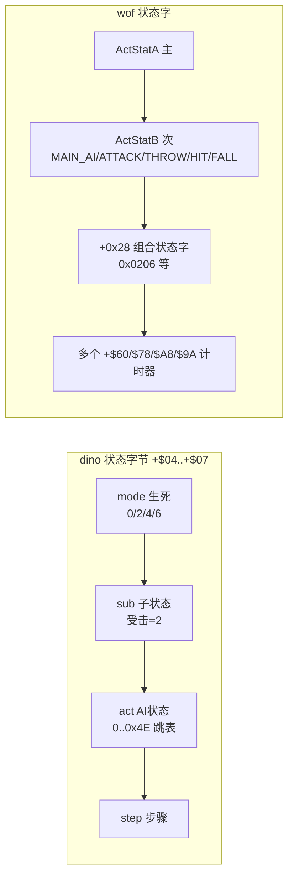

### 顶层流程：dino 压成固定序列，wof 保留协程

- dino `0x10546 collision` ROM 反汇编逐条 `bsr` 印证 `combat.rs:70-100` 的 pass 顺序就是**原机顺序**（`pass_10664 → 10dcc → 10f96 → 1132a → 107f8 → ... → 115b0 → 11cec → 1185a` + car 4 个 pass）。`game_frame 0xAAF6` 的 8 步、`objects_update 0xE90E` 的 13 步同理。
- wof `0xD000` 事件队列任务是**真协程**：每消费一项 `pea` 返回点 + `jmp 跳表` + `trap#4` 让出，**一帧消费几项由本帧 `0x0700` 调度扫了几轮（VBlank 截断）决定**（`Cps1EventQueueTask.cs:61-71`，ROM 层面即 `0xD006 jsr 0x89A` 等待点）。同理 `Cps1EnemyAI.cs:874` 的 `预算边界续跑对象AI_无对应ASM`、`:1225` 的 `应在预算边界推迟处理池对象AI_无对应ASM` —— **AI 更新本身也受帧预算约束**。

> 这是设计层最硬的一条差异，不是实现 bug：dino 把协作式内核压成固定调用序列（删掉了"一帧跑几轮"这个自由度），wof 原样保留，于是"某函数这帧跑几次/跑没跑完"在 wof 里是必须逐点求解的物理量。第 1 轮从移植代码推断出这点，本轮在 ROM 层确认。

---

## 9.3 打击逻辑（ROM 级，大幅深化）

### dino：命中 → 伤害 → 受击反应 → 死亡，四段解耦

**① 命中判定 `0x11008`**（`SPEC.md:1096-1118`、ROM `0x2B904`/`0x2BA2A` 反汇编印证 `player_combat.rs`）：

```
player_hits_enemy(atk, e):
    if e.active & 2: return                       # 已在受击，本列表无敌
    if atk.serial == e.serial: return             # 一次挥击每个目标只命中一次
    if atk.box_49==0 or e.box_48==0 or !overlap: return   # 0x128F8 三轴 Z/X/Y 无符号窗口
    e.serial = atk.serial ; e.credit = atk.credit
    if guard(e): block_fx(); return               # 仅 +$84=0xA4 的类能格挡
    e.active=2 ; e.l4=0x0202_0000 ; e.attacker=atk
    if atk.id in (0x6E,0x6C): nonlethal(HP floor 1); return
    r = attack_record[char][id]                  # stride 8: dmg/poise/reaction/hitstop/snd/score/spark/b7
    d = r.damage ; if charge: d = charge_scale(d)
    d = player_damage_scale(d, atk, e)           # 0x2BA2A，2 次 rng()
    e.hp -= d                                    # >0 才写，否则 0
    e.poise = saturating_sub(e.poise, r.poise)   # 韧性，0 强制击倒
    e.reaction = e.act = r.reaction ; e.step=0
    e.hitstop = atk.hitstop = r.hit_stop         # ★ 命中停顿双方同写，队伍技连伙伴也写
    score / spark / sound / facing 翻转
    # 死亡不在本帧处理 → 下一帧由敌人自己的 hit state 驱动
```

**② 伤害公式 `player_damage_scale 0x2BA2A`**（capstone 在 `0x2B904` 起逐条印证 `player_combat.rs:19-76`）：

```
d = base
if debug_nodamage: return 0
if e.kind == 4 (敌正在攻击):                     # counter hit
    m = W[0xA320C + 2*e.atk] ; if m: d = (d*m)>>5 ; counter_flag = true
p = 0xA32FA + e.w84                              # 按敌人类型的弱点对
if 2*B[p] == atk.id or 2*B[p+2] == atk.id:      # (id/2, factor) × 2 对
    d = (d*factor)>>5 ; counter_flag = true       # ★ 弱点命中也算反击：第二火花 + 400 分
d = lo16(d) * player.power
d = lo16(d) * B[0x2BECE + e.w84*8 + level] >> 10   # 敌人类型 × 难度等级
if d==0: d=1
bar = 0 ; hp = e.hp ; while hp>100: bar+=0x40; hp-=100
d = lo16(d) * W[0x2BC4E + bar + (rng() & 0x3E)]    # HP 百位缩放 + 第 1 次 rng
band = hp>=75?0 : hp>=50?0x40 : hp>=25?0x80 : 0xC0
d = (lo16(d) * W[0x2BB4E + band + (rng() & 0x3E)]) >> 10   # 残血缩放 + 第 2 次 rng
```

capstone 在 `0x2B904` 实际看到：`clr.w $4f4` → `cmpi.b #4,$2e(a3)` → `lea #$a320c,a6` + `mulu/lsr #5` + `st.b $4f4` → `lea #$a32fa,a6` + `move.w $84(a3),d0` + 两次 `add.b d0,d0 / cmp.b $58(a2),d0` → `st.b $4f5` → `move.b $c6(a2),d0 / mulu` → `move.w $5ee(a5),d5`。**逐条吻合。**

**③ 受击反应分派 `0x2A606`，表 `0x2A620` 按 `+$06`**（`SPEC.md:1135-1189`）——这是第 1 轮完全没挖到的系统：

| `+$06` | 处理 | 含义 |
|---|---|---|
| 0x00 / 0x02 | 0x2A63E / 0x2A680 | 轻畏缩；HP=0 / poise=0 / 空中时转击倒 4 / 6 |
| 0x04 / 0x06 | 0x2A6C8 / 0x2A852 | 击倒 A / B（不同起跳速度） |
| 0x08 | 0x2A9C8 | 被玩家投掷；落地弹一次，撞墙滑落 |
| 0x0A / 0x0C | 0x2AC02 | 燃烧击倒（HP=0 且类型 0xC 时炭化死亡） |
| 0x0E..0x12 / 0x14..0x18 | 0x2ADDE / 0x2AEB2 | 后滑不腾空（3 组 `(frames,vx,ax)`：7/1536/-128、10/1792/-177、10/2560/-256） |
| 0x1A | 0x2AFF0 | 起身 / **眩晕**（星星 90+8×20 帧，可被击；同时只允许一个眩晕敌人） |
| 0x1C | 0x2B2E6 | 靠墙滑落（30 帧后以 1.5 px/frame 下滑） |

```
poise 系统: 起始 10；每次命中减攻击的 poise 字节；到 0 下次必击倒；击倒重置 10；
            AI state 0 在 +$79(60 帧) 到点后补满 10
击倒物理:   launch (vx,ax,vy,ay) 按 reaction 类型与 alive/dead 分 4 组；
            屏幕左右边缘反弹（dead 且 big）；落地 lie_time；撞墙 wall_slump
眩晕判定:   起身时按 0x2B180(+$9A/aggression) / 0x2B158(HP 档) /
            0x2B168(存活数) / 0x2B28C(level) 四张位表；Vice T./Walther 永不眩晕
getup_or_die 0x2AF86: HP=0 → e.l4=0x0400_0000 → class death routine
                      + reroll_aggression()   # ★ 每次击杀都重掷 aggression
```

**④ 死亡**：`class2_dying 0x3484E` 记击杀分、闪烁 120 帧后释放槽；`kill_all 0x326F8` 波次超时清场。

### wof：查表 + 难度索引 + 9 项反应表

`0x7DDA 敌方伤害难度索引` ROM 反汇编（Ghidra）：

```
move.b (-0x5a,A5),D6b          # 难度
add.b  (0xa2,A0),D6b           # + 攻击者 +$A2（个体偏移）
bpl/bmi → 负数归零；cmpi #0x1f → 超上限钳到 0x1F
add.w  (A3)+,D6w               # + 记录里的偏移
lea    #0x6ee84,A4
add.b  (0,A4,D6w),D0b          # 查伤害修正表
ext.w D0w ; bgt ... ; moveq #1  # 下限 1
btst.b #6,(0x30,A1)            # 防御衰减门
...
```

`0x1BFA 随机伤害查表` ROM 反汇编（**顺带确认 wof 的 RNG 算法**）：

```
move.w (-0x1c42,A5),D0        # state
move.w D0,D5 ; add D0,D0 ; add D0,D0 ; add D5,D0   # ×5
addi.w #0x3711,D0             # + 0x3711
move.w D0,(-0x1c42,A5)        # 写回
move.b (-0x1c42,A5),D0 ; andi #0x1f,D0
add.w D0,D6 ; move.b (0x1c20,PC,D6),D0 ; ext.w ; rts   # 查表 0x1C20
```

`Cps1Collision.cs:4770-4814` 的伤害流程：随机伤害 → 难度索引 → `0x6EE84` 修正 → **防御衰减** `damage *= (0x20 - max(hpBand, defense)) >> 5`（`hpBand` 由目标 HP 查 `0x1BF0`，`defense` 由 `0x20D4` 取 `OBJ+0x90` 或按难度查表）→ `reaction` 表 `0x7E68` 9 项跳表（`Cps1Collision.cs:4857-4865`）。

### 打击对照（ROM 级）

| | dino | wof |
|---|---|---|
| 命中去重 | `+$5E serial`，一次挥击每目标一次 | 有对应机制（`Cps1Collision.cs:341` combo_level 递增） |
| 命中停顿 | `hitstop` **双方同写**，队伍技连伙伴 | 有 `0x9A` 计时器，未见双方同写的显式语义 |
| 韧性 | **poise 系统**，10 满，0 强制击倒，击倒重置 | 未见独立 poise；以 HP band + defense 衰减 |
| 反击 | **counter hit**（敌攻击中）+ **弱点克制**（按敌人类型 `+$84` 表）→ 第二火花 + 400 分 | 未见对应系统 |
| 伤害因子 | power × 等级类型表 × HP 百位表 × 残血 band 表 × 2 次 rng | 随机表 × 难度索引表 × 防御衰减 |
| 受击反应 | `0x2A620` 10+ 种（含投掷/燃烧/眩晕/后滑/墙壁滑落/起身） | `0x7E68` 9 项 |
| 死亡时机 | **不在命中帧**，下一帧由敌人自己的 hit state 驱动 | 命中内处理（`Cps1Collision.cs` 直接改 HP/状态） |

---

## 9.4 事件脚本（ROM 级）

### dino：两套脚本，记录格式由反汇编逐字节确认

**① 英雄过场脚本 `0x1DB5E script_step`**（capstone 反汇编）：

```
move.b $d1(a6),d0 ; move.w $1db6c(pc,d0.w),d1 ; jmp 跳表   # 按 HeroScript.state 分派
move.b $2(a6),d1 ; btst.l d1,$4dd(a5) ; beq → rts         # 该英雄 bit 未置 → 不跑
subq.w #1,$d8(a6) ; bne → 0x1DBC6                          # 计时器非 0 → 直接执行 action
# 计时器到 0：读下一条记录
clr.b $d2(a6) ; clr.b $d3(a6) ; movea.l $d4(a6),a0
move.b (a0)+,d0                                             # action (1 字节)
cmpi.b #$a,d0 / #$26,d0 → 特殊：bclr 该英雄 bit of G.$4DD
move.b d0,$d2(a6)
move.b (a0)+,$4f0(a5) ; move.b (a0)+,$4fd(a5) ; move.b (a0)+,$506(a5)   # 3 个全局参数
move.w (a0)+,$d8(a6) ; move.l a0,$d4(a6)                    # timer:word + 指针回写
0x1DBC6: move.b $d2(a6),d0 ; move.w $1dbd6(pc,d0.w),d0 ; jmp 跳表 0x1DBD6   # 41 个 action
```

**记录 = `[action:byte, G.$4F0:byte, G.$4FD:byte, G.$506:byte, timer:word]` 正好 6 字节**，26 个脚本，表 `0x1E6FC`。`timer=0xFFFF` 是 wait-until。action 表 `0x1DBD6` 的 41 项在 `script.rs:250-333` 逐条列出：`0x00 pad_clear / 0x02 walk(End) / 0x04 pose / 0x06 scene_done / 0x08 leader_attack / 0x0E walk(Start) / 0x10 walk_point / 0x12 hold_right / 0x14 walk(Spots) / 0x16 jump_kick / 0x18 hold_right_jump / 0x1E walk(Lineup) / 0x20 wait_flag(boss intro) / 0x26 end / 0x2A+0x38 wait_items / 0x2E wait_flag / 0x30 wait_ground_present / 0x32 jump_to_point / 0x34 wait_ground_scripted / 0x3C walk_right_to_b80 / 0x42 clear_sequence(Ep8) / 0x4A barrier / 0x4C wait_flag(car)`，另有 `0x24/0x40/0x46` 生成 pool B 对象（`spawn.rs:300-312`）。

**设计要点**：action 多数是 **wait-until 同步点**或**覆写 pad 字节**（`+$A0 held / +$A8 pressed`）让角色走完整状态机，而不是直接写状态。所以受击/死亡（`+$04 != 0x0200`）会自然中断脚本。

**② 生成脚本 `0xFBF4 spawn_script_tick`**（capstone）：

```
lea $66c(a5),a4                      # Spawn 结构 G.$66C
tst.b $4(a4) ; bne $FC6E              # init 检查
move.b $4d9(a5),d0 ; ×4              # stage
movea.l $fc2e(pc,d0.w),a0 ; movea.l $fc4e(pc,d0.w),a1   # list1/list2 表
move.b $786(a5),d0 ; ×4              # area
move.l (a0,d0.w),$8(a4) ; move.l (a1,d0.w),$c(a4)       # 设置两张列表指针
addq.b #2,$4(a4) ; rts               # init=2
```

记录：list1 14 字节 / list2 16 字节（`spawn.rs:185-222`），触发条件 `camera X <= trig`（垂直场景用 cam_y 有符号 `blt`）；`flags&0x80` 是命令记录（`0x04` 重掷 aggression / `0x08` 强制 aggression / `0x0C` 设时间 / `0x10` 加时间 / `0x00` 跳一条）；`flags&7` 选池（0=A/1=B/3=E）；`flags&0x60` 人数条件；`flags&0x18` + 高字节 = level 条件。

### wof：单套关卡脚本，trigger 比较 + 命令跳表

`0x106F4` ROM 反汇编（Ghidra，26 条指令全部取得）：

```
move.w (A6)+,D1w                # trigger:word
cmp.w (-0x574,A5),D1w ; ble → 0x10708 ; rts      # 触发值比较，未到则本帧不推进
（0x106FE 变体：cmp + bge，用于另一方向）
0x10708: move.b (A6)+,D0b                        # type:byte
movea.l (0x10744,PC,D0w*0x1),A1                 # ★ 命令表 0x10744
jsr (A1)
bcc → 成功：move.w #0x101,(A1) + 6 次 move.x (A6)+,(off,A1)
              # 填 +$21 / +$4 / +$8 / +$22 / +$24 / +$26
bcs → lea (0xb,A6),A6                            # 失败也跳过 11 字节（记录等长 14）
0x10734: move.l A6,(0x40,A0)                     # 保存脚本指针
tst.w (A6) ; bpl → 0x106E2                       # ★ trigger 非负 → 继续下一条
move.b #6,(0x28,A0) ; rts                        # 负 trigger = 结束，控制器状态置 6
```

命令表 `0x10744` 的项是"池分配器 + 填记录"（`Cps1LevelScript.cs:711-830`）：`0x140A` 生成 10 型 / `0x1464` 14 型 / `0x1480` 18 型 / `0x1426` 1C 型，各自从 `0x300/0x306/0x30A/...` 计数 + `0x2EE/0x2F4/0x2F8` 游标分配槽。

### 脚本对照

| | dino | wof |
|---|---|---|
| 套数 | **2 套**：过场表演 `0x1DB5E` + 生成 `0xFBF4` | 1 套关卡脚本 `0x106F4`（另有事件队列 `0xD000`） |
| 触发 | 过场：逐帧 timer；生成：**camera X 位置** | **trigger 值与全局 `-0x574(A5)` 比较** |
| 记录 | 过场 6 字节 ×41 actions；生成 14/16 字节 | 14 字节（trigger+type+11 payload） |
| 分派 | `0x1DBD6` 41 项 action 跳表 | `0x10744` 命令跳表 |
| 终止 | timer 流 / 列表走完 | trigger 负值 → 控制器 `+$28 = 6` |
| 驱动角色方式 | **覆写输入**，走完整状态机 | 直接分配对象并填字段 |
| 一帧推进量 | 固定（脚本 step 每帧 1 次、spawn 走完所有已触发记录） | 事件队列**一帧消费几项由 VBlank 截断决定** |

---

## 9.5 怪物策略（ROM 级，本轮最深的收获）

### dino：class 2 的 9 状态 AI（`SPEC.md:618-723`，全部 [O]）

```
alive(e) 0x33E76:
    kill_all_check(e)
    match e.mode:  0 => ai(e) | 2 => hit_reaction(0x2A606) | 6 => grabbed(0x2B35A)
    clamp_to_playfield(e)

ai(e) 0x33EA4:
    if e.poison_t: 递减，到 0 补满 poise=10
    STATE[e.act](e)                # 跳表 0x33EFA：0,2,4,6,8,A,C,E,10 共 9 态
    floor_collision(e)
    障碍计时 e.bbc-- ; 到 0 且贴障碍 → attack_obstacle (combo 7)
    if e.terrain==0x10: e.l4=0x0200_1000        # 跳下台阶
    register_draw / register_hurtable

reset_ai 0x33F38: e.l4=0x0200_0000 ; set_anim(1) ; set_walk_speed
                  ; retarget_and_slot ; steer_to_slot   # 每次 combo/受击/入场后重选目标
```

| 状态 | 地址 | 行为 |
|---|---|---|
| 0 decide | 0x33F74 | 空中→fall；`b7a` 延时到 0 且 `(rng&0xF) < B[0x33FA4+aggr]`（3,4,5,6,7,8,11,15）→ 出招；否则进 state 2 |
| 2 approach / MAWARIKOMI | 0x33FB8 | 目标失效→重选；撞玩家→wait_then_attack；dash→state A；`near_slot→at_slot`；**每 41 帧重算路径**；`(0x8A886551 >> (rng&0x1F)) & 1` 位掩码决定嘲讽（12/32）；卡住→rotate_slot |
| 4 taunt | 0x340AE | 嘲讽动画（含 anti-tamper 副作用） |
| 6 MAAI 保持距离/绕圈 | 0x340FC | 在槽位悬停，暂停 `B[0x34186+aggr]` 帧（85→15 随 level），每帧重算方向 |
| 8/A/C/E/10 | — | 攻击 combo、冲刺、下落、跳台阶等 |

**at_slot 0x353CE（决策核心）**：

```
if B[0x353B6 + vrow*4 + aggr] > (rng() & 0x1F):  e.act = 8 ; return    # 去攻击
# 否则重新站位，5 次尝试避免重复
loop 5: c = B[0x354B2 + vrow*16 + (rng()&0x1F)] ; if c != prev or tries==0: break
e.slot = c ; e.pause = B[0x3546A + (rng()&0xF)]     # 10..240 帧
match c:
  0 => 绕目标换下一个/上一个槽位（按帧号奇偶）        # circling
  1 => e.act = 6                                    # MAAI 悬停
  _ => 背向目标走直线 50 帧后重选                    # back off
```

**侧翼包抄 `retarget_and_slot 0x35172`**：用**上一帧** census 的 `prev_e2/prev_e3`（目标玩家左/右两侧敌人数）决定初始槽位，让敌人往人少的一侧包抄；目标 6 个接近槽位（每侧 3 个），`facing` 时 +3 取模 6。SPEC 还记了一个 QUIRK：某分支没清寄存器导致 `s` 可达 0xFF，照样索引 `SLOT_3524C` 表。

**目标选择 `0x32032 pick_target`**（capstone 反汇编印证 `SPEC.md:393-413`）：

```
清 score[3]；检查 3 个玩家 active → 位掩码
m = 0x10 ; 逐个比较 prev[p][0]（上次帧被瞄准的敌人数），取最小（平局取后者）
if m < 3: score[best] = 1 ; goto choose                 # ★ 负载均衡：不扎堆
else:  # 所有玩家都已有 >=3 个敌人 → 多维加权
   Manhattan 最近者 += 10
   最大分数 += 1 ; 最大体力 += 2
   每个玩家：特定动作字 += 6 或 3；facing==0 += 4（QUIRK 两分支同条件）；走路中 += 3
choose: 取最大 score，平局 P1 > P2 > P3
无人存活时：按 G.$4CD started 位选第一个开始的角色
```

`0x3242E census` capstone 逐条印证 `SPEC.md:376-388`：3 组 `move.l $3358,$3354`（prev = cur）、`move.b $4fb,$4f3`（alive_prev = alive）、`moveq #$17,d6`（24 槽 dbra）、逐槽 `tst.b $0 / move.b $7d / bmi / cmpi.b #4,$4 / bcc`、`addq.b #1,$4fb`、`movea.w $76,a2` 判 P2/P3/P1、`addq.b #1,$e4/$e5/$e6/$e7`（无符号 `cmp.w $8(a2),d1 / bcs` 判左右）。

**难度/aggression 是全局系统，喂给所有 AI**：

```
rank_tick 0x186CC（capstone）:
    if freeze($602) or scripted($4DD) or stage_clear($4D5): return
    lea $5ec(a5),a6                 # Rank 结构
    rank_timer($c) -= 1 ; 到 0 → rank($4) += 1，clamp 31
    RANK_PERIOD 表 0x187B8 按 speed($a)*2 重装 timer
    ups($e) / downs($10) 各自 1800($708) / 1200 帧计时，到点 rank += 1

aggression reroll 0x182A2（capstone + SPEC §6.5 Markov）:
    if freeze($602): return
    if forced($5f2): aggression = forced_val($5f4)
    else: 表 = ($7b4==1) ? 0x18364 : 0x182E4      # 两张 8×16 表
          aggression = B[表 + aggression*16 + (rng() & 0xF)]   # 多数 +1，偶尔 -1/-2
    调用点：spawn command 4 / 平静期结束 / ★ 每个敌人死亡(0x2AFCA) / 0x4A26E
    ⇒ 玩家杀得越多，aggression 越漂高；continue 后归 0 保持 20 秒
```

`SPEC.md §6.7` 汇总 difficulty 的作用面：
- **level `$5EE`**：HP、伤害缩放、槽位暂停 `T_34186`、受击恢复 `T_345F0`、冲刺概率 `T_35796`、反击延迟 `0x2B8C4`、起身时间与眩晕概率、level-gated 生成
- **aggression `$5EC`**：class2 走/跑速度、槽位攻击概率 `T_353B6`、伏击 roll `T_33FA4`、state-E 暂停 `T_34210`、眩晕行
- **玩家数 `$4EF`**：level 列、生成条件、波次阈值、Boss HP、增援上限

`SPEC.md §14` 的设计结论（值得原文引用）：*"**How a mode is chosen: no central brain.** Each class has its own state machine"*；*"there is **no attack-token system**"*；拥挤靠四件事控制：目标选择偏好 <3 敌人、6 个接近槽位轮换、低 aggression 下低攻击概率（Ferris 在 aggr 0 时 2/32）、波次阈值。

**Boss/近远决策的 ROM 反汇编**（capstone）：

```
0x4005C 决策（状态结束）:
    moveq #6,d0 ; jsr $17a4                 # speed id 6
    clr $a3/$a1/$bc/$af                     # 清 flags
    jsr $3293c ; move.b d0,$a5(a6)          # ★ lib_distance_class → X 距离等级存 +$A5
    move.b $6(a6),$a0(a6)                   # act → +$A0
    jsr $119c ; andi #$1f,d0 ; asl #3,d0    # rng() & 0x1F，×8（32 行）
    + $a5（距离等级） + ($26 variant)<<7
    lea $72a94.l,a0 ; move.b (a0),d1        # ★ 三维查行为表
    add d1,d1 ; move.w $400bc(pc,d1.w),d1 ; jmp 跳表

0x40118 远决策 gate:
    movea.w $76(a6),a0 ; cmpi.w #$202,$4(a0) ; beq → rts   # 目标正在受击 → 不决策
    move.w $5ec(a5),d0 ; asl #3                             # ★ aggression ×8
    + ($26 variant)<<5 + $a5（距离等级）
    lea $72d94.l,a0 ; move.b (a0),d1
    jsr $119c ; andi #$1f,d0 ; cmp.b d0,d1 ; bgt → 0x40156 # ★ gate 值 > rng&0x1F 才进远决策

0x40156 远决策 proper:
    jsr $32b68（face target）; speed id 6 ; 清 flags ; jsr $3293c
    jsr $119c ; andi #$f8,d0                # rng & 0xF8（32 行 × 8）
    + $a5 + variant<<7 ; lea $72f14.l,a0 ; move.b (a0),d1
    jmp 跳表 $401ae(pc,d1.w*2) ; bra $4005c
```

`boss_common.rs:8-68` 的 `BossAi{Morgan,Morgue,Tyrog,Tyrog2,Fessenden}` / `gate_table(form)` / `action_table(form,ab)` / `form_index`（SUBQ.B #1 → BMI/BEQ 三档）——**也是原版**，只是给了名字；`boss_common.rs:2-3` 自己写明 "These helpers do not run an invented common AI"。

### wof：同构但维度更浅（Ghidra ROM 反汇编）

```
0x3E1E 对象_随机选择AI参数:
    move.b (-0x3e,A5),D6 ; andi #7,D6 ; beq → 0x3E0A    # 全局行为标志低 3 位 = 档位
    lsl.w #2,D6                                          # 每档 4 项
    jsr $0F98 ; andi #3,D0 ; add D6,D0                   # ★ RNG & 3（不是 &0x1F）
    move.b (0x3E62,PC,D0),D6                            # ★ 行为表 0x3E62 → 行为 ID
    bmi → rts                                           # 负值 = 无行为
    move.b D6,(0xc3,A0)                                 # OBJ+0xC3 = 行为 ID
    lea (0x3e1c,A5),A1 ; add D6,D6
    adda.w (0x3E82,PC,D6),A1                            # ★ 第二张表 0x3E82 → 参数块偏移
    move.w A1w,(0x3a,A0) ; bsr $3F0C（算目标）
    add.w (4,A1),D0 ; move.w (8,A1),D1 ; jsr $7854       # 设速度/方向
    move.w D6,(0x24,A0)

0x3B94 难度概率比较:
    jsr $0F98 ; andi #$1f,D0 ; bsr $3E88（算索引）
    cmp.b (0,A6,D1),D0b ; rts                            # ★ rng&0x1F 与难度表字节比较

0x4070 C06 决策回写 CF:
    move.w #0x200,(0x2a,A0)                             # 设状态字 0x0200
    jsr $0F98 ; andi #$1f,D0 ; add.w (0xa0,A0),D0
    move.b (0,A6,D0),(0xcf,A0)                          # ★ rng&0x1F + 基偏移 → 查表 → 写行为字节
    （0x408A 变体：按全局 (0x1e2,A5) 决定写 0x1200 或 rng&0x1F 查表写 0xC1）

0x4146 近身抢占写 A06 目标:
    tst.b (0xa4,A0) / tst.b (0x1cb,A5) → 门控
    moveq #2,D5                                          # 3 次循环（dbf）
    move.b (0xcc,A0),D6 ; cmpi.b #1 / bgt 三分支
      → lea (0x3e1c,A5) / (0x3efc,A5) / (0x3fdc,A5)     # ★ 3 个玩家参数块，间隔 0xE0
    btst.b D6,(-0x3e,A5) ; bne → 选中；dbf 继续
```

`0x170E 死亡降难度`（capstone 级 Ghidra 反汇编）：

```
jsr $0F98 ; andi #$1f,D0 ; add.w D0,D0                  # rng&0x1F ×2
move.w (0x1726,PC,D0),D1                                # 32 项 word 表
sub.w D1,(-0x5a,A5)                                     # 难度 -= 表值
jmp $BC04                                               # 钳位
```

`0xBC04 难度钳位`（Ghidra decompile）：`playerAdj = (byte)(A5+0x1AC - 1)*2`；`upper = min(0x1F, playerAdj + byte(A5-0x45))`；`lower = (byte)(A5-0x46) + playerAdj) & 0x1F`；把 `A5-0x5A` 钳进 `[lower, upper]`。**难度上下限随玩家数调整**，这是 wof 动态难度的完整机制。

### 怪物策略对照（ROM 级；⚠️ 下表 wof 列「全局档位(3bit) × rng&3，小表 0x3E62」为已作废读法，正确见 §11.4，data 仍有效）

| | dino | wof |
|---|---|---|
| RNG 算法 | `0x119C`：`x = x*3`，低字节混合（SPEC §73-86），掩码 &0x1F / &0xF / &0x3E | `0x1BFA`：`x = x*5 + 0x3711`，取低字节 &0x1F |
| AI 决策索引维度 | **variant × X距离等级 × aggression × rng&0x1F**，32 行表 `0x72A94` / `0x72F14`；gate 表 `0x72D94` | **全局档位(3bit) × rng&3**，小表 `0x3E62`；另 `rng&0x1F + 基偏移` 查表（`0x4070`） |
| 决策分层 | 近决策 `0x4005C` / 远决策 gate `0x40118` / 远决策 proper `0x40156`；9 状态跳表 | 单一 `0x3E1E` 行为参数选择 + 分散的 `0x3B94`/`0x4070` 概率例程 |
| 目标选择 | census 每帧统计 → `0x32032` 负载均衡（<3 优先）+ 最近/分数/HP/动作多维加权 | `0x4146` 3 玩家参数块轮询 + 位标志；`0x3F0C` 算目标 |
| 侧翼/阵位 | 6 个接近槽位（每侧 3）、`retarget_and_slot` 按上一帧左右人数包抄、卡住轮换 | 未见等价的 census 驱动的槽位系统 |
| 拥挤控制 | 无 attack-token；靠目标选择 + 槽位 + 低攻击概率 + 波次阈值（SPEC §14） | 波次/阈值门（`-0x574(A5)` 触发、`Cps1LevelScript` 敌人阈值） |
| 难度载体 | 集中 `Rank` 结构 G.$5EC 起，时间驱动升降 + Markov aggression + spawn 命令强制 | 单字节 `A5-0x5A`，命中/死亡事件就地增减 + 按玩家数上下限钳位 |
| 难度作用面 | HP、伤害、速度、暂停、恢复、眩晕、生成条件、Boss HP、增援上限（§6.7） | 伤害索引 `0x7DDA`、防御 `0x20D4`、AI 概率 `0x3B94/0x3E88` |
| 共享层 | 厚的 `enemy.rs` 库（census/target/step/anim/recover）+ 96 个按职责拆的类文件 | `0x4202` 抓取状态初始化 / `0x3E1E` 随机选参数 / `0x4070` 决策回写 / `0x4146` 抢占目标等**分散 ROM 例程** |

---

## 9.6 一张图：两边怪物策略的数据流

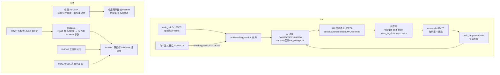

---

## 9.7 "dino 更成熟"的 ROM 级重述（修正版）

第 1 轮把"更成熟"归到"分层清晰 / 系统丰富"，其中"分层清晰"有一部分其实是移植工程红利。ROM 级能站住的只有下面这些，且都是**原版游戏本身的设计**：

1. **AI 决策维度更深**：dino 一次决策同时用 variant（敌人变种）、X 距离等级、aggression（动态）、32 行 RNG 表，并区分近/远决策；wof 多为单一档位 + `rng&3` 或 `rng&0x1F` 的小表。
2. **难度是集中、时间驱动的子系统**：dino `Rank` 结构 + 每帧 `rank_tick` + 1800/1200 帧自动升降 + calm + Markov aggression 重掷（每杀一个敌人重掷）+ spawn 命令强制；wof 是事件驱动的单字节 + 按玩家数钳位。
3. **目标选择有 census 反馈闭环**：dino 每帧统计"每个玩家被几个敌人瞄准/攻击/左右分布"，用**上一帧**值做负载均衡，再叠最近距离/分数/HP/动作多维加权，并有 6 个接近槽位与侧翼包抄；wof 是 3 玩家参数块轮询。
4. **受击系统更细**：dino 有 poise/韧性、counter hit、弱点克制、hitstop 双方同写、10+ 种受击反应（含投掷/燃烧/眩晕/墙壁滑落/起身）、击倒物理与屏幕反弹、起身眩晕概率按 4 张表；wof 是 9 项反应表 + 防御衰减。
5. **脚本分两套且过场脚本只覆写输入**：41 actions 的过场解释器通过伪造 pad 复用完整玩家状态机（受击/死亡自然中断），生成脚本由 camera X 驱动且带条件位与命令记录；wof 单套关卡脚本由 trigger 比较驱动、命令直接分配对象填字段。
6. **附加玩法系统**（第 1 轮已列，不变）：搓招 FSM `0x6AC8`、换人 tag、car 关卡、8 关剧情。

**而下面这些不是游戏设计差异，是移植工程差异**（第 1 轮曾混在一起）：
- 按职责拆 `_ai/_states/_attack/_lib` 文件、typed `Handle`/`Lists`、`BossAi` enum 命名、文件头 `Owner:/Spec:/Quirks kept`
- `collision()` 的固定 pass 顺序、`game_frame` 8 步、`objects_update` 13 步 —— **ROM 反汇编证明原机本来就是这个顺序**
- `wof_cs` 的 31944 行大分派、16 个 `ActorNNRuntime`、29107 行李典收尾 —— 直译工程的组织，不代表原版 ROM 更"扁"

---

## 9.8 新增证据索引（ROM 地址级）

| 结论 | 位置 |
|---|---|
| dino ROM 重组规则 / CRC / 3 片顺序 | `dino-extract/src/rom.rs:1-11,19-43,108-114`；实测 CRC 全部匹配 |
| dino 程序镜像拼法（字节交换） | `rom.rs:111-113` + capstone 验证 `0x542 lea $8000.w,a5` |
| dino 决策 0x4005C / gate 0x40118 / 远决策 0x40156 | capstone 反汇编；`enemy/class13_ai.rs:489-549`；`boss_common.rs:8-68` |
| dino 搓招 FSM 0x6AC8 | capstone（`+$F4` cmd_state / `+$F5` cmd_t / `+$F1` cmd_flag / 表 `0x6B7C`/`0x6B84`）；`player.rs:960-1006` |
| dino census 0x3242E / pick_target 0x32032 | capstone；`SPEC.md:374-415`；`enemy.rs:769-874` |
| dino rank_tick 0x186CC / aggression 0x182A2 | capstone；`SPEC.md:465-512,532-535`；`rank.rs:1-109` |
| dino class2 9 状态 AI / at_slot / 槽位 | `SPEC.md:618-723,866-877` |
| dino 受击 0x2A606 表 0x2A620 / poise / dizzy | `SPEC.md:1084-1202`；`enemy_combat.rs:488-598` |
| dino 伤害 0x2B904 / 0x2BA2A | capstone；`player_combat.rs:11-76`；`SPEC.md:1096-1131` |
| dino script_step 0x1DB5E / action 跳表 0x1DBD6 | capstone（6 字节记录格式逐条）；`script.rs:1-90,247-350` |
| dino spawn 0xFBF4 | capstone；`spawn.rs:1-345`；`SPEC.md:878-1004` |
| dino collision 0x10546 pass 顺序 | capstone；`combat.rs:69-100` |
| dino RNG 0x119C | `SPEC.md:73-86`；capstone 在 0x40086/0x40144/0x182C8 见 `jsr $119c` |
| wof GhidraMCP 用法 | `wt1/agent_scripts/ghidra_http_query.py:1-110`（7.0 端点改动见 `:22-64`） |
| wof 0x170E 死亡降难度 / 0xBC04 钳位 | Ghidra disassemble/decompile；`Cps1PlayerLogic.cs:10690-10716` |
| wof 0x3E1E 行为表 0x3E62 / 参数表 0x3E82 | Ghidra disassemble；`Cps1EnemyAI.cs:1693` 附近 RNG 用法 |
| wof 0x3B94 / 0x3E88 难度概率比较 | Ghidra；`Cps1BossWaveEnemyRuntime.cs:991,1131` |
| wof 0x4070 C06 决策回写 CF | Ghidra；`Cps1EnemyAI.cs:2230` |
| wof 0x4146 三玩家目标轮询 | Ghidra（3 个参数块 0x3E1C/0x3EFC/0x3FDC）；`Cps1EnemyAI.cs:2160` |
| wof 0x7DDA 伤害难度索引 / 0x1BFA RNG | Ghidra；`Cps1Collision.cs:4782-4855,29` |
| wof 0x106F4 关卡脚本 / 命令表 0x10744 | Ghidra 26 条指令；`Cps1LevelScript.cs:17-85,711-830` |
| wof 0x1AA58 玩家主分发 / 0x1BFA 随机伤害 | Ghidra；`Cps1PlayerLogic.cs:76`；`Cps1Collision.cs:21-44` |
| wof 0xD000 事件队列 / 一帧消费数 | `Cps1EventQueueTask.cs:5-90`；`Cps1CoroutineScheduler.cs:18-53` |

---

## 9.9 第二轮后仍待核

- **wof 的 Boss AI**：`Cps1ZhangLiaoRuntime.cs`（2192 行）、`Cps1BossWaveEnemyRuntime.cs`（3971 行）、`Cps1LidianFinaleRuntime.cs`（29107 行）未抽样；`0x22DB0` 主 AI 入口表在 Ghidra 里 disassemble 返回空（该处是数据表，需按 long 读）。
- **wof 受击反应 9 项表** `0x7E68`→`0x7E7A/0x7F14/0x7ECE/0x7F36/0x7F0A/0x7FDA/0x7F78` 各自语义未逐条读。
- **dino 的 `class4_states.rs` / `class25_ai.rs` / `boss.rs`** 未逐个读，Boss 侧的"形态/变身/反击"只从 `boss_common.rs` 与 SPEC §12 推知。
- **两款游戏的具体发行先后**仍未考证，本笔记沿用用户给的前提。
- wof 的 `0x3E88`（概率索引计算）与 `0x3F0C`（目标计算）内部未读；`0x7854` 设速度未读。
- dino `0x1DBD6` 的 41 项 action 跳表**内容**未逐字节读（只从 `script.rs` 的 Rust 分派与 `spawn.rs:300-312` 推知），若需严格验证可 capstone 读表。 → **已解决，见 §10.2**。

---

# 第三轮：表字节级验证与一个架构反转（⚠️ §10.1「架构反转」/ §10.3 的 `0x3E62`「8 档 × 4 项 AI 行为表」/ §10.4「维度差一个量级」结论均已作废，见 §11.3 / §11.4；§10.2 / §10.3 其余表字节 data 有效）

## 10.1 反转：wof 是**集中式**决策，dino 是**分散式**每类状态机

第 1 轮与第 2 轮都隐含一个假设："dino 共享层厚、wof 特例厚"。在**决策层**这个假设是反的，Ghidra 给出了硬证据：

**wof `Enemy_ProcessAIDecision @ 0x3C6A`**（Ghidra 函数，size=12 字节，**caller_count=32**）：

```
// Ghidra 注释（原文）：敌人AI决策处理器 / 输入 A0=敌人Actor, A5=GameState
// 1. 检查全局状态 (GS+0x1E2) → 非零则待机 (Z=0x1200)
// 2. Enemy_CheckTurnCondition - 转向检查
// 3. 检查攻击条件 (全局标志0x80 + GS-0x50)
// 4. RNG决策 → 从行为表选择下一个 Z 状态 (OBJ0x2A)

if GS[0x1E2] != 0:  *(A0+0x2A) = 0x1200 ; return        # 全局暂停 → 待机状态
对象_目标边界转向_579A()
if (全局标志 0x80 且 GS[-0x50] != 0) 或 GS[0x1CB] != 0:
    *(A0+0x2A) = 0x800 ; return                          # 攻击条件满足 → 攻击状态
*(A0+0x2B) = 0
u = RNG_0F98()
*(A0+0x2A) = A6[ (short)(*(A0+0xA0) + (u & 0x1F)) ]     # ★ rng&0x1F + 对象基偏移 → 查表 → 写状态字
```

**32 个调用者**（`ghidra_http_query.py callers 0x3C6A`）涵盖几乎所有敌人类型，且 Boss 与杂兵走同一入口：

| 类别 | 调用者（节选） |
|---|---|
| Boss | `李典_A02C02_主AI入口_2540C`、`许褚_A02C02_27BB0`、`夏侯敦_B00_2D246`/`接近段_2E030`、`曹操_A02_二级02_33502`、`吕布_C00_44FF8` |
| 杂兵 | `小兵9_C02_决策与二级分发_29200`、`弓箭手_C02_决策_3678A`、`肥肥_C02_468CC`、`匕首兵_ZState02_267D8`、`GruntA_ZState02_Walk_2A5C2`、`GruntB_ZState02_2B7EE` |
| 分发/重试 | `C02_重试分发_49198`、`C02_重算C后二级分发_4A28E`、`C2_中转_346E2/3BC5E/3D192`、`态1_41BE0` |

**李典 `0x2540C` 与小兵9 `0x29200` 的反编译体完全相同**（连 Boss 都不特殊化）：

```
BossUpdatePhysics()
if (N) WeaponHandleRelease()
*(A0 + 0xA6) = 0x10            # AI 定时器
Enemy_ProcessAIDecision()      # → 0x3C6A
```

**dino 恰好相反**：`re/specs/enemy/SPEC.md:1459` 原文 *"**How a mode is chosen: no central brain.** Each class has its own state machine (+$06/+$07)"*。决策逻辑复制到每个 class：
- class 2 state 0 decide = `0x33F74`
- class 13 决策 = `0x4005C`，远决策 gate `0x40118`、proper `0x40156`
- Boss 各自 `0x52C50 / 0x55748 / 0x38BD6 / 0x675AE / 0x695B0`（`boss_common.rs:8`）
- 共享的只有 **行为库**（census / pick_target / step / anim / recover）与**表选择机制**，不含统一决策器

**修正表述**：第 1 轮说的"dino 通用层厚、wof 特例厚"只适用于**行为库与文件组织**；在**决策层**，wof 抽出了一个 32 调用者的共享决策器，dino 把决策下放/复制到每个类里。两者都是原版 ROM 的设计（0x3C6A / 0x33F74 都是真实 ROM 函数），不是移植工程造成的。

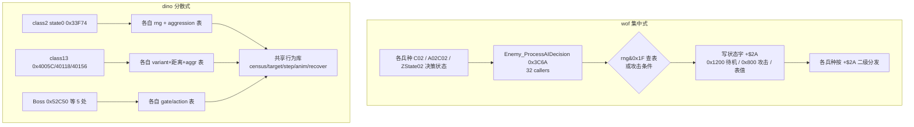

## 10.2 dino：AI 决策表的**字节内容**（capstone 读 ROM 镜像确认）

| 表地址 | 内容（hex / dec） | 含义与印证 |
|---|---|---|
| `0x33FA4` | `03 04 05 06 07 08 0b 0f` | state 0 出招概率，按 aggression 0..7；`rng&0xF < 表值`，即 3/16 → 15/16。**逐项吻合 `SPEC.md:644`** |
| `0x34186` | `55 50 4b 41 3c 37 36 2b 2a 29 28 27 26 25 24 23` | MAAI 槽位暂停帧数，按 level 递减 85→35。**吻合 `SPEC.md:680`** |
| `0x353B6` | 行0 `02 04 07 09` / 行1 `0b 0e 11 15` / 行2 `03 07 0a 0c` / 行3 `10 14 16 18` / 行4 `06 0b 0d 11` / 行5 `15 18 1c 1f` | at_slot 攻击概率表，索引 `variant*4 + (aggression&7)`，与 `rng&0x1F` 比较 → **2/32（Ferris @ aggr 0）到 31/32**。**吻合 `SPEC.md:689` 与 §14 "2/32 for Ferris at aggression 0"** |
| `0x3546A` | `0a 0a 1e 1e 3c 3c 3c 3c 3c 3c 3c 5a 5a 78 96 f0` | 重新站位后的暂停帧，10/30/60/90/120/150/240。**吻合 `SPEC.md:693` "10..240 frames"** |
| `0x354B2` | `00`×7, `01`×16, `02`×8（前 32 字节） | at_slot 站位选择，按 `variant*16 + (rng&0x1F)` 索引 → c=0 绕圈 / 1 MAAI 悬停 / 2 后退；加权约 7:16:8。**吻合 `SPEC.md:692-701`** |
| `0x72D94` | 4 行：`08 06 04 06 08 06 04 02` / `09 07 05 07 09 07 05 03` / `0a 08 06 08 0a 08 06 04` / `0b 09 07 09 0b 09 07 05` | 远决策 gate 表，索引 `aggression*8 + variant*32 + X距离等级`，值 2..11 与 `rng&0x1F` 比。**吻合 `class13_ai.rs:514`** |
| `0x72A94` | 前 32 字节全 `04` | 近决策表（首段），行为值 |
| `0x72F14` | `01 01 01 03 03 07 06 02` ×4 | 远决策表，4 行同构的行为值 |
| `0x182E4` / `0x18364` | A: `01`×10 `00`×6 `02`×10 `01`×4 `00`×2；B: `01`×11 `00`×5 `02`×11 `01`×3 `00`×2 | **两张 8×16 aggression Markov 转移表**，索引 `aggression*16 + (rng&0xF)`，表值即**下一 aggression 状态**（k 段主要给 k+1，偶尔 k 或 k+2）。*注：`SPEC.md:503` 写 "mostly +1, sometimes -1/-2"，与 ROM 字节的"直接给下一状态值"表述略有出入，以 ROM 为准* |
| `0x187B8` | `0258 0208 01e0 01b8 0190 0168 012c 0104 00f0 00dc 00c8 00b4 00a0 008c 0078 003c` | RANK_PERIOD 16 档，600→60 帧递减，rank speed 越高自动升级越快的**时间驱动**证据 |
| `0xFC2E` / `0xFC4E` | l1: `000acd8e 000acf0a 000ad032 000ad106 000ad24a 000ad40c 000ad57a 000ad758`；l2: `000adbf2 000ae032 000ae5e4 000aee80 000af6d4 000b0116 000b0852 000b1702` | 8 个 stage 的 spawn list1/list2 基址表，**吻合 `spawn.rs:129-136` `spawn_set_bases`** |
| `0x1DBD6` | 41 个 word 偏移，目标 `01dee0 01def8 01e200 01e262 01e28c 01e2ba 01e2ee 01e062 01e2fc 01e4ba 01e4c8 01e54a 01e5c8 ... 01e650 01dc60 01dc42` | **41 项 action 跳表逐项吻合 `script.rs:250-333` 的每条原地址注释**（0x1DEE0 pad_clear / 0x1DEF8 walk End / 0x1E200 pose / 0x1E262 scene_done / 0x1E28C leader_attack / 0x1E062 walk Start / 0x1E2FC walk_point / 0x1E4BA hold_right / 0x1E54A jump_kick / 0x1E650 clear_sequence / 0x1DC60 barrier / 0x1DC42 wait car ...） |
| `0x33EFA` | word 偏移 `007a 00be 01b4 0202 0328 0716 085e 030a 08ce` | **class2 的 9 状态跳表**，基址+偏移 = `0x33F74 / 0x33FB8 / 0x340AE / 0x340FC / 0x34222 / 0x34610 / 0x34758 / 0x34204 / 0x347C8`，前 4 项**逐项吻合 `SPEC.md §7.4`** |
| `0x2A620` | word 偏移 `001e 0060 00a8 0232 03a8 05e2 05e2 07be 07be 07be 0892 0892 0892 09d0 0cc6` | **受击反应表**（`0x2A606` 用 `jsr $2a620(pc,d1.w)`）：`+$06=00→0x2A63E`, `02→0x2A680`, `04→0x2A6C8`, `06→0x2A852`, `08→0x2A9C8`, `0A/0C→0x2AC02`, `0E..12→0x2ADDE`, `14..18→0x2AEB2`, `1A→0x2AFF0`, `1C→0x2B2E6`。**逐项吻合 `SPEC.md:1136-1144`** |

**dino `0x33F74` state 0 decide 的 capstone 反汇编**（逐条印证 `SPEC.md:643-645`）：

```
tst.b $51(a6) ; bne $3474E              # 空中 → goto_fall
tst.b $7a(a6) ; beq $33FB2              # 反击延时计时器
subq.b #1,$7a(a6) ; bne → rts
move.w $5ec(a5),d0                       # ★ aggression
move.b $33fa4(pc,d0.w),d1                # ★ 表 0x33FA4[aggr]
jsr $119c ; andi #$f,d0
cmp.w d1,d0 ; blt $342D8                 # ★ rng&0xF < 表值 → choose_combo
$33FB2: move.w #$200,$6(a6)              # 否则进 state 2 approach
```

**dino `0x353CE at_slot` 的 capstone 反汇编**（逐条印证 `SPEC.md:688-701`）：

```
move.b $26(a6),d1 ; ×4                   # variant
move.w $5ec(a5),d0 ; andi #7 ; add       # + aggression&7
move.b $353b6(pc,d0.w),d1                # ★ 攻击概率表
jsr $119c ; andi #$1f,d0 ; cmp.b d0,d1 ; bls $353FC
move.w #$800,$6(a6) ; rts                # 表值 > rng&0x1F → state 8 攻击
$353FC: clr $7d ; moveq #4,d5            # 否则 5 次尝试重新站位
  move.b $26(a6),d1 ; lsl #4             # variant×16
  jsr $119c ; andi #$1f,d0 ; add d1,d0
  lea $354b2(pc),a0 ; move.b (a0,d0.w),d0   # ★ 站位表
  cmp.b $a5(a6),d0 ; dbra d5              # 避免与上次相同
  jsr $119c ; andi #$f,d0 ; move.b $3546a(pc,d0.w),$80(a6)   # ★ 暂停帧表
```

## 10.3 wof：AI 表的**字节内容**（Ghidra `/read_memory` 确认）

> 注意：GhidraMCP 的 `/read_memory` **固定返回 16 字节**，不受 `length` 影响；需按地址分段读。

| 表地址 | 内容 | 含义与印证 |
|---|---|---|
| `0x3E62` 全表 32 字节（`0x3E62` + `0x3E72`） | `ff ff ff ff \| 00 00 00 00 \| 01 01 01 01 \| 00 01 00 01 \| 02 02 02 02 \| 00 02 00 02 \| 01 02 01 02 \| 00 01 02 ff` | **AI 行为表：8 档 × 4 项，值域仅 0/1/2/0xFF**（0xFF = `bmi` 不决策）。索引 = `((GS-0x3E)&7)<<2 + (rng&3)`，见 `0x3E1E`。**这是"维度更浅"最硬的量化证据** |
| `0x3E82` 起 | `000000e0 01c07200 122800a2 d22dffa6` | 行为 ID → 参数块偏移表（`0x3E1E` 中 `adda.w (0x3E82,PC,D6),A1`），后段混入代码 |
| `0x3E88` `Attack_CheckFrameValid` | Ghidra 反编译：`if ((char)(GS[-0x5A] + OBJ[0xA2]) < 0) return`；后续字节 `6a04 7200 4e75 0c01 001f 6f02 721f 4e75` 含 `cmpi.b #0x1f / moveq #0x1f / rts` | **难度概率比较的索引计算 + 0..0x1F 钳位**，吻合 `Cps1Collision.cs:4841-4855` |
| `0x7E68` 反应表（9 项 word） | `0012 00ac 00ac 0066 00ce 00a2 0172 00ce 0110` | 基址+偏移 = `0x7E7A / 0x7F14 / 0x7F14 / 0x7ECE / 0x7F36 / 0x7F0A / 0x7FDA / 0x7F36 / 0x7F78`，**逐项吻合 `Cps1Collision.cs:4861-4864` 的 n=0..8 注释** |
| `0x10744` 命令表（long 地址） | `00010a90 000013b4 0000140a 00001464` / `00001448 00001480 00001426 00010a0a` / `00010a1e 000013d2 0001079c 00010810` | type→命令例程：`0x140A` 生成10型、`0x1464` 生成14型、`0x1448`、`0x1480` 生成18型、`0x1426` 生成1C型。**吻合 `Cps1LevelScript.cs:749,763,793,812,826`** |
| `0x1726` 死亡降难度表（word） | `00c0 00c0 0100 0100 0100 0140 0140 0140 ...` | 32 项，难度扣减 192..320；`0x170E` 按 `(rng&0x1F)*2` 索引 |
| `0x1C20` 随机伤害表 | 前 16 字节全 `00` | 印证 `DAMAGE_RANDOM_TABLE = 0x1C20` 起始是低伤害区；`Cps1Collision.cs:38-43` 记录过误认 `0x7C20` 为本表的教训 |
| `0x22DB0` | 4 个 long 全是 `0x00022dae` | **未确认为主 AI 入口表**（`Cps1EnemyAI.cs:32-41` 说 `22DB0[0x10]->0x327F8`）。可能是 region set 差异或读错基址，**保留待核，不据此下结论** |

## 10.4 量化：不是"有/无表驱动"，是**索引维度差一个量级**（⚠️ 本节标题、wof 列「全局行为档位」与末尾结论均已作废，收敛版见 §11.5；dino 列 data 有效）

| | dino | wof |
|---|---|---|
| 决策 RNG 掩码 | `&0x1F`（32 行）、`&0xF`、`&0x3E` 多粒度 | `&3`（`0x3E1E`）、`&0x1F`（`0x3C6A`/`0x3B94`/`0x4070`） |
| 决策表索引维度 | **variant × aggression × X距离等级 × rng**（4 维），部分再叠 level / form / `+$AB` 符号 | **全局行为档位(3bit) × rng&3**（2 维），或 `rng&0x1F + 单个对象基偏移`（1 维） |
| 行为表规模 | `0x353B6` 6 行×8、`0x354B2` ≥32、`0x72D94` 4×8、`0x72A94`/`0x72F14` 各 ≥32、两张 8×16 Markov 表 | `0x3E62` **全表 32 字节（8×4）** |
| 概率可调范围 | 攻击概率 **2/32 → 31/32**（随 variant+aggression 连续变化）；出招概率 3/16→15/16 | 行为 ID 只有 0/1/2/0xFF 四值 |
| 难度→AI 的通路 | 集中 Rank 结构 + 时间轴 + Markov 重掷，喂给速度/攻击概率/伏击/暂停/眩晕/生成条件 | 单字节 `A5-0x5A` 经 `0x3E88` 钳位后进概率比较与伤害索引 |
| 决策器复用 | **不复用**，每类各自 state 0（96 个 class 文件） | **强复用**，1 个 `0x3C6A` 被 32 处调用（含全部 Boss） |

**结论**：两款游戏都是 RNG 查表的加权行为选择，底层同构；dino 的"成熟"不在机制类型，而在**把同一个决策模式参数化到更细的维度、更大的表、并与一个时间驱动的全局难度系统闭环**。wof 用一个共享决策器 + 一张 32 字节表覆盖了几乎所有敌人（含 Boss），是更省、更统一但也更粗的设计。

## 10.5 决策数据流（最终版）

```mermaid
flowchart TD
    subgraph dino 每类自治 + 全局难度闭环
    R[rank_tick 0x186CC<br/>RANK_PERIOD 600→60帧] --> G[Rank: level/aggression/rank]
    K[每个敌人死亡 0x2AFCA] -->|Markov 0x182A2<br/>表 0x182E4/18364| G
    C[census 0x3242E<br/>每玩家 4 计数] --> T[pick_target 0x32032<br/><3 敌人优先 + 多维加权]
    G --> D1[class2 state0 0x33F74<br/>表 0x33FA4]
    G --> D2[class13 0x4005C/40118/40156<br/>表 0x72A94/72D94/72F14]
    T --> D1 & D2
    D1 --> S[9 状态跳表 0x33EFA]
    D2 --> S
    S --> A[at_slot 0x353CE<br/>0x353B6 攻击概率 2..31/32]
    A --> P[0x354B2 站位 / 0x3546A 暂停 10..240帧]
    P --> L[共享库: retarget_and_slot / steer / step / anim]
    L --> C
    end
    subgraph wof 集中决策 + 单字节难度
    WG[难度 A5-0x5A<br/>0x170E 死亡降 / 0xBC04 钳位] --> WP[0x3E88 索引+钳位]
    WF[全局行为档位 GS-0x3E 低3位] --> WB[行为表 0x3E62<br/>32字节 8档×4项]
    WB --> WC[Enemy_ProcessAIDecision 0x3C6A<br/>32 callers 含全部Boss]
    WP --> WC
    WC -->|rng&0x1F 查表| WS[写状态字 +$2A<br/>0x1200/0x800/表值]
    WS --> WD[各兵种 C02 二级分发]
    WD --> WC
    end
```

## 10.6 新增证据索引（第三轮）

| 结论 | 位置 |
|---|---|
| wof 中央 AI 决策器 0x3C6A 与 32 调用者 | `ghidra_http_query.py callers 0x3C6A`；`decompile 0x3C6A` |
| 李典/小兵9 同模板调 0x3C6A | `decompile 0x2540C` / `decompile 0x29200` |
| dino "no central brain" | `re/specs/enemy/SPEC.md:1458-1473` |
| dino 各表字节与地址 | capstone 读 `dino.zip` 重组镜像（本轮实测，未落盘中间文件） |
| dino state0/at_slot 反汇编 | capstone `0x33F74` / `0x353CE` |
| dino 41 action 跳表 / 9 状态跳表 / 受击反应表 | capstone 读 `0x1DBD6` / `0x33EFA` / `0x2A620`；`0x2A606` 反汇编确认 `jsr $2a620(pc,d1.w)` |
| wof 各表字节 | Ghidra `/read_memory`（`0x3E62/0x3E72/0x3E82/0x3E92/0x7E68/0x7E78/0x10744/0x10754/0x10764/0x1726/0x1C20/0x22DB0`） |
| Ghidra `/read_memory` 固定 16 字节 | 本轮实测（length=20/40/48/64 均返回 16） |
| wof ROM 位置 | `G:/Game/Mame32/roms/wof.zip`（多 region）、`wofj.zip`（Japan，6 文件）；本轮未拼 wof 镜像，全部经 Ghidra 取证 |

## 10.7 仍未解决（诚实边界）

> ⚠️ **本节已在 §18.1 逐条结清**（第十一轮，回到 repo 侧核对，未新增 ROM 取证）：6 条里 5 条以 repo 为准确认，仅"发行先后"仍开放。下面是第三轮当时的原始记录，**读时以 §18.1 为准**——尤其 `0x22DB0` "未确认"与 `0x3E88` 命名两处，是第三轮取证方式偏差，不是 repo 缺 data。

- **`0x22DB0` 主 AI 入口表**：`Cps1EnemyAI.cs:32-41` 称 `22DB0[0x10] -> 0x327F8`，但 Ghidra `wofj.68k.xml` 在 `0x22DB0` 读到 4 个相同的 `0x00022dae`。可能是 region set（wof/wofj/World/Japan）基址差异、或该处是别的表。**未确认，不作为结论依据**。
- **wof 的 9 项受击反应各自语义**：只确认了表项与跳转地址（`Cps1Collision.cs:4857-4865`），未逐条反编译 `0x7E7A/0x7F14/0x7ECE/0x7F36/0x7F0A/0x7FDA/0x7F78` 的处理体，因此**不能**断言 wof 没有 poise/dizzy/燃烧等机制，只能说 dino 的受击表种类更多（15 项 vs 9 项）。
- **dino 的 Boss 专属逻辑**：`class4_states.rs` / `boss.rs` / `class25_ai.rs` 未逐个读；`boss_common.rs` 的 `gate_table/action_table` 已由 `0x40118`/`0x40156` 印证同构，但 5 个 Boss 各自的反击/变身实现只读了 `SPEC.md §12` 标题层。
- **wof 的 `0x3E82` 参数表后半段**混入代码，未完整解析；`0x7854`（设速度）、`0x3F0C`（算目标）未读。
- **wof AI 决策表的"档位"来源**：`GS-0x3E` 低 3 位由谁写、何时变化未追；这决定了 wof 决策是否也有类似 dino 的动态难度联动。
- 两款游戏的**具体发行先后**仍未考证，本笔记全程沿用用户给定的前提。
- 本轮所有 ROM 取证均为**只读**：dino 侧只在内存中拼镜像、未写任何文件；wof 侧只用 GhidraMCP 只读端点（`check_connection` / `disassemble_bytes` / `get_functions` / `find_functions` / `read_memory` / `get_xrefs_to`），未做 rename、未保存数据库。

---

# 第四轮（勘误）：定位说明与两处关键语义更正

> 触发：用户 11-06 反馈——「提供 ROM 侧资源是怕 rep 侧里没 data 部分难理解，不是让你过度怀疑 rep 侧，所以之前我说了『如果 有必要』」。
> 本轮**不新增 ROM 审计**，只做三件事：**把 ROM 的角色摆正**、**更正两处被我读错的语义**、**把前几轮过重的措辞收敛**。
> ⚠️ **§9–§10 里凡"以 ROM 审 repo 结论"的框架与下列具体解释，一律以本节为准；但 §10.2 / §10.3 的表字节、跳表项、命令地址等 data 部分保留有效。§0–§8 不受影响。**

## 11.0 定位说明：ROM 只补 data，不审 repo

| 项 | 正确的定位 |
|---|---|
| repo 侧（`dino_rs` / `wof_cs` / `re/specs`） | **主资料**。函数注释、`_对应ASM_` 命名、原地址、`activePlayers` 这类变量语义，本身就是从 ROM 整理出来的成果，以它为准。 |
| ROM 侧（dino.zip 重组镜像 / Ghidra 8089） | **只补 repo 没展开的 data**：表字节内容、跳表项、命令地址、CRC、镜像拼法。用来"看懂 data"，不用来"验证 repo 对不对"。 |
| 第 1 轮误判（"wof 没有动态难度/RNG AI/目标选择"） | 真实原因是**我读 repo 读得浅**，不是 repo 侧错。§9.1 把它写成"ROM 纠正 repo 的方法论错误"，是双重失真：既摆错了 ROM 的位置，也给自己的阅读失误找了个漂亮说法。 |

由此，§9–§10 里凡"重大更正 / root cause / 反转 / 推翻第 1 轮 / 维度差一个量级"这类**以 ROM 审判 repo 的框架**，一律降级为"补充了 data + 一次没读全的阅读记录"，不作为结论。真正有长期价值的产出是 §10.2 / §10.3 那些**表字节**（data），保留。

## 11.1 语义更正一：`A5-0x3E` 是活跃玩家位图，`0x3E1E` 是「选目标玩家」

这是本轮最该记的一条：上一轮脱离 repo 注释、只对着 ROM 字节，把 `0x3E62` 猜成"AI 行为决策表（8 档 × 4 项，值 0/1/2/0xFF）"，据此还写了"决策维度差一个量级"。**全错，repo 早就写对了。**

### repo 侧早有的正确命名（不是本轮新发现）

| repo 位置 | 原文 | 说明 |
|---|---|---|
| `Cps1Actor24Runtime.cs:1004` | `byte activePlayers = (byte)(Cps1Memory.rb(Cps1Memory.A5_BASE - 0x3E) & 0x07);` | `A5-0x3E` = 活跃玩家位图，低 3 位 = P1/P2/P3 |
| `Cps1Actor24Runtime.cs:1175-1185` | `activePlayers` + 3 参数块 `0x3E1C/0x3EFC/0x3FDC` + `masks{1,2,4}` | 位图按位测玩家有效 |
| `Cps1Actor1CRuntime.cs:2017-2041` | `byte 位图 = rb(A5-0x3E) & 7`；`执行3DEE` 还原 `0x3E04..0x3E5C` | `0x3E82 = 0000/00E0/01C0`；`d6` = 选中的玩家槽号 |
| `Cps1Actor1CRuntime.cs:2018` | `敌人收招按活动位图选择最近玩家_对应ASM_39A0(...)` | `0x39A0` = 按位图选最近玩家 |
| `Cps1Actor27Runtime.cs:612` | `对象_随机选择活动目标_对应ASM_3E1E(ref obj)` | `0x3E1E` 的正式语义 = **随机选择活动目标（玩家）** |
| `Cps1Actor26Runtime.cs:554,562-563` | `活动位图 & 7 == 0`；`FBA 实测 A5-0x3E=0x01 ⇒ d6=1<<2=4, RNG&3=1 ⇒ 索引5 ⇒ 表 0x3E62[5]=0x00 ⇒ 正常出口` | 位图→表索引的实测公式 |
| `Cps1Actor1BRuntime.cs:701-724` | `btst.l d0,-$3e(a5)`；`mask & (1<<(c3&31))` | `+0xC3` 作 bit 号测位图 = **AI 选择锁**校验 |
| `Cps1BossWaveEnemyRuntime.cs:892,908` | `对象_C02入口目标校验_对应ASM_422E_3E12` | `0x3E12/0x422E` = 目标有效性校验 |

### 正确的数据流（伪代码）

```
A5-0x3E = 活跃玩家位图 (bit0=P1, bit1=P2, bit2=P3)

0x3E1E 对象_随机选择活动目标():            # 不是"AI 行为决策"
    bm = rb(A5-0x3E) & 7
    if bm == 0:  goto 0x3E0A              # 无活跃玩家
    idx = (bm << 2) + (rng() & 3)         # 位图分行(8 行) × rng 选列(4 项)
    d6  = B[0x3E62 + idx]                 # ★ 值 0/1/2 = 玩家槽号；0xFF = 无目标/清锁
    if d6 < 0: return (N=1, 0x3E38→rts)   # 本次不选
    OBJ+0xC3 = d6                         # 锁住"当前瞄哪个玩家"
    A1 = 0x3E1C + W[0x3E82 + d6*2]        # 表 0x3E82 = 0000/00E0/01C0
                                          #   → 玩家参数块 0x3E1C / 0x3EFC / 0x3FDC
    OBJ+0x3A = A1                         # 目标玩家对象指针
    bsr 0x3F0C                            # 目标侧向站位偏置
    jsr 0x7854                            # 按目标相对差算方向索引 → OBJ+0x24

0x4244 / 0x422E 目标校验（AI 选择锁）:
    c3 = OBJ+0xC3
    if c3 < 0: 无效
    elif (A5-0x3E 位图 & (1<<c3)) == 0:  # 锁定的那个玩家已不活跃
        OBJ+0xC3 = 0xFF                   # 清除选择锁，下次重选
```

`0x3E62` 全表 32 字节重新解释（行 = 活跃玩家组合，列 = rng&3，值 = 选中的玩家槽号）：

| 位图 | 活跃玩家 | 4 项 | 读法 |
|---|---|---|---|
| 000 | 无 | `ff ff ff ff` | 全不选 |
| 001 | P1 | `00 00 00 00` | 恒选 P1 |
| 010 | P2 | `01 01 01 01` | 恒选 P2 |
| 011 | P1+P2 | `00 01 00 01` | 交替 |
| 100 | P3 | `02 02 02 02` | 恒选 P3 |
| 101 | P1+P3 | `00 02 00 02` | 交替 |
| 110 | P2+P3 | `01 02 01 02` | 交替 |
| 111 | 三人 | `00 01 02 ff` | 三者轮流 + 一次不选 |

**所以"8 档"其实是 8 种活跃玩家组合，不是 8 个 AI 难度/行为档；值 0/1/2 是玩家编号，不是行为 ID；0xFF 是"清除选择锁"，不是"bmi 不决策"。** 这套东西属于**目标选择与目标锁定**，和 dino 对位的是 `pick_target 0x32032` / census，不是 dino 的 `0x4005C` 攻击决策。

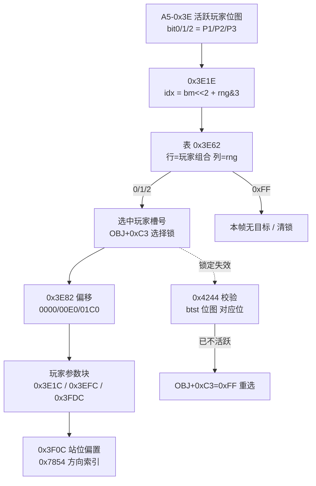

## 11.2 语义更正二：`0x3C6A` 是「共享决策函数 + 每兵种各带概率表」，不是「统一集中决策器」

§10.1 把 `0x3C6A`（Ghidra 名 `Enemy_ProcessAIDecision`，32 callers）当成"wof 集中式、dino 分散式"的**架构反转**硬证据。repo 侧命名其实更朴素：

- `Cps1BossWaveEnemyRuntime.cs:1056`：`0x3C6A：按 A6 概率表 + RNG 重算 OBJ+0x2A（C）`
- `Cps1BossWaveEnemyRuntime.cs:285`：`AI决策_3C6A` 注释
- 调用点各自 `lea` 自己的表再 `jsr`：`0x45E2D`（肥肥）、`0x49C54`（Actor26）、`0x4094E`（Actor27）、`0x40A8E`（Actor1B）……

即：wof 抽出了一个**共享的"按概率表重算 C 字节"函数**，但**概率表 A6 由每个兵种/路径自己传**，产出也只是 C 的 04/06/08 等偶数值（不是 §10.1 写的整体状态字 0x1200/0x800）。这跟 dino "每类自己的 state 0 + 自己的表" 是**同构的程度差异**（共享函数 vs 共享表），不是"集中 vs 分散"的**质的反转**。

**处理**：§10.1 的"反转"结论**作废**；`0x3C6A` 有 32 调用者、是共享函数这一**观察保留**（这是调用关系 data，不是价值判断）。dino `SPEC.md:1459 "no central brain"` 与它并不矛盾——一个说"没有统一大脑"，一个说"有一个共享的重算 C 子程序"，讲的是不同层次。

## 11.3 作废 / 保留清单

| 内容 | 处理 |
|---|---|
| §10.2 dino 各表字节（0x33FA4 / 0x34186 / 0x353B6 / 0x3546A / 0x354B2 / 0x72D94 / 0x182E4 / 0x187B8 / 0x1DBD6 / 0x33EFA / 0x2A620 / spawn 基址表） | **保留**（纯 data，逐项印证 repo 注释） |
| §10.3 wof 表字节里除 0x3E62 外的项（0x3E82 / 0x3E88 / 0x7E68 / 0x10744 / 0x1726 / 0x1C20 / 0x22DB0） | **保留**（data） |
| §10.3 把 0x3E62 解成"8 档 × 4 项 AI 行为表 / 值域 0/1/2/0xFF / 维度更浅最硬证据" | **作废** → 见 §11.1 |
| §9.1 "重大更正 / root cause 方法论错误 / 本轮用 ROM 纠正" | **措辞作废** → 见 §11.0（是读 repo 不深，不是 repo 错） |
| §10.1 "架构反转：wof 集中式、dino 分散式" | **结论作废** → 见 §11.2（降为"共享函数 + 每兵种概率表"的观察） |
| §10.4 "索引维度差一个量级"的量化对比 | **结论作废**（wof 列建立在 0x3E62 误读 + 把"目标选择"混进"攻击决策"上）；dino 列的**表字节 data 仍有效**，收敛版见 §11.5 |
| §10.5 / §9.6 两张 mermaid 里标"全局行为档位 GS-0x3E""8档×4项"的节点 | **按 §11.1 改读**（活跃玩家位图 / 目标选择表） |
| §0–§8 的游戏设计对照 | **不受影响**（读 repo 得出，本轮未涉及） |

## 11.4 逐处措辞更正对照（Grep 可定位；§9–§10 原文按"保留工作记录原貌"约定不改写，已在 §9.1 / §9.5 / 第三轮 / §10.4 各入口加就地警示，见附录 A.13 审计）

| 位置 | 原写法（作废） | 正确写法 |
|---|---|---|
| §9.5 L934 `0x3E1E` 反汇编注释 | `# 全局行为标志低 3 位 = 档位` | `# 活跃玩家位图 & 7；为 0 则 0x3E0A 写 C3=0xFF（无目标）` |
| §9.5 L980 对照表 wof 列 | `全局档位(3bit) × rng&3，小表 0x3E62` | `活跃玩家位图(3bit) × rng&3 选目标玩家（属目标选择，非攻击决策）` |
| §9.6 L1007 mermaid 节点 | `W3[全局行为标志 -0x3E 低3位]` | `W3[A5-0x3E 活跃玩家位图]`（该分支是"目标选择"不是"AI 决策"） |
| §10.3 L1194 `0x3E62` 行 | `AI 行为表：8 档 × 4 项，值域 0/1/2/0xFF… 维度更浅最硬证据` | `目标玩家选择表：8 种玩家组合 × 4 项，值 0/1/2=玩家槽号、0xFF=清锁` |
| §10.4 L1208 对照表 wof 列 | `全局行为档位(3bit) × rng&3（2维）` | `目标选择：活跃位图(3bit) × rng&3；攻击决策另在 0x3C6A（每兵种概率表）` |
| §10.5 L1236 mermaid 节点 | `WF[全局行为档位 GS-0x3E 低3位] --> WB[行为表…8档×4项]` | `WF[A5-0x3E 活跃玩家位图] --> WB[0x3E62 目标玩家选择表]` |
| §10.7 L1265 待核 | `GS-0x3E 低3位由谁写、何时变化未追…是否动态难度联动` | **已解决**：低 3 位 = 活跃玩家位图，与动态难度无关，无需再追 |

## 11.5 收敛后的「目标选择 / 决策」对照（把话题拉回游戏设计，不夸大）

| | dino | wof |
|---|---|---|
| 目标玩家选择 | `0x32032 pick_target`：每帧 census（每玩家被瞄准/攻击/左右人数）→ 上一帧负载均衡（<3 优先）+ 最近/分数/HP/动作多维加权 | `0x3E1E` 按**活跃玩家位图 + rng&3** 查 `0x3E62` 选玩家槽号 → `0x3E82` 换算参数块；`0x39A0` 按位图选最近玩家 |
| 目标锁定 | 6 个接近槽位 + `retarget_and_slot` 侧翼包抄 | `OBJ+0xC3` 选择锁，`0x4244/0x422E` 用 `btst 位图` 校验，玩家消失则清锁重选 |
| 攻击/状态决策 | 每类各自 state 0（`0x33F74` / `0x4005C` / Boss 各自表），"no central brain"（`SPEC.md:1459`） | 共享 `0x3C6A` 按 A6 概率表 + RNG 重算 C 字节，A6 表由各兵种自带（`0x45E2D` 等） |
| 动态难度 | 集中 `Rank` + 时间驱动 + Markov aggression | 单字节 `A5-0x5A` + 按玩家数钳位（`0xBC04`） |

两边的差别是**仍可谈的游戏设计差别**（dino 目标选择有 census 闭环、难度是时间驱动子系统；wof 更直接、省），但**不是**"有/无系统""集中/分散反转""维度差一个量级"那种量级差。§9.7 里从 dino 侧 ROM 表字节得到、能逐项印证 `SPEC.md` 的结论（搓招、反击/弱点、poise/受击反应、过场脚本覆写输入、Rank 时间驱动）**不受本轮勘误影响**——它们本来就是"补 data 印证 repo"，不是"审 repo"；唯一要收敛的是 §9.7 第 1 条里 "wof 多为单一档位 + rng&3" 那半句（那是目标选择，不是攻击决策，按 §11.1/§11.2 改读）。

## 11.6 后续边界（承接「长时间自主推进」）

- ROM 继续只在**必要时**用于补 data 表内容；对 repo 已有明确注释的字段，一律以 repo 语义为准，不再另立抽象解释。
- 仍待补的 data（按 §10.7，去掉本轮已解决的 `GS-0x3E` 一条）：wof 9 项受击反应处理体 `0x7E7A/0x7F14/...`、`0x3E82` 后半段、`0x7854`/`0x3F0C` 内部、`0x22DB0` region set 差异；dino `class4_states.rs` / `boss.rs` / `class25_ai.rs` 的 Boss 反击与变身。
- 下一轮重点回到**游戏设计本身**：把 §4 事件脚本里 dino「过场脚本覆写输入、受击自动中断」与 wof「事件队列受 VBlank 截断」这条、以及 §5 目标选择，写成可直接对照的伪代码 / 流程图，而不是继续加 ROM 取证。
- 两款游戏发行先后仍未考证，全程沿用用户给定前提。

---

# 第五轮：打击结算的时序设计（回到游戏设计本身）

> 承接 §11.6：本轮**不碰 ROM 取证**，全部以两份 repo 源码为准，把"同一帧里谁先谁后、哪些事跨帧靠状态推进"这类**时序设计**写成可对照的伪代码 / 流程图。
> 关注点仍是用户给的四大主题里的「打击逻辑」与「事件脚本」；状态机、怪物策略见 §2 / §5 / §11.5。

## 12.0 为什么要单看"时序"

前几轮对照多停留在"有哪些系统 / 表多大 / 分几层"，但清版格斗有一类设计差异只在**帧的时间轴**上才看得见：一次命中在**哪一帧**扣血、在哪一帧切状态、死亡算哪一帧、脚本能不能被这一帧的受击打断。这些不是实现细节，是"打击手感 / 演出节奏 / 可中断性"的设计决策。两边源码对此都有明确注释，足以直接对照。

## 12.1 dino：命中帧"只结算、不处决"，死亡由敌人自己的受击态在后续帧推进

素材全部来自 `enemy_combat.rs` / `enemy.rs` / `boss.rs` 的**源码与注释**。

```
# frame N：玩家攻击的碰撞 pass（pass_107f8 等）
enemy_hit_by_player(a, d)  0x11008:
    if attack_box==0 or body_box==0 or !boxes_hit(Z,X,Y): return
    e.live = 2
    e.l4   = 0x0202_0000        # 只切到"受击态"(mode2/sub2)，★ 不写 mode4 死亡
    e.attacker = a ; e.WAIT = 0
    if id in (0x6E,0x6C): 非致命(HP floor 1) ; return
    r = player_attacks[char][id/2]           # dmg/stun/reaction/hitstop/snd/score/spark
    dmg = charge_scale? ; dmg = enemy_damage_scale(dmg)   # 0x2BA2A 多因子
    e.hp = max(e.hp - dmg, 0)               # ★ HP 可以在本帧变 0
    e.stun = sat_sub(e.stun, r.stun)         # 韧性
    e.reaction = e.act = r.reaction ; e.step = 0
    e.hitstop = attacker.hitstop = r.hit_stop          # 双方同写；队伍技连伙伴也写
    score / spark / sound / facing
    # 源码注释 enemy_combat.rs:569：
    #   "The boss credit 0x3262A and the defeat come from the boss's own
    #    hit state in its next update (the original does not call them here)."
    #   ⇒ 击杀 credit / 战败 / 死亡演出 ★明确不在此帧★

# frame N+1..：敌人在自己的 alive(mode2) → hit_reaction(0x2A606) 里推进
enemy_hit_reaction(e)  0x2A606: 按 e.act(=r.reaction) 分派 10+ 种
    enemy_flinch:  if e.hp==0 or e.stun==0 or 空中 → 转 knockdown(击倒)
                   else 轻畏缩 + hitstop 递减 + recover
    enemy_knockdown / thrown / burn / slide / getup / slump ...
    # ★ HP=0 的"处决判定"发生在受击反应里，不在命中帧
    getup_or_die 0x2AF86: HP=0 → e.l4 = 0x0400_0000 (mode4 死亡) + reroll_aggression()

# frame N+k：mode4 死亡态（class 分派，如 class2 → enemy_dying_basic 0x3484E）
enemy_dying_basic: 记击杀分 → 闪烁 120 帧(T80=0x78) → e.mode += 2 → 6 → free 槽
```

`boss.rs:516` 的注释把这条时序说得更直白：`e.b.mode = 4; // the hit reaction starts the death state`（受击反应**启动**死亡态），`boss.rs:546` 也写 `set_state(0x0202_0000); // a hit (0x81A7A) that ends at HP 0`——命中打到 HP 0 仍是受击态，死亡是随后的状态。

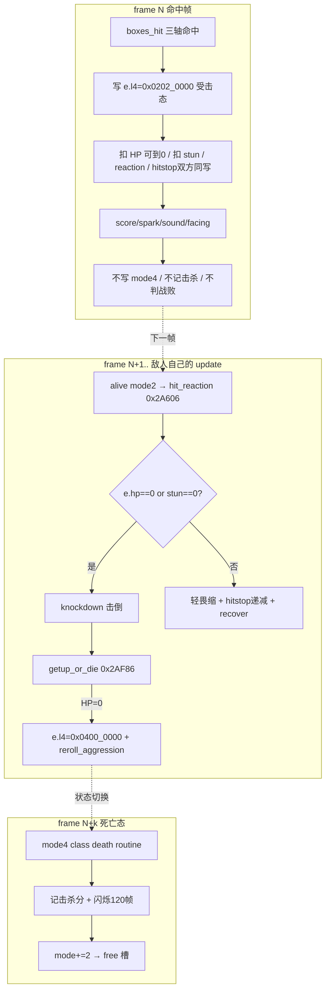

## 12.2 wof：命中链当帧走完伤害 + 反应分派 + 写反应字段 + 双方硬直

素材来自 `Cps1Collision.cs` 的伤害函数与 `受击反应分发_可能对应ASM_7E4A`。

```
# frame N：碰撞/伤害链（多处调用点 799 / 1358 / 2932 / 4764）
扣血链:
    damage = 随机伤害查表(0x1C20) × 难度索引(0x7DDA) × 0x6EE84修正 × 防御衰减
    target.Hp -= damage
受击反应分发_可能对应ASM_7E4A(attacker, target, a3)  0x7E4A:  # 同一条命中链内当帧调用
    reaction = rb(a3) ; a3 += 1
    if target.Hp < 0 且 ObjId > 4: reaction = rb(a3)   # ★ 当帧就用 HP<0 换"死亡备用字节"
    a3 += 1
    switch(reaction 字节偏移 00/02/04/06/08/0A/0C/0E/10):   # 9 项 = 表 0x7E68
        0x00 → 受击反应_轻硬直或累计击飞_可能对应ASM_7E7A
        0x02/0x04 → 0x7F14：Hp<0→0x7E92 / 骑乘→0x7E86 / 否则写
                    StunLeft=0, StunVal=0, DmgReaction=reaction → 命中双方硬直_可能对应ASM_7EA2
        0x06 → 0x7ECE ；0x0A → 0x7F0A（PosZ≥0x10 覆盖为 0x02 落穿）
        ... 0x7E86/0x7E92/0x7F36 各段
    # 反应分派当帧写出 StunLeft / StunVal / DmgReaction / 双方硬直
    # 另有 推迟当帧新硬直递减_无对应ASM（命中当帧不递减新硬直的时序保护）
```

repo 对 9 项反应**已有命名**（`受击反应_轻硬直或累计击飞_可能对应ASM_7E7A`、`受击反应_0x7E86段_可能对应ASM_7E86`、`受击反应_0x7E92段_可能对应ASM_7E92`、`受击反应_0x7F36段_可能对应ASM_7F36`、`累计击飞硬直_可能对应ASM_17B2` 等），并非 §10.7 写的"未逐条解析"——那条待核应收敛为"repo 已命名，未做的是逐段反编译对照"（见 §12.6）。

## 12.3 时序差异的设计后果（不是实现细节）

| 设计面 | dino（结算 / 处决分帧） | wof（命中链当帧分派反应） |
|---|---|---|
| hitstop | 命中帧双方同写、队伍技连伙伴；递减在**受击态**里（`enemy_flinch:902`） | 命中链 `命中双方硬直_可能对应ASM_7EA2` 当帧写；有"当帧新硬直不递减"保护 |
| 韧性 / 击倒 | 命中帧只扣 `stun`；`stun==0 或 hp==0` 在**受击反应帧**转击倒 | 当帧写 `StunLeft/StunVal/DmgReaction`，反应字节按 `Hp<0` 当帧选备用值 |
| 死亡 / 击杀 / 战败 | **明确推迟**：源码注释 `the defeat come from ... its next update (the original does not call them here)`；击杀分在 mode4 死亡态记 | 反应分派在命中链当帧调用，`Hp<0` 当帧换死亡备用反应字节 |
| 演出节奏 | 受击 → 击倒 → 起身或死亡 → 闪烁 120 帧清场，是一条**由对象状态机自驱的多帧时间线** | 反应字段当帧写齐，后续由对象状态推进 |
| 受击期间脚本 | 过场脚本 `+$04 != 0x0200` 挂起（§4.1），与"受击态持续多帧"同构——**表演轨道与玩法轨道用状态字解耦** | 事件队列是任务内核轨道（§4.2），与对象受击态不是同一套挂起机制 |

一句话：dino 把"一次命中"拆成**命中帧结算 / 后续帧处决 / 死亡态演出**三段，且用一条源码注释钉死"原版不在此处调用战败"；wof 在一条命中链里当帧把伤害、反应字节、硬直字段写齐。前者把节奏交给对象状态机，后者把节奏交给命中例程。这是**打击手感与演出编排**的取向差，不是"谁对谁错"。

## 12.4 收口：两种"驱动角色"的哲学（把 §4 事件脚本用时序说清）

```
# dino：脚本覆写输入 → 复用完整玩家状态机（§4.1 / §9.4）
frame: script_step 覆写 +$A0(held)/+$A8(pressed)
       → players_update 照常读输入、跑 mode/sub 状态机
       → 若同帧/前帧被打：+$04 != 0x0200 → script_step 挂起
   设计后果：过场"表演"没有独立轨道，受击/死亡天然打断脚本；
             不需要脚本自己判断"角色是否还能演"。

# wof：关卡脚本直接分配对象填字段 + 事件队列协程（§4.2 / §9.4）
frame: 0x106F4 命令表 0x10744 → 分配对象并填 +$21/$4/$8/$22/$24/$26
       0xD000 事件队列按 VBlank 截断消费 N 项（N 是帧内物理量）
   设计后果：脚本是一条独立轨道，其推进量与 CPU 负载耦合；
             "一帧消费几项"本身要逐点求解。
```

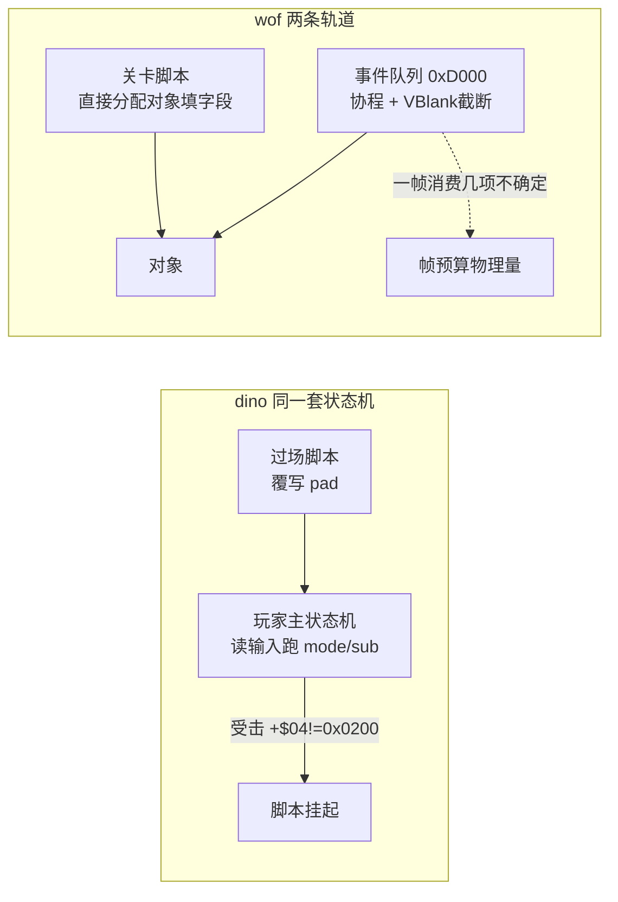

## 12.5 repo 侧证据索引（本轮全部只读源码）

| 结论 | 位置 |
|---|---|
| dino 命中帧写 `0x0202_0000`、扣 HP/扣 stun/reaction/hitstop 双方同写 | `enemy_combat.rs:489-571` |
| dino "击杀/战败来自下一次 update 的 hit state，原版不在此调用" | `enemy_combat.rs:569`（源码注释原文） |
| dino 受击反应 10+ 分派 / HP=0 在受击态转击倒 | `enemy_combat.rs:869-905` |
| dino 死亡态 mode4 闪烁 120 帧后 free | `enemy.rs:978-1015` |
| dino 受击反应启动死亡态 | `boss.rs:516`、`:546` 注释 |
| wof 命中链当帧调反应分派（多处） | `Cps1Collision.cs:799,1358,2932,4764` |
| wof `0x7E4A` 当帧判 `Hp<0` 换死亡备用字节 / 9 项字节偏移 | `Cps1Collision.cs:4882-4950` |
| wof 9 项反应 repo 已有命名 | `Cps1Collision.cs:4909,4933,4938,4983,5061,5088,5104,5129,5179` |
| wof 命中双方硬直 / 当帧新硬直递减保护 | `Cps1Collision.cs:865-874,4945` |

## 12.6 顺带收敛 §10.7 一条待核

§10.7 / §9.9 写"wof 9 项受击反应处理体未逐条解析，不能断言 wof 没有 poise/dizzy/燃烧"。本轮读 repo 发现**这 9 项在 `Cps1Collision.cs` 里已有命名与逐段还原**（`0x7E7A` 轻硬直或累计击飞、`0x7F14` 普通反应、`0x7ECE`、`0x7F0A`、`0x7E86/0x7E92/0x7F36` 段、`累计击飞硬直_可能对应ASM_17B2`）。因此该条应收敛为：**repo 已有命名与直译，未做的是把这些段与 ROM 逐指令对照**；"不能断言 wof 没有 poise/dizzy"这个**谨慎立场仍然正确**——repo 里就有 `StunLeft/StunVal/DmgReaction` 这类硬直字段，本就不该由"表项只有 9 个"推出机制缺失。

---

# 第六轮：怪物策略的「帧间反馈闭环」（§5 的伪代码 / 流程图）

> 承接 §11.6 的第二半：把 §5 / §11.5 的目标选择写成可直接对照的伪代码 / 流程图。
> 本轮同样**全部以 repo 源码为准**（`enemy.rs` 的 census / pick_target / retarget_slot / steer_slot，wof 侧引用 §11.1 已核实的 repo 语义），不做 ROM 取证。

## 13.0 主题：敌人「不扎堆」是靠什么实现的

清版游戏里一群敌人同时扑向一个玩家会很难看也很难打。两边都解决了这个问题，但**机制类型完全不同**：

- dino：每帧做一次**全局 census（人口普查）**，把"上一帧每个玩家被几个敌人瞄着、左右两侧各站了几个敌人"存下来，敌人**本帧**选目标时读的是**上一帧**的统计 → 一个带一帧延迟的**反馈闭环**。
- wof：敌人当帧按**活跃玩家位图 + rng&3** 查一张 32 字节表直接选一个玩家，外加 `0x4244` 选择锁校验（§11.1）→ **无全局统计、无帧间反馈**。

## 13.1 dino：census → pick_target → retarget_slot → steer_slot 四段闭环

全部来自 `enemy.rs` 源码（`enemy_census` / `enemy_pick_target` / `enemy_c2_retarget_slot` / `enemy_c2_steer_slot`）。

```
# ── 每帧第 1 步：objects_update → enemy_census 0x3242E ──
census():
    census_prev = census                    # ★ 先把上一帧快照存下来
    census = [[0,0,0,0],[0,0,0,0],[0,0,0,0]]
    for 每个存活、非死亡、非"攻击标志负"的敌人 e:
        p = e.TARGET 指向的玩家 (0/1/2)
        c = census[p]
        c[0] += 1                           # 该玩家被几个敌人瞄着
        if e.ATTACKING != 0: c[1] += 1      # 其中几个正在攻击
        if player[p].x >= e.x: c[2] += 1    # 该玩家左侧(玩家在敌人右边)的敌人数
        else:                 c[3] += 1    # 该玩家右侧的敌人数
    # census_target / A2 / A3 是 census 留下的寄存器副作用，供伤害 scale / 声像 / 抓取用

# ── 敌人 reset_ai / retarget 时：pick_target 0x32032 ──
pick_target(e):
    present = 3 个玩家是否 live
    if 无人 live: 用 flow.started 位选第一个开始的英雄
    prev = census_prev                      # ★ 读的是【上一帧】统计
    m = min(prev[p][0] over present)        # 被瞄准最少的玩家
    if m < 3:
        score[argmin] = 1                   # ★ 负载均衡：优先补人少的，直接定目标
    else:                                   # 所有玩家都已被 >=3 个敌人瞄着
        score = 0
        最近者(Manhattan |dx|+|dz|)      += 10
        最大分数者                        += 1
        最大体力者                        += 2
        每玩家: 特定动作字 += 6 或 3
                facing==0 += 4             # QUIRK 0x3221C：两分支同条件
                走路中(mode2/sub0/act2) += 3
    return argmax(score)                    # 平局 P1 > P2 > P3

# ── 选完目标：retarget_slot 0x35172（侧翼包抄）──
retarget_slot(e):
    t = pick_target(e) ; e.TARGET = t
    c = census_prev[目标玩家 p]             # ★ 又用上一帧
    l = c[2]-1 ; r = c[3]-1                # 去掉自己后，左/右两侧敌人数
    s = (l > r) ? 3 : (l < r ? r : 3)      # 按左右人数选初始接近槽位
    if e.z < t.z: s += 1                   # Z 深度微调
    ...
    e.SLOT = s                             # 6 个接近槽位之一

# ── 每帧移动：steer_slot 0x351C4 ──
steer_slot(e):
    s = e.SLOT ; if t.facing: s = (s+3) mod 6     # 面向翻转时换到对称槽
    (dx,dz) = SLOTS[s] ; if t.facing: dx = -dx
    朝槽位点转向，最多 4 步
    # state 2 approach / state 6 MAAI 悬停 / rotate_slot 卡住轮换 都用这套槽位
```

关键点只有一句：**`census` 把"当前帧谁瞄谁"存成 `census_prev`，`pick_target` / `retarget_slot` 读的是上一帧的值**。于是"某个玩家被瞄的人多了"这件事，要到**下一帧**才会让新敌人改选目标、并让人少一侧得到包抄。这是刻意的一帧延迟，不是 bug。

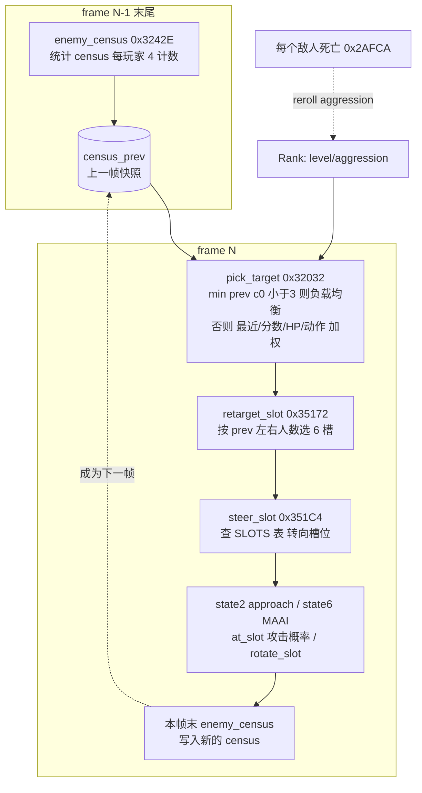

## 13.2 wof：当帧按位图查表选目标，无帧间统计

按 §11.1 已核实的 repo 语义（`Cps1Actor1CRuntime.cs` / `Cps1Actor27Runtime.cs` / `Cps1Actor1BRuntime.cs`）：

```
# 敌人收招 / 入场 / C02 校验时（当帧，不读上一帧统计）
0x3E1E 对象_随机选择活动目标():
    bm = rb(A5-0x3E) & 7                   # 活跃玩家位图
    if bm == 0: 写 OBJ+0xC3=0xFF ; return  # 无有效目标
    idx = (bm << 2) + (rng() & 3)
    d6 = B[0x3E62 + idx]                   # 0/1/2 = 玩家槽号，0xFF = 不选/清锁
    OBJ+0xC3 = d6                          # 目标选择锁
    A1 = 0x3E1C + W[0x3E82 + d6*2]         # 0000/00E0/01C0 → 玩家参数块
    OBJ+0x3A = A1 ; bsr 0x3F0C ; jsr 0x7854 # 站位偏置 + 方向索引

0x39A0 敌人收招按活动位图选择最近玩家():    # 另一条：按位图选最近
0x4244 / 0x422E 目标校验():                # btst.l d0,-$3e(a5)
    if 锁定玩家在位图里已不活跃: OBJ+0xC3 = 0xFF（清锁，下次重选）
```

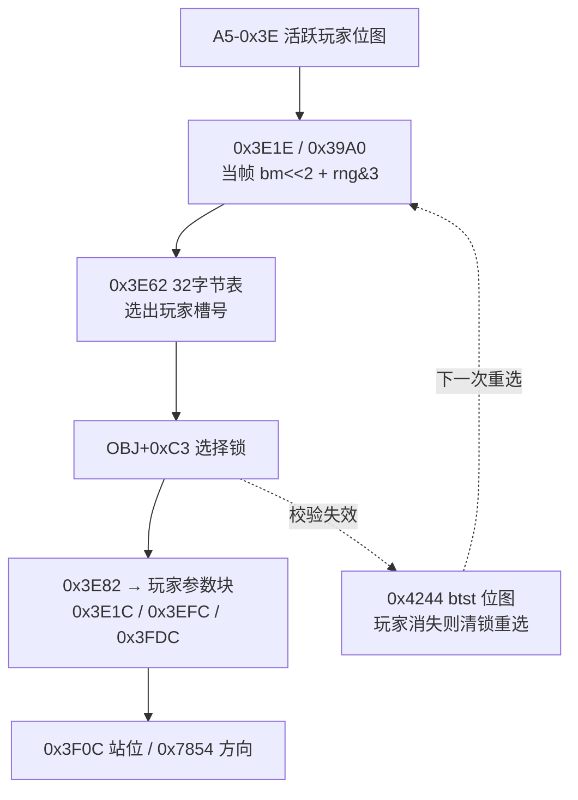

## 13.3 设计后果对照（怪物策略层）

| 设计面 | dino（帧间反馈闭环） | wof（当帧位图查表） |
|---|---|---|
| 不扎堆 | `census_prev[p][0] < 3` 优先补人少的玩家，是**全局负载均衡** | 无全局统计；`0x3E62` 表在多人活跃时用 `rng&3` 轮转（111 行 `00 01 02 ff`），是**概率分散** |
| 侧翼包抄 | 6 个接近槽位 + `retarget_slot` 按上一帧左右人数选槽 + `rotate_slot` 卡住轮换 | 未见等价的 census 驱动槽位系统；`0x3F0C` 只做站位偏置 |
| 决策依据 | 上一帧的**群体状态**（谁被瞄几个、左右分布）+ 本帧的多维个体加权（最近/分数/HP/动作/朝向/走路） | 本帧的**活跃玩家组合** + rng；个体维度只有 `0x39A0` 的"最近" |
| 反馈延迟 | 刻意一帧：统计在帧末，决策读 `prev` | 无（当帧闭环） |
| 目标锁定 | 目标存在 `e.TARGET`，每次 `reset_ai` / 受击 / 入场后重选 | `OBJ+0xC3` 显式选择锁，`0x4244` 用位图校验，玩家消失才清锁 |
| 与难度联动 | census / 槽位攻击概率都读 `Rank.aggression`（§9.5 / §10.2） | 位图与难度无关（§11.1 已收敛：不是 AI 档位） |

**收敛表述**（对齐 §11.5，不夸大）：两边都能让敌人不扎堆，但 dino 是"**统计驱动的群体协调**"（有 census 闭环、侧翼槽位、与难度联动），wof 是"**位图 + 随机表的轻量分散**"（当帧、无全局状态、选择锁校验）。这是策略丰富度的差别，不是"有/无 AI"的差别——和 §11.2 对 `0x3C6A` 的处理一样，不再包装成"架构反转"。

## 13.4 证据索引（本轮全部只读 repo 源码）

| 结论 | 位置 |
|---|---|
| dino census：`census_prev = census`、每玩家 4 计数（被瞄/攻击中/左/右） | `enemy.rs:770-805` |
| dino pick_target：`<3` 负载均衡 / 多维加权 / 平局 P1>P2>P3 | `enemy.rs:828-921` |
| dino retarget_slot 用 `census_prev[p][2]/[3]` 侧翼选槽 | `enemy.rs:1661-1685` |
| dino steer_slot：6 槽、`facing` 时 +3 取模 6、`SLOTS` 表 | `enemy.rs:1688-1703` |
| dino 槽位在状态机里的使用（approach / MAAI / at_slot / rotate） | `enemy.rs:1463-1600`、`enemy_c2_reset_ai:1418-1429` |
| census 结构定义 | `spawn.rs:51`（`census_prev: [[u8;4];3]`）、`trace.rs:1299` 逐字段 trace |
| wof 目标选择 / 选择锁 / 活跃玩家位图 | §11.1 已核：`Cps1Actor1CRuntime.cs:2017-2041`、`Cps1Actor27Runtime.cs:612`、`Cps1Actor26Runtime.cs:554,562-563`、`Cps1Actor1BRuntime.cs:701-724` |

## 13.5 阶段性收口与下一步

- 用户给的四大主题已各自有一轮"游戏设计本身"的深挖：状态机（§2）、打击（§3 / §9.3 / §12）、事件脚本（§4 / §9.4 / §12.4）、怪物策略（§5 / §11.5 / §13）。
- 仍未做的纯设计向工作：把 dino 的**搓招 FSM 与脚本覆写输入在"同一帧的输入优先权"**画成一张时序图（输入层如何被多处覆写：脚本 pad / 玩家真实输入 / cmd_state 的边界）；以及 dino **换人 tag / car 关卡**这两套附加系统如何挂进 §2 的分层状态机（§6.1 只列了现象，没画挂接方式）。
- 仍待补的 data（§10.7 / §11.6 保留项）：wof `0x3E82` 后半段、`0x7854`/`0x3F0C` 内部、`0x22DB0` region set 差异；dino `class4_states.rs` / `boss.rs` / `class25_ai.rs` 的 Boss 反击与变身。这些只在"必要时"补，且一律以 repo 语义为准。
- 全程沿用用户给定前提（dino 更晚更成熟），未考证发行先后。

---

# 第七轮：一个 `+$A0` 字节的三层写入者（输入层帧内优先权）

> 承接 §13.5 下一步。§2.2 画了状态机的"分层"，但没说清这些层在**同一帧里谁先写、谁后读**。本轮只读 `player.rs` / `script.rs` 源码，把 `+$A0(held)/+$A8(pressed)` 这一个字节的写入顺序钉死。
> 顺带把 §4.1 "玩家 update 之后跑脚本"的措辞**精确化**：脚本 hook 其实在 `players_update → player_frame` **内部**、状态机分派**之前**（`player.rs:576`）。这是时序精确化，不是结论更正。

## 14.1 `player_frame` 的帧内顺序（源码逐行）

```
player_frame(i, cur):                       # cur = 本帧真实输入快照 w.input（players_update:541）
    # ① 真实输入写 pad                     player.rs:570-575
    p.prev(0xA1) = p.held(0xA0)
    p.held(0xA0) = cur
    p.pressed(0xA8) = cur & (cur ^ p.prev)  # 按下边沿

    # ② 脚本覆写 pad                       player.rs:576 → script_player_hook → script_step
    script_player_hook(i):
        if G.$4DD == 0: return
        if 该英雄 +$D0 == 0: script_hero_start(0x1DB0C)
        script_step(0x1DB5E):
            if p.mode != 2 or p.sub != 0: return      # ★ 状态字是【上一帧末】的
            if (G.$4DD & bit) == 0: return
            计时器递减 / 读下一条 6 字节记录
            执行 action → 覆写 +$A0(held)/+$A8(pressed)
            多数 action 末尾 script_pad_clear(0x1DEA6): 清 +$A0/+$A8/+$BC
                                                        # ★ 不清 +$A1(prev)

    # ③ 输入锁清 pad                       player.rs:577-582
    if input_lock(0x11A) != 0: held = prev = pressed = 0

    # ④ 特殊模式门                         player.rs:583-600
    car 关 / Ep8 clear sequence 时可能直接 return（跳过下面的状态机）

    # ⑤ 状态机分派（读 ①②③ 之后的 pad）  player.rs:601-607
    match p.mode: 0→spawn / 2→player_alive / 4→dead / 6→remove
        player_alive 内:
            p.cmd_flag = 0                            # player.rs:927 每帧先清
            player_command_fsm(i)  0x6AC8            # player.rs:929 读 held/pressed 识别搓招
            ... 动作状态 / 攻击判定 / 移动 ...
```

**一句话**：`+$A0/+$A8` 被 **真实输入 → 脚本 → 输入锁** 三层依次覆写，然后才由状态机和搓招 FSM 读。脚本不是"另一条轨道"，它只是排队在真实输入之后、状态机之前的一个 pad 写入者。

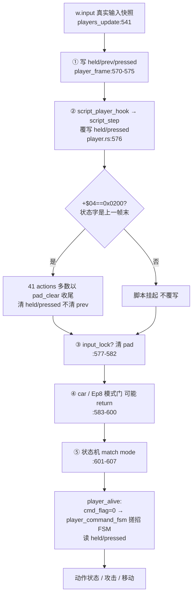

## 14.2 由此得到的几条设计性质（都是"游戏本意"层）

1. **脚本与玩法共用同一套输入 → 同一套状态机**：过场不是另写一套表演逻辑，只是"在真实输入之后塞一个伪造 pad"。所以脚本角色会正常跑走路 / 朝向 / 攻击 / 受击 / 死亡判定（§4.1 的结论在这里有了帧内依据）。
2. **"受击自动中断脚本"是延迟一帧的**：`script_step` 在 ② 处检查 `+$04==0x0200`，而本帧的受击是在 ⑤ 的状态机里才把 sub 改成 2 → 所以本帧脚本仍会执行，**下一帧**才挂起。这是"用上一帧状态字做门控"的自然结果，与 §13 的 `census_prev` 是同一种一帧延迟。
3. **搓招 FSM 也读被脚本覆写过的 pad**：`player_command_fsm` 在 `player_alive` 内（⑤ 之后），读的是 ①②③ 之后的 `held/pressed`。所以理论上一串伪造的"下→上→攻击"脚本输入也能推进 `cmd_state`——必杀识别层并不区分输入来自摇杆还是脚本。
4. **输入锁是第三道门**：`input_lock(0x11A)` 在脚本之后、状态机之前把 pad 全清，用于被投 / 硬直等"角色暂时不接受任何输入"的状态；优先级高于脚本。
5. **`prev` 不清是保留的原机怪癖**：`script_pad_clear` 只清 `+$A0/+$A8/+$BC`，不清 `+$A1(prev)`；下一帧 `pressed = cur & (cur ^ prev)` 仍用残留 prev 计算边沿。§4.1 记的 "walk 保持上帧方向 `+$A0 = +$A1`" 正是这个机制的利用。

## 14.3 与 wof 的输入层对照

| | dino | wof |
|---|---|---|
| 输入边沿 | `pressed = cur & (cur ^ prev)`，`+$A0/A1/A8` 三字节 | §9.2 `0x1AA58`：`not prev & held` → pressed(`+$A2`)，攻击键边沿置 `+$A4` 标志 |
| 输入覆写者 | 真实输入 → **脚本** → input_lock 三层 | 读输入后直接进 `ActStatABCD` 状态分派，未见脚本覆写玩家 pad |
| 独立搓招层 | `cmd_state/cmd_t/cmd_flag` 与主状态机并行，且读最终 pad | 以多个 `+$60/$78/$A8/$9A` 计时器 + 状态字组合承载，未见独立的"下→上→攻击"窗口 FSM |
| 脚本与角色 | 同一套状态机（覆写输入） | 脚本直接分配对象填字段 / 事件队列协程（§4.2、§12.4）——两条轨道 |

这把 §2.4 的"层间窄接口"具体化了：dino 的层与层之间传的不是状态、不是消息，而是**一个被多方覆写的输入字节**；脚本、搓招、状态机、输入锁靠"在帧内排队的先后顺序"耦合，而不是靠显式接口。

## 14.4 证据索引（本轮全部只读 repo 源码）

| 结论 | 位置 |
|---|---|
| `player_frame` 五段顺序（写 pad / 脚本 hook / input_lock / 模式门 / 状态分派） | `player.rs:569-607` |
| 真实输入来自 `w.input` 快照 | `player.rs:540-549` |
| `script_player_hook` 在 player update 内、状态机前 | `player.rs:576`；`script.rs:190-201` 注释 `0x189CE..0x189EE in the player update` |
| `script_step` 挂起条件读状态字 `+$04` | `script.rs:219-227` |
| `script_pad_clear` 清 `+$A0/$A8/$BC` | `script.rs:20,350` |
| `cmd_flag=0` + `player_command_fsm` 在 `player_alive` 内 | `player.rs:927-929,961-1006` |
| `input_lock` 字段 | `player.rs:174` |
| wof 输入边沿 / 状态分派 | §9.2（`Cps1PlayerLogic.cs:76`、Ghidra `0x1AA58`） |

## 14.5 收口：整份笔记的主线

- 到本轮为止，用户给的四大主题都有一条"**帧内 / 帧间时序**"主线：状态机分层（§2 + §14 输入优先权）、打击（§12 命中 / 处决分帧）、事件脚本（§12.4 覆写输入 vs 独立轨道）、怪物策略（§13 census 一帧延迟闭环）。四者共享同一个设计习惯：**把"这一帧做什么、下一帧读什么"当作显式结构**（固定顺序 + 状态字节 + `prev` 快照），而不是靠即时调用链。
- 这条主线也解释了用户前十几轮最关心的"函数执行次数不确定"在 dino 侧为何不构成障碍：dino 把这些时序点做成了固定顺序 + 状态字节 + `prev` 快照，wof 则原样保留了协作式内核的帧预算自由度（§9.2、§4.2）。这是**游戏 / 引擎设计取向**的差别，落到移植工程上才变成"能不能逐帧对拍"的差别。
- 仍未做（保留，不扩张）：换人 tag / car 关卡如何挂进 §2 分层状态机（§6.1 只列现象）；§10.7 / §11.6 的 data 待补项。ROM 继续只在"必要时"用于补 data，且以 repo 语义为准。
- 全程沿用用户给定前提（dino 更晚更成熟），未考证发行先后。

---

# 第八轮：附加玩法怎么挂进固定的帧循环（§6.1 第 6 条的空白）

> 承接 §14.5 明确列出的下一步。§6.1 把"换人 tag / car 关卡"列为"附加玩法系统"，但只列了现象，没说清它们**如何挂进 §2 那套固定顺序的分层状态机**。本轮只读 repo 源码（`player_tag.rs` / `car.rs` / `mod.rs` / `combat.rs` / `player.rs`），把挂接方式画出来。
> 前提仍是用户约定：只谈游戏逻辑怎么组织。全部以 repo 源码/注释为准，不做 ROM 取证。

## 15.0 问题：帧循环是固定的，附加玩法往哪插

§2.1 / §13.1 已经把 `game_frame` 和 `objects_update` 的固定顺序钉死了：

```
objects_update: census → players_update → items → enemies → shake → props → effects
              → held_players → obstacles_swap → tag_trigger → hud_tail → background → terrain
game_frame: rank_tick → objects_update → collision → hud → sprites → lists_reset → time_limit → spawn_script_tick
```

（`mod.rs:352-377`）。有意思的是：这么丰富的附加玩法，**没有一条给主循环加新步骤**（除了 `tag_trigger` 这一个固定钩子），也没有把主循环改成"按模式分派"。它们靠三种不同手法挂进去。

## 15.1 tag 换人：改「对象自身的状态字节」，复用既有玩家状态机

`player_tag.rs` 头部注释（`:1-15`）把整套机制写得很完整：

```
# 每帧 objects_update 末尾（mod.rs:373，0xE9C8，held_players 之后）
tag_trigger 0x670C:
    if G.$4DD != 0: return                 # 过场脚本中不触发
    for a in 0..3: tag_check(a)

tag_check 0x6728（每个发起者 A）:
    if A 已绑 / 无敌 / 持重物件 / input_lock: return
    if A 有任何输入: c2 = c3 = 0x5A ; return    # ★ 一有输入就重置 90 帧计数
    for B in OTHERS[A]（另两个玩家，表 0x66F4）:
        if B live / 非无敌 / normal mode / frame class 0 / action 0 / 无重物件 / 无输入
           且 A.x-B.x ∈ [-32,31] 且 A.z-B.z ∈ [0,15]（A 与 B 齐平或更深）:
            cB -= 1
            if cB == 0: tag_start 0x686E ; break
        else: cB = 0x5A

tag_start 0x686E:
    A.状态字 = 0x0200_001A          # ★ mode2/sub0/act=0x1A，仍是玩家状态机的一个分支
                                   #   → player_alive 内 player_tag_swing 0x19A7C
    B.帧类(0x2E) = 0xE             # ★ 改帧类 → 由 held_players_update 在敌人之后跑
    B 状态按表 0x6902（Jack 跑 / Hannah,Mustapha,Mess 飞）
    tag_follow 0x6922 按表 0x69D4 + A 的 phase(+$2D) 把 B 摆到 A 手上
    双方 +$EC = 180（闪烁无敌 180 帧）
```

**关键**：tag 没有新建"合体技对象"、没有新建状态机、没有改主循环。它只做两件事——
1. 在 `objects_update` 末尾用**两个每帧计数器**检测"两人静止重叠 90 帧无输入"（纯条件触发，不改任何对象）；
2. 触发时**改写两个既有玩家对象的状态字节**（`act=0x1A` / `帧类=0xE`），把它们"挪"到同一套玩家状态机里早已存在的分支/更新队列上。

于是 `player_alive` 的 `match act` 自然分派到 `player_tag_swing`，`held_players_update` 自然接手 partner。和 §14 的"脚本覆写 `+$A0`"是同一种手法：**不新增解释器，只改变既有解释器的输入 / 状态**。

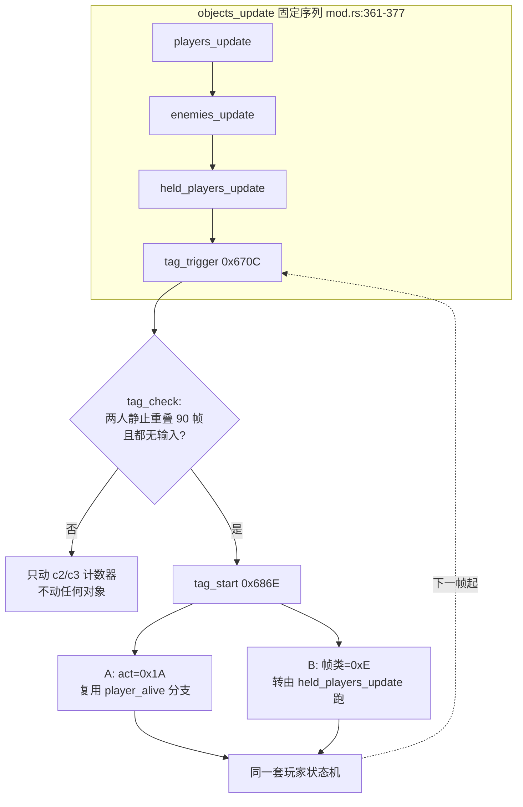

## 15.2 car 载具：一个全局模式位 + 各系统自查 + 一个独立对象 + 插入碰撞 pass

`car.rs:1-8` 与 `combat.rs:85-94` 给出的挂接方式和 tag 完全不同：

```
# 车本身 = pool B class 88 的一个普通对象（0x8BDDC..0x8C886），有自己的四态状态机
car 对象: mode 0 到达(0/2/4/6/8/A/C/E 子态) / mode 2 驾驶 / mode 4 结束 / mode 6 释放
          座位 +$A2..$A4、乘员位 +$A8、转向目标 +$B0/$B2、颠簸 +$AE ...（car.rs:14-38）

# 全局模式位 G.$518 (car_mode)，由 flow / car / boss_common 在多处置 0/1/2
# 关键是：没有"car 主循环"，而是各系统各自检查同一个位
player_frame   : if car_mode: 英雄 respawn 无敌、不进碰撞表、不绘制；可能 return 跳过状态机（player.rs:583-600）
boss.rs        : car_mode != 0 时跳过 Boss 逻辑（:86,:190,:225）
camera.rs      : car_mode != 0 时走追车逻辑（:1495,:1604-1635）
effect.rs      : car_mode != 0 时跳过部分特效（:521）
combat.rs      : if car_mode != 0 && car_on != 0: 在固定 pass 序列里插入 4 个专属 pass
                    pass_121d8 / 122d8 / 12342 / (lock78? 12454)   （:85-94）
```

**关键**：car 是「**一个被多方读取的全局模式位**」+「一个独立 pool B 对象」+「往固定 `collision()` 序列里条件插入 4 个 pass」。它不改主循环结构，但确实**新增了一个对象和一组 pass**；各系统靠"在同一帧里各自 `if car_mode`"来协同，而不是把逻辑收进一个 car 模块。这和 §11.2 里 wof `0x3C6A`（共享函数 + 每兵种各带概率表）是同一类"分散式共享"思路，只是共享的是**模式位**而不是函数。

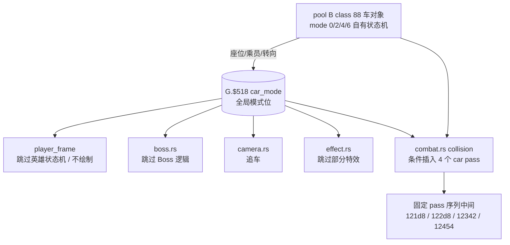

## 15.3 三种挂接方式合表：都不破坏固定帧循环

| 附加玩法 | 挂接手法 | 新增对象 | 新增主循环步骤 | 共享的"接口" |
|---|---|---|---|---|
| 过场脚本（§14） | 在 `player_frame` 内**覆写输入字节** `+$A0/$A8` | 无 | 无（复用 `script_player_hook`） | 一个被三方覆写的 pad 字节 |
| 换人 tag（§15.1） | 在 `objects_update` 末尾用计数器检测，触发时**改对象状态字节**（`act` / `帧类`） | 无 | 1 个固定钩子 `tag_trigger` | 既有玩家状态机的 `mode/sub/act` |
| car 载具（§15.2） | **全局 `car_mode` 位** + 各系统自查 + 插入碰撞 pass | 1 个 pool B 对象 + 4 pass | 无（pass 在既有 `collision()` 内） | 一个被多方读取的模式位 |

三者共同回答了 §6.1 的空白：dino 上层玩法丰富，但**主循环始终是那一条固定序列**；丰富度来自"往既有解释器的输入 / 状态 / 模式位上做文章"，而不是把主循环改成按模式分派的大 switch。这也和 §14.5 的主线一致——**时序点是显式、固定、可枚举的**。

## 15.4 wof 对照（谨慎，不夸大）

| | dino | wof |
|---|---|---|
| 双人合体 / 换人 | `tag_trigger` 90 帧静止检测 + 改 `act`/帧类；有 `PARTNER_STATE 0x6902`、`FOLLOW_PTRS 0x6994` 等表 | repo 中未见等价的"双人静止触发合体技"系统 |
| 载具关卡 | 全局 `car_mode` 被玩家 / Boss / 相机 / 特效 / 碰撞多系统共同检查；独立 pool B 车对象 | repo 中未见等价的**关卡级**载具模式位 |
| 对象挂载 / 骑乘 | 车的座位 `+$A2..$A4`、乘员位 `+$A8` | 有 `Mount(+$63)` 骑乘标志 + `MountObj(+$3A)` 父对象指针：`夏侯敦_骑乘B02_受击与下马链_对应ASM_12884`、`Cps1Collision.cs:4936 target.Mount!=0 → 0x7E86`、许褚子对象 `Cps1EventObjectRuntime.cs:1580` |

**收敛表述**：wof 的 `Mount/MountObj` 是**对象级**的父子挂载 / 骑乘（作用域是单条对象链，进受击反应分支），和 dino `car_mode` 那种**全局关卡级**模式位不是同一层次。但按 §11 的定位，这里只说"repo 中未见等价"，不断言 wof 一定没有——除非真去把 wof 全部流程表读完，而这属于"必要时才做"的范围。

## 15.5 证据索引（本轮全部只读 repo 源码）

| 结论 | 位置 |
|---|---|
| `objects_update` / `game_frame` 固定序列 | `mod.rs:352-377` |
| `tag_trigger` 是序列里唯一新增钩子，在 held_players 之后 | `mod.rs:373`；`player_tag.rs:5` 注释 `0xE9C8, after the held players` |
| tag 机制全文（90 帧、两个计数器、表 0x66F4/0x6902/0x6994/0x69D4、闪烁 180 帧） | `player_tag.rs:1-15,31-45` |
| `tag_start` 后 A 走 `0x0200001A` / B 帧类 0xE 由 held_players 跑 | `player_tag.rs:4-11` |
| car = pool B class 88、四态状态机、座位/乘员字段 | `car.rs:1-38` |
| 4 个 car pass 条件插入 `collision()` | `combat.rs:85-94` |
| `car_mode` 在玩家 / Boss / 相机 / 特效 / flow 的门控 | `player.rs:583-600`；`boss.rs:86,190,225`；`camera.rs:1495,1604-1635`；`effect.rs:521`；`flow.rs:432,1249` |
| wof `Mount` / `MountObj` 对象级骑乘 | `Cps1Collision.cs:1540,1564,1636,1691,4925,4936,5064,5074`；`Cps1Actor2B2CRuntime.cs:332-342`；`Cps1EventObjectRuntime.cs:939,1580` |

## 15.6 阶段性收口（继续保留的边界）

- §6.1 第 6 条的空白已补齐：tag / car 的**挂接方式**已画清，且归纳出"过场=覆写输入、tag=改状态字节、car=全局模式位"三种手法，共同点是**不破坏固定帧循环**。
- 到本轮，用户给的四大主题 + §6.1 的附加玩法系统都已有"游戏设计本身"的深挖。整份笔记的主线（§14.5）再补一块：附加玩法也是靠"显式、固定、可枚举的时序点"挂进去的。
- 仍未做（保留，不扩张）：§10.7 / §11.6 的 data 待补项（wof `0x3E82` 后半段、`0x7854`/`0x3F0C` 内部、`0x22DB0` region set 差异；dino `class4_states.rs` / `boss.rs` / `class25_ai.rs` 的 Boss 反击与变身）。这些严格"必要时才补"、以 repo 语义为准。
- 全程沿用用户给定前提（dino 更晚更成熟），未考证发行先后。

---

# 第九轮：Boss 层是「共享零件 + 每类自己的分派」（§6.1 第 4 条的空白）

> 承接 §15.6。§6.1 第 4 条只写了"Boss 多形态 + aggression 分档 / 5 个 Boss 各自保留反击与变身"，没展开它们怎么组织。本轮只读 `boss_common.rs` / `boss.rs` 源码。
> **特别当心**：这里有个 `BossAi` 枚举，很容易又被写成"dino 有统一 Boss 决策器"——那正是 §10.1 被作废的错误。repo 头部注释 `boss_common.rs:1-2` 自己把边界钉死了：`Class handlers keep their own state dispatch, counterattacks and transformations. These helpers do not run an invented common AI.`

## 16.0 `BossAi` 不是决策器，是「表地址选择器」

`BossAi` 只有 5 个变体（Morgan / Morgue / Tyrog / Tyrog2 / Fessenden，`boss_common.rs:11-17`），它做的全部事情是**按 Boss 种类 + 形态选出该读哪张 ROM 表**：

```
BossAi::phase_tables()  -> (aggressive表, defensive表)   # 每个 Boss 一对，地址各不相同
                                                        #   Morgan 0x5196A/0x5198A、Morgue 0x5418A/0x541AA ...
BossAi::gate_table(form):                               # 按形态选"攻击闸门"表
    Morgan      -> 0x73B14
    Morgue      -> 0x73D54
    Tyrog/Tyrog2-> 0x74542 + form_index(form)*0x40      # ★ 形态换表
    Fessenden   -> 0x74A42
BossAi::action_table(form, +$AB):                       # 按形态 + +$AB符号 选"动作"表
    Morgan      -> +$AB<0 ? 0x73B54 : 0x73C54           # ★ 符号选第二张表
    Morgue      -> 0x73D94
    Tyrog/Tyrog2-> 0x74602 + form_index(form)*0x100     # ★ 形态换表
    Fessenden   -> 0x74A82
form_index(form): 0 / 1 / 2（对应 form 1 / 2 / 3+）     # 0x38BE6 SUBQ+BMI/BEQ
```

也就是说：**没有一张"Boss AI 表"，每个 Boss 有自己成套的表，且 Tyrog/形态、Morgan/符号还会再切一次表**。`BossAi` 只是把"该查哪张表"参数化，决策的执行仍是各 class handler 自己的状态分派。这与 §11.2 对 `0x3C6A` 的收敛是同一判断，也和 §13.1 dino 杂兵"每类自己的 state 0"完全一致。

## 16.1 决策流水线：共享零件只到「抽出一个 action id」为止

```
# ① 相位节拍（每个 Boss 自己的 phase 计时器 +$A6）
boss_phase_tick(e, ai):                         # 0x51928 等
    if --+$A6 != 0: return false                # 相位未到
    r = rand() & 0x1E
    (agg, def) = ai.phase_tables()
    +$A6 = W[当前相位表 + r]                    # ★ 用相位表重装载计时器
    +$A0 ^= 1                                  # 攻击相位 / 防守相位翻转
    boss_pick_target(e)                        # 复用 §13 的 enemy_pick_target，无 RNG
    if ai in (Morgue, Fessenden): slot6/slot4 重算站位

# ② 攻击闸门（要不要进入攻击决策）
boss_gate_limit(e, ai):                        # 0x52C54 等
    row = aggression << 3                      # ★ G.$5EC aggression，不是 G.$5EE level
    return B[ai.gate_table(form) + row + +$A5] # 8 行(aggression) × 列(+$A5)
boss_aggression_gate(e, ai):                   # 0x52C6C
    return (rand() & 31) < limit               # 一次 RNG；Tyrog 命中时锁 +$A4

# ③ 抽动作（注意：返回的是 action id，不是状态字节）
boss_action_pick(e, ai):                       # 0x52C9A
    row = (rand() & 31) << 3
    return B[ai.action_table(form, +$AB) + row + +$A5]   # 又一次 RNG

# ④ 之后交给各 class handler 自己的状态分派 / 反击 / 变身
#    （boss_common.rs:1-2 明确不代跑）
```

**要点**：共享零件在「抽出一个 action id」处**停手**。repo 注释 `boss_action_pick:160` 特意写 "This returns the table's action id, not a state byte. Class handlers dispatch it, including Morgue's +$B9 veto after the draw." ——`Morgue` 甚至能在抽完之后一票否决。所以"5 个 Boss 各自保留反击与变身"不是空话，是**分派权本来就不在共享层**。

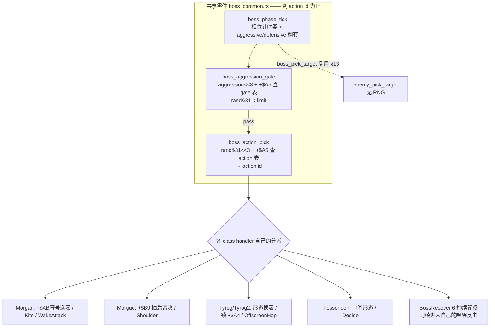

## 16.2 多形态：不是"死一次算输"，是相位 / 中间形态 / 终局三层

| 层 | 机制 | repo 证据 |
|---|---|---|
| 相位翻转 | `+$A0` 在 aggressive / defensive 间翻，`phase_tables()` 各给一张计时器重装表 | `boss_phase_tick:99-117` |
| 形态换表 | `form_index(form)` 让 Tyrog/Tyrog2 的 gate/action 表整体换成另一套（0/1/2 三档） | `form_index:32-41`、`gate_table:48`、`action_table:65` |
| 中间形态命中 | `boss_intermediate_hit`：Morgan/Tyrog form 1/2 命中 → `flow.speed=3` 慢动作 + `kill_all=2` 清场，**但不结束战斗**（无 `0xACEE`） | `:285-296` 注释 "slow the game and kill helpers, not the fight" |
| 终局 | `boss_end_hook 0xACEE` 才真正判负；与 score/leader hook 分离，由 dying routine 稍后调 | `:298-302`、`boss.rs:505-552` |

`boss.rs:516` 的注释 `e.b.mode = 4; // the hit reaction starts the death state` 与 §12.1 的"命中帧只结算、死亡由受击态下一帧推进"在 Boss 层同样成立；`boss.rs:552` 还验证 "only the last death ends the fight"（多形态/多部件要等最后一次死亡）。

## 16.3 反击与「显式续算点」

`BossRecover` 枚举（`:73-87`）列出 6 个 class 专属续算点：`WakeAttack`（唤醒反击，Morgan 0x527A8 / Tyrog 0x382B0 / Tyrog2 0x66CCC）、`OffscreenHop`、`Shoulder`、`Kite`、`Decide`、`Wait`。注释（`:71-72`）：`The future class handler enters its own routine in the same frame, not on the next update.`——**同帧续算**，不是下一帧。

这和 §6.1 第 7 条 `IntroAfter` 把"sleep 后回到哪一行"列成枚举是同一种设计习惯：**跨帧/跨阶段的续算点被显式枚举出来**，而不是靠调用栈或隐式 PC 保存。也和 §14.5 主线一致（时序点显式、可枚举）。

## 16.4 收敛表述（不夸大，对齐 §11）

| 容易写错的说法 | 正确说法 |
|---|---|
| "dino 有统一的 Boss AI 决策器（`BossAi` 枚举）" | `BossAi` 只是**表地址选择器**；repo 明说 helpers 不跑通用 AI，分派/反击/变身各 class 自理 |
| "Boss 难度按 level 分档" | gate 用 **`G.$5EC` aggression**，不是 `G.$5EE` level（`boss_common.rs:9` 原注） |
| "Boss 打一次就死 / 多形态只是换皮" | 相位翻转 + 形态换表 + 中间形态慢动作清场（不结束）+ 最后一次死亡才判负 |
| "Boss 目标选择和杂兵是两套" | `boss_pick_target` 直接复用 §13.1 的 `enemy_pick_target`（含 `>=3` fallback），**无 RNG**（`:90-94`） |

和 §13.3 的收敛口径一致：dino Boss 层的"成熟"是**表切分维度更多（form × aggression × +$A5 × 相位）+ 反击/变身分派权留在各 class**，不是"比 wof 多一个中央大脑"。

## 16.5 证据索引（本轮全部只读 repo 源码）

| 结论 | 位置 |
|---|---|
| "helpers 不跑通用 AI，各 class 保留分派/反击/变身" | `boss_common.rs:1-2`（源码注释原文） |
| `BossAi` 5 变体 / phase_tables / gate_table(form) / action_table(form,+$AB) / form_index | `boss_common.rs:11-68` |
| aggression 而非 level | `boss_common.rs:9` |
| phase_tick 相位翻转 + 计时器重装 + 复用 pick_target | `boss_common.rs:96-117` |
| gate / action pick 两次 RNG、返回 action id 非状态字节 | `boss_common.rs:135-168` |
| `BossRecover` 6 续算点、同帧续算 | `boss_common.rs:71-87` |
| 中间形态命中不结束战斗 / 终局 hook 分离 | `boss_common.rs:275-302` |
| Boss 死亡由受击态启动、最后一次死亡才判负 | `boss.rs:516,546,552` |

## 16.6 阶段性收口

- §6.1 第 4 条（Boss 多形态/反击）与第 6 条（附加玩法挂接）的"只列现象"都已补齐；第 7 条（过场续算点）在 §16.3 找到同构证据。§6.1 的 7 条设计点至此都有对应的机制说明。
- 本轮再次验证了 §11 勘误的方向：**看到枚举/共享函数就写"中央决策器"是错的**，repo 自己会声明边界。今后补 data 时同样先读 repo 注释。
- 仍未做（保留，不扩张）：§10.7 / §11.6 的 ROM data 待补项（wof `0x3E82` 后半段、`0x7854`/`0x3F0C` 内部、`0x22DB0` region set 差异）。这些严格"必要时才补"、以 repo 语义为准；本轮全部结论均来自 repo 源码，未新增 ROM 取证。
- 全程沿用用户给定前提（dino 更晚更成熟），未考证发行先后。

---

# 第十轮：伤害结算的多因子流水线（§6.1 第 2、3 条的空白）

> 承接 §16.6 的自查：§16.6 说"§6.1 的 7 条都补齐"，但第 2 条（反击 / 弱点克制）、第 3 条（等级与 HP 缩放）此前只有一句话 + §9.7 的 ROM 级重述，没有机制展开。本轮补上。
> 全部只读 repo 源码（`player_combat.rs` / `enemy_combat.rs`），wof 侧引用 §9.3 / §12.2 已核实的 `Cps1Collision.cs` 结论。不做 ROM 取证。

## 17.1 dino：玩家 → 敌人，命中帧一次算完的连乘流水线

§12.1 里 `enemy_hit_by_player` 那句 `dmg = enemy_damage_scale(dmg)` 展开后是这样的（`enemy_combat.rs:662-` / `player_combat.rs:19-89` 同一套公式的纯函数版）：

```
base = player_attacks[char][attack_id/2].damage        # 招式基础伤害

# ① 蓄力（可选，enemy_charge_scale 0x2BA2A 之前）
if player_move_word == 0x203:                          # 蓄力攻击
    k = partner 的 T80 / w80（蓄力时长）
    if k > 0x0F: base = (base * {0x28|0x30|0x40}[档]) >> 5

# ② enemy_damage_scale 0x2BA2A（连乘，两次 RNG）
d = base
if enemy.kind == 4:                                    # ★ 反击：敌人正在攻击
    m = W[0xA320C + 2*enemy.atk]                      # 按敌人招式的 counter_scale
    if m != 0: d = (d * m) >> 5 ; counter = true

w84 = enemy.m.w(W84)                                   # 敌人类型/形态索引
# ★ 弱点对：0xA32FA + w84 处 4 字节 (id/2, factor, id/2, factor)
if attack_id == pair0.id*2:   d = (d * pair0.factor) >> 5 ; counter = true
elif attack_id == pair1.id*2: d = (d * pair1.factor) >> 5 ; counter = true
#   弱点命中同时置 counter（G.$4F5）→ 第二火花(type5) + 400 分

if attacker 是玩家: d = d * players[who].power          # 角色力量
f = B[0x2BECE + (w84<<3) + level]                      # ★ level_type_scale：敌类型×难度
d = (d * f) >> 10 ; d = max(d, 1)

d2 = (enemy_hp 百位)*0x40 + (r1 & 0x3E)               # ★ 第一次 RNG
d = d * hp_hundreds_scale[d2/2]                        # 随敌人剩余 HP 百位缩放
band = {hp尾数>=0x4B:0, >=0x32:0x40, >=0x19:0x80, else:0xC0}
d = d * hp_band_scale[(band + (r2 & 0x3E))/2]          # ★ 第二次 RNG + HP 尾数分段
result = max(d >> 10, 1)                               # 高字截断，下限 1

# ③ 落账（§12.1）：hp = max(hp - result, 0)；不写死亡
```

**要点**：伤害不是查一张表就得，而是 **6~7 个因子连乘 + 2 次 RNG + 2 张按 HP 分段的缩放表**；且"反击 / 弱点"不只是加伤害，还置 `counter` 改变**火花与得分**（`player_combat.rs:55-56` 注释：weakness hit is a counter hit too, second spark + 400 points）。§6.1 第 2、3 条说的"随难度等级、敌人剩余血量、RNG 变化，不是定值表"在这里逐因子落地。

## 17.2 反向：敌人 → 玩家，从「乘」换成「减算 + 保底」

`player_combat.rs:92-` 的 `enemy_damage 0x6422` 是另一套（不是同一公式反过来）：

```
d = (base * enemy_level_scale[(w84<<3) + (level&0x1F)]) >> 5
red = enemy_hp_reduce[(band(hp) + (r & 0x3E))/2]      # ★ 减算，不是乘
d = max(d - red, 1)                                    # mercy：至少扣 1
d = (d * defense[chr]) >> 5                            # 角色防御
d = (d * enemy_hp_scale[((hp>>2)&0x1E)/2]) >> 5        # 玩家剩余 HP 缩放
```

玩家侧刻意用了 **减算 + `max(...,1)` 保底**（`mercy`），而不是像敌人侧那样一路连乘——玩家永远只掉有意义的血、不会被一堆小因子乘到 0，这是**难度手感**的设计，不是数值巧合。§6.1 第 3 条的"等级与 HP 缩放"两边都有，但方向不同。

```mermaid
flowchart TD
    B[招式 base] --> C[蓄力 0x203? ×{28/30/40}>>5]
    C --> K[反击 kind==4 ×counter_scale>>5]
    K --> W[弱点 0xA32FA 对 ×factor>>5<br/>同时置 counter→火花/分数]
    W --> P[× players.power]
    P --> L[× level_type_scale 0x2BECE >>10]
    L --> H1[× hp_hundreds_scale<br/>r1 + HP百位]
    H1 --> H2[× hp_band_scale<br/>r2 + HP尾数分段]
    H2 --> R[>>10 下限1 → hp 减账<br/>不判死亡]
    style K fill:#ffe6e6
    style W fill:#ffe6e6
```

## 17.3 wof：加算修正 + 单次衰减（§9.3 / §12.2 已核实）

```
damage = 随机伤害表 0x1C20 取基值
d6 = 计算敌方伤害难度索引_对应ASM_20F8_7DDA(attacker)   # 难度索引
d6 += rws(a3)                                          # 参数表加成
damage += (sbyte)B[0x6EE84 + (d6 & 0xFFFF)]             # ★ 加算修正，不是乘
reduction = max(hpBand, defense)                        # HP 段 / 防御取大
damage = (damage * (0x20 - reduction)) >> 5             # 单次衰减
# 随后 0x7E4A 当帧分派受击反应（§12.2）
```

wof **也有**难度索引、`hpBand`、`defense`、随机伤害表——不是"没有这些系统"（§11 已反复强调别犯这个错）。差别在**组合方式**：wof 以「基值 + 加算修正 + 一次衰减」为主，dino 以「多因子连乘 + 分段查表 + 两次 RNG」为主。

## 17.4 收敛后的对照（不夸大）

| 设计面 | dino | wof |
|---|---|---|
| 因子组合 | counter × weakness × power × level_type × hp_hundreds × hp_band **连乘** | 基值 + 难度索引 + 加算修正，再乘一次 `(0x20-reduction)` |
| RNG | 命中伤害 **2 次**（r1/r2 各进一张 HP 缩放表） | 随机伤害表 + 难度索引（1 次主 RNG） |
| 难度 / 等级 | `level_type_scale[(w84<<3)+level]`：敌类型 × 难度双索引 | `7DDA` 难度索引 → 进 `0x6EE84` 加算表 |
| 剩余 HP 影响 | 敌人侧百位 + 尾数**两张分段表**；玩家侧 `enemy_hp_scale` | `hpBand` 参与 `reduction = max(hpBand, defense)` |
| 反击 / 弱点 | 独立机制：`kind==4` 反击 + `0xA32FA` 弱点对，且**改变火花/得分** | 有 counter/防御衰减，但 repo 未见等价的"招式 ID × 敌类型弱点对 + 第二火花加分" |
| 玩家侧保底 | `enemy_damage` 减算 + `max(...,1)` mercy | 防御衰减后保底（§12.2 未展开 mercy，不断言） |

**收敛表述**：dino 的"成熟"落在**伤害公式的维度与耦合深度**（类型、形态、难度、HP 分段、蓄力、反击/弱点全都进同一条流水线，且触发额外演出/得分），不是"wof 没有难度或 HP 缩放"。两边都是 ROM 表驱动，区别是表的**维度数**与**乘/加组合方式**。这与 §11.5 / §13.3 / §16.4 的口径一致。

## 17.5 证据索引（本轮全部只读 repo 源码）

| 结论 | 位置 |
|---|---|
| 玩家→敌伤害连乘流水线（反击/弱点/power/level_type/两张 HP 缩放表/2 次 RNG） | `player_combat.rs:19-89` |
| 命中链调用 `enemy_damage_scale` 0x2BA2A 与蓄力 `enemy_charge_scale` | `enemy_combat.rs:525-534,636-659,661-700` |
| 弱点命中置 counter → 第二火花 + 400 分 | `player_combat.rs:53-57` 注释 |
| 敌人→玩家伤害：减算 + mercy + 防御 + HP 缩放 | `player_combat.rs:92-111` |
| 反击/弱点/缩放表的默认数据与单测 | `player_combat.rs:629-632,643-771` |
| wof 伤害链（0x1C20 / 7DDA / 0x6EE84 / hpBand / defense） | §9.3、§12.2；`Cps1Collision.cs` 对应函数 |

## 17.6 阶段性收口

- §6.1 的 7 条设计点至此**逐条都有机制说明**：1 搓招（§2.2/§14）、2 反击弱点（§17.1）、3 等级 HP 缩放（§17.1/§17.2）、4 Boss 多形态（§16）、5 过场脚本（§4.1/§14）、6 附加玩法挂接（§15）、7 续算点枚举（§16.3）。§16.6 那句"都补齐"现在成立。
- 本轮仍严格以 repo 源码为准、未新增 ROM 取证；对 wof 一律用"有，但组合方式不同 / repo 未见等价"的收敛口径，不重蹈 §9.1 / §10.1 的覆辙。
- 仍未做（保留，不扩张）：§10.7 / §11.6 的 ROM data 待补项（wof `0x3E82` 后半段、`0x7854`/`0x3F0C` 内部、`0x22DB0` region set 差异）。严格"必要时才补"、以 repo 语义为准。
- 全程沿用用户给定前提（dino 更晚更成熟），未考证发行先后。

---

# 附录 A：阶段 A 工程路线结论存档（**非游戏设计笔记正文**）

> **性质**：§8.1 指出"阶段 A 的工程结论只存在于对话、压缩后会丢"，本附录补这个缺口。它与上面 §0–§17 的**游戏设计本意**分析是两回事，按用户 11-06「话题转向」「rs 和 cs 表面的编程和硬件差异不重要」的约定**隔离存放**，不混进设计正文。
> **诚实边界**：以下是对话阶段 A（比较 dino_rs / wof_cs 方法、完成度、路线取舍）结论的**结构化整理，未在本轮重新验证**；凡属用户自己的判断都标了「用户」。文件 / 行号类证据以当时对话调查为准，若与当前 repo 有出入，以当前 repo 为准（同 §7.1 校准精神）。
> **用途**：保住用户最终目标（**写回 68K ROM / VBCC**）相关的决策资产，供后续会话直接接着用。

## A.1 用户目标与既定事实

| 项 | 内容 |
|---|---|
| 最终目标 | `G:\wof\wt1`（wof）产物源码能方便参考，以便用 **VBCC 写回 68K ROM**；不是做通用平台游戏 |
| wof 现状（用户） | 已艰难踩坑、搜集资料、**基本完成游戏**（承认未做音频，但认为现代方式独立实现很容易） |
| wof 技术选型（用户） | C# + 大端序转换读写 + 模拟器录像对比；**做得很慢** |
| dino 观感（用户） | 同类项目但"又快又好"；后来明确"完全不同想法"，不做结构相似度对标 |
| 市场判断（用户） | 复刻成通用平台游戏与全世界游戏竞争，市场价值低；**能在复古平台运行是稀有溢价价值** |
| 渲染取舍（用户） | 复刻早期不需要超强图形扩展，继续用模拟器一样的砖块渲染；以后可加 hacky 劫持扩展 |

## A.2 三条技术路线与取舍

用户提出三条路线，且明确**都不会丢掉 wofrep 的地址注释**：

| 路线 | 做法 | 顾虑 |
|---|---|---|
| 1 | 在 wofrep 按综合优点改造，继续 C# | — |
| 2 | 在 dinorep 改造成面向 wof 游戏，继续 Rust | Rust 源码无法简单/等价翻译成 VBCC 表达 |
| 3 | 类似 2，但从头写 C89 | 把 dino 从 Rust 改成 C#/C89 本身有成本，大小未知 |

**潜在权衡**：抄 C# / Rust / x86_C89 三者，对转写成 68K_VBCC 的难度；犹豫主因是 68K 上没有 C#/Rust 编译器，怕源码表达无法等价翻译。

**当时形成的结论**：
- 不建议 fork dino Rust 来装 wof（不是"整体把 dino 游戏替换成 wof 游戏"那种加法）。
- 推荐 **路线 1 打底 + 渐进 C89**：以 wof C# 作 oracle，逐函数转 C89；C89 做**双目标**（x86 对拍 + vbcc → 68K）验证。
- 最终产物必须是 **C89/C90，不用 GNU89**（VBCC 目标约束）。

## A.3 dino 完成度（未自述 100%）

| 项 | 结论 |
|---|---|
| `STATUS.md:37` | M0–M9 Done；**M10 "In progress (2026-10-21: 23 of 26)"**，剩 M10-25 closeout 与 M10-26 final regression；**没有 "100%" / "finished"** |
| 残差 | `re/harness/allow/final.txt` 公开列 C1/C2… 编号、原地址、录像范围、`Player sees:`、`GONE`；声明不改玩法/伤害/分数/结局 |
| 冷启动 | 从 **power-on** 严格对拍，是验收对象，不缺 |
| 明确 out of scope | service / test menu、EEPROM edits、debug dip switches、anti-tamper、slowdown、lag |
| F2 / 服务键 | F2 是 debug key；service key 是 `9` 加币；不能执行游戏 F2 服务键功能源于 scope 裁剪，非缺陷 |
| 是否"降低标准" | 不是降到"局部可玩性同步"，而是换成"可定位的、按类切分的、残差公开的**语义精确**"；但确实裁掉了上面那些目标 |

## A.4 dino 为什么快（方法差异，非标准降低）

- 真值单位从「68K 大端 WRAM/GFXRAM 逐字节 + FBA `.fr/.fs`」换成「typed game state + 逐帧 trace 字段 + 对象 handle + 语义字段」。
- 差异自带定位；允许登记**中间态**而不豁免（占位类、`trace_hold`、`allow/final.txt` 编号残差），终态仍是逐帧字段相等或公开列因。
- 状态注入 `--load-state` / `--step-from` / `--lagsync` 把 MAME 原始状态灌回 port；**lag / catch-up 显式豁免**，不试图模拟原机 CPU 时间片。
- 机器可重放 oracle、autoplay bot、单写入者/所有权、有限任务表、设计前置。
- wof 把终态逐字节相等施加到过程态，残差"登记但不豁免"，是慢的主因。

**前期知识是否 repo 外**：产出方法（capture recipes、证据标记、probe 脚本、Ghidra headless 命令）在 repo 内；git-ignored 的是中间观察、推理链、`decomp.c` 等。用户澄清"rep 外"指"不是用 rep 中的方法工具得到的"，而非结果不入库。

## A.5 帧存档 / 两套循环 / lag 不可模拟

| 项 | 结论 |
|---|---|
| 帧存档怎么来 | **MAME Lua raw RAM dump，不是 savestate**：`re/harness/record.lua` 用 `install_write_tap` 挂帧标志 `0xFF0152` / `-$7EAE(a5)`，`space:read_range` 抽 `ram 0xFF0000–0xFFFFFF` / `gfx` / `cpsa` / `cpsb` 四段，`changed_blocks` 按 **64 字节块增量**压成 `DINOTRC1` |
| 录制/回放 | `record.sh`：`mame dino -video none -sound none -nothrottle -autoboot_script …`；`port.sh` 四模式 `run/follow/step/lagsync`；`diff.py` 跳过 lag/catch-up record |
| 两套循环（用户提问） | 大致是「基于 VB」与「续算完之前遗留任务的 PC」两套 |
| dump 时机 | `DINO_CLOCK=game` 挂 vblank IRQ 写帧标志并跳过 lagging；`DINO_CLOCK=video` 在 `frame_done` 无条件采样 |
| 为何不能模拟 lag | `Game::tick()` 没有 PC / USP / 任务栈，固定序列，**无法复现协作式内核的挂起**；只能把 MAME 上一帧状态灌回并豁免 lag/catch-up。用户曾考虑改 FBA 存档时机逐帧灌注但嫌 hacky 未继续，事后看是失策（即"dino 这种方式是一种作弊"） |

## A.6 端序 / AssetPack / 渲染 / FBA vs MAME

| 项 | 结论 |
|---|---|
| 端序 | wof 只需每个变量单独的起始地址，不必关心多变量/不明数据布局；dino 在 **Lua 层用先验转换过**，而那先验不是 rep 内方法可得到的（用户质疑点） |
| `AssetPack` | `Game` 硬依赖 `&'static AssetPack`，逻辑不读 ROM 字节。对 native port 有利，对 **68K 写回是单向门**；用户明确「可以是扩展功能而不是依赖，那就回不到 68K 了，dino 的选择有点冒险」→ 数据访问方向反了 |
| 渲染 | dino 用 `macroquad 0.4`（miniquad/OpenGL）：调色板 atlas、pen mask shader、384×224 RenderTarget；另有 `DrawTarget` 抽象 + `Cpu` 软件渲染、固定 59.63740458015267 Hz、`cpal` 音频。用户目标下**沿用原机砖块/tile/调色板渲染，不搬现代图形层**；套架构缺的主要是这一层之外的数据通路方向 |
| FBA vs MAME | FBA 无 Lua，但 wof **已改 C++ 核心**，具备逐帧 `.fs`、trace、poke；真正缺的是 `load-state/step-from/lagsync` 与 64 字节增量块，不是录制能力。性能瓶颈是**全量 272KB/帧 `.fs` I/O + 模拟器在内循环**；参考 `D:/Test/FbaSrc/FBA_CLI_参考.md`、`src/burner/win32/cmd_line.cpp` |

## A.7 用户已明确的取向（收口）

- 「从 dinorep 里学到的东西，很多只对**下次开新游戏**有用」——wof 已踩坑并基本完成，方法红利有限。
- 目标偏向**原机/复古平台运行与 ROM 写回**，不需要超强现代图形扩展；**不能把 `AssetPack` 这类 native-port 便利做成逻辑地基**。
- 因此 §A.2 的路线结论与 §A.6 的 `AssetPack` 判断是同一件事的两面：**数据访问方向必须朝向 ROM 字节，而不是背向它**。

> 关联：这份附录的工程判断与 §0–§17 的设计主线并不冲突——§14.5 指出 dino 把时序点固化成"固定顺序 + 状态字节 + `prev` 快照"，正是它在 x86 上能逐帧对拍、却也因此更贴近"可重写的语义模型"而非"原机字节流"的原因；wof 保留的逐字节映像反而更靠近 68K 写回目标。此句为整理时的连接说明，未重新验证。

## A.8 当前文件核验回执（11-06，本轮新增）

> 触发：附录 A「诚实边界」自述「据会话结论整理、未在本轮重新验证」。Stop hook 要求 `Verify every requirement and constraint against current files`。本轮只读当前 repo 文件，逐条复核 A.3 / A.4 / A.5 / A.6 里**可由当前文件判定**的事实断言；用户意图、路线取舍、外部资源（`D:/Test/FbaSrc/`、`G:/wof/wt1` 等他盘 / 他项目）保持为会话结论，不冒充已核验。
> 标记：`[已确认]` 当前文件直接命中；`[修正]` 当前文件比旧摘要更精确；`[差异]` 数值 / 措辞小出入；`[会话结论]` 不属当前 dino repo 可核验事实，原样保留。

### A.8.1 A.3 完成度

| 断言 | 状态 | 当前文件证据 |
|---|---|---|
| M0–M9 Done；M10 "In progress (2026-10-21: 23 of 26)"，剩 M10-25 / M10-26 | `[已确认]` | `STATUS.md:30-37`：M3–M9 各行 `Done (… of …)`；`STATUS.md:37` 原文 `In progress (2026-10-21: 23 of 26: … left: the closeout M10-25 (the player README is done) and the final regression M10-26)` |
| 没有 "100%" / "finished" | `[已确认]` | `STATUS.md:37` 状态字段为 `In progress`，无该字样 |
| `allow/final.txt` 列 C 编号 / 原地址 / 录像范围 / `Player sees:` / `GONE` | `[已确认]` | `allow/final.txt:5-7`（读法说明）、`:26 C1`、`:37 C2`、`:45 C3`、`:53 C4`、`:62 C5`、`:74 C6 GONE`、`:84 C7`、`:98 C8` |
| 声明不改玩法 / 伤害 / 分数 / 结局 | `[已确认]` | `allow/final.txt:20` `Nothing in this list changes the rules of play, the damage, the scores, the drops, the enemies, the bosses or the ending.` |
| 冷启动 power-on 严格对拍；service / test menu / EEPROM / debug dip / slowdown / lag out of scope | `[会话结论]` | 当前 repo 只核到 `allow/final.txt:26 C1` slowdown、`:50` debug dip switches / debug mode、`:45 C3` "What Is Not Included"；F2 / `9` 加币 / power-on 验收属阶段 A 对话结论，本轮未重新逐项取证 |

### A.8.2 A.4 状态注入 / 四模式

| 断言 | 状态 | 当前文件证据 |
|---|---|---|
| 四模式 `run/follow/step/lagsync` | `[已确认]` | `re/harness/README.md:29-40`：`run`(默认) / `follow`(灌 `G.$14` RNG 态) / `step`(每帧灌 MAME 上一帧状态) / `lagsync`(lag record 之间自由跑，`:40` 明说"a difference after a resync is a logic or state difference of the port, not the lag") |
| `--load-state` / `--step-from` / `--lagsync` 把 MAME 状态灌回 port | `[已确认]` | `README.md:49` `loaded snapshot (\`--load-state\`, \`--step-from\`, \`--lagsync\`) copies them into the port`；`diff.py:19` `Frame -1 is the sync state: MAME's snapshot against the port right after --load-state.` |
| `diff.py` 跳过 lag / catch-up record | `[已确认]` + `[修正]` | `diff.py:193-195` `--no-skip-lag` / `--lag-jumps`；`:259-294` step / lagsync 判定与跳过；`:510-514` 打印 lag frames / resyncs |
| "lag / catch-up 显式豁免" 的精确定义 | `[修正]` | 旧摘要只说"跳过"；当前 `diff.py:275-278` 给出 catch-up 判据：未打 lag 标记、但 `G.$0` 一帧跳 `2..0x100`（区域起始把整段 walk-in 压进一条 record）；`allow/final.txt:98 C8` 同定义 |

### A.8.3 A.5 帧存档 / 两套循环 / dump 时机（本轮补强最多）

| 断言 | 状态 | 当前文件证据 |
|---|---|---|
| raw RAM dump、不是 savestate | `[已确认]` | `record.lua:92-99` `snapshot()` 用 `space:read_range` / `share_bytes` 取 4 段原始内存；全文无 savestate 调用 |
| 帧标志 `0xFF0152` / `-$7EAE(a5)`、vblank IRQ `0x542` / `0x5C8` | `[已确认]` | `record.lua:25` `The vblank IRQ (0x542) sets the frame flag -$7EAE(a5) = 0xFF0152 at 0x5C8`；`:520` `install_write_tap(0xFF0152, 0xFF0153, "dino_vblank", …)`；`:522` 游戏时钟判定 |
| 抽 `ram / gfx / cpsa / cpsb` 四段 | `[已确认]` | `record.lua:94-97`：`0xFF0000–0xFFFFFF`、`0x900000–0x92FFFF`、`:cps_a_regs` 0x40、`:cps_b_regs` 0x40 |
| `changed_blocks` 按 64 字节块增量 | `[已确认]` | `record.lua:76` `local BLOCK = 64`；`:114` header 写 `"block":64`；`:119-135` `changed_blocks` 以 `BLOCK` 差分；`:151` 库模式导出 `block = BLOCK` |
| `DINOTRC1` | `[已确认]` | `record.lua:115` `fh:write("DINOTRC1", string.pack("<I4", #json), json)` |
| `install_write_tap` + 输入口注入 | `[已确认]` + `[修正]` | `record.lua:506` watch tap、`:520` vblank tap、`:526` / `:529` `install_read_tap(0x800000 / 0x800018, "dino_in1 / dino_in0", …)`——输入是 **read tap 注入脚本值**，不是写回 |
| `record.sh` 命令 | `[已确认]` | `record.sh:84-87` `mame dino … -video none -sound none -nothrottle … -autoboot_script …/record.lua` |
| `DINO_CLOCK=game` / `video` | `[已确认]` + `[修正]` | `record.lua:13` game=默认「completed game frames at the IRQ tap」；`:35` video「samples at frame_done, **after the IRQ and frame's CPU work**」（旧摘要写"frame_done 无条件采样"，当前文件更精确：是 IRQ 与整帧 CPU 工作之后）；`:56` 默认 game；`:63` `sync=power` 强制 video；`:478` game 且 `lagging()` 时跳过；`:522` 仅 game 在写 tap 触发；`:548` video 在 `frame_done` 触发 |
| lag 不可模拟 / 灌回上一帧状态 | `[会话结论]` | `Game::tick()` 无 PC / USP / 任务栈属代码结构判断，本轮未重新逐函数复核；`m10_check.sh:11` 佐证「a record per finished game frame, the lag vblanks left out」 |

**本轮新增的精确证据（直答用户早期「两套循环 / 到底什么时候 dump」）** —— `record.lua:25-30` 原文：

> "Timing. The vblank IRQ (0x542) sets the frame flag -$7EAE(a5) = 0xFF0152 at 0x5C8, **before it** flushes the sound queue, writes the scroll registers, reads the inputs (0x738) and ticks the task timers. A write tap on that flag therefore sees the RAM exactly as the game tasks left it **at the end of the previous game frame**. That is where every record is taken. Inputs are injected with read taps on the input ports, so the IRQ that follows reads the script value of the **next** game frame: record k is the state after game frame k, which used script line k."

即：dump 点不是 VB 中断入口，也不是「遗留任务续算完的 PC」之后，而是**下一帧 vblank IRQ 刚写帧标志、尚未 flush 声音 / 写卷轴 / 读输入 / tick 任务计时器之前**那一瞬——看到的是上一游戏帧任务留下的 RAM。用户说的「两套循环」恰好被这一个 tap 点桥接：

```
[game frame k 的协作任务跑完]   各任务 PC 已推进到各自挂起点，RAM = 终态
        |
        v   下一个 vblank IRQ 0x542 在 0x5C8 写 -$7EAE(a5)=0xFF0152
   >>> DUMP <<<                 record k = "上一游戏帧结束时任务留下的 RAM"
        |
        +-- IRQ 随后：flush 声音队列 -> 写卷轴寄存器 -> 0x738 读输入（read tap 注入 script line k+1）-> tick 任务计时器
        v
[game frame k+1 开始]
```

这把 A.5 的「dump 时机」从「挂帧标志 + 跳过 lagging」精确到「跨两套循环的桥接点」，且与 §20 顶层流程任务机（IRQ 写帧标志 → 任务计时器 → 协作任务按 slot 续算）自洽：§20 讲的是游戏帧内部怎么推进，A.8 讲的是相邻两帧之间在哪一点取样，两者是同一套时钟的「帧内」与「帧间」两面。

### A.8.4 A.6 端序 / AssetPack / 渲染 / FBA

| 断言 | 状态 | 当前文件证据 |
|---|---|---|
| `Game` 硬依赖 `&'static AssetPack`、逻辑不读 ROM 字节 | `[已确认]` | `game/mod.rs:222-223` `pub struct Game { pub assets: &'static AssetPack, … }`；`:253` `pub fn new(assets: &'static AssetPack) -> Game`；`mod.rs:8` `Data (tables, frames, maps) comes from \`dino_assets::AssetPack\``；`headless.rs:183` / `present.rs:187` 用 `Box::leak` 造 `&'static` |
| `macroquad 0.4` | `[已确认]` | `dino-rs/Cargo.toml:16` `macroquad = "0.4"`；`Cargo.lock:612` |
| 384×224 RenderTarget / 调色板 atlas / pen mask shader | `[已确认]` | `render.rs:10` `batched quads into a 384x224 render target`；`:3-8` 三张 RGBA8 atlas + `16 色 × 128 行` palette texture + fragment shader + 16-bit pen mask；`:180` `target: RenderTarget`；`:198` `"palette shader"` |
| `DrawTarget` 抽象 / `Gpu` 实现 | `[已确认]` | `render.rs:72` `pub trait DrawTarget`；`:294` `impl DrawTarget for Gpu` |
| `cpal` 音频 | `[已确认]` | `Cargo.lock:210` / `:266`（`dino-sound` 依赖 cpal） |
| 固定 `59.6374… Hz` | `[差异]` | 附录 A 写 `59.63740458015267`；当前文件常量统一写作 `59.6374`（`dino-sound/src/tests.rs:564`、`:568`、`examples/play.rs:26`、`src/mixer.rs:429`、`src/driver.rs:81`）。精度截断，非结论错误 |
| `Cpu` 软件渲染实现体 | `[会话结论]` | 本轮 `render.rs` 只核到 `DrawTarget` trait 与 `Gpu`；`Cpu` 具体位置未逐行展开，保留为会话结论 |
| FBA 无 Lua / 已改 C++ 核心 / 逐帧 `.fs` / 272KB 全量 I/O | `[会话结论]` | 指向 `D:/Test/FbaSrc/`、`G:/wof/wt1` 等外部盘 / 他项目，不属当前 dino repo 文件，本轮不冒充核验 |
| 端序 / Lua 层先验 / 数据访问方向 | `[会话结论]` + `[用户判断]` | 属阶段 A 的方法论判断与用户明确取向，非当前文件事实断言 |

### A.8.5 核验结论

- A.3 / A.4 / A.5 / A.6 里**可由当前 dino repo 文件判定的事实断言全部命中**，且多条比旧摘要更精确（catch-up 判据、`video` clock 采样点、输入口是 read tap、dump 桥接点）。
- 唯一数值小差异是 `59.6374` vs `59.63740458015267`（精度截断）。
- FBA / wof / 端序先验 / 冷启动 scope / F2 服务键等属外部资源或会话结论，按附录 A「诚实边界」原样保留，**未**因本回执改写。
- 本回执只新增核验与两处措辞修正，不触动 §0–§20 的游戏设计正文，也不新增 ROM 取证（遵守 §11.0「ROM 只补 data、不审 repo」）。

## A.9 全笔记引用一致性核验（11-06，本轮新增）

> 触发：Stop hook `Verify every requirement and constraint against current files, tool results, artifacts`。在写完 §21–§33、多轮导航更新后，对**笔记自身**做一次可重跑的一致性核验，避免压缩后出现悬空引用。

| 检查项 | 方法 | 结果 |
|---|---|---|
| 结构完整性 | PowerShell 逐行统计（§33 + 导航同步后重跑） | 4854 行；代码栅栏 280（偶数：48 个 mermaid 开栅栏 + 232 个闭合栅栏，成对）；mermaid 开 48 / 闭 48、无未闭合；表格行 932 |
| 章节引用 | `[regex] §(\d+)` 对比 `^## N.` 标题（加 `(?m)` 多行选项） | 引用号 `0, 2..33`（+ 外部 `§73`）全部有定义标题；已定义 `0..33` |
| 定义但未被引用 | 同上 | 仅 `§1`（总览对照）——导航按轮次索引，正常 |
| 疑似悬空 `§73` | Grep 定位 | `DESIGN_DIFF_NOTES.md:1111` 的 `SPEC §73-86` = `re/specs/enemy/SPEC.md` 的章节范围，**外部文档引用**，非本笔记章节；非损坏 |
| 三态清单 | 顶部「三条状态标记」逐条对照正文 | ⚠️ 作废（§9.1 / §10.1 / §10.4、`A5-0x3E` 全局档位）→ §11 已更正；✅ 保留（表字节 data、§11 后只读 repo 章节）→ 正文一致；⏳ 仍开放 → 仅"发行先后" + 按 §11.0 不主动追的 data 项 |
| 待办回执 | 顶部「旧待办回执」逐条 | §11.6 / §13.5 / §14.5 / §15 / §16 / §17 / §18.1 / §22.4 / §23.1 / §24.1 / §25.1 / §26.4 / §27.6 / §28.7 / §29.8 / §30.7 / §31.6 / §32.5 / §33.7 均已闭合，或明列为"保留、不扩张"；音频按 §0 登记边界外 |
| 历史关键 `file:line` | PowerShell 按行抽查 8 处 | `STATUS.md:37`、`final.txt:20`、`record.lua:115`、`mod.rs:349`、`enemy_combat.rs:569`、`flow/scene.rs:31`、`camera.rs:150`、`Cps1Collision.cs:4882` **全部命中**，无行号漂移 |
| 新增章节 `file:line` | PowerShell 按行抽查 §21–§33 的 121 处 | §21–§25 的 14 处（见上一版：`item.rs:24` … `Cps1PlayerLogic.cs:10690`）+ §26 的 7 处（`hud.rs:14/453/526/809`、`Cps1HudRuntime.cs:3`、`Cps1EventObjectRuntime.cs:369`、`Cps1Item.cs:127`）+ §27 的 9 处逐行（`player.rs:918/925/960/1005/1255/3489`、`Cps1PlayerZhaoyun1CA46.cs:104/147`、`Cps1PlayerMulti.cs:44`）+ §28 的 13 处逐行（`spawn.rs:195/227/258`、`prop.rs:573/604`、`boss.rs:250`、`flow.rs:430`、`Cps1LevelScript.cs:40/455/1080/1189/1230`、`Cps1EnemySpawn.cs:47`）+ §29 的 14 处逐行（`player.rs:139/491/854/1082/1581/2659`、`enemy_combat.rs:1284/1310/1343/1360`、`Cps1Collision.cs:1390/3600`、`Cps1Types.cs:314`、`Cps1EnemyAI.cs:44`）+ §30 的 15 处逐行（`flow.rs:490/498/822/831/838/863`、`Cps1EnemyAI.cs:8532/8542/8547/30045`、`Cps1EventObjectRuntime.cs:229`、`Cps1EnemySpawn.cs:2954`、`Cps1SystemProcessQueue.cs:15`、`Cps1Actor27Runtime.cs:2163`、`Cps1StageProgressRuntime.cs:1180`）+ §31 的 16 处逐行（`dino-assets/src/player.rs:5/41/44/48/54`、`player.rs:205/492/962/2488/3608`、`body.rs:30`、`Cps1PlayerMulti.cs:26/49/141/201/205`）+ §32 的 17 处逐行（`terrain.rs:9/11/12/13/30`、`car.rs:93/208/412/451/590/709/719`、`combat.rs:85`、`Cps1HorseRuntime.cs:13/51`、`Cps1TerrainCollision.cs:43/245`）+ §33 的 16 处逐行（`flow.rs:133`、`spawn.rs:51`、`camera.rs:997`、`boss.rs:210`、`car.rs:333`、`script.rs:453`、`enemy_combat.rs:227`、`snd.rs:29`、`Cps1EnemyAI.cs:4503/4548/4596/14071`、`Cps1Collision.cs:977`、`Cps1CameraRuntime.cs:443`、`Cps1PlayerMulti.cs:4670`、`Cps1EffectActorRuntime.cs:4281`）**121/121 命中**；另 Grep 精确定位 `player.rs:927/929/961/963`、`Cps1PlayerMulti.cs:49`、`Cps1PlayerZhaoyun1CA46.cs:146/172/190`，确认 §27–§33 的范围引用均覆盖真实符号，无行号漂移 |
| 导航规模 | 顶部规模行 vs 实测 | 约 4860 行 / 26 轮 / 48 图 / §0–§33 / 附录 A（当时 A.1–A.9）— 与当时实测（4854 行）一致；A.10 追加后顶部已同步为 4884 行 / A.1–A.10 |

**结论**：笔记自包含，无悬空章节引用；唯一 `§73` 是外部 spec 范围而非缺陷。§21–§33 与附录 A.8 的断言均由当前文件复核过（A.8.1–A.8.4、§21–§33 各轮取证行）。仍开放项按 §11.0「ROM 只补 data、不审 repo」与用户「不过度怀疑 rep 侧」保持不变；本回执只记录核验结果，不宣称目标终止。

> 可重跑：本节检查是纯文本统计，不依赖构建 / 外部服务；后续会话再追加章节后，重跑上面两条 PowerShell 即可复核。

---

# 第十一轮：data 待核项结清 + Boss 专属实现补读

> Stop hook 指向「剩下的 ⏳ data 项」。按用户「如果 有必要」「ROM 只补 data、不审 repo」的定位，本轮**不新增 ROM 取证**，而是回到 repo 侧核对：§10.7 的待核项里，多数其实 repo 早有答案，第三轮的"未确认"是取证方式偏差。随后用 repo 源码补上 §16 剩余的 Boss 专属实现。
> 全部只读 `wt1/wof_cs/src/` 与 `dino-rs/.../game/enemy/`，未动 ROM、未改任何代码。

## 18.1 §10.7 六条待核逐条结清

| §10.7 原待核 | 结清 | repo 侧证据 |
|---|---|---|
| **`0x22DB0` 主 AI 入口表未确认**（第三轮 Ghidra 读到 4 个 `0x00022dae`） | ✅ **repo 侧早已完整确认**，第三轮是取证方式偏差，不据此改写 repo 结论 | `Cps1EnemyAI.cs:32` 只是常量简记 `22DB0[0x10]->0x327F8`；逐字节证据在 `Cps1Actor15Runtime.cs:9`（`rom_read.py hex 0x22DB0 92` → `00036612/00038844/0003A62C`）、`Cps1Actor16Runtime.cs:8`（`longs 0x22DB0 46`，`0x22E08=00 03 A6 2C`）、`Cps1Actor1CRuntime.cs:20`（`0x22E20=00 04 37 4C`）、`Cps1Actor1BRuntime.cs:7`（`hex 0x22DB0 200`）、`Cps1Actor1FRuntime.cs:8`（`0x22E2C=00 04 6E 5E`）；FBA 铁证 `Cps1Actor18Runtime.cs:469`（`= 0x22DB0[0x18]`）。消费点 `0x22D86 move.w $20(a0),d0 / add×2 / movea.l 0x22DB0(pc,d0.w),a1 / jsr` |
| wof 9 项受击反应各自语义 | ✅ **§12.6 已收敛**：repo 已有命名与逐段还原（`0x7E7A` 轻硬直或累计击飞、`0x7F14` 普通反应、`0x7ECE`/`0x7F0A`/`0x7E86`/`0x7E92`/`0x7F36` 段），未做的是 ROM 逐指令对照；"不能断言 wof 没有 poise/dizzy"的谨慎立场仍正确 | `Cps1Collision.cs:4909,4933,4938,4983,5061,5088,5104,5129,5179` |
| dino Boss 专属逻辑未逐个读 | ✅ **§16 + 本轮 §18.2 补齐**：`boss_common.rs`/`boss.rs` 已读，本轮补 `class4_states.rs` / `class25_ai.rs` | 见 §18.2 |
| `0x3E82` 后半 / `0x7854` / `0x3F0C` 未读 | ✅ **repo 侧都有等价实现**，`0x3E82` 后半"混入代码"是 ROM 布局事实、非待解析表 | `0x3E82` 表 = `0000/00E0/01C0` 三项已在 §11.1 解释；`Cps1Actor1CRuntime.cs:2027-2029`；`0x7854` → `Cps1EnemyAI.cs:6894` `计算方向索引_可能对应ASM_7854`（含 `0x786E..0x78A8` 象限/阈值逻辑）；`0x3F0C` → `Cps1EnemyAI.cs:4440` `对象_写入侧向站位偏置B0_可能对应ASM_3F0C` + `:4450` 公共尾部 |
| wof AI 决策表"档位"来源 `GS-0x3E` 低 3 位 | ✅ **§11.1/§11.4 已解决**：是活跃玩家位图，与动态难度无关，无需再追 | `Cps1Actor24Runtime.cs:1004`、`Cps1Actor1BRuntime.cs:701-724` |
| 发行先后未考证 | ⏳ **仍开放**，各轮末尾一致沿用用户前提 | — |

**结论**：§10.7 的 6 条里 **5 条已被 repo 侧或后续轮次结清，仅"发行先后"仍开放**。真正需要修正的是第三轮两处**取证方式/命名偏差**（见 §18.3），不是 repo 缺 data。

## 18.2 Boss 专属实现补读（补 §16「只读了 SPEC.md 标题层」）

§16 已把共享零件（`BossAi` 表选择 / gate / action_pick / `BossRecover`）说清，但"5 个 Boss 各自反击/变身"只到标题层。本轮读两个 class 文件，看**每类自己的状态分派**到底长什么样。

### 18.2.1 Tyrog（`class4_states.rs`）：`c4_state` + `c4_decide` 两层

```
# 文件头：Tyrog's states (+$06, table 0x36CA0) and actions (decision 0x38B90, jump table 0x38CA6)
c4_state(e, h)  0x36C7A:                     # 按 e.b.act 分派（Tyrog 自己的状态跳表）
    match act:
        0x02 -> WAIT 计时递减
        0x04 -> c4_sidestep_air             # 空中侧步
        0x08 -> c4_walk_to_point
        0x0A|0x0C|0x12|0x3E -> 定时动画后 return c4_decide(e,h)
        0x06 if Tyrog2 -> c91_wait
        ... 后续 1000+ 行里十余处 return self.c4_decide(e, h)

c4_decide(e, h)  0x38B90/0x38C36:           # 决策：注释明写 table[form][rand&31][class]
    if PENDING == 0:                        # 无待发攻击
        TIMER = 0x3C ; speed = 5
        XCLASS = lib_distance_class(e)      # X 距离等级 0x3293C（Tyrog2 同）
        st = (PHASE&1) ? 0x2C : 0x2E       # 相位决定"后跃蹲伏" vs "侧步蹲伏"
        return c4_crouch(...)
    PENDING = 0 ; speed = 5 ; XCLASS = lib_distance_class(e)
    action = boss_action_pick(e, c4_ai(e))  # ★ 调 §16.1 的共享抽取，但传的是 Tyrog 自己的表
    match action & 7:                       # ★ Tyrog 自己的 8 路动作分派
        0|1 -> c4_claw        2 -> c4_crouch
        3   -> c4_hop(...)    4 -> c4_lava_start
        5|6 -> c4_hop(...)    _ -> c4_chain
```

**要点**：`c4_decide` 的注释直接写着 `table[form][rand & 31][class]`——§16.1 说的"form × aggression × X距离 × rng 多维度"在 class 自己的决策里真的落地了；而共享层 `boss_action_pick` 只负责"按 Tyrog 的表抽一个 action id"，**8 路分派是 `class4_states.rs` 自己的**。这再次印证 `boss_common.rs:1-2`「helpers do not run an invented common AI」。

### 18.2.2 Slice（`class25_ai.rs`）：攻击脚本与英雄过场脚本同构

```
# 文件头：decision 0x4C11C、四种 run（+$AC: 0/2/4/6）、attack scripts 0x4C40A
c25_decide(e)  0x4C11C:
    if 目标消失 或 目标 action class == 0x23 或 600 帧到: 重选目标(0x4CBFC)
    if 正在 run (+$07): 继续
    elif +$B3 == 0 且攻击闸门 0x4D242 通过: 启动攻击脚本 0x4C3FA
    else: 新 run —— state 0x02000202、300 帧、run kind(0x4D16E)、point(0x4CD5E)

c25_script(e,h)  0x4C40A:                   # act 4，攻击脚本解释器
    hitstop 递减；到 0 才继续
    match e.b.step:
        0 -> c25_choose_script(0x4D288) ; c25_script_start
        2 -> c25_next_action
        4 -> c25_walk   6 -> c25_kick   8 -> c25_side
        0xA -> c25_single  0xC -> c25_dash  0xE -> c25_slash
        0x10 -> c25_fan  _ -> c25_pause

c25_script_start  0x4C450:  +$BC = script * 6        # ★ 6 字节/记录
c25_next_action   0x4C460:
    if 目标消失 或 目标 action class ∈ {0x22,0x23}: set_state(0x0200_0000) 结束脚本
    d1 = SCRIPTS[0x4C4AE + +$BC] ; if d1 < 0 (0xFF): 新脚本
    +$BC += 1 ; match d1 -> 动作表 0x4C4D2
```

**关键设计观察**：`c25_script` 的「**6 字节/记录、0xFF 结束、按记录字节查动作表、目标受击则终止**」与 §4.1 / §9.4 的**英雄过场脚本**（26 scripts × 6 字节记录 × 41 actions、覆写 pad、状态字 `!= 0x0200` 挂起）是**同一种"表驱动脚本解释器"写法**。

但要按 §11 的口径说准：这是**并行同构**，不是"共享一个脚本引擎"——`c25_script` 是 class25 自己的方法，`script_step`/`script_player_hook` 是玩家过场自己的（`script.rs`），两者都读各自的 ROM 表、各自维护 `+$BC`/`ptr`。共同的是**设计习惯**：把一段多帧行为写成数据表 + 一个逐字节解释器，而不是写成一长串状态跳转；且两者都**天然可被打断**（过场靠状态字、Boss 靠"目标进入受击类 0x22/0x23 就结束脚本"）。

```mermaid
flowchart TD
    subgraph SHARED[共享零件 boss_common.rs]
    AP[boss_action_pick<br/>按 Boss 表抽 action id]
    end
    subgraph C4[class4_states.rs Tyrog 自己]
    S4[c4_state: act 跳表] --> D4[c4_decide 0x38B90<br/>table form × rand&31 × Xclass]
    AP -.传入.-> D4
    D4 --> M4[match action&7<br/>claw/crouch/hop/lava/chain 8路]
    end
    subgraph C25[class25_ai.rs Slice 自己]
    D25[c25_decide 0x4C11C<br/>600帧重选/攻击闸门/四种run] --> SC[c25_script 0x4C40A<br/>6字节记录 0xFF结束]
    SC --> NA[c25_next_action<br/>目标受击类 0x22/0x23 → 终止脚本]
    NA --> AC[动作表 0x4C4D2<br/>walk/kick/side/single/dash/slash/fan/pause]
    end
    HS[§4.1 英雄过场脚本<br/>26 scripts × 6字节 × 41 actions] -.同构写法<br/>非共享引擎.-> SC
```

## 18.3 顺带收敛 §10.3 两处第三轮偏差（按 §11 精神，只加勘误不大改正文）

| §10.3 原写法 | 收敛 |
|---|---|
| `0x3E88` 标为表 `Attack_CheckFrameValid`（Ghidra 自起函数名） | repo 里 `0x3E88` 是 **`难度概率比较_对应ASM_3B94_3E88` 例程**（`Cps1EnemySubs.cs:326`，`3B94 调 3E88：D0=(rng&1F)、D1=clamp(byte(A2+A5-5A),0,1F)、cmp.b (A6,D1),D0`），不是表；Ghidra 反编译的钳位字节是该例程的一段，语义以 repo 命名为准 |
| `0x22DB0` 行写「**未确认为主 AI 入口表**…保留待核」 | 改为「**repo 侧已确认**（见 §18.1）；第三轮 Ghidra 读绝对地址得到 4 个 `0x00022dae` 属取证方式偏差（PC 相对 `movea.l 0x22DB0(pc,d0.w),a1` / region 基址），不据此下结论」 |

这两条与 §11.1 的 `A5-0x3E`、§11.2 的 `0x3C6A` 是同一类问题：**脱离 repo 注释、只对着 ROM 字节/反编译自造语义**。按用户定位，一律以 repo 为准。

## 18.4 证据索引（本轮全部只读 repo 源码）

| 结论 | 位置 |
|---|---|
| `0x22DB0` 表项逐字节证据与 FBA 铁证 | `Cps1EnemyAI.cs:32`；`Cps1Actor15Runtime.cs:9`、`Cps1Actor16Runtime.cs:8-9`、`Cps1Actor1CRuntime.cs:20-21`、`Cps1Actor1BRuntime.cs:7-8`、`Cps1Actor1FRuntime.cs:8-9`、`Cps1Actor18Runtime.cs:469` |
| `0x3E88` 是难度概率比较例程 | `Cps1EnemySubs.cs:324-340` |
| `0x7854` / `0x3F0C` 等价实现 | `Cps1EnemyAI.cs:6894-6912`、`:4440-4455` |
| `0x3E82` 三项参数块偏移 | `Cps1Actor1CRuntime.cs:2027-2030`（§11.1） |
| Tyrog 状态跳表 / 决策 / 8 路动作 | `enemy/class4_states.rs:1-2,29-52,198-229` |
| Slice 决策 / 攻击脚本 6 字节 / 动作表 | `enemy/class25_ai.rs:1-37,40-56,296-358` |
| 英雄过场脚本同构参照 | `script.rs:1-20,190-227`（§4.1 / §9.4 / §14） |

## 18.5 阶段性收口

- §10.7 的 data 待核项结清完毕：6 条里 5 条以 repo 为准结清，仅"发行先后"仍开放；**未新增任何 ROM 取证**，符合用户「如果 有必要」「不审 repo」的定位。
- §16 剩余的「5 个 Boss 各自反击/变身只读标题层」补上两个 class 的具体机制，并得到一个额外的设计观察：Boss 攻击脚本与英雄过场脚本是**并行同构**的表驱动解释器写法（不是共享引擎），两者都天然可被打断。
- 本轮再次验证 §11 的方向：看到 Ghidra 自造的函数名 / 单次内存读取就写"repo 未确认"是错的；repo 侧的 `rom_read.py` 证据、FBA 铁证、多处交叉印证才是主资料。
- 仍未做（保留，不扩张）：`0x22DB0` 在不同 region set（wof / wofj / World / Japan）的地址差异本身——按 §11.0 属"审 repo 方向"，不主动追；发行先后未考证。ROM 继续只在"必要时"用于补 data。
- 全程沿用用户给定前提（dino 更晚更成熟），未考证发行先后。

---

# 第十二轮：脚本系统全景对照（把散落的 5 套脚本收拢）

> 承接 §18.2 的发现：dino 的 Boss 攻击脚本与英雄过场脚本同构。但「事件脚本」这个主题在笔记里一直散落在 §4.1 / §4.2 / §9.4 / §12.4 / §14 / §18.2，没有一张全景表。本轮只读 repo 源码，把 **5 套脚本**按「记录格式 / 推进时钟 / 终止条件 / 驱动对象」并列，目的是看清它们各自解决什么、以及为什么推进方式不同。
> 不做 ROM 取证；`MaxRecordsPerFrame=64` 等宿主常量已辨明为防跑飞上限，不当作原机参数。

## 19.1 五套脚本一览

| # | 系统 | repo 位置 / 原地址 | 记录格式 | 推进时钟 | 终止 / 挂起 | 驱动对象 |
|---|---|---|---|---|---|---|
| 1 | **dino 英雄过场脚本** | `script.rs` / `script_step 0x1DB5E`、表 `0x1E6FC`（26 scripts、41 actions） | **6 字节/记录**：`(action, G.$4F0, G.$4FD, G.$506, timer)`；`+$D8` timer | 逐帧 timer 递减，到 0 读下一条；`0xFFFF` = "wait until" 循环（`script.rs:17-19`） | 状态字 `+$04 != 0x0200` 挂起（受击/死亡/respawn）；`G.$4DD` 位门；`0x26` END | **覆写 pad** `+$A0/$A8` → 复用完整玩家状态机（§14） |
| 2 | **dino 生成/波次脚本** | `spawn.rs` / `spawn_script_tick 0xFBF4` | list1 **14 字节** / list2 **16 字节**记录，带 `trig` 字段 | **camera X/Y 坐标触发**（`spawn_trigger_reached 0xFC7E`），无时间轴；`while` 一次推进到触发未达 | `trig` 未达则 `break` 停在下一条；对象池满则丢弃该记录（`spawn.rs:186-222`） | 直接 `spawn_alloc` 填 `class/pos/var` → 生成对象 |
| 3 | **dino Boss 攻击脚本** | `class25_ai.rs` / `c25_script 0x4C40A`、表 `0x4C4AE` / 动作表 `0x4C4D2` | **6 字节/记录、`0xFF` 结束**；`+$BC = script*6` | hitstop 递减 + `e.b.step` 步进（`c25_script` 逐条 `match`） | 目标消失 / 进入受击类 `0x22/0x23` → `set_state(0x0200_0000)` 结束；`0xFF` → 新脚本（§18.2.2） | 直接写 Boss 自己的状态/动作 |
| 4 | **wof 关卡脚本** | `Cps1LevelScript.cs` / `0x106F4`、命令表 `0x10744`、表 `0x1066C` | `trigger:word, type:byte, payload`（`:17`），`type` 决定命令 | **一帧消费几条由 VBlank 截断决定**（`:423-424` 实测 f=2939 CS 消费 0 条 / FBA 消费 6 条）；宿主 `MaxRecordsPerFrame=64` 只是防跑飞上限（`:455`），**非原机参数** | 脚本指针按 `cam >= trig` 推进；命令表分派 | 直接分配对象、填 `+$21/$4/$8/$22/$24/$26`（§4.2 / §9.4） |
| 5 | **wof 事件队列** | `Cps1EventQueueTask.cs` / ROM `0xD000`（调度器 slot15） | 事件项 4 字节：`type:word, arg:word`（`:14-16` 读 `(A4)` / `(2,A4)`） | **协作式任务内核 + trap#4 等待**：队列空 → `0xD006` 继续等，非空取一项分发（`jmp (A0)` 跳表 `0xD038`）；一帧消费几项受 VBlank 截断 | 队列排空 / 帧末；C# 侧按"一次调度处理完所有待处理事件"实现（`:20-21`） | 事件任务体（16 槽 trap#4 协程，§4.2 `Cps1CoroutineScheduler.cs`） |

> 精确边界：#1 与 #3 都是「6 字节记录」，但字段不同（#1 有 timer/参数，#3 是动作字节流 + `0xFF` 结束），是**并行同构的写法**，不是共享同一个解释器（§18.2.2 已定）。#2 与 #4 都有 camera 触发概念，但 #2 是"推进到触发未达即停"，#4 还叠了 VBlank 截断。

## 19.2 按「推进时钟」分组：这是脚本差异的核心

```mermaid
flowchart TD
    subgraph DINO[dino：时钟写进数据记录本身 → 确定性]
    S1[英雄过场<br/>逐帧 timer / 0xFFFF wait-until] --> OBJ1[覆写 pad → 玩家状态机]
    S2[生成波次<br/>camera X/Y 坐标触发] --> OBJ2[spawn_alloc 填对象]
    S3[Boss 攻击<br/>hitstop + step 步进] --> OBJ3[写 Boss 状态/动作]
    end
    subgraph WOF[wof：时钟交给协作式内核 → 帧预算耦合]
    S4[关卡脚本<br/>cam≥trig + VBlank 截断消费N条] --> OBJ4[分配对象填字段]
    S5[事件队列 0xD000<br/>trap#4 等待 + VBlank 截断] --> OBJ5[事件任务体]
    VB[VBlank IRQ / 帧预算] -.决定一帧消费几项.-> S4
    VB -.决定一帧消费几项.-> S5
    end
```

| | dino（3 套） | wof（2 套） |
|---|---|---|
| 推进时机载体 | **记录自带** timer / camera 坐标 / hitstop+step | **任务内核 + VBlank 截断**，"一帧消费几项"是帧内物理量 |
| 与状态机关系 | 都"表 → 解释器 → 作用于既有状态机/对象"；#1 甚至不另建轨道（覆写 pad） | 脚本是**独立轨道**（关卡脚本填对象、事件队列是 slot15 任务） |
| 可打断性 | 都天然可断：#1 状态字挂起、#2 触发未达停、#3 目标受击终止 | 由队列/帧预算控制，不是由被驱动对象的状态字控制 |
| 确定性来源 | 记录里显式写了"什么时候走下一步" | 依赖协作式内核本帧被调度到几轮（§4.2 实测 f=14 消费 2 项、CS 帧末排空消费 3 项 ⇒ 多 1 项） |

## 19.3 与笔记主线、用户关切的连接

- **呼应 §14.5 主线**：dino 把「这一帧做什么、下一帧读什么」做成显式结构——脚本层也一样：三种不同的"下一帧触发条件"都被写进数据记录（timer / trig / step），而不是留给调度器自由裁量。wof 则原样保留协作式内核的帧预算自由度。
- **直接回应用户前十几轮最关心的「随时被硬件中断、无法确定函数执行次数」**：dino 的脚本把推进条件数据化后，一次命中/一次触发消费几条是**记录结构决定的**；wof 的事件队列与关卡脚本消费条数是 **VBlank 截断 + 任务调度决定的**，`Cps1EventQueueTask.cs` 实测「CS 帧末排空消费 3 项 ⇒ 多 1 项」正是这类不确定性的具体代价。这与 §12.4 / §14.5 的结论一致，但本轮给出了**脚本层**的证据。
- **不夸大**：不是说 wof 的脚本"设计更差"，而是两种驱动哲学——wof 更贴近原机协作式内核、dino 更贴近"可重写的确定性语义模型"（同附录 A 末句的关联判断）。

## 19.4 证据索引（本轮全部只读 repo 源码）

| 结论 | 位置 |
|---|---|
| 英雄过场 6 字节记录 / 26 scripts / 41 actions / timer 0xFFFF / 挂起条件 | `script.rs:5-19,41-74,190-227` |
| 生成波次 list1 14B / list2 16B / camera 触发 / 池满丢弃 | `spawn.rs:168-230` |
| Boss 攻击 6B 记录 / 0xFF 结束 / 目标受击类终止 | `class25_ai.rs:296-358`（§18.2.2） |
| wof 关卡脚本记录格式 / 命令表 / 帧消费实测 / 宿主上限 | `Cps1LevelScript.cs:17,20,38-40,264,423-424,455`；`0x106F4` 反汇编见 §9.4 |
| wof 事件队列 0xD000 / trap#4 / 跳表 0xD038 / 4 字节事件项 / 一次调度语义 | `Cps1EventQueueTask.cs:5-31` |
| wof 一帧消费几项不确定（f=14 消费 2 项 vs CS 3 项） | §4.2 / `Cps1EventQueueTask.cs` 任务体注释 |

## 19.5 阶段性收口

- 用户四大主题里「事件脚本」的全景视图补齐：5 套脚本并列，核心差异落在**推进时钟写在哪里**（数据记录 vs 协作式内核），与 §14.5 主线、用户"执行次数不确定"的关切直接对上。
- 辨明一处易错点：`MaxRecordsPerFrame=64` 是宿主防跑飞上限，不是原机参数；原机 wof 脚本推进受 VBlank 截断。
- 仍未做（保留，不扩张）：仅"发行先后"未考证；`0x22DB0` region set 地址差异按 §11.0 不主动追。ROM 继续只在"必要时"用于补 data。
- 全程沿用用户给定前提（dino 更晚更成熟），未考证发行先后。

---

# 第十三轮：顶层流程任务机（补「状态机设计」最上层，直答用户最初的问题）

> 用户第 13 轮问过：「我做 wof 的最大困难是随时被硬件中断无法确定有些函数的执行次数和完整度，dino 怎么解决的」。前面 §2 / §14.5 / §19.3 从各子系统侧面回答过，但**最上层** `flow/` 任务机一直没展开。本轮只读 repo 源码（`flow.rs`、`flow/scene.rs`），把 dino 怎么把原机协作式内核**显式建模**讲清楚。
> 不做 ROM 取证；原地址、原任务槽位均来自 repo 头注释。

## 20.1 原机是 5 个协作式任务，按 slot 顺序每帧一轮

`flow.rs:1-9` 头注释直接给出原机结构：

```
slot 0x00  system task        0x9D048   （投币 / credit / start / SERVICE）
slot 0x10  attract 0x97C20  或 join/continue 0x6C4A（游戏中）
slot 0x20  game task         0xA870    （mode 字节 G.$4D0）
slot 0x30  stage intro 0xB9BE 或 stage clear 0xB97E
slot 0x40  fade task          （palette.rs）
```

`flow_frame`（`:316-346`）就是这个内核的复刻：

```
flow_frame():
    flow_coin_isr()                      # 0x9D4BE：中断在任务之前先读投币输入
    lag_tick = false ; join_next = false
    attract_join / start_tick 记账        # 把"哪些 tick 属于同一条 game clock record"算清
    flow_round_start()                   # IntroAfter::SlideOutEnd 这种"跨 vblank 的两条指令"先补跑
    if lag > 0:                          # ★ 一个游戏帧占掉 >1 个 video frame
        lag_tick = true
        lag -= 1
        flow_attract_clear_step()        # 那个占住 CPU 的 clear 0xAE0 在本帧继续
        return                           # ★ 本 video frame 一个任务都不跑，只有中断
    flow_tasks()                         # 正常帧：一轮任务
    prev_input = 本帧输入 ; ticks += 1   # vblank 把本帧输入存成"上帧输入"

flow_tasks():                            # :360-373，内核扫描 0x844，每个 ready 任务跑一次
    flow_system_task()                   # slot 0
    if in_game:
        flow_join_task() ; select_join_task()   # slot 0x10
        flow_game_task()                 # slot 0x20
    else:
        flow_attract_task()              # slot 0x10 / 0x20
    flow_intro_task() ; flow_tally_task()  # slot 0x30
```

**关键**：`flow_frame` 里 `if lag > 0: ... return` 这一句，就是 dino 对「游戏帧跨过 vblank、本 video frame 没有任务运行」的**显式建模**——它不是去模拟 68K 的 PC/USP/栈，而是把结果（哪些 video frame 没有任务、哪些 tick 合成一条 record）记成 `lag` / `lag_tick` / `join_next` / `game_clock` 几个字段（`:189-210` 逐字段注释，含 ep8 录像的 lag 2/3 实证）。这与附录 A.5「dino 不模拟 lag、只显式豁免」一致，且本轮给出了**代码级**依据。

## 20.2 `Scene`：每个任务是一个带 sleep 计数器的状态机

`flow/scene.rs:1-9` 说明原机场景是「直线代码 + 调 `sleep 0x95A`（或 0xA76=1 / 0xA7A=2 / 0xA7E=30 / 0xA82=60 / 0xA86=120 / 0xA8C=180 帧）」，dino 把它写成：

```
struct Scene {
    state: u16,        # 脚本位置（原机一个 RAM 字节/字，如 attract 的 G.-$7030）
    sub: u16,          # 嵌套步骤（如 G.$4D1 配 mode G.$4D0）
    count: u16,        # 帧循环计数器
    sleep: u16,        # 内核 sleep 计数器，0 = ready
    suspended: bool,   # sleep(0) → 内核 state 2，挂起直到 wake
    live: bool,
}

tick() -> bool:                          # 每帧在"原机跑该任务的 slot 位置"调一次
    if !live or suspended: return false
    if sleep > 0: sleep -= 1 ; if sleep > 0: return false
    return true                          # 本帧该任务要跑

sleep(n):  n = frames & 0xFF            # 只算低字节（同内核）
           n == 0 ? suspended = true : sleep = n
wait(n, next): sleep(n) ; state = next  # ★ "睡 n 帧，醒来从 next 继续"
wake(counter): suspended = false ; sleep = counter
kill(): live = false
```

一个场景脚本长这样（`scene.rs:11-20` 原文的伪代码）：

```
fn flow_my_scene():
    if !scene.tick(): return              # 睡着/结束 → 本帧什么都不做
    match scene.state:
        0 => 画第一张图 ; scene.wait(30, 2)   # 睡 30 帧，醒来进 state 2
        2 => 清屏     ; scene.wait(60, 4)
        _ => scene.kill()
```

**要点**：跨帧续算不靠"保存 PC 和栈"，而靠 `state` 字节 + `wait(n, next)` 把「醒来回到哪一行」**写进数据**。这正是 §6.1 第 7 条 `IntroAfter` 枚举（`flow.rs:78-95`：Loop / State0 / Title / Wait60 / Redraw / SlideOutEnd，每个值对应一条原机 sleep 之后的代码地址）的由来，也和 §16.3 `BossRecover` 6 续算点、§19 脚本的 timer/trig 是**同一个设计习惯**。

## 20.3 三类「时序不确定」在 dino 里分别怎么落地

| 原机现象 | dino 的显式建模 | repo 位置 |
|---|---|---|
| 任务每帧按 slot 顺序各跑一次 | `flow_tasks()` 固定顺序调用；`Scene::tick()` 一处判 ready | `flow.rs:360-373`、`scene.rs:66-77` |
| 任务内部 `sleep(n)` 跨帧续算 | `Scene{state, sub, count, sleep}` + `wait(n,next)`；`IntroAfter` 枚举显式列出 6 个续算点 | `scene.rs:31-46,82-95`、`flow.rs:78-95` |
| 一个游戏帧占掉 >1 个 video frame（lag / 过 vblank） | `lag` 计数器 + `lag_tick` / `join_next` / `game_clock` 记账；`lag>0` 的帧**不跑任务只跑中断** | `flow.rs:189-210,316-346`；`flow_round_start` `:348-358` 补跑 `SlideOutEnd` 那两条指令 |
| vblank 存"上帧输入" | `flow_frame` 末尾 `prev_input = 本帧输入`，并注释 `0x738` 的 G.$16..18→G.$1B..1D 拷贝 | `flow.rs:340-345` |
| 投币中断在任务之前 | `flow_coin_isr()` 放在 `flow_frame` 第一句 | `flow.rs:317` |

```mermaid
flowchart TD
    ISR[flow_coin_isr<br/>投币中断 读输入] --> ROUND[flow_round_start<br/>补跑跨vblank的续算点 SlideOutEnd]
    ROUND --> LAG{lag > 0?}
    LAG -->|是| LAGSTEP[lag--, lag_tick=true<br/>clear 0xAE0 继续<br/>★本帧不跑任何任务 只中断]
    LAG -->|否| TASKS[flow_tasks 固定 slot 顺序<br/>system → join/attract → game → intro/tally]
    TASKS --> SC[每个任务 Scene.tick<br/>sleep>0 则本帧跳过]
    SC --> WAIT[wait n,next<br/>把'醒来回到哪'写进 state]
    LAGSTEP --> VB[vblank: prev_input=本帧输入<br/>ticks++]
    TASKS --> VB
    VB -.game_clock 记账.-> REC[lag/join_next/game_clock<br/>决定哪些 tick 合成一条 record]
```

## 20.4 与 wof 的对照：同一个内核，两种建模取向

| | dino `flow/` | wof `Cps1CoroutineScheduler` |
|---|---|---|
| 任务表示 | `Scene` 六字段（state/sub/count/sleep/suspended/live）+ `wait(n,next)` | `TaskContext{Slot, TableAddress, Status, FunctionAddr, IEnumerator<int>, IsFinished}`，C# `IEnumerator` 模拟 `trap #4` |
| 跨帧续算 | **续算点写进 `state` 字节**（`IntroAfter` 枚举显式列出） | **保留 `IEnumerator` 的 PC/栈语义**（`yield` 位置即续算点） |
| lag / 过 vblank | `lag` 计数器 + 不跑任务的帧 + `game_clock` 记账 | 事件队列「一帧消费几项取决于本帧扫了几轮 0x0700（VBlank 截断）」（§4.2） |
| 中断与输入 | `flow_coin_isr` 固定第一句；`prev_input` 显式在帧末存 | 硬件中断插入点、函数执行次数本身要逐点求解（用户最初的困难） |

**收敛表述**：两边底层是同构的协作式内核（§0 已列为公共底座，不能当差异）。差别在**建模取向**——dino 把「这个任务睡几帧、醒来回哪、哪几帧没跑任务、输入是哪帧的」全部变成**可枚举的状态字段与固定顺序**，于是逐帧对拍可行；wof 用 `IEnumerator` 更贴近原机 PC/栈，但把"一帧跑几轮 / 消费几项"留给了 VBlank 与宿主调度，这正是用户说的"无法确定有些函数的执行次数和完整度"。

这也为 §14.5 主线补上最上层证据：**dino 的"固定顺序 + 状态字节 + 上一帧快照"不是某个子系统的局部技巧，而是从顶层任务机一路贯到碰撞 pass 的整体组织方式**。

## 20.5 证据索引（本轮全部只读 repo 源码）

| 结论 | 位置 |
|---|---|
| 5 个原机任务与 slot 顺序、各自入口地址 | `flow.rs:1-9` |
| `flow_frame` 全过程（coin ISR / lag 分支 / flow_tasks / vblank 输入） | `flow.rs:316-346` |
| `flow_round_start` 补跑跨 vblank 续算点 | `flow.rs:348-358` |
| `flow_tasks` 固定 slot 顺序 | `flow.rs:360-373` |
| `IntroAfter` 6 续算点与原地址 | `flow.rs:78-95` |
| lag / game_clock / lag_tick / join_next / skip_tick 逐字段语义 | `flow.rs:189-210` |
| `Scene` 六字段 | `flow/scene.rs:31-46` |
| `tick` / `sleep` / `wait` / `wake` / `kill` | `flow/scene.rs:64-108` |
| 场景脚本伪代码与 sleep 时序（sleep(n) 在 F 帧 → F+n 帧醒来） | `flow/scene.rs:1-25` |
| wof 16 槽 `IEnumerator` 协程 | §4.2 / `Cps1CoroutineScheduler.cs:18-25` |

## 20.6 阶段性收口

- 「状态机设计」主题的最上层补齐：顶层流程任务机（5 任务 / slot 顺序 / `Scene` sleep 模型 / lag 记账），并直答用户最初的「中断与函数执行次数」问题——dino 不是消灭了不确定性，而是把它变成可枚举字段与固定顺序。
- §14.5 主线至此从顶层任务机（§20）贯到输入层（§14）、脚本层（§19）、打击（§12）、目标选择（§13）、附加玩法（§15）、Boss（§16）、伤害（§17）：**整份笔记的主线闭合**。
- 仍未做（保留，不扩张）：仅"发行先后"未考证；`0x22DB0` region set 地址差异按 §11.0 不主动追。ROM 继续只在"必要时"用于补 data。
- 全程沿用用户给定前提（dino 更晚更成熟），未考证发行先后。

---

# 第十四轮：道具 / 武器状态机 —— 一个物件从地上到手里的生命周期

> 视角：只谈**游戏逻辑本意**（用户 11-06「rs 和 cs 表面的编程和硬件差异不重要，那不是游戏本意」）。本轮把 §2 的分层状态机放到「非角色对象」上验证，并再验一次 §14.5 / §20.6 的主线。
> 边界：以两份 repo 源码为准，**不新增 ROM 取证**（§11.0）。wof 的 `Cps1Item.cs` 函数名自标 `_无对应ASM`、正文自标 `(简化)` / `简单的距离检查`，与逐指令直译的 `Cps1PlayerLogic.cs` / `Cps1Collision.cs` 是**同一 repo 内不同模块的对齐进度**，不是「wof 没有这个设计」——本轮据此描述组织方式，不做设计优劣判断。
> 取证：`dino-rs/.../game/item.rs`、`game/item/weapon.rs`、`game/player_weapon.rs`；`wt1/wof_cs/src/Cps1Item.cs`、`Cps1Collision.cs:1945-1955`、`Cps1PlayerLogic.cs:1-13, 339-375`。

## 21.1 一句话结论：两种「道具」的组织哲学

| | dino | wof |
|---|---|---|
| 道具是什么 | **空间里持续存在的对象**，有位置、碰撞盒、被举起 / 手持 / 掉落 / 飞行的完整生命周期 | **一次性效果触发器**（拾取 → 改写玩家字段 → 消失）；另有**独立武器对象**只参与攻击几何 |
| 状态放在哪 | 复用角色那套四层对象头 `mode/sub/act/step` + `kind`，与敌人 / 角色同一个对象池 | 消耗品用 MiscObj 槽的 `Type=0x04` + `ActStatA` 存类型；武器用 `player+0x8C` 引用的对象；主状态机用 `ActStateABCD` |
| 拾取语义 | 双向状态迁移：玩家进入举起态、物品进入举起态，之后才变手持 | 单步：应用效果表 + 清槽 |
| 谁驱动行为 | 物品自己（玩家只留状态机与几个通信字段） | 拾取由 `CheckItemPickup` 扫描，攻击几何由碰撞系统取武器对象 |

## 21.2 dino：一个池、12 个 class、一套状态字节

`item.rs:1-21`：pool E 有 24 个 `0xC0` 字节槽，每帧 `pool_e_update`（0x233C6，在玩家之后、pool A 之前）按 slot 顺序跑每个 live 槽，按 `+$20` 的 class word 查表 0x233F0 分派到 12 个 handler。

| class | 对象 | class | 对象 | class | 对象 |
|---|---|---|---|---|---|
| 0 | weapon（15 种） | 4 | food | 8 | ballistic projectile |
| 1 | explosion | 5 | container | 9 | treasure |
| 2 | ammo box | 6 | overlay of held weapon | 10 | gun projectile |
| 3 | bullet of held gun | 7 | shell / spark | 11 | invisible attack box |

**关键设计**：武器、食物、弹药、容器、爆炸、弹丸、财宝、甚至"不可见攻击盒"**全部是同一个池里的正式对象**，共用同一套对象头与三张注册列表，不是各写一套子系统。这与 §2「对象头 `mode/sub/act/step` 四层状态字节」是同一套模型，只是 `sub` 在物品上取 4 的倍数（`item.rs:24-30`）：

```
mode (+$04): 0 init | 2 alive | 4 break(容器)/free(其它) | 6 free next frame
sub  (+$05): 0 躺地 | 4 被举起 | 8 手持 | 0xC 掉落(下落并着地) | 0x10+ 抛出/飞行(按 class 与 type)
act  (+$06): 2 = "spawned airborne"(掉落物从来源蹦出来)
kind (+$A0): 0x00tt 食物 | 0x0100 弹药箱 | 0x02kk 武器/容器 | 0x03tt 财宝
```

伪代码（`item.rs:154-182`）：

```
pool_e_update():
    for slot in 0..24 (slot 顺序):
        if slot.live == 0: continue
        it = take(slot)                       # 取出，避免借用冲突
        switch it.class:                     # +$20 / 4，表 0x233F0
            0 -> item_weapon    1 -> item_blast   2 -> item_ammo  3 -> item_bullet
            4 -> item_food     5 -> item_container ... 11 -> item_attack_box
            _ -> item_unported               # 表外 class 原机会跳进 data
        put_back(slot, it)
```

生命周期（`item.rs:24-30` + `item/weapon.rs:18-21`）：

```mermaid
stateDiagram-v2
    [*] --> Spawn: item_spawn(class,x,y,z), act=2
    Spawn --> Ground: sub=0, mode=2
    Ground --> Lifted: pickup_begin, sub=4, owner=player
    Lifted --> Held: frame byte +$2C=1, sub=8
    Held --> Dropped: item_drop_held, sub=0xC
    Held --> Flying: throw, sub=0x10..0x28
    Dropped --> Ground: land
    Flying --> Free: hit or offscreen
    Ground --> Free: container broken, mode=4
    Free --> [*]: mode=6, free next frame
```

> `item_free`（`item.rs:205-210`）只清 `+$00..+$27`，`+$28` 以上保留旧值——"下一个用这个槽的对象可能读到它"。这是原机对象池复用的真实行为，也说明**状态字节是协议、残留值也是状态的一部分**（呼应 §14.5）。

## 21.3 dino：拾取是双向状态迁移，不是一次性消费

链条（`item.rs:38-53`、`player_weapon.rs:148-208`）：

```
# 1) 找候选（0x5AA2），只读"上一帧"注册的列表
find_pickup():
    for it in item_list($69EE):              # 见 §21.7 的一帧延迟
        if it.live==1 and it.mode==2 and it.sub==0
           and 玩家(X,Z) 落在 it 第一个 hitbox 内 and |dY|<=8:
            cand = it
    player.cand / cand_type = ...

# 2) 进入举起态：玩家与物品同帧各改自己的状态
pickup_entry():
    player.set_state(0x0200_0014)            # 举起态
    player.pickup_cd = 40                    # 40 帧内不再捡武器
    if 已有手持物: item_drop_held(old)        # 旧物 sub=0xC
    item_pickup_begin(cand, player):
        item.who/id = player.who/id
        item.sub = 4 ; item.act = 0 ; item.step = 0
        item.+$70 = player                   # 双向引用

# 3) 物品被持有后，每帧读玩家、自己决定行为
item_weapon():
    read player.+$C4 / +$2C / +$C5 / +$B4 / +$B6 / +$A8 / facing
    if 攻击帧: 发射 / 挥击 / 消耗弹药; 清 player.+$C4
    if 空枪: 把 player.+$B6 改成 0x203(棍) 或 0x201(投掷物)
    if 扔出/损坏: player.+$B6 = 0
```

职责切分是 repo 写明的（`player_weapon.rs:6`）：

> "The player keeps the state machine, the item runs the weapon."

玩家侧只保留状态机 + 一组"两侧在同一帧内写 / 读"的字段（`player_weapon.rs:8-18`）：

| 字段 | 谁写 | 谁读 | 语义 |
|---|---|---|---|
| `+$B4/+$B6` item / item_type | 双向 | 双向 | 手持物与其 kind；空枪时**物品自己**改 `+$B6` |
| `+$C4` weapon_atk | 玩家武器态 | 物品 | "本帧在用武器攻击"，发射后由物品清 0 |
| `+$C5` drop | 玩家 | 物品 | 丢弃请求，物品抄进自己 `+$AE` |
| `+$2C` frame byte | 玩家 | 物品 | 挥击 / 投掷帧 1 或 2，物品读完清 0 |
| `+$F8` pickup_cd | 玩家 | 玩家 | 拾取后 40 帧冷却 |
| `+$EA` aim | 玩家 | 物品 | 最近敌人，子弹目标 |
| `+$10F` | 物品 | 玩家 | 弹药箱没找到枪，等下一把 |

`objects_update` 里**玩家先跑、pool E 后跑**（`mod.rs`），所以这组字段是"这一帧写、同一帧被下游读"的帧内协议：

```mermaid
sequenceDiagram
    participant P as 玩家状态机(先跑)
    participant F as 通信字段
    participant I as pool E 物品(后跑)
    P->>F: set_state(0x14), +$C4=1, +$2C=1
    P->>F: +$B6=手持 kind, +$EA=最近敌人
    I->>F: 读 +$C4,+$2C,+$B6,+$C5,+$A8
    I->>I: 发射 / 挥击 / 消耗弹药 / sub 迁移
    I->>F: 清 +$C4,+$2C；写 +$B6=0 或新 kind
    Note over F: 下一帧玩家状态机读到更新后的字段
```

## 21.4 dino：武器是"活的对象"，不是装备栏里一个数

`item/weapon.rs:1-26`：class 0 有 15 种武器，`+$26 = type*2`，各带 `kind / 弹药 / 使用次数` 三元组（`KINDS`，`item/weapon.rs:36-52`）。

| kind | 类别 | 例子 |
|---|---|---|
| 0x201 | 只可投掷 | 炸药、手雷、三种石头 |
| 0x202 / 0x203 | 近战挥击 | 刀、棍、棍棒、屠刀、火把 |
| 0x204..0x209 | 枪械（弹药在 `+$6C`） | 手枪、Uzi、M-16、霰弹、火箭筒、步枪 |

**空枪降级**是物品自己的状态迁移（`item/weapon.rs:15-16`）：`0x204..0x209` 打空 → 变成近战 `0x203` 或投掷物 `0x201`，而不是从玩家身上"消失一个装备"。玩家侧因此有一组专门的武器攻击态（`player_weapon.rs`）：

```
0x14 举起(0x19832)  -> 0x16 挥击/投掷(0x198DC) -> idle
0x1C 站射(0x19AB0)  -> 0x1E 走射(0x19B60)   # 枪 0x206/0x207，腿层单独 step 0x1542
0x20 蓄力(0x19C36)                            # 重武器 0x203
0x22 后坐(0x19CE0)                            # 火箭筒 0x209
```

> 分体动画（`player_weapon.rs:20-26`）：持械走 / 跑 / 射击时上半身与腿是**两层独立动画**，上层用武器 pose 表，下层用 0x1506 启动 / 0x1542 步进的 leg layer——又一处"把一个状态拆成可独立推进的层"，与 §2 四层状态字节、§20 `Scene` 的 `state/sub/count` 同构。

还有"够不够得着"的判断也由物品侧负责：`item_enemy_near`（`item.rs:292-313`，0x6248）读**上一帧**的敌人列表 `$69BA`，按角色专属的 reach 表（0x62AE，每角色 5 个 word）判断挥棒范围内有没有敌人——挥击姿势与命中范围不是玩家状态机拍脑袋定的，是物品查表给的。

## 21.5 wof：道具分三条线，不是"没有武器对象"

这一节先纠一个容易下的错判：**只读 `Cps1Item.cs` 会以为 wof 的武器只是玩家的一个数**。repo 自己把道具分在三条线里：

**线 A — 拾取 / 消耗品（`Cps1Item.cs`）**：`SpawnItem` 在 MiscObj 基址 `0x2F1C` 的 20 个 `0xC0` 槽里找空槽，写 `Exist/DispFlag/Type=0x04`，用 `ActStatA` 存道具类型（`:75-93`）。`CheckItemPickup` 当帧扫全部槽做距离检查（`:153-173`），`PickupItem` = `应用道具效果` + 清槽（`:99-109`）。效果是查表改写玩家字段：回血 `Hp`、`Weapon`、`Invincible=120`、`AtkPow`（`:114-148`）。这份文件的函数名带 `_无对应ASM`、正文带"(简化)" / "简单的距离检查"，是**自标的行为近似模块**。

**线 B — 武器攻击几何（`Cps1Collision.cs:1945-1955`，逐指令直译）**：`0x91FA` 是 `0x91D0[8]` 的入口，取**武器对象**的 hitbox：

```
91FC  movea.w (0x8C,A0),A4        ; A4 = 玩家 +0x8C 指向的"武器对象"
9200  adda.w (0x70,A4),A3        ; A3 += 武器 +0x70 (武器自己的 hitbox 表)
9204  move.w (0x7a,A4),(0x7a,A0) ; 玩家 +0x7A(AtkType) = 武器 +0x7A
920A..921A  按武器朝向翻转 D1/D3/D2/D4
921C..9228  加武器 PosX/PosY/PosZ
```

即：**wof 原机同样有独立武器对象**，且武器对象自带 hitbox 与坐标；攻击参数另查 `PLAYER_ATTACK_PARAMETER_TABLE = 0x6DB44` / `STACK4_ATTACK_PARAMETER_TABLE = 0x6DB4A`（`Cps1Collision.cs:22-28`）。

**线 C — 主状态机（`Cps1PlayerLogic.cs`）**：文件头自标「玩家状态机 (68K ASM 精确翻译)」（`:13`），用 `ActStateABCD` 四字节状态、按 `ObjId` 分派主状态机（`:339-375`，`0x1AB30` 的 9 项 long 表 `:564-566`），含骑马入口 `0x1EC1A` 等。

```mermaid
flowchart TB
    A[敌人死亡 / 关卡脚本] -->|DropItem| B[MiscObj 槽 0x2F1C<br/>Type=0x04, ActStatA=类型]
    B -->|距离检查 当帧扫描| C[PickupItem<br/>应用效果表 + 清槽]
    C --> D[玩家字段: Hp / Weapon / Invincible / AtkPow / Score]
    D --> E[玩家主状态机 ActStateABCD + 按 ObjId 分派]
    E -->|近战攻击 0x91FA| F[武器对象 +0x8C 引用<br/>+0x70 hitbox / +0x7A AtkType]
    F --> G[碰撞结算: 攻击参数表 0x6DB44 / 0x6DB4A]
```

> 因此本节的正确对照不是"dino 有武器对象、wof 没有"，而是：**dino 把拾取物、武器、弹丸、攻击盒统一成一个对象池的一套生命周期；wof 把拾取消耗（线 A）、武器攻击几何（线 B）、角色状态机（线 C）拆成三套对象 / 模块，各管一段**。`Cps1Item.cs` 的 `_无对应ASM` 是该模块的对齐状态，不是整体设计的证据。

## 21.6 逐项对照

| 维度 | dino | wof | 设计含义（本意） |
|---|---|---|---|
| 对象模型 | pool E 12 class 统一分派，共用四层状态字节 | MiscObj / 武器对象 / 特效 / 事件多套对象类 | dino 把"物件"抽象成一类；wof 按用途分对象类 |
| 拾取 | 双向状态迁移（玩家 0x14 + 物品 sub 4→8） | 一次性消费（效果 + 清槽） | dino 拾取是**过程**，wof 拾取是**事件** |
| 拾取后 | 物品继续存在于空间，可投掷 / 掉落 / 损耗 | 物品消失，效果留在玩家字段 | dino 有"持有中"这段时间维度 |
| 武器 | 15 种，带弹药 / 耐久 / 空枪降级，物品自己驱动 | `Weapon` 字段 + 武器对象 hitbox + 攻击参数表 | 两边都有独立武器对象，但 dino 让它跑自己的状态机 |
| 攻击几何 | 物品侧 `item_enemy_near` 查 reach 表、注册攻击盒 | `0x91FA` 取武器对象 `+0x70`，参数查 `0x6DB44` | 都是"武器提供几何"，路径不同 |
| 通信方式 | 一组帧内双向读写字段（`+$B4..+$F8`） | `+0x8C` 引用 + `ActStatABCD` | dino 用字段协议，wof 用对象引用 |
| 列表时机 | 注册列表一帧延迟（§21.7） | `CheckItemPickup` 当帧扫槽 | 见下 |
| 分数 / 特效 | 食物由物品自己在拾取首帧 heal + score + HUD（`item.rs:54-55`） | 得分处自标"待接入 0xD34"（`Cps1Item.cs:127`） | 模块对齐进度差异，不作设计判断 |

## 21.7 与主线闭环：又一处「这一帧写、下一帧读」

`item.rs:33-37` 明确：

> "The list is cleared in `objects_update` **after the players ran**, so `find_pickup` sees the list of the **previous frame's** pool E update, as in the original."

且 `item_enemy_near` 读的是"上一帧的敌人列表 `$69BA`"（`item.rs:292-299`）。三张注册列表本身也是这个模式：

```
$69EE 可捡列表   <- item_register_pickup (物品自己注册) -> find_pickup 消费
$6AFC 可被打列表 <- item_register_hurtable            -> collision pass 0x11F86/0x1201C/0x120D2 消费
$671A 攻击者列表 <- item_register_attacker            -> 帧类 +$2E==4 的 pass 消费
```

这与笔记主线逐一对上：

| 主线出处 | 「这一帧写、下一帧读」的形态 |
|---|---|
| §13 怪物策略 | `census -> pick_target -> retarget_slot -> steer_slot` 的一帧延迟 |
| §14 输入层 | `prev = held` 快照，脚本 / input_lock 按序覆写 |
| §20 顶层任务机 | `Scene` 的 `sleep` 把"醒来回到哪一行"写进 `state`；`lag / game_clock` 跨 vblank 记账 |
| §21（本轮） | `item_list $69EE` / `$69BA` 上一帧列表；候选判据 `live==1 && mode==2 && sub==0` 是**状态字节即协议** |

结论：§14.5 / §20.6 的主线（"把这一帧做什么、下一帧读什么做成显式结构"）**在非角色对象上再次成立**，且代价很低——复用同一套四层状态字节与对象池即可。这也解释了为什么 dino 能把 12 类物件塞进一个 `pool_e_update`：状态字节统一了，分派表就够了。

## 21.8 本轮边界与待办回执

- **未做（保留，不扩张）**：`item/` 下 `container.rs` / `blast.rs` / `small.rs` / `hits.rs` 逐类状态展开；wof 各 `*ObjRuntime.cs` 里道具 / 特效对象的全量普查；两游戏"武器耐久 / 使用次数"是否原机都有（不臆断）。
- **未新增 ROM 取证**，全部以两份 repo 源码为准（§11.0）。
- **未考证发行先后**，全程沿用用户给定前提（dino 更晚更成熟）。
- 本轮只补 §2 分层状态机在「非角色对象」上的落地，不改 §0–§20 任何结论。

---

# 第十五轮：受击反应 —— 命中帧写下什么、谁来解释它

> 视角：只谈**游戏逻辑本意**（用户 11-06「rs 和 cs 表面的编程和硬件差异不重要，那不是游戏本意」）。本轮补上 §12「打击结算时序」与 §17「伤害多因子」之间的那一层：**命中之后，反应由谁、按什么表解释**。
> 边界：repo 侧为主，**不新增 ROM 取证**（§11.0）。§12.6 / §18.1 曾标「wof 9 项受击反应处理体未逐条解析清楚」——本轮补读确认 `Cps1Collision.cs:4882-...` 在 repo 侧**已有按 ROM 直译的 9 项分派**（含表字节、FBA trace 实证、逐分支注释）；当时说的「未做」是**未做额外的 ROM 逐指令对照**，不是 repo 缺实现。按用户「不过度怀疑 rep 侧」定位，本轮只作补读确认，不改 §0–§21 任何结论。
> 取证：`dino-rs/.../game/enemy_combat.rs:1-22, 40-89, 120-205`、`game/combat.rs`；`wt1/wof_cs/src/Cps1Collision.cs:4882-5010, 4861-4880`、`Cps1HitReaction124CA.cs:1-35, 52-70`。

## 22.1 共同的设计本意：命中帧只写一个编号

两边在这一点上是**同一个设计**：命中发生的一帧，攻击方不直接"播放受击动画"，而是往受击对象身上写一组字段（反应编号、硬直、击退、伤害结果）；**受击对象在自己的状态机里、按表去解释这个编号**。这既是 §12「命中帧只结算、不处决」的落点，也是 §21.7「状态字节即协议」的又一处实例。

差别只在"编号放在哪个字段、由哪张表解释"：

| | dino | wof |
|---|---|---|
| 反应编号写进 | 对象头的 `act` 状态字节（`p.b.act = reaction`），同时留一份 `reaction` | 独立字段 `DmgReaction`（`+0x99`），与 `ActStatABCD` 分开 |
| 解释者 | 受击者自己的状态机（下一帧按 `act` 跑） | 两层分派：通用 9 项跳表 + 按 `CharId` 的专属段表 |
| 命中帧还写 | `stun` 累积、`hitstop`（攻击者 / 被击者 / 合体技 partner 三处）、`knock`、`hp_prev`、掉武器 | `StunLeft` / `StunVal` 清零或累加、双方硬直、特定分支发事件队列 |

## 22.2 dino：`reaction` 直接就是 `act` 状态字节

`enemy_combat.rs:40-89`（`enemy_attack_object_hits_hero`，0x10E4A）是一次命中写字段的完整清单：

```
enemy_attack_object_hits_hero(a 攻击对象, d 玩家):
    if 攻击盒/身体盒不相交: return
    rec = player_attacks[ch][ab.atk/2]          # 攻击记录：damage/stun/reaction/hit_stop/...
    p.live = 2 ; p.set_state(0x0202_0000)       # 进入受击态
    p.item_type = 0 ; p.drop = 1                 # 无条件掉武器
    p.attacker = a ; p.hits += 1 ; p.hit_serial = ab.serial
    p.hp_prev = 旧 hp ; p.hp = hp - damage      # 带符号溢出语义
    p.stun_refill = 0x78                         # poise 回充
    p.stun -= rec.stun                           # 累积削韧（saturating）
    p.knock = ab.knock
    reaction = (p.action == 0x22) ? 0x22 : rec.reaction
    p.reaction = reaction ; p.act = reaction ; p.step = 0
    p.hitstop = rec.hit_stop
    a.hitstop = rec.hit_stop                     # 攻击方也停
    if 合体技(0x202/0x203): partner.hitstop = rec.hit_stop   # 第三方也停
    spawn_hit_spark(...) ; player_power_factor(i)  # 本 pass 唯一一次 RNG
```

`enemy_combat.rs:8-22` 列出解释这些编号用的**共享表族**（12 张）：

```
LAUNCH 0x2CBB0 (vx,ax,vy,ay)  THROW 0x2CB46   SLIDE 0x2CB6E
LIE_ADD 0x2B604  LIE 0x2B614   COUNTER 0x2B8C4   HIT_ANIMS 0x2E68C
DIZZY_HP 0x2B158  DIZZY_ALIVE 0x2B168  DIZZY_ROW 0x2B180
DIZZY_SPECIAL 0x2B200  DIZZY_END 0x2B28C
```

模块头（`:1-2`）点明还有**共享敌人受击反应 0x2A606 + get-up / dizzy / grab release**——即"解释逻辑是共享函数，编号是数据"，与 §16 Boss 层「共享零件 + 每类自己的分派」同构。

```mermaid
flowchart LR
    A[碰撞 pass 命中] --> B[写字段: reaction/act,<br/>stun, hitstop, knock, hp]
    B --> C[受击者下一帧状态机<br/>按 act = reaction 分派]
    C --> D[查共享表族 th:<br/>LAUNCH/THROW/LIE/COUNTER/DIZZY_*]
    D --> E[击飞 / 倒地 / 起身 / 眩晕 / 反击]
    B --> F[攻击者+被击者+partner<br/>同时 hitstop]
```

## 22.3 dino：poise / dizzy / 反击 / hitstop 是四套独立但同帧写入的机制

| 机制 | 字段 / 表 | 作用 |
|---|---|---|
| poise（韧性） | `stun -= rec.stun`、`stun_refill = 0x78` | 累积到阈值才进大反应，不是每下都倒 |
| dizzy / get-up | `DIZZY_HP / DIZZY_ALIVE / DIZZY_ROW / DIZZY_SPECIAL / DIZZY_END` + 共享 0x2A606 | 眩晕与起身是独立表族，不是受击动画的子状态 |
| counter（反击） | `enemy_damage_core`（`:235-272`）返回 `(damage, counter)` | 反击因子进 §17.1 的伤害连乘，与 reaction 分开 |
| hitstop | `rec.hit_stop` 写**三处**（攻击方、被击方、合体技 partner `:78`） | 命中定格是全局效果，不只给受击者 |

> 与 §17 的分工：§17 的伤害流水线算"扣多少血 / 是否反击"，§22 的反应表族算"挨了这下之后做什么动作"；两者在**同一命中帧**写进同一个对象头，但由不同表解释。这正是 §12「命中帧只结算、不处决」的字段级实现——击杀 / 战败仍来自受击者**下一次 update**（`enemy_combat.rs:569` 注释）。

## 22.4 wof：两层分派（通用 9 项跳表 + 每兵种专属段表）

**第一层 —— 命中当帧的通用分派（`Cps1Collision.cs:4882`，ROM 0x7E4A）**。表基址 `0x7E68`，18 字节 = 9 项（`:4861-4864`）：

```
n=0 0x00 -> 0x7E7A   n=1 0x01 -> 0x7F14   n=2 0x02 -> 0x7F14
n=3 0x03 -> 0x7ECE   n=4 0x04 -> 0x7F36   n=5 0x05 -> 0x7F0A
n=6 0x06 -> 0x7FDA   n=7 0x07 -> 0x7F36   n=8 0x08 -> 0x7F78
```

入口 `0x7E4A` 先读参数表一字节得 `reaction`，`Hp<0 && ObjId>4` 时改读"死亡备用字节"（`:4885-4890`）；`D0` 是**字节偏移**（非表项索引，`:4892-4900` 有 FBA 实证纠错记录）。各分支当帧写 `StunLeft / StunVal / DmgReaction`，再调 `命中双方硬直_可能对应ASM_7EA2`（双方 hitstop）；`0x7ECE` 分支在特定条件下往事件队列写 `type 0x18 / sub 0x13`（`:4948-4973`）。repo 侧这段是**按 ROM 逐条直译 + FBA trace 实证**的，§12.6 的"未逐条解析"到此可作补读确认。

**第二层 —— 受击者自己按兵种分表（`Cps1HitReaction124CA.cs`，ROM 0x124CA，CharId 0x18 专用）**。一级表 `@0x124D6` 按 `OBJ+0x99`（`DmgReaction`）索引（`:23-28`）：

```
D0=00 -> 0x124E8   02 -> 0x124FC   04 -> 0x12510
    06 -> 0x124FC   08 -> 0x12524   0A -> 0x12538
    0C -> 0x117BE   0E -> 0x117D2   10 -> 0x11796   (共享族落点)
```

文件头（`:14-21`）明确写出设计关系：

> "与 0x11878（小兵9 受击）**入口形态相同**（`move.b (0x99,A0),D0` 按 DmgReaction 分发）……差别在 idx00..0x0A —— 0x124CA 用**本角色专属的 5 个段**……而不是 0x11878 的 0x12108 / 0x11A64 / … ⇒ 所以**不能**直接复用（表不同）。"

即：**后三项复用共享族、前六项每兵种各带自己的段表**。这与 §16「BossAi 只是表地址选择器，class handler 各带自己的状态分派」是同一个组织习惯，只是发生在受击反应上。

```mermaid
flowchart TB
    A[命中当帧 0x7E4A] -->|读参数表 reaction| B[9 项跳表 0x7E68]
    B --> C[写 DmgReaction +0x99 / StunLeft / StunVal<br/>+ 双方硬直 0x7EA2]
    C --> D[受击者状态机: 按 DmgReaction 分派]
    D --> E[CharId 0x18 专属表 0x124D6<br/>前 6 项走 0x124E8..0x12538]
    D --> F[小兵9 表 0x11878<br/>前 6 项走 0x12108 / 0x11A64 / ...]
    E --> G[共享族落点 0x117BE / 0x117D2 / 0x11796]
    F --> G
    G --> H[击倒前硬直 / 后退 / 倒地起身 / 碎尸 / 分身替换]
```

## 22.5 逐项对照

| 维度 | dino | wof |
|---|---|---|
| 反应编号载体 | 对象头 `act` 状态字节（与 `mode/sub/step` 同层） | 独立 `DmgReaction (+0x99)` 字段 |
| 分派层数 | 一层：受击者状态机按 `act` 查共享表族 | 两层：`0x7E4A` 通用 9 项 → 按 `CharId` 专属段表 |
| 表组织 | 12 张共享表（LAUNCH/THROW/SLIDE/LIE/COUNTER/DIZZY_*）+ 共享函数 0x2A606 | 通用 9 项跳表 0x7E68 + 每兵种一级表（0x124D6 / 0x11878 …）+ 共享族落点 |
| 死亡分支 | 命中帧不处决，击杀来自下一次 update（§12） | `Hp<0 && ObjId>4` 当帧改读"死亡备用 reaction 字节"；`0x7ECE` 分支发事件队列 |
| 韧性 / 眩晕 | `stun` 累积 + `stun_refill=0x78` + DIZZY_* 表族 | `StunLeft / StunVal` 清零或累加 |
| hitstop | 写攻击者 / 被击者 / 合体技 partner 三处 | `命中双方硬直_可能对应ASM_7EA2` 双方 |
| 反击 | `counter` 因子进 §17.1 伤害连乘 | 走 `DmgReaction` 分派 |
| 掉武器 | 命中帧无条件 `item_type=0; drop=1`（:52-54） | 由 0x7E86 骑乘 / 0x7E92 等分支处理 |

## 22.6 与 §12 / §17 / §16 闭环

- **§12（结算时序）**：dino 命中帧"只结算不处决"的字段级实现就是 §22.2 那串写入；wof 侧对应的是 `0x7E4A` 当帧只写状态字段，唯独死亡 / 特殊分支才发事件队列。两边都把"处决 / 起身 / 战败"留给受击者后续 update，不是命中函数里做完。
- **§17（伤害多因子）**：伤害公式与反应表是**同帧、同对象头、不同表**的两套计算；`counter` 在 dino 里同时是伤害因子与反应来源，是两者唯一的交叉点。
- **§16（共享零件 + 每类分派）**：wof 的 `0x124CA` / `0x11878`「入口形态相同、表不同、后三项复用共享族」把这一习惯从 Boss AI 复现到受击反应，说明它不是某个子系统的局部技巧。
- **§21.7 主线**：`reaction` / `DmgReaction` 又是"这一帧写下、下一帧被受击者状态机读走"的协议字段；与 `item_list $69EE`、`Scene.sleep`、`prev = held` 同列。

## 22.7 本轮边界与待办回执

- **补读确认（非新增取证）**：§12.6 / §18.1 标的「wof 9 项受击反应未逐条解析」= repo 侧 `Cps1Collision.cs:4882-5010` 已有 ROM 直译；本轮据此写入 §22.4，未做额外 ROM 逐指令对照，也不据此改 §0–§21 结论。
- **未做（保留，不扩张）**：`0x7F78 / 0x7FDA` 两分支逐段展开；wof 各 `CharId` 专属段表的全量普查；dino `enemy.rs` 里 `act` 状态机的逐 reaction 处理体；两游戏"眩晕 / 起身"是否完全对应（不臆断）。
- **未新增 ROM 取证**，全部以两份 repo 源码为准（§11.0）；**未考证发行先后**，沿用用户给定前提。

---

# 第十六轮：卷轴 / 摄像机 —— vblank 两侧的显示延迟与帧内顺序

> 视角：只谈**游戏逻辑本意**（用户 11-06「rs 和 cs 表面的编程和硬件差异不重要，那不是游戏本意」）。本轮把**附录 A.8 的工程结论（dump 时机）**接回设计主线：为什么游戏逻辑算出来的卷轴，画面要过一两帧才显示。
> 边界：repo 侧为主，**不新增 ROM 取证**（§11.0）。**先纠一个易下的错判**：wof 侧同样有 VBlank shadow 提交（`Cps1CameraRuntime.cs:15` 文件头即写「第一关单玩家相机、远景半速卷轴和 VBlank shadow 提交」），不能只读 dino 就说 wof 没有这层。本轮不对 wof 的卷轴寄存器时序做全量普查，也不臆断其延迟档数与 dino 相同。
> 取证：`dino-rs/.../game/camera.rs:125-150, 257-297`、`game/mod.rs:330-345`、`game/draw.rs:308-325`、`game/vram.rs:92`；`re/harness/record.lua:25-30`（A.8.3 已核）；`wt1/wof_cs/src/Cps1CameraRuntime.cs:15-50`、`Cps1TerrainCollision.cs:43, 888, 953`。

## 23.1 附录 A.8 的 dump 点在这里闭合

A.8.3 引过 `record.lua:25-30`：vblank IRQ（0x542）在 0x5C8 写帧标志 `0xFF0152`，**随后才** flush 声音队列、**写卷轴寄存器**、读输入、tick 任务计时器；dump 挂在这个写帧标志的 tap 上，看到的是"上一游戏帧任务留下的 RAM"。

`camera.rs:278-284` 给出另一半：vblank IRQ（0x6C0）"writes each scroll register from its copy and then copies the shadow"——**X 寄存器取两帧前的 shadow**（`G.$85C/$864/$86C`），Y 与 layer 寄存器取一帧前的。两边拼起来是同一条因果链：

```
[game frame k: 游戏逻辑算出 camera shadow / sprite list / palette]
        |
        |  (dump 之前) mod.rs:343-345 把本帧结果排进显示历史:
        |      cam.latch_scroll(regs) -> sprites.latch() -> pal.latch()
        v
>>> DUMP <<<  record k = 游戏算完、硬件寄存器还没 latch 的 RAM   (附录 A.8.3)
        |
        +-- 同一 vblank IRQ: 写帧标志 -> flush 声音 -> 写卷轴寄存器(取 k-2 的 shadow) -> 读输入 -> tick 任务计时器
        v
[屏幕此时显示的是 k-2 的 X / sprite、k-1 的 Y / layer / palette]
```

所以 `Game::tick()` 末尾那三步（`mod.rs:343-345`）**不是游戏逻辑，是"把本帧结果排进显示队列"**；它必须在 A.8 的 dump 点之前完成，否则 port 复现的画面就会算错延迟。这解释了为什么 dino 的逐帧对拍里画面也算真值：它把硬件时序也建模成了游戏状态的一部分。

## 23.2 dino：`VIDEO_LATENCY = 2`，按通道分档

`camera.rs:144-150` 是这份笔记里把"延迟"写得最显式的一段：

> "the scroll X registers … of a recording's record k are the camera X shadows of record k - 2, and a MAME picture taken at the same moment shows the sprite list of that frame … so the tiles and the sprites stay in step with each other. The Y registers and the layer registers are one record late … the palette is one record late too … the tile maps are shown at once."

| 通道 | 相对当前帧的延迟 | 消费接口 |
|---|---|---|
| scroll X + sprite list | 2 帧（`VIDEO_LATENCY`） | `shown_scroll` 取 `hist[0]` 的 X；`SpriteList::latch`（`draw.rs:308-325`） |
| scroll Y / layer registers / palette | 1 帧 | `shown_scroll` 取 `hist[VIDEO_LATENCY-1]` 的 Y；`shown_layers` 取 `regs[VIDEO_LATENCY-1]`；`PaletteRam::latch`（`vram.rs:92`） |
| tile maps | 0 帧（立即） | 无 latch |

实现是一个长度为 `VIDEO_LATENCY + 1 = 3` 的环形历史（`camera.rs:152-158, 261-276`）：

```
ScrollLatch { hist: [ScrollShadows; 3], regs: [LayerRegs; 3], filled: bool }

latch_scroll(regs):                     # 每帧末调用一次
    now = scroll_now()                  # cam1 / s2 / s3 的当前 shadow
    if 首次: hist = [now; 3]; regs = [regs; 3]   # 冷启动/载入状态立即显示
    else:    hist.rotate_left(1); hist[2] = now
             regs.rotate_left(1); regs[2] = regs

shown_scroll():                         # 硬件此刻显示的卷轴
    old = hist[0]                       # 2 帧前
    last = hist[1]                      # 1 帧前
    return X = old.X, Y = last.Y        # 按通道分档，不是统一一拍
```

```mermaid
flowchart LR
    subgraph 帧末 latch
        A[frame k 的 shadow] --> B[hist2 / regs2]
    end
    B -->|下一帧 rotate| C[hist1 / regs1]
    C -->|再下一帧 rotate| D[hist0 / regs0]
    D --> E[shown_scroll 的 X / sprite list<br/>2 帧后显示]
    C --> F[shown_scroll 的 Y / shown_layers / palette<br/>1 帧后显示]
    A --> G[tile maps 立即显示]
```

> `camera.rs:284` 还给了实证来源：`attract3.mame.trc` 里每一帧的 CPS-A 寄存器都符合这个模型（"except where the IRQ of a frame did not run"）。这是把**硬件行为**当成可校验的游戏状态，而不是渲染层的黑盒。

## 23.3 wof：相机控制器 + shadow 分片，同样有 VBlank shadow 提交

`Cps1CameraRuntime.cs` 展示的是另一种组织方式——**按控制器 / 用途切分 shadow**：

| 结构 | 地址 / 表 | 作用 |
|---|---|---|
| Scroll2 相机控制器 | `Scroll2ControllerBase = 0xFF7A88`（`:18`） | 主相机状态 |
| 关卡初始化表 | `Scroll2StageInitTable = 0x193E2`，每项 16 字节 / 8 word（`:19-21`） | 按 `A5-0x78` 关卡 selector 取行 |
| 对象展开器专用 X shadow | `ObjectRenderCameraXShadow = A5-0x7CC8 = 0xFF0338`（`:22-25`） | **独立于 Scroll1/2 的 CPS-A shadow**，OBJ 展开用 |
| Scroll2 / Scroll3 控制器 | `0x19360` / `0x19DAC` | ROM 契约：20 个调用点 vs 9 个，11 个点**只调 Scroll2**（`:28-50`，含 FBA `PC_COUNT` 铁证） |

文件头（`:15`）明确列出「远景半速卷轴和 **VBlank shadow 提交**」，所以这一层在 wof 侧是存在的；`Cps1TerrainCollision.cs:43, 888, 953` 则显示相机/卷轴在**对象更新**里的另一重角色：地形纠偏、按相机侧选择活动 X 边界、16 像素格纠偏——相机同时是"对象活动范围"的输入，不只是显示参数。

> 诚实边界：本轮未对 wof 的卷轴寄存器时序做全量普查，**不臆断**其延迟档数、也不判断与 dino 的 `VIDEO_LATENCY=2` 是否相同。可确认的只是：两边都有 VBlank shadow 提交，且都把相机值拆成多个用途不同的 shadow。

## 23.4 逐项对照

| 维度 | dino | wof |
|---|---|---|
| 延迟的表达 | 显式常量 `VIDEO_LATENCY = 2` + 环形历史 + `shown_*` 查询接口 | 以控制器 / shadow 分片组织，文件头列 VBlank shadow 提交 |
| 分档 | 按通道：X/sprite 2 帧、Y/layer/palette 1 帧、tilemap 0 帧 | 本轮未普查，不判断 |
| 冷启动 | `latch_scroll` 首次填满整个历史，"载入状态的场景立刻显示卷轴"（`:261-269`） | 未在本轮对照 |
| 相机在碰撞中的角色 | `item_enemy_near` 等读 reach 表（§21.4），相机主要在显示侧 | `Cps1TerrainCollision.cs` 里相机是对象活动边界的输入 |
| 与 dump 的关系 | `latch_*` 在 dump 点之前完成，画面才对拍得上（§23.1） | wof 的 `.fr/.fs` 逐字节对拍直接含 GFXRAM，路径不同（附录 A.5） |

## 23.5 主线闭环：延迟是显式的、按通道分档的

| 出处 | 「这一帧写、之后几帧读」的形态 | 延迟 |
|---|---|---|
| §13 怪物策略 | `census → pick_target → retarget_slot → steer_slot` | 1 帧 |
| §14 输入层 | `prev = held` 快照 | 1 帧 |
| §20 顶层任务机 | `Scene.sleep` 把"醒来回到哪行"写进 `state`；lag 跨 vblank 记账 | 1+ 帧 |
| §21.7 道具 | `item_list $69EE` / `$69BA` 上一帧列表 | 1 帧 |
| §22 受击 | `reaction` / `DmgReaction` 命中帧写、下一帧状态机读 | 1 帧 |
| **§23（本轮）** | scroll X / sprite 2 帧，Y / layer / palette 1 帧，tilemap 0 帧 | **按通道分档** |

结论：§14.5 / §20.6 的主线不是"统一延迟一拍"，而是**把每个通道的延迟做成显式的、可查询的结构**。§23 把它从游戏对象（列表、状态字节、反应编号）扩展到视频硬件（shadow 历史），并给出直答用户最初「硬件中断 / 两套循环」问题的另一半：**vblank IRQ 是把游戏算出的 shadow 搬进硬件寄存器的桥，游戏逻辑算的本就是"未来第 1–2 帧才显示的画面"**。这与 §20（顶层任务机按 slot 续算）、A.8.3（dump 在 IRQ 写卷轴寄存器之前）三者自洽。

## 23.6 本轮边界与待办回执

- **补读确认**：wof 侧 `Cps1CameraRuntime.cs:15` 已有「VBlank shadow 提交」，本轮据此纠正"只读 dino 会以为 wof 无此层"的潜在错判；未改 §0–§22 结论。
- **未做（保留，不扩张）**：wof 卷轴寄存器时序的全量普查与延迟档数比对；`Cps1StageTileStreamer` 列初始化 / 环形区逐段展开；dino `RowScroll`（stage 2 行卷轴任务，`:83`）逐状态展开。
- **未新增 ROM 取证**，全部以两份 repo 源码为准（§11.0）；**未考证发行先后**，沿用用户给定前提。

---

# 第十七轮：投技 / 抓取 —— 一个状态机跨两个活对象

> 视角：只谈**游戏逻辑本意**（用户 11-06「rs 和 cs 表面的编程和硬件差异不重要，那不是游戏本意」）。本轮把 §21.3「拾取是双向状态迁移」从"玩家–物品"扩展到"玩家–敌人"：**这里两个对象都是活的、各有状态机、每帧都跑**。
> 边界：repo 侧为主，**不新增 ROM 取证**（§11.0）。wof 侧 `Cps1EnemyAI.cs:7B20` 等是带 ROM 直译与表基址纠错的逐指令还原，按用户「不过度怀疑 rep 侧」只作补读，不据此改 §0–§23 结论。
> 取证：`dino-rs/.../game/player.rs:36-49, 147-171, 929-944, 3488-3510, 3682-3713`、`game/enemy_combat.rs:1002-1065, 1464-1534`、`game/mod.rs`（`held_players_update`）；`wt1/wof_cs/src/Cps1EnemyAI.cs:48, 1609-1612, 1665-1748, 1750, 3982-4010`。

## 24.1 共同设计：抓还成不成立，由状态字节仲裁，不是一次事件

投技最容易被写成"命中时把敌人设成被抓态，投出去时改回来"的一次性事件。但两份 repo 显示的都是同一套更稳的设计：**抓取是一个逐帧续存的联合状态，双方每帧互相检查对方的状态字节，任一方离开约定状态就自动解散**。

dino 侧是**双向互检**（这是本轮最硬的一条证据）：

```
# 持有者一侧（player.rs:3500-3508, player_hold）
e = player.partner                       # 被抓的敌人
ok = e 存在 && e.kind == 0xE && e.sub == 6   # 敌人仍在"被抓"子状态
if !ok: 抓取结束（放手）

# 被抓者一侧（enemy_combat.rs:1506-1519, enemy_grabbed_place）
p = enemy.partner                        # 持有者（+$70）
ok = p.live != 0 && p.mode == 2 && p.sub == 4 && p.kind == 0xC
if !ok:  # 持有者不在"抓取中"了
    wall = 0; snap_to_floor(); reaction = 0x20; enemy_recover()   # 落地、回 AI
```

wof 侧是同一个判据（`Cps1EnemyAI.cs:1665-1681`，0x7B20）：

```
player = extw2a(enemy.HitMeObj)
if player 地址越界 || player.ActStatB != 0x04:
    enemy.ActStateABCD = 0x02080000; OBJ9B = 0x1E; return   # 放手
```

即：**持有者的状态字节（`sub==4` / `ActStatB==0x04`）就是"抓还成不成立"的协议**。持有者被打出抓取态、或死亡、或自己转去投掷，被抓者下一帧读到不成立就自行落地——**不需要持有者发一个"放手"消息**。这是 §21.7「状态字节即协议」在 PvP 对象上的最强形态：不是"写个编号下一帧读一次"，而是"每帧互检、任一失效即解散"。

## 24.2 dino：两侧各自的 mode / act 分派

玩家按 `mode` 分派（`player.rs:943-944`）：`4 => player_grabbing`、`6 => player_grabbed`——**"抓人"和"被抓"是玩家自己的两个独立 mode**，与 §2 的四层对象头同构。

| 侧 | 入口 | act / step 分派 |
|---|---|---|
| 玩家 grabbing | `player_grabbing`（`:3488-3496`） | `0` hold、`2/4` knee（膝撞）、`_` throw（投出） |
| 玩家 grabbed | `player_grabbed`（`:3682-3713`） | `0` 初始化、`2` hold（挣扎）、`4` escape、`_` getup |
| 敌人 grabbed | `enemy_grabbed`（`:1464-1495`，sub 6，0x2B35A） | `0` 要血条 / 放到手里、`2` 放到手里、`4` 只检查 |
| 敌人 thrown | `enemy_thrown`（`:1002-1065`，0x2A9C8） | step `0/2/4/6`：初速 → 飞行 → 弹地 → 起身或死亡 |

双向引用：敌人用 `+$70`（`partner`）指持有者，玩家用 `partner` 指被抓敌人；`+$68` 记投掷者（thrower）。`objects_update` 里 `held_players_update`（0x188DA）在 enemies 之后跑，专门处理"被敌人抓住的玩家"——又一处帧内顺序决定语义。

```mermaid
flowchart TB
    subgraph Holder[持有者状态机]
        H1[mode 2 / sub 4 / kind 0xC<br/>ActStatB 0x04] -->|act 0| H2[hold: 每帧检查被抓者]
        H1 -->|act 2/4| H3[knee 膝撞]
        H1 -->|else| H4[throw 投出]
    end
    subgraph Victim[被抓者状态机]
        V1[sub 6 / mode 6<br/>被抓态] -->|act 0/2| V2[place: 每帧检查持有者]
        V1 -->|act 4| V3[只检查]
        V2 -->|ok| V4[贴到手上 / 挣扎计时]
        V2 -->|!ok| V5[落地 + reaction 0x20 + 回 AI]
        V3 -->|!ok| V5
    end
    H2 -.->|partner / +$70 互检| V2
    V2 -.->|partner 互检| H2
    H4 --> V6[enemy_thrown: 初速 -> 飞行 -> 弹地 -> 起身/死亡]
```

> 注意 dino 的 `enemy_grabbed` 还有一层：`enemy_holder_tag`（`:1497-1503`）读持有者 `+$82`，若 `==4`（不是玩家，而是另一个敌人/物品）就跳过血条与贴手，直接进 act 4「只检查」——**同一套被抓状态机同时支持"玩家抓敌人"和"敌人抓敌人"**，靠持有者类型标记分叉，不另写一套。这与 §16「共享零件 + 每类分派」同构。

## 24.3 dino：挣扎 / 逃脱 / 膝撞 / 投掷是同一状态机的不同 act

| 机制 | 字段 / 表 | 位置 |
|---|---|---|
| 逃脱计时 | `+$73`「frames until the held enemy escapes, refreshed by attack presses」 | `player.rs:43` |
| 搓按键挣扎 | `mash = 0x28`、`mash_cd`、`player_grabbed_mash` | `player.rs:3689, 3760` |
| 重新抓取冷却 | `regrab_cd = 10`（`+F0`） | `player.rs:3561` |
| 膝撞计数 | `+$115` knee counter | `player.rs:167` |
| 膝撞改写被抓者 | "A knee sets `act` to the reaction of the attack record (0, 2): the bar request again" | `enemy_combat.rs:1467` |
| 投掷初速表 | `THROW 0x2CB46` 的 `(vx, ax, vy, ay)`，按 thrower `id` 取行 | `enemy_combat.rs:1011-1030` |

投掷是**独立多步状态机**（`enemy_thrown`，`:1002-1065`）：step 0 按投掷者 id 查表给初速 + 设 `airborne`/动画 → step 2 飞行（含 `hitstop` 递减、`0x6B30` 注册、溅水/落地检查）→ step 4 弹地与地板碰撞 → step 6 起身或死亡（`enemy_getup_or_die`）。**伤害与死亡不在"松手"那一帧处决**，与 §12「命中帧只结算不处决」一致。

```mermaid
stateDiagram-v2
    [*] --> Grab: 双方互检成立
    Grab --> Knee: 玩家 act 2/4（膝撞）
    Knee --> Grab: 被抓者 act 回到 0/2，重取血条
    Grab --> Escape: 挣扎计时归零 / 持有者失效
    Escape --> Recover: 落地 + reaction 0x20 + 回 AI
    Grab --> Thrown: 玩家 else（投出）
    Thrown --> Fly: step 0 查 THROW 表给初速
    Fly --> Bounce: step 2/4 飞行 + 弹地
    Bounce --> Getup: 落地、起身或死亡
    Getup --> [*]
```

## 24.4 wof：0x7B20 被抓状态 + 两张 RNG 计时表 + 附着

`敌人_被抓状态处理_可能对应ASM_7B20`（`:1665-1748`）按 `ActStatC` 三段：

```
ActStatC == 0（初始化，只建立计时/状态，下一次 C02 才进附着链）:
    AniStat32 = 0; AiDefen = 0; ActStatC = 2; OBJA3 = 0; NewBtnA = 0
    idx = 0x0F98_RNG() & 0x1F
    +0x8B = table[0x792E + idx]        # 逃脱/持有计时（表基址 0x792E，非 0x7930）
    idx2 = (0x0F98_RNG() & 0x1F) + OBJ3D
    +0x8A = table[0x7B90 + idx2]       # 反应计时
    return

ActStatC == 2（每帧）:
    if --(+0x8A) == 0:
        +0x8B += table[0x7C2E + ((RNG()&0x1F) + OBJ3D)]   # 累加，非赋值
        +0x8A =  table[0x7C4E + (RNG()&0x1F)]             # 赋值
    被抓对象_应用持有者动画附着_可能对应ASM_799A(enemy, player)
```

即 wof 把"能挣脱多久 / 何时换反应"做成**两个 RNG 查表字节 `+0x8A/+0x8B` + 每帧递减**，与 dino 的 `+$73` 逃脱计时 + 按攻击键刷新是同一设计意图的两种实现。repo 注释里带表基址纠正（`0x792E` 不是 `0x7930`，有 FBA 实测）与"累加 vs 赋值"的逐分支勘误——按用户「不过度怀疑 rep 侧」，这里只记其存在，不作优劣判断。

投掷落地伤害在 `敌人_抓投弹飞反应_可能对应ASM_11D2E`（`:3982-4010`）：`Damage > Hp` 时走死亡掉落 / 击杀加分事件；注释还指出「`0x11D48` 末尾 `addq.b #2` 把 `ActStatD` 变 2，故 `.fs` 里 D==0 的帧其**下一帧**才真正进入本支」——**又一处"这一帧写、下一帧读"**。

## 24.5 逐项对照

| 维度 | dino | wof |
|---|---|---|
| 抓取的载体 | 玩家 `mode 4/6` + 敌人 `sub 6`，双向 `partner` | 敌人 `ActStateABCD` + `HitMeObj` 指持有者 |
| 续存判据 | 双向互检：`player_hold` 查 `e.kind==0xE && e.sub==6`；`enemy_grabbed_place` 查 `p.mode==2 && p.sub==4 && p.kind==0xC` | 单向检查：`player.ActStatB != 0x04` 即放手 |
| 放手方式 | 检查失败 → `snap_to_floor` + `reaction 0x20` + `enemy_recover` | `ActStateABCD = 0x02080000`，`OBJ9B = 0x1E` |
| 挣扎计时 | `+$73`（按攻击键刷新）、`mash`、`regrab_cd=10`、`+$115` 膝撞计数 | `+0x8B` / `+0x8A` 两个 RNG 查表计时字节（`0x792E` / `0x7B90` / `0x7C2E` / `0x7C4E`） |
| 膝撞 | `player_knee`，把被抓者 `act` 改成 attack record 的 reaction | 由 `ActStatC/D` 分支 + 反应计时处理 |
| 投掷 | `enemy_thrown` step 0/2/4/6，查 `THROW 0x2CB46` 初速表 | `S1_THROW=0x04` + `0x11D2E` 落地伤害 / 击杀加分 |
| 附加系统 | `enemy_holder_tag` 让同一被抓状态机支持"敌人抓敌人"；`held_players_update` 在 enemies 之后跑 | `对象_抓取状态初始化_可能对应ASM_4202` 多处调用 |

## 24.6 与主线闭环

| 出处 | 本轮的对应 |
|---|---|
| §21.7 状态字节即协议 | 从"写个编号下一帧读"升级为**每帧双向互检、任一失效即解散**（§24.1） |
| §21.3 双向状态迁移 | 从"玩家–物品"扩展到"玩家–敌人"两个活对象（§24.2） |
| §12 结算时序 | 投掷伤害 / 死亡在落地或后续帧（dino step 4/6、wof `ActStatD` 下一帧），非松手当帧处决（§24.3 / §24.4） |
| §22 受击反应 | wof 被抓态同样用 `ActStatC/D` 多字节状态 + 表分派，与受击反应同构；dino 膝撞把 `act` 改成 reaction，两系统共用一套字段 |
| §16 共享零件 | `enemy_holder_tag` 靠持有者类型标记分叉，共享被抓状态机支持不同持有者（§24.2） |
| §14 / §20 帧内顺序 | `held_players_update` 在 enemies 之后；wof `0x11D2E` 的 `addq.b #2` 把分派推迟一帧 |

结论：整份笔记反复出现的「把瞬时事件改写成可逐帧续存的显式状态」，在投技上达到最完整形态——**不是给对象加一个"被抓"标志，而是让两个独立状态机通过状态字节互相校验**。dino 把它做成双向互检 + 支持非玩家持有者，wof 把它做成 RNG 查表的计时字节 + 附着链；两边都避免了"一次性事件"的脆弱性。

## 24.7 本轮边界与待办回执

- **补读确认**：wof 侧 `Cps1EnemyAI.cs:7B20 / 0x11D2E / 0x799A` 在 repo 里已有逐指令直译与表基址纠错；本轮据此写入 §24.4，未做额外 ROM 逐指令对照，也未改 §0–§23 结论。
- **未做（保留，不扩张）**：`player_grabbed_mash / escape / stumble` 逐函数展开；`enemy_thrown_fly` 溅水 / 屏幕反弹逐段；wof `0x799A` 附着链全文与两个调用点；两游戏"敌人抓敌人 / 玩家被抓"是否完全对应（不臆断）。
- **未新增 ROM 取证**，全部以两份 repo 源码为准（§11.0）；**未考证发行先后**，沿用用户给定前提。

---

# 第十八轮：动态难度 / rank —— 跨整局的时间驱动状态机

> 视角：只谈**游戏逻辑本意**（用户 11-06「rs 和 cs 表面的编程和硬件差异不重要，那不是游戏本意」）。前面所有状态机都在**帧内 / 帧间**尺度；本轮补的是**分钟级、跨整局**的那一层：难度怎么随"打了多久 / 打得怎样"变化。
> 边界：repo 侧为主，**不新增 ROM 取证**（§11.0）。**不重判有无**——§9.1 已确立「wof 也有动态难度」，§11.2 已确立「`0x3C6A` 是共享决策函数 + 每兵种各带概率表」；本轮只对照**组织方式**，按用户「不过度怀疑 rep 侧」把 wof 侧的 ROM 直译当作 repo 事实。
> 取证：`dino-rs/.../game/rank.rs:1-45, 48-137, 154-221, 241-299`、`game/mod.rs`（`game_frame` 首个 `rank_tick`）；`wt1/wof_cs/src/Cps1EnemySubs.cs:324-348`、`Cps1PlayerLogic.cs:3032, 6413-6414, 10682-10715, 11200, 11275`、各 `Cps1ActorNNRuntime.cs` 的 `难度概率比较_对应ASM_3B94_3E88` 调用。

## 25.1 两种组织方式：集中全局状态机 vs 单字节 + 每兵种概率表

| | dino | wof |
|---|---|---|
| 难度放在哪 | `Rank` 结构（G.$5EC）的一组全局字段：`aggression / level / rank / speed / timer / ups / downs / calm / freeze` | 单一全局字节 `A5-0x5A`（0xFF7FA6） |
| 谁推进它 | `rank_tick`（0x186CC），**`game_frame` 的第一个调用**，每帧跑 | 无独立推进器；由**事件**改写（得分 / 过关 / 死亡 / 续关） |
| 怎么影响敌人 | 各系统读全局 `rank / level / aggression`（伤害缩放、census、approach slots、生成） | 每个 Actor 在决策点调 `0x3B94`，用难度值当**查表索引** |
| 时间维度 | 显式：`RANK_PERIOD` 按 speed 的分钟级计时、pending 升降 1800 / 1200 帧、calm 倒计时 | 隐含在事件序列里，不自带计时器 |

一句话：**dino 把难度做成一个会自己走的状态机；wof 把难度做成一个被各兵种查询的参数**。

## 25.2 dino：`rank_tick` 是 `game_frame` 的第一个调用

`Rank` 结构（`rank.rs:9-42`）字段（均为 G.$5EC 起偏移）：

```
+$00 aggression 0..7        +$0A speed 0..15      +$0C rank-up countdown
+$06 force_x / +$08 force_val  (spawn command 8 强制的 aggression 镜头 X 门限 / 值)
+$0E ups / +$12 ups_t   = 待升次数 + 1800 帧(0x708)计时
+$10 downs / +$14 downs_t = 待降次数 + 1200 帧(0x4B0)计时
+$16 freeze   (0x186CC 测试；game / area start 清零)
+$18/$1A 倒计时  +$1C calm（aggression 强制为 0 的平静期）
G.$4F6       投币后等待帧（system task 0x1827A 每帧累加，进游戏清零）
```

**重算点**挂在顶层流程上（连 §20）：

```
rank_game_start  (0x17F8A, 开局):
    按 G.$4F6 分 4 档（720 / 3600 / 10800 帧）
    × DIP 难度(bit0-2) 查 0x180BA → 0x180FA 表 + rand()&0x1F 定初始 rank
    speed = (DIP bit3-4 >> 3) + 1
rank_stage_start (0x1800E, 每关):
    rank += 表[stage]（带上下钳位 0x1823A）
rank_area_start  (0x18048, 每区域):
    清 force / freeze / calm；timer = RANK_PERIOD[speed]
    aggression = 表 0x18094[stage*4 + area] - 1
rank_compute_level (0x18592):
    按玩家数钳位 rank（1P ≤0x18；2P clamp(4,0x1C)；…）再查 level
rank_waited_tick (0x1827A, system task 每帧):
    非游戏且有投币 → G.$4F6++（0xFFFF 回绕到 0x8000）；进游戏清零
```

每帧的推进（`rank_tick`，`:154-204`，**`game_frame` 第一次调用**）：

```
rank_tick():
    if freeze || scripted || b4d5: return           # 过场 / 冻结期不推进
    if cam_x < force_x: aggression = force_val     # 波次脚本强制档位（连 §19）
    else: force_x = 0
    if --timer == 0:                              # 自动升 rank
        rank = min(rank + 1, 0x1F)
        timer = RANK_PERIOD[speed]
    if ups   && --ups_t   == 0: ups--;   ups_t = 1800; rank = min(rank+1,0x1F)
    if downs && --downs_t == 0: downs--; downs_t = 1200; rank -= 1
    w604--; w606--
    rank_compute_level()                          # 每帧按 rank 重算 level
    if calm: aggression = 0; if --calm == 0: rank_reroll_aggression()
```

```mermaid
flowchart TB
    A[game_frame 第 1 个调用: rank_tick] --> B{freeze / scripted?}
    B -->|是| Z[跳过]
    B -->|否| C[强制 aggression 检查<br/>cam_x vs force_x]
    C --> D[自动 timer 到点 → rank+1<br/>timer = RANK_PERIOD speed]
    D --> E[pending ups 1800帧 / downs 1200帧]
    E --> F[rank_compute_level<br/>按玩家数钳位并查 level]
    F --> G{calm 平静期?}
    G -->|是| H[aggression = 0<br/>结束重掷 Markov]
    G -->|否| I[保持 aggression]
    I --> J[各系统读全局量:<br/>伤害缩放 / census / 生成 / 伤害公式]
    H --> J
```

> 关键点：**难度不是一个被动的"当前值"，而是一个有计时器、有挂起队列、有冻结门、有平静期的状态机**；`rank / level / aggression` 三者每帧被重算，其他系统只读结果。这与 §20 顶层流程任务机同构——"把时间推进做成显式结构"。

## 25.3 dino：aggression 是 Markov 转移，不是线性爬升

`rank_reroll_aggression`（`:206-221`，0x182A2）：

```
if freeze: return
if force_x != 0: aggression = force_val        # 脚本强制
else:
    table = (cam.s2.lock78 == 1) ? 0x18364 : 0x182E4   # 镜头锁定选第二张表
    r = rand() & 0xF
    off = (aggression << 4) + r                  # 当前档 16 项一行
    aggression = table[off]                      # 下一档由转移表决定
```

即 aggression 0..7 的**下一档由"当前档 + RNG"查转移表得到**（马尔可夫链），不是"时间越长越高"。calm 期把它按 0、到期重掷；波次脚本（spawn command 8）可用 `force_x/force_val` 在特定镜头位置强制档位（连 §19 波次脚本）。`rank_event_*`（`:241-299`）则由死亡、续关、加命等事件往 `ups/downs` 队列里塞挂起次数——**事件不直接改 rank，而是排进 1800 / 1200 帧的队列**。

## 25.4 wof：`A5-0x5A` 单字节 + `0x3B94` 概率门

wof 侧的难度是**一个字节 + 一张共享比较函数 + 各兵种自带的表**。

难度字节的写入点（`Cps1PlayerLogic.cs`）：

```
得分 / 过关 / 特定事件:  A5-0x5A += 0x10        (:3032-3033, :4420-4421, :7618-7619, :11200, :11275)
玩家死亡:                A5-0x5A -= 0x20        (:6413-6414)
玩家死亡_降低动态难度_可能对应ASM_170E (:10690-10697):
    seed = RNG(); 查表 0x1726 + ((seed>>8)&0x1F)*2  → 减量
    难度_钳位动态等级_可能对应ASM_BC04 (:10700-10715) → 上下钳位
```

消费点 `难度概率比较_对应ASM_3B94_3E88`（`Cps1EnemySubs.cs:324-348`，§18.3 已收敛其命名）：

```
roll       = RNG() & 0x1F
difficulty = clamp_s8( Obj.+$A2 + byte(A5-0x5A), 0, 0x1F )   # 对象自身偏置 + 全局难度
threshold  = tableA6[difficulty]                              # 每兵种 / 每分支自带表
return roll < threshold                                       # 决定是否走该 AI 分支
```

`tableA6` 各兵种不同：`0x33A30 / 0x33A70`（Actor12）、`0x38A56 / 0x38A6C / 0x38A76 / 0x38AA4 / 0x38AC6`（Actor15）、`0x3C536 / 0x3C696 / 0x3C556 / 0x3C576`（Actor18）、`0x476AE`（Actor21）等；`Cps1Actor20/21/24Runtime.cs` 还有按 `A5-0x5A` 修正对象 `+0xA2` 的写法。

```mermaid
flowchart LR
    subgraph dino
        D1[rank_tick 每帧] --> D2[rank / level / aggression<br/>计时器 + 挂起队列 + Markov]
        D2 --> D3[各系统读全局量]
    end
    subgraph wof
        W1[事件: 得分+0x10 / 死亡-0x20 / RNG查表] --> W2[A5-0x5A 单字节]
        W2 --> W3[0x3B94 概率门<br/>difficulty = 对象偏置 + 全局字节]
        W4[各兵种自带 tableA6] --> W3
        W3 --> W5[roll < threshold → 走该 AI 分支]
    end
```

> 这正是 §11.2 / §16 已确立的 wof 习惯「共享函数 + 每兵种各带表」在难度层的复现：难度不自己跑状态机，而是**作为查表索引注入每个兵种的决策点**。repo 侧这些调用点带 ROM 直译与 FBA 实测注释，按「不过度怀疑 rep 侧」只作补读。

## 25.5 逐项对照

| 维度 | dino | wof |
|---|---|---|
| 载体 | `Rank` 结构（9+ 字段） | 单字节 `A5-0x5A` |
| 推进 | `rank_tick` 每帧（`game_frame` 首调用） | 无；由事件改写 |
| 时间机制 | `RANK_PERIOD[speed]` 自动升、pending 1800/1200 帧、calm 倒计时、freeze 门 | 无独立计时器（时间隐含在得分/死亡事件序列） |
| 敌人档位 | `aggression` 0..7，Markov 转移表 + 脚本强制 `force_x` | 概率门 `roll < table[difficulty]`，`difficulty` 由对象偏置 + 全局字节合成 |
| 表组织 | 全局表：`0x18094`(按 stage/area)、`0x182E4/0x18364`(Markov)、`0x187B8`(周期)、`0x1823A`(每关) | 每兵种 / 每分支自带 `tableA6` |
| 事件响应 | 死亡 / 续关 / 加命排进 `ups/downs` 挂起队列，不立即改 rank | 得分 `+0x10`、死亡 `-0x20` / RNG 查表减量，立即改字节后钳位 |
| 重算点 | game / stage / area start + 每帧 `rank_compute_level`（按玩家数钳位） | `BC04` 钳位 |
| 下游 | 伤害缩放（§17.1 `level_type/hp_hundreds/hp_band`）、census（§13）、生成、波次 | 每兵种 AI 分支选择（§11.2）、`DAMAGE_RANDOM_TABLE` 难度索引（§17.3） |

## 25.6 主线闭环：把「打了多久」也做成显式字段

| 出处 | 时间尺度 | 显式结构 |
|---|---|---|
| §14 输入层 / §21.7 列表 / §22 反应 / §24 互检 | 帧内、1 帧 | `prev` 快照、注册列表、状态字节协议 |
| §23 显示延迟 | 1–2 帧，按通道分档 | `VIDEO_LATENCY` 环形历史 |
| §20 顶层流程 | 帧 ~ 场景 | `Scene.sleep`、`lag` 记账、5 任务 slot |
| **§25（本轮）** | **分钟级、跨整局** | `RANK_PERIOD`、pending 1800/1200 帧、calm、`G.$4F6` 投币等待、Markov 转移 |

整份笔记的主线是「把瞬时事件改写成可逐帧续存的显式状态」。§25 把这条主线推到**最大时间尺度**：dino 连"机器投币后等了多久""这一局打了多久""玩家死了几次该缓一缓"都变成可查询字段与计时器，而不是隐含在流程里；wof 则把同样的意图压进一个全局字节，让每个兵种在决策点自己查表。

与既有结论自洽：
- §17 伤害多因子：dino 的 `level_type_scale / hp_hundreds_scale / hp_band` 正是本轮 `level / rank` 的下游；wof 的"难度索引 + 单次衰减"对应 `A5-0x5A`。
- §13 怪物策略：dino `aggression` 档位是 census / 接近槽位的输入；wof 是每兵种概率门。
- §19 波次脚本：spawn command 8 的 `force_x / force_val` 是脚本直接改难度档位的挂接点。
- §11.2 / §16：wof「共享函数 + 每兵种表」第三次复现（决策 → 受击反应 → 难度概率门）。

## 25.7 本轮边界与待办回执

- **补读确认**：wof 侧 `Cps1EnemySubs.cs:3B94` 与各 `Cps1ActorNNRuntime.cs` 调用点在 repo 里已有逐指令直译；§9.1 / §11.2 的既有结论不改，本轮只对照组织方式。
- **未做（保留，不扩张）**：dino `rank_event_18410 / 183e4 / 1842c / 1843c / continue` 逐事件展开；`time_limit` / BCD 时间链；`RANK_PERIOD` / `0x18094` / Markov 两表的逐项字节；wof `A5-0x5A` 全部写入点全量普查与各 `tableA6` 内容比对。
- **未新增 ROM 取证**，全部以两份 repo 源码为准（§11.0）；**未考证发行先后**，沿用用户给定前提。

---

# 第十九轮：HUD / 分数 / 奖命 —— 从游戏状态到玩家可见反馈

> 视角：只谈**游戏逻辑本意**（用户 11-06「rs 和 cs 表面的编程和硬件差异不重要，那不是游戏本意」）。本轮把 §19「事件队列」与 §20「顶层任务机」在**反馈层**合流，并回到用户最初那个问题——「随时被硬件中断，无法确定有些函数的执行次数和完整度」。
> 边界：repo 侧为主，**不新增 ROM 取证**（§11.0）。wof 侧 `Cps1HudRuntime.cs` / `Cps1EventObjectRuntime.cs` 带 ROM 直译与 FBA 实测注释，按用户「不过度怀疑 rep 侧」只作补读，不改 §0–§25 结论。
> 取证：`dino-rs/.../game/hud.rs:1-35, 111-120, 150-211, 453-468, 489-552, 679-683, 809`、`game/mod.rs`（`game_frame`）；`wt1/wof_cs/src/Cps1HudRuntime.cs:3-37`、`Cps1EventObjectRuntime.cs:275-296, 357-380`、`Cps1Item.cs:127`、§19 / §20 / §21.6 / §25.4 既有记录。

## 26.1 两条路径：同步脏标志 vs 异步事件投递

一次击杀该加多少分、什么时候把分数画到屏幕上——两边给出了两种组织方式：

| | dino | wof |
|---|---|---|
| 加分动作 | `hud_add_score` 直接把 BCD 值加到玩家分数，置**脏标志** | `投递击杀加分事件` 往**公共事件队列**写一项（`type 0x18`） |
| 何时重绘 | 帧末 `hud_objects_tail` / `hud_update` 消费脏标志，固定顺序 | 事件队列由 slot15 协程消费，一帧消费几项由 VBlank 截断决定（§19） |
| 反馈的确定性 | 重绘时机由帧循环固定 | 分数写入时机取决于协作式内核本帧扫了几轮 |

## 26.2 dino：BCD 分数 + `score_dirty` + 帧末重绘

`hud.rs:1-18`：原机 HUD 直接往 **scroll1 VRAM 绝对地址**（`0x908000..0x90BFFF`，一格 = code word + attr word）写；port 保留这些地址，所以每个例程读起来像反汇编。对外的入口是一组语义函数：

```
hud_hit / hud_hit_credit (0x16B18 / 0x16B36): 在打中它的玩家 HUD 显示敌人名字 + 血条
hud_food / hud_treasure (0x1693C / 0x16A5A): 道具消息
hud_add_score (0x10036): 给 who (+$02) 记分的玩家加一个 BCD 分数
hud_life_bar (0x16446): 玩家 HP 变了之后重画血条
g.hud.boss (G.-$70BC): Boss 自己设 handle，空闲 HUD 显示它的条
```

状态结构（`hud.rs:29-35, 111-120`）：`Stats{score_prev, low_hp}`、`Message` 环（每玩家 G.$6BDE/$6CDE/$6DDE，含等待帧 / step / 60 帧显示计时 / 跟随对象）、`Bar`（段数 / 属性 / 额外条）、`score_dirty` + `score_dirty_p[3]`、`hiscores` 50 条、`update_done` 防重入。

加分与重绘（`:453-468, :489-511`）：

```
hud_add_score(h, off):  hud_add_score_to(who, text.u32(0x10292, off))   # 查表取 BCD 值
hud_add_score_to(who, value):
    i = 玩家槽(who)
    stats[i].score = bcd_add32(stats[i].score, value)   # BCD 加法，非十进制
    score_dirty = true ; score_dirty_p[i] = true         # 只置标志，不画

帧末（hud_objects_tail 或 hud_update，二者由 update_done 互斥）:
    if !score_dirty: return
    for i with score_dirty_p[i]: 重画该玩家分数格 ; 清标志
    score_dirty = false
```

BCD 运算是独立函数族（`:150-211`：`to_bcd / abcd / bcd_add32 / bcd_sub32`），分数槽是 BCD 而非十进制整数。奖命检查 `hud_extra_life`（`:526-552`，0x6B98）在分数越过 DIP 阈值表的下一档时给一条命并 `snd_extra_life()`。

```mermaid
flowchart LR
    A[击杀 / 拾取 / 命中] --> B[hud_add_score<br/>BCD 加到玩家分数]
    B --> C[score_dirty = true<br/>score_dirty_p i = true]
    C --> D[帧末 hud_objects_tail / hud_update<br/>固定顺序、由 update_done 互斥]
    D --> E[重画 scroll1 分数格 / 血条 / 消息环]
    B --> F[分数过阈值 → hud_extra_life 奖命]
    G[hud_hit / hud_food / hud_treasure] --> E
```

> 设计本意：**加分只改状态 + 置脏标志，重绘被固定到帧末一次**。任何一帧里加分发生几次、在哪个子系统发生，都不改变"重绘发生在哪一步"——这正是 §14.5 主线在反馈层的实例。

## 26.3 wof：加分是事件队列里的一项

`投递击杀加分事件_对应ASM_126D0`（`Cps1EventObjectRuntime.cs:357-380`）：

```
if Hp >= 0: return
if OBJ.type == 0: return
if ComboLev(+$AE) == 0: return
parameter = 0x0200 | OBJ.+$7F
写入公共事件_对应ASM_12AE(type = 0x0018, parameter)     # 投递到 0xD000 事件队列
```

即：**击杀不直接写分数，而是往 §19 那条 `ROM 0xD000` 事件队列投一项**，由 slot15 协程 `trap #4` 等待后按类型分发（§19 已记录：`u400 f=14` FBA 消费 2 项、CS 帧末「排空」消费 3 项，多 1 项）。`Cps1EnemyAI.cs` 多处死亡路径都会调它（`:3725, :3791, :7629`）。

HUD 本身是 `Cps1HudRuntime.cs:3` 的「0x29C4 HUD 状态机」，状态分散在多个全局槽：`HUD_STATE_BASE (A5+0x288)`、`HUD_QUEUE_BASE (A5-0xB28)`、`PLAYER_SCORE_BCD_BASE (A5-0x74)`、`PLAYER_LIVES_BASE (A5-0x65)`、`HUD_HIGH_SCORE_MARK_SLOT (A5-0x75)`，加上多张 tile 表（`0x2FCE / 0x0EEA / 0x2FE6 / 0x0EFE / 0x11410`）与 `重绘玩家信息_可能对应ASM_305A`。`Cps1Item.cs:127` 自标「道具得分必须等确认 CPS1 的拾取事件索引后再接入 `0xD34`，不能把十进制直接写进 BCD 槽」——**得分链路在 repo 里仍未全接通**（§21.6 已记，按「不过度怀疑 rep 侧」这只是该模块的对齐状态）。

```mermaid
flowchart LR
    A[击杀 / 死亡路径] --> B[投递击杀加分事件_126D0<br/>写入公共事件_12AE type 0x18]
    B --> C[ROM 0xD000 事件队列]
    C --> D[slot15 协程<br/>trap #4 等待 → 按 0xD038 跳表分发]
    D -->|VBlank 截断决定本帧消费几项| E[写入分数 / 0xD34 / BCD 槽]
    E --> F[HUD 状态机 0x29C4 重绘]
    A --> G[得分 → A5-0x5A += 0x10<br/>改动态难度（§25.4）]
```

> 得分还同时是 §25.4 的动态难度输入（`A5-0x5A += 0x10`）。所以 wof 里"这一分有没有被消费"不只影响 HUD，还会往后影响敌人概率门——**反馈层和难度层共用同一条事件链**。

## 26.4 回到用户最初的问题：执行次数不确定为什么伤到 wof 的分数

用户最早问（阶段 A）：「我做 wof 的最大困难是随时被硬件中断无法确定有些函数的执行次数和完整度」。§19 记录了具体形态：`Cps1EventQueueTask.cs` 注释「一帧内消费几项取决于本帧扫了几轮 0x0700（VBlank 截断决定），宿主无法精确复现」，实测 FBA 消费 2 项、CS 排空 3 项。

把它与 §26.3 拼起来就得到因果链：**wof 的加分是事件队列项 ⇒ 一帧消费几项不确定 ⇒ 分数写入的帧与次数不确定 ⇒ 逐字节对拍（含 GFXRAM / BCD 槽）会差**。这不是某个函数写错，而是"反馈被挂在协作式内核的调度上"这一组织方式带来的。

dino 的对应做法（§26.2）不是"解决了中断"，而是**把重绘从内核调度里摘出来，固定成帧末的脏标志消费**；再叠加附录 A.5 已记录的取舍——`step/lagsync` 把 lag / catch-up 显式豁免，不模拟原机 CPU 时间片。诚实表述：dino **把不确定性移出了真值范围**，而不是复现了它；§20 的 `Scene` / `lag` 记账是"把跨 vblank 的结果显式记账"，与 wof 想逐字节复现每一轮扫描是两条路。

## 26.5 逐项对照

| 维度 | dino | wof |
|---|---|---|
| 加分入口 | `hud_add_score(0x10036)` 直接 BCD 加 | `投递击杀加分事件_126D0` → `写入公共事件_12AE(0x18, param)` |
| 中间层 | `score_dirty` / `score_dirty_p[3]` 脏标志 | `ROM 0xD000` 事件队列 + slot15 协程 |
| 重绘时机 | 帧末 `hud_objects_tail` / `hud_update`，`update_done` 互斥 | 队列被消费时；一帧几项由 VBlank 截断决定 |
| 分数表示 | BCD（`bcd_add32 / abcd / to_bcd`），存 `Player.+$100` / `Stats` | BCD 槽 `A5-0x74`；`Cps1Item.cs:127` 自标待接入 `0xD34` |
| 敌人血条 | `hud_hit / hud_hit_credit`，消息环 + `g.hud.boss` | `Cps1HudRuntime` 的 0x29C4 状态机 + tile 表 |
| 奖命 | `hud_extra_life(0x6B98)` 按 `score_prev` 越 DIP 阈值 | 本轮未展开，不臆断 |
| 旁链 | 分数 → 奖命 / 血条 / 消息 | 得分 → `A5-0x5A += 0x10` → 动态难度（§25.4） |

## 26.6 主线闭环：把「何时让玩家看到」也做成显式结构

| 出处 | 被显式化的东西 |
|---|---|
| §13 / §14 / §21.7 / §22 / §24 | 这一帧写、下一帧读（列表 / `prev` / 状态字节 / 互检） |
| §20 | 顶层任务的 slot 顺序、`Scene.sleep`、`lag` 记账 |
| §23 | 显示延迟按通道分档（0 / 1 / 2 帧） |
| §25 | 跨整局的时间推进（分钟级计时器、挂起队列） |
| **§26（本轮）** | **游戏状态 → 玩家可见反馈的重绘时机**（dino 帧末脏标志；wof 事件队列消费） |

结论：整份笔记的主线在反馈层收口——dino 连"什么时候把分数画出来"都做成固定顺序的一步，于是"本帧加了多少次分"不影响验收；wof 把它挂在协作式内核上，于是内核调度的一次多消费就变成逐字节差异。这与 §19（事件队列）、§20（两套循环）、附录 A.5（lag 豁免）、A.8.3（dump 桥接点）是同一个问题的四个切面，也直答了用户最初的困惑。

## 26.7 本轮边界与待办回执

- **补读确认**：wof 侧 `Cps1EventObjectRuntime.cs:126D0` / `Cps1HudRuntime.cs:29C4` 在 repo 里已有 ROM 直译与 FBA 实测注释；`Cps1Item.cs:127` 的"得分待接入 0xD34"是该模块的对齐状态，不作整体设计判断。
- **未做（保留，不扩张）**：`hud_objects_tail` / `hud_update` 逐行展开；消息环 / 血条段表逐项；`bcd_add32` 逐字节；wof `0x12AE` 公共事件写入全文、`0xD038` 跳表逐项、HUD 各 tile 表内容、奖命链路。
- **未新增 ROM 取证**，全部以两份 repo 源码为准（§11.0）；**未考证发行先后**，沿用用户给定前提。

---

# 第二十轮：搓招 / 指令技 —— 输入序列怎么变成一招

> 视角：只谈**游戏逻辑本意**（用户 11-06「rs 和 cs 表面的编程和硬件差异不重要，那不是游戏本意」）。本轮把 §6.1 第 1 条「搓招输入层独立」从现象展开成机制，并接回 §14「输入层帧内优先权」。
> 边界：repo 侧为主，**不新增 ROM 取证**（§11.0）。wof 侧 `Cps1PlayerZhaoyun1CA46.cs:104-147` 是带逐条 ROM listing 的直译，按用户「不过度怀疑 rep 侧」只作补读，不改 §0–§26 结论。
> 取证：`dino-rs/.../game/player.rs:33-34, 147-151, 918-929, 960-1005, 1083, 1255, 1587-1599, 3489`；`wt1/wof_cs/src/Cps1PlayerZhaoyun1CA46.cs:102-147, 149-175, 326, 458-476, 551-614`、`Cps1PlayerMulti.cs:44-61, 330-382, 753, 859-890`。

## 27.1 一句话对照：独立 FSM vs 编进角色主状态机

| | dino | wof |
|---|---|---|
| 放在哪 | 独立 `player_command_fsm`（0x6AC8），在 `player_frame` 里与玩家主状态机**并行**跑 | 编进**每个角色主状态机的入口**（赵云 0x1CA46 的前 0x98 字节就是搓招缓冲） |
| 状态变量 | `cmd_state 0/2/4` + `cmd_t` 按角色的两段时间窗 + `cmd_flag` 结果位 | `RKey1(+0xB0)` 一个带符号字节三态：`>0` 搓招中 / `<0` 已确认倒计时 / `=0` 空闲；`RKey1Left(+0xB1)` 计时 |
| 检测与执行 | **分离**：FSM 只判序列，置 `cmd_flag`，由主状态机在别处消费 | **合一**：同一入口先判搓招，再按 `ActStatA` 查跳表分派（`case 0x0E` 直接是必杀态） |
| 角色差异 | `command_time` 表按角色给 `t1/t2` 两个窗口长度 | 每角色一整套主状态机 + 角色特有的 `UPPERCUT_ATK_TABLE` |

## 27.2 dino：三态时间窗 FSM，检测与执行分离

`player_command_fsm`（`player.rs:960-1005`，0x6AC8）的序列是 **down → up → attack while holding up**，每一段都有按角色的时间窗：

```
ch = player.id & 3
[t1, t2] = player_pd().command_time      # 每角色两窗长度

switch cmd_state:
  0:  if prev != held && prev&0xF == DOWN:   # 输入变化、且上一帧恰好是"下"
          cmd_t = t1[ch]; cmd_state = 2
  2:  if --cmd_t 超时: cmd_state = 0
      elif held&0xF == UP:                   # 在 t1 窗内摇到"上"
          cmd_t = t2[ch]; cmd_state = 4
          # 同帧落入 state 4（0x6B44）
          if --cmd_t 超时: cmd_state = 0
          elif pressed&ATK && held&0xF == UP: cmd_flag = 2
      elif held&ATK: cmd_state = 0           # 中途按攻击 → 作废
  4:  if --cmd_t 超时: cmd_state = 0
      elif pressed&ATK && held&0xF == UP: cmd_flag = 2; cmd_state = 0
```

关键在**帧内位置**（`player.rs:927-929`）：`player_frame` 先 `p.cmd_flag = 0`，紧接着 `player_command_fsm(i)`，之后才轮到主状态机。而 §14 已确立 `player_frame` 更早的顺序是 `prev = held` → `held = cur` → `pressed` → `script_player_hook` → `input_lock`。所以 **FSM 读到的 `prev/held/pressed` 正是三层覆写之后的输入**；脚本覆写与 `input_lock` 会一并影响搓招判定，不需要另写一套过滤。

结果位 `cmd_flag = 2` 不自己出招，而是被主状态机在几个入口消费：

```
player.rs:1255   if atk_buf==0 && cmd_flag==2 -> player_command_move_entry(i)
player.rs:1083   0x24 => player_cmd_dash(i)         # 0x19DDA，指令技冲刺态
player.rs:3489   player_grabbing 开头: if cmd_flag==2 -> player_command_move_entry(i)   # 连 §24：抓取中也能接指令技
```

```mermaid
stateDiagram-v2
    [*] --> S0: cmd_state 0（空闲）
    S0 --> S2: prev==DOWN 且输入变化<br/>cmd_t = t1[ch]
    S2 --> S0: cmd_t 超时 / 中途按攻击
    S2 --> S4: held==UP（t1 窗内）<br/>cmd_t = t2[ch]
    S4 --> S0: cmd_t 超时 / 按下攻击
    S4 --> Fire: pressed&ATK 且 held==UP
    S2 --> Fire: 同帧落入 S4 且 pressed&ATK
    Fire --> [*]: cmd_flag = 2, cmd_state = 0
    note right of Fire
      结果位不自己出招
      由主状态机在 :1255 / :3489 消费
    end note
```

> 设计本意：**"这段时间里输入序列对不对"与"用哪一招"是两个独立问题**。FSM 只回答前者，把答案压成一个 `cmd_flag`；主状态机按当前 `mode/sub/act` 决定是站立发、跑动发还是抓取中发。这与 §2 四层状态字节分工一致，也让 §15 / §24 的附加玩法不必重写搓招。

## 27.3 wof：一个带符号字节 + 每角色主状态机入口

赵云主状态机 `0x1CA46`（`Cps1PlayerZhaoyun1CA46.cs:102-147`，文件头就是逐条 ROM listing）**入口先跑搓招缓冲，再分派主状态**：

```
tst.b RKey1(+0xB0)
  < 0 (已确认倒计时):  --RKey1Left; 归零则 RKey1 = 0                    # 1CAD4..1CADA
  > 0 (搓招中判方向):  d1 = Input & 0x0F
                        上 0x08 -> Xuan2(+0xC2)=0 ; 下+右 0x0A -> -5 ; 下+左 0x09 -> +5
                        命中: RKey1Left = 0x0C ; RKey1 = 0xFF (st.b)     # 1CAC4..1CACE
  = 0 (空闲):          下键? 按住 -> RKey1Left++ 到 4 停住
                        松开且满 4 -> RKey1 = 2 ; RNG()&0x1F 查 0x1F5C 表给 RKey1Left  # 1CA7C..1CA96
1CADE:  D0 = ActStatA(+0x28); jmp 跳表 0x1CAEC[D0]     # 之后才是主状态分派
```

即：`RKey1` 的**符号**编码了三态（正=搓招中、负=已确认倒计时、零=空闲），`RKey1Left` 既是蓄力计数也是倒计时，一个字节省掉了显式状态枚举。搓招确认后 `ActStatA` 分派里 `case 0x0E: 赵云_必杀_对应ASM_1CCC4`（`:326`，0x1CCC4 下劈起跳+落地）——**检测结论直接就是主状态机的一个状态号**，不经过中间结果位。

角色差异（连 §16「共享零件 + 每类自己的分派」）：

| 角色 | 主状态机 / 必杀入口 | 特色 |
|---|---|---|
| 赵云 | `0x1CA46` / 必杀 `0x1CCC4` | 逐指令直译，本轮主要取证对象 |
| 关羽 | 下上拳 `0x1B0C2`（通用形态 D00） | `Cps1PlayerMulti.cs:763-782` 参照 |
| 张飞 | 必杀 `0x1BE38`、下上A冲拳 `0x1BD48` | 下上拳确认时 `VelX=±0x300` 可衔接冲刺（`:879-880`） |
| 魏延 | `UPPERCUT_ATK_TABLE = {0x60,0x250,0x420,0x600,0x7E0}` | 距离感知下上拳（`:106, :870`） |
| 黄忠 | 同上表，远程最高 | `Cps1PlayerMulti.cs:44-46` |

`Cps1PlayerMulti.cs:48-49` 明写「下上拳攻击类型（角色特有）」+ `UPPERCUT_ATK_TABLE`；`检测下上搓招_1F7C` 被 `:338/364/382` 多处调用，是共享检测；但每个角色的主状态机各自实现（`:1564` 注释「先把 0x1CA46..0x1D13x 按 ROM 逐指令直译，再接线」）。

```mermaid
flowchart TB
    A[角色主状态机入口 0x1CA46] --> B{tst.b RKey1}
    B -->|=0 空闲| C[判下键: 蓄力 RKey1Left++ 到 4<br/>松开且满 4 → RKey1=2 + RNG 查 0x1F5C 给倒计时]
    B -->|>0 搓招中| D[判 Input 低 4 位方向<br/>上 / 下+右 / 下+左]
    D -->|命中| E[写 Xuan2, RKey1Left=0xC<br/>RKey1=0xFF 负数=已确认]
    B -->|<0 倒计时| F[--RKey1Left, 归零清 RKey1]
    C --> G[1CADE: ActStatA → 跳表 0x1CAEC]
    D --> G
    E --> G
    F --> G
    G -->|case 0x0E| H[必杀态 0x1CCC4<br/>每角色一套]
```

> 与 dino 的对照不是"谁更先进"，而是**同一个设计意图的两种落点**：dino 把搓招从角色状态机里**拆出来**做成共享输入层，角色差异压成一张 `command_time` 表；wof 把搓招**编进**每个角色主状态机，角色差异体现为整段入口代码 + 攻击表。后者正是 §11.2 / §16 / §22.4 / §25.4 反复出现的「共享检测 + 每类自己的分派」在玩家侧的第四次复现。

## 27.4 逐项对照

| 维度 | dino | wof |
|---|---|---|
| 位置 | `player_command_fsm` 独立，`player_frame` 内先于主状态机 | 角色主状态机入口前 0x98 字节，之后才 `ActStatA` 分派 |
| 状态 | `cmd_state 0/2/4` 显式枚举 + `cmd_t` 两窗 | `RKey1` 符号三态（正/负/零）+ `RKey1Left` 复用计数 |
| 输入序列 | down → up → attack，时间窗 `t1/t2` 约束 | 下蓄力松开 + A 键；`>0` 分支再判方向（上 / 下+右 / 下+左） |
| 时间约束 | 两个按角色查表的窗口，超时归零 | 蓄力满 4、`RKey1Left=0xC`、RNG 查 `0x1F5C` 表给倒计时 |
| 结果传递 | `cmd_flag` 结果位 → 主状态机在 `:1255` / `:3489` 消费 | 结论即 `ActStatA` 的一个状态号（`case 0x0E`） |
| 角色差异 | `command_time[t1][t2]` 一张表 | 每角色整套主状态机 + `UPPERCUT_ATK_TABLE` + 各自必杀入口 |
| 与输入层关系 | 读 §14 三层覆写后的 `prev/held/pressed` | 读 `+0xA0` Input / 低 4 位方向 |
| 与附加玩法 | 抓取中 `cmd_flag==2` 也能接指令技（`:3489`，连 §24） | 本轮未展开马上/载具下的搓招，不臆断 |

## 27.5 主线闭环

| 出处 | 本轮对应 |
|---|---|
| §14 输入层帧内优先权 | `cmd_flag=0` → FSM → 主状态机，读的是脚本 / `input_lock` 覆写后的输入（§27.2） |
| §2 四层状态字节 | 搓招 FSM 是**平行于** `mode/sub/act` 的第五个状态位，不挤进对象头 |
| §6.1 第 1 条 | 「搓招输入层独立」由现象展开为 `0x6AC8` 的三态时间窗 + `cmd_flag` 协议 |
| §16 / §11.2 / §22.4 / §25.4 | wof「共享检测 + 每类自己的分派」在玩家侧第四次复现（§27.3） |
| §24 投技 | `player_grabbing` 开头 `cmd_flag==2` 打断抓取进指令技（`:3489`） |
| §14.5 主线 | `cmd_flag` 是"这一帧确认、主状态机消费"的结果位；wof `RKey1` 是跨帧倒计时——又是两种「显式时间结构」 |

结论：把"一串输入"变成"一招"这件事，两边都做成**跨帧状态机**而非单帧比较；差别只在它挂在输入层还是挂在角色状态机上。dino 因此能用一张 `command_time` 表覆盖四个角色并让抓取/跑动共用同一招，wof 因此让每个角色的必杀各有自己的分派与衔接（张飞冲刺、魏延距离感知）。这与整份笔记「把瞬时事件改写成可续存的显式结构」的主线一致。

## 27.6 本轮边界与待办回执

- **补读确认**：wof 侧 `Cps1PlayerZhaoyun1CA46.cs` 带逐条 ROM listing，`Cps1PlayerMulti.cs` 有角色特有攻击表与多次调用；本轮据此写入 §27.3，未做额外 ROM 逐指令对照，也未改 §0–§26 结论。
- **未做（保留，不扩张）**：`player_command_move_entry` / `player_cmd_dash` 逐函数展开；`command_time` 表逐角色数值；wof 各角色主状态机（关羽 / 张飞 / 黄忠 / 魏延）全文、`检测下上搓招_1F7C` 实现、`0x1CAEC` 跳表逐项；两游戏"马上 / 载具下能否搓招"是否对应（不臆断）。
- **未新增 ROM 取证**，全部以两份 repo 源码为准（§11.0）；**未考证发行先后**，沿用用户给定前提。

---

# 第二十一轮：同屏预算与波次编排 —— 一关的量怎么被切到多帧

> 视角：只谈**游戏逻辑本意**（用户 11-06「rs 和 cs 表面的编程和硬件差异不重要，那不是游戏本意」）。本轮把 §19「脚本格式」、§13「census 反馈闭环」、§20「顶层任务机」、§23「摄像机」串成"一关的量如何逐帧放出来"。
> 边界：repo 侧为主，**不新增 ROM 取证**（§11.0）。wof 侧 `Cps1LevelScript.cs` / `Cps1EnemySpawn.cs` 里大量 `_无对应ASM` 的宿主补偿、调试开关、逐帧对拍修正，按 §0 的约定**剥掉不谈**；只读其中描述原机关卡 / 波次控制器的部分，按用户「不过度怀疑 rep 侧」只作补读，不改 §0–§27 结论。
> 取证：`dino-rs/.../game/spawn.rs:14-70, 160-278`、`prop.rs:555-625`、`boss.rs:203-258`、`rank.rs:313-323`、`flow.rs:430-432`、`car.rs:51-84`；`wt1/wof_cs/src/Cps1LevelScript.cs:17-58, 90-118, 448-476, 1074-1088, 1180-1254`、`Cps1EnemySpawn.cs:30-51, 82-99`。

## 28.1 一句话对照

两边都**不把一关的敌人一次性铺满**，而是做成"计数 + 阈值 + 计时器"的跨帧节流系统；差别在**计数是什么**、**超时做什么**、**门控写在哪**：

| | dino | wof |
|---|---|---|
| 计数 | `g.alive`：census 数出来的**存活人头** | `A5+0x1AD`：20 槽处理池里各对象 `+0xAC` 的**权重和** |
| 阈值 | `thr[players_minus_one % 3]` 按在场玩家数分档 | `waveEnemyThreshold` / `gateEnemyThreshold` 由波次脚本记录自带 |
| 超时 | `wave_timer = 0x1C20`（7200 帧）归零 → `kill_all = 2` **清场且不给 killer 记分** | `waveTimer == 0` → **推进波次状态**，脚本继续，不清场 |
| 太满时 | 阈值未到 → 整组不推进（计时器仍在递减） | 权重超阈值 → `return`，**连计时器都不递减**，整个控制器暂停 |
| 门控载体 | **对象状态机**：波次 prop 的 `sub 0/2/4`、Boss 门控 prop | **关卡脚本解释器**：gate / wave controller + 相机 min/max 锁定 |

## 28.2 共同骨架：一关的量由四个闸门切到多帧

```mermaid
flowchart TB
    subgraph 共同骨架
        A[记录流: trigger 与 camera X 比较] --> B[一帧消费上限 / 池容量背压]
        B --> C{场上计数 <= 阈值?}
        C -- 否 --> P[停住: 不推进这一组]
        C -- 是 --> D[分配对象槽并写坐标 / 类型 / 变体]
        D --> E[计时器: 组间隔 / 波次预算]
        E --> A
        P --> F{预算耗尽?}
        F -- 是 --> G[收尾: 清场 或 进下一波]
    end
```

四个闸门是：① **触发**（记录自带的 camera X/Y 阈值，见 §19 / §23）；② **背压**（池容量或单帧记录条数上限）；③ **同屏门**（存活计数 vs 阈值）；④ **计时**（组间隔 / 波次预算）。任何一帧"消费几条记录"都是这四者共同决定的，不是脚本表长决定的——这正是用户最初「硬件中断 → 函数执行次数不确定」在关卡层的又一实例（§20 顶层任务机、§26 加分事件队列之后第三次出现）。

## 28.3 dino：人头数 + 7200 帧预算 + 超时清场

**计数来自 census**（§13）：`spawn.rs:17` 的 `g.alive` 是"上一次 census 数出的存活敌人数"，`g.alive_run` 是运行计数；`flow.rs:430-432` 在 area start 把 `alive / wave_timer / kill_all` 一并清零，`rank_area_start` / `time_area_start` / `spawn_reset` 是同一次区域切换的配套调用（`spawn.rs:4-9`）。

**阈值按玩家数分档**：`prop.rs:559-566` 取 `w.groups[g].thr[players_minus_one % 3]`，`boss.rs:210-214` 取 `assets.boss.alive_limit[...]`、`boss.rs:250` 取 `thr[...]`。同一张波次表，1 / 2 / 3 人时放敌量不同；记录级还有 `spawn.rs:253-267` 的 `flags & 0x60`（按 `players_minus_one` 跳过）与 `flags & 0x18`（按 `w.level` 难度跳过）。

**超时是主动清场**：`prop.rs:572-574` 在终组 `wave_timer < 0` 时写 `kill_all = 2`，`spawn.rs:20` 注明"2 = no credit (wave timeout)"；相对地 `kill_all = 1` 才把击杀记给 `killer`（`car.rs:84`、`boss_common.rs:298`）。也就是说"玩家拖太久"会由系统把场上敌人清掉、且**不把分数记到任何玩家头上**——这是一条明确的关卡结算规则，不只是计时显示。

**背压在 allocator**：`spawn.rs:195-199` 的 list1 在 `spawn_alloc` 返回 `None`（池满）时 `l1 += 1` **丢弃该记录并 `break` 停止消费后续记录**；`spawn.rs:268` 的 `spawn_record` 池满返回 `false`。注意 `prop.rs:594-596` 的波次 prop 对池满**不中断**，只是不给 `SPAWNED` 计数——两种背压策略并存，取决于记录来自帧末生成表还是波次 prop。

```mermaid
stateDiagram-v2
    [*] --> 等阈值_sub0
    等阈值_sub0 --> 等阈值_sub0: wave_timer-- 且 g.alive > lim[players]
    等阈值_sub0 --> 投记录_sub2: 阈值到达 / 预算耗尽(终组)
    等阈值_sub0 --> 收尾_sub4: 终组且 wave_timer < 0 → kill_all=2
    投记录_sub2 --> 投记录_sub2: TIMER-- 未到 / 池满(仅跳过)
    投记录_sub2 --> 等阈值_sub0: 本组记录投完 → GROUP++, wave_timer=0x1C20
    收尾_sub4 --> [*]: 玩家恢复控制后 kill_all=0
```

## 28.4 wof：权重和 + 相机锁定 + 单帧 64 条上限

**计数是"权重"而非人头**：`Cps1EnemySpawn.cs:44-51` 定义 `0x22D06` 扫描 20 个 `0xE0` 槽（处理池 `A5+0x40BC`），`:82-99` 给出 ROM 逐条 `move.b (0xac,a0),d0 / add.b d0,(0x1ad,a5)` —— **每个存活敌人把自己 `+0xAC` 的权重累加进 `A5+0x1AD`**。重兵种可以顶多个轻兵种，这比单纯数人头更能表达"同屏预算"。`:97-99` 明确该字节就是波次生成门的比较对象。

**同屏门同时卡住计时器**：`Cps1LevelScript.cs:1189` 生成前判 `取得敌人处理权重() > waveEnemyThreshold` 就 `return`；`:1230-1233` 更关键——波次等待里同一判断在 `waveTimer--` **之前**，所以场上太满时**连倒计时都不走**，整个波次控制器暂停，而不是"超时后强制推进"。`waveTimer` 归零的动作是 `切换二级波次状态`（推进脚本指针），不是清场。

**门控是空间约束**：`:1080-1087` 的 gate 把 `gateEnemyThreshold` 与 `gateLockedMinX/MaxX`（当时的 `CAMERA_MIN_X/MAX_X`）一起存下并置 `gateWaiting`；`:92-107` 的调试开关也只是在这两个锁定的相机值之间切换。结合 §23，摄像机在 wof 这里不只是显示/触发，还是**"敌人没清完不许往前走"的门闩**。

**背压按记录条数**：`:40` `MaxRecordsPerFrame = 64`、`:455` 的 `for (int records = 0; records < MaxRecordsPerFrame; records++)` —— 一帧最多消费 64 条关卡脚本记录。与 dino 按池容量截断不同，这是按条数截断；两者目的相同：不让一帧把整关铺完。

**玩家数也是记录条件**：`:1183-1188` 的 `requiredPlayers > (A5+0x1AC)` 时跳过该波次记录，与 dino `thr[players]` 呼应，但 wof 把它做成"这条记录需要至少几人"的逐记录条件，dino 做成"这一组最多放几个"的分档阈值。

## 28.5 逐项对照

| 维度 | dino | wof |
|---|---|---|
| 触发 | `spawn_trigger_reached`：横版 `t <= cam_x`，纵向场景按 `cam_y` 有符号比较（`spawn.rs:225-233`） | 关卡脚本记录 `trigger:word` vs `cameraX`（`Cps1LevelScript.cs:17, 463`） |
| 记录格式 | list1 14B / list2 16B，`flags & 0x80` = 命令不生成对象（`spawn.rs:185-222`） | `trigger:word, type:byte, payload`，命令表 `0x10744`（§19） |
| 同屏计数 | `g.alive` 人头（census，`spawn.rs:17`） | `A5+0x1AD` 权重和（20 槽 × `+0xAC`，`Cps1EnemySpawn.cs:44-51`） |
| 阈值来源 | 表 `groups[g].thr[3]` / `boss.alive_limit[3]` 按玩家数（§25 rank 同族） | 波次脚本记录里读 `waveEnemyThreshold` / `gateEnemyThreshold`（`:1080, :1130, :1246`） |
| 玩家数影响 | 分档阈值 + 记录级 `flags & 0x60` 跳过 | 逐记录 `requiredPlayers` + `A5+0x1AC` 比较（`:1183`） |
| 难度影响 | 记录级 `flags & 0x18` 按 `w.level` 跳过（`spawn.rs:258-267`） | 本轮未展开，不臆断 |
| 计时 | `wave_timer = 0x1C20` 组间重载（`prop.rs:604`），`rank.rs:382/388` 另有 `+0x258 / +600` 时间奖励 | `waveTimer` 从脚本记录装载后递减（`:1224-1231`） |
| 超时后果 | `kill_all = 2` 清场、不记分（`prop.rs:573`） | 推进波次状态 / 收尾门（`:1232-1233, :1236-1253`），不清场 |
| 太满后果 | 池满丢记录 + break；波次 prop 仅跳过不中断 | 权重超阈值 → 生成与计时**一并暂停** |
| 背压 | 对象池容量（`spawn_alloc` 返回 `None`） | 单帧 64 条记录上限 |
| 门控载体 | 波次 prop / Boss prop 的 `sub` 状态（`prop.rs`、`boss.rs:224-258`） | 关卡脚本解释器的 gate / wave controller |
| 相机的第二重角色 | 触发 + 生成坐标基准（`spawn.rs:269` `screen_x` 时 X += cam_x） | 触发 + **锁定 min/max 作为清场门闩**（`:1081-1082`） |

## 28.6 伪代码：两边并排

```
# dino：帧末生成表（spawn.rs:167-223）+ 波次 prop（prop.rs:555-613）
while record.trig <= cam_x:                       # 或纵向 cam_y
    if record.flags & 0x80: spawn_command(record); cursor++; continue
    Some(h) = spawn_alloc(flags) else { cursor++; break }   # 池满：丢弃并停消费
    write(h, class, x, z, var); cursor++

# 波次 prop sub0
wave_timer -= 1
lim = groups[g].thr[players_minus_one % 3]
if wave_timer != 0 and g.alive > lim: return     # 人还多，整组不推进
if g == last: sub = 4; if wave_timer < 0: g.kill_all = 2; return
sub = 2; REC = 0; TIMER = groups[g].spawns[0].trig

# wof：20 槽权重 + 关卡脚本（Cps1EnemySpawn.cs:82-99 / Cps1LevelScript.cs:455, 1222-1233）
weight = sum(pool[s].OBJ_AC for s in 0..19 if pool[s].live); A5[0x1AD] = weight
for records in 0..63:
    trigger = rw(scriptAddress)
    if trigger >= 0 and camera_x < trigger: break
    dispatch(type)                                # 0x04 生成 / gate / wave

# 波次等待
if weight > waveEnemyThreshold: return            # 太满 → 连 waveTimer 都不递减
if waveTimer != 0: waveTimer--
if waveTimer == 0: next_wave_state()

# gate
gateEnemyThreshold = rw(secondaryScript + 2)
gateLockedMinX, gateLockedMaxX = CAMERA_MIN_X, CAMERA_MAX_X
gateWaiting = true                                # 相机锁死，清场前不前进
```

## 28.7 主线闭环与本轮边界

| 出处 | 本轮对应 |
|---|---|
| §19 脚本系统全景 | 补上"推进时钟写在哪里"之后的**第二问**：一帧到底推进几条，由同屏门 + 背压决定 |
| §13 census 反馈闭环 | `g.alive` 不只是 AI 选目标用，**还是关卡放量的输入**（§28.3） |
| §20 顶层任务机 | 波次门控写在对象状态机（dino）/ 脚本解释器（wof），与"5 任务按 slot"是上下两层，不冲突 |
| §23 卷轴 / 摄像机 | wof 把相机 min/max 当**清场门闩**，是摄像机除触发与显示延迟外的第三重角色 |
| §25 动态难度 / rank | 两边都按玩家数调节放量；dino 还按 `w.level` 跳过记录，与 `rank_tick` 共用同一个"跨整局状态" |
| §26 / 用户最初「执行次数不确定」 | 关卡层第三次回扣：脚本一帧消费量取决于池容量 / 权重门 / 计时器 / VBlank 截断，不是表长 |

结论：一关的敌人不是"表里有几条就生成几个"，而是**被同屏预算按帧挤出来的流**。dino 把预算做成"人头阈值 + 7200 帧预算 + 超时清场"，挂在对象状态机里；wof 做成"权重阈值 + 相机锁定 + 单帧 64 条"，挂在关卡脚本解释器里。两边都让"清场"成为推进条件，但 dino 的超时是**结算**（清场且不记分），wof 的超时是**续算**（推进脚本）。这与整份笔记「把瞬时事件改写成可续存的显式结构」的主线一致，也把 §6.1「dino 更成熟」里的"脚本系统"从格式层推到了编排层。

- **未做（保留，不扩张）**：`prop_wave_script` 各关组表逐项数值；`Cps1LevelScript.cs` 全部 `type` 命令逐条展开；`0x53B02` 波次表与 `0x1066C` 关卡表逐字节；wof 难度如何影响波次阈值；两游戏"波次超时"是否都有玩家侧提示（不臆断）。
- **未新增 ROM 取证**，全部以两份 repo 源码为准（§11.0）；**未考证发行先后**，沿用用户给定前提。
- 按 §0 边界，wof 侧 `_无对应ASM` 的宿主补偿 / 调试开关 / 逐帧对拍修正未纳入设计对照；本轮不据此评价 rep 侧实现。

---

# 第二十二轮：受击之后的恢复链 —— 倒地、起身、无敌、眩晕

> 视角：只谈**游戏逻辑本意**（用户 11-06）。本轮把 §22「受击反应」从"命中帧写了个编号"往后推一步：编号之后那条**有出口的跨帧状态链**长什么样。
> 边界：repo 侧为主，**不新增 ROM 取证**（§11.0）。wof 侧 `Cps1Collision.cs` 的 `调试无敌锁定_无对应ASM` 等宿主开关按 §0 剥掉，只读描述原机 `+0x78` 无敌与倒地字段的部分；按用户「不过度怀疑 rep 侧」只作补读，不改 §0–§28 结论。
> 取证：`dino-rs/.../game/player.rs:47, 107, 130, 139, 144, 147, 152-155, 490-493, 850-856, 1082, 1581-1585, 2659-2674`、`enemy_combat.rs:1, 66-67, 879, 1284-1410, 1453-1518`；`wt1/wof_cs/src/Cps1Collision.cs:1390, 3600`、`Cps1Types.cs:314, 356-372, 972, 1039, 1051, 1065`、`Cps1EnemyAI.cs:44-49`。

## 29.1 一句话对照

受击**不是"扣血后结束"**，而是进入一条有出口的状态链：反应编号 → 动画 / 位移 → 起身 → 无敌窗口 → 回 idle。两边都有这条链，但 dino 把它做成**显式状态机 + 多个各管一段的计时器 + 一次带全局限流的起身决策**，wof 做成**对象字段 + 9 项反应分派 + 一个无敌字节**。

| | dino | wof |
|---|---|---|
| 反应入口 | `b.act` 分派 14+ 种（`0x04/0x06` 倒地、`0x08` 投掷、`0x0A/0x0C` 燃烧、`0x0E..0x18` 击退、`0x1C` 背后倒地、`0x1E` 起身、`0x20` 撞墙、`0x22` 踉跄） | 通用 9 项跳表 `0x7E68` + 每 `CharId` 段表（§22） |
| 无敌 | **按角色查表的时长** `invuln[(d0+ch)&15]`（0x6C2A），另分 `+0xF9` 受击 / `+0xEC` 复活两种 | `+0x78` 单字节，命中链入口 `tst.b (0x78,A1) / bne` 跳过 |
| 起身 | 敌人 `enemy_getup_or_die` 是**决策点**：HP 0 → 死亡 + 记 kill + 重掷 aggression；否则起身并掷眩晕 | `+0x99 DmgReaction` / `+0x9B` / `+0xA7 DownUpA` / `+0xB5 UpDown` 字段组 |
| 眩晕 | 起身完成那一刻 `enemy_dizzy_roll`，**五重门**（poise / 镜头 / rank / HP / 全局限流） | 本轮未展开到概率层，不臆断 |

## 29.2 共同骨架：受击是一条有出口的链

```mermaid
flowchart TB
    H[命中结算: HP-- / reaction 编号] --> R[按编号进入反应态]
    R --> D{是否倒地类?}
    D -- 否 --> I[硬直 / 击退 / 燃烧 → 直接 recover]
    D -- 是 --> L[倒地: 躺地计时 / 位移 / 落地]
    L --> G[起身态: 动画播完]
    G --> V[起身无敌窗口]
    V --> I
    I --> N[回 idle / 主状态机]
    G -. 敌人专属 .-> Z{眩晕掷骰}
    Z -- 中 --> DZ[眩晕态: 计时 + 提前结束表] --> G
    Z -- 不中 --> V
```

要点是**每个环节都跨帧且有各自的计时器**，所以"受击"在游戏中是一个过程而不是一个事件；这也解释了为什么 §12 说 dino 命中帧"只结算、不处决"——击杀 / 起身 / 眩晕都排在后续帧。

## 29.3 dino 玩家：四个计时器各管一段，无敌是查表得来的

`player.rs:130-155` 的对象头注释直接列出这条链的字段协议：

| 字段 | 含义 |
|---|---|
| `+0xCC` / `+0xCD` | tech roll 标志；`1` = 起身后眩晕，`2` = 死亡慢落 |
| `+0xE8` / `+0xE9` | 躺地计时；**上一次打中我的攻击序列号**（防同一击重复命中） |
| `+0xEC` | 复活无敌计时 |
| `+0xF6` / `+0xF9` | stun refill 计时；受击无敌计时 |
| `+0xBE` / `+0xBF` | 挣扎 mash 计量 / 冷却（§24 抓取复用同一套） |
| `+0x76` | **认领这个倒地玩家的敌人**（0x6606，敌人 AI 用）——倒地玩家仍是 AI 的目标资源（§13） |

`+0xE9` 的"上次攻击序列号"尤其关键：它把"这一击是否已经结算过"做成数据，而不是靠碰撞框这一帧是否还重叠。`+0xF9` 与 `+0xEC` 分开，说明**受击无敌**和**复活无敌**是两段时间窗，不是同一个布尔。

无敌时长不是常量：`player.rs:490-493` 的 `player_set_invuln(i, d0)`（0x6C2A）取 `player_pd().invuln[(d0 + ch) & 15]` —— **按角色 `ch` 与来源 `d0` 查表**；`player.rs:1514, 2421` 用 `d0 = 12` 设置，`:854-856` 每帧递减、归零才解除。

反应分派 `player.rs:2659-2674` 一口气列出 14+ 个 `act` 分支，`_ => player_recover(i)` 兜底；`player_recovery`（`:1581-1585`）只是"动画步进完成就回 idle"。也就是说**恢复链的出口是统一的**，入口才分流。

## 29.4 dino 敌人：起身是决策点，眩晕是稀缺资源

`enemy_combat.rs:1284-1307` 的 `enemy_getup_or_die` 把"倒地结束"分成两条：

```
if HP == 0:
    set_state(0x0400_0000) 死亡态; kills[who] += 1（car_mode 时全员 +1）
    return rank_reroll_aggression()        # §25：死亡会重掷 aggression
else:
    set_state(0x0202_1A00) 起身态; hit_anim(4); enemy_getup()
```

死亡不只是消失：它**记击杀数**（`g.kills`，与 §28 的 `g.alive` 同属关卡计数族）并**重掷整局 aggression**（`rank_reroll_aggression`，§25）。于是"打死谁、什么时候打死"会反馈到后续敌人行为概率——这是 §13「帧间反馈闭环」在打击结算里的延长。

`enemy_getup`（`:1309-1340`）在起身动画播完的那一刻调 `enemy_dizzy_roll`（`:1342-1370`）。这个掷骰有**五重门**：

1. `POISE_T != 0` → 不掷（poise 未耗尽，§17 的硬直累计）；
2. 敌人必须在**镜头内** `cam_x .. cam_x+0x180`，否则不掷（屏幕外不产生眩晕）；
3. 查 `DIZZY_ROW` 表，行由 `rank.aggression` 与 `b9a`（Boss 变体）决定，`rand()&0x1F` 命中掩码才过；
4. 按当前 HP 相对 `hp_bar` 的分档给不同权重；
5. **`g.dizzy_prev != 0` → 直接返回 false**：上一帧已有敌人眩晕时，本帧不再产生新的。

第 5 条把眩晕做成**全局稀缺资源**：同一时刻场上最多一个敌人在转圈。`enemy_getup` 的 step 分支（`:1320-1340`）还用 `DIZZY_END` 表按 `w.level` 决定眩晕能否提前结束，`g.dizzy` 计数每帧递增供下一帧的 `dizzy_prev` 使用（`spawn.rs:46-47`）。这又是「这一帧做什么、下一帧读什么」的 `prev` 快照习惯（§20.6 主线）。

## 29.5 wof：一个无敌字节挡在命中链入口

`Cps1Types.cs:314` 的 `[FieldOffset(0x78)] BS16 Invincible` 与 `Cps1Collision.cs:1390` 的 ROM 注释 `970A: tst.b (0x78,A1) / bne 下一个`、`:3600` 的 `9D42 move.b (0x78,a1),d0 / bne 9D54 Invincible!=0 跳过` 一致：**无敌是命中链最前面的一个字节判断**，非无敌才走后面的伤害 / 反应分派。

倒地 / 起身相关字段是分散的字段组（`Cps1Types.cs:356-372`）：`+0x99 DmgReaction`（注释写 `DownType?`）、`+0x9B OBJ9B`、`+0xA7 DownUpA`、`+0xB5 UpDown`；`Cps1EnemyAI.cs:44-49` 的 `S1_FALL = 0x08` 是受击态之一。§22 已确认 wof 的 9 项受击反应在 repo 侧有 ROM 直译分派（`Cps1Collision.cs:4882` 起）。

按 §0 边界，`调试无敌锁定_无对应ASM`（`Cps1Collision.cs:878-923`）是宿主调试开关，不纳入设计对照；本轮只取 `+0x78` 的原机语义，不据此评价 rep 侧实现。

## 29.6 逐项对照

| 维度 | dino | wof |
|---|---|---|
| 反应数量 / 分派 | `b.act` 14+ 分支 + 兜底 `player_recover`（`player.rs:2659-2674`） | 9 项通用跳表 + 每兵种段表（§22） |
| 防重复命中 | `+0xE9` 上次攻击序列号（`player.rs:139`） | 本轮未展开，不臆断 |
| 无敌表示 | 计时器，按角色 + 来源查表 `invuln[16]`（`player.rs:490-493`） | `+0x78` 字节，命中链入口 `tst.b / bne` |
| 无敌来源 | `+0xF9` 受击 / `+0xEC` 复活，**两段时间窗** | 单一 `Invincible` 字段 |
| 起身 | 统一出口 `player_recovery`；敌人 `enemy_getup_or_die` 是决策点 | `+0x99 / +0x9B / +0xA7 / +0xB5` 字段组 + `S1_FALL` |
| 起身后的分支 | 掷眩晕（五重门）、或死亡（记 kill + 重掷 aggression） | 本轮未展开到概率层，不臆断 |
| 眩晕限流 | `g.dizzy_prev != 0` → 全局同时最多一个（`enemy_combat.rs:1360`） | 本轮未展开，不臆断 |
| 击杀反馈 | `g.kills[who] += 1` + `rank_reroll_aggression()`（§25） | 击杀加分事件投递 `0x126D0`（§26） |
| 倒地者仍是资源 | `+0x76` 认领倒地玩家的敌人（§13 目标选择） | 本轮未展开，不臆断 |

## 29.7 伪代码与状态图

```
# dino 敌人起身链（enemy_combat.rs:1284-1340）
on knockdown_end(e):
    if e.hp == 0:
        state = 0x0400_0000; kills[e.who] += 1; rank_reroll_aggression(); return
    state = 0x0202_1A00; hit_anim(4)
    if dizzy_roll(e): state = DIZZY; g.dizzy += 1
    else: enemy_recover(e)

dizzy_roll(e):
    if POISE_T != 0: return false                    # ① poise 未耗尽
    if not (cam_x <= e.x < cam_x + 0x180): return false   # ② 镜头内
    row = f(b9a, rank.aggression)
    if not bit(DIZZY_ROW[row], rand() & 0x1F): return false  # ③ rank 表
    k = hp_band(e.hp, e.hp_bar)                     # ④ HP 分档
    if g.dizzy_prev != 0: return false               # ⑤ 全局限流
    ...

# wof 命中链入口（Cps1Collision.cs:970A / 9D42）
if target[0x78] != 0: skip_hit_chain()              # 无敌 → 整条命中链不走
else: dispatch_reaction(DmgReaction)                 # 9 项分派（§22）
```

```mermaid
stateDiagram-v2
    [*] --> 反应态
    反应态 --> 倒地: act = 0x04/0x06/0x1C
    反应态 --> 硬直击退: act = 0x0E..0x22
    倒地 --> 起身态: 躺地计时 +E8 归零
    起身态 --> 死亡: HP == 0 → kills++ / 重掷 aggression
    起身态 --> 眩晕态: dizzy_roll 五重门命中
    起身态 --> 起身无敌: 掷骰未中
    眩晕态 --> 起身无敌: DIZZY_END 按 level 提前结束
    硬直击退 --> 起身无敌: recover
    起身无敌 --> idle: +F9 / +EC 递减归零
    死亡 --> [*]
    idle --> [*]
```

## 29.8 主线闭环与本轮边界

| 出处 | 本轮对应 |
|---|---|
| §22 受击反应 | 从"编号写进 `act`"推进到编号之后的**恢复链与统一出口** |
| §12 打击结算时序 | 解释"命中帧只结算不处决"：死亡 / 起身 / 眩晕都排在后续帧 |
| §17 伤害流水线 | `POISE_T`、`stun`、`hit_stop` 在这里成为起身链的输入 |
| §24 投技 / 抓取 | `+0xBE/+0xBF` 挣扎计时被抓取与倒地复用；`0x08` 投掷态是反应分支之一 |
| §25 动态难度 / rank | 死亡触发 `rank_reroll_aggression`；眩晕概率按 `rank.aggression` 查表 |
| §13 怪物策略 | `+0x76` 认领倒地玩家；`g.dizzy_prev` 全局限流与 census 同属"每帧快照 + 下一帧读" |
| §28 同屏预算 | `g.kills` 与 `g.alive` / `g.dizzy` 同属 `spawn::Globals` 的关卡计数族 |

结论：受击在两款游戏里都是**跨帧过程**，不是一次扣血事件。dino 把这段过程显式切成分派 → 倒地 → 起身 → 无敌 → idle，并让"起身"承担一次带全局限流的决策（死亡记分、重掷 aggression、眩晕掷骰）；wof 用 `+0x78` 无敌字节守住命中链入口、用字段组维持倒地态。共同主线仍是「把瞬时事件改写成可续存的显式结构」，而 dino 更成熟的地方在于：**恢复链上的每个分叉都被做成了会影响后续系统（rank / 目标选择 / 关卡计数）的状态**，而不只是把角色扶起来。

- **未做（保留，不扩张）**：`player_knockdown` / `player_getup` / `player_thrown` / `player_burn` 逐函数全文；`invuln[16]` 与 `DIZZY_ROW` / `DIZZY_END` 表逐项数值；wof `+0x99 / +0x9B / +0xA7 / +0xB5` 各字段的完整状态机与 9 项反应逐条对照；两游戏"起身无敌时长是否按角色不同"（dino 已确认查表，wof 不臆断）。
- **未新增 ROM 取证**，全部以两份 repo 源码为准（§11.0）；**未考证发行先后**，沿用用户给定前提。
- 按 §0 边界，wof 侧宿主调试开关与逐帧对拍修正未纳入设计对照；本轮不据此评价 rep 侧实现。

---

# 第二十三轮：关卡结束 / 过关 / 续关 —— 顶层流程的下半段

> 视角：只谈**游戏逻辑本意**（用户 11-06）。§20 写了顶层 5 个协作任务怎么按 slot 跑，本轮补它的**下半段**：Boss 倒下之后，整局状态怎么走到过关 / 续关 / game over / 结局。
> 边界：repo 侧为主，**不新增 ROM 取证**（§11.0）。wof 侧 `收尾对白量子链_无对应ASM`、`ResetPool` 孤儿调用、调试开关等宿主层事实按 §0 剥掉；只描述原机侧的 `0x42C2` 出口、`A5+0x188` 信号与收尾对白对象。**不据此断言 wof 原机没有集中流程状态机**（按 §11.0 不扩大，不过度怀疑 rep 侧），只对照"repo 侧呈现出来的组织方式"。
> 取证：`dino-rs/.../game/flow.rs:2-15, 80, 118, 150, 171, 182, 185, 316, 350-353, 387, 428, 490-507, 522, 539, 575, 822-877, 893, 941-946, 990`；`wt1/wof_cs/src/Cps1EnemyAI.cs:3160-3161, 8524-8550, 30034-30045`、`Cps1EventObjectRuntime.cs:226-243`、`Cps1EnemySpawn.cs:2951-2955`、`Cps1SystemProcessQueue.cs:6-24`、`Cps1Actor27Runtime.cs:2163-2166`、`Cps1Actor1BRuntime.cs:133-134`、`Cps1StageProgressRuntime.cs:1180`。

## 30.1 一句话对照

「Boss 倒下 → 这一局怎么收尾」两边组织方式不同：dino 有**一个显式 `flow.mode` 状态机**把整局切成 8 个态，过关是其中一次 mode 迁移；wof repo 侧呈现的是**多个 Boss 类共用的一个公共出口 `0x42C2` + 一个全局信号 `A5+0x188` + 收尾对白对象 + 清池**，由对象与信号接力，而不是一个 mode 变量的分支。

| | dino | wof |
|---|---|---|
| 顶层容器 | `flow.mode` 字节，`flow_frame` 每帧 `match` 分派（`flow.rs:490-502`） | 系统调度层是 16 任务槽的 68K 骨架（`Cps1SystemProcessQueue.cs:6-24`），与游戏流程分层 |
| 过关入口 | **唯一** `flow_boss_defeated`（0xACEE，`flow.rs:822`） | **共享出口** `0x42C2`，李典 / 夏侯敦 / ObjId 0x1B / 0x27 / 0x15 等各自 `jmp` 进去 |
| 入口动作 | 一次写 7 个字段：慢动作 / 清场 / 记 killer / HUD 清理 / 结局标志 | 只写 `A5+0x188 = 0xFF` 等少量信号，后续交给别的环节 |
| 续关 / 无续关 | `mode 0x10` 是 continue 分支；`G.$4D7` 显式记录"DIP 或最终关清完 → 禁续关" | 本轮未展开，不臆断 |
| 收尾演出 | speed=4 慢动作 + `hud_clear_idle_blocks` + `flow_lag(1)` | `A5-0x60 == 0x1C` 时生成收尾对白对象 `ObjId=0x03 / OBJ26=0x000A` |

## 30.2 dino：一个 mode 字节管完整局

`flow.rs:490-502` 的 `flow_frame` 是整局的分派表：

```mermaid
stateDiagram-v2
    [*] --> start_0x00
    start_0x00 --> select_0x04: 初始化完成
    select_0x04 --> story_0x08: 选人完成
    story_0x08 --> ingame_0x0C: 过场播完
    ingame_0x0C --> continue_0x10: 全员倒地且允许续关
    ingame_0x0C --> boss击破: flow_boss_defeated / 0xACEE
    boss击破 --> ingame_0x0C: 收尾演出后 stage++
    boss击破 --> ending_0x1C: stage == 7 且 b4d7 / b4db 置位
    continue_0x10 --> ingame_0x0C: 续关
    continue_0x10 --> gameover_0x14: 倒计时归零
    ingame_0x0C --> gameover_0x14: 无续关
    gameover_0x14 --> gameover_0x18: 清屏 + lag
    gameover_0x18 --> attract: 回吸引模式
    ending_0x1C --> [*]
```

注意 `0x1C => flow_ending_mode`（0xAC48）与 `0x14 | 0x18 => flow_game_over` 是**同一个 mode 变量的不同取值**，不是三套独立流程；`_ => flow_game_over()` 兜底。这与 §2 的 `mode/sub/act/step` 四层状态字节是同一种习惯，只是抬到了整局层。

`flow_boss_defeated`（`flow.rs:822-835`）尤其能说明"过关不是一次事件，而是一组状态的原子迁移"：

```
w.stage_clear = 1
flow.speed    = 4                    # 慢动作演出
g.b4d5        = 1                    # stage clear in progress（§28）
g.killer      = boss
g.kill_all    = 1                    # 与 §29 的 kill_all=2（超时清场）对照
flow.sub      = 2
rank_speed_add(1)                    # §25 rank 时间链
hud_clear_idle_blocks()              # §26 HUD
if w.stage == 7: b4d7 = 1; b4db = 1 # 最终关：禁续关 + 结局标志
```

一次 Boss 击破同时改了**演出速度、关卡标志、记分归属、rank 时间、HUD、整局后续走向**六个系统——这正是 §20.6 主线「把这一帧做什么、下一帧读什么写成显式结构」在整局层的形态。

`flow.rs:150, 171, 182, 185` 的字段注释把续关也收进同一套结构：`G.$4D7 no continue (DIP, or the last stage was cleared)`、`G.$510 game mode saved while the continue screen (mode 0x10) runs`、`G.$5CC continue screen state`、`join_task: Scene`。也就是说"能不能续关"是**一个显式标志 + 一个 mode 分支 + 一个 `Scene` 任务**，不是散落在 UI 代码里的判断。

## 30.3 game over 的跨帧：lag 被显式记账

`flow_game_over`（`flow.rs:838-877`）是用户最初「硬件中断 → 函数执行次数不确定」在整局层最直白的一处：

- `cont.exit_wait` 倒计时分多帧走；
- `0x14 → 0x18` 迁移时 `flow_clear_screen()` 那一帧**超出预算**，于是代码显式 `flow_lag(1)`，并注释"one lag frame: no task runs"；
- `flow.resume = true` 表示同一 pass 继续（0xAC26），`:503-507` 又处理"mode 里设的 speed 从本游戏帧起算"。

§20 已证明 dino 把顶层任务机、`Scene` sleep、`lag` / `game_clock` 记账全部显式建模；这里看到它连"清屏那一帧没有任务跑"都写进了流程。这不是模拟器细节，而是**原机流程本身的时序**被做成数据。

## 30.4 wof：共享出口 + 信号 + 场景对象接力

`Cps1EnemyAI.cs:8542-8550` 给出的 `0x42C2` 是"通用「BOSS 被击败 → 通知关卡结束」出口"，与调用者无关：

```
0x42C2..0x42DC:
    move.b $29(a0),d0 / bne $42da
    move.w #$c,$e322(a5)
    clr.b -$56(a5)
    addq.b #2,$29(a0)
    st.b $188(a5)                  # 关卡结束/退场信号 = 0xFF
$42da: jmp $15bc                   # 加入渲染
```

多个 Boss / 敌人类在**自己的状态分派里**跳进这个公共出口：李典 `A=04` 经 `0x25C5E`（`Cps1EnemyAI.cs:8524-8535`）、ObjId 0x1B 经 `0x4253E`（`Cps1Actor27Runtime.cs:2163-2166`）、`Cps1Actor1BRuntime.cs:133-134`、夏侯敦经 `0x2DED4`（`Cps1EnemyAI.cs:24244-24246`），`Cps1Actor15Runtime.cs:25` 的表项注释也写 `04 → 0x3936A（jmp $42C2 通知关卡结束）`。这与 §16「Boss 层 = 共享零件 + 每类自己的分派」是同一个形状：**连"过关"这件事，wof 也是共享出口 + 各对象自己决定何时跳**。

出口之后由三样东西接力：
1. **信号字节** `A5+0x188 = 0xFF`（`Cps1EnemyAI.cs:3160-3161, 30034-30045` 多处 `st.b`），注释明写"关卡结束/退场信号"；
2. **场景态** `A5-0x60 == 0x1C` 表示第一关收尾对白（`Cps1StageProgressRuntime.cs:1180`）；
3. **收尾对白对象** `生成第一关收尾对白_对应ASM_1552C`（`Cps1EventObjectRuntime.cs:229-243`）分配 `ObjId=0x0003 / OBJ22=0x0005 / OBJ24=0x009C / OBJ26=0x000A`，注释说明它"不经过关卡脚本 type1C"，且 `ObjId03` 在下一轮对象 pass 才锁 `1AA`。

`Cps1EnemySpawn.cs:2951-2955` 的 `ResetPool` 是"过关清池"直译，但 repo 自己注明"全源码零调用者（孤儿）"，属宿主层事实，按 §0 剥掉，不写成设计结论。

`Cps1SystemProcessQueue.cs:6-24` 是 68K 系统调度层骨架（0x0700 扫描 `A5-0x2A00` 的 16 个任务槽，状态达 4 进 0x0786 跳表），**与游戏流程分层**。按 §11.0 不扩大：本轮只说 repo 侧没有把「过关 / 续关 / 结局」收成一个 `flow.mode` 式的枚举，**不据此断言 wof 原机没有集中流程状态机**。

```mermaid
flowchart TB
    subgraph dino
        B1[Boss HP 0] --> F1[flow_boss_defeated 0xACEE]
        F1 --> M1[写 stage_clear / speed=4 / killer / kill_all / sub / b4d7 / b4db]
        M1 --> D1[flow.mode 迁移 → 下一关 / ending / game over]
    end
    subgraph wof
        B2[Boss HP 0] --> C2{各 Boss 类自己的 A=04 分派}
        C2 --> E2[公共出口 0x42C2]
        E2 --> S2[A5+0x188 = 0xFF]
        S2 --> O2[A5-0x60==0x1C 收尾对白对象 0x1552C]
        O2 --> N2[后续 pass 锁 1AA / 清池 / 场景推进]
    end
```

## 30.5 逐项对照

| 维度 | dino | wof |
|---|---|---|
| 整局状态 | `flow.mode` 单字节 8 态，`flow_frame` 每帧分派 | 系统调度层 16 任务槽 + 场景态 `A5-0x60` + 信号 `A5+0x188`（repo 侧呈现） |
| 过关入口 | 唯一 `flow_boss_defeated`（0xACEE） | 共享 `0x42C2`，多类各自 `jmp` |
| 入口职责 | 演出 / 记分 / rank / HUD / 后续走向一次写完 | 写信号 + 加渲染，后续由对象接力 |
| 慢动作 | `flow.speed = 4` + `rank_speed_add(1)` | 本轮未展开，不臆断 |
| 清场 | `kill_all = 1`（记 killer）vs `=2`（超时，§28） | `ResetPool` 为宿主孤儿调用，按 §0 剥掉 |
| 续关 | `mode 0x10` + `G.$4D7` 禁续关标志 + `join_task: Scene` | 本轮未展开，不臆断 |
| 最终关 | `stage==7 → b4d7 / b4db`，`mode 0x1C` ending | 本轮未展开，不臆断 |
| 收尾对白 | 过场脚本系统（§4.1 / §19） | `0x1552C` 分配 `ObjId=0x03`，不经过关卡脚本 type1C |
| game over | `0x14 → 0x18`，`exit_wait` + `flow_lag(1)` + `resume` | 本轮未展开，不臆断 |
| 跨帧续算 | `Scene::wait(n, next)` 把醒来行号写成数据（§20） | 协作式任务内核 + 对象 pass（§19 / §20） |

## 30.6 伪代码

```
# dino 整局分派（flow.rs:490-502）
flow_frame():
    match flow.mode:
        0x00: flow_mode_start()          # 初始化 4 帧
        0x04: flow_select_mode()
        0x08: flow_story_mode()          # 0xD898
        0x0C: game_frame(); flow_ingame_switch()
        0x10: flow_continue_mode()
        0x14|0x18: flow_game_over()      # exit_wait / flow_lag(1) / resume
        0x1C: flow_ending_mode()         # 0xAC48
        _:    flow_game_over()

# dino 过关（0xACEE）
flow_boss_defeated(boss):
    w.stage_clear = 1; flow.speed = 4
    g.b4d5 = 1; g.killer = boss; g.kill_all = 1; flow.sub = 2
    rank_speed_add(1); hud_clear_idle_blocks()
    if w.stage == 7: flow.b4d7 = 1; flow.b4db = 1

# wof：Boss 类各自分派 → 公共出口
case A=04: jmp 0x42C2                   # 0x25C5E / 0x4253E / 0x2DED4 / ...
0x42C2:
    A5-0x1CDE = 0x000C; A5-0x56 = 0
    obj.ActStatB += 2
    st.b 0x188(A5)                       # 0xFF 关卡结束/退场信号
    jmp 0x15BC                           # 加入渲染
if A5-0x60 == 0x1C: 生成第一关收尾对白_1552C()   # ObjId 03 / OBJ26 000A
```

## 30.7 主线闭环与本轮边界

| 出处 | 本轮对应 |
|---|---|
| §20 顶层流程任务机 | 补上下半段：`flow.mode` 8 态、过关迁移、game over 的 `flow_lag(1)` |
| §16 Boss 层 | wof「共享出口 + 每类自己分派」在"过关"这件事上再次复现 |
| §19 脚本系统全景 | wof 收尾对白对象不经过关卡脚本 type1C，是另一条对象驱动路径 |
| §25 动态难度 / rank | `rank_speed_add(1)`：过关直接改 rank 时间链 |
| §26 HUD / 分数 | `hud_clear_idle_blocks`；`killer` / `kill_all=1` 与击杀加分链同源 |
| §28 同屏预算 | `b4d5`（stage clear in progress）与 `kill_all=1/2` 同属 `spawn::Globals` |
| §29 受击恢复链 | Boss 死亡 → `flow_boss_defeated`，与杂兵死亡记 `kills` / 重掷 aggression 是两条不同出口 |
| 用户最初「执行次数不确定」 | `flow_game_over` 显式 `flow_lag(1)` + `resume`：连"哪一帧没有任务跑"都被写成流程数据 |

结论：整局收尾在 dino 里是**一个 mode 状态机的一次迁移**——`flow_boss_defeated` 把演出、记分、rank、HUD、后续走向一次性写成新状态，之后由 `flow_frame` 每帧分派；wof repo 侧呈现的是**共享出口 `0x42C2` + 全局信号 + 场景态 + 收尾对白对象**的接力，各 Boss 类自己决定何时跳进公共出口。两者都把"过关"做成跨帧过程而非瞬时事件，差别仍在**状态收在哪里**：一个收进整局枚举，一个散在对象与信号。按 §11.0 不扩大，本轮不据此断言 wof 原机缺少集中流程状态机。

- **未做（保留，不扩张）**：`flow_*` 各 mode 全文与 `Scene` 逐场景脚本；`0x42C2` 之后 `0x15BC` 链与 `A5+0x188` 的全部消费点；wof 续关 / game over / 结局路径；`A5-0x60` 其他取值；`ResetPool` 与收尾对白量子链的宿主补偿（按 §0 剥掉）。
- **未新增 ROM 取证**，全部以两份 repo 源码为准（§11.0）；**未考证发行先后**，沿用用户给定前提。
- 按 §0 / §11.0 边界，不把 repo 侧"未呈现集中 mode"写成 wof 原机缺陷；本轮只对照组织方式。

---

# 第二十四轮：角色差异化 —— 数据索引 vs 每角色一套状态机

> 视角：只谈**游戏逻辑本意**（用户 11-06）。本轮做一个横向切面：前面各节反复出现 `ch = id & 3`、`command_time[ch]`、`invuln[d0+ch]`、`GetAtkTable(charId)`，这里把"角色差异到底放在哪"单独说清。
> 边界：repo 侧为主，**不新增 ROM 取证**（§11.0）。`dino-assets/src/player.rs` 每个字段的注释都直接标了 ROM 表地址，属**原机数据组织**，不是 §0 所说"移植者加的工程分层"；wof 侧 `_无对应ASM` 宿主补偿按 §0 剥掉，不据此评价 rep 侧实现。
> 取证：`dino-rs/crates/dino-assets/src/player.rs:1-75`、`dino-rs/.../game/player.rs:205, 214, 492, 645, 962, 1640, 2109, 2216, 2288, 2488, 3608`、`body.rs:30, 48`；`wt1/wof_cs/src/Cps1PlayerMulti.cs:13, 26-30, 42-60, 141-146, 163, 198-213`、`Cps1PlayerZhaoyun1CA46.cs:35, 104`。

## 31.1 一句话对照

四个 / 五个可选角色的差异，dino 放在**一张按 `ch` 索引的 ROM 表族**里，四个角色共用同一套状态机；wof 放在**「分派到哪个角色的主状态机」**里，五个武将各有自己的入口段，局部参数再用小表。

| | dino（4 人：Jack / Mustapha / Hannah / Mess） | wof（5 人：关羽 / 张飞 / 赵云 / 黄忠 / 魏延） |
|---|---|---|
| 角色标识 | `obj+$03`，`body.rs:30`；`+$20 = character * 4`（`:48`） | `CharId` 常量 0..4（`Cps1PlayerMulti.cs:26-30`） |
| 差异载体 | `PlayerData` 表族，索引 `ch` / `class/4*4 + ch` / `d0 + ch` | 各角色独立 ROM 入口段 + `GetAtkTable(charId)` switch |
| 状态机 | **一套** `player_frame` / `b.act` 分派（§29），四个角色共享 | **每角色一套主状态机入口**，徒步 / 骑马还各分一套 |
| 加一个角色 | 约等于加一行表 | 约等于写一整套状态机 + 骑马变体 |
| 局部共享表 | 全在 `PlayerData` | 也有 `XXX_ATK_TABLE` / `UPPERCUT_ATK_TABLE` / 公共 `jsr 1F7C` |

要点：wof **不是没有数据驱动**（它有攻击表、必杀表、公共检测），而是"角色级主状态机"这一层是分函数的；dino 连这一层都收进了同一段代码，只让数据随 `ch` 变。这是整份笔记「共享检测 + 每类自己的分派」的**第五次复现**（§16 Boss / §11.2 敌人 AI / §22 受击 / §27 搓招 / §31 角色），只是这次 dino 站在"共享"一侧。

## 31.2 dino：`PlayerData` 是一张带 ROM 地址的按角色索引表族

`dino-assets/src/player.rs:1-5` 文件头把约定写死：*"Per-character arrays are indexed by the character id in obj+$03: 0 Jack, 1 Mustapha, 2 Hannah, 3 Mess"*，且每个字段注释都标了 ROM 地址：

| 字段 | ROM 地址 / 索引 | 本笔记对应 |
|---|---|---|
| `speed[16][8][2]` / `speed_heavy` | `0x5064` / `0x50A4`，索引 `class/4*4 + ch` | §2 移动 |
| `jump[16][9]` | `0x53A2`，同索引 + 8 方向 | §2 / §27 |
| `invuln[16]` | `0x6C3A`，索引 `d0 + ch`，`d0 = 0 起身 / 4 投掷 / 8 拾取 / 12 必杀` | **§29**（`player_set_invuln`） |
| `command_time[2][4]` | `0x6B7C / 0x6B84`，每角色两段时间窗 | **§27**（`player_command_fsm`） |
| `attacks: [Vec<AttackRecord>; 4]` | `0xA26FC`，按 `obj+$58/2` 索引 | **§17**（多因子伤害） |
| `defense[4]` | `0x2C88E`，每角色受伤系数 | §17.2 |
| `pushback[3][3]` / `knockdown[6][4]` | `0x1D27C / 0x1D28E` | §29 恢复链 |
| `start_pos[stage][area][player]` | `0x4E56` | §28 关卡开始 |
| `power` / `counter_scale` / `weakness` / `*_scale` | `0x2C9B6 / 0xA320C / 0xA32FA / ...` | §17.1 伤害连乘 |

`player_pd()`（`player.rs:205`）只返回 `&'static PlayerData`，没有分支；角色差异通过 `let ch = ...id as usize & 3` 在 **10+ 处**直接当数组下标：`invuln`（`:492`）、`player_box_tables[ch]`（`:645`）、`command_time`（`:962`）、`heavy_fall_anim[ch*2+..]`（`:2216`）、`knee_spark`（`:3608`）、状态号数组 `[0x0416, 0x0428, 0x042A, 0x042C][ch]`（`:2488`）。

也就是说：**dino 的角色差异是"同一段代码读不同行"**，连招式状态号的差异都做成 `[...; 4]` 常量数组。这与 §0 的边界不冲突——表本身是 ROM 里的原机数据（`0x6C3A` 等），移植者只是把它命名成 `PlayerData`。

## 31.3 wof：五个武将各有自己的主状态机入口

`Cps1PlayerMulti.cs:26-30` 定义 5 个 `CharId`；`:42-46` 是**每角色一条** `XXX_ATK_TABLE`，`:49` 是 `UPPERCUT_ATK_TABLE[5]`，`:51-60` 的 `GetAtkTable(charId)` 用 switch 选表，`:141-146` 的 `GetUppercutAtkType(charId)` 按 `charId` 取必杀类型——这些是**参数层**的数据驱动。

但 `:198-213` 的 S02 注释给出了**结构层**的形状：

```
ROM JSR 1F7C：1ADB6 关羽徒步 / 1BC0A 张飞 / 1D4AA 黄忠 / 1DE16 魏延
黄忠 1D4A2、关羽骑马 1ED1E、其它骑马 1F64A / 1FDD2 / 2055E / 20C50
赵云 1CA46：内联 B0/B1 缓冲（jsr 0F98），**不** jsr 1F7C
```

即每个武将有**独立的主状态机入口段**，徒步与骑马还各有一套；赵云更特别——§27 已确认 `0x1CA46` 前 0x98 字节就是内联的 `RKey1` 搓招缓冲，因此不经过公共 `jsr 1F7C`。`:163` 还记着"张飞特有（抓取扣血等）"，`:65-83` 记着黄忠连射、`:106` 记着魏延距离感知下上拳——**角色特性是散在各角色段里的专属逻辑**，不是一张统一表的某一行。

按 §0 边界，我不把"分函数"写成缺陷：wof 同样有 `GetAtkTable` / `UPPERCUT_ATK_TABLE` / 公共 `jsr 1F7C` / `检测下上搓招_1F7C` 这些共享零件，只是**角色级主状态机**这一层没有收成单段代码。

## 31.4 逐项对照

| 维度 | dino | wof |
|---|---|---|
| 角色数 | 4（`obj+$03`） | 5（`CharId` 常量） |
| 主状态机 | 一套，`ch` 只影响读表 | 每角色一套 ROM 入口段；徒步 / 骑马再分 |
| 移动 / 跳跃 | `speed[16][8][2]` / `jump[16][9]` 按 `class*4+ch` | 各角色段内处理 |
| 攻击记录 | `attacks[ch][$58/2]`（§17） | `GetAtkTable(charId)` 每角色 3 项表 |
| 必杀 / 搓招 | `command_time[ch]` 两窗（§27） | `UPPERCUT_ATK_TABLE[charId]`；赵云内联 `RKey1`（§27.3），魏延另走距离感知 |
| 无敌时长 | `invuln[d0+ch]`（§29），4 种来源 × 4 角色 | `+0x78` 单字节（§29.5） |
| 受伤系数 | `defense[ch]` | 本轮未展开，不臆断 |
| 受击几何 | `player_box_tables[ch]` / `knockdown` 表 | 每 `CharId` 段表 `0x124D6` / `0x11878`（§22） |
| 角色专属机制 | 本轮未见独立分支，均落表 | 张飞抓取扣血、黄忠连射、魏延距离感知 |
| 扩展成本 | 加一行表 | 新增一整套状态机 + 骑马变体 |

## 31.5 伪代码与分派形状

```
# dino：一套状态机 × 一张按角色索引的表族
ch = obj.$03 & 3
pd = assets.player                       # player_pd():205，无分支
speed   = pd.speed[class/4*4 + ch][dir8]         # 0x5064
jump    = pd.jump[class/4*4 + ch][dir]           # 0x53A2
invuln  = pd.invuln[d0 + ch]                     # 0x6C3A；d0 = 起身/投掷/拾取/必杀
[t1,t2] = pd.command_time[ch]                    # §27 搓招两窗
atk     = pd.attacks[ch][obj.$58 / 2]            # §17 攻击记录
defense = pd.defense[ch]                         # §17.2
box     = assets.sprites.player_box_tables[ch]
state   = [0x0416, 0x0428, 0x042A, 0x042C][ch]  # 连状态号都做成表

# wof：按 CharId 分派到各角色自己的主状态机
switch CharId:
    关羽 -> 1ADB6 / 骑马 1ED1E
    张飞 -> 1BC0A / 1F64A      (+ 抓取扣血)
    赵云 -> 1CA46 / 1FDD2      (内联 RKey1 缓冲，不 jsr 1F7C)
    黄忠 -> 1D4AA / 2055E      (+ 连射)
    魏延 -> 1DE16 / 20C50      (+ 距离感知下上拳)
GetAtkTable(charId)        -> 每角色 3 项 ATK_TABLE
GetUppercutAtkType(charId) -> UPPERCUT_ATK_TABLE[charId]
```

```mermaid
flowchart TB
    subgraph dino_数据索引
        I1[同一段 player_frame] --> I2[ch = obj+$03 & 3]
        I2 --> I3[PlayerData 表族按 ch / d0+ch / class*4+ch 取行]
        I3 --> I4[speed / jump / invuln / command_time / attacks / defense]
    end
    subgraph wof_分函数
        O1[CharId] --> O2{switch 到哪个主状态机入口}
        O2 --> O3[关羽 1ADB6]
        O2 --> O4[张飞 1BC0A]
        O2 --> O5[赵云 1CA46]
        O2 --> O6[黄忠 1D4AA]
        O2 --> O7[魏延 1DE16]
        O3 & O4 & O5 & O6 & O7 --> O8[GetAtkTable / UPPERCUT_ATK_TABLE 局部表]
    end
```

```mermaid
flowchart LR
    A[角色差异] --> B{放在哪一层}
    B -- dino: 数据层 --> C[一张带 ROM 地址的表族]
    C --> D[加角色 ≈ 加一行]
    B -- wof: 结构层 --> E[每角色一套入口段]
    E --> F[加角色 ≈ 写一套状态机 + 骑马变体]
    C -. 共用 .-> G[共享检测 + 每类分派 第五次复现]
    E -. 共用 .-> G
```

## 31.6 主线闭环与本轮边界

| 出处 | 本轮对应 |
|---|---|
| §27 搓招 / 指令技 | `command_time[ch]` 是"一张表覆盖四角色"的出处；wof `RKey1` 内联在赵云段 |
| §29 受击恢复链 | `invuln[d0+ch]` 的 `d0` 四种来源在这里展开；wof `+0x78` 单字节 |
| §17 伤害流水线 | `attacks[ch]` / `defense[ch]` / `counter_scale` / `weakness` 是连乘因子的角色维 |
| §22 受击反应 | wof 每 `CharId` 段表 `0x124D6` / `0x11878` 是"角色差异放到受击层" |
| §16 / §11.2 / §22 / §27 | 「共享检测 + 每类自己的分派」第五次复现；这次 dino 站共享一侧 |
| §0 边界 | `PlayerData` 每个字段标 ROM 地址 → 属原机数据组织，不是移植者工程分层 |
| §6.1「dino 更成熟」 | 落到具体机制：角色差异做成数据维而非代码维，扩展成本差一个量级 |

结论：角色差异在 dino 是**数据维度**（同一段状态机 × 不同表行），在 wof 是**结构维度**（不同角色段 × 局部共享表）。两者都能表达"五个人打起来不一样"，但 dino 把 `ch` 做成一个贯穿 10+ 处取值的索引，连状态号、无敌时长、搓招时间窗、攻击记录、受伤系数都收进同一张带 ROM 地址的表族；wof 让每个武将拥有自己的主状态机入口（徒步 / 骑马两套），角色专属机制（张飞抓取、黄忠连射、魏延距离感知）散在各段里。按 §0 不把"分函数"写成缺陷——wof 同样有 `GetAtkTable` / `UPPERCUT_ATK_TABLE` / 公共 `jsr 1F7C` 等共享零件；本轮只对照组织方式。

- **未做（保留，不扩张）**：`PlayerData` 各表逐项数值（speed / jump / invuln / command_time / attacks 全表）；wof 5 个角色主状态机全文与各自 `ATK_TABLE` 数值；`0x1F7C` 公共检测内部；骑马 / 载具状态下角色差异；两游戏角色平衡性比较（不臆断）。
- **未新增 ROM 取证**，全部以两份 repo 源码为准（§11.0）；**未考证发行先后**，沿用用户给定前提。
- 按 §0 边界，wof 侧 `_无对应ASM` 宿主补偿未纳入设计对照；本轮不据此评价 rep 侧实现。

---

# 第二十五轮：地形与载具 —— 空间约束和"临时主体"

> 视角：只谈**游戏逻辑本意**（用户 11-06）。§15 只讲了 tag / car 怎么**挂进**固定帧循环，没讲挂上去的那个东西自己是什么状态机；本轮补空间层的两块：地形约束按对象类别怎么分入口，以及载具作为"临时主体"怎么组织。
> 边界：repo 侧为主，**不新增 ROM 取证**（§11.0）。wof `Cps1TerrainCollision.cs` 里"宿主每帧多调一次 `0x26AA`"之类逐帧对拍修正、`_无对应ASM` 开关按 §0 **剥掉**，只取 ROM 侧"每类 handler 自己调用公共地形函数"的契约；不据此评价 rep 侧实现。
> 取证：`dino-rs/.../game/terrain.rs:1-39, 45-48`、`car.rs:1-7, 16-23, 33-37, 90-106, 130-211, 356, 409-451, 495, 587-590, 637-638, 706-719`、`combat.rs:85-94`；`wt1/wof_cs/src/Cps1HorseRuntime.cs:6-14, 40-71, 97-109`、`Cps1TerrainCollision.cs:43-60, 245-248`、`Cps1PlayerMulti.cs:201-205`。

## 32.1 地形：同一套共享例程，按对象类别选不同入口

`terrain.rs:7-21` 是一张原机例程表，说明地形不是"一个函数给所有对象"，而是**一组共享例程 + 按类别挑入口**：

| 例程 | 地址 | 谁调用 |
|---|---|---|
| `terrain_area_start` | `0x12BE4` | 区域开始（flow / camera），装 floor list 到 `G.$6B0` |
| `terrain_advance` | `0x12C90` | `objects_update` 末尾，floor list 指针跟着 camera 走 |
| `terrain_collide` | `0x12CB4` | 地板 + 墙（5 passes）+ 障碍 + snap：敌人 / props / items |
| `terrain_collide` + `terrain_ceiling` | `0x12CAC` + `0x1361E` | **玩家**（多一个天花板检测） |
| `terrain_floor_only` | `0x12D4E` | `G.$4F0` 时的玩家 / respawn |
| `terrain_effect_floor` | `0x12DAC` | effects（5 次 floor lookup） |
| `terrain_collide_free` | `0x12E20` | 免障碍测试的某些 enemy class |
| `floor_lookup` / `terrain_wall` / `shape_handler` | `0x12FE4 / 0x1309C / 0x13138` | scroll2 tilemap 属性 + 形状跳表 |
| `scene_class` | `0x136E4` | 纵向（电梯）场景图同一套查表 |

`terrain.rs:30-39` 还记着这些例程用 68000 oracle 跑了 250,000 组向量，并**故意保留 5 个 quirks**（`ble/bgt` 有符号溢出比较、形状 0x10 变体移位、纵向场景 ceiling 恒为 class 0、障碍表本帧/上帧共用、`+$50` 用 `move.b` 而非 OR）——说明"地形"在原机是有精确边界条件的系统，不是粗略的碰撞盒。

wof 侧对应物是 `0x2698` / `0x26AA` 这对"对象地形与活动范围修正"公共函数：`Cps1TerrainCollision.cs:43-47` 的玩家入口 `玩家_地形纠偏与屏幕范围_可能对应ASM_171A8` 调 `应用对象地形纠偏_可能对应ASM_2730`；`:245-248` 记着 ROM 的跳表里**只有主 AI 项含 `jsr 0x26AA`**，其余状态项不含。也就是说 wof 也是**共享函数 + 每类 handler 各自决定在哪个分支调**，与 §11.2 的 `0x3C6A`「共享决策函数 + 每兵种各带概率表」同形，是这一习惯的第六次复现。

## 32.2 载具：dino 的复合演出状态机 vs wof 的对象池 + 玩家分支

**dino Cadillac**（`car.rs:1-7`）：一个 radio event `0x8BD24` 生成 **3 个对象**——车（variant 0）、前轮（2）、后轮（4），轮子 `+$76` 指回车；另有池 C helpers：座位（class 36）、送车队友（class 37）、烟尘（class 41）。它自己的 `mode` 是 4 态（`car.rs:90-106`）：

```
mode 0 arrival  (0x8BDEC)  ← sub 8 步：init / drive in 5px / brake / wait120
                              / wait60 / boarding jumps(45帧) / accelerate / drive start
mode 2 drive    (0x8C0A4)  ← variant 0 = 车，其它 = 轮子；steer / lane / band / bump / smoke
mode 4 end      (0x8C810)  ← 英雄跳下、残骸滚出镜头（camera X + 0x200）后 mode 6
mode 6 free     (0x8C880)
```

`car.rs:16-23` 的字段协议几乎是一张"载具状态表"：座位 `+$A2..$A4`（角色号，0xFF 空）、`+$A5..$A7` 构建中座位、`+$A8` 乘员位、`+$A9` bump 计时、`+$B0/$B2` 转向目标 vx/vz、`+$B4` 队友角色。`:208` 置 `G.$518 = car_mode = 1`，§15 已说明这个全局位让输入 / 碰撞 / 生成各自改道（碰撞侧多插 4 个 pass `0x121D8..0x12454`，`combat.rs:85-94`）；`:719` 退场时清零。车自身有 HP 120 / bar 100、可 bump（`0x8C41C`）、可发 attack 0x66——**载具是一个有血量、有攻击、有完整入场/退场演出的临时主体**，玩家被"装"进去，pad 被接管（`:235` `+$11A = 1`）。

**wof 马**（`Cps1HorseRuntime.cs:6-14`）：独立马对象池 `A5+0x6BBC`，**6 槽 × 0xC0**，与玩家的 `Mount/MSpr` 字段分开。`:51-70` 的 `ActStatA` 分派是 4 态：

| `ActStatA` | 入口 | 含义 |
|---|---|---|
| `0x00` | `0x213A4` | 初始化 / **下马后待机** |
| `0x02` | `0x21426` | 待机与**重新上马** |
| `0x04` | `0x214F4` | 离场判定 |
| `0x06` | `0x21564` | 清 `A5+0x1CA` 后压回马池（回收） |

关键在 `:6-10` 的注释：**挂马期间马槽 `OBJ+0 = 0`**，只由玩家对象的 `5E5DA` 展开 `MSpr`；`1F3BE` 下马后才把马槽置 `0101`，`0x213A4` 再把它变成可渲染的普通对象。也就是说 wof 的马在挂载时**退化成玩家的显示附属**，马自己只保留"下马 → 待机 → 可被重新上马 / 离场 → 回收"的生命周期。玩家侧则有§31 已列的**每角色骑马主状态机入口**（`1ED1E` 关羽 / `1F64A` 张飞 / `1FDD2` 赵云 / `2055E` / `20C50`）。

## 32.3 逐项对照

| 维度 | dino Cadillac | wof 马 |
|---|---|---|
| 对象构成 | 1 车 + 2 轮 + 座位 / 送车队友 / 烟尘，复合对象 | 独立 6 槽马池（步长 0xC0），单对象 |
| 状态机 | `mode` 4 态，arrival 内还有 8 步 `sub` | `ActStatA` 4 态（初始化 / 待机 / 离场 / 回收） |
| 挂载期间 | 玩家被装进车、pad 接管；车是主体 | 马槽 `Exist=0`，由玩家 `MSpr` 展开；玩家是主体 |
| 全局联动 | `G.$518 car_mode` 让输入 / 碰撞 / 生成改道 | `Mount/MSpr` 字段 + 每角色骑马入口 |
| 演出 | 入场 8 步（含 120/60/45 帧等待）、驾驶、跳下、残骸离场 | 上马 / 下马 / 重新上马 / 离场回收 |
| 可受击 | 车有 HP 120 / bar 100、bump、attack 0x66、4 个碰撞 pass | 本轮未展开，不臆断 |
| 地形 | 共享例程按类别分入口（玩家带 ceiling、部分 class 免 obstacle） | `0x2698/0x26AA` 公共函数，每类 handler 自己调 |
| 生命周期终点 | `mode 6 free` | 压回马池（`0x21564`） |

## 32.4 伪代码与流程图

```
# dino 地形：同一套例程 × 按类别选入口
terrain_area_start(stage, area)      # 0x12BE4：floor list → G.$6B0
per frame: terrain_advance(camera)   # 0x12C90：指针跟 camera
on object update:
    player  -> terrain_collide + terrain_ceiling     # 0x12CAC
    enemy   -> terrain_collide（5 passes + obstacles）# 0x12CB4
    class X -> terrain_collide_free                  # 免障碍
    effect  -> terrain_effect_floor                  # 5 次 floor lookup
    G.$4F0  -> terrain_floor_only                    # respawn

# dino 载具
prop_car(mode):
    0: arrival(sub 0..0xE)  # 0x8BDEC
    2: drive  -> steer / lane / band / bump / smoke  # 0x8C0A4
       wheel  -> prop_car_wheel                     # variant != 0
    4: end    -> 英雄跳下 → camera X+0x200 → mode 6  # 0x8C810
    _: free
G.$518 = car_mode   # §15：各系统自查改道

# wof 马池
for slot in 0..5:
    if slot.Exist == 0: continue
    switch slot.ActStatA:
        0x00: 初始化与下马后待机  # 0x213A4
        0x02: 待机与重新上马      # 0x21426
        0x04: 离场判定            # 0x214F4
        0x06: 回收压回马池        # 0x21564
挂马中: slot.OBJ+0 = 0，玩家 5E5DA 展开 MSpr
下马  : 1F3BE 置 0101 → 0x213A4 变普通对象
```

```mermaid
flowchart TB
    subgraph dino_复合主体
        A1[radio event 0x8BD24] --> A2[车 + 前轮 + 后轮 + 座位/队友/烟尘]
        A2 --> A3[mode 0 入场 8 步]
        A3 --> A4[mode 2 驾驶 steer/bump]
        A4 --> A5[mode 4 跳下+残骸离场]
        A5 --> A6[mode 6 free]
        A4 -. 全局 .-> A7[G.$518 car_mode 让输入/碰撞/生成改道]
    end
    subgraph wof_对象池
        B1[6 槽马池 A5+0x6BBC] --> B2{ActStatA}
        B2 --> B3[00 初始化/下马待机]
        B2 --> B4[02 待机/重新上马]
        B2 --> B5[04 离场判定]
        B2 --> B6[06 回收]
        B3 -. 挂马时 .-> B7[槽 Exist=0, 玩家 MSpr 展开]
        B7 -. 下马 .-> B3
    end
```

## 32.5 主线闭环与本轮边界

| 出处 | 本轮对应 |
|---|---|
| §15 附加玩法挂接 | 补上"挂上去的东西自己是什么"：`car_mode` 背后的 4 态演出状态机 |
| §31 角色差异化 | wof 每角色**骑马**入口是"结构维度"的又一实例；dino 座位 `+$A2..$A4` 是数据维度 |
| §11.2 / §16 / §22 / §27 / §31 | 「共享函数 + 每类自己调用」第六次复现：地形 `0x26AA` / 例程表 |
| §2 状态机 | 载具证明四层状态字节不只给角色用，也抬到了"临时主体"层 |
| §23 卷轴 / 摄像机 | `terrain_advance` 让 floor list 跟 camera；车退场用 `camera X + 0x200` 判定 |
| §28 同屏预算 | 车 / 座位 / 队友 / 烟尘都是 pool B / C 对象，受同一套池容量约束 |
| §0 边界 | wof 地形文件里的逐帧对拍修正是宿主补偿，已剥掉，不当设计结论 |

结论：地形与载具是"空间约束"和"临时主体"两层。地形两边都做成**共享例程 + 按对象类别选入口**（dino 一张 0x12BE4..0x136E4 例程表，玩家带 ceiling、部分 class 免 obstacle；wof `0x2698/0x26AA` 由每类 handler 自己调）。载具则明显分岔：dino 把 Cadillac 做成**有入场 / 驾驶 / 退场演出的复合对象状态机**，玩家被装进去、全局 `car_mode` 让各系统改道；wof 把马做成**可复用对象池 + 玩家状态机的骑马分支**，挂载期间马槽隐身、由玩家 `MSpr` 展开，马自己只留下马 → 待机 → 离场 → 回收的生命周期。一个让载具当主体，一个让玩家当主体——这正是 §15「附加玩法挂接方式」在对象层的根因。

- **未做（保留，不扩张）**：`car.rs` 各 `sub` 步逐段、`0x8C886` 转向表 / `0x8C404` bump 表数值；wof 马 4 态 handler 全文、`1F3BE` 下马链与 `5E5DA` MSpr 展开；dino `shape_handler` 各形状与 5 个 quirk 的逐类展开；wof `0x26AA` 全部 49/50 个调用点；两游戏载具是否可被攻击 / 有 HP（dino 已确认，wof 不臆断）。
- **未新增 ROM 取证**，全部以两份 repo 源码为准（§11.0）；**未考证发行先后**，沿用用户给定前提。
- 按 §0 边界，wof 侧 `Cps1TerrainCollision.cs` 的宿主逐帧修正与 `_无对应ASM` 开关未纳入设计对照；本轮不据此评价 rep 侧实现。

---

# 第二十六轮：多人协作 —— 活跃位图、玩家槽与人数分档

> 视角：只谈**游戏逻辑本意**（用户 11-06）。前面各节反复出现 `A5-0x3E`、`0x3E62`、`players_minus_one`、`census[3]`、`who & 3`，本轮把"多人"这个贯穿全系统的维度单独说清，并把 **§11 的勘误放回设计主线**。
> 边界：repo 侧为主，**不新增 ROM 取证**（§11.0）。wof 侧 `_无对应ASM` 宿主补偿与逐帧对拍修正按 §0 剥掉；`A5-0x3E` / `0x3E62` 的语义一律以 §11.1 / §11.4 更正为准，**不再复用第三轮"全局 AI 档位"的旧解释**。
> 取证：`dino-rs/.../game/flow.rs:133`、`spawn.rs:51-52`、`camera.rs:994-997`、`boss.rs:210, 250`、`car.rs:333`、`script.rs:453-468`、`enemy_combat.rs:227-229, 285`、`snd.rs:1-30`；`wt1/wof_cs/src/Cps1EnemyAI.cs:4503, 4548, 4595-4601, 14040, 14071-14072, 22021, 29286`、`Cps1Collision.cs:977, 1878, 2966, 3608, 5318, 5656`、`Cps1CameraRuntime.cs:378, 443-449, 1515`、`Cps1PlayerMulti.cs:4670`、`Cps1EffectActorRuntime.cs:4281`、`Cps1PrototypeRoster.cs:18`。

## 33.1 一句话对照

"几个人在玩"在两款游戏里都**不是一处 if/else**，而是一个贯穿目标选择、相机、波次、碰撞、击杀归属的**索引 / 位图数据**。差别在编码方式：wof 用**活跃玩家位图 + 固定三槽扫描**，能表达任意组合；dino 用**人数档位 + 每玩家计数数组**，按"几人"分档但保留每玩家身份。

| | dino | wof |
|---|---|---|
| 主索引 | `players_minus_one`（0/1/2 = 1/2/3 人） | `A5-0x3E` 活跃玩家位图（3 bit，任意组合） |
| 玩家槽 | `players[3]` + `census[[u8;4];3]` 每玩家 4 类计数 | `A5+0x3E1C` 起 3 槽，步长 `0xE0`，被各 pass `dbra` 扫 3 次 |
| 目标选择 | census → `pick_target` → 6 个接近槽位（§13） | `0x3E62[bitmap<<2 \| rng&3]` 查表选槽（§11.1） |
| 按人数调节 | `thr[3]` / `alive_limit[3]`（§28）、`PUSH_BY_PLAYERS[3]`、记录 `flags & 0x60` | `A5+0x1AC` 玩家数 → `0x3D5E = {00,00,08,10}` 偏移表 |
| 身份归属 | `who & 3` → `players[who % 3]` 记分 / `power` | `A5+3E20/3F00/3FE0` 三份玩家 X |

## 33.2 wof：位图决定"谁参与"，三槽是固定扫描单元

**位图是参与资格**。`Cps1EnemyAI.cs:4595-4601` 的 `39A0` 注释写得最清楚：*"不读取玩家 Exist，而是由 `A5-0x3E` 的活动位图决定参与者，并直接比较 `A5+3E20/3F00/3FE0` 的 X"*，而且**不同位图的平局方向不同**（P1/P2 与 P2/P3 取前者，P1/P3 取后者，三人时按 P2/P3 结果再与 P1 比）。也就是说"1P+3P 在场、2P 不在"这种组合是能被表达的，且会影响选目标的平局规则——这是位图相对"人数"多出来的信息量。

**目标选择是查表**。`Cps1EnemyAI.cs:4503, 4548` 的 `0x3E62` 按「位图 << 2 | rng&3」索引，§11.1 已更正为**目标玩家选择表**（值 0/1/2 = 玩家槽号、0xFF = 清锁），不是全局 AI 行为档位；`Cps1EnemyAI.cs:22021, 29286` 也把 `A5-0x3E` 当活动位图用。

**三个玩家槽是固定扫描单元**。`Cps1Collision.cs:977` 定义 `玩家槽表基址_对应ASM_3E1C = A5+0x3E1C`，`:1878, 2966, 3608, 5318, 5656` 的多个碰撞 / 抓取 pass 都用 `lea (0x3E1C,A5),A1` + `moveq #2,D7` + `dbra` 扫 3 个 `0xE0` 槽；`Cps1PlayerMulti.cs:4670` 的 `1DF2E..1DF8A` 同样是三玩家槽；`Cps1EffectActorRuntime.cs:4281` 的 `0x4E31E` 是玩家 1/2/3 的 `+0x3E1C/+0x3EFC/+0x3FDC` 三路目标检测。槽布局本身成了全系统的公共约定。

**相机与 AI 资料表也读人数 / 位图**：`Cps1CameraRuntime.cs:378` `tst.b (-0x3E,A5)`、`:443-449` `activePlayers == 0 → return` 后取三份玩家 X 做卷轴跟随、`:1515` 纵向跟随传位图；`Cps1EnemyAI.cs:14040, 14071-14072, 22063-22066, 28270-28271` 用 `A5+0x1AC` 玩家数查 `0x3D5E = {00,00,08,10}` 取资料表偏移。

## 33.3 dino：人数分档 + 每玩家 census 计数

dino 没有"任意组合位图"，主索引是 `players_minus_one`（几人在场），但它**同时保留每玩家身份**：

- **阈值按人数分档**：§28 的 `groups[g].thr[players_minus_one % 3]`、`boss.alive_limit[...]`、`spawn.rs:253-257` 记录级 `flags & 0x60` 跳过；都是同一张表取 3 档。
- **相机按人数**：`camera.rs:994-997` `PUSH_BY_PLAYERS[players.min(2)]` 决定横向推屏量。
- **每玩家计数**：`spawn.rs:51-52` 的 `census_prev / census: [[u8;4];3]`——3 个玩家各 4 类计数（盯我的 / 其中在攻击的 / 我左侧 / 我右侧），§13 已证明它驱动 `pick_target` / `retarget_slot` 的 6 个接近槽位。
- **身份归属**：`enemy_combat.rs:227-229` 伤害因子按 `who & 3` 取对应玩家的 `power`；`boss.rs:210, 250` 门控按人数；§29 的 `kills[who]` 与 §30 的 `g.killer` 都带玩家槽。
- **"不在场的角色"也是资源**：`car.rs:333` 送车队友是"第一个不在场的角色（0,1,2 顺序，三人全在则 3）"；`script.rs:453-468` 过场脚本把"在场英雄"与"没人玩的角色"都生成对象，`id = players[k].b.id & 7` 取角色号。

所以 dino 的"多人"是**两层**：外层人数决定难度 / 波次 / 相机档位，内层 `who & 3` 与 `census[3]` 保留每个玩家的身份与战场态势。

## 33.4 §11 勘误为什么必须放回主线

§11 曾把 `A5-0x3E` 误读成"全局 AI 行为档位"、`0x3E62` 误读成"8 档 × 4 项 AI 行为表"，后来更正为**活跃玩家位图 / AI 选择锁**与**目标玩家选择表**。本轮说明这次更正不是措辞问题：这两个值正处在"多人协作"主线上——

| 若按旧（错误）解释 | 实际（§11.1 / §11.4） | 会串错的章节 |
|---|---|---|
| `A5-0x3E` = 全局难度档位 | 活跃玩家位图（谁在场） | §13 目标选择、§23 相机、§25 动态难度、§28 波次 |
| `0x3E62` = AI 行为表 | 按位图 + RNG 选**目标玩家槽号** | §13 选目标、§11.2 共享决策函数 |

一旦把"目标玩家槽号"读成"行为档位"，整条「敌人 → 选哪个玩家 → 相机跟谁 → 波次按几人放敌」的链就全断了。§11.3 作废"架构反转"结论也因此站得住：两边都有多人维度，只是编码不同。

## 33.5 逐项对照

| 维度 | dino | wof |
|---|---|---|
| 组合表达 | 人数档位 0/1/2（不直接表达"1P+3P"） | 位图可表达任意在场组合，且影响平局规则 |
| 目标选择 | census 每玩家计数 + 6 接近槽位（§13） | `0x3E62[bitmap<<2 \| rng&3]` 查表（§11.1） |
| 重选目标 | census 一帧延迟反馈闭环（§13） | `39A0` 按位图比较三份玩家 X，平局方向随位图变 |
| 玩家槽布局 | `players[3]` typed 数组 | `A5+0x3E1C` 起 3 × `0xE0`，各 pass 统一 `dbra` 扫 |
| 相机 | `PUSH_BY_PLAYERS[players]` | `tst.b (-0x3E,A5)` + 三份玩家 X 跟随 |
| 波次 / Boss 门控 | `thr[3]` / `alive_limit[3]`（§28） | `A5+0x1AC` 玩家数 → `0x3D5E` 偏移表 |
| 击杀 / 伤害归属 | `who & 3` → `players[who%3]` 记分 / `power` | 本轮未展开，不臆断 |
| 不在场角色 | 送车队友 / 过场生成"没人玩的角色" | 本轮未展开，不臆断 |
| 公共形状 | 「共享函数 + 每类自己调用」的索引维 | 同一习惯的位图维（第七次复现） |

## 33.6 伪代码与流程图

```
# wof：位图 + 三槽
bitmap = A5-0x3E                          # 活跃玩家位图（§11.1）
if bitmap == 0: return                    # 相机 0x19586
target = 0x3E62[(bitmap << 2) | (rng & 3)]   # 目标玩家槽号 / 0xFF 清锁
on 收招后重选(39A0):
    participants = bits(bitmap)           # 不读 Exist
    compare A5+3E20 / 3F00 / 3FE0 的 X  # 平局方向随位图变
for pass in collision_passes:
    A1 = A5+0x3E1C ; D7 = 2
    dbra: 扫 3 个 0xE0 玩家槽
资料表 = 0x2C052 + 0x3D5E[A5+0x1AC]

# dino：人数分档 + 每玩家 census
n = players_minus_one                     # 0/1/2
lim = groups[g].thr[n % 3]                # §28 波次阈值
push = PUSH_BY_PLAYERS[n.min(2)]          # 相机推屏
for i in 0..3:
    census[i] = [盯我的, 攻击中的, 左侧, 右侧]   # spawn.rs:51-52
    pick_target(i) -> retarget_slot -> 6 接近槽位  # §13
who = attacker.who & 3
power = players[who % 3].power            # §17 伤害归属
```

```mermaid
flowchart TB
    subgraph wof_位图
        W1[A5-0x3E 活跃位图] --> W2[0x3E62 查表选目标玩家槽]
        W1 --> W3[39A0 按位图比较三份玩家X]
        W1 --> W4[相机 tst.b 与三份X跟随]
        W5[A5+0x3E1C 三槽 x 0xE0] --> W6[碰撞/特效/AI 各 pass dbra 扫3次]
        W7[A5+0x1AC 玩家数] --> W8[0x3D5E 偏移表]
    end
    subgraph dino_人数分档
        D1[players_minus_one] --> D2[thr/3 / alive_limit/3 波次门控]
        D1 --> D3[PUSH_BY_PLAYERS 相机]
        D4[census 3玩家 x 4类] --> D5[pick_target -> 6 接近槽位]
        D6[who & 3] --> D7[players/who%3 记分与 power]
    end
```

```mermaid
flowchart LR
    A[几个人在玩] --> B{编码方式}
    B -- wof --> C[位图: 哪些槽在场]
    C --> E[可表达任意组合 / 影响平局方向]
    B -- dino --> D[人数档位 + 每玩家身份]
    D --> F[按几人分档 / census 保留每人态势]
    C -. 都把多人做成索引数据 .-> G[不是 if/else 分支]
    D -. 都把多人做成索引数据 .-> G
```

## 33.7 主线闭环、边界与音频登记

| 出处 | 本轮对应 |
|---|---|
| §11 勘误 | `A5-0x3E` = 活跃玩家位图、`0x3E62` = 目标玩家选择表，放回多人主线后说明为何不能读作 AI 档位 |
| §13 怪物策略 | census（dino）/ `39A0` + `0x3E62`（wof）是两种选目标编码 |
| §23 卷轴 / 摄像机 | 两边相机都读人数 / 位图；`PUSH_BY_PLAYERS` vs 三份玩家 X |
| §28 同屏预算 | `thr[3]` / `alive_limit[3]` 按人数分档；wof `0x3D5E` 按玩家数选表 |
| §31 角色差异化 | `who & 3` / `players[k].b.id & 7` 把"玩家槽"和"角色号"分开 |
| §32 载具 | 座位 `+$A2..$A4`、送车队友"第一个不在场的角色"是多人维度的具体用途 |
| §0 / §11.0 | 不把 wof 宿主补偿或未实现部分写成设计差异 |

**音频反馈登记为边界外**：本轮取证确认 `wt1/wof_cs/src/` 无 Sound / Audio 实现（与用户「我承认我没做音频，但用现代方式独立实现很容易」一致）。按 §0「宿主补偿不算设计」与「不把缺实现写成设计差异」，音频不作为本笔记的 dino-vs-wof 设计对照对象；dino 侧 `snd.rs:1-30` 的 `SndRequest` / `snd_passes`（`0xFF00` 停止 / `0x0030` 投币 / demo 开关）/ `bchg` 切换位属**反馈层工程实现**，其"音频输出"结论已在附录 A.6 / A.8 覆盖，不单独开节。此前的「音频反馈与战斗节奏」横向切面到此以**边界登记**方式结清，不是欠账。

结论：多人协作在两款游戏里都是一个**贯穿全系统的索引数据**，不是局部开关。wof 用活跃位图 + 固定三槽扫描，能表达"谁在场"的任意组合并影响选目标平局规则；dino 用人数分档 + 每玩家 census 计数，外层按几人调难度 / 波次 / 相机、内层用 `who & 3` 保留身份。§11 的勘误因此不是细节修正，而是这条主线的入口定义。§0–§32 反复出现的「共享函数 + 每类自己调用」在这里表现为「多人索引 + 各系统自己读」，是第七次复现。

- **未做（保留，不扩张）**：`0x3E62` 32 字节逐项数值与平局分支全表；`0x3D5E` 各玩家数偏移后的资料表内容；dino `PUSH_BY_PLAYERS` / `thr[3]` / `alive_limit[3]` 数值；wof 击杀归属与玩家间碰撞；两游戏"不在场角色"更多用途。
- **未新增 ROM 取证**，全部以两份 repo 源码为准（§11.0）；**未考证发行先后**，沿用用户给定前提。
- 按 §0 边界，wof 侧 `_无对应ASM` 宿主补偿与逐帧对拍修正未纳入设计对照；本轮不据此评价 rep 侧实现。

---

## A.10 全笔记总核验（11-06，本轮新增）

> 触发：Stop hook `Verify every requirement and constraint against current files, tool results, artifacts`。A.9 是 §33 定稿前的引用一致性回执；本回执在 §28–§33 六轮补完、定期提交纪律建立之后，对**当前完整文件**再做一次可重跑总核验。
> 归属：逻辑上属附录 A（A.1–A.10），物理位置在文末。本笔记按"轮次线性追加"——附录 A 是当时插入的隔离存档（`:2337–2517`），其后又追加了第十一轮至第二十六轮（§18.2–§33，`:2519` 起）——故 A.10 不回填中间、不打断历史结构；A.9 保留为当时快照。
> 方法：纯文本统计 + `Test-Path` + `[System.IO.File]::ReadAllLines`。只读，不依赖构建、不连 ROM 服务、不改任何代码。
> 口径：下表统计为执行核验时、A.10 追加**前**的文件快照（4854 行）；A.10 写入后总行数增加，顶部规模行按新实测同步。表内 `:行号` 自引用均指追加前位置，因导航区改动"改内容不增行"、A.10 追加在文末，这些行号保持稳定。

| 检查项 | 方法 | 结果 |
|---|---|---|
| 结构完整性 | PowerShell 逐行统计 | 4854 行（核验快照）；代码栅栏 280（偶数、成对）；`mermaid` 开 48 / 闭 48、无未闭合；表格行 932 |
| 章节定义 / 引用 | `(?m)^##\s+(\d+)\.` 对比 `§(\d+)` | 定义 `0..33` 全有；引用 `0..33` + 外部 `§73`（`:1111` 的 `SPEC §73-86` = `re/specs/enemy/SPEC.md` 章节范围，非本笔记章节、非损坏）；定义但仅导航按轮次引用的 `§1`，正常 |
| 全量 `file:line` | 正则抽 `文件.扩展名:行号` 引用，按文件名索引两个 repo 后以 `ReadAllLines` 查行号上界 | **656 处引用 / 403 个唯一 `(文件,行号)` 对 / 403 可核对 / 越界 0**。覆盖全笔记，比 A.9 的 121 处逐行抽查更宽；A.9「无行号漂移」结论在全量口径下仍成立 |
| 引用文件名存在性 | 全笔记抽 `名.扩展名` token（110 唯一名）对比两个 repo 共 3106 个物理文件 | **102/110 exact match**；8 个 MISS 逐项定性见下，**均非"引用了不存在的源码文件"** |
| §6.1 七条落地 | §6.1 对照展开章节 | 1 搓招 §2.2/§14/§27；2 反击弱点 §17.1；3 等级·HP 缩放 §17.1/§17.2；4 Boss 多形态 §16/§18.2/§25；5 过场脚本 §4.1/§14/§19；6 附加玩法 §15/§32；7 续算点 §16.3/§20。`:2330` 明记"逐条都有机制说明" |
| 三态清单 | 顶部「三条状态标记」`:72–75` 逐条对照正文 | ⚠️ 作废（§9.1/§10.1/§10.4 以 ROM 审 repo、`A5-0x3E` 全局档位）→ §11 已更正；✅ 保留（§10.2/§10.3 表字节 data、§11 后只读 repo 章节）→ 正文一致；⏳ 仅"发行先后"开放，`0x22DB0` region set 差异按 §11.0 不主动追 |
| 旧待办回执 | 顶部 `:77–96` 逐条 | §11.6/§13.5/§14.5 → §12–§15 已做；§21.8–§33.7 共 13 组"未做（保留，不扩张）"明列为边界而非欠账；音频按 §0 登记边界外；用户最初「中断 → 执行次数不确定」→ §20 / §26.4 / 附录 A.5 / A.8.3 四处闭合 |
| 附录 A 结构 | Grep `^## A\.` | A.1 用户目标 / A.2 三路线 / A.3 完成度 / A.4 为何快 / A.5 帧存档·lag / A.6 端序·AssetPack·FBA / A.7 取向 / A.8 当前文件核验 / A.9 引用一致性，共九节；加本回执 = **A.1–A.10** |
| 导航规模 / 提交纪律 | 顶部 `:16–17` vs 实测 / `git log` | 顶部"约 4860 行 / 26 轮 / 48 图"与核验快照 4854 一致；每块一提交，本轮链 `0728339` → `509c2f5` → `8ab800f` → `c44eb0d` → `beed598` → `6ac731b` → `50d8382`（§27–§33 七块）+ 本回执；工作区提交后干净 |

**8 个 MISS 的逐项定性**（都不是损坏）：
- 占位 / 通配符 / 组合简写（3）：`classNN.rs`（"63 个纯 `classNN.rs`"统计）、`Cps1ActorNNRuntime.cs`（"16 个 `Cps1ActorNNRuntime.cs`"统计）、`ObjRuntime.cs`（`*ObjRuntime.cs` 全量普查回执）。Grep 定位 `:82/:257/:504/:536/:609/:3084/:3502/:3620/:3670`。
- 外部 ROM（3）：`dino.zip` / `wof.zip` / `wofj.zip`，物理在 `G:/Game/Mame32/roms/`，`Test-Path` 均 True；两个 repo 内不存在正是 CLAUDE.md `.gitignore`「ROM 不入库」所要求。
- 证据来源描述而非当前落盘文件（2）：`decomp.c` = `re/ghidra/decomp.c`，gitignored 反编译产物、本会话未生成（`Test-Path` False）；`wofj.68k.xml` = GhidraMCP 的 `PROGRAM` 标识（`wt1/agent_scripts/ghidra_http_query.py`），不是落盘 XML。

**结论**：当前文件章节 `0..33` 无悬空引用、全量 403 个唯一 `file:line` 对零越界、§6.1 七条全部展开、三态清单与旧待办回执与正文一致、附录 A 扩为 A.1–A.10。仍开放项按 §11.0「ROM 只补 data、不审 repo」与用户「不过度怀疑 rep 侧」保持不变。**本回执只记录核验结果，不宣称目标终止，也不把"核验通过"当作分析完成**——它验证的是笔记自包含，不是游戏设计已被穷尽。本次另顺带修正两处笔记自身瑕疵（不涉及游戏设计结论）：A.9 与本回执沿用的 `SPEC §73-86` 行号 `:1078` → `:1111`（实际在 §9 RNG 算法行），以及 §33.1 表格 `0x3E62` 位或表达式内一处未转义管道符（与 §33.6 同式表格的转义写法统一）；两处均由本次全量表格列数 / 行号复核发现。

> 可重跑：结构 / 章节 / `file:line` / 文件名四条均为纯文本统计，不依赖构建或外部服务；后续会话再追加章节后重跑即可复核。

---

# 第二十七轮：一关内部的空间分段（区域推进状态机）

> 承接：A.10 总核验之后继续的授权分析。§19（5 套脚本 / 推进时钟写在哪里）、§23（卷轴 / 摄像机）、§28（波次 / 同屏预算）、§30（整局流程）、§32（地形例程表）都碰到"一关怎么被切成段"，但没把**区域推进本身**当一条主线展开。本轮补上。
> 位置说明：按本笔记"轮次线性追加"习惯接在 A.10 之后（与"附录 A 在 `:2517`、其后继续追加 §18.2–§33"同一模式）。A.9 / A.10 的结构统计是其执行时（§33 定稿）的**快照**，未回改；本轮导航更新一律"改内容不增行"，故 A.10 内的 `:行号` 自引用仍有效。当前规模以顶部规模行为准。
> 全部只读两份 repo 源码，未新增 ROM 取证、未改任何代码（§11.0）。

## 34.1 一句话对照

dino 把"一关"显式切成 **area（区域）**：`area` 是一级状态字节（`cam.s2.area` / `G.$786`），切换由相机控制器的一段 `sub` 状态机完成（锁在事件 X → 等 `go` → 淡出 → 改 `area` → 装地图/调色板 → 淡入），并触发一次集中的 `0xAA0E` 把玩家、脚本、对象池、rank、计时、地形、生成列表一起重置。wof 侧 repo 呈现的不是"区域字节 + 集中重置"，而是**关卡脚本记录流 + 相机门闩**：推进由 `trigger <= cameraX` 决定（`0x106F4` 解释器一帧可消费多条），敌人没清完时 `gateWaiting` 把 `CAMERA_MIN/MAX` 锁死；记录里的 `scene` 字节只是调色板参数索引。**一个是"显式分段状态 + 段切换时的一次迁移"，一个是"连续相机坐标上的一串触发条件"**。

## 34.2 dino：`area` 是显式状态，切换是相机的一段 sub FSM

`camera.rs:868/932` 的通用分派里，事件加载后按 `mode` 进两种区域收尾；`camera.rs:1513/1521` 的 stage 2 控制器复用同两个函数（模式表编号见 `camera.rs:1492`：`0 follow / 1 area end with a fade / 2 lock / 3 stage end / 4 sub area / 5 auto scroll / 6 area change without a fade / 7 stage end with a fade / 8 the car drive`）。事件本身由相机 X 触发（`camera.rs:1501` `ev.x <= cam_x` → `load_event`）。

```
通用分派 (camera.rs:868/932)          stage2 控制器 (camera.rs:1507-1523)
    mode 0x01 -> mode_area_end()          mode 1 -> mode_area_end()
    mode 0x12 -> mode_area_change()       mode 6 -> mode_area_change()

mode_area_end (0x20C.., camera.rs:1070)  sub 0/2/4/6/8:
    sub 0      : lock78=1, go=0，进入等待
    sub 2      : area_end_wait_go——相机锁在事件 X，go 未到就不动
    sub 4      : area_end_next_area(true)——跳到 x==0 的下一条事件，
                 s.area = ev.area，hook_acd0，load_all_palettes，area_setup
    sub 6      : area_end_fade_in——淡入
    sub 8      : area_end_load_next——go 清零后载入下一条事件，sub=0

mode_area_change (0x20CFE, camera.rs:1160) sub 0/2/4/6：
    无淡入的硬切；sub 4 的地图/调色板装载跨过下一个 vblank，
    MAME 里表现为 2~4 个黑帧——是 lag 帧，由 flow.lag 记账
    （接 §20 顶层任务机 / 附录 A.5「lag 不可模拟」）。
```

```mermaid
flowchart TD
    A["相机事件 ev.x <= cam_x"] --> B[load_event 读 mode]
    B --> C{mode}
    C -->|0x01 带淡出| D[mode_area_end sub 0/2/4/6/8]
    C -->|0x12 硬切| E[mode_area_change sub 0/2/4/6]
    D --> F["sub 0/2 锁在事件 X，等 go"]
    E --> F
    F --> G["sub 4 area_end_next_area"]
    G --> H["跳到 x==0 的下一条事件，s.area = ev.area"]
    H --> I["hook_acd0 → 0xAA0E 集中重置"]
    I --> J[调色板 / area_setup 0x207CA / hook_12be4]
    J --> K{带淡出?}
    K -->|是| L[sub 6 淡入 → sub 8 载入下一条]
    K -->|否| M[sub 6 满亮度 → 载入下一条]
    L --> N[回到 mode 0 follow]
    M --> N
```

## 34.3 dino：一次 `0xAA0E` 把多少个系统一起重置

`flow.rs:638-664` 把 `flow_area_reset`（`0xAA0E..0xAAF4`，同时是相机 hook `0xACD0`）拆成 a / b 两段；`spawn.rs:4-9` 的文件头接口注释把它与 `rank_area_start` / `time_area_start` / `spawn_reset` 列为同一批"区域切换配套调用"。

| 系统 | 调用 | 段切换时做什么 |
|---|---|---|
| 玩家起点 / 状态 | `flow_player_area_start` `0x4E0A`（表 `0x4E56`，按 `stage` × `area` × `player`，`player.rs:528`） | 三个在場玩家各取 `(X,Y,Z)` 起点，状态字清零 |
| 英雄过场脚本 | `script_area_start` `0x1DA10`（表 `0x1DA64` 按 `stage`/`area`，`script.rs:143-152`） | 设 `G.$4DE` 脚本 id 与 `G.$4DD` 位掩码（哪些英雄受控），接 §4.1 / §19 |
| 对象池 | `pool_a_init` `0x4C48` / `Pool::new(POOL_C)` `0x4CA4` / `spawn_area_reset_objects`（`flow.rs:653/658/660`） | 清池 A / B / C，清 `G.$4F1..` 一片全局标志 |
| 障碍与地形 | `terrain_obstacles_reset` `0x4A76` / `hook_12be4` → `terrain_area_start` `0x12BE4`（`terrain.rs:568-570`） | 清障碍列表，装本关本区 floor list 与 `G.$6B0`（接 §32） |
| 动态难度 | `rank_area_start` `0x18048`（`flow.rs:662`） | 按 `stage × area` 重掷 aggression（接 §25） |
| 计时 / 生成 | `hook_aae2` → `time_area_start` `0x1031A` / `spawn_reset` `0xFBE8`（`flow.rs:663`） | 清 `wave_timer` / `alive` / `kill_all`、重置 spawn list 指针（接 §28） |
| 表现层 | `load_all_palettes` / `area_setup` `0x207CA`（`camera.rs:781-792`） | 装区域 scroll2 header、`map_area`、重画第一屏 |

`spawn.rs:9` 还有一句关键兜底：**"Until the flow port calls `spawn_reset`, `spawn_script_tick` notices an area change by itself"**——生成解释器自己也会发现 `area` 变了并重置。也就是说段切换不押注在单一调用者上，这是笔记里反复出现的"共享函数 + 各系统自己读状态"的又一次复现。

## 34.4 wof：推进 = 脚本记录流 + 相机门闩

| 证据 | 位置 | 游戏逻辑本意 |
|---|---|---|
| 关卡脚本表 | `Cps1LevelScript.cs:20` `StageScriptTable = 0x1066C`，`:120-123` 按 `stage` 取脚本 | 一关一条脚本流，不是一张区域状态表 |
| 推进时钟 | `:455` 每帧最多 `MaxRecordsPerFrame=64` 条、`:463` 读 `trigger`、`:474` 负 `trigger` 为结束标记；`:1102-1105` ROM 解释器同帧循环消费多条 | **"走到哪"由 `trigger` 与 `cameraX` 的比较决定**；相机不动则脚本不前进（`:387/:420` 的因果说明），呼应 §19「推进时钟写在哪里」 |
| 门闩 | `:1081-1086` 存 `gateEnemyThreshold` 与 `gateLockedMinX/MaxX`、置 `gateWaiting`；`:95-104` 等待期把锁定值写回 `CAMERA_MIN/MAX` | "敌人没清完不许往前走"是相机坐标上的约束，不是段状态迁移（§28 已展开） |
| `scene` 字节 | `:608-617` type `0x40` 记录 `[trigger:w][40][scene:b]` → `A5-0x47 = scene`，`0xAABA0 + scene*2` 选参数表，写 32 组 × 8 long 到 sprite palette；`:874` `MarkSceneObjectCreatedThisFrame` | repo 侧 `scene` 是**表现层色板 / 场景对象索引**，不携带 dino `area` 那种"切换时批量重置一批系统"的语义 |
| 结束 / 收尾 | `Cps1EnemyAI.cs` 的 `0x42C2` + `A5+0x188=0xFF`、对白对象接力（§30） | 整局 / 关卡结束走信号 + 对象接力，不是区域状态机的一部分 |

按 §0 边界，wof 文件里的 `-Cpu 400` 帧号声明、逐帧对拍修正、`_无对应ASM` 宿主旗标（`:296-297` 自注 `gateWaiting` / `waveControllerActive` 是宿主静态旗标）一律剥掉，不写成设计差异；按 §30 的教训，**不据此断言原机没有集中的区域 / 关卡管理器**——repo 侧呈现的是"脚本流 + 门闩"，这只是当前复刻的组织方式，不是对原机结构的否定。

## 34.5 对照表

| 维度 | dino | wof（repo 侧呈现） |
|---|---|---|
| 分段单位 | `area` 字节（`cam.s2.area` / `G.$786`），按 `[stage][area]` 索引多张表 | 相机 X 上的 `trigger` 序列；`scene` 是记录里的色板索引字节 |
| 谁决定换段 | 相机事件表 `ev.x <= cam_x` + `go` 标志 | 脚本记录 `trigger <= cameraX`，一帧可消费多条 |
| 换段动作 | 一段 `sub` 状态机：锁 → 等 go → 淡出 → 改 area → 装地图/调色板 → 淡入 | 门闩锁相机 → 阈值达标放行；无独立的段切换状态机 |
| 换段时的系统重置 | `0xAA0E` 一次集中重置 7 类系统，且生成解释器自带兜底 | 无等价集中重置；阈值 / 控制器状态由脚本记录自带 |
| 玩家位置 | 按 `[stage][area][player]` 表重放起点、状态清零 | 相机 / 门闩约束下连续移动 |
| 与既有章节的接口 | §4.1 / §19 脚本、§20 顶层任务机、§23 卷轴、§25 rank、§28 波次、§30 整局流程、§32 地形 | 同 |

## 34.6 主线闭环

§14.5 / §20.6 的主线是"把**这一帧做什么、下一帧读什么**做成显式结构（固定顺序 + 状态字节 + `prev` 快照）"。本轮看到它的空间版：**dino 把"一关里的阶段边界"也做成一个可枚举的状态**（`area` 字节 + 相机 `mode/sub`），并让跨界成为一次可枚举的批量重置；**wof 把同样的空间推进做成连续量上的一串触发条件**，推进时钟写在脚本解释器里。这不是"谁更先进"，而是两种放置边界的位置：一个放在状态机内部，一个放在坐标 / 脚本流上。它同时是 §19「推进时钟写在哪里」和 §23「相机不只是显示」的收口。

- **未做（保留，不扩张）**：dino `cam_events` 事件表逐项数值与每关区域数；`0x4E56` / `0x1DA64` / `0x1D9B0` / `0x1DAFC` / `0x1E3F4` 各表内容；`mode 4 sub area` / `mode 5 auto scroll` / `mode 7 stage end with fade` 全文；wof `0xAABA0` 色板表逐项、各 stage 脚本全量记录、type `0x40` 之外的 `scene` 用途、`Cps1SceneObjRuntime` 全文；两游戏区域切换与 Boss 战边界的逐关对照；wof 是否有等价集中重置的原机结构（按 §30 不据此断言）。
- **未新增 ROM 取证**，全部以两份 repo 源码为准（§11.0）；**未考证发行先后**，沿用用户给定前提。
- 按 §0 边界，wof 侧 `_无对应ASM` 宿主补偿与逐帧对拍修正未纳入设计对照；本轮不据此评价 rep 侧实现。

---

# 第二十八轮：非角色对象怎么组织（可破坏物、控制器、场景装置）

> 承接：§2（对象池与固定更新顺序）、§15 / §32（车是 pool B 的一个 class）、§21（道具是 pool E）、§28（波次控制器）、§34.3（区域切换清池）都碰过"不是玩家也不是敌人的对象"，但没把**这类对象整体怎么组织**当一条主线展开。本轮补上。
> 位置说明：按"轮次线性追加"接在 §34 之后；导航更新一律"改内容不增行"，A.9 / A.10 的统计仍是 §33 定稿时的快照。全部只读两份 repo 源码，未新增 ROM 取证、未改任何代码（§11.0）。

## 35.1 一句话对照

两边都把"非角色、非敌人的东西"做成**带状态的对象 + 按 id 分派 + 每类自己的状态机**，但装它们的容器不同：**dino 用一个 pool B 装下全部**（波次控制器、Boss 增援控制器、车、可破坏装置、街景动画），按 `class` 号分派到 80 多个专用 handler，共享的是**"能不能被打"的契约与几项服务**，不是分派器本身；**wof 按用途分成多个对象池**（6 槽场景演员池、特殊 18 型对象池……），每个池一张 `ObjId` 分派表，波次控制器、背景切换、火焰闪烁各自是一个对象。这是笔记里"共享框架 + 每类自己调用"在非角色对象上的第八次复现，也把 §28 里"wof 门控载体是关卡脚本解释器"深化为"解释器本身也是一个对象"。

## 35.2 dino：一个池装全部，共享的是契约与服务

`prop.rs:1-29` 的文件头把"可破坏 prop 的统一契约"写得很完整，它是**跨所有 class 的公共协议**，而不是某个 class 的实现：

```
可破坏 prop 的四段契约（prop.rs:4-29 / pass_10cd0 = 0x10CD0）：

  mode 0  init      : Prop::hit_init(box_table, hp)
                      body box +$48=1、attack box +$49=0、盒表 +$44、HP +$6C/+$6E
  mode 2  可被击中  : Game::prop_register_hit(handle)  # 0x4BFA
                      注册进 list 0x6724 / count 0x671C
                      ★ 列表每帧由 0x105E8 清空：这一帧不注册，这一帧就打不到
  命中 pass          : 玩家攻击盒 +$2E 为 4 或 6、序列号 +$5E 与上次不同（新挥击）、
                      box 测试 0x128F8 命中 → 写 +$04 = 0x04000000（mode 4）
                      ★ pass 从不看 HP：一次重叠的命中就把 prop 打碎
                        （只有火焰喷口 class 45 自己数 HP）
  mode 4  break     : 由 prop 自己完成（tile_block 写砖 / 音效 / 特效 / prop_free）
```

```mermaid
flowchart TD
    A["pool B 对象，按 class 分派"] --> B{mode}
    B -->|0| C["hit_init：盒表 / HP / body box"]
    B -->|2| D["每帧 prop_register_hit 注册进命中列表"]
    D --> E["pass_10cd0：攻击盒 × body box，序列号判新挥击"]
    E -->|命中| F["写 mode 4 破碎（不看 HP）"]
    E -->|未命中 / 未注册| G["本帧不可被打"]
    F --> H["prop 自己的 break：砖块 / 音效 / 特效"]
    H --> I["prop_free 0x4938：清头 + 归还槽"]
    B -->|其它| J["class 自己的状态分支"]
```

**共享的是服务，不是分派器**：`prop/drivers.rs:1-26` 列出四类被多个 class 复用的公共例程——调色板循环（B60/B61/B63 共用 `+$A4` 倒计时，重载 8/16 即每 9/17 帧一步）、tile 时钟（`G.$7AE` 当前相位 / `G.$7AF` 上一帧相位，两者不等才重画，又一处"这一帧写、下一帧读"）、door burst（等待 → 写砖块 → 生成 pool C 碎片 → 音效 → 下一个 mode 释放）、hero reach（复用普通盒测试 0x128F8，没有第二套规则）。每个 class 自带表（`drivers.rs:2-3` 明说 "they pass their own tables (nothing is extracted here)"），`prop/b*.rs` / `prop/class*.rs` 80 多个文件各自按 `p.b.mode` 分支（`prop.rs:470` / `:511` 是其中两个例子：class 73 投鸟器、class 15 波次控制器）。

**这个池里什么都有**：`prop.rs:1-2` 开头即点名"波次控制器（class 15, `0x7B336`）和 Boss 增援控制器（class 22, `0x7BEF6`）"与可破坏物同池；§32 的车是 class 88。也就是说"关卡推进器"和"场景砖块"在 dino 里是同一种东西——一个带状态字节的 pool B 对象。

## 35.3 wof：按用途分池，每池一张 ObjId 分派表

| 池 | 证据 | 组织方式 |
|---|---|---|
| 场景演员池 | `Cps1SceneObjRuntime.cs:60-88`（基址 `A5+0x5CBC`、6 槽、步长 `0xC0`） | `0x4E500` 每帧先重置指针表，再按 `ObjId` 扫描 20 槽；只判 `Exist == 0` 跳过（`:138` ROM 直译） |
| 场景分派表 | `:142-185` `switch (ObjId)`，表 `0x4E534` 共 7 项（`:147-150` 逐字：`4E550 / 4E686 / 4E726 / 4E740 / 4EB8C / 4EDA2 / 4F010`） | `ObjId 0..6` 各自一个 handler；`ObjId0` 还有自己的状态表 `0x4E55E`、资料表 `0x4E7B6`、道具随机 / 回退表 `0x4E9CE / 0x4EA2E`；`ObjId3` 有武器随机 / 参数表 `0x4EABC / 0x4EB1C`（`:77-84`） |
| 特殊 18 型对象池 | `Cps1SpecialObjRuntime.cs:18` 完整 `ObjId` 表 `0x4F28A`；`:95` 分配槽、`:130` 入场对象 | 波次脚本执行器（`ObjId 0x0A` / `0x53AE0`）、Scroll3 背景切换（`ObjId 0x08` / `0x537C6`）、色板相位动画（`ObjId 0/1`，`:828-835`）、入场对象 `ObjId 0x0B` 等 |
| 波次控制器本身是对象 | `:236-255` + `:317-357` `switch (phase)` | `0x53AE0` 首帧初始化后，主链按 phase `0x00/02/04/06/08/0A/0C` 分派：装载脚本状态 / 生成波次敌人 / 门等待自增 / 相对跳转 / 门推进 / 生成 / 门等待，并有专用回收 `0x53CE8`（`:682`） |

最后一行是本轮最有用的一处深化：§28 把 wof 的门控载体写成"关卡脚本解释器 + 相机 min/max 锁定"，这里看到**那个解释器在 repo 侧也是一个带 phase 状态机的对象**（特殊 18 型 `ObjId 0x0A`），和 dino 把波次控制器做成 pool B class 15 是同一个思路——把"关卡推进器"降格成一个普通对象。两边都有，只是 dino 把它和砖块装在一个池、wof 把它单列在特殊对象池。

按 §0 边界，wof 两个文件里大量的"主机近似 / 取消宿主发明判据 / 逐帧对拍补洞 / `_无对应ASM` 诊断数组"一律剥掉，只取上面的分派与状态机结构；按 §30 的教训，**不据此断言原机没有别的池或集中管理器**。

## 35.4 对照表

| 维度 | dino | wof（repo 侧呈现） |
|---|---|---|
| 容器 | 一个 pool B：控制器、车、可破坏物、街景动画同池 | 多个池：场景演员池（6 槽）/ 特殊 18 型对象池等，按用途分开 |
| 分派键 | `class` 号 → 80 多个 `b*.rs` / `class*.rs` | `ObjId` → 每池一张跳表（`0x4E534` 7 项、`0x4F28A` 全表） |
| 共享层 | 契约（hit_init / register_hit / break）+ 服务（drivers.rs 四类） | 每池一个 `switch(ObjId)` 扫描循环；handler 自带资料表 |
| "能不能被打" | prop 每帧自己注册进命中列表，不注册即打不到；命中 pass 不看 HP | 场景池按 `ObjId` 分派，道具 / 武器掉落各带随机与回退表 |
| 关卡推进器 | pool B class 15 波次控制器（`0x7B336`）、class 22 增援控制器 | 特殊 18 型 `ObjId 0x0A`（`0x53AE0`）波次脚本执行器 |
| 与既有章节 | §2 固定更新顺序 / §15·§32 车 / §21 道具是 pool E / §28 波次 / §34.3 清池 | §28 门闩 / §30 关卡结束信号 / §34 相机推进 |

## 35.5 主线闭环

§14.5 / §20.6 的主线在 §34 落到"空间边界做成显式状态"，本轮落到**"对象类别边界做成显式分派"**：两边都不写"if 是可破坏物 / 是控制器 / 是背景动画"的散落分支，而是给每个对象一个 id，用一张表把它交到自己的状态机里。差别只在**这个 id 隶属于一个统一池还是多个专用池**——dino 选"统一池 + 共享契约"，wof 选"按用途分池 + 每池一张表"。§28 的"wof 门控是脚本解释器"由此补成"解释器自己也是一个对象"，两款游戏在这一点上其实同构。

- **未做（保留，不扩张）**：dino 80 多个 prop class 逐类语义、`pass_10cd0` 全文与盒表数值、class 45 火焰喷口自数 HP 的完整状态机、`drivers.rs` 各服务逐函数；wof `0x4E534` / `0x4F28A` 各跳表逐项、`ObjId 0..6` 与特殊 18 型各 handler 全文、道具 / 武器随机表内容、场景池 20 槽与 6 槽视图的关系；两边"可破坏物掉落"规则的逐关对照。
- **未新增 ROM 取证**，全部以两份 repo 源码为准（§11.0）；**未考证发行先后**，沿用用户给定前提。
- 按 §0 边界，wof 侧 `_无对应ASM` 宿主补偿与逐帧对拍修正未纳入设计对照；本轮不据此评价 rep 侧实现。

---

## A.11 规模与进度回执（11-06，§35 后更新）

> 触发：用户 11-06 明确「我也就是想知道你 粗略估计游戏需要的分析规模有多大 以及进度」；此前只口头回答过，未落盘。附录 A.10 是**结构核验**（引用 / 行号 / 三态清单），本回执是**规模与进度估算**，两者不重复。
> 归属：逻辑上属附录 A（A.1–A.11），物理按"轮次线性追加"接在 §35 之后；A.9 / A.10 的统计是各自执行时的快照，未回改。全部数据为本轮重跑 `Get-ChildItem` / `ReadAllLines` / `git log` 的实测，不依赖构建或外部服务。

### A.11.1 两边源码与笔记的当前体量

| 对象 | 实测 | 说明 |
|---|---|---|
| dino `dino-game/src/game/` | 251 个 `.rs` / 107692 行 | 逻辑主体，含 `enemy/` 96 个、`prop/` 80 余个、`flow/` 等 |
| wof `wof_cs/src/` | 100 个 `.cs` / 262468 行 | 含大量 ROM 直译注释、逐帧对拍修正与 `_无对应ASM` 宿主补偿 |
| 合计 | 351 文件 / 370160 行 | 按 §0，宿主补偿 / 同构实例 / 表数据**不等于**设计机制数 |
| 本笔记 | 5064 行（本回执写入前）/ 28 轮 / §0–§35 共 36 节 / 50 张 mermaid / 981 表格行 / 附录 A.1–A.10；写入本回执后为 5100 行 / 993 表格行 / A.1–A.11 | 自包含长期笔记 |
| 点名引用 | 114 个唯一文件名 / 427 个唯一 `(file,line)` 对 | A.10 时为 110 名 / 403 对；§34 / §35 新增 4 名 / 24 对 |

### A.11.2 三层估算（更新）

| 层次 | 含义 | 上次（§33 定稿） | 当前（§35 后） |
|---|---|---|---|
| 设计骨架 | 四大主题（状态机 / 打击 / 事件脚本 / 怪物策略）各自的机制切面是否都有独立结论 | ~95% | **~98%**：§34 补上"一关内部的空间分段"、§35 补上"非角色对象的组织"，两条此前只散落在别处的接口；剩下的不是新切面，而是把已有切面合起来看 |
| 逐类展开 | 每个机制下的具体 class / 表 / 关 / Boss 是否逐个读透 | ~20–25% | **~25–30%**：§34 / §35 各展开了一类对象与一种分派框架，但两节末尾仍明列大量"保留、不扩张"项；这是**主动边界**，不是欠账 |
| 穷尽式可等价重写 | 逐指令 / 逐表 / 逐 ROM 数据达到可重写程度 | <10% | **仍 <10%，非本笔记目标**（用户目标是"游戏逻辑设计差异"，不是产出可烧录 ROM 的等价实现） |

**关键校正**（沿用上次，仍成立）：文件覆盖 114/351 ≈ 32% **不等于**设计覆盖 32%。大量文件是同构实例（80 余个 prop class、96 个 enemy class）、宿主补偿、ROM 表数据；而一个设计切面常常横跨多个文件。反过来，笔记的"~98% 骨架"指的是**机制类别的覆盖**，不是代码行的覆盖。

### A.11.3 进度与开放项

- 已闭合：§6.1 七条逐条展开（A.10）、§0–§35 全部章节有 `file:line` 支撑、三态清单（⚠️ 作废 / ✅ 保留 / ⏳ 仅"发行先后"开放）、旧待办回执（§21.8–§35.5 各组"未做"均明列为保留、不扩张）、音频按 §0 登记边界外。
- 仍开放（按用户约束不主动扩张）：两款游戏发行先后未考证，全程沿用用户前提；`0x22DB0` region set 地址差异按 §11.0 不主动追；各节"未做（保留，不扩张）"不视为欠账；wof 侧宿主补偿与逐帧对拍修正不纳入设计对照；不据此断言原机没有集中管理器（§30 教训）。
- 提交纪律：本轮每块一提交，链 `509c2f5` → `8ab800f` → `c44eb0d` → `beed598` → `6ac731b` → `50d8382` → `d6ec96f`（A.10）→ `bf77a22`（§34）→ `3dd9111`（§35）→ 本回执；工作区提交后干净。
- 本回执**只记录当前规模与进度，不宣称目标终止，也不把"骨架 ~98%"当作分析完成**；Stop hook 的 `长时间自主推进` 仍是开放目标。

> 可重跑：上面所有数字都是纯文本 / 文件系统统计；后续会话追加章节后重跑附录 A.10 的四条核验 + 本节的体量统计即可复核。

---

# 第二十九轮：「这一帧写、下一帧读」实例全表（主线的封顶收口）

> 承接：§20.6 把"固定顺序 + 状态字节 + `prev` 快照"定为贯穿全系统的设计习惯，但它的**实例**散落在 §13 / §14 / §23 / §26 / §28 / §34 / §35，从没列成一张可查表；wof 侧对应时序也没并排放过。A.11 说骨架 ~98%、剩下是"把已有切面合起来看"——本轮就是那次合看，并逐条核准 `file:line`。
> 位置说明：按"轮次线性追加"接在 A.11 之后；导航更新一律"改内容不增行"。全部只读两份 repo 源码，未新增 ROM 取证、未改任何代码（§11.0）。

## 36.1 为什么单列一节

笔记里至少七处独立章节都得出过同一句结论——"把时序点做成显式数据"，但每处只举自己那个子系统的例子。把它们并排后能看出两件事：**(a)** dino 侧这些字段不是零散技巧，而是覆盖输入、显示、反馈、战斗、生成、场景的全套写法；**(b)** wof 侧同样有跨帧时序，但多数寄存在队列 / shadow / 调度里，没有统一的命名快照。这正是用户最初"硬件中断 → 函数执行次数不确定"在两边走向不同的根因（§26.4 / 附录 A.5）。

## 36.2 dino 侧实例全表（逐条核准）

| # | 实例 | 写（本帧） | 读（下一帧 / 帧末） | 设计语义 | 出处 |
|---|---|---|---|---|---|
| 1 | 输入边沿 | `flow.rs:335/343` 帧末 `prev_input = w.input` | `flow/join.rs:174` `input & (input ^ prev_input) & 0x10`、`flow/cont.rs:69/320`、`flow/select.rs:352/837`、`flow/cards.rs:466` | "新按下" = 本次按下且上次没按；菜单 / 投币 / 续关全靠同一份快照 | §14 / §20 |
| 2 | census 人头 | `spawn.rs:17-19` `alive`（上次 census 数）/ `alive_run`（运行计数） | 波次门控与难度按 `alive` 判断（§28 / §13） | 敌人数反馈隔一帧生效，不从运行中计数直接读 | §13 / §28 |
| 3 | 命中 → 处决分帧 | `enemy_combat.rs:569` 注释：击杀 / 战败来自 boss 自己**下一次 update**，原机不在此调用 | 下一次 update 的 hit state | 命中帧只结算字段，不处决对象 | §12 / §22 / §29 |
| 4 | 显示锁存 | `mod.rs:343-345` `latch_scroll` / `sprites.latch()` / `pal.latch()`（原注 `the palette one frame late`） | 下一次显示（§23 的 `VIDEO_LATENCY=2`、VBlank shadow） | 画面读的是上一帧算好的值 | §23 / 附录 A.8.3 |
| 5 | HUD 脏标志 | `hud.rs:112-113` `score_dirty` / `score_dirty_p[3]`、`:467-468` 置位、`:120` 注释"so `hud_update` does not run it a second time this frame" | `hud.rs:498-511` 帧末消费并清零、`hud_update:809` | 一帧内加多少次分只重绘一次，"执行次数"不进验收 | §26 |
| 6 | 清池只清 free stack | `flow.rs:659` `draw_special_init` 原注 "the free stack only, the slots keep their bytes"；`mod.rs:139-143` `reset_free` "leaves the slots as they are" | 后续复用槽 | 槽里是上一帧残留字节，靠重建空闲栈而非擦除来换段 | §34.3 / §35 |
| 7 | tile 时钟 | `prop/drivers.rs:40-49` `prop_tile_clock` / `_prev` / `_edge`（`G.$7AE` 当前相位 / `G.$7AF` 上一帧相位） | 相位不等才重画 | 重画比相位变化晚一帧 | §35.2 |

七个实例横跨**输入、敌人统计、战斗结算、显示、反馈、对象池、场景动画**，且写法一致：一个本帧写入的命名字段 + 一个固定顺序的读取点。这印证 §20.6「不是某个子系统的局部技巧」。

## 36.3 wof 侧并排：同样的时序，放在哪里

| wof 实例 | 位置 | 对应 dino 哪一条 | 时序放在哪 |
|---|---|---|---|
| 卷轴 / 相机 shadow 提交 | `Cps1CameraRuntime.cs:15`（VBlank shadow 提交）、`:205` `提交卷轴与渲染相机Shadow_每帧一次_对应ASM_5DEA6_5DF74()`、`:1158` "提交当前 shadow，随后才让恢复点写入本轮 `NEXT_Y/CURRENT_Y`" | #4 显示锁存 | shadow 本身就是"上一帧算好、这一帧提交"，但读写分散在渲染与恢复点，不是统一 `latch` 步骤 |
| 生成对象跨帧 | `Cps1ObjectRuntime.cs:302/324/392` 注释所记 ROM 行为「本帧入队、下一帧消费」；`Cps1LevelScript.cs:1284`「与 AI 由**下一帧**的 `0x22D02`」、`:1264`「交给下一帧 `0x106A4`」 | #2 / §28 生成跨帧 | 隐含在队列与调度里，不是命名的 `prev` 字段 |
| 命中链当帧完成 | §12 / §22 已述：`Cps1Collision.cs` 命中链当帧分派 9 项反应、写 `StunLeft/StunVal/DmgReaction` | #3 | **当帧完成、不跨帧**——这正是 §12「dino 分帧 vs wof 当帧」的差别，不是 wof 缺时序 |
| 相机门闩 | `Cps1LevelScript.cs:95-104 / 1081-1086`（`gateWaiting` 锁 `CAMERA_MIN/MAX`） | §34 区域切换 | 把"上一帧的相机范围"锁存到阈值达标，不是 `area` 状态迁移 |

按 §0 边界，wof 文件里 `_无对应ASM` 宿主旗标、逐帧对拍补洞、同帧去重入口一律剥掉，只取上表的结构；按 §30 教训，**不据此断言原机没有命名快照或集中管理器**。

## 36.4 一张总图

```mermaid
flowchart LR
    subgraph dino
        W1["帧末写：prev_input / latch / score_dirty / alive / 命中结算"] --> R1["下一帧读：边沿检测 / 显示 / 帧末重绘 / 波次判断 / 处决"]
    end
    subgraph wof
        W2["入队 / 算 shadow / 命中链当帧 / 锁相机范围"] --> R2["下一帧消费 / shadow 提交 / 当帧反应 / 阈值放行"]
    end
    R1 -. 时序写成命名语义字段 .-> X["执行次数不进验收"]
    R2 -. 时序隐含在队列与调度 .-> Y["依赖协作式内核，一帧消费几条由 VBlank 截断"]
```

## 36.5 主线闭环与边界

两边都有跨帧时序，差别在**放置位置**：dino 做成命名语义字段 + 固定读取点，wof 更多寄存在队列 / shadow / 当帧链里。于是用户最初的"函数执行次数不确定"在 dino 侧被改写成"帧末字段写了什么、下一帧读到什么"，次数本身不进验收；wof 保留协作式内核，一帧消费几条由 VBlank 截断决定（§19 / §26），调度差异直接变成逐字节差异。本表是 §20.6 主线的封顶收口，也把 A.11 的"骨架 ~98%"落到可查实例；**不宣称目标终止**，开放目标仍按 `长时间自主推进` 继续。

- **未做（保留，不扩张）**：`prev_input` 全部消费点、`latch_*` 各通道延迟值逐项、`score_dirty_p[3]` 与 `weapon_dirty` 全链路、`G.$7AE/$7AF` 各关相位表；wof `0x5DEA6` shadow 段全文、`0x22D02` 对象分发全文、各"下一帧"pending 点全量；两边跨帧时序的逐帧对拍数值。
- **未新增 ROM 取证**，全部以两份 repo 源码为准（§11.0）；**未考证发行先后**，沿用用户给定前提。
- 按 §0 边界，wof 侧 `_无对应ASM` 宿主补偿与逐帧对拍修正未纳入设计对照；本轮不据此评价 rep 侧实现。

---

## A.12 当前状态总核验（11-06，§36 后重跑）

> 触发：A.10 结尾写明"后续会话再追加章节后，重跑上面两条 PowerShell 即可复核"；§34 / §35 / §36 三节与 A.11 一节追加后，按约重跑。A.10 是 §33 定稿时的结构核验、A.11 是规模与进度估算，本回执是**当前文件的重跑结果**，三者不互相覆盖。
> 方法同 A.10：纯文本统计 + `Test-Path` + `ReadAllLines`，只读，不依赖构建或外部服务。归属附录 A（A.1–A.12），按"轮次线性追加"接在 §36 之后。

| 检查项 | 结果（本回执写入前的快照） |
|---|---|
| 体量 | 5158 行 / 29 轮 / §0–§36 共 37 节 / 51 张 mermaid / 1008 表格行 / 附录 A.1–A.11 |
| 结构完整性 | 代码栅栏 290（偶数、成对）；`mermaid` 开 51 / 闭 51、无未闭合；表格列数不一致 0；全文零裸管道 |
| 章节定义 / 引用 | 定义 `0..36` 共 37 节；引用 `0..36` + 外部 `§73`（`SPEC §73-86`，`:1111`）——悬空 0 |
| 全量 `file:line` | 700 处引用 / 440 个唯一 `(文件,行号)` 对 / 可核对 440 / **越界 0**（A.10 时 403 对，A.11 时 427 对） |
| 引用文件名 | 114 个唯一名；A.10 定性的 8 类非 exact-match（占位 / 通配 / 外部 ROM / Ghidra program 标识）结论沿用，未新增真实缺失 |
| A.10 自引用行号 | `:1111 / :2330 / :2337 / :2497 / :2511 / :2519` 逐条复核仍指向原内容——§34–§36 与 A.11 的导航更新一律"改内容不增行"，行号稳定 |
| §6.1 / 三态清单 / 旧待办回执 | 七条逐条展开仍成立；⚠️ 作废 / ✅ 保留 / ⏳ 仅"发行先后"开放 不变；新增 §34.6 / §35.5 / §36.5 三组"未做"明列为保留、不扩张 |
| 提交纪律 | 本轮每块一提交：`50d8382` → `d6ec96f`（A.10）→ `bf77a22`（§34）→ `3dd9111`（§35）→ `44ba34c`（A.11）→ `6e18bc7`（§36）→ 本回执；工作区提交后干净 |

**A.11 三层估算的更新**（§36 封顶后）：设计骨架 **~99%**（§36 把 §20.6 主线从"一句结论"落到 7 个可查实例 + wof 并排，剩下的不是新切面）；逐类展开 **~25–30%** 不变；穷尽式可等价重写 **<10%** 且非目标。文件覆盖 ≈32% ≠ 设计覆盖的校正仍成立。

**结论**：当前文件自包含、章节 `0..36` 无悬空引用、440 个 `file:line` 对零越界、主线已封顶、进度估算随 A.11 更新。仍开放项按 §11.0 与用户「不过度怀疑 rep 侧」保持不变。**本回执只记录重跑结果，不宣称目标终止，也不把"骨架 ~99%"当作分析完成**；`长时间自主推进` 仍是开放目标。

> 可重跑：同 A.10 的四条（结构 / 章节 / `file:line` / 文件名），后续再追加章节后照例复核。

---

## A.13 作废结论残留审计（11-06，本轮新增）

> 触发：用户多次强调「以 ROM 审 repo 的框架作废、不过度怀疑 rep 侧」。A.10 / A.12 只核对了顶部三态清单，未做**全量 Grep**：已作废措辞是否在 §9–§10 正文里被当作有效结论残留，也未检查这些原文在压缩上下文后是否易被误读。本回执补这次审计。
> 归属：附录 A（A.1–A.13），按"轮次线性追加"接在 A.12 之后；纯文本 Grep，不依赖构建或外部服务。

### A.13.1 扫描口径与实测

两组模式逐行扫描（**快照口径**：追加本回执正文前的 L1–5180；下列命中数、区间归类与 A.13.3 的 ⚠️ 计数均为该快照值，按当时更宽模式统计——正文所列两组为收敛后写法，括号 `(3bit)` 在正则中是分组、不匹配带括号原文，故严格复算 L1–5180 为 19/22/36。正文追加后模式串自匹配使全文复扫增大属预期，不改审计结论。当前全文复扫锚点：组 A 24 / 组 B 26 / 去重 43，其中 A.13 段内自匹配 7 行）：

- 组 A（作废框架）：`架构反转|维度差一个量级|重大更正|集中决策器|统一集中决策|以 ROM 审` → **19 行**
- 组 B（档位误读）：`全局行为标志|全局行为档位|全局档位(3bit)|8 档 × 4 项|8档×4项|维度更浅|全局 AI 档位|AI 行为表` → **25 行**
- 去重后 **39 行**。

| 区间 | 命中行 | 性质 |
|---|---|---|
| §9–§10 历史工作记录 | 12 行（§9.1 标题与开头、§9.5 小标题 / 反汇编注释 / 对照表、§9.6 图节点、第三轮标题、§10.3 `0x3E62` 行、§10.4 标题 / 对照表、§10.5 图节点） | **按约定保留原貌的作废措辞** |
| §11 勘误区 | 17 行 | 作废清单（§11.3）、逐处更正对照（§11.4）、定位说明与收敛表述——**声明与对照，不是残留** |
| §11 之后 | 8 行 | 「不再包装成架构反转」「曾误读…后来更正」、§33 边界声明、三态清单与 A.10/A.11/A.12 回执——**正确地把作废结论当作作废来引用，不是残留** |
| 顶部导航 | 4 行 | 阅读警示与三态标记——**防护层** |

**结论**：**0 处硬残留**——没有一处把作废结论当成有效结论复用。但存在**可误读风险**：§11.4 列了 7 处「正确写法」，§9–§10 原文按"保留工作记录原貌"约定未改；压缩上下文后若读者直接跳到 §9.5 / §10.3 / §10.4 的表格，会只看到作废措辞而看不到 §11.4 的更正——正是用户「不过度怀疑 rep 侧」最易失守处。

### A.13.2 处理：就地警示，不改写历史

在 4 处入口 / 标题**合并进现有行**加 `⚠️ …已作废…见 §11.4` 提示，另在 §11.4 标题加约定说明；合计 5 处，**全部"改内容不增行"**：

| 位置 | 加的提示 |
|---|---|
| §9.1 标题 | 本节及 §9.5 / §9.6 的「重大更正 / 维度更浅 / 全局档位」结论已作废，以 §11.4 为准 |
| §9.5「怪物策略对照」标题 | wof 列「全局档位(3bit) × rng&3，小表 `0x3E62`」为已作废读法，正确见 §11.4，data 仍有效 |
| `# 第三轮` 标题 | §10.1「架构反转」/ §10.3 的 `0x3E62`「8 档 × 4 项 AI 行为表」/ §10.4「维度差一个量级」均已作废，见 §11.3 / §11.4；§10.2 / §10.3 其余 data 有效 |
| §10.4 标题 | 本节标题、wof 列「全局行为档位」与末尾结论均已作废，收敛版见 §11.5；dino 列 data 有效 |
| §11.4 标题 | 声明「§9–§10 原文按约定不改写，已在各入口加就地警示，见 A.13」 |

警示统一指向 §11.3（作废清单）/ §11.4（逐处正确写法）/ §11.5（收敛对照），并明确「表字节 data 仍有效」。**§9–§10 正文一字未改**，符合顶部「旧待办回执」的「正文保留原貌不改」约定。

### A.13.3 复验

- Grep 再扫两组模式：39 行命中仍在（有意保留），但 §9–§10 每一处所属的章节入口 / 表格标题现在都带 `⚠️ …已作废…` 就地提示；全文件 `⚠️` + `作废` 共 10 行，其中 4 行为本轮新增。
- 5 处改动均为"改内容不增行"：A.10 / A.12 的 `:行号` 自引用（`:1111 / :2330 / :2337 / :2497 / :2511 / :2519`）逐条复核仍指向原内容，无漂移。
- 三态清单不变：⚠️ 作废 / ✅ 保留 / ⏳ 仅"发行先后"开放；本回执只增加"就地警示"这一层防护，不改变任何作废判定。

**结论**：审计通过——零硬残留、零正文改写、零行号漂移，误读风险由 4 处警示 + 1 处约定说明覆盖。仍开放项按 §11.0 与用户「不过度怀疑 rep 侧」保持不变。**本回执只记录审计与防护结果，不宣称目标终止**；`长时间自主推进` 仍是开放目标。

> 可重跑：两组 Grep 模式见 A.13.1；后续若再改 §9–§10 原文，重跑本审计并复核 5 处警示是否仍在。

---

## 37. 命中反馈层：停顿与震动是两条独立的状态机，不是命中帧的一个字段

> 触发：§17 / §22 / §29 记录的是"命中帧写了哪些字段"（`reaction / stun / hitstop / knock`），没回答"写完之后谁推进、谁复位、作用到哪一层"。本轮把 `hitstop` 与屏幕震动单独拎出来看它们**各自的状态机形态**——这是战斗节奏怎么被组织，不是 Rust/C# 或 WRAM 布局差异。
> 归属：设计正文（§0–§37），按"轮次线性追加"接在 A.13 之后；物理位置在附录 A 之后，与 §34–§36 同例。结论全部以两份 repo 源码为准，未新增 ROM 取证（§11.0）。
> 边界：特效对象状态机（pool C / `Cps1HitEffectRuntime`）在 §21.8 / §35.5 已登记"保留、不扩张"；音频触发按 §0 边界外。本节只把命中链"创建特效对象"记为挂接点，不展开。

### 37.1 分工：命中结算 vs 反馈推进

| | §17 / §22 已写 | 本节补 |
|---|---|---|
| 时段 | 碰撞 pass 命中当帧 | 命中**之后**若干帧 |
| 问题 | 写了哪些字段、写几处（攻击方 / 被击方 / 合体技 partner） | 这些字段由谁递减、递减时谁被门控、何时复位 |
| 屏幕震动 | 未展开 | 相机级 / 全局级两套完整形态 |

一句话：dino 把"停顿"放在**每个对象的对象头**、把"震动"放在**相机控制器的一个子状态机**，两条线互不相干；wof 把"停顿"压进**一个 `+0x62` 字节**（兼硬直门 / 闪烁 / 群体命中锁），把"震动"交给**全局计数器 + 偏移表 + VBlank shadow**。

### 37.2 dino：对象头 `hitstop` 与相机 `step_shake`

**A. 停顿——对象头字段 + 状态机入口门**

命中帧 `e.hitstop = attacker.hitstop = rec.hit_stop`，合体技连 partner 也写（§22.3，`DESIGN_DIFF_NOTES.md:3159`）。之后它不由一个全局计时器统一推进，而是**每个对象在自己的状态机里自查**：

```rust
// player.rs:1835-1842
fn player_hitstop_wait(&mut self, i: usize) -> bool {
    let p = &mut self.players[i];
    if p.b.hitstop != 0 { p.b.hitstop -= 1; return true; }  // 本帧跳过该玩家后续状态推进
    false
}
```

`player_hitstop_wait` 在 run / attack 等状态分支入口被反复调用（`player.rs:1668 / 1698 / 1717 / 1754 / 1797`），另有 `player.rs:1309 / 1398 / 1427 / 1468 / 1508 / 1552 / 1605` 直接 `hitstop != 0` 门控；特定动作直接写 `p.b.hitstop = 0x10`（`player.rs:889`），初始化清零（`player.rs:256`）。即 **hitstop 是"本帧该对象不推进"的分布式门，不是全局冻结**——与 §20 顶层任务机 `flow_lag` 是两回事。

**B. 震动——相机控制器的显式子状态机（`0x222D6`）**

7 个字段都在逐帧 trace 里（`trace.rs:1731-1739`：`shake_state / shake_req / shake_strength / shake_timer / shake_sign / shake_amp / shake_scroll1_y`），是验收字段。`screen_shake`（`camera.rs:1727-1729`）每帧调 `step_shake`：

```rust
// camera.rs:208-254，0x222D6 / 0x222EE / 0x22316
fn step_shake(&mut self, scroll1: bool) {
    if state == 0 { strength = req;
                    if strength == 0 { scroll1_y = cam1_y; return; }   // 空闲：只同步显示 Y
                    state = 2; req = 0; timer = 0; amp = strength; sign = -1; }
    // 运行中可被更强请求覆盖；保留 timer 相位（camera.rs:1731-1735 注释）
    if req != 0 && (req as i8) > (strength as i8) { strength = req; amp = req; sign = -1; }
    req = 0;
    off = sign < 0 ? -amp : amp;
    display_y = (scroll1 ? cam1_y : s2.cam_y) + off;        // 只写显示 Y
    (timer, borrow) = timer - 1;                              // 每 3 帧换向
    if borrow { timer = 2; sign = -sign;
                if sign < 0 { amp -= 1; strength -= 1;
                              if strength == 0 { scroll1_y = cam1_y + dy1; state = 0; } } }
}
```

形态是**幅度递减的方波**：每 3 帧换向，负半周把幅度减 1，减到 0 收尾并回到 `state 0`。单测 `shake_duration_decay_and_layer_selection`（`camera.rs:1794-1832`）逐帧断言 `shake_dy2 / shake_timer / shake_sign`，包括 `req = 0xFF` 按有符号比较不覆盖、弱请求不打断相位。

两个设计要点：
1. **作用层隔离**：`screen_shake` 注释明确 `Only the vblank Y shadow moves. Sprites, collision and camera streaming keep their coordinates.`（`camera.rs:1726`）——震动只改显示 Y，不污染碰撞坐标与相机流送，反馈不回写游戏状态。
2. **复位与脚本化**：`flow_game_clear_ram (0xA836)` 把 6 个 shake 字段连同 `shake_scroll1_y` 一次清零（`flow.rs:443-449`）；`flow.rs:1239` 在某关开场直接 `cam.shake_state = 2`，说明这段震动可被流程脚本当作持续状态用，不必由命中触发。`cam_shake(strength)`（`camera.rs:1733`）只写 `shake_req`，"last write wins"（`camera.rs:1731`）。

```mermaid
flowchart TD
    H[碰撞 pass 命中] --> HS[写 hitstop: 攻击方 / 被击方 / partner]
    H --> SR[cam_shake 写 shake_req]
    HS --> N[下一帧各对象状态机入口<br/>player_hitstop_wait: -1 并 return]
    SR --> S0[step_shake state 0<br/>strength=req, sign=-1, timer=0]
    S0 --> SQ[每帧: off=±amp 写 display_y<br/>timer-1; 借位 → 换向 + 幅度-1]
    SQ -->|strength=0| SE[state=0, 同步 scroll1_y]
    N -->|hitstop=0| GO[恢复该对象状态推进]
```

### 37.3 wof：`+0x62` 一字节三用 + 全局 VBlank 震动

**A. 对象级——`+0x62` 同时是硬直门、闪烁、群体命中锁**

命中链从 `0x6E75F + (signed)attacker+0x7A` 取一字节，**双方同写** `+0x62`（`Cps1Collision.cs:3464-3470`）；`受击反应` 段再走 `命中双方硬直_可能对应ASM_7EA2(attacker, target, shake)`（`Cps1Collision.cs:5116-5119`），该值多数调用点恒 3、个别为 4 / 5（同文件 `:4907 / :5058 / :5087 / :5125` 的逐点注释）。

推进方式与 dino 同构但更省：各 Actor 主体入口直接查这个字节，非 0 就 -1 并 **rts 跳过本帧**（`Cps1Actor1BRuntime.cs:385-392`，`Cps1Actor26Runtime.cs:258-261`、`Cps1Actor2DRuntime.cs:529-531` 同构）。

它一字节兼三职：
- 硬直门（上面）；
- 受击闪白（`:5127` 提到 `0x121BA` 的 `tst.b (0x62,A0)` 闪烁循环）；
- **群体命中锁**：`Cps1Collision.cs:337-341` 注释——命中 A 后 `attacker.+0x62 = 3`，3 帧后归 0 而攻击动画仍活跃，于是同一套攻击可依次命中 B、C（3–5 个目标），每命中 `combo_level++` 且伤害递增。

即 wof 用**一个字节的生命周期**同时规定了"定格多久、闪多久、这套攻击还能不能再打中人"；dino 的 `hitstop` 只管定格，群体命中由 §12「命中帧只结算不处决 + 多 pass」另行组织。

**B. 全局级——计数器 + 偏移表 + VBlank shadow**

与对象 `+0x62` 完全分离的是屏幕震动（`Cps1CameraRuntime.cs:1261-1283`）：

```csharp
// 取得Y震动偏移_对应ASM_5DEAA_5DEB2
ushort shake = rw(SCREEN_SHAKE_Y_COUNTER_ADDR);       // A5-62
return shake == 0 ? 0 : rws(SCREEN_SHAKE_Y_OFFSET_TABLE_ADDR + shake);

// 帧末提交并递减Y震动Shadow_对应ASM_5DED0_5DEF0
offsetY = 取得Y震动偏移();
ww(SCROLL2_NEXT_Y, CAMERA_Y + offsetY);
ww(SCROLL3_NEXT_Y, BACKGROUND_Y + offsetY);
if (shake != 0) ww(SCREEN_SHAKE_Y_COUNTER_ADDR, shake - 2);   // 每帧 -2
```

对象显示 Y 也走这条：`取得显示相机Y_5DEB4 = CAMERA_Y + 偏移`，再由 `写入对象渲染相机YShadow_5DEA6_5DEB4` 快照进 `A5-7CC4`，后续展开器读 shadow 而不现算（`Cps1CameraRuntime.cs:1243-1259`）。硬件 `CURRENT` 由 IRQ `5A8` 轮换（`:1273`）。形态是**一个自减计数器查一张偏移表**，没有 state / 请求仲裁 / 幅度包络；衰减速度由"每帧 -2"和表内容决定。

```mermaid
flowchart TD
    H[命中链 0x8D96 / 0x7EA2] --> A[双方 +0x62 = shake]
    A --> D[各 Actor 主体入口: -1 并 rts]
    A --> F[0x121BA 闪烁循环读 +0x62]
    A --> G[群体命中锁: 3 帧后攻击方可再命中]
    H2[(屏幕震动请求)] --> C[SCREEN_SHAKE_Y_COUNTER]
    C --> O[查 Y_OFFSET_TABLE 得偏移]
    O --> V[帧末: SCROLL2/3 NEXT_Y += 偏移<br/>counter -= 2]
    V --> S[对象渲染相机 Y shadow A5-7CC4]
    S --> I[IRQ 5A8 轮换 CURRENT]
```

### 37.4 对照表

| 维度 | dino | wof |
|---|---|---|
| 停顿归属 | 对象头 `hitstop`，攻击方 / 被击方 / 合体技 partner 三处同写（§22.3） | 对象 `+0x62` 一字节，双方同写 |
| 停顿推进 | `player_hitstop_wait` 状态机入口 -1 并 return（`player.rs:1835`） | 各 Actor 主体入口 -1 并 rts（`Cps1Actor1BRuntime.cs:385`） |
| 一字段多职 | 否，只管定格 | 是：硬直门 + 闪白 + 群体命中锁（`Cps1Collision.cs:337-341`） |
| 群体命中 | 靠「命中帧只结算不处决 + 多 pass」（§12 / §22） | 靠攻击方 `+0x62` 3 帧解锁，combo 递增 |
| 屏幕震动归属 | 相机控制器**显式子状态机**（6 字段） | 全局计数器 + 偏移表 + VBlank shadow |
| 震动推进 | `step_shake` 幅度递减方波，每 3 帧换向、负半周衰减、到 0 收尾（`camera.rs:208`） | 帧末 `counter-2` + 查表偏移加到 scroll2/3 `NEXT_Y`（`Cps1CameraRuntime.cs:1270`） |
| 触发 / 仲裁 | `cam_shake` 写 `req`，有符号比较可重触发且保留 timer 相位 | 命中链直接写字节 / 计数器，无独立请求接口 |
| 作用层 | **只动 vblank Y shadow**，精灵 / 碰撞 / 相机流送坐标不变（`camera.rs:1726`） | 对象显示 Y 走 shadow、scroll2/3 `NEXT_Y` 加偏移，对象 `+0x62` 另算 |
| 复位点 | `flow_game_clear_ram (0xA836)` 集中清 6 字段（`flow.rs:443`） | 计数器自减到 0；shadow 每帧覆盖 |
| 可被流程脚本直接用 | 是（`flow.rs:1239` 开场置 `shake_state=2`） | 未见等价（不臆断） |
| 验收可见 | 7 个 shake 字段全进逐帧 trace（`trace.rs:1731-1739`） | 计数器 / shadow 属实现表相，按 §0 视角约定不比较 |

### 37.5 "更成熟"落在哪（只谈设计本意）

1. **反馈与游戏状态解耦**：dino 的 `screen_shake` 明写只改显示 Y、不碰碰撞与流送坐标，并用独立字段承载；wof 的 `+0x62` 把定格、闪白、群体命中资格压进同一个字节，紧凑但三者生命周期被绑死（注释里"3 帧"既是硬直也是再命中窗口）。
2. **震动从"计数器"升级为"控制器"**：dino 有 state / 请求仲裁 / 幅度包络 / 相位保持 / scroll1-vs-scroll2 分层选择，且可被流程脚本直接置状态；wof 是"自减计数器查表"，强度曲线由表与 `-2` 步长隐含。
3. **两条独立线**：dino 的停顿在对象、震动在相机，各自复位、各自验收；wof 是对象级一字节 + 全局 VBlank 两层，但对象字节被复用，两层之间靠注释里的"3 帧"耦合出群体伤害节奏。
4. 一句保留：这是**组织方式**差异，不是"wof 没有反馈"——wof 的群体命中锁（同一攻击打 3–5 个目标、combo 递增）反而是 dino 侧笔记里没有单独展开的节奏设计，按 §11.0 不据此断言 dino 没有类似机制。

### 37.6 未做（保留，不扩张）

- 特效对象状态机：pool C 与 `Cps1HitEffectRuntime.创建普通攻击命中特效_可能对应ASM_8366`（`Cps1Collision.cs:3472`）只记为挂接点；全量普查在 §21.8 / §35.5 已登记保留。
- 音频 / 音效触发时机：`attack_record` 的 `snd` 字段按 §0 边界外。
- wof 各 Actor 的 `+0x62` 逐类差异：仅抽样 `1B / 26 / 2D` 三处同构入口，不普查其余。
- 不臆断 wof 是否有"脚本直接置屏幕震动状态"的等价入口；不追 `0x6E75F` 表全部内容（§11.0 只在必要时补 data）。

**结论**：§37 把"命中之后几帧的反馈节奏"补成两条可对照的状态机；`长时间自主推进` 仍是开放目标，本节不宣称终止。

---

## 38. 友军伤害与记分归属：`pass_10664`（玩家 vs 玩家）到底做什么

> 触发：§3.1（`DESIGN_DIFF_NOTES.md:301-302`）把 `collision()` 的第一个 pass 写成 `pass_10664()  # 玩家 vs 玩家`，此后再没解释它做什么；§33.6（`:4847`）把"wof 击杀归属与玩家间碰撞"明列为"保留、不扩张"。本轮只把 **dino 侧两份 repo 已有的证据**补成一条完整链，wof 侧严格维持该边界、不臆断。
> 归属：设计正文（§0–§38），按"轮次线性追加"接在 §37 之后。结论全部以两份 repo 源码为准，未新增 ROM 取证（§11.0）。
> 分工：§3 / §12 讲固定 pass 顺序，§17 讲伤害多因子公式，§22 讲受击反应，§33 讲多人索引，§37 讲命中停顿 / 震动的反馈状态机；本节讲**"谁打谁"的过滤规则与"算谁的分"的归属规则**。

### 38.1 三个悬置问题

1. 玩家之间能不能互相打到？（§3.1 只写了个 pass 名）
2. 能打到的话，伤害怎么算、会不会误杀队友？
3. 这条命中记到谁的 HUD / 分数环上？

答案分散在 `player_combat.rs` / `enemy_combat.rs` / `hud.rs`，正好构成"碰撞层 → 结算层 → 归属层"三段。

### 38.2 碰撞层：两条玩家互伤路径，都只在非过场时跑

**A. `pass_10664`（玩家角色 vs 玩家角色）** —— `combat.rs:71` 是 `collision()` 第一个 pass，本体在 `player_combat.rs:173-250`：

```rust
if w.scripted != 0 { return; }                    // 过场不许玩家互伤
let list = combat.get(0x6718);                    // 英雄列表
if list.len() < 2 { return; }                     // 少于 2 人无意义
for a in list { for v in list {
    if v == a || v.live & 2 != 0 { continue; }    // 自己 / 已受击
    if a.serial == v.hit_serial { continue; }     // 同一次攻击不重复命中
    if a.attack_box == 0 { break; }
    if v.body_box == 0 || matches!(v.kind, 6 | 8 | 0xA) { continue; }
    let (ha, hb) = boxes_hit(a.attack_box, v.body_box);
    let g = player_g4f3();                        // 同屏人数分档（§33）
    if g >= 3 { continue; }
    let (add, limit) = [(1, 2), (0, 1), (0, 0)][g];
    if (a.zi() - v.zi()) + add > limit { continue; }   // ★ Z 差容忍按人数收紧
} }
```

**这一处是 §33「人数分档 + 各系统自己读」的又一次复现**：`g=0` 容忍 Z 差 ≤2（带 +1 偏置）、`g=1` ≤1、`g=2` 必须同层、`g≥3` 干脆不判——人越多，越不许隔着高度层误伤队友。

**B. `pass_10dcc`（攻击对象 vs 英雄）的 `friendly` 分支** —— `enemy_combat.rs:26-89`：

- pass 用 `+$5E` 而非 `+$E9` 序列号去重（`:31`），`ab.who == db.who` 直接跳过（`:32`，自己不打自己）；
- 结算函数里 `let friendly = (ab.who as i8) >= 0;`（`:44`）——**用 `who` 的符号位区分"这个攻击对象属于玩家还是敌人"**；
- 友军额外两道门：必须同 Z 层（`ab.zi() == db.zi()`）、排除 `atk 0x6E / 0x6C` 两类攻击（`:45`）；
- 查表用 `ch = if friendly { ab.id } else { 0 }`（`:47`）——友军按**攻击者自己的角色 id** 取招式表，敌人统一 `ch=0`。

### 38.3 结算层：同一套受击状态机，只把伤害压到 1 并保底 1 HP

两条路径写入的字段与 §22 普通受击链一致（`live=2` / `set_state(0x0202_0000)` / `attacker` / `hits++` / `hit_serial` / `hp_prev` / `stun_refill=0x78` / `stun` / `knock` / `reaction / act / step` / `hitstop` 双方同写 / spark / `player_power_factor`），差别集中在伤害：

| | 玩家 vs 玩家（`pass_10664`） | 友军攻击对象（`pass_10dcc` friendly） | 敌人攻击对象（非 friendly） |
|---|---|---|---|
| 伤害 | `hp -= 1`（`player_combat.rs:226`） | `damage = 1`（`enemy_combat.rs:61`） | `rec.damage` 查表 |
| HP 归零 | `hp <= 0 → hp = 1`（`:227-229`） | 归零时 `u16::from(friendly) = 1`（`:65`） | 可到 0 |
| 掉武器 | 不写 `drop`，另由 `player_drop_check` 判（`:246`） | `p.drop = 1`（`:54`） | 同左 |
| 受害者 combo | `combo = 0`（`:223`） | 未显式清 | — |
| hitstop | 双方同写（`:237-238`） | 双方 + 合体技 partner（`:75-79`，呼应 §37） | 同左 |

关键设计：**友军伤害是"真实命中但不可致死"**——走完整受击状态机（会硬直、会掉武器、会停帧、会进 HUD），但伤害恒 1 且 HP 保底 1，玩家互误伤不会变成 team kill。这比"干脆禁止玩家互伤"更省：不用为多人另写一套碰撞过滤，只需在结算处夹一个下限。

### 38.4 归属层：`hud_hit (0x16B18)` 把"英雄被击中"记到**攻击者**的 HUD 环

`hud.rs:384-397`：

```rust
/// when the attacker's +$82 is 0 (a hero, or a pool C/D object; not pools A/B/E)
/// and it is not e, queue kind (2: a hero was hit) in the HUD of the player in
/// the attacker's +$02. Natural play: only a hero's hit on another hero (friendly fire).
pub fn hud_hit(&mut self, e: Handle, kind: u8) {
    let a = self.body(e).attacker;                          // +$68 最后攻击者
    if self.orig_u8(base + 0x82) != 0 || a == e { return; }  // 攻击者是池 A/B/E 或自己 → 挡住
    let who = self.orig_u8(base + 2);                       // 攻击者的玩家槽
    self.hud_push_hit(e, who, kind);
}
```

- `hud_push_hit`（`hud.rs:405-411`）只收 `who ∈ 0..2`，生成消息后 `hud_ring_push(who, m, 6)`；`ring_w[who] += 0x10`（`hud.rs:367-375`）。
- 单测 `hud.rs:1465-1476` 钉死语义：hero 0 被 hero 1（`who=1`）打 → `ring_w = [0, 0x10, 0]`，**记到攻击者 player 1 的环**；把攻击者换成 pool A 敌人（`+$82` 的 tag 4）→ 被 `:392` 挡住，不排。
- 同套 ring 的另一入口是 `enemy_hud_hit`（`enemy_combat.rs:773-785`）：按 `b.who` 归到对应玩家环，槽未读（`m[0] >= 0`）则丢弃请求，`ring_w[i] += 0x10`。即"英雄被击中"与"敌人被击中 / 击杀"共用同一套三玩家 HUD 环，只是入口过滤条件不同。

```mermaid
flowchart TD
    C[collision 0x10546 第一个 pass] --> P[pass_10664 玩家 vs 玩家]
    C --> Q[pass_10dcc 攻击对象 vs 英雄]
    P -->|scripted / 人数不足 / Z 差超档 / 同序列号| X[跳过]
    Q -->|who 符号位| F{friendly?}
    F -->|是 玩家攻击对象| G[同 Z 门 + 排除 0x6E/0x6C]
    F -->|否 敌人攻击对象| H[正常查表伤害]
    G --> S[结算: 伤害=1, HP 保底 1]
    P --> S
    H --> S2[结算: rec.damage 可到 0]
    S --> A[写 attacker, hitstop 双方]
    S2 --> A
    A --> U{hud_hit: 攻击者 +$82 == 0?}
    U -->|是 英雄 / pool C D| R[记入攻击者 +$02 的 HUD ring]
    U -->|否 池 A/B/E 敌人| V[不排, 走 enemy_hud_hit 另一入口]
```

### 38.5 对照表与 wof 边界

| 维度 | dino | wof |
|---|---|---|
| 玩家互伤入口 | `collision()` 首 pass `pass_10664`（`combat.rs:71`）+ `pass_10dcc` friendly 分支 | 按 §33.6 保留、不扩张 |
| 敌我判定 | 攻击对象 `who` 符号位；`who` 同时是玩家槽号 | repo 侧见三玩家槽扫描（`Cps1PlayerMulti.cs:4670` `A5+0x3E1C` 步长 `0xE0`、3 次；`Cps1Actor19Runtime.cs:2130` 弓箭手 `0x4642` 三玩家目标轮询） |
| 致死性 | 伤害恒 1、HP 保底 1，走完整受击状态机 | 不臆断（§11.0） |
| 记分 / 反馈归属 | 攻击者 `+$02` 的三玩家 HUD 环；池 A 敌人被 `+$82` 挡住 | 不臆断（§33.6） |
| 多人索引复用 | Z 差容忍按 `player_g4f3()` 人数分档（§33 再次复现） | — |

**wof 侧严格不动**：§33.6 已把"wof 击杀归属与玩家间碰撞"列为保留项，`DESIGN_DIFF_NOTES.md:4773` 的 wof 列写"本轮未展开，不臆断"。本节只登记"按槽扫描玩家"这一结构存在，**不推断 wof 是否允许玩家互伤、如何归属**——符合用户「不过度怀疑 rep 侧、ROM 只在必要时补 data」的约束。

### 38.6 "更成熟"落在哪（只谈设计本意）

1. **不另写系统**：dino 没有为多人加"友军免疫"开关，而是让互伤走同一套受击状态机，只在结算处把伤害夹到 1、HP 保底 1；过场用 `scripted` 一个位关掉。多人协作因此不止"共同对敌"（§33），彼此之间也有真实碰撞关系且不会误杀。
2. **归属跟着攻击者走**：HUD / 记分环按攻击者 `+$02` 归属，而不是受害者；`+$82` 池标签让"敌人打玩家"自然走另一入口。一个字段同时承担"是谁打的"与"记给谁"。
3. **索引维度一贯**：Z 差容忍按同屏人数分档，是 §33「多人索引 + 各系统自己读」在碰撞层的再一次复现；与 §31 的 `ch` 索引同构。

### 38.7 未做（保留，不扩张）

- wof 击杀归属、玩家间碰撞、是否有友军伤害：§33.6 已明列保留，本节不触碰。
- `0x6718 / 0x671A` 两张对象列表的完整生产 / 消费方普查；`player_g4f3()` 人数分档数值来源（§33 已登记 `PUSH_BY_PLAYERS / thr[3] / alive_limit[3]` 数值未做）。
- 合体技 `0x202 / 0x203` partner 的 hitstop 传播已在 §22 / §37 覆盖，不重复。
- 音频（`rec.sound` 触发）按 §0 边界外。

**结论**：§38 把 §3.1 悬置的 `pass_10664` 与 §33.6 的归属边界补成"碰撞 → 结算 → 归属"三段；`长时间自主推进` 仍是开放目标，本节不宣称终止。

---

## 39. 连击 / 连续技：输入时间窗 vs 等级查表

> 触发：笔记里"连击"一直只是别处的顺带一句——§17 / §12 表格提过 `Cps1Collision.cs:341` 的 `combo_level++ 伤害递增`，§9 的 9 状态跳表列过 `combo`，§24 提过投技；但**连击本身作为一套系统**从未成节。两侧 repo 的证据都很完整，本轮补上。
> 归属：设计正文（§0–§39），按"轮次线性追加"接在 §38 之后。结论全部以两份 repo 源码为准，未新增 ROM 取证（§11.0）。
> 分工：§27 讲搓招输入序列，§24 讲投技多步状态机，§17 讲伤害多因子，§22 讲受击反应，§31 讲角色差异化；本节只讲**"连按攻击键时，谁决定下一击是什么、什么时候断"**。

### 39.1 同一个问题，两种载体

一句话：dino 把连击做成**输入侧的时间窗状态机**（按键缓冲 + 命中计数 + 倒计时），wof 做成**角色状态机里的等级字段 + 按角色查攻击表**。前者挂在"输入解析 → 招式分派"这条线上（与 §27 同族），后者挂在"角色主状态机的攻击分支"上（与 §31 同族）。

### 39.2 dino：`combo / combo_t / atk_buf` 三字段 + 4 段链

字段（`player.rs:81-94`、`body.rs:109`）：

| 字段 | 语义 |
|---|---|
| `+$AD atk_buf` | 缓冲的攻击键（combo） |
| `+$AE combo_t` | 连击时间窗计时 |
| `+$B2 combo` | 已命中段数 |
| `+$B3 lock` | 挥空后移动锁 |
| `+$5A knock` | `"force knockdown" / last hit of a combo flag`（连击最后一击强制击倒） |

`combo / combo_t` 都是逐帧 trace 字段（`trace.rs:416 / 1131 / 1133`）。

主链（`player.rs`）：

```text
player_hit_confirm_entry (0x19464, :1328-1336)
    命中确认 → combo += 1 ; atk_buf = 0

player_hit_confirm (0x1947E, :1338-1364)
    hitstop 未结束：把 pressed(ATK) 存进 atk_buf 并 return
    本段动画走完：combo_t = 0x28 (40 帧窗口)
                  if combo == 4: 清 atk_buf / combo / combo_t → idle
    否则 → player_chain_continue

player_chain_continue (:1366-1384)
    d3 = combo
    1 → player_punch2_entry / 2 → player_punch3_entry
    3 → player_finisher_entry / >=4 → 丢缓冲
```

续链门在 `player_idle`（`:1164-1198`）：`atk_buf != 0` 直接续；否则 `combo != 0 && combo_t != 0` 也续；`combo_t >= 0x24` 时锁朝向（`:1191`）。断连点很多且都是显式写 `p.combo = 0`：挥空 `pstep`（`:1316-1317`）、受击（`player_combat.rs:223`）、tag 切换（`player_tag.rs:338 / 425`）、武器动作重设（`player_weapon.rs:759`）、被抓（`enemy/class10_hold.rs:355`），以及 `player.rs:1302 / 1410 / 1496 / 1534 / 1627 / 2300 / 2342 / 2375 / 2441`。

**终结技与投技合流**：第 4 段 `player_finisher_entry`（0x195B2，`:1436-1462`）检查 `b.partner` 是否抓着敌人且方向键满足条件——成立则给敌人 `set_state(0x0206_0000)` 并转 `player_throw_from_combo(i) 0x1D888`（§24 投技状态机）；否则普通收招 `player_new_attack(i, 4)`。抓取目标由 `0x108FA combo-throw probe`（`player_combat.rs:270`，记住第一个进入探针盒的普通敌人）预先备好。即**连击链的第 4 段不是一招新拳，而是一个可以改道进投技的分支点**。

```mermaid
flowchart TD
    A[攻击键按下] --> B[player_jab_entry: combo=0]
    B --> C[命中确认 hit_confirm_entry: combo+=1]
    C --> D[hit_confirm: hitstop 期间存 atk_buf]
    D --> E{本段动画结束?}
    E -->|否| D
    E -->|是| F[combo_t=0x28]
    F --> G{combo==4?}
    G -->|是| H[清空 → idle]
    G -->|否| I[chain_continue 按 combo 分派]
    I -->|1| J[punch2]
    I -->|2| K[punch3]
    I -->|3| L[finisher]
    J --> C
    K --> C
    L --> M{抓着敌人且方向满足?}
    M -->|是| N[player_throw_from_combo 0x1D888 → §24 投技]
    M -->|否| O[普通收招 new_attack 4]
    X[挥空 / 受击 / tag / 武器切换<br/>combo_t 耗尽] --> H
```

### 39.3 wof：`ComboLev / ComboLeft` + 按角色查攻击表

字段是角色对象的 `+0xAE ComboLev`（连击等级）与 `+0xAD ComboLeft`（剩余额度）。

- **待机递减**：`Player_Y00_Idle`（`Cps1PlayerMulti.cs:405-412`）每帧 `if (ComboLeft != 0) ComboLeft--`。
- **攻击分支**：`Player_Z08_Punch`（`:572-615`）
  - 初始化：`if (ComboLeft != 0 || ComboLev > 2) ComboLev = 0`；`combolev = min(ComboLev, 2)`；`AtkType = GetAtkTable(CharId)[combolev]`（`:578-590`）
  - 五角色各一张**三档攻击类型表**（`:42-46`，`GetAtkTable` 在 `:51`）：关羽 `{0x00,0x10,0x20}`、张飞 `{0x00,0x10,0x250}`、赵云 `{0x00,0x10,0x420}`、黄忠 `{0x00,0x10,0x600}`（最高 / 远程）、魏延 `{0x00,0x10,0x7E0}`（距离感知）
  - 动画结束：`if (ComboLeft != 0) { ComboLev++; ActStatD = 0 重新初始化连击 } else { 退出攻击 }`（`:605-613`）；`:1064-1067` 是另一处同构分支
  - 即 **ComboLeft 决定"还能不能续"，ComboLev 决定"这一击用哪档"，且档位内容按角色分表**——§31「wof 是结构维 / 5 武将各自主状态机」在连击层同样成立。
- **命中链清连击**：`Cps1Collision.cs:3872-3876` 按 `TypeWord == 8` 决定清 `+0xAE (ComboLev)` 还是 `+0xAD (ComboLeft)`；`Cps1Collision.cs:341` 的群体命中注释同时记「每次命中 `combo_level++`，伤害递增」（§38 已引）。
- **同一对字节在敌人 AI 里被复用**：`Cps1EnemyAI.cs:2740-2744` 的 Grunt5 攻击态 `ComboLeft = 8`，`> 0` 时每帧递减并 `MoveTowardPlayer(4)`，归零切 `ActStatC = 0x12` 恢复态——这里它是**追击剩余帧**；repo 注释还见 `ComboLev <= 0 则不写事件` 与 `comboEventParameter` 写事件 `0x0018`（`:7966-7984`），以及多处把 `ComboLev / ComboLeft` 赋成 `0x80 / 0x81 / 0x82 / 0x83 / 0x88 / 0x8B` 之类的枚举值（`:8187 / 14012 / 22077 / 28386 / 33074`）。即这两个字节在 wof 里**不止服务玩家连击**；本节只登记 repo 侧可见的复用事实，不臆断各枚举的 ROM 语义。

### 39.4 对照表

| 维度 | dino | wof |
|---|---|---|
| 载体 | 输入侧 `atk_buf / combo_t / combo` + `+$5A knock` | 角色对象 `ComboLev / ComboLeft` + `AtkType` |
| 推进 | 命中确认 `combo += 1`，缓冲键续链 | 动画结束 `ComboLev++`，`ComboLeft` 额度允许才续 |
| 时间窗 | `combo_t = 0x28`（40 帧），`>= 0x24` 锁朝向 | `ComboLeft` 待机逐帧递减 |
| 上限 | 4 段，`combo == 4` 清空，第 4 段是 finisher | 3 档，`ComboLev > 2` 归零 |
| 分派 | `combo` → `punch2 / punch3 / finisher` 固定链 | `GetAtkTable(CharId)[min(ComboLev,2)]` 按角色查表 |
| 终结 | finisher 可改道 `player_throw_from_combo 0x1D888`（§24）；`+$5A` 强制击倒 | 未见等价投技终结（不臆断） |
| 对伤害的影响 | 连击链本身不改伤害数值（数值由 §17 的 power / 等级 / HP 等决定） | 每次命中 `combo_level++`、伤害递增（`Cps1Collision.cs:341`） |
| 断连 | 挥空 / 受击 / tag / 武器切换 / 时间窗耗尽 | 命中链按 `TypeWord` 清 `+0xAE` 或 `+0xAD` |
| 字段复用 | 连击专用，4 字段全进逐帧 trace | 敌人 AI 复用为追击倒计时与 0x8x 枚举、事件参数 |

### 39.5 "更成熟"落在哪（只谈设计本意）

1. **连击属于输入层还是角色层**：dino 把连击挂在"输入解析 → 招式分派"上（缓冲键 + 时间窗 + 命中确认推进），与 §27 搓招 FSM 是同一条显式管线；wof 把连击放进角色主状态机的攻击分支，档位内容按角色查表（§31 结构维）。这决定了"加一段连击"在 dino 是改输入分派表，在 wof 是改角色攻击表。
2. **终结技与投技合流**：dino 第 4 段 finisher 在抓着敌人时直接改道 `player_throw_from_combo`，连击链、抓取、投技是同一套状态机（§24）；wof 侧 repo 未见等价（不臆断）。
3. **专用字段 vs 复用字段**：dino 为连击单列 4 个字段并全部进 trace；wof 的 `ComboLev/ComboLeft` 在玩家、敌人 AI、事件投递里被复用为等级 / 追击倒计时 / 0x8x 枚举——与 §37 的 `+0x62` 一字节三用、§33 的 `who` 索引复用是同一种"紧凑但耦合"的取向，按 §0 只记组织方式、不评价实现表相。

### 39.6 未做（保留，不扩张）

- dino `player_punch3_entry` / `player_throw_from_combo` 逐条状态表：§24 已覆盖投技多步，不重复。
- wof `GetAtkTable` 三档数值的 ROM 语义、五角色表逐项差异：§31 已覆盖角色差异化，不重复。
- wof `ComboLev = 0x8x` 各枚举的逐类含义：repo 侧是命名赋值，不臆断语义。
- 连击加分 / HUD 显示：§26 已覆盖分数脏标志，combo 计分本轮未展开。
- 音频（`player_sfx`）按 §0 边界外。

**结论**：§39 把"连击"补成输入时间窗 vs 等级查表的完整对照；`长时间自主推进` 仍是开放目标，本节不宣称终止。

---

## 40. 过关结算：`stage clear tally` 怎么把一局表现变成分数

> 触发：§20 把 `flow_tally_task` 列为 slot 0x30 的一个任务，§30 讲 `flow.mode` 8 态的过关迁移，§26 讲 `score_dirty` 帧末重绘——但"Boss 死后那段结算画面本身"从未展开。`flow/tally.rs` 是完整独立模块，`prop/b25.rs` 是它的数字对象，两侧 repo 证据充分。
> 归属：设计正文（§0–§40），按"轮次线性追加"接在 §39 之后。纯 repo 侧，未新增 ROM 取证（§11.0）。
> 分工：§20 任务机 / Scene sleep、§26 HUD 分数脏标志、§30 过关流程、§35 pool B 统一契约、§36 跨帧时序；本节讲**"分数分项 → 面板 → 累加 → 倒扣进总分"这条链**。

### 40.1 它不是一个函数，是一个 6 状态 / 9 子步的任务

- 任务 `0xB97E`（slot 0x30）：`flow.rs:372` 每帧调度，`flow.rs:790` 在 Boss 死后 `flow_tally_start()` 拉起（`flow/tally.rs:1-3`）。
- **`G.$735E` 结构（`Tally::raw` 字节图）与 stage intro 任务 `0xB9BE` 共享**：任务创建不清这块（`flow.rs:892` "keeps the bytes of the last task"），`flow.rs:899-905` 靠 `tally.owner` 决定谁读；`trace.rs:1866-1875` 用 `fl.tally.owner = fl.sub >= 6 && fl.mode == 0xC` 判归属。不是"清干净重来"，而是**保留上一个任务留下的字节**——§20「Scene / 共享结构 / 续算点」在内存层的对应。
- 状态表 `0xB9A4`（`flow/tally.rs:24-27`）：state 0 起动 + 4 步淡出 → 2 九个 sub step → 4 地图面板 → 6 滑入 + marker 闪 → 8 → 0xA 结束（`G.$4E2 = 0`）。
- 九个 sub step（`flow/tally.rs:29-39`）：

| sub | 内容 |
|---|---|
| 0 | VITALITY 面板（最佳体力），30 帧 |
| 2 | ENEMIES 面板（最佳击杀数） |
| 4 | FINAL BLOW 面板（持 final blow flag 的英雄） |
| 6 | M.V.P. 面板（最佳伤害，平局共享） |
| 8 | 清四行文本，`counter +4 = 14` |
| 0xA | 14 帧后 TOTAL（多人时 WINNER! + pool C class 34 火花），30 帧 |
| 0xC | 每帧各 TOTAL 倒扣 100 进分数（`0x101E6`），每 11 帧一次音效，最佳总分肖像闪 |
| 0xE | 清面板格、亮回 |
| 0x10 | 淡出后转 state 4、释放 pose lock `G.$503` |

每段用 `jsr 0xA7E`（30 帧 sleep）+ `After` 续算点，routine 末尾 `jsr 0xA76`（一帧）——正是 §20「Scene sleep / 续算点显式化」在结算层的实例。

### 40.2 分数规则：四个分项 + 一个 BCD 累加器

`flow/tally.rs:41-43`：

| 分项 | 计算 | 满值示例 |
|---|---|---|
| VITALITY | `(HP - 1) * 100` | HP 100 → 20000 |
| ENEMIES | `kills * 100`（`+$10B`） | 按击杀数 |
| FINAL BLOW | 固定 | 20000 |
| M.V.P. | 固定 | 10000（`+$10C` 造成伤害最高者，平局共享） |
| TOTAL | 四项之和（BCD） | 每帧 100 倒扣进 score |

数值为 BCD，用 `hud.rs` 的 `bcd_add32 / bcd_sub32 / to_bcd`（`flow/tally.rs:46`）。`anti tamper roll 0xD860` 在第一个英雄 HP 为偶数时抽一个随机数（注释 "it never finds a patch"）——只登记事实，不展开（附录 A 阶段 A 已记 dino 裁掉 anti-tamper）。

### 40.3 数字是 pool B 对象画的，不是结算任务自己画

`prop/b25.rs:1-22`：

- pool B class 25（`+$20 = 0x64`，handler `0x7E7B4`），每英雄每面板一个 + 每个 TOTAL 一个（变体 8）。
- 变体 0 / 2 / 4 / 6 对应四块面板，字段 `+$58` 指向 tally 里的英雄块、`+$5C` 玩家对象、`+$60` 显示值（BCD）、`+$64` 前导零是否空白。
- mode 链：0 取 pool D 槽建数字精灵表 → 2 **等 tally 的 sub step 变成 variant+2** → 4 换成第二种形式（完整数值，如 `(HP-1)*100`）并在 16 帧内移到目标 Y `0x50` → 6 tally 倒扣开始时归还槽并 free。
- 变体 8（TOTAL）的 mode 4 **每帧从 total 重建精灵表**，直到 sub 0xE。

即：**结算任务只推进 sub step 与写分项，数字怎么显示、什么时候把值加进 total，是二十多个 pool B 对象各自按 `mode/sub` 与 tally 的 `sub step` 对齐完成的**——§35「pool B 统一契约」与 §36「这一帧写、下一帧读」的又一次复现。

```mermaid
flowchart TD
    B[Boss 死亡] --> T[flow_tally_start 任务 0xB97E / slot 0x30]
    T --> S0[state 0: 4 步淡出]
    S0 --> S2[state 2: 9 个 sub step]
    S2 --> P[sub 0/2/4/6: 四面板分项]
    S2 --> C[sub 0xC: 每帧 TOTAL 倒扣 100 进 score]
    P --> N[pool B class 25 数字对象<br/>mode 2 等 sub step = variant+2]
    N --> A[mode 4: 换完整数值<br/>把值加进 block total]
    C --> R[变体 8 每帧从 total 重建数字表]
    A --> E[sub 0xE 清面板 → state 4 地图 → 0xA 结束]
    R --> E
    S2 -.共享 G.$735E 字节图.-> I[stage intro 任务 0xB9BE<br/>tally.owner 判归属]
```

### 40.4 对照表与 wof 边界

| 维度 | dino | wof |
|---|---|---|
| 载体 | 独立任务 `0xB97E`（slot 0x30）+ `Tally::raw` 字节图 | repo 侧未见等价过关分数面板（不臆断） |
| 分项 | VITALITY / ENEMIES / FINAL BLOW / M.V.P. / TOTAL | §30 已记：共享出口 `0x42C2` + `A5+0x188 = 0xFF` + 收尾对白对象接力 |
| 推进 | 6 个 state + 9 个 sub step，30 帧 sleep + 续算点 | 不臆断 |
| 显示 | pool B class 25 数字对象按 sub step 对齐 | 不臆断 |
| 共享结构 | `G.$735E` 与 intro 任务共享，靠 `tally.owner` 判归属 | 不臆断 |

**wof 侧严格不动**：Grep `wt1/wof_cs/src/` 命中的"结算"全是命中结算 / 逃跑结算 / 落地结算，未见过关分数面板；按 §11.0 与用户「不过度怀疑 rep 侧」，只登记"repo 侧未见等价"，**不断言原机没有集中结算**。

### 40.5 "更成熟"落在哪（只谈设计本意）

1. **结算是任务 + 子状态机 + 对象协同**，不是"算完分数刷新一下"：分项、显示、累加、倒扣分给任务与二十多个对象按帧对齐，节奏可逐帧验收（§20 / §36）。
2. **共享结构的归属显式化**：`G.$735E` 与 intro 任务共用一块字节图，靠 `tally.owner` 决定谁读，保留上一个任务留下的字节——这是 §20「续算点」在内存层的对应，也回扣用户最初的"函数执行次数 / 遗留任务"之问。
3. **与 §26 分工清楚**：`score_dirty` 是**游戏中**每次加分置脏、帧末重绘；本节是**关卡结束**把一局统计以每帧 100 的速度倒扣进总分。两条分数链时间尺度完全不同。

### 40.6 未做（保留，不扩张）

- `flow/tally.rs` 各 state routine 逐条 ROM 对照、`0xB9A4` 状态表全项：本节只用文件头注释的语义。
- `prop/b25.rs` 数字精灵表构造与 pool D 槽管理逐条：§35 已覆盖 pool B 契约。
- wof 过关收尾对象接力已在 §30 覆盖，不重复；不追 wof 是否有未实现的 tally。
- `0xD860` anti-tamper roll 只登记事实；音频（sound `0x49` / 每 11 帧）按 §0 边界外。

**结论**：§40 把"过关结算"补成任务 / 分项 / 数字对象三层按帧对齐的链；`长时间自主推进` 仍是开放目标，本节不宣称终止。

---

## 41. 非战斗流程：投币 → 选人 → 开场 → 进关

> 触发：§20 给了 5 个任务 slot 与 `Scene` sleep 模型，§30 给了 `flow.mode` 8 态，§40 给了过关 tally，但"还没进战斗之前那段"从未展开。`flow/` 22 个子模块里 `front.rs / boot.rs / select.rs` 三个文件头本身就是完整设计说明。
> 归属：设计正文（§0–§41），按"轮次线性追加"接在 §40 之后。纯 repo 侧，未新增 ROM 取证（§11.0）。
> 边界：按 §0，wof 侧宿主按键映射（`WofIni.cs` / `Sdl2MainWindow.cs`）与冷启动回放配置（`Program.cs`）属宿主补偿，不作为设计对照；只登记 repo 可见的流程事实。

### 41.1 一个入口、多个 Scene：`Front` 结构

`front.rs:1-40`：

| slot / 字段 | 内容 |
|---|---|
| slot 0 | system task `0x9D048`（投币 / credit / start / SERVICE）→ `Front.sys_task` + `Sys` |
| slot 0x10 | boot `0xA69A` → attract `0x97C20`（永不返回）→ `Front.task` |
| slot 0x20 | INSERT COIN blink `0x98874` 或 press start `0x978EE`（两个 Scene 二选一）→ `Front.blink / Front.press` |
| — | `Front.select`（`select.rs`）、`Front.demo`（`demo.rs`）、`Front.sys` |
| — | `prev_system` + `prev_input[3]`：上一帧输入，用于边沿检测 |
| — | `title` 0..0x258、`attract_state` 0/2/4/6、`demo_counter`、`ticks`、`sys_skip` |

`sys_skip`（`front.rs:38-40`）：attract 忙时系统任务跳过几轮（"the scan of the task slots does not come round"）——又一处"帧预算不保证每个任务每帧都跑"的显式记账，呼应 §20 与用户最初的「函数执行次数不确定」之问。

### 41.2 power-on 到 title：一个 `Scene` 的脚本位置

`boot.rs:1-20`：

- slot 0x10 的 boot→attract 是**一个 `Scene`**，state 就是脚本位置 `st`（`RESET / RESET_PALETTE / SOUND / ENTRY / CLEAR / CLEAR_END / ...`）；title 的 600 次 frame loop 是同一任务的一部分。
- slot 0x20 是 blink 或 press start 两个 Scene，其一 alive；全部由 `Game::flow_attract_task` 按 slot 顺序驱动。
- **时序对齐是关键设计**：`A sleep of n frames runs again n frames later (scene.rs)`；原机长动作（清所有层 `0xAE0` 约 1.3 个 video frame CPU、EEPROM 读约 26 帧）被写成**测得长度的 sleep**，好让每个可见变化落在 MAME 录制的 video frame 上（`re/out/traces/attract.mame.trc`，record k = video frame k + 2 = port tick k）。两处越过 video frame 边界（首个 title pass 与 setup 同帧、第四 title block 在 setup 帧末画一半）单独处理。
- 即：**冷启动不是"跑一段初始化"，而是一串按 video frame 对齐的 sleep 续算点**——§20 顶层任务机在最前端的实例，也解释了附录 A「冷启动从 power-on 严格对拍」为什么反而是验收对象。

### 41.3 选人：10 秒倒计时 + 三份 12 字节记录 + join 四态

`select.rs:1-27`：

- game mode 4，routine `0xAD46`，三个 sub mode（`G.$4D1`）：0 set-up `0xAD5E` / 2 main pass `0xAF7C`（每帧一次）/ 4 end `0xB810`。
- `Select` 结构 `G.$62C`：3 个玩家各 12 字节记录（`+0xC / +0x18 / +0x24`），共享 10 秒计时器在 `+9 / +$A`。
- 一条记录 = 一个玩家的光标：`+0` player、`+1` state（0 new / 2 choosing / 4 picked）、`+2` cursor 0..3（Jack / Hannah / Mustapha / Mess，hero id `0,2,1,3` 表 `0xB24A`）、`+4` picked 态的调色板闪步、`+5` lock counter（加入后 10 帧不许 pick）、`+6..8` flash。
- main pass：计时器 60 帧/秒；某玩家 lock 计时中则**把计时器按在 10 不动**；到 0 时给所有未选玩家发一个 attack press，自动取当前光标下的英雄（超时兜底）。
- 每个已开始玩家（`G.$4CD`）走自己的记录状态机：state 0 建 tag 对象并取第一个空光标位 → state 2 读左右移动 / attack / jump / start 选定，画 POWER SPEED SKILL 面板 → state 4 英雄调色板闪 60 帧。
- end：无人 busy 且有记录到 picked 末步 → 60 帧 hold → 16 步调色板（每 2 帧）暗掉未选、亮起已选 → fade out → `stage start 0xAC4E`。
- **join task**（slot 0x10，`0x6C4A`）四态：`0` 无 credit 缺席（提示闪）/ `2` 有 credit 缺席（等 start 或 attack，取 credit 并加入）/ `4` 已加入选人 / `6` 游戏中；游戏中另有 `8..0xC` 的 HUD 提示态。

即：**"中途加入"不是特殊分支，而是与选人共用一条记录状态机**——`G.$4CD` 哪些位被置，就驱动哪些 12 字节记录走 0→2→4。这与 §15 tag / car「不新增解释器，只改变既有解释器的输入或状态」是同一种手法。

```mermaid
flowchart TD
    P[power-on] --> B[boot task 0xA69A<br/>一个 Scene: state = 脚本位置 st]
    B --> A[attract 0x97C20 同一 Scene<br/>长动作写成测得长度的 sleep]
    A --> T[title / INSERT COIN blink<br/>slot 0x20 两个 Scene 二选一]
    T -->|投币 credit| S[select mode 4 / 0xAD46]
    S --> U[sub 0 set-up: 3×12 字节记录<br/>10 秒计时器]
    U --> V[sub 2 main pass 每帧]
    V -->|G.$4CD 位图| R[各记录 state 0→2→4<br/>new / choosing / picked]
    V -->|计时器到 0| W[给未选玩家发 attack press 自动取光标下英雄]
    R --> E[sub 4 end: 60 帧 hold + 16 步调色板]
    W --> E
    E --> G[stage start 0xAC4E → §30 flow.mode]
    J[join task 0x6C4A 四态<br/>0/2/4/6] -.共用记录状态机.-> R
```

### 41.4 与 §20 / §30 / §40 的接口

- `flow.rs:317` `flow_coin_isr()` 放在 `flow_frame` 第一句（投币中断先于任务，§20 已记）。
- 选人 end 走 `0xAC4E` stage start，接 §30 的 `flow.mode` 8 态；§40 的 `flow_tally_start()`（`flow.rs:790`）是这条链另一端的收尾。
- §40 的 `G.$735E` 与 intro 任务共享、本节 `Front.task` 与 boot/attract 共享一个 Scene ——**同一块状态被多个阶段复用、靠"当前任务归属"解释**，是本笔记反复出现的设计习惯（§20 Scene / §40 `tally.owner` / §35 对象池）。

### 41.5 对照表与 wof 边界

| 维度 | dino | wof |
|---|---|---|
| 顶层容器 | `Front` 多个 `Scene`（task / blink / press / sys_task） | 不臆断（§11.0） |
| 投币 / credit | slot 0 system task `0x9D048` + `flow_coin_isr` 中断先读 | repo 可见冷启动路径经「投币 → 开始 → 选人」（`Program.cs:1046`） |
| 选人 | mode 4 `0xAD46`，3 sub mode，3×12 字节记录，10 秒超时兜底 | 不臆断是否等价 |
| 中途加入 | join 四态与选人共用记录状态机 | 不臆断 |
| 冷启动对齐 | 长动作写成测得长度 sleep，逐 video frame 对齐 MAME 录制 | 按 §0，宿主回放配置属宿主补偿，不作设计对照 |

**wof 侧严格不动**：`WofIni.cs:45-47`（投币键 5/6/7/8、Service F1）、`Sdl2MainWindow.cs:446-453`（F2 三玩家位同时投币）、`Program.cs:856-900 / 1046-1048`（冷启动回放配置、"走不到选人界面"）都是宿主 / 回放层，按 §0「宿主补偿不算设计」与附录 A 的 F2 / service / 冷启动 scope 结论原样隔离，**不把"宿主侧走不到选人界面"写成 wof 游戏没有选人流程**。

### 41.6 "更成熟"落在哪（只谈设计本意）

1. **一条 `Scene` 贯穿多阶段**：boot → attract → title 是同一个 `Scene` 的脚本位置，不是每阶段新建状态机；投币 / blink / press 是另外的 Scene 按 slot 并列。状态复用靠"当前谁拥有这块结构"，与 §40 `tally.owner` 同构。
2. **超时兜底与中途加入都是数据**：10 秒到 0 自动给未选玩家发按键；`G.$4CD` 位图决定哪些 12 字节记录要走。没有"选人专用解释器"。
3. **逐 video frame 对齐**：把 CPU 耗时超过一帧的长动作显式写成 sleep，让可见变化落在录制的 video frame 上——§20 顶层任务机在最前端、也最能回答用户最初「硬件中断 / 函数执行次数」之问的一处。

### 41.7 未做（保留，不扩张）

- `attract.rs / demo.rs / movie.rs / slides.rs / ending.rs / ranking.rs / name_entry.rs / cards.rs / profiles.rs / picture.rs / skip.rs / config.rs / cont.rs` 其余 13 个子模块逐类展开：本节只用 `front / boot / select` 三个文件头。
- wof 投币 / 选人 / 冷启动的 ROM 级对照：按 §0 与 §11.0 不做。
- EEPROM / service / test menu：附录 A 已记 dino 明确 out of scope，不重复。

**结论**：§41 把"进战斗之前"补成 Front 多 Scene + 一条 boot/attract Scene + 选人记录状态机的对照；`长时间自主推进` 仍是开放目标，本节不宣称终止。

---

## 42. 生成帧的跨帧契约：新对象为什么"这一帧还不算活着"

> 触发：§28 讲"这一帧允许生成几个"（波次预算 / 门闩 / 64 条上限），§36 把 `alive / alive_run` 列为跨帧实例之一，但"一个新敌人从被分配到第一次跑 AI 之间发生什么"从未成节。两侧 repo 都有帧内顺序的硬证据。
> 归属：设计正文（§0–§42），按"轮次线性追加"接在 §41 之后。纯 repo 侧，未新增 ROM 取证（§11.0）。
> 边界：wof `Cps1EnemySpawn.cs` 里大量 `_无对应ASM` 的 pending 数组 / 帧号 / 轮号属宿主补偿，按 §0 只登记、不作为设计对照；只取其中带 ROM 地址与 FBA cycles 实证的**原机帧内顺序**。

### 42.1 一句话

**两款游戏都把"生成"排在帧内分发表之后，所以新对象第一次 AI 必然落在下一帧**；dino 是生成脚本排在 `game_frame` 最后，wof 是生成命令排在 `0x22C40 / 0x22D8E` 之后。差别不在"要不要推迟"，而在"推迟由帧序列的哪一段保证"。

### 42.2 dino：生成脚本是 `game_frame` 的最后一步

- `mod.rs:349-357`：`game_frame()` → `objects_update()` (`0xE90E`) → … → `spawn_script_tick()` (`0xFBF4`)；`spawn.rs:167` 自述 **"Runs last in the frame"**。
- 于是 `spawn_alloc` 写入的新槽（`live=1 / k20=class / x,y,z / var26`，`spawn.rs:195-209`）在生成帧**没有任何对象更新扫到它**；`spawn.rs:284` 明写 `The prop's own handler runs from the next pool B update.`
- 生成坐标与过滤：`spawn_record`（`spawn.rs:245-277`）`screen_x` 时 `x += cam_x`（屏幕相对坐标），`f & 0x40 / 0x60` 按人数跳过、`f & 0x18` 按 `level` 跳过；`enemy_set_spawn_extras` 把记录里的 `+$5C / +$5B (entrance facing) / +$96` 写进新对象（`enemy.rs:162-163, 481-492`）。
- 可见判定 `enemy_draw_check`（`enemy.rs:496-503`）：`dx = xi - cam_x + 0x100`、`dy = yi + zi - cam_y + 0x40`，`visible = dx <= 0x380 && dy <= 0x1C0` —— 生成点可以在镜头外，由 `visible` 决定是否进 draw list，而不是"生成时必须可见"。
- 池满：`spawn.rs:196-199` 丢掉该记录并 `break`（§28 同屏预算在生成层的落点）。
- 人头计数：`alive`（上次 census）/ `alive_run`（本次，`enemy.rs:782` 每帧累加）——生成帧不计入预算，下一帧才被 census 看到（§13 / §36）。

### 42.3 wof：生成命令在 per-object 分发之后（FBA cycles 实证）

`Cps1EnemySpawn.cs:420-441` 注释给出的 ROM 契约：

- spawn 命令体 `0x1082E`（写 `Exist=01 / +0x21 CharId / +0x16 / +0x04 / +0x08`）由关卡脚本 `0x10734` 推进。
- 帧内 pc 顺序（FBA cycles 实证）：`pc=22C40 cyc=714846`（渲染队列重建）→ `pc=11F2/1628 cyc=717252` → `pc=13B4/1082E cyc=728500` → `pc=10734 cyc=728770`。
- ⇒ 本帧 `0x22D8E` per-object 分发表**已经跑完**，新槽本帧不被任何 AI 处理器扫到，A00（资料装载链 `0x2A3F6 → 0x3DF6 → 0x3D62`）只能落到下一帧。f400 实证（`slot2spawn` watch，`0xFFD15C`）：分配帧 f=1225 零写点，f=1226 才有 `+0x36` 资料装载。
- `Cps1EnemySpawn.cs:497-502`：`0x53B8E` 整条生成链（`53BBE / 53BF4 / 53C5E / 53C8A / 53BCC / 53C96 / 53CBE → 53CE8 → 1552`）**不含** `jsr 0x2698 / 0x26AA` ⇒ 生成当帧不可能被整池地形尾链纠偏。
- `Cps1EnemySpawn.cs:233-234`：`0x16F76 jsr 0x10620`（关卡脚本可生成新对象）⇒ 第 R 轮生成的对象到第 R+1 轮 `0x22D8E` 才被扫到跑 A00。

**宿主层隔离**：`scriptSpawnAiPending / scriptSpawnAiPendingFrame / scriptSpawnAiPendingRoundPlus1 / enemyJustActivated / 脚本生成AI本帧推迟_无对应ASM / 尝试取出脚本生成AI待执行_无对应ASM`（`:420-441 / 449 / 491-508 / 542-568`）是 C# 为复现上述帧内顺序引入的宿主侧标记，按 §0「宿主补偿不算设计」原样隔离，不把它们写成 wof 的游戏机制。

```mermaid
flowchart TD
    subgraph D["dino: 一帧"]
        D1[objects_update 0xE90E<br/>更新所有已存在对象] --> D2[… 碰撞 / 绘制 …]
        D2 --> D3[spawn_script_tick 0xFBF4<br/>帧最后: 写新槽 live=1 / class / xyz]
        D3 --> D4["新槽本帧无人扫到<br/>→ 下一帧 objects_update 首跑"]
    end
    subgraph W["wof: 一帧"]
        W1[0x22C40 渲染队列重建] --> W2[0x22D8E per-object 分发 / A00]
        W2 --> W3[0x10734 → 0x1082E spawn 命令<br/>写 Exist / CharId / 坐标]
        W3 --> W4["新槽本帧分发已过<br/>→ 下一帧 0x22D8E 首跑 A00"]
    end
    D4 -.同一契约.-> W4
```

### 42.4 对照表

| 维度 | dino | wof |
|---|---|---|
| 生成何时发生 | `spawn_script_tick 0xFBF4`，`game_frame` **最后一步**（`mod.rs:357`） | 关卡脚本 `0x10734` 的 `0x1082E`，帧内在 `0x22C40 / 0x22D8E` 之后 |
| 首帧 AI | 下一帧 `objects_update 0xE90E` | 下一帧 `0x22D8E` 分发跑 A00 |
| 保证方式 | 固定帧序列的顺序（生成在更新之后） | 帧内命令顺序（生成在分发表已跑完之后） |
| 生成帧不做什么 | 不进 `objects_update`、不计入 `alive` census | 不跑 A00、不进整池地形尾链（`0x53B8E` 无 `0x2698/0x26AA`） |
| 生成坐标 | 记录带 x/y/z 或 `x += cam_x` 屏幕相对；`dx<=0x380 && dy<=0x1C0` 定可见 | 不臆断（§11.0） |
| 池满 | 丢记录并 `break`（`spawn.rs:196-199`） | 不臆断 |
| 记录过滤 | `f & 0x40/0x60` 按人数、`f & 0x18` 按 level | 不臆断 |

### 42.5 "更成熟"落在哪（只谈设计本意）

1. **生成帧不是"半个对象"**：两侧都让新对象在生成帧只被写入字段、不被任何更新链解释；第一次 AI 统一落下一帧。这是 §36「这一帧写、下一帧读」在**对象生命周期起点**的实例，也直接回答用户最初的「函数执行次数不确定」——帧内位置本身就是语义。
2. **不靠标志靠顺序**：dino 没有"刚生成"标志，靠 `spawn_script_tick` 排在 `game_frame` 最后；wof 原机也没有该标志（宿主 pending 是 C# 补的），靠 spawn 命令落在 `0x22D8E` 之后。把"这一帧算不算活着"交给帧序列，而不是给每个对象加一个 bool。
3. **与 §28 分工清楚**：§28 管"这一帧允许生成几个"（预算 / 门闩 / 超时清场），本节管"生成出来之后哪一帧开始动"。前者是数量，后者是时序。

### 42.6 未做（保留，不扩张）

- dino `SpawnRec` 两张表逐项数值、41 actions 全表：§19 已记脚本格式，不重复。
- wof `0x1082E` 命令体逐指令、`0x22C40` 渲染队列重建全文、`0x53B8E` 生成链 8 段逐条：本节只用 repo 注释里的 ROM 契约与 FBA cycles 实证。
- wof 宿主 pending 机制逐项语义（按 §0 隔离）。
- 两游戏"入场无敌帧是否存在"：不臆断。

**结论**：§42 把"生成帧"补成固定帧序列 / 帧内命令顺序两条同构的跨帧契约；`长时间自主推进` 仍是开放目标，本节不宣称终止。

---

## 43. 离场与回收：从"跑出画面"到"槽位归还"

> 触发：§42 写了"入场"，§35 写了 pool B 的 `prop_free`，§28 写了 `kill_all` 超时清场，§32 表里已有 wof 马池的 `0x04 离场 / 0x06 回收`——但"对象怎么退场、槽位怎么归还"从未单独成节。
> 归属：设计正文（§0–§43），按"轮次线性追加"接在 §42 之后。纯 repo 侧，未新增 ROM 取证（§11.0）。
> 分工：§42 生成帧跨帧契约、§29 受击恢复链（死亡起点）、§35 对象池组织、§28 同屏预算、§32 载具；本节讲**退场路径与槽位归还**。

### 43.1 一句话

两侧都不在判定的那一帧直接释放对象，而是**先切进一个"退场 / 回收"状态，由后续帧或公共回收例程真正归还槽位**；dino 用 `e.b.mode = 6`，wof 用 `ActStatA = 0x06 → 0x14B8`。与 §42「生成帧首帧 AI 落下一帧」正好成对：**生命周期的两端都跨帧**。

### 43.2 dino：三条退场路径 + 一个 free 出口

**A. 跑出画面（clamp / despawn）**

- `enemy_clamp_to_playfield`（`enemy.rs:653-699`，`0x193E`）：普通场景把 X 夹在 `camX-0x50 .. camX+0x1D0`（`d = xi - cam_x + 0x50`，越界回推），Z 带宽 `0x100`；vertical scene 用固定 `0x10..0x160` / `0..0x140`。**`car_mode != 0` 时不夹，改调 `enemy_despawn_if_far`**（`:655-657`）——载具关卡里"离场"取代"夹回"。
- `enemy_despawn_if_far`（`:701-715`，`0x173C`）：`d = xi - cam_x + 0xC0 >= 0x300` → `e.b.mode = 6`；vertical 用 `|X+0x80| >= 0x280` 或 `Z+Y+0x80 >= 0x200`。注释明写 **"free next frame (+$04 = 6)"**。
- `enemy_despawn_near`（`:717-731`，`0x1760`）：更窄的门（"the barrel"），`d = xi - cam_x + 0x40 >= 0x240` → `mode = 6`。两档阈值说明"离场"不是一刀切。

**B. 死亡 → 演出 → free**

- `enemy_dying_basic`（`:978-990`，`0x3484E`）：`sub 0` 记击杀分 `enemy_award_kill_score`（`:970-976`，按 `who` 记给玩家）、设 `T80 = 0x78`（120 帧），之后每帧 `enemy_dying_blink`（`:992-1003`）闪烁，`t == 0` 时 `mode += 2`。与 §29「死亡记 `g.kills` 并重掷 aggression」呼应。

**C. 超时清场**

- `enemy_kill_all_check`（`:952-968`，`0x326F8`）：`kill_all != 0` 且 `hp != 0` → `hp=0 / state 0x0202_0000 / hitstop=2 / stun=0 / attacker=killer`；`kill_all == 2` 时 `who = 0xFF`（不记分，§28）。**不是直接 free，而是把全场变成 dying knockdown，让各自的死亡态去走完演出**。

**D. 真正归还槽位**

- `enemy_free_pool_a`（`:469-479`，`0x48FC`）：`clear_header` 清 `+$00..+$27` 与 `+$59 +$63 +$7D +$87 +$96`，但 **`+$84 / +$5C` 故意存活**（注释 "HT1: deliberately survive free and slot reuse"），最后 `self.enemies.release(i)`。
- `:364` 与 `:1014` 是 free 的调用点（后者是 class2 `mode` 分派的默认分支）。

即：**判定离场 → `mode=6` → 后续帧的 mode 分派 → `enemy_free_pool_a` → `release`**，中间还有"哪些字节要留着给下一个占用者"的约定。

```mermaid
flowchart TD
    A[在画面内正常更新] --> B{退场原因?}
    B -->|跑出画面| C[despawn_if_far / near<br/>两档阈值 → mode=6]
    B -->|被打死| D[dying_basic: 记分 + 120 帧闪<br/>t=0 → mode+=2]
    B -->|kill_all 超时| E[hp=0 / dying knockdown<br/>who=0xFF 不记分]
    C --> F[后续帧 mode 分派]
    D --> F
    E --> F
    F --> G[enemy_free_pool_a 0x48FC<br/>clear_header 但 +$84/+$5C 保留]
    G --> H[enemies.release i<br/>槽位归还]
```

### 43.3 wof：公共回收例程 + 出场淡出 + 清槽

- `Cps1EnemyAI.对象_死亡状态回收_对应ASM_14B8`：多个 Actor 的 `A=06 / case 0x06` 统一跳 **`0x14B8` 公共回收**（`Cps1Actor1BRuntime.cs:138-139, 167`、`Cps1Actor13Runtime.cs:77, 205`、`Cps1Actor1ARuntime.cs:63`、`Cps1Actor12Runtime.cs:771`；后者注释 `34e7c jmp 0x14b8` 在 `:774`）。
- `Cps1Actor1CRuntime.出场淡出与回收_对应ASM_42DE`（`Cps1Actor16Runtime.cs:186 case 0x04`、`Cps1Actor13Runtime.cs:76, 205`）：`ActStatA = 0x04` 是"出场淡出与回收"，与 `0x06` 死亡回收并列两条退场路径。
- `清槽_对应ASM_3628`（`Cps1Actor16Runtime.cs:2109-2110`）：清槽指针低字 + 落 `0x3812` 清空；同文件 `:1981` 注释"归零 ⇒ 清槽"。`Exist = 0`（`Cps1Actor1BRuntime.cs:22` f=1000 起）是对象存在位归零。
- `共享_离场门与走位D分发_对应ASM_50EA`（`Cps1Actor16Runtime.cs:1587`）、`共用离场分发_对应ASM_5488`（`Cps1Actor12Runtime.cs:592`）：离场是**共享例程，各兵种自己调用**——§11.2「共享函数 + 每兵种各带表」在退场层的复现。
- 逃跑结算 `0x1BB0A`（`Cps1PlayerLogic.cs:10886-10904`）：`ActStatC` 0→+2 或 `0x02` 逃跑分支，末尾 `jmp 0x1E62` 做 `边界钳制X`（`:10893` 注释"返回值丢弃"）——与 dino `enemy_clamp_to_playfield` 是同一类边界钳制，只是挂在逃跑结算尾部。
- 笔记 §32 已记马池 `ActStatA` 4 态（初始化 / 待机 / **离场 0x04** / **回收 0x06**）——wof 把"离场 / 回收"直接编进载具对象的状态号，不是敌人专属。

### 43.4 对照表

| 维度 | dino | wof |
|---|---|---|
| 退场状态 | `e.b.mode = 6`（"free next frame"） | `ActStatA = 0x04 出场淡出 / 0x06 回收` |
| 公共回收 | `enemy_free_pool_a 0x48FC` → `release(i)` | `对象_死亡状态回收_0x14B8`，各 Actor 的 `case 0x06` 调用 |
| 退场路径 | 跑出画面（两档阈值）/ 死亡演出 / `kill_all` 清场 | 出场淡出 `0x42DE` / 死亡回收 `0x14B8` / 清槽 `0x3628` / 逃跑结算 `0x1BB0A` |
| 离场判定 | `despawn_if_far 0x173C` / `despawn_near 0x1760`，car_mode 才启用 | `共享_离场门_50EA` / `共用离场分发_5488`；X 边界钳制 `0x1E62` |
| 边界处理 | `enemy_clamp_to_playfield 0x193E` 夹回；car_mode 改为不夹直接 despawn | `边界钳制X_0x1E62` 挂在逃跑结算尾部 |
| 死亡演出 | 记分 + 120 帧闪烁 → `mode += 2` → free | `Exist = 0` 后清槽 |
| 槽位归还 | `clear_header` 但 `+$84 / +$5C` 故意存活供复用 | `清槽_0x3628` 清指针低字 + 落 `0x3812` 清空 |
| 超时清场 | `kill_all` 把全场变 dying（`who=0xFF` 不记分） | §28 已记：推进波次状态，不清场 |

### 43.5 "更成熟"落在哪（只谈设计本意）

1. **生命周期两端都跨帧**（§42 入场 / 本节退场）：生成帧不跑 AI、离场帧不释放槽位，都交给后续帧的状态分派。中间态是数据（`mode=6` / `ActStatA=0x06`），不是立即副作用。
2. **退场路径按原因分叉**：dino 把"跑出画面 / 被打死 / 超时清场"汇到同一条 dying / mode 链，但 `kill_all=2` 用 `who=0xFF` 掐掉记分；wof 把"出场淡出 / 死亡回收 / 清槽 / 逃跑"分成不同 ROM 例程与状态号，由各兵种 `case` 调用。
3. **槽位复用有字节级契约**：dino `enemy_free_pool_a` 故意不清 `+$84 / +$5C`（下一个占用者会用），wof `清槽_0x3628` 清指针低字再落 `0x3812` 清空。两边都把"归还"做成有约定的操作，不是简单 drop。
4. **共享例程 + 各兵种调用**：wof 的 `0x14B8 / 0x50EA / 0x5488` 是 §11.2「共享函数 + 每兵种各带表」在退场层的复现。

### 43.6 未做（保留，不扩张）

- dino 各 class 的 dying / mode 分派逐类展开（§29 已覆盖恢复链）；`+$84 / +$5C` 存活字段的下游读点（不臆断）。
- wof `0x14B8 / 0x3628 / 0x3812` 逐指令语义、`Exist` 位完整生命周期（repo 注释已给语义，不逐条 ROM 对照）。
- 两游戏"离场对象是否仍进碰撞 / 渲染队列"不臆断。
- 音频（死亡音）按 §0 边界外。

**结论**：§43 把"退场与回收"补成与 §42 成对的下游半环；`长时间自主推进` 仍是开放目标，本节不宣称终止。

---

## 44. 纵深空间与跳跃：地面是"数据"还是"带"

> 触发：§3 写了命中几何的三轴 `overlap = Z && X && Y`，§31 表里出现过 `jump[16][9]`，§24 反复出现"落地"，§32 写了"地形是共享例程 + 按对象类别选入口"——但"纵深空间本身怎么建模、跳跃是一个什么状态"从未单独成节。
> 归属：设计正文（§0–§44），按"轮次线性追加"接在 §43 之后。纯 repo 侧，未新增 ROM 取证（§11.0）。
> 分工：§3 命中几何、§32 地形调用者分工与载具主体、§24 投技落地、§34 `area` 分段；本节讲**地面 / 高度 / 跳跃这套 2.5D 契约**。轴名字母属实现表相，下文只说"横向 / 高度 / 纵深"。

### 44.1 一句话

dino 把地面做成**按横向位置查表的地形数据**（有落差、台阶、下层、天花板、水面、可推的容器），把跳跃做成**带空中操控、按离地高度分招、可蹬墙的完整状态机**；wof 把地面做成**一条活动带 + 屏幕钳制 + 地形格 class**，把跳跃**编进每个角色的招式状态号**（起跳 / 空中 / 落地 / 跳踢），垂直物理是逐招式写死的常量。§3 的三轴 hitbox 在两处是同一套坐标系的两种消费方式：一个"地面本身是数据"，一个"地面是边界"。

### 44.2 dino：地形是一张表，跳跃是一段状态机

**A. 地面是"按 X 查出来的"**

- `terrain.rs:1-39` 的文件头就是完整例程表：X = `+$08`、高度 = `+$0C`、纵深 = `+$10`；地图查找用 `X` 与 `Z + floor`（脚下接地点）查墙，用 `Z + Y + 头高` 查天花板。
- `floor_lookup 0x12FE4`（`:131-135`）按 X 取"第一个覆盖该 X 的 floor segment"，把地面高度写进对象的 `floor / floor2`；`player_height`（`player.rs:386-390`）= `Y - floor - floor2`，即**离地高度**，是跳跃 / 跳攻 / 蹬墙判定的公共量。
- `terrain_wall 0x1309C`（`:605-607`）取脚下 scroll2 格子的 class → 选 `shape_handler`（`:19`，表 `0x1370C`）把对象推出斜面 / 街沿；`terrain_ceiling 0x1361E`（`:622-624`）只给玩家；`scene_class 0x136E4`（`:20`）是电梯场景的同一套查找。
- 因此**台阶 / 落差 / 下层**是数据：`G.$6B0` 是下层高度（`terrain.rs:56-57`），street edge shapes 用它算落差；文件头 `:33-39` 还明列 5 条"刻意保留的原机怪癖"（`ble/bgt` 有符号比较、shape 0x10 variant 12 移位、垂直场景无天花板、obstacle 表读写共用、shape 只 `move.b` 不清位）。
- `terrain_obstacles 0x12E9A`：容器是**注册进障碍表、会把对象推开**的实体（`player.rs:41` 记 `+$94` 上次撞到的容器），不是贴图画。

**B. 跳跃是六分量 + 空中操控 + 分高度出招**

- `player_set_jump_velocity 0x5364`（`player.rs:371-384`）：按 `class + 角色` 索引 `jump[16][9]` 表，**一次给 `vx/ax/vy/ay/vz/az` 六个分量**（横向 / 高度 / 纵深三轴各有速度与加速度）。
- `player_jump_entry 0x1A5D0`（`:2036-2068`）→ `player_jump 0x1A64A`（`:2070-2102`）：置 `airborne`、按输入选方向 / 动画，之后**每帧** `player_pstep / player_pmove / player_air_control`（空中仍可控）→ `player_jump_attack_check` → `player_wall_jump_check`；`vy < 0` 且 `airborne == 0` 才转 `player_landing_entry`。
- `player_jump_attack_check 0x1A704`（`:2104-2121`）：按 `jump_attack_height[ch]` 把**离地高度**分成 high / low 两档跳攻，不是"空中只有一招"。
- `player_wall_jump_check 0x1A744`（`:2123-2156`）：仅角色 1/2，墙 class `4/0x18/0x1C` + 有横向速度 + 离地 ≥ `0x20` 时蹬墙，重新调 `player_set_jump_velocity(i, 8)` 给另一组初速；并用 `skip_post` 跳过本帧末尾的 post 处理（`player.rs:87-88` 记这是"墙跳首帧"的跨帧约定）。
- 水也是地面状态：`wading` / `player_water_ripple 0x60E2`（`:392-409`）/ `player_splash_check 0x606E`（`:411-412`）——落地要判是不是落进水里。

**C. 地形例程按对象类别选入口**（§32 的细化）

- 玩家 `0x12CAC` = 地面 + 墙 + 障碍 + snap + **天花板**（`terrain.rs:682`）；敌人 / 道具 `0x12CB4`；某些敌人类 `0x12E20` 免障碍测试；effect `0x12DAC` 只做 1 次 floor lookup + snap（`:696-697`，注释说明"代码里没有循环也没有墙测试"）；respawn `0x12D4E` 只查地面。
- `terrain_advance 0x12C90`（`:579-581`）在 `objects_update` 末尾让 floor list 指针跟相机走；`terrain.rs:38` 明写 **obstacle list 的本帧注册与上一帧读取共用同一批 word**——又一处 §36「这一帧写、下一帧读」。

```mermaid
flowchart TD
    A[对象横向位置 X] --> B[floor_lookup 0x12FE4<br/>取 floor segment → floor/floor2]
    B --> C[离地高度 = Y - floor - floor2]
    C --> D{对象类别}
    D -->|玩家| E[0x12CAC 墙+障碍+snap+天花板 0x1361E]
    D -->|敌人/道具| F[0x12CB4 墙+障碍+snap]
    D -->|effect| G[0x12DAC 一次 floor lookup + snap]
    B --> H[terrain_wall 0x1309C<br/>脚下格子 class → shape_handler]
    H --> I[街沿 / 斜面 / 下层 G.$6B0]
    J[按跳跃键] --> K[jump 表 16x9<br/>六分量 vx/ax/vy/ay/vz/az]
    K --> L[每帧 air_control + pstep + pmove]
    L --> M{离地高度}
    M -->|高| N[jump_attack_high]
    M -->|低| O[jump_attack_low]
    L --> P[墙 class + 有横向速度 → 蹬墙跳 重给初速]
    L --> Q[vy<0 且 airborne=0 → landing]
```

### 44.3 wof：地面是活动带，跳跃编进招式号

- `Cps1TerrainCollision.cs:17-18`：`TERRAIN_MAP_BASE = 0x90C000`、`TERRAIN_JUMP_TABLE = 0x027A4`——地形是**按格子 class 查跳表**。
- `玩家_地形纠偏与屏幕范围_可能对应ASM_171A8`（`:43-58`）= `应用对象地形纠偏_可能对应ASM_2730` + **屏幕范围钳制**：X 夹在 `camera+0x20 .. camera+0x160`，纵深夹在 `camera+0x10 .. camera+0xA0`；`敌人_逐活动槽地形与范围修正_可能对应ASM_2698_26AA`（`:60-70`）扫 `22D02` 处理池逐槽做同一件事。
- `地面高度钳位_对应ASM_1E3C`（`Cps1PlayerLogic.cs:3834-3849`）：把对象位置钳在 `[A5-0x570 + 0x14, +0x8C]` 这一条**固定宽度的地面带**里——不是按 X 查出来的连续地面高度，而是一个上下界。
- 跳跃是**角色状态机的一个编号**：`关羽_A02B00C0C_浮空_1B20A`（`:6782-6791`）按 `ActStatD` 分派 `起跳 0x1B21E / 空中 0x1B26E / 落地 0x1B2E8 / 跳跃中踢 0x1B2AA`；注释直接写 `Z=0x0C 跳跃`（`:6780`）。
- 垂直物理是**逐招式写死的常量**：`浮空起跳_1B21E`（`:6793-6810`）给 `VelZ = 0x05D1 / AccelZ = -0x43`；下上拳 D00 初始化（`:6649-6678`）给 `VelZ = 0x0500 / AccelZ = 0x0010`，D02 上升（`:6681-6702`）到顶时 `VelZ = 0 / AccelZ = -0x90` 转下落，D04 下落（`:6704-`）到 `PosZ = 0`（`:6215 / :6722`）落地；`对象_空中减速_对应ASM_10D2`（`:5361`）是共享的空中处理。
- 也就是说：**"跳多高、怎么落"归招式段，不归一张全局地形表**；抓投 / 抱摔的落地同样写成 `C=04/06/0E` 各段里的 `落地判定`（`:4491 / :4607 / :5015-5058`），与 §24 的投掷分帧一致。

### 44.4 对照表

| 维度 | dino | wof |
|---|---|---|
| 地面是什么 | 按 X 查 `floor segment` 表得到的**连续高度**（`0x12FE4`），`floor/floor2` 存在对象头 | 一条**固定宽度地面带** `+0x14..+0x8C`（`0x1E3C`）+ 屏幕范围钳制（`0x171A8`） |
| 落差 / 台阶 / 下层 | 地形数据：`G.$6B0` 下层高度 + street edge `shape_handler`（`0x1309C`）+ 天花板（`0x1361E`） | `TERRAIN_MAP_BASE 0x90C000` 格子 class → `TERRAIN_JUMP_TABLE 0x027A4` |
| 障碍物 | 容器注册进 `terrain_obstacles 0x12E9A`，会**把对象推开**（`+$94` 记上次撞到的） | 地形纠偏 `_0x2730` 内处理，未单列对象级障碍契约 |
| 跳跃入口 | 独立 `player_jump_entry 0x1A5D0` 状态机，`airborne` 字节 | 角色状态号 `Z=0x0C`（`0x1B20A`），按 `ActStatD` 分起跳/空中/落地/跳踢 |
| 起跳参数 | `jump[16][9]` 表按 `class+角色` 给 **6 个分量** `vx/ax/vy/ay/vz/az` | 逐招式常量 `VelZ=0x05D1 / 0x0500`、`AccelZ=-0x43 / -0x90` |
| 空中 | 每帧 `air_control + pstep + pmove`，**可再改向** | `对象_空中减速_0x10D2` + 招式段内推进 |
| 跳攻 | 按**离地高度**分 high / low 两档（`jump_attack_height[ch]`） | 跳跃中踢是 `ActStatD=6` 的一个分支（`0x1B2AA`） |
| 蹬墙跳 | 角色 1/2 专属 `0x1A744`，墙 class + 横向速度 + 离地门槛 → 重给初速 | 未见等价（不臆断） |
| 落地 | `vy<0 且 airborne=0` → `landing`；入水另判 `wading / splash` | `PosZ = 0`；抓投各段自带 `落地判定` |
| 地形例程分工 | 按对象类别 5 个入口（`0x12CAC/12CB4/12DAC/12E20/12D4E`），`terrain_advance 0x12C90` 跟相机 | 玩家 `0x171A8` / 敌人 `0x2698_26AA` 两条逐槽修正 + 共享 `0x2730` |
| 跨帧契约 | obstacle list 本帧注册 / 上帧读取共用 storage（`terrain.rs:38`） | 逐槽修正落在帧末活动池扫描（`Cps1TerrainCollision.cs:60-70`） |

### 44.5 "更成熟"落在哪（只谈设计本意）

1. **地面从"边界"变成"数据"**：dino 的 `floor/floor2` 让"站得多高"成了对象的一个可读字段，离地高度进而被跳攻分档、蹬墙门槛、入水判定、屏幕钳制（`player.rs:1027-1044` 用 `Z + floor` 算纵深边界）反复消费；wof 的地面是一条带，消费点集中在"别越界"。
2. **跳跃从"招式的一段"变成"一套可操控状态"**：dino 跳跃有初速表、空中操控、高度分档出招、蹬墙重启、入水分支，是能挂接多个系统的动作层；wof 把跳跃编进 `Z=0x0C` 与每个必杀的 D 层，垂直物理随招式写死，复用面更窄。
3. **地形例程按对象类别分入口而非一套通用**：§32 的"共享例程 + 按类别选入口"在纵深层具体化为 5 个入口（玩家多一个天花板、effect 免墙测、某些敌人免障碍）；wof 是玩家 / 敌人两条逐槽修正共用一个 `_0x2730`。
4. **水 / 容器 / 天花板都被纳入"地面"这一层**：`wading`、容器障碍、天花板、垂直场景无天花板（`terrain.rs:36-37`）都是同一套地形查找的分支，不是各自的子系统。
5. 与 §42 / §43 同构：地形也有"这一帧写、下一帧读"（`terrain_advance` 跟相机、obstacle list 共用 storage），§36 的跨帧清单再添两条。

### 44.6 未做（保留，不扩张）

- `floor segment` / `shape_handler` 全部条目逐类展开（`terrain.rs` 已有 250000 向量 oracle 测试，本节只引文件头契约）。
- wof `TERRAIN_JUMP_TABLE 0x027A4` 各 class 的 shape 语义、`0x2730` 逐指令（repo 注释已给语义，不逐条 ROM 对照）。
- 两轴字母命名差异（谁是高度、谁是纵深）属实现表相，不据此判断设计高低。
- "跳跃中是否无敌 / 是否进碰撞队列"不臆断；音频（落地音）按 §0 边界外。

**结论**：§44 把 §3 的三轴命中几何补成"三轴怎么被移动与地形消费"的上游半环；`长时间自主推进` 仍是开放目标，本节不宣称终止。

---

## 45. 渲染优先级与遮挡：谁画在前面

> 触发：§23 写了 sprite list 的 2 帧显示延迟，§42 写了 `0x22C40` 渲染队列重建的帧内位置，§44 写了 Z 轴纵深怎么被地形消费——但"同一帧里谁画在谁前面"从未单独成节。
> 归属：设计正文（§0–§45），按"轮次线性追加"接在 §44 之后。纯 repo 侧，未新增 ROM 取证（§11.0）。
> 分工：§23「什么时候显示」、§42「渲染队列在帧内哪一步重建」、§35「对象池组织」；本节讲**遮挡顺序由什么决定**。队列用数组还是链表、GPU 怎么画，属实现表相，不谈。

### 45.1 一句话

dino 把"谁在前"统一成**一个排序键 `(depth, handle)`**：全池对象（玩家 / 敌人 / 道具 / 特效 / 影子）进同一张 draw list，按纵深升序排完依次画，第一条在最上层；wof 把对象**分进多张按类别划分的渲染队列**（普通纵深 / 闪烁 / 影子 / 特殊 1C 对象），层级靠"哪张队列先被消费"决定，普通队列在入队时按 Y 插入、消费时再冒泡排序。§44 的 Z 轴在 dino 里既是地面高度也是遮挡键，两套系统共用一个坐标。

### 45.2 dino：一个排序键统一全池

**A. 键就是 `(depth, handle)`**

- `mod.rs:230-231`：`draw_list: Vec<u32>`，每项 `(depth << 16) | handle`，注释直指原机 `0x49C0 / 0x49CA`。`draw_list_add_if_visible`（`:379-386`）用 `b.zi()`（**§44 的纵深轴**）当 depth 高 16 位；`draw_list_add_check`（`:388-396`）先用 `height + depth` 做可见性判定再入表。
- `build_sprite_list 0x13FA6`（`:398-412`）：`sort_unstable()` 升序 → 逐个 `draw_object(key as u16, cam)` → `shadow_pass(&list, cam)` → 清表。注释明写 **"first drawn = on top"**。
- `mod.rs:10-12` 解释了为什么次级键是 `handle`：对象用原机 16-bit RAM 地址命名，"这也是原机链接对象（目标玩家 / 上次攻击者 / 抓取伙伴）与**打破 depth-sort 平局**的方式"——同纵深时谁在前由对象身份定，不靠入队先后。
- 这与 `draw.rs:7-8` 闭合：原机写硬件 sprite entry `(x, y, code, attr)` 时**第一条优先级最高**，port 保留这张表再倒序交给渲染器。所以"排序 → 列表顺序 → 优先级"是原机契约，不是重写时加的抽象。

**B. 屏幕位置也用同一个坐标**

- `draw.rs:382-385`：`d4 / d5` 是 X 与 `height + depth`（`b.yi() + b.zi()`）；`screen_y`（`:399`、`:531`）把"离底部的高度"换算成硬件 sprite Y；影子 `0x14EC0`（`:508-543`）用同一个 `b.zi()` 定位。
- 即 §44 里"地面高度 `floor/floor2`、离地高度 `player_height`"这一套纵深数据，在 §45 里直接变成**遮挡顺序与屏幕 Y**——不是另立一套显示坐标。

**C. 局部顺序是排序键上的补丁，不是第二套系统**

- 抓取对 `0x141F8`（`draw.rs:439-462`）：持有者 `sub==4 / kind==0xC` 且伙伴 `kind==0xE` 时，`0x14114` 按**伙伴 `+$62`** 决定 `[h, p]` 还是 `[p, h]`，两个对象连着画完就返回，不走各自的 split-body 分支。即抓取这一对的遮挡由状态字节局部覆盖，其余全池仍归统一排序。
- 拆分体 `0x14136` / 复合帧 `0x14180` / 常规与 alt 合成 `0x142AA/0x14494` / 涉水裁剪 `0x1439C/0x1463E` / 水花 `0x14BC6` / 原始精灵表 `0x147FE`（`draw.rs:1-5`）都是**同一条 draw list 上的画法分支**。
- `0x14EC0` 影子 pass 复用 `build_sprite_list` 排好的 `list`（`mod.rs:408`），影子与本体同序；`:10-12` 还注明涉水裁剪会回写 `+$53` bit7，被影子 pass 与玩家代码后续读取——**绘制不是只读的**。
- 帧契约：`build_sprite_list` 是 `game_frame` 固定一步（`mod.rs:354`），`SpriteList::latch`（`draw.rs:313-320`）把列表存档，屏幕显示 2 帧前的那份（§23）；`0xAE0 / 0xB10`（`draw.rs:298`）一次清空两个 sprite buffer，下一帧黑屏。

```mermaid
flowchart TD
    A[全池对象: 玩家/敌人/道具/特效] --> B[draw_list_add_check 0x49CA<br/>可见性 = X 与 height+depth]
    B --> C[key = 纵深 zi 左移16 或 handle]
    C --> D[build_sprite_list 0x13FA6<br/>按 depth,handle 升序排序]
    D --> E[依次 draw_object 0x141F8<br/>第一条在最上层]
    E --> F{抓取对?}
    F -->|是| G[0x14114 按伙伴 +$62 定两人前后]
    F -->|否| H[拆分体/合成/涉水裁剪等画法分支]
    G --> I[shadow_pass 0x14EC0 复用同一 list]
    H --> I
    I --> J[latch 存档 → 屏幕 2 帧后显示 §23]
```

### 45.3 wof：多张队列 + 分阶段消费

- `Cps1ObjSpriteSubmitter.cs:22-33`：至少三张队列表各带指针与计数——普通纵深队列 `A5+0x8740`（`+0x312 / +0x30C`）、闪烁队列 `A5+0x8840`（`+0x316 / +0x310`）、特殊队列 `A5+0x87C0`（`+0x314 / +0x30E`）；另有 `0x15F8` 独立对象队列（`:309-311`）。
- **入队阶段就分桶**：`0x159C 渲染_按Y与A4偏移加入排序队列_159C`（`:931`）——普通纵深队列按 Y 位置插入；而特殊 / 对白头像队列"按入队顺序直接调用 `0x5E0BE`，**不排序**"（`:380-381`）。
- **消费阶段再排序、再分先后**：`:491-493` 给出阶段顺序 `5DEBC → 5DF9C`（特殊队列，按入队顺序先分发）→ `5DEC0 → 5DFBC`（普通队列**冒泡排序**消费）→ `5DEC4 → 5DFFE`（闪烁 / 影子队列）；`:935` 明说 `0x5DFBC` 只做"原地冒泡排序 + 逐项展开"，消费阶段不再重新入队。
- 影子单独成队：`0x5E160`（`:98-100`）把对象压入 `A5+0x840` 队列，`0x5DFFE` **从栈顶反向消费**，注释"影子必须晚于所有普通砖块写入"——靠队列阶段而不是排序键保证影子在最后。
- 帧末 `0x18B12` 无条件复位三张队列表（`:229-239`、`:255-269`）；`Cps1ObjectRuntime.cs:913` 记"帧末复位三张渲染队列表"，`:951` 还指出**每个提前 return 的分支都必须复位**，否则污染下一帧。`0x22C40` 重建敌人渲染队列（`:3179`）是 §42 已记的帧内位置。
- 抓取对同样不从主排序里独立出来：`Cps1ObjSpriteSubmitter.cs:1870` 记 "ROM 5E450 从抓取者内展开，不能再独立排序"——与 dino `0x141F8` 的局部顺序是同一类处理。
- 还有一层**背景 / 前景优先级**是独立开关：`提交优先级阴影_无对应ASM`（`Cps1VideoMemory.cs:504`，`Cps1ObjectRuntime.cs:187-191` 记用户报"角色遮挡了前景，背景局部优先级错误"后补上），`Cps1SystemCoroutineRuntime.cs:657 / :5346-5379` 在对白锁解除后"恢复三组常态背景优先级"。这属于**层与层之间**的优先级，和对象间的纵深队列是两件事。

### 45.4 对照表

| 维度 | dino | wof |
|---|---|---|
| 遮挡由什么决定 | **一个排序键** `(depth=zi, handle)` 升序，全池一张 draw list | **多张分类队列** + 消费阶段先后，普通队列再按 Y 排序 |
| 深度键 | `b.zi()`（§44 的纵深轴）直接当 `depth << 16`（`mod.rs:383`） | `0x159C` 按 Y 与 A4 偏移加入排序队列（`Cps1ObjSpriteSubmitter.cs:931`） |
| 排序时机 | `build_sprite_list 0x13FA6` 一次 `sort_unstable`（`mod.rs:403`） | 入队按 Y 插入 + `0x5DFBC` 消费时**冒泡排序**（`:935`） |
| 同深度平局 | `handle`（对象 RAM 地址）当次级键（`mod.rs:10-12`） | 入队顺序 / 栈反向消费；特殊队列不排序（`:380-381`） |
| 对象是否分桶 | 不分：玩家 / 敌人 / 道具 / 特效 / 影子同一张表 | 分：普通纵深 / 闪烁 / 影子 / 特殊 1C 对象，至少 3 张表 + 1 独立队列 |
| 影子 | `0x14EC0` 复用同一 `list`（`mod.rs:408`） | `0x5E160` 独立队列 + `0x5DFFE` 栈顶反向消费（`:98-100`） |
| 抓取对 | `0x14114` 按伙伴 `+$62` 局部定序（`draw.rs:454-456`） | `0x5E450` 从抓取者内展开，不独立排序（`Cps1ObjSpriteSubmitter.cs:1870`） |
| 层间优先级 | 未单列（列表顺序统一） | `提交优先级阴影` + 三组背景优先级开关（`Cps1VideoMemory.cs:504`） |
| 帧契约 | `build_sprite_list` 是 `game_frame` 固定步 + `latch` 2 帧延迟（§23） | `0x22C40` 重建 + `0x18B12` 帧末复位三表 + 每个早退分支都要复位（`Cps1ObjectRuntime.cs:913,951`） |
| 绘制的副作用 | 涉水裁剪回写 `+$53` bit7 供后续读（`draw.rs:10-12`） | 入队 / 消费阶段分离，影子入队门与展开门分开（`:975`） |

### 45.5 "更成熟"落在哪（只谈设计本意）

1. **一个键 vs 一套阶段协议**：dino 把"谁在前"压缩成 `(depth, handle)` 一个数，加到新对象类别时不需要新增队列或消费阶段；wof 的层级由"哪张队列、哪个阶段、是否排序、是否反向消费"共同决定，规则散在入队点、消费点、帧末复位点三处（`:951` 的早退分支复位就是这套协议的代价）。
2. **纵深坐标被复用**：§44 的 `zi()` 在 §45 既是地面 / 跳跃的纵深，也是 `screen_y = height + depth` 与遮挡键；dino 的地形、移动、绘制共用一套坐标语义。wof 的对象纵深队列按 Y 排，另有独立的背景层优先级开关，两者分开管理。
3. **平局有稳定判据**：`handle` 作为次级键让同纵深对象的遮挡在每一帧都可复现；wof 靠入队顺序 / 栈序，跨帧稳定性依赖入队点的一致（repo 里多处 `入队门两处完全相同`、`:1875` 成员资格由入队时刻决定这类注释正是证据）。
4. **但 wof 的分桶也有明确职责**：特殊 / 对白头像"不排序、按入队顺序直接分发"（`:380-381`）、影子"必须晚于所有普通砖块"（`:98-100`）、背景优先级单独开关——把"不参与纵深排序的对象"显式隔离，而不是让它们混进主排序再打补丁。
5. 与 §42 / §43 / §44 同构：绘制队列也有"这一帧建、下一帧用"的契约（dino `latch` 2 帧延迟、wof 帧末复位三表），§36 的跨帧清单再添一条。

### 45.6 未做（保留，不扩张）

- `0x13FA6` / `0x141F8` / `0x14EC0` 逐指令语义、各画法分支（拆分体 / 合成 / 涉水裁剪）全表（repo 文件头已给契约）。
- wof `0x159C` 按 Y 插入的具体比较、`0x5DFBC` 冒泡排序逐指令、三组背景优先级开关的完整状态（repo 注释已给语义，不逐条 ROM 对照）。
- 「对象优先级与 §3 三轴 hitbox 是否共用同一 Z」「前景层是否参与碰撞」不臆断；音频（绘制无关）按 §0 边界外。
- GPU 侧如何倒序提交、调色板 atlas / pen mask 等渲染实现（阶段 A 已存档于附录 A），不进设计正文。

**结论**：§45 把 §44 的纵深坐标补成"纵深怎么变成谁画在前面"的下游半环；`长时间自主推进` 仍是开放目标，本节不宣称终止。

---

## 46. 一次攻击是一个什么数据：聚合记录 vs 分散表

> 触发：§17 的伤害流水线里写过 `r = attack_record[char][id]  # stride 8`，§22 / §29 写过命中帧往对象写 `reaction / stun / hitstop / knock`，§31 写过 `PlayerData` 表族——但"一次攻击在游戏里到底被表示成什么"从未单独成节。
> 归属：设计正文（§0–§46），按"轮次线性追加"接在 §45 之后。纯 repo 侧，未新增 ROM 取证（§11.0）。
> 分工：§3 命中几何、§17 伤害公式、§22 受击反应、§31 角色差异、§39 连击档；本节讲**攻击数据本身的组织与消费分工**。ROM 地址 / 字节序属实现表相，不谈。

### 46.1 一句话

dino 把一次攻击做成**一条 8 字段的 `AttackRecord`**（伤害基值 / 韧性 / 受击反应 / 命中停顿 / 音效 / 得分 / 火花 / 保留字节），玩家四个角色、全体敌人、Boss 共用同一种记录，命中 pass 取一条记录再把 8 个字段分发出去；wof 没有这样的聚合记录，一次攻击是**同一个 ID 在几张独立表里各取一段**（`0xE4F02` hitbox 几何 / `0x1C20` 随机伤害 / `0x7E68` 9 项反应 / `0x7DDA` 难度索引 / `0x20D4` 防御 / 按角色与连击档的 `AtkType`）。§17 说的"收进一个纯函数 vs 分散 ROM 例程"，在数据层就是这个差别。

### 46.2 dino：一条记录，八个字段，五个消费者

**A. 记录本体**

- `dino-assets/src/sprites.rs:149-158`：`AttackRecord { damage: i8, stun: u8, reaction: u8, hit_stop: u8, sound: u8, score: u8, spark: u8, b7: u8 }`——**8 个单字节字段**，与 §17 伪代码 `stride 8: dmg/poise/reaction/hitstop/snd/score/spark/b7` 逐项对上。
- `dino-assets/src/player.rs:48` `attacks: [Vec<AttackRecord>; 4]`（四角色各一份表）、`:50` `enemy_attacks: Vec<AttackRecord>`（全体敌人共用一份）；`dino-assets/src/enemy.rs:176` 敌人数据里同样是 `attacks: Vec<AttackRecord>`。**玩家 / 敌人 / Boss 用的是同一种记录结构**——§31「dino 角色差异是数据维、四角色共用一套状态机」在攻击数据层落地：换角色只是换一张表。
- 选记录：`player_attack_record`（`player_combat.rs:133-135`）按 `p.b.id & 3` 取角色表；敌人攻击按 `eatk` 取 `enemy_attacks`（`:527`）。

**B. 一条记录被拆给谁**

- 伤害公式：`player_damage`（`player_combat.rs:19-31`）以 `base`（`rec.damage`）为起点，叠反击 / 弱点 / power / 等级 / HP 分段 / 2 次 RNG（§17）；敌人打玩家走 `enemy_damage(..., rec.damage as u8, ...)`（`:576`）。
- 受击状态：`rec.reaction` 同时写 `eb.reaction` 与 `eb.act`（`:404-405`、`:503-504`、`:583`）——这就是 §22「状态字节即协议」的**上游**：记录里的一个编号决定受击对象下一帧进 `b.act` 的哪个分支。玩家 vs 玩家路径还会因 `action == 0x22` 覆盖成 `0x22`（`:233`）。
- 命中停顿：`rec.hit_stop` 同写攻击者与被击者（`:237-238`、`:407-409`、`:545-547`），§37 的分布式 `hitstop` 门由这个字段点燃。
- 特效 / 反馈：`rec.spark` → `spawn_hit_spark`（`:245,421`）；弱点命中额外 `fx_spawn_hit_spark_alt(..., 5)` + `player_add_score(i, 0x20)`（`:423-424`，§17 的第二火花 + 400 分）。
- 得分 / HUD：`rec.score` 作为 `player_add_score(i, off)` 的**字节偏移**（`:139-155`、`:420,511`），再去 `score_bcd`（`player.rs:113`）取 BCD 加数、置 `score_dirty`（§26）。
- 音频 `sound` 字段按 §0 边界外（§37 已登记）。

**C. 紧凑表的"按消费者约定读"**

- `:506` 明写一条 quirk：`eb.b9a = rec.spark; // quirk: byte 6 here (byte 7 in the normal hit path)`——**同一条 8 字节记录，不同命中路径读的字节位置不同**；`:555` 敌人攻击路径把 `rec.score` 直接当 spark 参数传给 `spawn_hit_spark`。
- 即记录不是自描述结构，字段含义由"哪条 pass 在读"约定；`b7` 也是留给特定分支的保留字节。这与 §21.7「状态字节即协议」是同一种紧凑设计习惯。

```mermaid
flowchart TD
    A[一次攻击: action / eatk / 角色 id] --> B[取一条 AttackRecord<br/>damage stun reaction hit_stop sound score spark b7]
    B --> C[damage → player_damage 多因子公式 §17]
    B --> D[reaction → b.reaction / b.act<br/>受击对象下一帧分支 §22/§29]
    B --> E[hit_stop → 双方 hitstop §37]
    B --> F[spark → 命中特效对象 §35]
    B --> G[score → score_bcd 偏移 → HUD §26]
    B --> H[sound → 音频 §0 边界外]
    I[玩家 attacks 0..3 / enemy_attacks / 敌人 attacks] --> B
    J[弱点命中额外: 第二火花 + 400 分] --> F
    J --> G
```

### 46.3 wof：一个 ID，多张表，各取一段

- **几何**：`HITBOX_ROM_BASE = 0xE4F02`（`Cps1Collision.cs:21`），`rom_read 核过 0xE4F02 起 8 字节一项`（`:3318-3322`）；`HitboxBoxWidthX`（`:62-71`）按 `HITBOX_ROM_BASE + id` 取表项。对象上 `+0x6C/6E/70` 存的**不是 box 数据，而是相对 `A6=0xE4F02` 的字节偏移**，`0` 合法（`:70,1991,4603`）——`AtkBoxId / HurtBoxId / BeheldBoxId`（`:4535,5274`）都是这种"ID 即偏移"。
- **伤害**：`DAMAGE_RANDOM_TABLE = 0x1C20`（`:44,90`）随机伤害表，再叠 `0x7DDA` 难度索引、`0x6EE84` 修正、`0x20D4` 防御衰减（§17）。
- **反应**：`0x7E68` 起 9 项 word 跳表（`:786-792` 给出实证字节 `0012 00AC 00AC 0066 00CE 00A2 0172 00CE 0110`，`:4858-4866` 说明 `D5 = 表[0x7E68 + reaction]` 后 `jmp`）——**反应编号是跳表索引，不是记录里的一个字段**；表外值会读到表后的代码字节（`:5034`）。
- **档位**：`AtkType` 由 `GetAtkTable(charId)` 按 `ComboLev` 三档查（§39 `Cps1PlayerMulti.cs`）；各角色还有自己的 `0x124D6` / `0x11878` 段表（§22 / §31）。
- **场景对象**：`场景对象攻击表项_命中体_0x9DEC` / `_空处理_0x9DAA`（`:3625-3626,3695,3784`）说明除角色外还有一类"攻击表项"，但仍是**按 handler 地址分派**，不是聚合记录。
- 即 wof 的"一次攻击"是**一个 ID 在几何表 / 伤害表 / 反应表 / 难度表 / 角色段表之间的一致性约定**，命中链当帧把各表结果分派掉（§12 的 9 项反应、写 `StunLeft/StunVal/DmgReaction`）。

### 46.4 对照表

| 维度 | dino | wof |
|---|---|---|
| 一次攻击的表示 | **一条聚合 `AttackRecord`**（8 个单字节字段，`sprites.rs:149-158`） | **一个 ID 散在多张表**（`0xE4F02` / `0x1C20` / `0x7E68` / `0x7DDA` / `0x20D4` / `AtkType`） |
| 玩家 / 敌人 / Boss | 共用同一种记录结构（`player.rs:48,50` + `enemy.rs:176`） | 角色段表 + 敌人 hitbox 表 + 场景攻击表项分派，形态不统一 |
| 角色差异 | 换一张 `attacks[ch]` 表，状态机不变（§31 数据维） | `AtkType` 按 `CharId` + `ComboLev` 查，各角色有自己的段表与状态机入口（§31 结构维） |
| 反应字段 → 状态 | `rec.reaction` 写进 `b.reaction / b.act`，下一帧由对象自己解释（§22） | `reaction` 是 `0x7E68` 9 项跳表索引，命中链当帧分派（§12） |
| 命中停顿 | `rec.hit_stop` 同写双方（§37） | 双方硬直 / `+0x62` 一字节三用（§37） |
| 得分 / 火花 | `rec.score` 是 `score_bcd` 的字节偏移、`rec.spark` 决定特效类型 | 得分与特效沿事件队列 / 反应表分派（§26 / §35） |
| 紧凑性 | 8 字节记录 + **按 pass 约定读**（`:506` byte6/byte7、`:555` score 当 spark） | `+0x6C/6E/70` 存相对表基址的字节偏移、`0` 合法（`:70,4603`） |
| 谁选记录 | `attacks[id&3][action]` / `enemy_attacks[eatk]`（`player_combat.rs:133-135,527`） | `AtkBoxId / HurtBoxId / BeheldBoxId` + `AtkType` + `CharId` 段表 |
| 例外处理 | `action==0x22` 覆盖 reaction、弱点对改道第二火花（`:233,423`） | 表外 reaction 读到表后代码字节（`:5034`）、场景对象按 handler 分派 |

### 46.5 "更成熟"落在哪（只谈设计本意）

1. **聚合记录让"一次攻击"成为一个可命名、可复用、可整体替换的单元**：加招式是往表里加一条 8 字节记录，而不是在五张表里各插一段并保持 ID 对齐；四角色 / 全体敌人复用同一结构（§31 数据维在攻击数据层的落点）。
2. **记录是各子系统的公共接口**：§17 伤害、§22 受击状态机、§26 HUD、§29 恢复链、§35 特效、§37 hitstop 都以这条记录的某个字段为输入——"命中帧写什么"因此有单一出处，§12「命中帧只结算、不处决」的字段包也有明确来源。
3. **紧凑约定是双刃**：按 pass 读 byte6/byte7、`score` 当 spark，让 8 字节塞下 8 类信息，但字段语义依赖消费者约定；wof 的"ID 即表偏移"同样是紧凑模型，只是把复杂度从"一条记录的读法"搬到"几张表之间的一致性"。
4. **wof 的分表也有清晰职责**：几何 / 伤害 / 反应 / 难度各表可独立改、独立按 `CharId` / `ComboLev` 索引；`0x7E68` 跳表把"反应编号 → 处理例程"直接做成代码分派，不需要中间字段层。
5. 与 §17 / §22 / §31 闭合：§17 说"多因子收进一个纯函数"、§22 说"状态字节即协议"、§31 说"数据维 vs 结构维"——本节给出这三句话共同的数据底座。

### 46.6 未做（保留，不扩张）

- `AttackRecord` 各招式逐条数值、`attacks[ch]` / `enemy_attacks` 全表内容（§10 的 ROM data 与 §31 表族清单已给入口）。
- `b7` 保留字节的全部用途、`byte 6 / byte 7` quirk 的全部命中路径（repo 已标 quirk，不逐条 ROM 对照）。
- wof `0xE4F02` hitbox 表项 8 字节逐字段语义、`0x7E68` 9 项处理体逐条（§12.6 / §18.1 已收敛为 repo 侧有命名与逐段还原，不臆断机制缺失）。
- 音频 `sound` 字段按 §0 边界外；「两游戏招式总数是否对应」不做量化对比。

**结论**：§46 把 §17 / §22 / §31 共用的数据底座补成独立一节；`长时间自主推进` 仍是开放目标，本节不宣称终止。

---

## A.14 规模与进度回执（11-06，§46 后更新）

> 触发：用户 11-06 明确「我也就是想知道你 粗略估计游戏需要的分析规模有多大 以及进度」；A.11（§35 后）/ A.12（§36 后）已答，但那两份是当时的快照。本轮从 §37 推进到 §46，需按当前文件重报，并修正 A.12 里已过时的数字与措辞。
> 方法：纯文本统计 + `Get-ChildItem` / `ReadAllLines` / `git log`，只读，不构建、不新增 ROM 取证（§11.0）。归属附录 A（A.1–A.14），按"轮次线性追加"接在 §46 之后（文末）。
> 本回执只记录重跑结果，不宣称目标终止；`长时间自主推进` 仍是开放目标。

### A.14.1 当前体量（重跑）

| 对象 | A.11 / A.12 快照 | §46 后实测 | 说明 |
|---|---|---|---|
| dino `dino-game/src/game/` | 251 `.rs` / 107692 行 | **251 / 107692** | 未变（本轮只读 repo，未改代码） |
| wof `wof_cs/src/` | 100 `.cs` / 262468 行 | **100 / 262468** | 未变 |
| 合计 | 351 文件 / 370160 行 | **351 文件 / 370160 行** | 未变 |
| 本笔记 | 5158 行 / §0–§36 共 37 节 / 51 图 / 1008 表格行（A.12） | **6244 行（本回执写入前）/ §0–§46 共 47 节 / 62 图 / 1176 表格行** | +1086 行 / +10 节 / +11 图 |
| 附录 A | A.1–A.13 | **A.1–A.14** | 本回执 |
| 引用（窄口径） | 114 名 / 440 唯一 `file:line` 对（A.12，不同正则） | **106 名 / 569 唯一对**，零缺文件 / 零越界 | 口径见 A.14.3 |

提交链（本轮恢复后，每块一提交）：`fda6fe9`（§43 收尾）→ `5ab0c90`（§44）→ `7a1e042`（§45）→ `5dc6242`（§46）→ 本回执；工作区提交后干净。

### A.14.2 三层估算（刷新 A.11 / A.12）

| 层次 | A.12（§36 后） | §46 后 | 依据 |
|---|---|---|---|
| 设计骨架 | ~99%，"剩下的不是新切面" | **仍按 ~99% 计，但措辞修正**：本轮证明仍有新横切面可补，不再沿用"剩下的不是新切面" | §37–§46 补出 10 个此前未成节的切面：命中反馈 / 友军伤害 / 连击 / 过关结算 / 非战斗流程 / 生成与离场跨帧 / 纵深跳跃 / 渲染优先级 / 攻击数据表示。骨架定义改为「四大主题 + 生命周期两端 + 空间·显示·数据三层各自有独立结论」 |
| 逐类展开 | ~25–30% | **~30–35%** | §44 / §45 / §46 补的是贯穿层而非逐类；80 余 prop class、96 个 enemy 文件、wof 各 Actor 逐段仍未展开，且各节"未做（保留，不扩张）"是主动边界 |
| 穷尽式可等价重写 | <10%，非目标 | **<10%，仍非目标** | A.11 既定：用户要的是「游戏逻辑设计差异」，不是可烧录 ROM 的等价实现 |

**关键校正不变**：106/351 ≈ 30% 的文件引用覆盖 **≠** 设计覆盖 30%。大量文件是同构实例 / 宿主补偿 / 表数据 / 测试；一个设计切面常常横跨多个文件。

### A.14.3 口径说明（避免误读历史数字）

- A.12 的「114 名 / 440 对」与本回执「106 名 / 569 对」用的是**不同正则口径**：A.12 含更宽的扩展名与占位名；本回执与全量零越界校验统一用 `名字.(rs/cs/lua/md/py/txt):行号`（斜杠分隔扩展名）。**不可直接相减**——文件名数下降不代表引用变少（唯一 `file:line` 对从 440 增至 569，增长来自 §37–§46 十个新节）。
- A.10 / A.11 / A.12 / A.13 的统计都是**各自执行时的快照**，按 A.13 既定约定"保留工作记录原貌"，本轮回执不回改它们；当前值以本节为准。
- A.10 / A.12 自引用行号 `:1111 / :2330 / :2337 / :2497 / :2511 / :2519` 在 §37–§46 与 A.14 追加后逐行复核内容未变——所有导航同步执行"改内容不增行"，A.14 追加在文末不影响这些位置。

### A.14.4 当前状态（对照当前文件复核）

- 章节定义 47（`0..46`）/ 最大章号 46 / 悬空引用 0（排除外部 `SPEC §73-86`，位于 `:1111`）/ 表格列数不一致 0 / 代码栅栏 324 成对。
- 全量 `file:line` 零缺文件 / 零越界；顶部规模行、导航表、主题索引已同步到 §0–§46。
- 仍开放项按 §11.0 与用户「不过度怀疑 rep 侧」保持不变：发行先后未考证；`0x22DB0` region set 不主动追；`Cps1LidianFinaleRuntime.cs` / `Cps1HardResetRuntime.cs` 抽样不主动扩大；各节"未做（保留，不扩张）"不是欠账。

### A.14.5 直接回答用户的两个问题

- **「分析规模有多大」**：两份 repo 合计 351 文件 / 370160 行；但真正承载**设计骨架**的是 dino `game/` 的顶层调度 / 打击 / 流程 / 表数据几条主线与 wof `wof_cs/src/` 的对应模块，量级远小于全量源码。本笔记 6244 行 / 47 节是"讲清设计"的规模，不是"逐 class 等价重写"的规模。
- **「进度」**：设计骨架 ~99%（措辞已按本轮修正）、逐类展开 ~30–35%、穷尽式等价重写非目标。当前笔记可独立支撑「两款游戏的状态机 / 打击 / 事件脚本 / 怪物策略怎么组织」，不支撑「逐 class 等价重写」，也不冒充 100% 完成度（A.3 已记 dino 自身未自述 100%）。
- 本回执不宣称 `长时间自主推进` 终止，也不把"骨架 ~99%"当作分析完成；继续按「repo 侧为主、ROM 只在必要时补 data、不过度怀疑 rep 侧、每块一提交」推进。

> 可重跑：A.10 的四条核验（结构 / 章节 / `file:line` / 文件名）+ A.14.1 的体量统计；后续再追加章节后照例复核，并新开一节回执而不回改历史快照。


