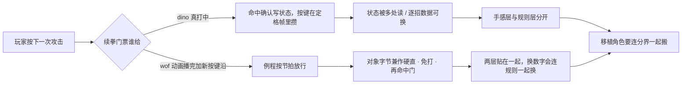

# dino vs wof：游戏逻辑设计差异笔记（总入口）

> 落盘原因：跨会话上下文会被压缩，这份笔记写成自包含笔记，不依赖对话记忆。
> 视角约定（用户 11-06）：**只谈游戏逻辑怎么组织**，不谈 Rust/C#、typed struct / WRAM 字节映像、大端序这类实现表相——"那不是游戏本意"。
> 证据来源：`g:/wof/dino/dino-rs/crates/dino-game/src/game/` 与 `g:/wof/wt1/wof_cs/src/` 的实际代码。
> 前提（用户给定）：dino 比 wof 更晚、更成熟。本笔记从代码验证这个"成熟"具体落在哪些系统上。
> 分卷（11-07）：原单文件 15,323 行 / 1.69 MiB，6 行导航超过 2000 字符、压缩恢复读不全，故按 `^## ` 标题块拆成 8 卷。块内逐行未改，历史快照不回改。

---

## 阅读顺序（压缩恢复后先读这里）

1. 本文件：约束、**一页设计意图**、卷清单、反查表、状态标记。
2. `notes/00-overview.md`：最初的边界与四块（状态机 / 打击逻辑 / 事件脚本 / 怪物策略）、总览、证据索引，以及 §9–§11。
3. ⚠️ §9–§10 是当时"用 ROM 取证"的工作记录，其中**把 ROM 当成审 repo 结论**的框架（"重大更正""架构反转""维度差一个量级"）以及 `A5-0x3E / 0x3E62 = 全局 AI 行为档位` 的解释，已按用户反馈**作废/更正**，一律以 **§11 定位说明与勘误** 为准。表字节 / 跳表项 / 命令地址等 **data 部分保留有效**。§0–§8 不受影响。
4. 需要细节时按下面反查表进对应卷；附录 A 是**阶段 A 工程结论存档，非游戏设计正文**。
5. `notes/06-method.md` 的 §94 是分析口径：细节停在哪、怎么从细节倒推设计意图、以及当前推进规则。
6. ⚠️ 回答「有没有 / 是什么 / 在哪定义」之前，先过下面这节自检清册；**别把「我没找到」写成「它不存在」**。

## 自检清册（写「没有 / 不统一 / 只有」之前先过这里）

> 由来：用户指出「2MB 的笔记，怎么老是各种没看到、不知道；这些我知道所以能盯着你去重找，万一是我也不知道的层面或角度呢」。
> 病根不是记得少，是**笔记按提问顺序堆结论，没有按游戏本体资产建索引**：检索范围由问题里的关键词决定，凡不含那批词的资产必然漏；而「没有 X」这类否定判断需要穷尽才成立，实际只在命中范围内搜过 —— 等于把「我没找到」写成了「它不存在」。用户凭经验能反驳，用户没经验的地方就永久错着。

三道闸（不依赖有人先问）：

1. **资产清册**：下表是「游戏里有哪些数据资产」的清单，不是结论；空格即盲区。任何「没有 / 不统一 / 只有」的结论必须逐行过一遍，写明查了哪几处；查不全就写成「在 A/B/C 没找到，D/E 未查」，不许包装成结论。**填「资产」列先算基址差**：两个常量只差几字节时，多半是同一张表的列别名而非两张表（§94.13），别把列别名数成资产。**带角色名 / 角色序号的资产名先数调用点再判是否专属**（§94.17）：`小兵9_受击处理` 实际被 8 个 Actor 共用，是共享体不是专属表。**跨系统被多方读的共享事实别当成某边独有**（§94.22）：`A5-0x3E` 一个字节被 AI / 相机 / 关卡脚本同读，不能因为 wof 没有 census 式帧间统计就写成「wof 没有群体事实层」。
2. **消费端反查**：从「谁在读这张表」倒着查，不是从玩家词正着搜。读点是有限集合、可穷举 —— 这是不靠用户经验也能兜底的方向。这次 `0x6DB44` 就是从命中链 `parameter+0x0C` 反查出来的，正着搜「火烧 / 粉碎」永远搜不到它。**§94.12 是这条闸第一次自主驱动**：顺着清册里「`0x6E754` 未核字段布局」这一格倒查，无人提问就发现 wof 有两张布局不同的攻击参数表，改了上一轮刚写的判断；**§94.13 顺着 §94.12 新留的空格继续**，把其中一半闭合掉。清册的空格是工作队列，不是写完就封存的目录。
3. **三方对账**：数据定义 ↔ 读它的代码 ↔ 玩家看得见的现象，三角对上才算闭环；缺一角标「未验」，不拿宿主常量名或民间资料的命名当原机事实。**§94.14 是这条闸第一次实战**：追到「现象」这一角发现对不上，就诚实停在缺角处，没有硬凑答案，也没有把「repo 没实现」倒写成「原机没有」；**§94.16 顺着「未验」继续查，把缺角补上**——可见演出一直都在，只是不挂在编号上，中间隔着按角色分的表。缺角不是终点，是下一格的地址。

| 资产 | 谁消费 | 状态 |
|---|---|---|
| wof `0x6DB44` 我方攻击参数表（16 字节/招） | `Cps1Collision` 主命中链 `0x7FF2` | 已核（§94.11 补 `+0..+0F`） |
| wof `0x6E754` 敌方攻击参数表（16 字节/招） | 敌→玩家 `0x8228` / `0x8726` 两条命中链 | 已核（§94.12）：**与我方表布局不同**，reaction 在 `+0xA`、`+4` 是难度索引增量 |
| wof `0x6E75F` = `0x6E754 + 0x0B`（敌方表「致死反应」列，在 `0x8D00` 被当 shake 读） | 敌→场地对象 `0x8D00`，`adda.w (0x7A,A0),A3` 绝对寻址 | 已核（§94.13）：**不是第三张表**，同一字节两条链两种语义 |
| wof `0x6E662` shake 线索 | 仅 `Cps1Collision.cs:5195` 一条 FBA 对照注释 | 已核（本轮用 ROM data 主通道查过，不是审 repo）：`G:\wof\CpsRes\wofj_68krom.bin`（1 MiB、线性映射）在 `0x6DB44` / `0x6E754` 处都呈现已知的 16 字节/招表结构，映射可靠；`0x6E662` = `0x6E660+2`，该字节与 `:5195` 注释「`$62` 的 `0x14` = 0x6E662 的 shake 源」所述一致。`0x6E640..0x6E753` 是一段按 16 字节重复的参数区，行内布局与 `0x6E754` 敌方表不同；`0x6E754 − 0x6E662 = 0xF2` 非 `0x10` 整数倍 ⇒ **不是 `0x6E754` 的列别名**。这段参数区与 §94.12 两张表如何分工、各列含义、repo 称它「攻击参数表 0x6E662」是否成立，按 §11.0 **不臆断**，只作并列登记。按 §11.6，这走的是「ROM 主要为调查 data」**主通道**；「`wof_cs` 非常可疑才核实」的**条件通道**仍未触发 |
| wof `0x6DB4A` = `0x6DB44 + 6`（常量名 `STACK4_ATTACK_PARAMETER_TABLE`） | 栈 4 命中链 `0x8966` | 已核（§94.13）：**列别名，不是独立表** |
| wof 三条命中链各自读表（玩家→敌 / 敌→玩家 / 敌→场地） | `0x7FF2` / `0x8228`·`0x8726` / `0x8D00` | 已核（§94.12）：同一批参数表被按不同偏移读 |
| wof `0x7E68` 9 项反应跳表 | `0x7E4A` | 已核（§12 / §46） |
| wof `0x1C20` / `0x20D4` / `0x7DDA` 伤害·防御·难度 | `0x7FF2` | 已核（§17 / §46） |
| wof `0xE4F02` 判定盒表 | 盒 ID 即偏移 | 已核（§49） |
| wof `0x6933C` 得分表（`SCORE_OFFSET_TABLE`，`00-overview.md:379`）、火花 `0x8406/8438/83D4` | 事件队列 / 命中特效 | **保留、不扩张**（非欠账）：`04-state.md:451` 已把「wof 命中三路逐段动画内容」列为按 §11.0 / §21.8 只在必要时补 data；逐项表值按 §94.2 属举例。检索面：本清册 + `04-state.md` / `00-overview.md`，未查 ROM（§11.6 未触发）；`plan/` 里的 `0x8438E` 是 wall patch，与 `0x8438` 不是同一资产（§94.13 基址差） |
| wof `0x25DC` **按 `ObjId` 索引的角色动画表指针表**（4 字节/项） | `0x25C8` / `0x25B6` 装动画、`0x11B30` 取碎尸描述子 | 已核（§94.16）：受击动画与碎尸描述子都从这里取；`0x25C8` 的 D0 是**有符号**档位偏移 |
| wof `0x124D6` = `0x124CA` 的一级受击表（9 项） | ROM 唯一调用点 `Cps1Actor18Runtime.A02`；repo 里 `Cps1Actor12Runtime` 复用实现是宿主行为（§94.17） | 已核（§94.16）：与 `0x11878` 是**兄弟表**，`0x0C/0E/10` 同落点、`0x00..0x0A` 各用专属段；**不是「每角色一本」** |
| wof 受击入口族 5 张同形态 9 项表 | `0x11720`（玩家）/ `0x11A52`（Boss 濒死）/ `0x11866`（`0x1185A`）/ `0x11884`（`0x11878`）/ `0x124D6` | 已核（§94.17）：**绝大多数敌人共用 `0x11878`**，变体由进入受击的路径 / 对象类别决定 |
| wof 玩家侧 `0x11720` 受击入口 | 张飞 / 赵云 / 魏延 / 黄忠 / 关羽各自主状态机的 `B=2` 段 | 已核（§94.18）：**五角色复用同一份受击逻辑**，只各写待机 / 招式段；骑马受击另走 `0x12832`（按状态分，不按角色） |
| dino 玩家侧 `player_hurt(i)` + 一份共用 `PlayerData` | 全场玩家；`assets.player.attacks[b.id & 3]` 等按角色 ID 索引 | 已核（§94.18）：**一套控制流 + 数据数组按 ID 索引**，ID 不在控制流分支上 |
| wof `0x11878` 敌人受击分派全表（reaction → 一级落点） | `Cps1EnemyAI` 受击状态机 | 已核（§94.14）：8 个编号全表，二级按 `ActStatC` 再分派 |
| wof 敌人状态分派表族（**按对象字节 `+0x28`/`+0x29`/`+0x2A`/`+0x2B`/`+0xC0`/`+0xCE` 分层索引的 word/long 偏移表**：`0x41A1C` A 层、`0x41A30` / `0x41B0C` B 层、`0x41B6C` C 层主循环、`0x41C06` 态内二级、`0x41D5C` / `0x4225A` 三四级、`0x4256E` 受击分支） | 原机由 `0x3C6A` 重算 `+0x2A` 后，各兵种靠自己这族表把状态字落到动作例程；repo 侧是 `Cps1Actor27Runtime.cs` / `Cps1Actor1BRuntime.cs` 的 A/B/C/D 层 `switch` **直译 + 常量注释**，不是运行时读表（按 §0 剥掉宿主表相，别把 `switch` 读成原机写死分支） | 已核（本轮按第一道闸从**资产声明侧**补，不属 dino `AssetPack` 13 类对账队列）：**机制早已登记**（§10.1 流程图 `W5`「各兵种按 `+$2A` 二级分发」、§11.2「共享函数 + 每兵种概率表」），缺的是承载它的**数据资产形态**；ROM data **主通道**（§11.6）核到样本地址呈按 2 / 4 字节排列的偏移表，`0x41C02` 前 4 字节是 `jmp` 指令、表体在 `0x41C06`，差 4 属**同一张表的基址差**（§94.13），不是两份资产。**倒推**：抽签（决定下一个状态字）与落地（这个字去跑哪段动作）是两件事，中间隔着一张可整族替换的地图；共享的只是抽签那一下——这把 §11.2 的「共享」收得更窄，不制造「一边共用 / 一边不共用」的新对立（§94.24）。与 §94.14 受击层 `ActStatC/D` 二三级分派是不同语境，不串；逐项表值与每个编号落到哪段按 §94.2 属举例，不展开；**本轮回源订正**：见下一行 `EnemyData.t`——两边都有按状态字查的 word 跳表（dino 每 class 一本，00 卷 §166 / §245 / §1345 早已登记），差别在表的归属与分层方式、索引哪个字节，不在有无；上一版写「dino 分派留在 `match` 里」已作废。按 §11.0 不串等价、不评优劣，也不据此断言原机有无别的表（§94.17） |
| dino `EnemyData.t: ByteTables`（**按 ROM 地址命名的小表字节块族**：`dino-extract/src/enemy.rs` 以 `(地址, 长度, 用途)` 成百条登记，含 Hopper / Morgan / B45 等按兵种命名的选择行、计时、绕圈方向、速度、受击反应映射 `0x11CC4`、格挡分派 `0x11CE4`；同属 `EnemyData` 而未单列的还有 `hp` / `boss_hp` / `speed_ptrs`+`speeds` / `reverse_frames`） | `ByteTables::u8/u16/u32(table, off)` 被 `enemy_combat.rs`（受击反应、伤害缩放、`HIT_ANIMS` 两级索引先取表地址再按 `W84` 取值）、`rank.rs`（动态难度周期 / aggression / 掩码）、`prop.rs`、`snd.rs`、`car.rs`、各 `class*` 多方读；`hp` / `boss_hp` 被 `enemy.rs:752/760`、`boss.rs:513` 读，`speed` / `reverse_frames` 被 `enemy.rs:514-551` 读 | 已核（本轮按 §94.25 对账表里 `enemy` 大类「部分」这一格倒查闭合）：**§94.25 标过 `enemy` 是「部分」，但后续只闭合了 census / `enemy_attacks` / `boss` / 道具表，这族小表一直没进清册**。`0x11CE4` 取的是 ROM 地址常量用来**比较**（`!= 0x4F3E8` 判 Hopper 格挡分支），不是跳转，别读成动作分派表；`HIT_ANIMS` 那族才是两级索引（表地址 → 数值）。**倒推（只到敌人状态机这一层）**：这族小表管的是「这一段取哪个数」，不是分派；「状态字去跑哪段动作」两边都外置成 word 跳表——dino 每 class 一本（`0x33EFA` 9 项 / `0x3E1AA` 40 项 / `0x407F8` 30 项，按 `+$06`/`act` 索引），wof 是一个对象按多个字节分 A/B/C/D 层级联查。repo 的 `match` / `switch` 都是宿主直译，别读成原机把分支写死（§0）；**上一版写「dino 主体分派留在 `match e.b.mode` 里」已作废**，那是拿 repo 写法当设计事实，且笔记 00 卷早已登记过那些跳表。差别在表的归属与分层、索引哪个字节，不在有无，按 §11.0 不串等价、不评优劣。**不与 §94.19「dino 动数据 / wof 动链」重复算设计**（§94.23）：那里比的是攻击 / 受击数据层「改一处数值要不要动命中链」，这里比的是状态机跳表怎么组织；按 §94.17 不写「dino 没有分派表」的全称。逐条表值按 §94.2 属举例，不展开 |
| wof `0x1066C` 关卡脚本、`0x53B02` 波次、`0xD038` 事件队列 | 关卡 / slot15 | 已核（§4 / §19）；**§94.27 补数据定义角**：记录按 `trigger <= cameraX` 触发，与 dino `camera_events` 同为按相机位置推进的记录流，不重复算一条设计（§94.23） |
| 两边调度层协作式任务轮（dino `0x83C` / `0x9E38C`；wof `A5-0x67` 每帧 3 轮、slot15 `trap#4`） | game task / fade / 强制输入槽 | 已核（§94.20）：**两边同构**，差别在脚本层不在调度层 |
| wof `0x42C2` 通用「Boss 击败 → 通知关卡结束」出口 | 与调用者无关；只写全局状态 `0x0C`、推进 Boss `+$29`、置标志、`jmp $15BC` | 已核（§94.21）：不算分、不播演出，后续由主状态机下一帧分派；**与 dino 姓名输入的「结算→演出」不是同一场景** |
| dino `census_prev`（每玩家 4 计数，**帧首封账**：`enemy_census 0x3242E` 是 `objects_update` 第一项，不是帧末滚动，见 06 卷 §94.22 帧序段）；`0x69BA` 上一帧对象表；**`G.$4EF = players_minus_one`（在场人数 − 1，0/1/2 三档，`flow.rs:684-687` / `player.rs:701-705`）**；另有当帧存活数（`WaveGroup.thr[players-1]` / `BossData.alive_limit[players-1]`） | `enemy_pick_target` / `retarget_slot` / `lib_slot6_new`（§13 / §74.5）；对象表另有五读方（§68）；波次与 Boss 增援闸门 `boss.rs:186-230`；**三档轴还被 Boss HP `enemy.rs:760`、动态难度 `rank.rs:126-151`、镜头推屏 `camera.rs:992-998`、结算 / 过场版面 `flow/tally.rs:281-305` / `script.rs:618-626` / `flow/cards.rs:420-427` 读** | 已核（§94.22）：`census_prev` / `0x69BA` 是**上一帧**的群体事实；**`G.$4EF` 不是逐帧量、也不是只开局定一次**——它在玩家状态变化的事件点重算（关卡 / 区域开始放置玩家 `player.rs:675`、`flow.rs:1022/1053`，掉落入场 `player.rs:832`，过场动作入口 `script.rs:1091/1155`，每关清零 `flow.rs:429`），续关时 `rank_event_continue` 按它选难度补偿行（`rank.rs:303`，05 卷 §606）⇒ 06 卷 §94.22「开局定档、整局几乎不动」已就地订正。消费面不止敌人策略、命中结算与放怪闸门，**人数是一根贯穿整局调参的档位轴**（见 06 卷 §94.22「几个人在玩」段）；**另一根 `G.$4F3` 是逐帧存活敌人数 / 拥挤度轴，管放怪、眩晕、出招与玩家互伤容差，不是人数轴**（§38.2 就地订正、§94.22 分轴，别混） |
| wof `A5-0x3E` 活跃玩家位图（1 字节）；**`A5+0x1AC` 另一份标量：玩家数 1/2/3**（`Cps1StageProgressRuntime.cs:29` 命名 `PLAYER_COUNT`） | `0x3E1E` / `0x39A0` / `0x4244` 选目标链、`0x4BF02` 阈值表、相机 `Cps1CameraRuntime:443`、Actor24 `:1004`、系统协程 `0x14F7E`；**`A5+0x1AC` 被关卡脚本 `requiredPlayers` 门（`Cps1LevelScript.cs`）、难度钳位 `0xBC04`（`Cps1PlayerLogic.cs:10716-10732`）、敌方资料块分组 `0x3D5E`（`Cps1EnemyAI.cs:14036-14043`）、防御加成 `Cps1Collision.cs:4836` 读** | 已核（§94.22）：**当帧**的群体事实，跨 AI / 相机 / 关卡脚本多方读；与 dino census 不是「有 / 无」差别。**`A5+0x1AC` 人数标量是每帧清零后按本帧进入主分发的玩家逐个 +1 重算（`0xAFE8` / `1AAA6`，回源见 06 卷 §94.22 订正注），不是开局定死**；与 dino `G.$4EF` 的事件点重算是两根脾气不同的账，按 §11.0 不串等价。**两边都同时有「人数」与「哪几个」两份事实**，按 §94.17 不写全称对立（§94.22 本轮补层） |
| wof `0x14F7E` → `0x14F8C` 换幕 X 差表 | `idx = (位图 << 3) + 阶段字节`，系统协程 / 换幕 | 已核（§94.22）：按「玩家组合」分表，与 AI 选目标读同一字节；`0x1564A` 同形态索引在宿主开关内，按 §0 只取形态 |
| wof `0x193E2` 关卡镜头初始化表 / `0x193A0` state 跳表 / `0x19DD6` Scroll3 速度表 | `Cps1CameraRuntime.cs:1049` 按 `A5-0x78` selector × 0x10 查，灌 8 个控制器字段 | 已核（§94.27）：按关卡选择的一组镜头参数表；按 §11.0 只登记并列事实，不与 dino `StageData` 串等价 |
| wof `0x55D8E` / `0x5C5D8` 1C 对象池分派 | 剧情 / 碎尸 / 场景碎裂 | 已核（§94.10） |
| wof `0x126F6` 碎尸 bodyData、火焰色板 / 背景火 | `0x11B30` / 特殊对象 | 已核（§94.16）：碎尸描述子 = `0x25DC[ObjId] + 8` 再按 `+0x8E` bodyKind 查 `0x126F6` 微调；**火系编号 → 演出的四层链路已核**（编号 → 入口路径 9 项表 → 状态档位 → `0x25DC` 角色动画表 / 碎尸描述子），未展开的只是逐条编号→动画对应（§94.2 举例），**不是「未解」**；与下方「火系攻击参数项」行同口径 |
| dino `0x0FFFF4` / `0x0FFFFA` 拼图 / 布局指针表、frame record | `anim_load` / 绘制链 | 已核（anim SPEC §2/§3） |
| dino `0x163E..168E` 六组动画表、`0xA26FC` 攻击记录表 | 状态机 / 命中链 | 已核（§46） |
| dino `0x18CC4` 判定盒表、`0x237E6` pool C 类跳表 | 碰撞 / 特效 | 已核（§49 / §58） |
| dino `0x1E6FC` 过场脚本、`0x1DBD6` 动作表、`0x1C03E` 受击表 | 脚本解释器 / 玩家 | 已核（§19 / §22） |
| dino `player_pd().burn_flames` 挂点表、pool C `0x20` 火焰 / `0x3C` 烧死碎片 | `player_burn` / 效果对象池 | 已核（§94.15）：受击反应码 → 状态机按血量分支 → 效果对象 + 焦黑色板 |
| 两边「玩家可见效果 → 数据字段」完整映射表 | — | 已核（四层链路与共用关系，§94.14–§94.18）：**wof 敌人侧 reaction 全表**（§94.14）、**dino 火烧链路**（§94.15）、**wof 受击演出四层链路**（§94.16：编号 → 入口路径对应的 9 项表 → 状态档位 → `0x25DC` 动画表 / 碎尸描述子；§94.17 修正：受击逻辑**共用为主**，按 `ObjId` 分的是动画数据）、**wof 玩家侧 `0x11720` 五角色共用**（§94.18）；逐条编号→动画地址、dino 其他反应按 §94.2 **属举例、不展开，不是欠账**（与上方火系两行同口径） |
| wof 火系攻击参数项 / 烧死编号是否等价于 repo 的 reaction `0x06` | `0x7E4A` → `0x7E68` 跳表 → 角色分派 → `0x25C8`/`0x25DC` | 已核两角（§94.14）：`0x06` 在 repo 分派里是击飞 / 击杀加分 / 事件，**不是火烧**；**演出组织位置已找到**（§94.16），缺的是编号→动画逐条对应（属举例）。仍不把资料命名当原机事实，也不把 repo 没实现写成原机没有 |
| dino 敌人侧攻击记录表（`enemy_attacks`，`dino-assets/src/player.rs:50` 的 `Vec<AttackRecord>`，`dino-extract/src/player.rs:119` 按 8 字节/招抽出） | `car.rs:778/948`、`enemy/class10_hold.rs:345`、`class24.rs:827`、`class29.rs:1078`、`player_combat.rs:527`、`enemy_combat.rs:304/434` | **已按 §94.2 筛过，不展开**：`AttackRecord` 8 字段结构（§46）与 8 处取数点已核，逐条数值只给已有结论举例，**不是欠账**；检索面 = 上述定义 / 抽取 / 消费点 |
| dino `stages`（**按关卡 → 区域 → 滚动层分级的关卡空间容器**：地图 / 色板 / 视差 / 斜坡 / 优先级掩码 / 16 字节镜头事件流） | `dino-assets/src/stage.rs`；`camera.rs` 事件推进与地图流送、`flow/*` 前端画面、`palette.rs` | 已核（§94.27）：**不是「背景地图·相机表」**；`camera_events` 按 `ev.x <= cam_x` 逐条推进，与 wof 关卡脚本 `trigger <= cameraX` 同构；`controller_map` 允许某关自带地图头 |
| dino 图形 tile（`tiles16/32/8`）、对象调色板组（`obj_palette_*`） | `render.rs:187-189` / `headless.rs:95-97` / `viewer.rs:117-118` 做图集；`game/palette.rs:31-38` 按 `(stage, area)` 取 set → bank | **已按 §94.2 筛过，不展开**：tile 无玩法消费端（按 §0 图形表相不进设计对照）；调色板组按关卡 / 区域查，与 §94.27 stages 色板同型，属举例。检索面 = 上述四文件 + `AssetPack` 字段；按 §11.0 未推断 wof 对应物有无 |
| dino Boss 增援控制列表 `boss` / 波次脚本 `Wave` | `dino-assets/src/boss.rs` / `enemy.rs:47-70`；`game/boss.rs:139-230` 增援控制器（pool B class 22） | 已核（本轮，§94.22 就地订正）：定时列表（帧延迟、负值收尾）+ 按人数分档的存活阈值组 + Boss 请求下一组；**群体事实还管放怪节奏**，不另开节 |
| dino 绘制路径 `effects`、道具掉落数据 | `dino-assets/src/effect.rs:45-61`（frames / raw_frames / shadows / splashes / spark_jitter / tables，帧 id 带 tag bit 区分来源）；`game/effect.rs:356-449`、`item/blast.rs:384`、`flow/cont.rs:722`；`enemy.rs:12-35 / 168-184` | **已按 §94.2 筛过**：`effects` 属 §94.15 已登记的效果对象池那一族，属举例；**资产命名修正**：`EnemyData` 无独立道具表，掉落是 `SpawnRec.b96`（生成记录 `+F`，item drop row）一列，按 §94.13 是列不是独立资产，不再算盲区 |
| dino `text`（**HUD 与流程杂表的统一字节池**，按 ROM 地址 + 偏移索引：分值 / 加命阈值 / 起始位置 / 血条瓦片 / 字形 / 名字串 / 语音音乐 id） | `dino-assets/src/text.rs` 的 `TABLES`；`hud.rs` 35 行引用（18 行直接取数 + 17 行绑定别名 `t`）、`flow/text.rs` 打字机、`flow/*`、道具、场景对象 | 已核（§94.26）：**不是只管字符串**；`frontend.text` 是同类型第二份实例，别数成新盲区 |
| dino `terrain`（地形碰撞整套 data：地面段列表 / 形状描述符 / 类标志 / 天花板 / 掉落点 / 纵向场景图） | `dino-assets/src/terrain.rs`；`game/terrain.rs` 共享例程族（玩家 / 敌人 / 道具 / 特效）、`player.rs:775` 掉落入场 | 已核（§94.28）：**类编号来自 scroll2 瓦片属性 bits 10..15**，画面格自带地形信息；`stages.slope_shift` 只是镜头斜坡，别混 |
| dino 前端场景 `frontend` | `dino-assets/src/frontend.rs:35-50`（`text: TextData`、scroll1/2 页与块、6 组场景色板）、`FRONT_TABLES`；`flow/{select,slides,tally,system}.rs` | **已按 §94.2 筛过，不展开**：`text` 是 `TextData` 第二份实例（§94.26）、`scroll3` 页共用 `StageData::scroll3_screen_cells`（§94.27），页面 / 色板是同型页面数据，查下去只给已有结论举例。检索面 = 上述文件；按 §11.0 未推断 wof 对应物有无 |
| wof 对白 / 消息砖块 / HUD 文本数据 | `对话消息表 0x56B06`（表内 word 偏移自索引）、`0x568EE` 附加表、`0x56A0C` 续接指针表、`0xD020` 空白砖块；1C 对白对象按 `messageId / selector` 读并写回对象字段 | 已核（§94.26）：分表 + 对象轨道，靠对白锁撑时长（§94.10）；按 §11.0 不推断原机有无集中池 |
| wof 地形图 / 地形跳表 / 共享地形修正入口族 | `TERRAIN_MAP_BASE = 0x90C000` 读格、`TERRAIN_JUMP_TABLE = 0x027A4` 按索引分发；`0x2784` 16 像素格纠偏、`0x26AA` / `0x2698` 对象地形与活动范围修正、`0x171A8` 把玩家钳在相机屏幕范围 | 已核两角（§94.28）：地形信息来自地图格、多个 Actor 共用修正入口；逐项表值 / 跳表目标按 §94.2 属举例未展开，按 §11.0 不与 dino `TerrainData` 串等价 |
| wof 波次脚本 / 波次生成门（**两道门**） | `WaveScriptTable = 0x53B02` 按 selector 取（`Cps1LevelScript.cs:38 / 1054`）；**`0x53BD0 / 0x53BF8` 的 `cmp.b (0x1ac,A5),D0b` 先比脚本 `requiredPlayers` 与玩家数**（`Cps1SpecialObjRuntime.cs:381-424`）；过了再由 `A5+0x1AD` 被 `0x53BE4 / 0x53C08 / 0x53C74 / 0x53CDA` 比较挡住 `+0x84` 倒计时；`0x3C56` 扫空波次槽 | 已核（本轮，§94.22 就地订正）：与 dino 放怪闸门并列（§11.0 不串等价）；**相邻两个字节是两道不同的门，别写成一道**；逐项门值与宿主逐帧补偿按 §0 剥掉 |
| dino `G.$4DD / $4F0 / $506` 一组全局规则档位（哪几个英雄被接管 / 地形只看地面 / 关屏幕钳制），过场脚本 6 字节记录逐条写、跨记录保持 | `script.rs:230-243` 写入；`combat.rs:72/95` 碰撞门、`player.rs:950-957` 地形与钳制、`terrain.rs:13`、`player_weapon.rs:77`、`prop/b47.rs:32` / `prop/b12.rs:90`；场景对象与武器也能写（`flow.rs:429` 每关清零） | 已核（§94.10 前一轮补层）：**不是过场专用变量**，也**不是全场停战**（玩家打敌人的 pass 照跑）；按 §94.17 不写「只有脚本能写 / 全部碰撞都停」；wof 侧的空格已按 §94.11 第二道闸倒着查闭合，见下一行 |
| wof 一组全局规则档位：`A5-0x60` 多值场景态字 / `A5+0x190` 场景期环境档位 / `A5+0x191` bit0 过场请求位 | 写：舞台过场控制器 `0x10B06` 把对象 `+0x58` key 搬进 `A5-0x60`（`Cps1SystemCoroutineRuntime.cs:8028`）、系统协程逐阶段写一串值、关卡脚本倒计时置 `0x191` bit0、李典 finale `0x168E4 / 0x16AAE` 置/清 `0x190`；读：`0x1E3C` 地面钳位、`0x3BDC` 敌人接近、`Cps1TerrainCollision:1147`、`0x2147C` 重新上马、`0x614C` 受击收尾、`0x59058` 碎尸调色板、发声与动画帧段多族；`0x1135C` 按请求位 + 玩家就绪 + 两道门放行并 `bclr` 消费 | 已核（§94.10 本轮按消费端反查补层）：**两边都有「全局字被玩法各层共读、决定这一帧按什么规则跑」这一层，但装法不同**——dino 一条记录流写三个专用字、wof 摊在几个字里由多条轨道分头写。按 §11.0 不串等价、不评优劣；按 §94.17 不写「就这几个字 / 所有字都这样」；`A5-0x60` 其他取值按 02 卷 §30.7 保留，逐值语义属举例（§94.2） |
| `sound`（QSound 表 / 序列 / 采样） | `dino-assets/src/sound.rs` | **边界外，不是盲区**：按 §0 音频不进设计对照（§94.25 显式排除） |

> 这张表不宣称穷尽，但**漏的形状已经可核对**（§94.25）：拿 dino `AssetPack` 的 13 类 data 对账，完整登记 4 类、部分 2 类、对账时未登记 6 类（已写成上表空格）、`sound` 按 §0 排除 1 类；**§94.26 闭合 `text`、§94.27 闭合 `stages` 半格、§94.28 闭合 `terrain` 半格、本轮闭合 `boss` 半格并就地订正 §94.22 消费面**；剩余 tile / 对象调色板组 / `frontend` / `effects` / 道具表已按 §94.2 逐类回源筛过，结论都是举例 / 边界外 / 资产命名误认，状态与检索面写在各行，**不再靠新增节号推进**。这是这一条清册盲区队列的收口，不是目标完成。没列进去的维度照样可能是盲区；但漏的形状会变 —— 从「整层没看见」变成「清册里明确标着已核 / 已按判据筛过并写明检索面」，后者可以主动推进，不需要有人先问；清册也会自己缩小或换形状（§94.12 新增 2 格，§94.13 闭合一半并排除一个误认的资产，§94.14 补齐 1 格全表、把另 1 格从「未做」改成「两角已核 / 一角未验」，§94.15 又新增一格 dino 资产并写清缺角性质，§94.16 订正 2 处资产命名、把 2 格转「已核」并补上缺角，§94.17 又回头推翻 §94.16 刚写的全称判断，§94.18 把「共用为主」推广到玩家侧并坐实五角色复用，§94.20 换维度补上两边调度层同构、收窄脚本引擎答法）。外部可验证事实（ROM data / 逐帧 trace / 用户经验）是用来撞清册之外的，不是给结论背书的。**状态标记也会过期**：写「仍未解 / 部分」的行要按最新订正回读一遍，别让清册自己留假空格——本轮已把「火系编号仍未解」收窄成「四层链路已核、逐条对应属举例」（§94.16 / 同表火系行），把「`0x6933C` 部分」写成「保留、不扩张」并补检索面（`04-state.md:451`）。**本轮另从资产声明侧复核一次**：按 `wof_cs/src` 全 `.cs` 的 760 条 `const ... = 0x...` 声明按名字 / 注释粗分（未归桶 457，多为各 Actor 的 `TBL_*` 行为 / 概率表常量与角色 / 槽位常量；动画序列 83、分派表 75、地图镜头 33、道具马匹 31、数值标志 29、关卡波次 19、HUD 文本计分 16、色板 11、Boss 阶段 6），除已补的**敌人状态分派表族**外，其余全部落在上表已登记资产族的同型实例、逐项表值（§94.2 举例）或 §0 边界外，**在 `wof_cs` 常量声明这个面上没有整类空格**。上述数字是**声明条数、不是资产条数**；检索面 = `wof_cs/src` 常量声明 + 上表逐行，未逐项展开表值、未做现象角逐帧 trace。**换个面就还有空格**：本轮回源 dino `AssetPack.enemy`（§94.25 对账表标「部分」）倒查，补上 `EnemyData.t: ByteTables` 一行，见上表；所以前一轮写的「资产声明侧铺完」只成立于当时那个检索面，不是全局结论。

## 一页设计意图（先读这个，再按卷查细节）

> 只写「两款游戏把玩法怎么组织」，不列机制、不列地址、不评优劣。依据全在下面各卷。
> wof 侧按 §11.0 只登记不同语境的并列事实：**笔记没登记不等于原机没有**。

**dino 侧**（§94.4 四条意图，主语只到 dino）

- 一段时间 → 一份能被很多系统同时读、能被打断、能换载体但关系不断的状态：连拳靠「真打中」续，演出把最后一棒交给脚本，三个名字输入共用一个帧戳，刀掉了主体还记着那个编号。
- 一次判定 → 每招一列可替换的数据：伤害、硬直、反应、停顿、火花逐招一列，韧性单独累积；「打」的规则和「这一拳什么感觉」分两层。
- 一个对象 → 若干对象加自己身上记着的编号：刀、舌头、一次爆炸里谁算攻击者、三把刀里转正的真身，都是主体记编号、零件自己跑。
- 全局写死 → 先换算成一小撮稳定开关再让各系统读：机器设置煮熟、随机种子单流、上一帧敌人表一个写入者五个读方。
- 一次受击 → 一个专门的受击状态：怎么死、烧成什么样、挂什么效果，都由这个状态自己看着血量决定；出招的人只递一个反应码（这个码同时指定了受击动作编号），火焰、焦黑色板、身体碎片都是这个状态挂上去的小对象。四个角色跑的是同一段逻辑，谁不一样就从同一份表里按编号取自己的那几个数（§94.15 / §94.18）。

一句话：把东西做成「很多地方能读、只有一个地方能改」。

**wof 侧**（§94.6 收敛，只到笔记登记过的那一层）

- 已登记的是「某个入口 / 某张表 / 某个让出点在什么语境被用」：通用关卡结束出口、公共回收、事件队列每帧消费几项、对白协程让出点、判定盒表按编号查、攻击力表按连击等级。
- 能成立的窄判断（**只到公共动作这一层**）：把大家都要做的动作收成一个入口——一张表、一个出口、一条队列、一个让出点——谁要用都来这里；这是「公共动作」被收拢了，**不是「一份状态被很多地方复用」**（§94.6.3）。别把「不各写各的」读成整款游戏的属性：轮到「敌人接下来打算干什么」，wof 是大家去同一个小函数里抽一次签、抽签用的概率表还是各自带的，dino 是每种敌人自己拿主意、只共用一本走路找目标的工具书；**「共用」是某一层的事，不是某一款游戏的事**（§94.24）。
- 「记在谁身上」「谁能打断」两句只到局部——状态贴在被处理对象身上由当帧例程读写，推进权交给动画计时器 / 协程让出 / 每帧扫描轮数；按 §11.0 停，不硬推成「原机没有别的写法」。
- 数值层确实单独存在（表），但有的数字兼着规则：被打中的对象身上记着一个计数，只要没减到零，这次挥击就不能再打中他、双方也还在抖；这个数按命中场景取不同值，群体连击时固定给几帧，好让一套动作依次打到好几个人。数字能整表换，「没减到零就别再命中」这条规则换不掉。
- 攻击与受击的组织（§94.12–§94.18）：一招的数据行里预写「平时用哪套反应、打死了换哪套」，但行里每格没有固定名字，同一格在不同命中链里可以是反应、也可以是硬直；可见演出不由编号命名，要顺着「从哪条路径被打 → 翻哪本受击手册 → 现在倒地还是起身 → 这个对象自己的动画本」逐层查出来。大多数敌人共用一本受击手册，少数走变体；五个玩家角色的「挨打之后怎么处理」这一章也翻同一本，各角色只各写自己平时怎么站、怎么出招。按对象分的是动画本，不是受击规则。

两条并排放着，不串等价、不评优劣。

**用户最初点名的四块，各自在问什么**

| 块 | 真正的设计决策 | 倒推出来的意图 | 在哪读 |
|---|---|---|---|
| 状态机 | 一段动作是「跑完就散」还是「写成能被别处读、能被打断的状态」 | 写成状态：连拳靠命中确认续、演出能交棒、名字输入共用一个帧戳（后两项与事件脚本行是同一事实 / 同一场景，见 §67.4 / §93；**不重复算两条设计**，§94.23） | 00 卷 §2；03 卷 §47 / §53；04 卷 §57 |
| 打击逻辑 | 续拳的门票谁给；一次挥击碰几个人；停顿 / 韧性 / 免打 / 屏幕抖动是一份还是几份；「这一下怎么演」写在哪一层 | 规则与手感分层：每招一列数据、韧性单独累积；wof 侧登记的是这些压在一个字节上。**两边攻击数据里都写着「挨这一下该进哪个反应」的编号：dino 让这个编号直接成为受击动作，怎么死、烧成什么样再由受击状态看着血量决定；wof 在打中那一帧按「有没有打死」换一个候选编号，再顺着它找该走的受击路径。可见演出两边都不写在攻击记录里，只是挂的位置不同** | 00 卷 §3；01 卷 §12 / §22 / §31；03 卷 §46 / §48 / §49；06 卷 §94.11–§94.19 |
| 事件脚本 | 演出时间由帧号、计数器还是任务轮推进；谁把最后一棒交给谁 | **演出与玩法共用一套任务轮**：两边调度层都是协作式任务轮 + 每帧多轮配额，快进快的是轮数、玩法任务同轮一起走，不是把时钟停掉；差别在脚本层谁决定「演到哪儿」（dino 记录计时器挂英雄状态字，wof 阶段档位 / 对白锁 / 事件队列）；**dino 那条记录还逐条改写一组全局规则档位（地形只看地面 / 关屏幕钳制 / 跳过敌攻玩家的碰撞 pass），「演到哪儿」与「这一帧按什么规则跑」是同一条流管的**；wof 按消费端反查也有一组被玩法各层共读的全局档位字，只是摊在几个字里、由过场控制器 / 系统协程 / 关卡脚本分头写，还有「按请求、等玩家站定才放行」的门——两边都有这一层，装的法子不同（§94.10 两轮补层；按 §11.0 不串等价、不评优劣）。末棒交给演出脚本（§67.4）；另有姓名输入 UI 的「结算 → 闪烁演出」局部顺序（§93.7），**不是脚本引擎通性**（§94.21） | 01 卷 §19 / §20；04 卷 §60 / §67；06 卷 §86 / §92 / §93 / §94.10 / §94.20 / §94.21；**层界**：§94.27 / §94.28 的相机 / 增援记录流属镜头与出怪控制器层，非过场脚本层 |
| 怪物策略 | 敌人各自算还是共享一份决策 / 一张上一帧表；难度由时间还是由全局字节驱动 | **两边都把「场上有谁」做成一份被多方读的全局事实**：dino 是上一帧人口统计 / 上一帧对象表，个体只在这本账上做局部加权，消费除了敌人策略与命中结算，还按当帧存活数与玩家人数卡放怪闸门；wof 是当帧活跃玩家位图 `A5-0x3E`，AI 选目标、相机、关卡脚本、波次门同读一个字节；**两边还各留一份「几个人在玩」的人数标量（dino `G.$4EF` / wof `A5+0x1AC`），被拿去按人数分档调 Boss HP、难度、放怪门槛、镜头、结算与过场版面**（§94.22 本轮补层）。差别在事实内容、隔不隔一帧、给谁看、哪份事实更常被拿去排表，**不是有没有这一层**（§94.22，本轮就地订正消费面；按 §94.17 不写成「一边只按人数 / 一边只按组合」） | 01 卷 §13 / §16 / §25；05 卷 §68 / §74；04 卷 §51；06 卷 §94.22；00 卷 §11.1 / §11.5 |

> 四行对应用户点名的四块，但**不是四条互不相干的架构**（§94.6.3）：「把什么做成能被很多地方同时读、能被打断、能与别的事分阶段的状态」这句是 §94.4 从 **dino 侧**倒推出来的，主语不能放大成「两款游戏共同的架构」。wof 侧笔记能支撑的是另一条更窄的判断：**把公共动作收成单一入口（表 / 出口 / 队列 / 让出点）**，两条并排放着，不串等价、不评优劣（§11.0）。四行各自的收窄记在 §94.20（调度层两边同构）、§94.21（结算先于演出是 UI 局部顺序）、§94.22（群体事实两边都有）；「演出交棒」与「名字输入」在状态机行和事件脚本行是同一事实 / 同一场景的两处登记（§67.4 / §93），不是两条设计（§94.23）。
>
> **四行在 dino 侧还共享一条已闭合的主线**：把「这一帧做什么、下一帧读什么」写成显式结构——固定的调用顺序、状态字节、每帧开头的 `prev` 快照，从顶层任务机一路贯到碰撞判定（01 卷 §20.6 闭合、00 卷 155 行转述；也直答了用户最初的「硬件中断让函数执行次数不确定」）。四行里的「连拳靠命中确认续」「命中 / 处决分帧」「过场记录自带计时器」「上一帧人口统计」都是它的实例，不是四条独立设计；近几轮订正补的是这条主线上**封账点在哪、账里装的是状态还是事件**（06 卷 §94.22 帧序段），没有新增一条意图。按 §94.6.3 主语仍只到 dino 侧；wof 侧按 §11.0 只登记已核的调度层同构与帧首 / 帧末锚点，不放大成两款游戏共同架构，也不据此断言原机没有。

**这份笔记对三个实际问题的落点**

- 优化 wof：若只抽「输入 → 状态迁移」的共享层（§31），判定管线不用改；若按「学 dino 经验、让角色差异整体退化成数值」这个更彻底的目标，就要**从上游往下**动——先统一攻击参数行的字段含义，再合并命中链对同一张表的读法，最后才轮到各角色状态段，此时判定管线不再完全免改（§94.19）。可见演出的分层查表是美术数据按对象分的正当需求，不必动。不评优劣，这是按既定目标给的改动落点。**决策层不照搬「抽成一套共用代码」这条**：dino 决策复制到每个 class、wof 是共享重算函数 + 每兵种自带概率表（§11.2 / §94.24），若想让敌人行为也退化成数值，动的是「共享什么」，不是把决策整体收成一处。**还有第三层别混进来**：决策只给出下一个状态字，之后「这个字去跑哪段动作」，两边都做成按 word 偏移查的跳表——dino 每种敌人自带一本（class 2 `0x33EFA` 9 项、class 13 `0x3E1AA` 40 项、class 14 `0x407F8` 30 项，按 `+$06`/`act` 索引，00 卷 §166 / §245 / §1345 早已登记），wof 是一个对象把目录拆成 A/B/C/D 几层、按身上不同字节一层层查。所以这层要定的是**跳表归谁、按哪个字节索引**，不是「有没有表」，也不是把表收成一处；按 §11.0 不串等价、不评优劣，也不与 §94.19 的攻击 / 受击数据层重复算设计（§94.23）。
- 互相移植角色：能搬的是招式表和数值，搬不动的是「哪层算手感、哪层算规则」的分界（§94.6），还有「一招的数据里预写了谁打谁、打死没有」这类分支、以及可见演出挂在哪一层（§94.12 / §94.15 / §94.16）。分界不跟着搬，搬过去只是「能打」，不是「打起来像」。**还多一层不跟着搬**：招式表和数值能搬，「这个状态去跑哪段动作」的**跳表组织法两边都有、也不用搬**，搬不动的是表里指向的动作例程和各层索引字节的语义；搬过去动作能对上，状态怎么往下走还得重写（清册「wof 敌人状态分派表族」/「dino `EnemyData.t`」两行）。
- 打击感：来自「续拳许可由谁给、一拳碰几个、停顿与免打是一份还是几份」，不是来自某一招的伤害数字（§94.1）；**连打累计到一定程度，顿帧会不会换成固定短顿**也在这一层（02 卷 §37.3）。

> 这不是待办清单。细节的停止条件与推进口径见 06 卷 §94.1 / §94.2 / §94.5。

## 卷清单

| 文件 | 涵盖 | 一句话 |
|---|---|---|
| `notes/00-overview.md` | 历史导航快照 + §0–§11 | 边界、最初四块、ROM 取证与勘误 |
| `notes/01-early.md` | §12–§25 | 打击结算、census、输入层、tag/car、Boss、伤害、脚本全景、顶层流程 |
| `notes/02-mid.md` | §26–§39 | 道具、HUD、搓招、波次、恢复链、过关、角色差异、地形、渲染、多人 |
| `notes/03-frame.md` | §40–§53 | 结算、非战斗流程、生成帧、离场、纵深、遮挡、一次攻击的数据、帧调度、判定窗口、判定盒、对象池、RNG、摄像机、动画帧 |
| `notes/04-state.md` | §54–§67 | 引用归属、续关、调色板、时间、火花、Boss 登场、长任务、射击、掉落、预录输入、开一局、设置、独占资源、进关 |
| `notes/05-objects.md` | §68–§81 | 上一帧表、持械分体、箱子三 pass、开场演员、玩家死亡、背景 tilemap、共享决策库、时间到、开场车、附着点、飞行身体、输入缓冲、结算字、打字机 |
| `notes/06-method.md` | §82–§94 | 连发时钟、HUD 缓存、背景流送、车、开场影片、爆炸攻击者、三槽转正、舌头、公共节拍、Butcher、快进、高分输入，以及 §94 分析口径 |
| `notes/07-appendix-a.md` | A.1–A.57 | 阶段 A 工程路线结论存档 + 逐节合规 / 规模回执（隔离存档，非设计正文） |

## `§N → 卷` 反查表

| 章节 | 卷 |
|---|---|
| §0–§11 | `00-overview.md` |
| §12–§25 | `01-early.md` |
| §26–§39 | `02-mid.md` |
| §40–§53 | `03-frame.md` |
| §54–§67 | `04-state.md` |
| §68–§81 | `05-objects.md` |
| §82–§94 | `06-method.md` |
| A.1–A.57 | `07-appendix-a.md` |

按主题找（粗粒度；细粒度 `§N` 索引的历史快照在 `notes/00-overview.md` 开头）：

| 主题 | 主要卷 |
|---|---|
| 状态机 / 顶层流程 / 输入 / 时间 / 帧调度 | 00、03、04 |
| 打击逻辑 / 判定框 / 受击 / 命中反馈 / 连击 | 00、01、03 |
| 事件脚本 / 演出 / 过场 | 00、04、06 |
| 怪物策略 / AI / 对象身份 / 引用 | 00、02、04、05 |
| 对象池 / 道具 / 武器 / 掉落 | 01、02、03、04、05 |
| 卷轴 / 摄像机 / 背景 / 渲染 / 调色板 | 02、03、04、05、06 |
| 整局流程 / 选人 / 高分 / 开机演出 / 快进 | 01、04、06 |
| 角色差异 / 移植取向 / 手感参数 | 02、06 |
| 分析粒度 / 架构意图倒推 / 推进口径 | 06 |

## 三条状态标记

- ⚠️ 作废：§9.1 / §10.1 / §10.4 的「以 ROM 审 repo」结论；`A5-0x3E` = 全局 AI 档位（正确见 §11.1）
- ✅ 保留：§10.2 / §10.3 的表字节 data；§11 之后所有只读 repo 的章节
- ⏳ 仍开放（§18 结清后）：**仅"两款游戏发行先后"未考证**；`0x22DB0` 的 region set 地址差异按 §11.0 不主动追。§10.7 的 6 条里 5 条已在 §18.1 以 repo 为准结清

## 旧待办回执（当时列的"下一步"均已完成，正文保留原貌不改）

- §11.6「把 §4 事件脚本、§5 目标选择写成可对照的伪代码 / 流程图」→ §12.4、§13
- §13.5「搓招 FSM 与脚本覆写输入的时序图」→ §14；「换人 tag / car 挂进 §2」→ §15
- §14.5「换人 tag / car 挂接」→ §15；§6.1 第 2/3/4 条的"只列现象"→ §17 / §16

## 提交纪律与当前口径

- 用户 11-06 提醒：长会话单点损毁风险高，每完成一个分析块即提交一次，不攒到最后；提交号以 `git log -1` 为准。分卷后按卷提交即可。
- 用户 11-07 纠偏：`请说人话,不要只说自己的小编号`、`用户关心的不是你的内部分析步骤,而是人类理解中的游戏设计`。
- 当前推进口径（§94.5，见 `notes/06-method.md`）：不再按源码文件顺序逐节铺；A.13–A.57 逐节回执到此为止；举例与考问不落盘；细节的停止条件是「再查下去结论一个字都不用改」；wof 侧并列事实已按这四句话归完（§94.6，见 `notes/06-method.md`），当前停在意图地图层，不再为 wof 补细节。
- 硬约束：只谈游戏逻辑本意；repo 侧为主、不过度怀疑；ROM 主要为 data，仅 `wof_cs` 写得非常可疑时才查（§11.6）；wof 侧按 §11.0 只登记不同语境并列事实，不串等价、不评优劣、不把未登记写成缺失；宿主对拍 / FBA 实测 / 置信度标记按 §0 剥掉。
- 拆分校验（11-07）：308 个 `^## ` 标题块、15,323 行按块分配，卷内保持原顺序，逐行 `-cne` 零缺失、行数 / 表格行 / 栅栏 / mermaid 守恒、LF 无 BOM；原文件历史导航与规模数字作为快照留在 `00-overview.md`，不回改。
- 目标 `长时间自主推进` 仍开放；本笔记不宣称分析完成。
