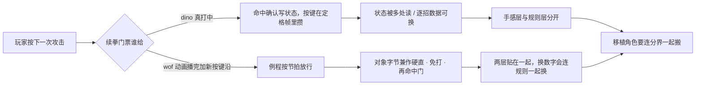

# dino vs wof：游戏逻辑设计差异笔记（总入口）

> 落盘原因：跨会话上下文会被压缩，这份笔记写成自包含笔记，不依赖对话记忆。
> 视角约定（用户 11-06）：**只谈游戏逻辑怎么组织**，不谈 Rust/C#、typed struct / WRAM 字节映像、大端序这类实现表相——"那不是游戏本意"。
> 证据来源：`g:/wof/dino/dino-rs/crates/dino-game/src/game/` 与 `g:/wof/wt1/wof_cs/src/` 的实际代码。
> 前提（用户给定）：dino 比 wof 更晚、更成熟。本笔记从代码验证这个"成熟"具体落在哪些系统上。
> 分卷（11-07）：原单文件 15,323 行 / 1.69 MiB，6 行导航超过 2000 字符、压缩恢复读不全，故按 `^## ` 标题块拆成 8 卷。块内逐行未改，历史快照不回改。

---

## 阅读顺序（压缩恢复后先读这里）

1. 本文件：约束、**一页设计意图**、卷清单、反查表、状态标记。
2. `notes/00-overview.md`：最初的边界与四块（状态机 / 打击逻辑 / 事件脚本 / 怪物策略）、总览、证据索引，以及 §9–§11。
3. ⚠️ §9–§10 是当时"用 ROM 取证"的工作记录，其中**把 ROM 当成审 repo 结论**的框架（"重大更正""架构反转""维度差一个量级"）以及 `A5-0x3E / 0x3E62 = 全局 AI 行为档位` 的解释，已按用户反馈**作废/更正**，一律以 **§11 定位说明与勘误** 为准。表字节 / 跳表项 / 命令地址等 **data 部分保留有效**。§0–§8 不受影响。
4. 需要细节时按下面反查表进对应卷；附录 A 是**阶段 A 工程结论存档，非游戏设计正文**。
5. `notes/06-method.md` 的 §94 是分析口径：细节停在哪、怎么从细节倒推设计意图、以及当前推进规则。
6. ⚠️ 回答「有没有 / 是什么 / 在哪定义」之前，先过下面这节自检清册；**别把「我没找到」写成「它不存在」**。

## 自检清册（写「没有 / 不统一 / 只有」之前先过这里）

> 由来：用户指出「2MB 的笔记，怎么老是各种没看到、不知道；这些我知道所以能盯着你去重找，万一是我也不知道的层面或角度呢」。
> 病根不是记得少，是**笔记按提问顺序堆结论，没有按游戏本体资产建索引**：检索范围由问题里的关键词决定，凡不含那批词的资产必然漏；而「没有 X」这类否定判断需要穷尽才成立，实际只在命中范围内搜过 —— 等于把「我没找到」写成了「它不存在」。用户凭经验能反驳，用户没经验的地方就永久错着。

三道闸（不依赖有人先问）：

1. **资产清册**：下表是「游戏里有哪些数据资产」的清单，不是结论；空格即盲区。任何「没有 / 不统一 / 只有」的结论必须逐行过一遍，写明查了哪几处；查不全就写成「在 A/B/C 没找到，D/E 未查」，不许包装成结论。
2. **消费端反查**：从「谁在读这张表」倒着查，不是从玩家词正着搜。读点是有限集合、可穷举 —— 这是不靠用户经验也能兜底的方向。这次 `0x6DB44` 就是从命中链 `parameter+0x0C` 反查出来的，正着搜「火烧 / 粉碎」永远搜不到它。
3. **三方对账**：数据定义 ↔ 读它的代码 ↔ 玩家看得见的现象，三角对上才算闭环；缺一角标「未验」，不拿宿主常量名或民间资料的命名当原机事实。

| 资产 | 谁消费 | 状态 |
|---|---|---|
| wof `0x6DB44` 我方攻击参数表（16 字节/招） | `Cps1Collision` 主命中链 | 已核（§94.11 补 `+0..+0F`） |
| wof `0x6E754` 敌方攻击参数表 | 敌→玩家命中链 | **未核字段布局** |
| wof `0x7E68` 9 项反应跳表 | `0x7E4A` | 已核（§12 / §46） |
| wof `0x1C20` / `0x20D4` / `0x7DDA` 伤害·防御·难度 | `0x7FF2` | 已核（§17 / §46） |
| wof `0xE4F02` 判定盒表 | 盒 ID 即偏移 | 已核（§49） |
| wof `0x6933C` 得分表、火花 `0x8406/8438/83D4` | 事件队列 / 命中特效 | 部分 |
| wof `0x25DC` 角色段表、`0x124D6` / `0x11878` 受击分派 | `0x25B6/25C8` / 受击入口 | 部分，**角色全表未列** |
| wof `0x1066C` 关卡脚本、`0x53B02` 波次、`0xD038` 事件队列 | 关卡 / slot15 | 已核（§4 / §19） |
| wof `0x55D8E` / `0x5C5D8` 1C 对象池分派 | 剧情 / 碎尸 / 场景碎裂 | 已核（§94.10） |
| wof `0x126F6` 碎尸 bodyData、火焰色板 / 背景火 | `0x11B30` / 特殊对象 | 部分，**火系攻击与「烧死」编号未解** |
| dino `0x0FFFF4` / `0x0FFFFA` 拼图 / 布局指针表、frame record | `anim_load` / 绘制链 | 已核（anim SPEC §2/§3） |
| dino `0x163E..168E` 六组动画表、`0xA26FC` 攻击记录表 | 状态机 / 命中链 | 已核（§46） |
| dino `0x18CC4` 判定盒表、`0x237E6` pool C 类跳表 | 碰撞 / 特效 | 已核（§49 / §58） |
| dino `0x1E6FC` 过场脚本、`0x1DBD6` 动作表、`0x1C03E` 受击表 | 脚本解释器 / 玩家 | 已核（§19 / §22） |
| 两边「玩家可见效果 → 数据字段」完整映射表 | — | **未做** |

> 这张表不宣称穷尽：没列进去的维度照样可能是盲区。但漏的形状会变 —— 从「整层没看见」变成「清册里明确标着未核」，后者可以主动推进，不需要有人先问。外部可验证事实（ROM data / 逐帧 trace / 用户经验）是用来撞清册之外的，不是给结论背书的。

## 一页设计意图（先读这个，再按卷查细节）

> 只写「两款游戏把玩法怎么组织」，不列机制、不列地址、不评优劣。依据全在下面各卷。
> wof 侧按 §11.0 只登记不同语境的并列事实：**笔记没登记不等于原机没有**。

**dino 侧**（§94.4 四条意图，主语只到 dino）

- 一段时间 → 一份能被很多系统同时读、能被打断、能换载体但关系不断的状态：连拳靠「真打中」续，演出把最后一棒交给脚本，三个名字输入共用一个帧戳，刀掉了主体还记着那个编号。
- 一次判定 → 每招一列可替换的数据：伤害、硬直、反应、停顿、火花逐招一列，韧性单独累积；「打」的规则和「这一拳什么感觉」分两层。
- 一个对象 → 若干对象加自己身上记着的编号：刀、舌头、一次爆炸里谁算攻击者、三把刀里转正的真身，都是主体记编号、零件自己跑。
- 全局写死 → 先换算成一小撮稳定开关再让各系统读：机器设置煮熟、随机种子单流、上一帧敌人表一个写入者五个读方。

一句话：把东西做成「很多地方能读、只有一个地方能改」。

**wof 侧**（§94.6 收敛，只到笔记登记过的那一层）

- 已登记的是「某个入口 / 某张表 / 某个让出点在什么语境被用」：通用关卡结束出口、公共回收、事件队列每帧消费几项、对白协程让出点、判定盒表按编号查、攻击力表按连击等级。
- 能成立的窄判断：把公共动作收成单一入口，谁都能来用，不各写各的。
- 「记在谁身上」「谁能打断」两句只到局部——状态贴在被处理对象身上由当帧例程读写，推进权交给动画计时器 / 协程让出 / 每帧扫描轮数；按 §11.0 停，不硬推成「原机没有别的写法」。
- 数值层确实单独存在（表），但有的数值兼着规则：固定三帧的硬直计数既是手感，也是免打窗口和再命中门。

两条并排放着，不串等价、不评优劣。

**用户最初点名的四块，各自在问什么**

| 块 | 真正的设计决策 | 倒推出来的意图 | 在哪读 |
|---|---|---|---|
| 状态机 | 一段动作是「跑完就散」还是「写成能被别处读、能被打断的状态」 | 写成状态：连拳靠命中确认续、演出能交棒、名字输入共用一个帧戳 | 00 卷 §2；03 卷 §47 / §53；04 卷 §57 |
| 打击逻辑 | 续拳的门票谁给；一次挥击碰几个人；停顿 / 韧性 / 免打 / 屏幕抖动是一份还是几份 | 规则与手感分层：每招一列数据、韧性单独累积；wof 侧登记的是这些压在一个字节上 | 00 卷 §3；01 卷 §12 / §22；03 卷 §46 / §48 / §49 |
| 事件脚本 | 演出时间由帧号、计数器还是任务轮推进；谁把最后一棒交给谁 | **表演轨道与玩法轨道解耦**：等待期间计数不走、快进快的是轮数、结算先于演出、末棒能交给过场脚本 | 01 卷 §19 / §20；04 卷 §60 / §67；06 卷 §86 / §92 / §93 |
| 怪物策略 | 敌人各自算还是共享一份决策 / 一张上一帧表；难度由时间还是由全局字节驱动 | **群体事实先于个体决策**：上一帧的人口统计、共享决策库、一张表五个读方；个体只在这份事实上做局部加权 | 01 卷 §13 / §16 / §25；05 卷 §68 / §74；04 卷 §51 |

> 前两行在 06 卷 §94.4 已展开，后两行是本轮补齐。四块合起来仍是同一个问题：**把什么做成能被很多地方同时读、能被打断、能与别的事分阶段的状态**——事件脚本多一条「算完」与「演完」可以分开，怪物策略多一条「群体」先于「个体」。wof 侧仍按 §11.0 只登记不同语境的并列事实，不串等价、不评优劣。

**这份笔记对三个实际问题的落点**

- 优化 wof：先抽「输入 → 状态迁移」的共享层，角色差异才有机会从结构退化成数值（§31）；再动命中确认与逐招停顿。两步都在状态 / 数据层，判定管线不用改。
- 互相移植角色：能搬的是招式表和数值，搬不动的是「哪层算手感、哪层算规则」的分界（§94.6）。分界不跟着搬，搬过去只是「能打」，不是「打起来像」。
- 打击感：来自「续拳许可由谁给、一拳碰几个、停顿与免打是一份还是几份」，不是来自某一招的伤害数字（§94.1）。

> 这不是待办清单。细节的停止条件与推进口径见 06 卷 §94.1 / §94.2 / §94.5。

## 卷清单

| 文件 | 涵盖 | 一句话 |
|---|---|---|
| `notes/00-overview.md` | 历史导航快照 + §0–§11 | 边界、最初四块、ROM 取证与勘误 |
| `notes/01-early.md` | §12–§25 | 打击结算、census、输入层、tag/car、Boss、伤害、脚本全景、顶层流程 |
| `notes/02-mid.md` | §26–§39 | 道具、HUD、搓招、波次、恢复链、过关、角色差异、地形、渲染、多人 |
| `notes/03-frame.md` | §40–§53 | 结算、非战斗流程、生成帧、离场、纵深、遮挡、一次攻击的数据、帧调度、判定窗口、判定盒、对象池、RNG、摄像机、动画帧 |
| `notes/04-state.md` | §54–§67 | 引用归属、续关、调色板、时间、火花、Boss 登场、长任务、射击、掉落、预录输入、开一局、设置、独占资源、进关 |
| `notes/05-objects.md` | §68–§81 | 上一帧表、持械分体、箱子三 pass、开场演员、玩家死亡、背景 tilemap、共享决策库、时间到、开场车、附着点、飞行身体、输入缓冲、结算字、打字机 |
| `notes/06-method.md` | §82–§94 | 连发时钟、HUD 缓存、背景流送、车、开场影片、爆炸攻击者、三槽转正、舌头、公共节拍、Butcher、快进、高分输入，以及 §94 分析口径 |
| `notes/07-appendix-a.md` | A.1–A.57 | 阶段 A 工程路线结论存档 + 逐节合规 / 规模回执（隔离存档，非设计正文） |

## `§N → 卷` 反查表

| 章节 | 卷 |
|---|---|
| §0–§11 | `00-overview.md` |
| §12–§25 | `01-early.md` |
| §26–§39 | `02-mid.md` |
| §40–§53 | `03-frame.md` |
| §54–§67 | `04-state.md` |
| §68–§81 | `05-objects.md` |
| §82–§94 | `06-method.md` |
| A.1–A.57 | `07-appendix-a.md` |

按主题找（粗粒度；细粒度 `§N` 索引的历史快照在 `notes/00-overview.md` 开头）：

| 主题 | 主要卷 |
|---|---|
| 状态机 / 顶层流程 / 输入 / 时间 / 帧调度 | 00、03、04 |
| 打击逻辑 / 判定框 / 受击 / 命中反馈 / 连击 | 00、01、03 |
| 事件脚本 / 演出 / 过场 | 00、04、06 |
| 怪物策略 / AI / 对象身份 / 引用 | 00、02、04、05 |
| 对象池 / 道具 / 武器 / 掉落 | 01、02、03、04、05 |
| 卷轴 / 摄像机 / 背景 / 渲染 / 调色板 | 02、03、04、05、06 |
| 整局流程 / 选人 / 高分 / 开机演出 / 快进 | 01、04、06 |
| 角色差异 / 移植取向 / 手感参数 | 02、06 |
| 分析粒度 / 架构意图倒推 / 推进口径 | 06 |

## 三条状态标记

- ⚠️ 作废：§9.1 / §10.1 / §10.4 的「以 ROM 审 repo」结论；`A5-0x3E` = 全局 AI 档位（正确见 §11.1）
- ✅ 保留：§10.2 / §10.3 的表字节 data；§11 之后所有只读 repo 的章节
- ⏳ 仍开放（§18 结清后）：**仅"两款游戏发行先后"未考证**；`0x22DB0` 的 region set 地址差异按 §11.0 不主动追。§10.7 的 6 条里 5 条已在 §18.1 以 repo 为准结清

## 旧待办回执（当时列的"下一步"均已完成，正文保留原貌不改）

- §11.6「把 §4 事件脚本、§5 目标选择写成可对照的伪代码 / 流程图」→ §12.4、§13
- §13.5「搓招 FSM 与脚本覆写输入的时序图」→ §14；「换人 tag / car 挂进 §2」→ §15
- §14.5「换人 tag / car 挂接」→ §15；§6.1 第 2/3/4 条的"只列现象"→ §17 / §16

## 提交纪律与当前口径

- 用户 11-06 提醒：长会话单点损毁风险高，每完成一个分析块即提交一次，不攒到最后；提交号以 `git log -1` 为准。分卷后按卷提交即可。
- 用户 11-07 纠偏：`请说人话,不要只说自己的小编号`、`用户关心的不是你的内部分析步骤,而是人类理解中的游戏设计`。
- 当前推进口径（§94.5，见 `notes/06-method.md`）：不再按源码文件顺序逐节铺；A.13–A.57 逐节回执到此为止；举例与考问不落盘；细节的停止条件是「再查下去结论一个字都不用改」；wof 侧并列事实已按这四句话归完（§94.6，见 `notes/06-method.md`），当前停在意图地图层，不再为 wof 补细节。
- 硬约束：只谈游戏逻辑本意；repo 侧为主、不过度怀疑；ROM 主要为 data，仅 `wof_cs` 写得非常可疑时才查（§11.6）；wof 侧按 §11.0 只登记不同语境并列事实，不串等价、不评优劣、不把未登记写成缺失；宿主对拍 / FBA 实测 / 置信度标记按 §0 剥掉。
- 拆分校验（11-07）：308 个 `^## ` 标题块、15,323 行按块分配，卷内保持原顺序，逐行 `-cne` 零缺失、行数 / 表格行 / 栅栏 / mermaid 守恒、LF 无 BOM；原文件历史导航与规模数字作为快照留在 `00-overview.md`，不回改。
- 目标 `长时间自主推进` 仍开放；本笔记不宣称分析完成。
