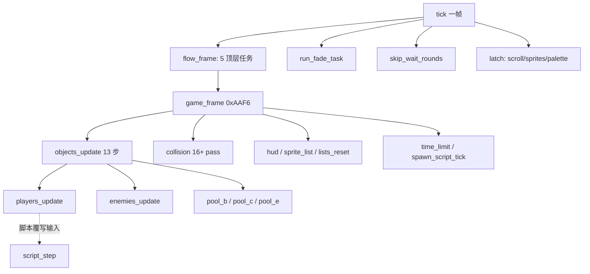
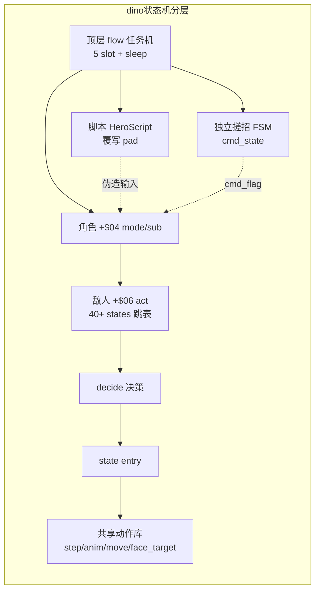
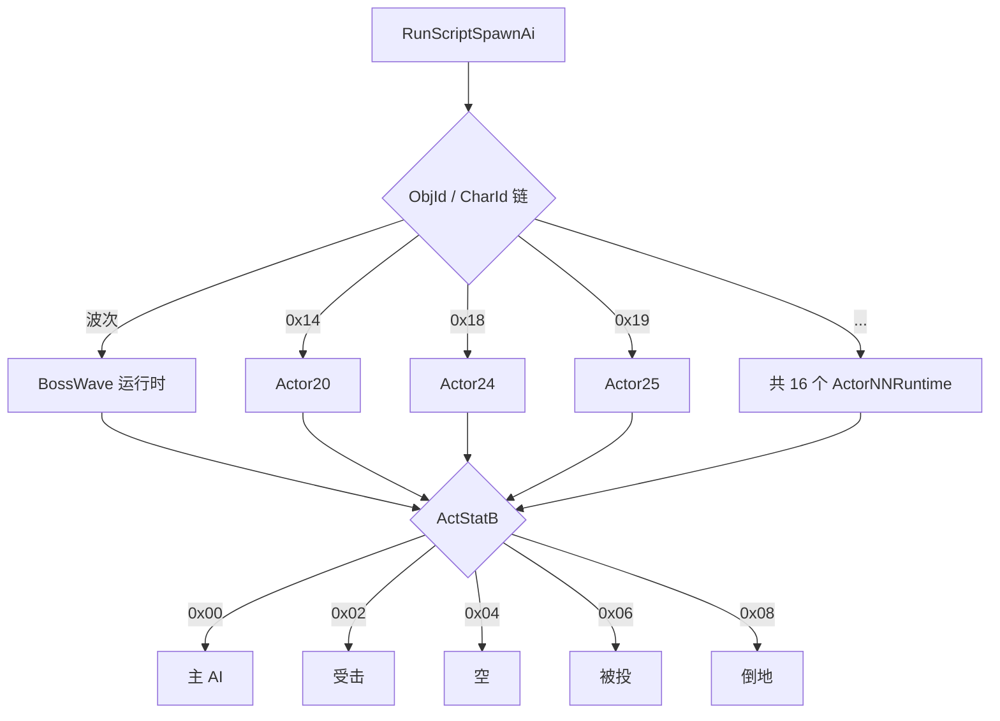
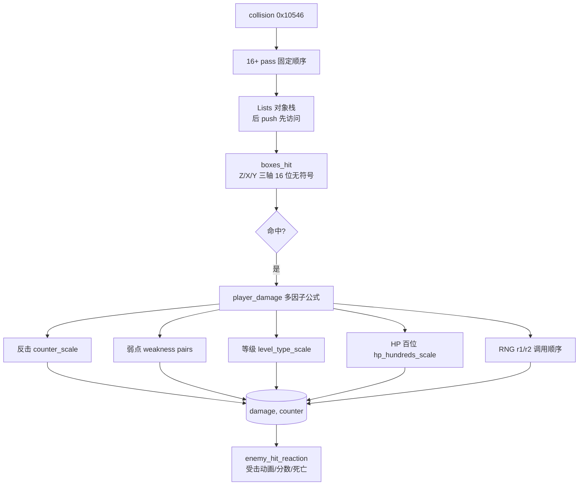
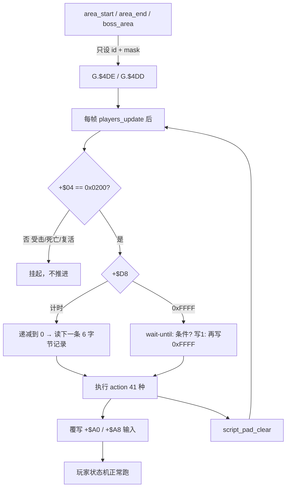
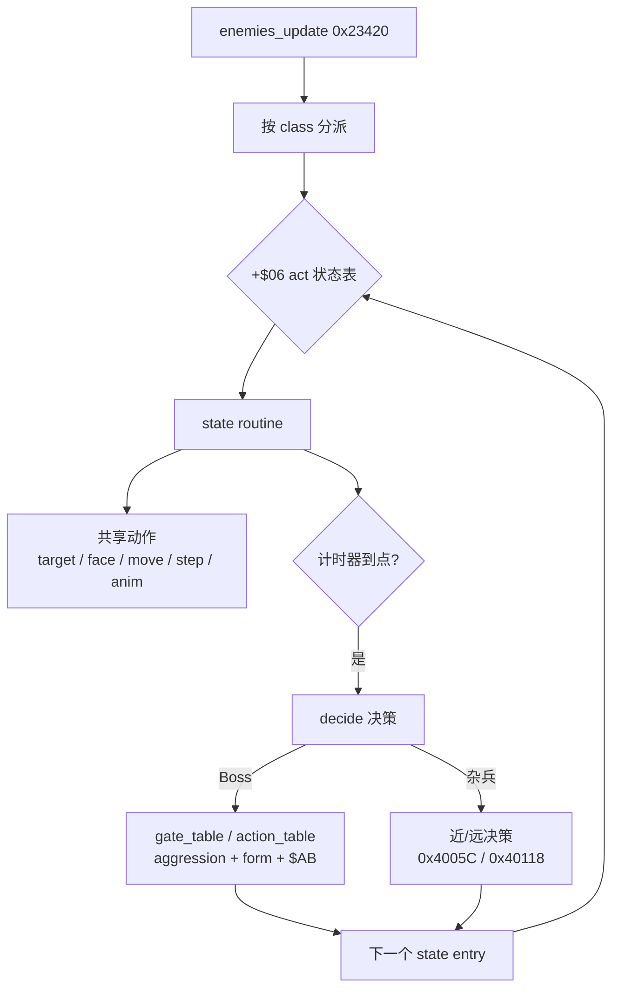

# dino vs wof：游戏逻辑设计差异笔记

> 落盘原因：跨会话上下文会被压缩，此文件写成自包含笔记，不依赖对话记忆。
> 视角约定（用户 11-06）：**只谈游戏逻辑怎么组织**，不谈 Rust/C#、typed struct / WRAM 字节映像、大端序这类实现表相——"那不是游戏本意"。
> 证据来源：`g:/wof/dino/dino-rs/crates/dino-game/src/game/` 与 `g:/wof/wt1/wof_cs/src/` 的实际代码。
> 前提（用户给定）：dino 比 wof 更晚、更成熟。本笔记从代码验证这个"成熟"具体落在哪些系统上。

---

## 0. 先划边界：哪些**不是**设计差异

两款游戏同属 CPS1，底层机制是同构的。以下这些是公共底座，**不能**当作差异：

| 公共机制 | dino 侧证据 | wof 侧证据 |
|---|---|---|
| 对象池（player / pool A 敌 / pool B 机关 / pool C 特效 / pool E 道具），每槽 0xE0 字节 | `enemy.rs:1` `game/mod.rs:361-375` | `Cps1Types.cs:13-25` OBJ 槽视图 |
| 状态字节 + 跳表分派 | `class13_ai.rs:1` 表 `0x3E1AA` 40 words、states 0..0x4E | `Cps1EnemyAI.cs:44-49` STATE0/S1 常量 |
| 协作式任务内核（16 槽、trap#4 yield、vblank IRQ） | `flow.rs:5-9` 五任务按 slot 顺序 | `Cps1CoroutineScheduler.cs:18-25` IEnumerator + 16 槽 |
| 事件队列 | `combat.rs` Lists（帧末对象列表） | `Cps1EventQueueTask.cs:5-20` ROM 0xD000 |
| 帧末碰撞 pass | `combat.rs:70` `collision()` 0x10546 | `Cps1Collision.cs` |
| ROM 表驱动 hitbox / 伤害 | `collide.rs:1` 0x128F8 四种表形态 | `Cps1Collision.cs:21-44` 0xE4F02 / 0x6DB44 / 0x1C20 |

另外两类"看起来像差异、其实不是"的东西，必须剥掉：

- **wof 的"散"有一部分是未完成的直译工程**：全库 15064 处 `_对应ASM_`、1787 处 `_部分对应ASM_`、11109 处 `_无对应ASM_`（实测统计）。后者是宿主补偿逻辑，不是原版游戏设计。
- **dino 的"清晰分层"有一部分是重写时的工程组织**：按职责拆 `_ai` / `_states` / `_attack` / `_lib` 文件、文件头的 `Owner:` / `Spec:` / `Quirks kept`、typed `Handle` / `Lists` 抽象，都是移植者加的，不是 ROM 里的结构。`combat.rs:1` 自己写明 `collision()` 的固定 pass 顺序是 **原机顺序**（"keeps the original call order"），所以"管线化"是原机就有的，不是 dino 发明。

**结论：真正的游戏设计差异只在"上层系统的丰富度与切分方式"，不在底层机制。**

---

## 1. 总览对照

| 子系统 | dino（更晚） | wof（更早） | 差异性质 |
|---|---|---|---|
| 状态机 | 多层：顶层任务机 + 角色 mode/sub + 独立搓招 FSM + 敌人 act(40+) + 独立计时器；`IntroAfter` 显式建模跨帧续算点 | 扁平两级 `STATE0_*(4)` / `S1_*(5)`；靠 CharId/ObjId 大分派链区分行为 | 分层深度 |
| 打击 | 固定 16+ pass 管线；对象列表栈；纯几何 `boxes_hit`；**多因子伤害公式**（反击/弱点/等级/HP 缩放/两次 RNG） | 直接读 ROM hitbox 表 + RNG 查表；受击/特效/地形碰撞分文件 | 系统丰富度 |
| 事件脚本 | 26 scripts × 6 字节记录 × 41 actions 的解释器，管入场/过场/Boss 死亡/结局；**通过覆写输入驱动角色** | 关卡 wave 控制器（触发/敌人阈值/相机门）+ 协程事件队列（9 项跳表） | 脚本职责范围 |
| 怪物策略 | 决策与执行分离（decide → state entry → 共享动作）；Boss 按 aggression/form 分档选表；共享行为库厚 | 单一 31944 行大分派文件 + 16 个按对象号拆的 Runtime + 若干专用大文件；共享层薄 | 通用层 vs 特例层 |
| 附加系统（wof 无或弱） | 4 角色 + 换人 tag / 队伍技、搓招必杀、car 关卡、counter hit、弱点克制、Boss 多形态、8 关剧情 | 多人同屏、马战、Boss 波次 | 内容量 |

---

## 2. 状态机设计

### 2.1 dino：帧循环固定序列（无中断、无任务挂起）

证据：`game/mod.rs:331-358`、`flow.rs:1-15`

```
tick()  = 一个 video frame:
    flow_frame()            # 5 个顶层任务，按 slot 0/0x10/0x20/0x30/0x40 顺序，各带 sleep 计数
    run_fade_task()
    skip_wait_rounds()      # 脚本场景中按住攻击/跳时的额外推进
    latch_scroll / latch_sprites / latch_palette   # 视频硬件延迟 1~2 帧

game_frame()  = 0xAAF6，固定 8 步:
    rank_tick → objects_update → collision → hud_update
    → build_sprite_list → combat_lists_reset → time_limit → spawn_script_tick

objects_update() = 0xE90E，固定 13 步:
    enemy_census → players_update → items_reset → pool_e_update → enemies_update
    → screen_shake → pool_b_update → pool_c_update → held_players_update
    → terrain_obstacles_swap → tag_trigger → hud_objects_tail
```



关键点：原机的协作式任务内核被压成**固定调用序列**，任务"睡几帧"改写成 `Flow` 状态字节分支。`flow.rs:78-95` 的 `IntroAfter` enum（Loop / State0 / Title / Wait60 / Redraw / SlideOutEnd）显式记录"一次 sleep 之后回到例程的哪一行"——即把跨帧续算点做成数据。

### 2.2 dino：角色状态机的分层

```
玩家对象字段（语义）:
    +$04 state word = (mode, sub)     # mode 4=死亡, mode 0=复活, sub>=2=受击反应
    +$A0 held pad / +$A8 pressed pad  # 可被脚本覆写
    cmd_state / cmd_t / cmd_flag      # 独立的搓招 FSM (0x6AC8)
    +$D1..+$DE HeroScript            # 脚本状态: state/act/step/ptr/timer/rank/count/tx/tz

敌人对象字段:
    +$06 act                         # 状态号，跳表 0x3E1AA，40 words，0..0x4E
    +$AC timer / +$A8 aim timer      # 独立计时器
    +$AB / +$84 等                   # 形态、弱点索引
```

**独立搓招 FSM**（`player.rs:960-1006`）——与主状态机并行、单独计时：

```
command_fsm():                          # 每帧先跑，识别"下、上、攻击"搓招
  状态0: 若上帧输入恰好是 DOWN 且本帧变化 → cmd_t = t1[角色]; 转状态2
  状态2: cmd_t -= 1
         超时(0xFF) → 回状态0
         held == UP  → cmd_t = t2[角色]; 转状态4，且同帧继续往下跑
         pressed ATK → 回状态0
  状态4: cmd_t -= 1
         超时 → 回状态0
         pressed ATK 且 held == UP → cmd_flag = 2  (发出必杀); 回状态0
```

**敌人状态机**（`class13_ai.rs:13-48`、`class4_states.rs:28-86`）：

```
enemy_state(e):                          # match e.b.act
    0x02 → 等待 +$7A 计时
    0x04 → 朝目标走 +$AC 帧 → decide()
    0x0E → 以速度 id 0xD 逼近槽位，每 30 帧重新瞄准，X 距目标 < 0xC0 提前结束 → decide()
    0x0A/0x0C/0x12/0x3E → 定时动画后 decide()
    0x18 → 爪击等待 → 蹲伏(0x385BA)
    0x1A → 落地判定 → decide()
    ... 40 个状态，每个对应原机一个例程
    未定义状态 → 表里指向数据/无入口（保留原样）

decide():                                # 0x4005C 状态结束决策；另有远决策 0x40118/0x40156
    → 选下一个 state entry (0x3F15E..0x3FC60)

state routine 内部调用共享动作:
    lib_target / lib_face_target / enemy_move_dir / enemy_step / enemy_anim / enemy_step_back
```



### 2.3 wof：扁平两级 + CharId 大分派

证据：`Cps1EnemyAI.cs:22-49, 61-85, 1595-1607, 2615-2619`、`Cps1PlayerLogic.cs:76`

```
敌人状态（两级）:
    ActStatA / STATE0: IDLE(0) / ACTIVE(2) / SPECIAL(4) / DEATH(6)
    ActStatB / S1   : MAIN_AI(0) / ATTACK(2) / THROW(4) / HIT(6) / FALL(8)

RunScriptSpawnAi(e):                     # 顶层是 if 链，按 ObjId / CharId 分派
    if 波次角色        → Cps1BossWaveEnemyRuntime.主状态分发
    elif ObjId == 24   → Cps1Actor24Runtime.主状态分发_494B4
    elif ObjId == 25   → Cps1Actor25Runtime.主状态分发_4996A
    elif ObjId == 20   → Cps1Actor20Runtime.主状态分发_470F8
    elif ObjId == 21   → Cps1Actor21Runtime.主状态分发_479AE
    ... 共 16 个 Cps1ActorNNRuntime.cs

兵种内分发:
    if ActStatB == S1_MAIN_AI → 正常状态分发
    elif ActStatB == S1_ATTACK → 攻击分支
    switch(ActStatB):
      0x00 主 AI / 0x02 受击入口(表 0x119C2) / 0x04 空(rts) / 0x06 被投 / 0x08 倒地
```



### 2.4 实质差异

- dino 把**输入识别（搓招）、动作状态（mode/sub）、受击/死亡/复活、脚本表演、顶层流程**拆成彼此独立、各自带计时器的层；层与层之间通过"覆写输入"和"状态字 == 0x0200"这类窄接口连接。
- wof 把大多数行为压在两级状态字节里，差异靠 **CharId → ActorNNRuntime** 的横向分派承载，纵向分层少。
- 结果：dino 加一个新系统（换人 tag、car、剧情脚本）是在层上挂新东西；wof 加一个特殊角色就多一个 Runtime 文件 / 一段大分派 if。这一点在下面的文件规模上体现得很直接。

---

## 3. 打击逻辑

### 3.1 dino：固定 pass 管线 + 对象列表栈 + 纯几何 + 多因子伤害

证据：`combat.rs:8-100`、`collide.rs:1-48`、`player_combat.rs:11-76`、`enemy_combat.rs:489,574,601,788,869`

```
collision():                              # 0x10546，顺序固定，不可换
    pass_10664()                          # 玩家 vs 玩家
    if not scripted: pass_10dcc()
    pass_10f96 / 1132a / 107f8(玩家攻击与抓 vs 敌) / 10cd0 / 11962
        / 11a9e / 11f86 / 1201c / 120d2 / 11e56
    if car_mode && car_on:                # car 关卡专属
        pass_121d8 / 122d8 / 12342 [+ pass_12454 if 镜头锁 0x7B4]
    if not scripted: pass_115b0(敌攻击 vs 玩家) / 11cec
    pass_1185a()

pass 内部:
    Lists 是按原机 RAM 地址键控的对象栈（0x6718 玩家表 / 0x671E / 0x69BA 上一帧 hurt list ...）
    push 插到头部 → 访问顺序是"最后 push 的先访问"（对应 68K 的 move.w a6,-(a4) 向下生长）
    特殊语义: combat_hurt_list_seen() 复现"上一帧 hurt 表的高位条目被本帧 push 覆盖"

boxes_hit(attacker, +$49 攻击框, defender, +$48 受击框):    # 纯几何，0x128F8
    table = body.box_table & 0xFFFFFF       # 忽略 24 位地址高字节里的标志位
    boxes = multi_box ? multi(table, idx) : single(table, idx)   # 四种表形态
    overlap = Z轴 && X轴 && Y轴
    每轴: (a0 - b0 + asz) as u16 <= (asz + bsz) as u16     # 16 位 wrapping + 无符号比较，边缘相切算命中
    facing != 0 时 X 框按 -xoff - xsize 镜像

player_damage(base, attack_id, power, level, enemy_kind, enemy_atk, w84, hp, r1, r2)
        -> (damage, counter_flag):          # 0x2B904，纯函数
    d = base
    if enemy_kind == 4 (敌人正在攻击):       # counter hit
        d = (d * counter_scale[enemy_atk]) >> 5 ; counter = true
    if attack_id 命中 w84 处的弱点对 (表 0xA32FA):
        d = (d * weakness_factor) >> 5 ; counter = true       # 弱点命中也算反击
    d = d * power
    d = d * level_type_scale[(w84 << 3) + level]              # 敌人种类 + 难度等级
    d = d >> 10 ; if d == 0: d = 1
    d = d * hp_hundreds_scale[(hp 百位*0x40 + (r1 & 0x3E)) / 2]
    ... 第二次 rand() r2 ...
    return (d, counter)                      # counter 触发第二火花 + 400 分
```



受击侧也拆成独立环节：`enemy_hit_by_player` / `enemy_hit_nonlethal` / `enemy_hit_score` / `enemy_hit_anim` / `enemy_hit_reaction`（`enemy_combat.rs`），而不是塞进攻击方。

### 3.2 wof：ROM 表直读

证据：`Cps1Collision.cs:21-76`

```
HitboxGet(id):
    base = 0xE4F02 + id                  # id 已是相对 A6 的字节偏移
    valX = be16[base]; radX = be16[base+2]; valY = be16[base+4]; radY = be16[base+6]
    X框宽 = be16[base - 2]               # 表项实为 [X框宽, valX, radX, valY, radY] 共 10 字节
                                          # id 指向 valX，故框宽在 id-2（曾系统性取错字段）

伤害参数:
    PLAYER_ATTACK_PARAMETER_TABLE = 0x6DB44
    STACK4_ATTACK_PARAMETER_TABLE = 0x6DB4A   # 奇数地址，ROM 原样
    DAMAGE_RANDOM_TABLE          = 0x1C20 + D6   # PC 相对寻址，(d16,PC,D6w*1)
    SCORE_OFFSET_TABLE           = 0x6933C
    RNG_INCREMENT                = 0x3711
```

`Cps1HitReaction124CA.cs` / `Cps1HitEffectRuntime.cs` / `Cps1TerrainCollision.cs` 也是分开的，所以 wof 并非"没有分层"；差别在**伤害构成**：wof 以查表 + RNG 索引为主，dino 在查表之上叠了 counter hit、弱点克制、等级/HP 缩放这些**显式系统**，且把它们收进一个纯函数。

---

## 4. 事件脚本

注意：两边"脚本"不是同一类东西，别直接对标。
- dino `script.rs` = **英雄过场表演脚本**（入场、走到下一区、Boss 死亡演出、结局）
- dino `spawn_script_tick` (0xFBF4, `game_frame` 第 8 步) = **生成/波次脚本**，这个才对应 wof 的 `Cps1LevelScript`

### 4.1 dino：数据驱动解释器，`script.rs:1-90`

```
数据: 表 0x1E6FC，26 个脚本 × 6 字节记录；41 个 action，各有原地址
      (assets.script / dino-extract/src/script.rs)

入口（只设状态，不执行任何动作）:
    script_area_start(0x1DA10) / script_area_end(0x1D95E) / script_boss_area(0x1DAC4)
        → G.$4DE = script id
        → G.$4DD = 位掩码 (bit i = 英雄 i 受脚本控制)
        → 清空英雄 +$D0

每帧（玩家 update 之后，只要 G.$4DD != 0）:
    for 每个置位英雄:
        if +$D0 == 0: script_hero_start(0x1DB0C)     # 一次性拷贝掩码
        script_step(0x1DB5E):
            if 状态字 +$04 != 0x0200: return          # 受击(sub>=2)/死亡(mode4)/复活(mode0) 期间挂起
            if +$D8 == 0xFFFF:                        # "wait until" 循环
                条件满足 ? 写 1 : 再写 0xFFFF
            else:
                +$D8 -= 1                              # 单位: game frame
                if +$D8 == 0: 读下一条记录 (action, G.$4F0, G.$4FD, G.$506, timer)
            执行 action（41 种）
            多数 action 以 script_pad_clear(0x1DEA6) 结束：清 +$A0 / +$A8 / +$BC

动作如何驱动角色:
    ★ 覆写输入字节 +$A0(held) / +$A8(pressed)，而不是直接改状态
    walk(0x1DF10): 保持上帧方向 +$A0 = +$A1，每 5 帧重算一次朝目标 X/Z
    ... 这样过场复用完整的玩家状态机，不另写一套表演逻辑

保留的怪癖（script.rs:30-36）:
    · 走路比较 X/Z 用无符号（bcs），目标在正、英雄在负 X 时会朝左走
    · 非领队英雄两端点位都被占时得 spot 0
    · action 0x26 只清自己的 bit，导致同帧更新较晚的英雄会从第一条记录重跑
    · G.$4F0 / G.$506 保留上一条记录的值（含 END 记录）直到下一个脚本首记录
```



### 4.2 wof：关卡 wave 控制器 + 协程事件队列

证据：`Cps1LevelScript.cs:17-85`、`Cps1EventQueueTask.cs:5-90`

```
关卡脚本 0x106F4:
    记录 = trigger:word, type:byte, payload
    StageScriptTable = 0x1066C ; WaveScriptTable = 0x53B02
    StageSelectorStateTable = 0x1065E ; StageControllerBase = 0xFF7E88 (A5-0x178)
    控制器状态: gateWaiting / waveControllerActive / waveEnemyThreshold / waveTimer
               gateLockedMinX / gateLockedMaxX / MaxRecordsPerFrame = 64
    类型 0..0x55（loggedUnsupportedType[0x55]）
    语义: 敌人数量阈值门 → 锁相机区间 → 放下一波 / 推进关卡

事件队列 0xD000（调度器 slot15，协程任务体）:
    loop:
        if READ_INDEX == WRITE_INDEX: trap#4 让出（等待）
        event = QUEUE_BASE + read ; type = be16[event] ; param = be16[event+2]
        read = (read + 4) & 0xFF
        jmp 跳表[type]        # 9 项: 0x096E / 0x0AFA / 0x0B70 / 0x0B86 / 0x0B9C
                              #       / 0x0E8E / 0x0D34(BCD 加分) / 0x0A58 / 0x2E46(血条)
        pea 返回点 0xD006 → 回到 trap#4 让出
    ★ 一帧消费几项 = 本帧 0x0700 调度循环扫了几轮（由 VBlank 截断决定）
      宿主无法精确复现 → 加了 任务体_带上限_无对应ASM(task, 64) 和 A/B 开关
      （实测 u400 f=14：FBA 消费 2 项，宿主排空式消费 3 项，冷启动多吃一项）
```

**关键设计差异**：
- dino 的过场脚本**接管输入**，被脚本控制的角色仍走完整状态机，所以受击/死亡会自然中断脚本（`+$04 != 0x0200`）；这是把"表演"和"玩法"接在同一套状态机上。
- wof 的事件队列是**任务内核的一部分**，它的执行次数本身就是帧内物理量（VBlank 截断），因此脚本推进与 CPU 负载耦合；这正是前面十几轮讨论的"函数执行次数不确定"在**游戏设计层**的落点，不是实现层 bug。

---

## 5. 怪物策略

### 5.1 dino：决策/执行分离 + 表选择分档 + 厚共享层

证据：`boss_common.rs:1-69`、`class13_ai.rs:1-90`、`enemy.rs:1-10,524-544`、`game/enemy/` 目录统计

```
BossAi = { Morgan, Morgue, Tyrog, Tyrog2, Fessenden }

gate_table(form):        按 G.$5EC (aggression，不是 level) 与 form 选门控表
                         Morgan→0x73B14 / Morgue→0x73D54 / Tyrog→0x74542+form_idx*0x40 / Fessenden→0x74A42
action_table(form, ab):  按 form 与 +$AB 的符号选行为表
                         Morgan: +$AB<0 → 0x73B54 else 0x73C54
                         Tyrog: 0x74602 + form_idx*0x100
form_index(form):        SUBQ.B #1 → BMI/BEQ → 0 / 1 / 2 三档形态

★ boss_common.rs:1-3 原文: "Class handlers keep their own state dispatch, counterattacks and
  transformations. These helpers do not run an invented common AI."
  → 共享的是「选表机制」，不是统一 AI；每个 Boss 仍保留自己的状态分派、反击、变身
```

```
通用怪物循环:
    state dispatch (match +$06 act，跳表)
        → state routine（每个是原机一个例程）
            → 计时器到点 / 条件满足 → decide()
                → 选下一个 state entry
    state routine 内复用共享动作库:
        lib_target / lib_face_target / enemy_move_dir / enemy_step / enemy_anim
        / enemy_step_back / enemy_recover_other

文件按职责拆（game/enemy/ 共 96 个 .rs）:
    classNN.rs 纯实现 63 个
    _ai 7 / _states 3 / _attack 3 / _lib 2 / _tests 2 / _moves 2
    _parts 1 / _entry 1 / _foot 1
```



### 5.2 wof：CharId 大分派 + 专用大文件 + 薄共享层

证据：`Cps1EnemyAI.cs:22-49`、文件行数统计

```
Cps1EnemyAI.cs (31944 行) — 单一主入口:
    CHAR_GRUNT5/9 = 0x05/0x09, CHAR_LIDIAN(李典) = 0x06, CHAR_DAGGERSOLDIER = 0x07,
    CHAR_XUCHU(许褚) = 0x08, CHAR_GRUNTA/B = 0x0A/0x0B, CHAR_MEILING = 0x0C,
    CHAR_XIAHOUDUN = 0x0D, CHAR_ZHANGLIAO(张辽) = 0x0E, CHAR_CAOREN = 0x0F,
    CHAR_OBJ10/12/18/20 ...
    主表 0x22DB0 → 各角色 AI 入口（如 0x12 → 0x343B6 → Cps1Actor12Runtime）

按对象号拆的专用运行时（16 个 Cps1ActorNNRuntime.cs）:
    1B / 1C / 1F / 20 / 21 / 22 / 23 / 24 / 25 / 26 / 27 / 28 / 2B / 2C / 2D ...

专用大文件（特例厚）:
    Cps1LidianFinaleRuntime.cs     29107 行   # 李典收尾
    Cps1HardResetRuntime.cs        25320 行   # 硬重置
    Cps1SystemCoroutineRuntime.cs  17005 行   # 系统协程
    Cps1EventObjectRuntime.cs       8848 行
    Cps1PlayerLogic.cs             13906 行
    Cps1BossWaveEnemyRuntime.cs     3971 行
    Cps1ZhangLiaoRuntime.cs         2192 行

共享层（薄）:
    Cps1EnemySubs.cs  2838 行 / Cps1Subs.cs  1121 行
```

对比很直接：dino 的共享行为库（`enemy.rs` 2331 行 + 按职责拆的 96 个类文件）承担通用动作，专属策略按类分散；wof 的 2838 行共享层要托住 31944 行主分派 + 两个 2.5w~2.9w 行的专用文件。**通用层薄、特例层厚**，是 wof 这边最明显的结构特征。

---

## 6. "dino 更成熟"具体落在哪（必须分成两栏）

### 6.1 属于游戏本身的设计（能从 ROM 表/地址结构验证，不是移植者发明）

1. **搓招输入层独立**：`player_command_fsm` 0x6AC8 用 `t1/t2[角色]` 两个窗口计时识别"下→上→攻击"，是独立于动作状态机的必杀识别系统。
2. **反击 / 弱点克制**：伤害公式里 `enemy_kind==4`（敌正在攻击）触发 counter_scale；`0xA32FA + enemy+$84` 的弱点对按 attack_id 匹配。弱点命中同时置 counter（第二火花 + 400 分）。
3. **等级与 HP 缩放**：`level_type_scale[(w84<<3)+level]`、`hp_hundreds_scale[hp百位*0x40 + r1]`——伤害随难度等级、敌人剩余血量、RNG 变化，不是定值表。
4. **Boss 多形态 + aggression 分档**：`gate_table(form)` / `action_table(form, ab)` / `form_index` 三处，`G.$5EC` 明确是 aggression 而非 level；5 个 Boss 各自保留反击与变身。
5. **过场脚本系统**：26 scripts × 6 字节记录 × 41 actions，覆盖入场、走位、Boss 死亡、结局；通过覆写 pad 接到玩家状态机，因此受击/死亡自动中断。
6. **附加玩法系统**：4 角色 + 换人 tag（`player_tag.rs` / `ally.rs` / `tag_trigger`）、car 关卡（`car.rs` + 4 个专属碰撞 pass）、8 关剧情/开场影片/结局（`flow/` 20+ 子模块）。
7. **过场续算点显式化**：`IntroAfter` 把"sleep 后回到哪一行"列成 6 个枚举值，说明原机过场里跨帧续算点很多且被认真管理。

### 6.2 属于移植工程组织红利（**不能**算到游戏设计头上）

- 按职责把类拆成 `_ai` / `_states` / `_attack` / `_lib` / `_parts` / `_tests`
- 文件头的 `Owner:` / `Spec:` / `Quirks kept` 约定
- typed `Handle` / `Lists` / `BossAi` enum 这类命名抽象
- `collision()` 固定 pass 列表本身是**原机 0x10546 的顺序**（`combat.rs:1` 自述），不是 dino 新增的设计
- `ARCHITECTURE.md` 的 `Game` 单名字空间 + 方法前缀约定

### 6.3 一句话

dino 的"成熟"主要是**上层玩法系统的丰富度与切分粒度**（搓招、反击、弱点、多形态 Boss、正式过场脚本、换人、载具），底层引擎与 wof 同构；而代码里看起来的"架构清晰"有相当一部分是重写时 reorganize 出来的，不是 ROM 原本就长得那样。

---

## 7. 证据索引（file:line）

| 结论 | 位置 |
|---|---|
| 帧循环固定序列、game_frame 8 步、objects_update 13 步 | `dino-rs/.../game/mod.rs:331-375` |
| 顶层 5 任务 / sleep / IntroAfter | `dino-rs/.../game/flow.rs:1-15, 78-95` |
| 玩家搓招 FSM | `dino-rs/.../game/player.rs:960-1006` |
| 玩家状态字 mode/sub == 0x0200 | `dino-rs/.../game/script.rs:15-20` |
| 敌人 40 状态跳表 / decide | `dino-rs/.../game/enemy/class13_ai.rs:1-90` |
| 敌人状态分发 / 决策 / 共享动作 | `dino-rs/.../game/enemy/class4_states.rs:28-86` |
| 共享行为库 | `dino-rs/.../game/enemy.rs:1-10, 524-544, 1946` |
| 类文件按职责拆分 / 模块清单 | `dino-rs/.../game/enemy.rs:12-71` |
| 碰撞 pass 固定顺序 / Lists 栈 / hurt list 覆盖语义 | `dino-rs/.../game/combat.rs:8-100` |
| 三轴 hitbox 几何 / facing 镜像 / multi_box | `dino-rs/.../game/collide.rs:1-48` |
| 多因子伤害公式 | `dino-rs/.../game/player_combat.rs:11-76` |
| 受击侧拆分 | `dino-rs/.../game/enemy_combat.rs:489,574,601,788,869` |
| Boss 表选择 / aggression / form | `dino-rs/.../game/boss_common.rs:1-69` |
| 26 scripts / 41 actions / 6 字节记录 / 覆写 pad / 怪癖 | `dino-rs/.../game/script.rs:1-90` |
| wof 两级状态常量 / CharId 链 | `wt1/wof_cs/src/Cps1EnemyAI.cs:22-49, 61-85` |
| wof 状态分派 switch | `wt1/wof_cs/src/Cps1EnemyAI.cs:1595-1607, 2615-2619` |
| wof 玩家主分发 | `wt1/wof_cs/src/Cps1PlayerLogic.cs:76` |
| wof hitbox / 伤害表 | `wt1/wof_cs/src/Cps1Collision.cs:21-76` |
| wof 关卡脚本控制器 | `wt1/wof_cs/src/Cps1LevelScript.cs:17-85` |
| wof 事件队列 + 一帧消费数不确定 | `wt1/wof_cs/src/Cps1EventQueueTask.cs:5-20, 61-90` |
| wof 协程调度器 / 16 槽 | `wt1/wof_cs/src/Cps1CoroutineScheduler.cs:18-53` |
| wof OBJ 槽视图 | `wt1/wof_cs/src/Cps1Types.cs:13-25` |

量化统计（实测）：wof 100 个 .cs / 249041 行；`_对应ASM_` 15064、`_部分对应ASM_` 1787、`_无对应ASM_` 11109；`Cps1ActorNNRuntime` 16 个。dino `game/enemy/` 96 个 .rs，其中 63 个纯 `classNN.rs`，`_ai` 7 / `_states` 3 / `_attack` 3 / `_lib` 2 / `_tests` 2；`game/` 目录 28 个 .rs。

---

## 8. 不可推断 / 待核

- 两款游戏的发行年份、谁先谁后：本笔记按用户给的前提（dino 更晚）叙述，**未**从代码考证。
- wof_cs 是未完成的直译，其"特例厚、通用薄"里有多少是原版 ROM 本身如此、多少是直译过程中堆积的宿主补偿（`_无对应ASM`），无法仅凭代码区分；若要下结论需回查 `CODEMAP.md` / `REFERENCE.md` 的地址级对应。
- dino_rs 的 `script.rs` 只覆盖**英雄过场**；与 wof `Cps1LevelScript` 对位的 `spawn_script_tick` (0xFBF4) 本轮**未深入读**，若要做严格对拍需补读。
- `Cps1LidianFinaleRuntime.cs` 29107 行 / `Cps1HardResetRuntime.cs` 25320 行 的具体内容未读，仅按文件规模推断"特例厚"，需抽样确认。
- 本笔记刻意不含 Rust/C# 语法、typed/WRAM、端序等实现层对比；那部分见此前对话结论。
