# 卷 00：开头与最初四块（§0–§11，含历史导航快照）

> 由 `DESIGN_DIFF_NOTES.md` 按 `^## ` 标题块原样拆出，块内逐行未改，卷内保持原文件出现顺序。
> 总入口、`§N → 卷` 反查表与阅读顺序见 `../DESIGN_DIFF_NOTES.md`。
> 本卷涵盖：§0–§11。附录 A 全部在 `07-appendix-a.md`。

---

# dino vs wof：游戏逻辑设计差异笔记

> 落盘原因：跨会话上下文会被压缩，此文件写成自包含笔记，不依赖对话记忆。
> 视角约定（用户 11-06）：**只谈游戏逻辑怎么组织**，不谈 Rust/C#、typed struct / WRAM 字节映像、大端序这类实现表相——"那不是游戏本意"。
> 证据来源：`g:/wof/dino/dino-rs/crates/dino-game/src/game/` 与 `g:/wof/wt1/wof_cs/src/` 的实际代码。
> 前提（用户给定）：dino 比 wof 更晚、更成熟。本笔记从代码验证这个"成熟"具体落在哪些系统上。

---

> ⚠️ **阅读顺序（11-06 追加）**：§9–§10 是当时"用 ROM 取证"的工作记录，其中**把 ROM 当成审 repo 结论**的框架（"重大更正""架构反转""维度差一个量级"）以及 `A5-0x3E / 0x3E62 = 全局 AI 行为档位` 的解释，已按用户反馈**作废/更正**，一律以 **§11 定位说明与勘误** 为准。表字节 / 跳表项 / 命令地址等 **data 部分保留有效**。§0–§8 不受影响。

---

## 导读 / 章节导航（11-06 整理，压缩上下文后先读这里）

> 规模：15323 行、59 轮、110 张 mermaid 图、3367 表格行、附录 A（A.1–A.57：A.8 当前文件核验 / A.9 引用一致性 / A.10 全笔记总核验 / A.11 规模与进度回执 / A.12 当前状态总核验 / A.13 作废结论残留审计 / A.14 规模与进度回执（§46 后）/ A.15 §37–§46 约束合规审计 / A.16 §47–§50 约束合规审计与规模进度回执 / A.17 §51–§52 约束合规审计与规模进度回执 / A.18 §53–§54 约束合规审计与规模进度回执 / A.19 §55 约束合规审计与规模进度回执 / A.20 §56 约束合规审计与规模进度回执 / A.21 §57 约束合规审计与规模进度回执 / A.22 §58 约束合规审计与规模进度回执 / A.23 §59 约束合规审计与规模进度回执 / A.24 §60 约束合规审计与规模进度回执 / A.25 §61 约束合规审计与规模进度回执 / A.26 §62 约束合规审计与规模进度回执 / A.27 §63 约束合规审计与规模进度回执 / A.28 §64 约束合规审计与规模进度回执 / A.29 §65 约束合规审计与规模进度回执 / A.30 §66 约束合规审计与规模进度回执 / A.31 §67 约束合规审计与规模进度回执 / A.32 §68 约束合规审计与规模进度回执 / A.33 §69 约束合规审计与规模进度回执 / A.34 §70 约束合规审计与规模进度回执 / A.35 §71 约束合规审计与规模进度回执 / A.36 §72 约束合规审计与规模进度回执 / A.37 §73 约束合规审计与规模进度回执 / A.38 §74 约束合规审计与规模进度回执 / A.39 §75 约束合规审计与规模进度回执 / A.40 §76 约束合规审计与规模进度回执 / A.41 §77 约束合规审计与规模进度回执 / A.42 §78 约束合规审计与规模进度回执 / A.43 §79 约束合规审计与规模进度回执 / A.44 §80 约束合规审计与规模进度回执 / A.45 §81 约束合规审计与规模进度回执 / A.46 §82 约束合规审计与规模进度回执 / A.47 §83 约束合规审计与规模进度回执 / A.48 §84 约束合规审计与规模进度回执 / A.49 §85 约束合规审计与规模进度回执 / A.50 §86 约束合规审计与规模进度回执 / A.51 §87 约束合规审计与规模进度回执 / A.5
> 2 §88 约束合规审计与规模进度回执 / A.53 §89 约束合规审计与规模进度回执 / A.54 §90 约束合规审计与规模进度回执 / A.55 §91 约束合规审计与规模进度回执 / A.56 §92 约束合规审计与规模进度回执 / A.57 §93 约束合规审计与规模进度回执；A.8–A.13 位于 §33 之后、A.14 / A.15 位于 §47 之前、A.16 位于 §50 后、A.17 位于 §52 后、A.18 位于 §54 后、A.19 位于 §55 后、A.20 位于 §56 后、A.21 位于 §57 后、A.22 位于 §58 后、A.23 位于 §59 后、A.24 位于 §60 后、A.25 位于 §61 后、A.26 位于 §62 后、A.27 位于 §63 后、A.28 位于 §64 后、A.29 位于 §65 后、A.30 位于 §66 后、A.31 位于 §67 后、A.32 位于 §68 后、A.33 位于 §69 后、A.34 位于 §70 后、A.35 位于 §71 后、A.36 位于 §72 后、A.37 位于 §73 后、A.38 位于 §74 后、A.39 位于 §75 后、A.40 位于 §76 后、A.41 位于 §77 后、A.42 位于 §78 后、A.43 位于 §79 后、A.44 位于 §80 后、A.45 位于 §81 后、A.46 位于 §82 后、A.47 位于 §83 后、A.48 位于 §84 后、A.49 位于 §85 后、A.50 位于 §86 后、A.51 位于 §87 后、A.52 位于 §88 后、A.53 位于 §89 后、A.54 位于 §90 后、A.55 位于 §91 后、A.56 位于 §92 后、A.57 位于 §93 后）。§0–§94 全部结论以两份 repo 源码为准；ROM 只在"必要时"用于补 data 表内容（见 §11.0）。**附录 A 是隔离存放的阶段 A 工程结论存档，非游戏设计正文**。§94 为分析口径与架构倒推节，不是新机制观察；逐节合规回执自 A.57 后不再新增（见 §94.5）。
> 提交纪律（用户 11-06 提醒）：长会话单点损毁风险高，本笔记每完成一个分析块即提交一次，不攒到最后；提交号以 `git -C g:/wof/dino log -1` 为准。

| 轮次 | 章节 | 内容 | 状态 |
|---|---|---|---|
| 一 | §0–§8 | 读 repo 得出的游戏设计对照（状态机 / 打击 / 事件脚本 / 怪物策略）+ 边界 | 有效 |
| 二 | §9 | ROM 级验证，补 data | "重大更正"等**措辞作废**，见 §11.0 |
| 三 | §10 | 表字节 data | data **保留**；"架构反转 / 维度差一个量级"**作废**，见 §11.3 |
| 四 | §11 | **定位说明与勘误**（`A5-0x3E` = 活跃玩家位图、`0x3C6A` = 共享函数 + 各兵种表） | **必读，优先于 §9–§10** |
| 五 | §12 | 打击结算时序：命中 / 处决分帧 | 有效 |
| 六 | §13 | 怪物策略：census 一帧延迟反馈闭环 | 有效 |
| 七 | §14 | 输入层帧内优先权：`+$A0` 三层写入者 | 有效 |
| 八 | §15 | 附加玩法挂接：tag / car 不破坏固定帧循环 | 有效 |
| 九 | §16 | Boss 层：共享零件 + 每类自己的分派 | 有效 |
| 十 | §17 | 伤害结算多因子流水线 | 有效 |
| 十一 | §18 | data 待核项结清 + Boss 专属实现补读（Tyrog / Slice 攻击脚本） | 有效 |
| 十二 | §19 | 脚本系统全景对照（5 套脚本 / 推进时钟写在哪里） | 有效 |
| 十三 | §20 | 顶层流程任务机（5 任务 / `Scene` sleep / lag 记账）——直答"中断与函数执行次数" | 有效 |
| 十四 | §21 | 道具 / 武器状态机（pool E 12 class / 拾取双向迁移 / wof 三条线纠偏 / 主线闭环） | 有效 |
| 十五 | §22 | 受击反应（命中帧写编号 / dino act 字节 / wof 两层分派 / 结清 §12.6 标注） | 有效 |
| 十六 | §23 | 卷轴 / 摄像机显示延迟（`VIDEO_LATENCY=2` / 按通道分档 / 与附录 A.8 dump 点闭合） | 有效 |
| 十七 | §24 | 投技 / 抓取（双向互检的联合状态机 / 挣扎计时 / 投掷多步 / 主线最完整形态） | 有效 |
| 十八 | §25 | 动态难度 / rank（跨整局时间驱动状态机 / Markov aggression / wof 单字节 + 概率门） | 有效 |
| 十九 | §26 | HUD / 分数 / 奖命（脏标志帧末重绘 vs 事件队列投递；回扣用户最初「执行次数不确定」） | 有效 |
| 二十 | §27 | 搓招 / 指令技（独立三态时间窗 FSM vs 每角色主状态机入口 / `cmd_flag` / `RKey1`） | 有效 |
| 二十一 | §28 | 同屏预算与波次编排（人头 vs 权重 / 7200 帧预算 / 超时清场 / 相机门闩 / 64 条上限） | 有效 |
| 二十二 | §29 | 受击后的恢复链（14+ 反应分派 / 按角色查表无敌 / 起身决策 / 眩晕五重门与全局限流） | 有效 |
| 二十三 | §30 | 关卡结束 / 过关 / 续关（`flow.mode` 8 态 / 0xACEE 原子迁移 / wof 共享出口 `0x42C2` / `flow_lag(1)`） | 有效 |
| 二十四 | §31 | 角色差异化（`PlayerData` 按 `ch` 索引表族 / wof 5 武将各自主状态机入口 / 数据维 vs 结构维） | 有效 |
| 二十五 | §32 | 地形与载具（例程表按类别分入口 / dino Cadillac 4 态复合主体 / wof 6 槽马池 + 玩家骑马分支） | 有效 |
| 二十六~三十六 | §33 / §34 / §35 / §36 / §37 / §38 / §39 / §40 / §41 / §42 / §43 / §44 / §45 / §46 / §47 / §48 / §49 / §50 / §51 / §52 / §53 / §54 / §55 / §56 / §57 / §58 / §59 / §60 / §61 / §62 / §63 / §64 / §65 / §66 / §67 / §68 / §69 / §70 / §71 / §72 / §73 / §74 / §75 / §76 / §77 / §78 / §79 / §80 / §81 / §82 / §83 / §84 / §85 / §86 / §87 / §88 / §89 / §90 / §91 / §92 / §93 / §94 | 多人协作（`A5-0x3E` / `0x3E62` / 3 槽扫描 / 人数分档 + census；音频边界外）；一关内部的空间分段（`area` 状态字节 / `0xAA0E` 集中重置 / wof 脚本流 + 相机门闩）；非角色对象（pool B 统一契约 + 80 余 class vs wof 多池 `ObjId` 分派）；跨帧时序实例全表（`prev_input` / `latch` / `score_dirty`、§20.6 主线封顶）；命中反馈层（对象头 `hitstop` + 相机 `step_shake` 子状态机 vs wof `+0x62` 一字节三用 + 全局 VBlank 震动）；友军伤害与记分归属（`pass_10664` / 伤害 1 保底 1 HP / Z 差按人数分档 / HUD 归攻击者 `+$02`）；连击 / 连续技（`combo_t` 时间窗 + 4 段 finisher 接投技 vs wof `ComboLev` 按角色查表）；过关结算（tally 四分项 / 每帧 100 倒扣 / pool B class 25 数字对象按 sub step 对齐）；非战斗流程（Front 多 Scene / boot-attract 一条 Scene / 选人 3×12 字节记录 + 10 秒兜底 / join 四态）；生成帧跨帧契约（`spawn_script_tick` 帧最后 / 首帧 AI 下一帧 / wof `0x1082E` 在 `0x22D8E` 之后 / 宿主 pending 按 §0 隔离）；离场与回收（`mode=6` free next frame / `enemy_free_pool_a` / wof `0x14B8` 公共回收）；纵深空间与跳跃（`floor/floor2` 连续地面 / `jump[16][9]` 六分量 / 5 个地形入口 / 蹬墙跳 vs wof `Z=0x0C` 招式跳跃 + 地面带 `0x1E3C`）；渲染优先级与遮挡（`(depth,handle)` 单键排序 / `0x14EC0` 影子同序 vs wof 多队列分阶段消费 + `0x5DFBC` 冒泡排序）；一次攻击的数据表示（8 字段 `AttackRecord` 聚合 / 玩家·敌人共用 vs wof 一招一行聚合参数行 + 另查 `0xE4F02`/`0x1C20`/`0x7E68`；§94.11 订正）；| 有效 |
| 二十六~三十六 | §33 / §34 / §35 / §36 / §37 / §38 / §39 / §40 / §41 / §42 / §43 / §44 / §45 / §46 / §47 / §48 / §49 / §50 / §51 / §52 / §53 / §54 / §55 / §56 / §57 / §58 / §59 / §60 / §61 / §62 / §63 / §64 / §65 / §66 / §67 / §68 / §69 / §70 / §71 / §72 / §73 / §74 / §75 / §76 / §77 / §78 / §79 / §80 / §81 / §82 / §83 / §84 / §85 / §86 / §87 / §88 / §89 / §90 / §91 / §92 / §93 / §94 |一帧完整调度链（`tick` 三层 / `game_frame` 8 步 / `objects_update` 14 调用 / wof 帧首 `0x050E` 与帧末 `0x18B12`）；一次挥击的判定窗口（`attack_serial` G.$67BE / `+$5E` 双向去重 / `combat_lists_reset` 拷 `0x69BA` 上一帧 hurt list vs wof `+0x79` 相位锁 + `HitMeObj`）；判定盒的数据与开关（`+$44` 可切换表基址 + `+$48/+$49` 索引 / frame record 逐帧重载 / `attack_box=0` 关盒 vs wof `0xE4F02` 全局表 + `+0x6C/6E/70` 偏移 / `AtkBoxId=0` 是合法表项）；对象池总表（players+5 池精确常量 / `slot_of` 地址即身份 / LIFO free 栈·`alloc=None` 背压 / 更新分池·绘制全池 / pool D 被 B 借用 vs wof 容器+`ObjId` 跳表）；RNG 单流全景（`w.rng` 一个全局种子 / `rand()` 取值直接当值 vs wof `& 0x1F + offset` 扰动 `0x1C20` 查表 / 取几次即帧契约·不取也被单测钉死 / 宿主 RNG 诊断按 §0 隔离）；摄像机（`Scroll2` 控制器 / 全体玩家 `max_x60/min_x64` 包围盒 / `push50` 人数分档·限速 6px / `lock78` 三态 + 事件 + `go` / wof 单玩家相机用上一帧 X 算边界 + Scroll2/Scroll3 拆分）；动画帧状态机（frame record 自带时长·链接·终止位 / `tick_anim` 返回「播完」事件 vs wof 序列表项 + `AniLeft` 计时门 + `AniStat` 状态位回调 / 主·副·强制装载多入口）；对象间引用与归属（dino `who`/`attacker`/`partner`/`serial` 语义分字段 vs wof `HitObj1`/`HitMeObj` 地址对 + `+0x79` 相位）；续关跨系统契约（保留 hero·score·RNG·不取 RNG / `wave_timer+600` / rank 时间+速度补偿 / HUD 倒计时 scripted·hold·mode 门 / `flow.sub` 0·2·4·6 四态）；| 有效 |
| 二十六~三十六 | §33 / §34 / §35 / §36 / §37 / §38 / §39 / §40 / §41 / §42 / §43 / §44 / §45 / §46 / §47 / §48 / §49 / §50 / §51 / §52 / §53 / §54 / §55 / §56 / §57 / §58 / §59 / §60 / §61 / §62 / §63 / §64 / §65 / §66 / §67 / §68 / §69 / §70 / §71 / §72 / §73 / §74 / §75 / §76 / §77 / §78 / §79 / §80 / §81 / §82 / §83 / §84 / §85 / §86 / §87 / §88 / §89 / §90 / §91 / §92 / §93 / §94 |调色板与淡入淡出（dino Fade 顶层异步任务 16 步·sleep 续算点·mask=0 轮询 / 按 (stage,area) 二维查表 / 亮度 nibble / pal.latch 一帧延迟 vs wof 对象级 profile 调色板 + 0x42DE 出场淡出）；时间三类计时器（①每帧无条件 ②带全局暂停门 ③事件补偿 / 与 §50 对象池·§51 RNG 并列的第三条全局共享资源 / 暂停门与取 RNG 次数同属帧契约）；一次确认命中之后的反馈对象（dino 火花类型由 `AttackRecord` byte6 定·坐标由两判定盒重叠几何算·pool C 真对象由 frame record `last` 位播完即 `fx_free` vs wof 由被击方 `HpDisp`·`OBJ+0x72 bit5` 三路选·调用者给坐标·出屏裁剪·共享入口 `5B80` + 特效环槽）；Boss 登场（dino `boss_hp[boss][人数][难度]` 三维表 / HUD `tracked` 每帧读对象头 / class timeline 供 portrait·text 写 scroll1 vs wof Obj16 专用血条绘制链 `3CE2→347A→34B0` / `+0x3D` 状态字节 + bit4 重建位 / 显示血量 `FF805A` 每帧 -2 渐降）；长任务跨帧（dino 2000 格写入被 video frame 边界切断 / `CUTS` 从 MAME 录制实测 / `ranking_cut` word 级半格 / `task.wait(1,rst::DRAW1)` sleep 续算点 vs wof 协程让出 N 帧 655·559 / 都不模拟 CPU 时间片）；一次射击（弹丸住 pool E 但语义是攻击者·进 $671A 带 attack id / 同次射击跨 pool E·pool C 两分配器各背压 / `partner → aim` 引用链 + variant 记录表定弹道 / `(frame+item_d7(i))&1` 与 wof `(A5-0x1CCC+D7)&1` 同构隔帧相位门 / 撞到转 mode 4 播完即 item_free）；| 有效 |
| 二十六~三十六 | §33 / §34 / §35 / §36 / §37 / §38 / §39 / §40 / §41 / §42 / §43 / §44 / §45 / §46 / §47 / §48 / §49 / §50 / §51 / §52 / §53 / §54 / §55 / §56 / §57 / §58 / §59 / §60 / §61 / §62 / §63 / §64 / §65 / §66 / §67 / §68 / §69 / §70 / §71 / §72 / §73 / §74 / §75 / §76 / §77 / §78 / §79 / §80 / §81 / §82 / §83 / §84 / §85 / §86 / §87 / §88 / §89 / §90 / §91 / §92 / §93 / §94 |一次掉落（行号挂对象头 `+$96` / 三入口共用 `item_drop_roll` / `<<5` 32 字节行 + `&0x1F` 一列 + 空结果条件第二次 RNG + 池满丢掉落两边同构 / `act=2` 蹦出 → `$69EE` 拾取列表 → §21.3 双向迁移 / wof `ObjId` 分派 + `0x4E9CE`·`0x4EABC` 两张随机表 + `1448` 空闲表分配器）；attract demo 预录输入（每英雄一条 2 字节流 / 清 RAM 重走 game start·删 rank 与 time limit / 帧循环临时换输入源 vs wof `0x1142A` 在 `FF63AA==0` 转 `0x114C0` 三态剧本机·4 字节记录写三槽·5 个条件调用点即帧契约）；一次「开一局」的四种写法（全量设定 / 差分补偿 / 白名单重建 / wof 数据快照·表 A 表 B / 三条全局资源线在开局收拢）；一组机器设置怎么变成玩法规则（19 字节 EEPROM 选项 cook 成 G.$777A/B/C 三个熟字节 / 命名位域集中解释 / boot·game start·demo 三处重跑解释非配置 vs wof A5-0x5A 全局难度字节被共享概率门与各 Actor runtime 直读 / 继输入·RNG·时间之后第四条全局共享状态线）；一个倒地的人 / 一件地上的东西怎么被认领（0x6606 双向 +$7E/$7F 标志与 +$76 认领者 / 两张每帧清空重建的候选表 0x6A5A·0x6A8E 且读上一帧 / 对方标志即整轮放弃 / class 6 认领地上道具 +$AF 同语汇 vs wof 0x4146 跨兵种共享抢占函数 / 独占被做成状态而非仲裁器）；进一关的那几秒（stage intro 0xB9BE 占 slot 0x30 / state·sub + sleep + IntroAfter 续算点把地图卡滑入·标题打字·卡片滑出·英雄入场·HUD 滑入串成一串 / 末棒交给 G.$4E2/$4E3 过场脚本 / 创建与首跑跨帧·首跑从 G.$735E 继承十字段只清四个 vs wof 入口开场对白对象 + slot15 0xD000 事件队列）；| 有效 |
| 二十六~三十六 | §33 / §34 / §35 / §36 / §37 / §38 / §39 / §40 / §41 / §42 / §43 / §44 / §45 / §46 / §47 / §48 / §49 / §50 / §51 / §52 / §53 / §54 / §55 / §56 / §57 / §58 / §59 / §60 / §61 / §62 / §63 / §64 / §65 / §66 / §67 / §68 / §69 / §70 / §71 / §72 / §73 / §74 / §75 / §76 / §77 / §78 / §79 / §80 / §81 / §82 / §83 / §84 / §85 / §86 / §87 / §88 / §89 / §90 / §91 / §92 / §93 / §94 |一张上一帧的敌人表被谁读（0x105E8 每帧滚动 0x69BA / 一个写入者五个读方 / 枪 0x64F6 面朝+纵深最近·武器 0x6248 角色盒表·class24 曼哈顿·class78/80 替补近身门共四种最近算法 / 共享的是表不是决策 vs wof 按 §11.0 只登记弹丸目标；持械时一个人被画成两层（+$25 bit0 通用两层帧开关 / 0x1506·0x1564·0x1542 三动作 / 走·跑·走射·跑挥击·tag 五处各自 step 腿层 / offs_table 按 +$35 有符号索引给 dx3c dy3e / draw_split 0x14136 两层贴合 / 层停下的旧值是下次起点 / wof 按 §11.0 只登记 AniStat 写入）；一个箱子被三种东西打碎（三条 pass 按伤害来源分工 / $6AFC 可被打与 $671A 攻击者可同挂一个 handle / 三种记分归属 / 破碎与掉落留给下一帧 container_idle 是 §62 上一帧 / wof 按 §11.0 只登记场景对象 A 表）；开场那群人不是敌人（pool B master class 74 九个 sub 分两批 cast / 演员 +$A4 记 master 且每帧比对 +$05 各按 class act 表解释 / +$7D 写 0xFF 被 enemy_census 跳过却不离开 pool A / class 74 开场与 82·81·87 结局同构 / wof 按 §11.0 只登记入口对白与 slot15 事件队列））；玩家自己的死亡（mode 4 三段 sub 走 60 帧闪烁 / stage_clear 短路白复活 / 0x1BFD0 扣命临时加回给 rank 读 / rank_respawn_time 补 600 帧波次与 3:30 时钟 / 无命只 live=0 交棒 §30 / wof 按 §11.0 只登记 A=04 三分支）；背景不是一张画（三层环形 tilemap 被约 60 个 pool B 场景对象按 VRAM 绝对地址改写 / TilePos 三入口与跨页不换列 / TileMode 三种写入循环 / BlockTable 每 period 帧换整块源表 / 一次性补丁·循环动画·mode 4 破碎三形状 / HUD 与场景道具共享 scroll1 显存 / wof 按 §11.0 只登记 0x23E4 与 TERRAIN_MAP_BASE）；| 有效 |
| 二十六~三十六 | §33 / §34 / §35 / §36 / §37 / §38 / §39 / §40 / §41 / §42 / §43 / §44 / §45 / §46 / §47 / §48 / §49 / §50 / §51 / §52 / §53 / §54 / §55 / §56 / §57 / §58 / §59 / §60 / §61 / §62 / §63 / §64 / §65 / §66 / §67 / §68 / §69 / §70 / §71 / §72 / §73 / §74 / §75 / §76 / §77 / §78 / §79 / §80 / §81 / §82 / §83 / §84 / §85 / §86 / §87 / §88 / §89 / §90 / §91 / §92 / §93 / §94 |敌人不是各自算一遍几何（0x32xxx 共享决策库 / +$76 目标 → +$22 方向·+$24 面向·+$88/+$8A 目的点 / +0x400 统一偏置 / 距离 8×4 档与离屏窗口 / slot6 直接读 census 是两层接缝 / wof 按 §11.0 只登记 0x3F0C）；时间到那一帧（不是 game over 分支 / 置 time_lock 与全队 HP 归 0 同帧 / pool C class 28 两个会自己飞走的字 / rank_add_time 补时即解锁且复活·join·载具三路共用 / 载具相机锁时反而补 3:00 / 与 §28 波次超时清场明确区分 / wof 按 §11.0 只登记 0x42C2 且不臆断）；开场那辆车不是载具（pool A class 16 演出车非 §32 可驾驶 car / RIDER_ROWS 按 G.$504 选行的 handle 表 + 每帧重算乘客坐标 / +$7D=0xFF 退出 census 却带真攻击记录 / 车轮 +$AC 反指·旗帜池满重试 / class 43 十个 sub 由 +$80 串联 / b4e2 是 §67 交接点下游门 / 又一条演出推进线 / wof 按 §11.0 只登记 156A8 与 0xD000）；手里的东西不挂在对象头上（item/shared.rs 共享服务层 / item_follow_hand 0x24A9A 按宿主当前帧 attach 查 0x122230 位置表与 0x120A20 动画表 / facing 镜像与 §69 分体偏移叠加 / item_lift_owner 每帧重验四门 / +$2C 帧字节三态 / 着地越界写成带次数上限的弹跳 / 被持有方读宿主帧是又一条挂接路 / wof 按 §11.0 只登记 +0x8C 与 +0x86 不同语境）；被扔出去的人在半空还是攻击者（0x6B30 每帧三态重登记 / pass_1185a 帧末最后一条且不受 scripted 门控 / enemy_attacks[0x11] 只被读四字段 / 双方 hitstop / §76 开场车两表下游 / wof 按 §11.0 只登记 0x11D2E 落地语境）；| 有效 |
| 二十六~三十六 | §33 / §34 / §35 / §36 / §37 / §38 / §39 / §40 / §41 / §42 / §43 / §44 / §45 / §46 / §47 / §48 / §49 / §50 / §51 / §52 / §53 / §54 / §55 / §56 / §57 / §58 / §59 / §60 / §61 / §62 / §63 / §64 / §65 / §66 / §67 / §68 / §69 / §70 / §71 / §72 / §73 / §74 / §75 / §76 / §77 / §78 / §79 / §80 / §81 / §82 / §83 / §84 / §85 / §86 / §87 / §88 / §89 / §90 / §91 / §92 / §93 / §94 |按下的键不是立刻用掉的（输入字节四个读方无统一解释器 / 档×角色×重物三维速度表且重物换整张表 / ATK+JMP 双消费者 受击帧写 special_buf=10 回 idle 兑现 / 重物拾取要摇杆朝向 变体 6·8 例外 / wof 按 §11.0 只登记 +0x28 与 RKey1 ；闪的不是数字而是它们共用的两格调色板（0x58 每 4 帧只切 sprite palette 0xB 让 0x8B 赢家数字闪·0x8C 不闪 / 0x88 每 5 帧把相位写进 WINNER 标签 8 列×2 单元格属性字低 5 位 / 两个对象都不会自己结束 靠 flow_area_reset_b 0x4CA4 重建 pool C 才消失 / 同名不同物 class 22 是 pool B 增援控制器 / wof 按 §11.0 只登记逐对象闪烁队列与 ；屏幕上的字不是字符（四种串协议位置编在串里且字符是 tile code 不解码 / 打字机是 pool B class 0x68 对象或场景载体共用同一 Typer / trace.rs 按 sub 把 +$80 从串指针改解释为写地址 / 攻击键边沿一次打完 按住或带方向不跳 结束多留一帧 / 按 A.34 保留边界下取横切面 不逐项展开 §59.6 原样交回 / wof 按 §11.0 只登记事件队列文字命令与；连发的时钟不是按键（物品每帧读宿主 +$2C 帧字节上升沿 (old^now)&now 判定 / Uzi 与 M-16 共用判定后各自分叉 打空降级与弹丸 variant 用 hp 低位 / B0 在炸弹是启动标志在自动枪是边沿缓存 按 type 分派 / 与 §68 瞄准是同帧两次独立决策 / wof 按 §11.0 只登记表驱动连发收尾与自动转向不同语境）；屏幕角落那把枪不是每帧画的（HUD slot 存 weapon_active·weapon_ammo·weapon_gun 三份缓存加一个全局 weapon_dirty / 每帧只比 item_type 与持有物 +$6C 相同就连 type 测试都不做 / 枪只在 dirty 时四块重画 近战每帧三块 / base+0x25C 近战写武器名枪写 2 位弹药 / 消息区与武器区共用同一片 scroll1 消息结束显式 dirty=1 重建 / 弹匣条 step*ammo 量化 12 格非百分比 低弹药换红 / wof 按 §11.0 只登记 HUD 重置门与事件消费不同语境）；| 有效 |
| 二十六~三十六 | §33 / §34 / §35 / §36 / §37 / §38 / §39 / §40 / §41 / §42 / §43 / §44 / §45 / §46 / §47 / §48 / §49 / §50 / §51 / §52 / §53 / §54 / §55 / §56 / §57 / §58 / §59 / §60 / §61 / §62 / §63 / §64 / §65 / §66 / §67 / §68 / §69 / §70 / §71 / §72 / §73 / §74 / §75 / §76 / §77 / §78 / §79 / §80 / §81 / §82 / §83 / §84 / §85 / §86 / §87 / §88 / §89 / §90 / §91 / §92 / §93 / §94 |§84（背景不是一次装进显存：摄像机记住上次补到哪一格只补新露出的一行或一列 / ge32 判跨 32 格才补一列 18 块或一行 26 块 / vram2·vram3 折进 64×64 环覆盖最旧一列 / 换区 reinit_map 整屏重建是另一种节拍 / tile_anim_tick 只换相位不重画 / wof 按 §11.0 只登记跨列跨行更新·列初始化·退场重画调用面）；§85（车开起来那一帧没有驾驶员 / 乘员位图与三份座位每帧清零重建 bc0 是玩家侧副本 / N 个人方向按人数分档 0 默认 0x800·1 全量·2 减半·3 乘 6/16 合成一份 TVX·TVZ / b119=0x3D 新按下窗口选 PAIRS_B 或 PAIRS / vz 立即 vx 每帧只逼近 0x30 位置再被相对镜头窗口拉回 / 英雄整数坐标每帧被覆写成车坐标 / bump 高度与 HP 门槛冒烟不读输入 / 轮子是独立对象反查车主体 vx vz 自算 WHEEL_ANIM 相位 / 终点由 cam_x >= 0xA000 或 car_mode==2 决定不是车自己的位置 / wof 按 §11.0 只登记马池分派·上马门控·卷屏退场·MountObj 目标指针不同语境）；§86（开场影片不是一段录像 / attract 任务里一个计数器加两张表 / mst 八个脚本位置·task.count·task.sub 步长 2 索引 0x9C002 与 0x9C026 / 每 pass 固定 helper 卷轴抖动加对象池精灵表再 count+1 / 计数撞表只跑一个 handler / 淡出清层淡入 sleep 都在 handler 内期间计数不走 所以 1480 计数跨 1745 帧 / 850·895 开常驻线 1120·1140·1150 关常驻线 / 清层两帧与 fade 16 步被写成 mst 续算点而非回调 / wof 按 §11.0 只登记开场剧情 1C 父循环·对象 0B 推进·特效 06 分发·相机开场续点不同语境）；| 有效 |
| 二十六~三十六 | §33 / §34 / §35 / §36 / §37 / §38 / §39 / §40 / §41 / §42 / §43 / §44 / §45 / §46 / §47 / §48 / §49 / §50 / §51 / §52 / §53 / §54 / §55 / §56 / §57 / §58 / §59 / §60 / §61 / §62 / §63 / §64 / §65 / §66 / §67 / §68 / §69 / §70 / §71 / §72 / §73 / §74 / §75 / §76 / §77 / §78 / §79 / §80 / §81 / §82 / §83 / §84 / §85 / §86 / §87 / §88 / §89 / §90 / §91 / §92 / §93 / §94 |§87（池 E 里的攻击者不是一类对象 / 爆炸五 kind 共用 mode 0·2·4·6 与每帧 item_register_attacker / 差异全压在 init 一次写入 kind0 按 airborne 选 attack 0x54·0x56·kind1 撞墙 sub+=2 停·kind3 who=0xFF 不记分·kind4+ 无攻击只闪烁 / item_d7=23-slot 池槽号参与闪烁相位 / bullet 隔帧碰撞·shell 弧线转 class1 爆炸·projectile 距离除以 0x39 低于 +$A2 爆炸·pellet 0xC0 像素 / attack_box 只活一帧把一次攻击做成池对象 / overlay 读宿主 +$2D 帧字节跟随火把 / 六种终点播完·撞到·停移动仍登记·转生成·一帧到期·宿主消失 / wof 按 §11.0 只登记爆炸特效环·ObjId 9·落地爆炸段·攻击盒 ID 字段不同语境）；§88（一条脚本记录造三个 pool A 对象 / 三个 handle 按地址排序取中位数当真身 / 两端降级成 class 60 parts 反查主体 / free_count 小于 2 整组放弃 / sub0 只写结构 sub2 才装 HP·box·anim·target / 真身跑 0x407F8 的 30 态跳表 TIMER 归零回 decision / parts 读主体 mode 与剩余刀数决定显示或自毁 / 两张决策表按 rng·DIST·variant·刀数选状态 / wof 按 §11.0 只登记三对象对拍·分身替换族·受击复制·state 0 不同语境）；§89（舌头不是主体的一段动画而是一个独立 pool A 对象 / 主体 alloc 出第二槽 两个 handle 比大小 小者当 class0 舌头 大者当 class0x18 主体 两向互指 / 主体写 +$C3 广播伸抓收回四态 舌头回写 +$C2 +$C4 / 舌头按距离每 16 像素一段现场拼可变长度 raw sprite list 上限 0xC8 / 抓住后两段独立计时 主体每 0x1E 帧扣 1 HP 舌头本地 100 帧 / 送回嘴边是 0x60 像素位置阈值 / 父死立即先还 pool D 数据槽再还对象槽 / wof 按 §11.0 只登记被抓者反查·抓取段读 HP·分身替换·三对象对拍不同语境）；| 有效 |
| 二十六~三十六 | §33 / §34 / §35 / §36 / §37 / §38 / §39 / §40 / §41 / §42 / §43 / §44 / §45 / §46 / §47 / §48 / §49 / §50 / §51 / §52 / §53 / §54 / §55 / §56 / §57 / §58 / §59 / §60 / §61 / §62 / §63 / §64 / §65 / §66 / §67 / §68 / §69 / §70 / §71 / §72 / §73 / §74 / §75 / §76 / §77 / §78 / §79 / §80 / §81 / §82 / §83 / §84 / §85 / §86 / §87 / §88 / §89 / §90 / §91 / §92 / §93 / §94 |§90（破墙不是每个机关各写一遍 / 共享服务层的存在已在 §35·§36 登记 本节只写三条节拍内部组织 / 时间归驱动器 内容归类自带表 / 调色板循环器把 subq.b 借位当步进 重装 8 或 16 得每 9 或 17 帧 首运行帧必写 且保亮度 nibble / tile clock 两全局字节差一帧才重画 / burst 是 mode 0·2·4·6 四步流水线 固定 tiles·attrs·effect·sound 顺序 不取 RNG 池 C 满静默 / 四种 BurstWait 形状把等几帧压成枚举 / B12 var0 与 var4 是例外 / drivers.rs 当前 dead_code 无类调用链 只登记注释钉死的原机节拍 不据此断言 rep 侧已生效 / wof 按 §11.0 只登记跨列补边·协程 palette 步·对象级 profile·对象头 palette 字段不同语境）；§91（刀掉在地上不是丢了一件东西 / 两把刀是独立 pool A class52 对象 主体四个 handle 字段同时记持有 +$A6 +$A8 与要追的副本 +$B4 +$B6 / 掉落只把同一个对象 sub 写成 8 且持有字段不清零 靠 KNIVES 减 1 退出跟手 / 落地刀自己造 pool E item variant 0x12 并把新 handle 回写副本字段 之后自毁 / 拾取只查一个已知句柄 slot_of 同时接受 Item 与 Enemy / 捡回造全新刀并移除旧物 与掉落不对称 三段共三个对象实例 / dash 每 32 帧朝副本句柄定向 sub==8 就放弃 刀数同时改三张 decision 表与导航目标 / 生命周期由刀每帧反查 owner mode>=4 主体死亡路径不碰刀字段 / 池满三处资源门如实登记 / wof 按 §11.0 只登记武器槽·地面近接扫描·+0x8C 武器指针·拾取缓冲队列不同语境）；| 有效 |
| 二十六~三十六 | §33 / §34 / §35 / §36 / §37 / §38 / §39 / §40 / §41 / §42 / §43 / §44 / §45 / §46 / §47 / §48 / §49 / §50 / §51 / §52 / §53 / §54 / §55 / §56 / §57 / §58 / §59 / §60 / §61 / §62 / §63 / §64 / §65 / §66 / §67 / §68 / §69 / §70 / §71 / §72 / §73 / §74 / §75 / §76 / §77 / §78 / §79 / §80 / §81 / §82 / §83 / §84 / §85 / §86 / §87 / §88 / §89 / §90 / §91 / §92 / §93 / §94 |§92（按住攻击或跳过场快进三倍 / 快进的不是帧率 是在一个 vblank 里把一轮任务跑三遍 / 准入四门 in_game·script.b4d8 bit0·cooked pad 0x30·在场英雄 且读电平不是边沿 / tick 先 flow_frame 再 run_fade_task 再 skip_wait_rounds 补最多两轮 / 按轮计数的 sleep 约 n 轮结束 fade 16 步 6 tick 走完 单测钉死 / 投币中断·输入 cooking 与 prev·display latch 每 vblank 只一次 不被压缩 / SKIP_ROUNDS=3 是实测 2.2 到 4 的中值 flow.lag 大于 0 立即停 / skip 是最后槽 0xF0 每轮 yield 不改任务槽顺序 / script.b4d8 与 §57 scripted 暂停门同字不同用 / wof 按 §11.0 只登记对白展开四倍步长·收起 delta·剧本 cnt 快进追加·事件队列每帧消费量不同语境）；§93（三个玩家各一份 32 字节块却共用一个帧戳 / name_same_frame 用 w.frame 判同帧 全局排名文字闪烁只减一次 / 私有块压 20 秒表·420 空闲帧·方向重复 24 首发 4 重复·攻击锁 4 帧 / blink 在输入阶段是光标帧戳 完成时重装 0x1E 当 4 次 30 帧倒计时 借位才减 flashes / 方向读低 4 位电平变化 攻击读边沿加锁 两种判据并存 / done 汇聚 20 秒·空闲·END 三条结束路径 finish 门先脏话过滤·按 rank 插入·50 条排序·4 次闪烁 / name_qualify 要 rank 小于等于 10 且第十名分数更低 结局在跑时整段 parked / 第 4 个字母起写进块内其它字段按 repo 侧如实登记 / wof 按 §11.0 只登记高分榜重绘协程·快照进度·最高分标记·排名字形 GFXRAM 写入不同语境）；§94 分析粒度 / 从机制细节倒推设计意图（口径节，非机制观察） | 有效 |
| 附 | 附录 A | **阶段 A 工程路线结论存档**（三条路线 / VBCC·C89 / `AssetPack` / 帧存档 / lag / FBA vs MAME）+ **A.8 当前文件核验回执 / A.9 引用一致性核验 / A.10 全笔记总核验（§33 后、§34 前）/ A.11 规模与进度回执 / A.12 当前状态总核验 / A.13 作废结论残留审计 / A.14 规模与进度回执 / A.15 §37–§46 约束合规审计 / A.16 §47–§50 约束合规审计与规模进度回执 / A.17 §51–§52 约束合规审计与规模进度回执 / A.18 §53–§54 约束合规审计与规模进度回执 / A.19 §55 约束合规审计与规模进度回执 / A.20 §56 约束合规审计与规模进度回执 / A.21 §57 约束合规审计与规模进度回执 / A.22 §58 约束合规审计与规模进度回执 / A.23 §59 约束合规审计与规模进度回执 / A.24 §60 约束合规审计与规模进度回执 / A.25 §61 约束合规审计与规模进度回执 / A.26 §62 约束合规审计与规模进度回执 / A.27 §63 约束合规审计与规模进度回执 / A.28 §64 约束合规审计与规模进度回执 / A.29 §65 约束合规审计与规模进度回执 / A.30 §66 约束合规审计与规模进度回执 / A.31 §67 约束合规审计与规模进度回执 / A.32 §68 约束合规审计与规模进度回执 / A.33 §69 约束合规审计与规模进度回执 / A.34 §70 约束合规审计与规模进度回执 / A.35 §71 约束合规审计与规模进度回执 / A.36 §72 约束合规审计与规模进度回执 / A.37 §73 约束合规审计与规模进度回执 / A.38 §74 约束合规审计与规模进度回执 / A.39 §75 约束合规审计与规模进度回执 / A.40 §76 约束合规审计与规模进度回执 / A.41 §77 约束合规审计与规模进度回执 / A.42 §78 约束合规审计与规模进度回执 / A.43 §79 约束合规审计与规模进度回执 / A.44 §80 约束合规审计与规模进度回执 / A.45 §81 约束合规审计与规模进度回执 / A.46 §82 约束合规审计与规模进度回执 / A.47 §83 约束合规审计与规模进度回执 / A.48 §84 约束合规审计与规模进度回执 / A.49 §85 约束合规审计与规模进度回执 / A.50 §86 约束合规审计与规模进度回执 / A.51 §87 约束合规审计与规模进度回执 / A.52 §88 约束合规审计与规模进度回执 / A.53 §89 约束合规审计与规模进度回执 / A.54 §90 约束合规审计与规模进度回执 / A.55 §91 约束合规审计与规模进度回执 / A.56 §92 约束合规审计与规模进度回执 / A.57 §93 约束合规审计与规模进度回执（A.14 / A.15 位于 §47 之前、A.16 位于 §50 后、A.17 位于 §52 后、A.18 位于 §54 后、A.19 位于 §55 后、A.20 位于 §56 后、A.21 位于 §57 后、A.22 位于 §58 后、A.23 位于 §59 后、A.24 位于 §60 后、A.25 位于 §61 后、A.26 位于 §62 后、A.27 位于 §63 后、A.28 位于 §64 后、A.29 位于 §65 后、A.30 位于 §66 后、A.31 位于 §67 后、A.32 位于 §68 后、A.33 位于 §69 后、A.34 位于 §70 后、A.35 位于 §71 后、A.36 位于 §72 后、A.37 位于 §73 后、A.38 位于 §74 后、A.39 位于 §75 后、A.40 位于 §76 后、A.41 位于 §77 后、A.42 位于 §78 后、A.43 位于 §79 后、A.44 位于 §80 后、A.45 位于 §81 后、A.46 位于 §82 后、A.47 位于 §83 后、A.48 位于 §84 后、A.49 位于 §85 后、A.50 位于 §86 后、A.51 位于 §87 后、A.52 位于 §88 后、A.53 位于 §89 后、A.54 位于 §90 后、A.55 位于 §91 后、A.56 位于 §92 后、A.57 位于 §93 后）** — 非设计正文 ；A.13–A.57 为逐节回执，自 §94 起不再新增附录回执（见 §94.5） | 隔离存档 |

**按主题找**：
- 状态机 → §2、§14、§15、§16.3、**§20（顶层流程任务机）**、**§21（非角色对象）**、§22（受击态）、§23（显示延迟）、**§24（跨两对象）**、**§25（跨整局）**、**§26（反馈层）**、**§41（Front 多 Scene / 选人记录状态机）**、**§53（动画帧状态机 / frame record 自带时长·链接·终止位 / `tick_anim` 返回「播完」事件 vs wof 序列表项 + `AniLeft` 计时门 + `AniStat` 状态位回调 / 主·副·强制装载多入口）**、**§54（对象间引用与归属 / dino `who`·`attacker`·`partner`·`serial` 语义分字段 vs wof `HitObj1`·`HitMeObj` 地址对 + `+0x79` 相位 / 引用住在对象头·跨帧持有）**、**§69（持械分体动画 / +$25 bit0 通用两层帧开关 / 0x1506·0x1564·0x1542 三动作 / 走·跑·走射·跑挥击·tag 五处各自 step 腿层 / offs_table 按 +$35 有符号索引给 dx3c dy3e / draw_split 0x14136 两层贴合 / 层停下的旧值是下次起点 / wof 按 §11.0 只登记 AniStat 写入）**、**§70（一个箱子被三种东西打碎 / 三张每帧重建列表 $69EE·$6AFC·$671A 按变体登记 / collision 0x10546 连续三 pass 11f86·1201c·120d2 各定伤害停顿朝向记分 / 玩家一路查 player_attacks 一次定三事 / serial 去重防箱子自打 / HP 归 0 后下一帧 container_idle 才破碎接 §62 / wof 按 §11.0 只登记场景对象 A 表）**、
  **§71（开场那群人不是敌人 / pool B master 0x89B48 九个 sub 与 +$A0 帧计数器分两批 cast / 演员 +$A4 记 master·+$A2 缓存上次 sub·按 0x57732·0x5799E·0x57CEE 各自解释同一个字节 / +$7D 写 0xFF 被 enemy_census 0x3242E 跳过不占 g.alive 与 pick_target 但仍可被打 / class 56 造 class 57 两级 master 链 / 74 开场与 82·81·87 结局同构 / wof 按 §11.0 只登记 156A8 与 0xD000）**、**§72（玩家自己的死亡 / mode 4 三段 sub 先走 60 帧闪烁 / stage_clear 短路白复活不扣命 / 0x1BFD0 扣命后临时 +1 给 rank 读再 -1 / rank_respawn_time 0x10482 补 600 帧波次与 3:30 时钟 / 无命只 live=0 交棒 §30 flow / wof 按 §11.0 只登记 A=04 三分支与 1BA6A 扣命）**、**§73（背景不是一张画 / 约 60 个 pool B 场景对象共用三层环形 tilemap 写入服务 / scroll1 0x908000·scroll2 0x90C000·scroll3 0x910000 各 0x4000 字节 64×64 环 / TilePos 三入口 at 原始地址·new 环坐标·scroll2_at_world 0x75208 / down 只 +4*n 跨页溢进下一列 / TileMode Pairs·PairsMerge(keep)·Codes 与 attr-only 矩形 / BlockTable 每 period 帧换整块源表且 looped 可循环 / 一次性补丁·循环动画·mode 4 破碎三形状 / HUD 与 prop 共享 0x908000..0x90BFFF / wof 按 §11.0 只登记 0x23E4 与 TERRAIN_MAP_BASE）**、
  **§74（敌人不是各自算一遍几何 / 0x32xxx 共享决策库被 class 14·3·4·6·7·8·13 与 Boss 同调 / lib_target 解析 +$76 且非法落回玩家 1 / aim·face·beside 写 +$22 方向与 +$24 面向 / off_screen 用 cam_x + 0x400 窗口判离屏 / distance_class 8×4 档是行为表第三维 / slot3·slot6 把 +$BD 槽号写成 +$88/+$8A 目的点并镜像 / lib_slot6_new 直接读 census 是策略与几何的接缝 / +0x400 偏置与 put_hi 保留原机数值行为 / wof 按 §11.0 只登记 0x3F0C 侧向站位偏置）**、**§75（时间到那一帧 / time_limit 0x1037E 每帧先 rank_time_over 再 rank_time_tick / BCD 51 帧 1 秒且三类全局门暂停 / car_mode 与 lock78 时反而补 3:00 不杀人 / 触发帧只置 time_lock 与全队 mode<4 HP 归 0 不切 flow / pool C class 28 两个 raw sprite 四态 先判停后移动 停后 hold 0xB5 帧或等锁清就释放 / 池满只造 TIME 玩家照样死 / rank_add_time 0x104A8 末行清锁 复活·join·载具三条补时路共用 / 与 §28 波次超时清场是两条时间线 / wof 按 §11.0 只登记 0x42C2 关卡结束出口且不臆断）**、
  **§76（开场那辆车不是载具 / Episode 2·4 的 pool A class 16 演出车不是 §32 可驾驶 car / car_place_riders 0x42308 每帧读 RIDER_ROWS 0x42350 按 G.$504 选行的 3-long 玩家 handle 表 / RIDER_OFFS 0x42374 只给 live 的乘客推进 (dx,dy,dz) 紧凑排座 / 无 parent 与局部坐标 每帧覆写世界坐标 / +$7D=0xFF 退出 census 却带 atk=0x3E 与 attack_serial 登记 $6B30·$6AC2 / 车轮 class 17 用 +$AC 反指·池满少一个 / class 43 十个 sub 由 +$80 倒计时与 spawn_prop 成功串联·旗帜池满下一帧重试 / b4e2 是 §67 过场脚本交接点下游门 / 表驱动挂载+计时器串联是又一条演出推进线 不并入 §19 五套表 / wof 按 §11.0 只登记 156A8 与 0xD000）**、**§77（手里的东西不是挂在对象头上的 / item/shared.rs 是 pool E 跨 class 共享服务层 / item_follow_hand 0x24A9A 每帧拿宿主当前帧的 attach +$60 当索引 按 o.k20 查 0x122230 的 (dx,dy) 对 再按 0x120A20 查这一帧该播的动画 / facing 镜像 dx 与 o.draw_flags&1 时叠 §69 的 dy3e dx3c / attach<0 或 id<0 就这一帧不画不兜默认 / item_lift_owner 每帧重验 玩家槽·live·who·state==0x0200_0014 四门 任一不成立就 sub=0xC 掉落 / +$2C 帧字节三态 弯腰·抓取·跟手 / item_land_check 0x24CE6 屏幕边缘反弹带 5 次上限 B81 计数 单测钉死 / item_ground_idle 躺地寿命与两张注册表 / 被持有方读宿主帧是又一条挂接路 与 §32 字段·§71 广播·§76 handle 表并列 / wof 按 §11.0 只登记 +0x8C 武器对象与 +0x86 敌人宿主桥接不同语境）**、
  **§78（被扔出去的人在半空还是攻击者 / 0x6B30 每帧三态重登记 飞行双表·弹地单表·hitstop 帧无表 / pass_1185a 0x6B30 x 0x671E 是帧末最后一条 / enemy_attacks[0x11] 只被读 damage hit_stop spark sound 四字段 stun reaction 被硬写 0 4 / who serial attacker facing 各有来源且双方 hitstop / 每条 pass 自带准入门无统一可被打判定 / §76 开场车两表下游恰好都不受 scripted 门控 / wof 按 §11.0 只登记 0x11D2E 落地语境）**、**§79（按下的键不是立刻用掉的 / §14 只讲谁写 本节讲谁读 held&3 定朝向且左右同按右优先·nib&15 查 walk_dir·ATK+JMP 组合·pressed&0xF 挣扎 / run 松手沿用 +$22 方向且空中控制是累加不是覆写 / speed_ptr 档 0·4·8·12 × 角色 16 项 item_type==0x20A 换整套 speed_heavy_ptr / player_special_check 当帧触发 vs player_special_buffer 受击帧写 special_buf=10 每帧减 1 回 idle 兑现 / player_find_pickup 重物要摇杆朝向 变体 6·8 例外 / wof 按 §11.0 只登记 +0x28·RKey1·+0xBE 不同语境）**、**§80（闪的不是数字是共用的两格调色板 / §40 只在 sub 0xA 把 pool C class 34 火花当步骤名 / 0x58 mode 0 把 0xB8612 亮度强制 F 拷进 sprite palette 0xB 与 0xC mode 2 每 4 帧只切 0xB / flow/tally.rs:541 按 best 传 0xB·0xC 经 prop/b25.rs:74 成 0x8B·0x8C / 0x88 每 5 帧把相位 0·2·0·2 写进 WINNER 标签 8 列×2 单元格属性字低 5 位 / 两对象 mode 链只有 0→2 不会自己结束 靠 flow.rs:658 重建 pool C 清掉 / 与 §35 pool B class 22 同名不同物 / wof 按 §11.0 只登记逐对象闪烁队列与 profile 调色板不同语境）**、
  **§81（屏幕上的字不是字符 / 四种串协议位置编在串里且字符是 tile code 不解码 / hud_put 写 0x90A000 起的 scroll1 与 §73·§80 同一地址空间 / text_portrait 被 §59 Boss 台词与 §40 结算肖像共用 / 打字机是 pool B class 0x68 对象或 flow.typers 场景载体共用同一 Typer / trace.rs 按 sub 把 +$80 从串指针改解释为写地址 / 攻击键边沿 now!=before 且 ==0x10 才 fast 一次打完 按住或带方向不跳 / 串里 attribute 被读出后丢弃 / 结束多留一帧才 free / wof 按 §11.0 只登记事件队列文字命令与对话砖块表不同语境）**、**§82（连发的时钟不是按键是宿主 +$2C 帧字节的上升沿 / weapon_auto_fire 判 (old^now)&now 非0 才 A9+1 发一发 / Uzi 与 M-16 共用同一判定 但打空降级·弹丸 variant 用 hp 低位·枪口偏移·枪口烟 B80 交替各自分叉 / B0 在炸弹是启动标志配 B4=0xF 在自动枪是上一帧缓存 按武器 type 分派成两种语义 / 与 §14·§81 按键边沿并列但来源不同 / 玩家侧 §68 选目标与物品侧开火是同帧两次独立决策 / wof 按 §11.0 只登记表驱动连发收尾与自动转向不同语境）**、**§83（屏幕角落那把枪不是每帧画出来的 / HUD 每帧只问 item_type 与持有物 +$6C 两个字节跟 HudSlot 三份缓存与一个全局 weapon_dirty 比 / 枪只在 dirty 时四块重画近战每帧三块重画 / base+0x25C 近战写武器名枪写 2 位 BCD / 消息区与武器区共用同一片 scroll1 消息结束显式 dirty=1 重建 / 弹匣条 step*ammo 量化 12 格非百分比 / wof 按 §11.0 只登记 HUD 重置门与事件消费不同语境）**、
  **§84（背景不是一次装进显存 / 摄像机记住上次补到哪一格只补新露出来的一行或一列 / cam_x·cam_y 是这一帧镜头 sx46·sy48 是已补到的游标 / ge32 判跨 32 格才补一列 18 块或一行 26 块 / vram2·vram3 把世界折进 i%4096 的 64×64 环覆盖最旧一列 / scroll2 一次 2×2 block 而 scroll3 一次 1 cell 同构不同粒度 / 换区 reinit_map 四份坐标归位加 17 或 19 列整屏是另一种节拍 / tile_anim_tick 只换 phase72 不重画任何格 / screen_shake 只动 vblank Y shadow 不参与补边 / wof 按 §11.0 只登记跨列跨行更新·列初始化·退场重画调用面）**、**§85（车开起来那一帧没有驾驶员 / 乘员位图与三份座位每帧清零重建 bc0 是玩家侧副本 / N 个人方向按人数分档 0 默认 0x800·1 全量·2 减半·3 乘 6/16 合成一份 TVX·TVZ / b119=0x3D 新按下窗口选 PAIRS_B 或 PAIRS / vz 立即 vx 每帧只逼近 0x30 位置再被相对镜头窗口拉回 / 英雄整数坐标每帧被覆写成车坐标 / bump 高度与 HP 门槛冒烟不读输入 / 轮子是独立对象反查车主体 vx vz 自算 WHEEL_ANIM 相位 / 终点由 cam_x >= 0xA000 或 car_mode==2 决定不是车自己的位置 / wof 按 §11.0 只登记马池分派·上马门控·卷屏退场·MountObj 目标指针不同语境）**、**§86（开场影片不是一段录像 / attract 任务里一个计数器加两张表 / mst 八个脚本位置·task.count·task.sub 步长 2 索引 0x9C002 与 0x9C026 / 每 pass 固定 helper 卷轴抖动加对象池精灵表再 count+1 / 计数撞表只跑一个 handler / 淡出清层淡入 sleep 都在 handler 内期间计数不走 所以 1480 计数跨 1745 帧 / 850·895 开常驻线 1120·1140·1150 关常驻线 / 清层两帧与 fade 16 步被写成 mst 续算点而非回调 / wof 按 §11.0 只登记开场剧情 1C 父循环·对象 0B 推进·特效 06 分发·相机开场续点不同语境）**、
  **§87（池 E 里的攻击者不是一类对象 / 爆炸五 kind 共用 mode 0·2·4·6 与每帧 item_register_attacker / 差异全压在 init 一次写入 kind0 按 airborne 选 attack 0x54·0x56·kind1 撞墙 sub+=2 停·kind3 who=0xFF 不记分·kind4+ 无攻击只闪烁 / item_d7=23-slot 池槽号参与闪烁相位 / bullet 隔帧碰撞·shell 弧线转 class1 爆炸·projectile 距离除以 0x39 低于 +$A2 爆炸·pellet 0xC0 像素 / attack_box 只活一帧把一次攻击做成池对象 / overlay 读宿主 +$2D 帧字节跟随火把 / 六种终点播完·撞到·停移动仍登记·转生成·一帧到期·宿主消失 / wof 按 §11.0 只登记爆炸特效环·ObjId 9·落地爆炸段·攻击盒 ID 字段不同语境）**、**§88（一条脚本记录造三个 pool A 对象 / 三个 handle 按地址排序取中位数当真身 / 两端降级成 class 60 parts 反查主体 / free_count 小于 2 整组放弃 / sub0 只写结构 sub2 才装 HP·box·anim·target / 真身跑 0x407F8 的 30 态跳表 TIMER 归零回 decision / parts 读主体 mode 与剩余刀数决定显示或自毁 / 两张决策表按 rng·DIST·variant·刀数选状态 / wof 按 §11.0 只登记三对象对拍·分身替换族·受击复制·state 0 不同语境）**、**§89（舌头不是主体的一段动画而是一个独立 pool A 对象 / 主体 alloc 出第二槽 两个 handle 比大小 小者当 class0 舌头 大者当 class0x18 主体 两向互指 / 主体写 +$C3 广播伸抓收回四态 舌头回写 +$C2 +$C4 / 舌头按距离每 16 像素一段现场拼可变长度 raw sprite list 上限 0xC8 / 抓住后两段独立计时 主体每 0x1E 帧扣 1 HP 舌头本地 100 帧 / 送回嘴边是 0x60 像素位置阈值 / 父死立即先还 pool D 数据槽再还对象槽 / wof 按 §11.0 只登记被抓者反查·抓取段读 HP·分身替换·三对象对拍不同语境）**、
  **§90（破墙不是每个机关各写一遍 / 共享服务层的存在已在 §35·§36 登记 本节只写三条节拍内部组织 / 时间归驱动器 内容归类自带表 / 调色板循环器把 subq.b 借位当步进 重装 8 或 16 得每 9 或 17 帧 首运行帧必写 且保亮度 nibble / tile clock 两全局字节差一帧才重画 / burst 是 mode 0·2·4·6 四步流水线 固定 tiles·attrs·effect·sound 顺序 不取 RNG 池 C 满静默 / 四种 BurstWait 形状把等几帧压成枚举 / B12 var0 与 var4 是例外 / drivers.rs 当前 dead_code 无类调用链 只登记注释钉死的原机节拍 不据此断言 rep 侧已生效 / wof 按 §11.0 只登记跨列补边·协程 palette 步·对象级 profile·对象头 palette 字段不同语境）**、**§91（刀掉在地上不是丢了一件东西 / 两把刀是独立 pool A class52 对象 主体四个 handle 字段同时记持有 +$A6 +$A8 与要追的副本 +$B4 +$B6 / 掉落只把同一个对象 sub 写成 8 且持有字段不清零 靠 KNIVES 减 1 退出跟手 / 落地刀自己造 pool E item variant 0x12 并把新 handle 回写副本字段 之后自毁 / 拾取只查一个已知句柄 slot_of 同时接受 Item 与 Enemy / 捡回造全新刀并移除旧物 与掉落不对称 三段共三个对象实例 / dash 每 32 帧朝副本句柄定向 sub==8 就放弃 刀数同时改三张 decision 表与导航目标 / 生命周期由刀每帧反查 owner mode>=4 主体死亡路径不碰刀字段 / 池满三处资源门如实登记 / wof 按 §11.0 只登记武器槽·地面近接扫描·+0x8C 武器指针·拾取缓冲队列不同语境）**、
  **§92（按住攻击或跳过场快进三倍 / 快进的不是帧率 是在一个 vblank 里把一轮任务跑三遍 / 准入四门 in_game·script.b4d8 bit0·cooked pad 0x30·在场英雄 且读电平不是边沿 / tick 先 flow_frame 再 run_fade_task 再 skip_wait_rounds 补最多两轮 / 按轮计数的 sleep 约 n 轮结束 fade 16 步 6 tick 走完 单测钉死 / 投币中断·输入 cooking 与 prev·display latch 每 vblank 只一次 不被压缩 / SKIP_ROUNDS=3 是实测 2.2 到 4 的中值 flow.lag 大于 0 立即停 / skip 是最后槽 0xF0 每轮 yield 不改任务槽顺序 / script.b4d8 与 §57 scripted 暂停门同字不同用 / wof 按 §11.0 只登记对白展开四倍步长·收起 delta·剧本 cnt 快进追加·事件队列每帧消费量不同语境）**、**§93（三个玩家各一份 32 字节块却共用一个帧戳 / name_same_frame 用 w.frame 判同帧 全局排名文字闪烁只减一次 / 私有块压 20 秒表·420 空闲帧·方向重复 24 首发 4 重复·攻击锁 4 帧 / blink 在输入阶段是光标帧戳 完成时重装 0x1E 当 4 次 30 帧倒计时 借位才减 flashes / 方向读低 4 位电平变化 攻击读边沿加锁 两种判据并存 / done 汇聚 20 秒·空闲·END 三条结束路径 finish 门先脏话过滤·按 rank 插入·50 条排序·4 次闪烁 / name_qualify 要 rank 小于等于 10 且第十名分数更低 结局在跑时整段 parked / 第 4 个字母起写进块内其它字段按 repo 侧如实登记 / wof 按 §11.0 只登记高分榜重绘协程·快照进度·最高分标记·排名字形 GFXRAM 写入不同语境）**
- 打击逻辑 → §3、§9.3、§12、§17、§21.5/§21.6（武器攻击几何）、**§22（受击反应）**、**§24（投技）**；一次攻击的数据表示 / 招式表 → **§46（8 字段 `AttackRecord` 聚合 / 5 个消费者 / 玩家·敌人共用 vs wof 一招一行聚合参数行 + 另查几张表 / 按 pass 约定读字节；§94.11 订正）**；一次挥击的判定窗口 / 命中去重 / 候选列表跨帧 → **§48（全局 `attack_serial` G.$67BE / `+$5E` 攻击者持号·被击者记「被哪个号打过」 / `combat_lists_reset` 拷 `0x69BA` 上一帧 hurt list vs wof `+0x79` 相位锁 + `HitMeObj` 地址）**；判定盒的数据表示 / 逐帧开关 → **§49（frame record 载盒 ID / dino `+$44` 表基址+`+$49` 索引·`0`=关盒 vs wof `0xE4F02`+`+0x70` 偏移·`0`=合法表项 / §46→§49→§48 三段判定链）**；随机源 / 伤害 2 次 RNG / 概率门 → **§51（`w.rng` 全局单流 / 取值 vs 取索引 / 取几次即契约）**；动画换帧 / 帧时长 / 播完事件 → **§53（`Frame` 记录自带 duration/last/next / `tick_anim` 返回「播完」事件 vs wof 序列表项 + `AniLeft` 计时门 + `AniStat` 状态位回调）**；对象引用 / 归属 → **§54（dino `who`·`attacker`·`partner`·`serial` vs wof `HitObj1`·`HitMeObj` + `+0x79` 相位）**；一次确认命中后的反馈对象 / 火花生成 → **§58（`AttackRecord.spark` byte6 定类型 / `spawn_hit_spark 0x12720` 两盒重叠几何定坐标 / pool C 真对象·`fx_tick` 播完即 `fx_free` vs wof 被击方 `HpDisp`·`OBJ+0x72 bit5` 三路选 + 屏幕裁剪 + 共享入口 `5B80`）**
- 事件脚本 → §4、§9.4、§12.4、§14、**§19（5 套脚本全景）**、**§26（加分事件队列）**、**§63（attract demo 预录输入流 / 前端层，不并入 §19 的 5 套表 / 谁在操作角色）**、**§67（stage intro 末棒交给 G.$4E2/$4E3 过场脚本 / 演出任务与 §19 脚本系统的接入口）**
- 怪物策略 → §5、§9.5、§11.5、§13、§16、§18.2、**§25（动态难度 / 概率门）**、**§51（一个全局 RNG 单流 / `rand()` 取值直接当值 vs wof 低字节扰动表索引 / 取几次即跨系统帧契约·不取也被单测钉死）**、**§66（一份资源被独占 / 倒地玩家 0x6606 与地上道具 0x3AFFA 共用候选表·跳过已占·写回双方·退出解绑 / 上一帧 list 与 §13 census·§29 dizzy_prev 同族 / step4 复核双标志是 §24 双向互检的第三实例 / wof 0x4146 共享抢占函数按 §11.0 只登记）**、**§68（一张上一帧的敌人表 0x69BA 被五个读方共享 / 枪·武器·class24·class78/80 四种最近算法 / 共享的是表不是决策 / §48 去重与 §61 弹道的下半段）**
- 道具 / 武器生命周期 → **§21（12 class / 拾取双向迁移 / 空枪降级 / 一帧延迟列表）**、**§62（一次掉落 / 行号挂对象头 `+$96`·三入口共用 `item_drop_roll` / `<<5` 32 字节行 + `&0x1F` 一列 / 空结果条件第二次 RNG / 池满丢掉落两边同构 / `act=2` 蹦出 → `$69EE` 拾取列表 → §21.3 双向迁移 / wof `ObjId` 分派 + `0x4E9CE`·`0x4EABC` 两张随机表 + `1448` 空闲表分配器）**、**§69（持械分体动画 / +$25 bit0 通用两层帧开关 / 0x1506·0x1564·0x1542 三动作 / 走·跑·走射·跑挥击·tag 五处各自 step 腿层 / offs_table 按 +$35 有符号索引给 dx3c dy3e / draw_split 0x14136 两层贴合 / 层停下的旧值是下次起点 / wof 按 §11.0 只登记 AniStat 写入）**、**§70（一个箱子被三种东西打碎 / 三张每帧重建列表 $69EE·$6AFC·$671A 按变体登记 / collision 0x10546 连续三 pass 11f86·1201c·120d2 各定伤害停顿朝向记分 / 玩家一路查 player_attacks 一次定三事 / serial 去重防箱子自打 / HP 归 0 后下一帧 container_idle 才破碎接 §62 / wof 按 §11.0 只登记场景对象 A 表）**、**§71（开场那群人不是敌人 / pool B master 0x89B48 九个 sub 与 +$A0 帧计数器分两批 cast / 演员 +$A4 记 master·+$A2 缓存上次 sub·按 0x57732·0x5799E·0x57CEE 各自解释同一个字节 / +$7D 写 0xFF 被 enemy_census 0x3242E 跳过不占 g.alive 与 pick_target 但仍可被打 / class 56 造 class 57 两级 master 链 / 74 开场与 82·81·87 结局同构 / wof 按 §11.0 只登记 156A8 与 0xD000）**、
  **§72（玩家自己的死亡 / mode 4 三段 sub 先走 60 帧闪烁 / stage_clear 短路白复活不扣命 / 0x1BFD0 扣命后临时 +1 给 rank 读再 -1 / rank_respawn_time 0x10482 补 600 帧波次与 3:30 时钟 / 无命只 live=0 交棒 §30 flow / wof 按 §11.0 只登记 A=04 三分支与 1BA6A 扣命）**、**§73（背景不是一张画 / 约 60 个 pool B 场景对象共用三层环形 tilemap 写入服务 / scroll1 0x908000·scroll2 0x90C000·scroll3 0x910000 各 0x4000 字节 64×64 环 / TilePos 三入口 at 原始地址·new 环坐标·scroll2_at_world 0x75208 / down 只 +4*n 跨页溢进下一列 / TileMode Pairs·PairsMerge(keep)·Codes 与 attr-only 矩形 / BlockTable 每 period 帧换整块源表且 looped 可循环 / 一次性补丁·循环动画·mode 4 破碎三形状 / HUD 与 prop 共享 0x908000..0x90BFFF / wof 按 §11.0 只登记 0x23E4 与 TERRAIN_MAP_BASE）**、**§74（敌人不是各自算一遍几何 / 0x32xxx 共享决策库被 class 14·3·4·6·7·8·13 与 Boss 同调 / lib_target 解析 +$76 且非法落回玩家 1 / aim·face·beside 写 +$22 方向与 +$24 面向 / off_screen 用 cam_x + 0x400 窗口判离屏 / distance_class 8×4 档是行为表第三维 / slot3·slot6 把 +$BD 槽号写成 +$88/+$8A 目的点并镜像 / lib_slot6_new 直接读 census 是策略与几何的接缝 / +0x400 偏置与 put_hi 保留原机数值行为 / wof 按 §11.0 只登记 0x3F0C 侧向站位偏置）**、
  **§75（时间到那一帧 / time_limit 0x1037E 每帧先 rank_time_over 再 rank_time_tick / BCD 51 帧 1 秒且三类全局门暂停 / car_mode 与 lock78 时反而补 3:00 不杀人 / 触发帧只置 time_lock 与全队 mode<4 HP 归 0 不切 flow / pool C class 28 两个 raw sprite 四态 先判停后移动 停后 hold 0xB5 帧或等锁清就释放 / 池满只造 TIME 玩家照样死 / rank_add_time 0x104A8 末行清锁 复活·join·载具三条补时路共用 / 与 §28 波次超时清场是两条时间线 / wof 按 §11.0 只登记 0x42C2 关卡结束出口且不臆断）**、**§76（开场那辆车不是载具 / Episode 2·4 的 pool A class 16 演出车不是 §32 可驾驶 car / car_place_riders 0x42308 每帧读 RIDER_ROWS 0x42350 按 G.$504 选行的 3-long 玩家 handle 表 / RIDER_OFFS 0x42374 只给 live 的乘客推进 (dx,dy,dz) 紧凑排座 / 无 parent 与局部坐标 每帧覆写世界坐标 / +$7D=0xFF 退出 census 却带 atk=0x3E 与 attack_serial 登记 $6B30·$6AC2 / 车轮 class 17 用 +$AC 反指·池满少一个 / class 43 十个 sub 由 +$80 倒计时与 spawn_prop 成功串联·旗帜池满下一帧重试 / b4e2 是 §67 过场脚本交接点下游门 / 表驱动挂载+计时器串联是又一条演出推进线 不并入 §19 五套表 / wof 按 §11.0 只登记 156A8 与 0xD000）**、
  **§77（手里的东西不是挂在对象头上的 / item/shared.rs 是 pool E 跨 class 共享服务层 / item_follow_hand 0x24A9A 每帧拿宿主当前帧的 attach +$60 当索引 按 o.k20 查 0x122230 的 (dx,dy) 对 再按 0x120A20 查这一帧该播的动画 / facing 镜像 dx 与 o.draw_flags&1 时叠 §69 的 dy3e dx3c / attach<0 或 id<0 就这一帧不画不兜默认 / item_lift_owner 每帧重验 玩家槽·live·who·state==0x0200_0014 四门 任一不成立就 sub=0xC 掉落 / +$2C 帧字节三态 弯腰·抓取·跟手 / item_land_check 0x24CE6 屏幕边缘反弹带 5 次上限 B81 计数 单测钉死 / item_ground_idle 躺地寿命与两张注册表 / 被持有方读宿主帧是又一条挂接路 与 §32 字段·§71 广播·§76 handle 表并列 / wof 按 §11.0 只登记 +0x8C 武器对象与 +0x86 敌人宿主桥接不同语境）**、**§78（被扔出去的人在半空还是攻击者 / 0x6B30 每帧三态重登记 飞行双表·弹地单表·hitstop 帧无表 / pass_1185a 0x6B30 x 0x671E 是帧末最后一条 / enemy_attacks[0x11] 只被读 damage hit_stop spark sound 四字段 stun reaction 被硬写 0 4 / who serial attacker facing 各有来源且双方 hitstop / 每条 pass 自带准入门无统一可被打判定 / §76 开场车两表下游恰好都不受 scripted 门控 / wof 按 §11.0 只登记 0x11D2E 落地语境）**、
  **§79（按下的键不是立刻用掉的 / §14 只讲谁写 本节讲谁读 held&3 定朝向且左右同按右优先·nib&15 查 walk_dir·ATK+JMP 组合·pressed&0xF 挣扎 / run 松手沿用 +$22 方向且空中控制是累加不是覆写 / speed_ptr 档 0·4·8·12 × 角色 16 项 item_type==0x20A 换整套 speed_heavy_ptr / player_special_check 当帧触发 vs player_special_buffer 受击帧写 special_buf=10 每帧减 1 回 idle 兑现 / player_find_pickup 重物要摇杆朝向 变体 6·8 例外 / wof 按 §11.0 只登记 +0x28·RKey1·+0xBE 不同语境）**、**§80（闪的不是数字是共用的两格调色板 / §40 只在 sub 0xA 把 pool C class 34 火花当步骤名 / 0x58 mode 0 把 0xB8612 亮度强制 F 拷进 sprite palette 0xB 与 0xC mode 2 每 4 帧只切 0xB / flow/tally.rs:541 按 best 传 0xB·0xC 经 prop/b25.rs:74 成 0x8B·0x8C / 0x88 每 5 帧把相位 0·2·0·2 写进 WINNER 标签 8 列×2 单元格属性字低 5 位 / 两对象 mode 链只有 0→2 不会自己结束 靠 flow.rs:658 重建 pool C 清掉 / 与 §35 pool B class 22 同名不同物 / wof 按 §11.0 只登记逐对象闪烁队列与 profile 调色板不同语境）**、
  **§81（屏幕上的字不是字符 / 四种串协议位置编在串里且字符是 tile code 不解码 / hud_put 写 0x90A000 起的 scroll1 与 §73·§80 同一地址空间 / text_portrait 被 §59 Boss 台词与 §40 结算肖像共用 / 打字机是 pool B class 0x68 对象或 flow.typers 场景载体共用同一 Typer / trace.rs 按 sub 把 +$80 从串指针改解释为写地址 / 攻击键边沿 now!=before 且 ==0x10 才 fast 一次打完 按住或带方向不跳 / 串里 attribute 被读出后丢弃 / 结束多留一帧才 free / wof 按 §11.0 只登记事件队列文字命令与对话砖块表不同语境）**、**§82（连发的时钟不是按键是宿主 +$2C 帧字节的上升沿 / weapon_auto_fire 判 (old^now)&now 非0 才 A9+1 发一发 / Uzi 与 M-16 共用同一判定 但打空降级·弹丸 variant 用 hp 低位·枪口偏移·枪口烟 B80 交替各自分叉 / B0 在炸弹是启动标志配 B4=0xF 在自动枪是上一帧缓存 按武器 type 分派成两种语义 / 与 §14·§81 按键边沿并列但来源不同 / 玩家侧 §68 选目标与物品侧开火是同帧两次独立决策 / wof 按 §11.0 只登记表驱动连发收尾与自动转向不同语境）**、**§83（屏幕角落那把枪不是每帧画出来的 / HUD 每帧只问 item_type 与持有物 +$6C 两个字节跟 HudSlot 三份缓存与一个全局 weapon_dirty 比 / 枪只在 dirty 时四块重画近战每帧三块重画 / base+0x25C 近战写武器名枪写 2 位 BCD / 消息区与武器区共用同一片 scroll1 消息结束显式 dirty=1 重建 / 弹匣条 step*ammo 量化 12 格非百分比 / wof 按 §11.0 只登记 HUD 重置门与事件消费不同语境）**、
  **§84（背景不是一次装进显存 / 摄像机记住上次补到哪一格只补新露出来的一行或一列 / cam_x·cam_y 是这一帧镜头 sx46·sy48 是已补到的游标 / ge32 判跨 32 格才补一列 18 块或一行 26 块 / vram2·vram3 把世界折进 i%4096 的 64×64 环覆盖最旧一列 / scroll2 一次 2×2 block 而 scroll3 一次 1 cell 同构不同粒度 / 换区 reinit_map 四份坐标归位加 17 或 19 列整屏是另一种节拍 / tile_anim_tick 只换 phase72 不重画任何格 / screen_shake 只动 vblank Y shadow 不参与补边 / wof 按 §11.0 只登记跨列跨行更新·列初始化·退场重画调用面）**、**§85（车开起来那一帧没有驾驶员 / 乘员位图与三份座位每帧清零重建 bc0 是玩家侧副本 / N 个人方向按人数分档 0 默认 0x800·1 全量·2 减半·3 乘 6/16 合成一份 TVX·TVZ / b119=0x3D 新按下窗口选 PAIRS_B 或 PAIRS / vz 立即 vx 每帧只逼近 0x30 位置再被相对镜头窗口拉回 / 英雄整数坐标每帧被覆写成车坐标 / bump 高度与 HP 门槛冒烟不读输入 / 轮子是独立对象反查车主体 vx vz 自算 WHEEL_ANIM 相位 / 终点由 cam_x >= 0xA000 或 car_mode==2 决定不是车自己的位置 / wof 按 §11.0 只登记马池分派·上马门控·卷屏退场·MountObj 目标指针不同语境）**、**§86（开场影片不是一段录像 / attract 任务里一个计数器加两张表 / mst 八个脚本位置·task.count·task.sub 步长 2 索引 0x9C002 与 0x9C026 / 每 pass 固定 helper 卷轴抖动加对象池精灵表再 count+1 / 计数撞表只跑一个 handler / 淡出清层淡入 sleep 都在 handler 内期间计数不走 所以 1480 计数跨 1745 帧 / 850·895 开常驻线 1120·1140·1150 关常驻线 / 清层两帧与 fade 16 步被写成 mst 续算点而非回调 / wof 按 §11.0 只登记开场剧情 1C 父循环·对象 0B 推进·特效 06 分发·相机开场续点不同语境）**、
  **§87（池 E 里的攻击者不是一类对象 / 爆炸五 kind 共用 mode 0·2·4·6 与每帧 item_register_attacker / 差异全压在 init 一次写入 kind0 按 airborne 选 attack 0x54·0x56·kind1 撞墙 sub+=2 停·kind3 who=0xFF 不记分·kind4+ 无攻击只闪烁 / item_d7=23-slot 池槽号参与闪烁相位 / bullet 隔帧碰撞·shell 弧线转 class1 爆炸·projectile 距离除以 0x39 低于 +$A2 爆炸·pellet 0xC0 像素 / attack_box 只活一帧把一次攻击做成池对象 / overlay 读宿主 +$2D 帧字节跟随火把 / 六种终点播完·撞到·停移动仍登记·转生成·一帧到期·宿主消失 / wof 按 §11.0 只登记爆炸特效环·ObjId 9·落地爆炸段·攻击盒 ID 字段不同语境）**、**§88（一条脚本记录造三个 pool A 对象 / 三个 handle 按地址排序取中位数当真身 / 两端降级成 class 60 parts 反查主体 / free_count 小于 2 整组放弃 / sub0 只写结构 sub2 才装 HP·box·anim·target / 真身跑 0x407F8 的 30 态跳表 TIMER 归零回 decision / parts 读主体 mode 与剩余刀数决定显示或自毁 / 两张决策表按 rng·DIST·variant·刀数选状态 / wof 按 §11.0 只登记三对象对拍·分身替换族·受击复制·state 0 不同语境）**、**§89（舌头不是主体的一段动画而是一个独立 pool A 对象 / 主体 alloc 出第二槽 两个 handle 比大小 小者当 class0 舌头 大者当 class0x18 主体 两向互指 / 主体写 +$C3 广播伸抓收回四态 舌头回写 +$C2 +$C4 / 舌头按距离每 16 像素一段现场拼可变长度 raw sprite list 上限 0xC8 / 抓住后两段独立计时 主体每 0x1E 帧扣 1 HP 舌头本地 100 帧 / 送回嘴边是 0x60 像素位置阈值 / 父死立即先还 pool D 数据槽再还对象槽 / wof 按 §11.0 只登记被抓者反查·抓取段读 HP·分身替换·三对象对拍不同语境）**、
  **§90（破墙不是每个机关各写一遍 / 共享服务层的存在已在 §35·§36 登记 本节只写三条节拍内部组织 / 时间归驱动器 内容归类自带表 / 调色板循环器把 subq.b 借位当步进 重装 8 或 16 得每 9 或 17 帧 首运行帧必写 且保亮度 nibble / tile clock 两全局字节差一帧才重画 / burst 是 mode 0·2·4·6 四步流水线 固定 tiles·attrs·effect·sound 顺序 不取 RNG 池 C 满静默 / 四种 BurstWait 形状把等几帧压成枚举 / B12 var0 与 var4 是例外 / drivers.rs 当前 dead_code 无类调用链 只登记注释钉死的原机节拍 不据此断言 rep 侧已生效 / wof 按 §11.0 只登记跨列补边·协程 palette 步·对象级 profile·对象头 palette 字段不同语境）**、**§91（刀掉在地上不是丢了一件东西 / 两把刀是独立 pool A class52 对象 主体四个 handle 字段同时记持有 +$A6 +$A8 与要追的副本 +$B4 +$B6 / 掉落只把同一个对象 sub 写成 8 且持有字段不清零 靠 KNIVES 减 1 退出跟手 / 落地刀自己造 pool E item variant 0x12 并把新 handle 回写副本字段 之后自毁 / 拾取只查一个已知句柄 slot_of 同时接受 Item 与 Enemy / 捡回造全新刀并移除旧物 与掉落不对称 三段共三个对象实例 / dash 每 32 帧朝副本句柄定向 sub==8 就放弃 刀数同时改三张 decision 表与导航目标 / 生命周期由刀每帧反查 owner mode>=4 主体死亡路径不碰刀字段 / 池满三处资源门如实登记 / wof 按 §11.0 只登记武器槽·地面近接扫描·+0x8C 武器指针·拾取缓冲队列不同语境）**、
  **§92（按住攻击或跳过场快进三倍 / 快进的不是帧率 是在一个 vblank 里把一轮任务跑三遍 / 准入四门 in_game·script.b4d8 bit0·cooked pad 0x30·在场英雄 且读电平不是边沿 / tick 先 flow_frame 再 run_fade_task 再 skip_wait_rounds 补最多两轮 / 按轮计数的 sleep 约 n 轮结束 fade 16 步 6 tick 走完 单测钉死 / 投币中断·输入 cooking 与 prev·display latch 每 vblank 只一次 不被压缩 / SKIP_ROUNDS=3 是实测 2.2 到 4 的中值 flow.lag 大于 0 立即停 / skip 是最后槽 0xF0 每轮 yield 不改任务槽顺序 / script.b4d8 与 §57 scripted 暂停门同字不同用 / wof 按 §11.0 只登记对白展开四倍步长·收起 delta·剧本 cnt 快进追加·事件队列每帧消费量不同语境）**、**§93（三个玩家各一份 32 字节块却共用一个帧戳 / name_same_frame 用 w.frame 判同帧 全局排名文字闪烁只减一次 / 私有块压 20 秒表·420 空闲帧·方向重复 24 首发 4 重复·攻击锁 4 帧 / blink 在输入阶段是光标帧戳 完成时重装 0x1E 当 4 次 30 帧倒计时 借位才减 flashes / 方向读低 4 位电平变化 攻击读边沿加锁 两种判据并存 / done 汇聚 20 秒·空闲·END 三条结束路径 finish 门先脏话过滤·按 rank 插入·50 条排序·4 次闪烁 / name_qualify 要 rank 小于等于 10 且第十名分数更低 结局在跑时整段 parked / 第 4 个字母起写进块内其它字段按 repo 侧如实登记 / wof 按 §11.0 只登记高分榜重绘协程·快照进度·最高分标记·排名字形 GFXRAM 写入不同语境）**
- 受击 / 硬直 / 眩晕 / 反击 / 命中停顿 / 屏幕震动 → **§22（dino 12 张表族 / wof 9 项跳表 + 每兵种段表）**、**§37（两条独立反馈状态机 / `step_shake` 幅度递减方波 / `+0x62` 一字节三用）**
- 卷轴 / 摄像机 / 硬件时序 → **§23（`VIDEO_LATENCY` / VBlank shadow 提交 / 与 A.8 dump 点闭合）**、**§52（`Scroll2` 控制器 / 跟随全体玩家 `max_x60/min_x64` 包围盒 / `push50` 按人数分档·限速 6px / `lock78` 三态 + 事件 + `go` / wof 单玩家相机 + 上一帧 X 算边界 + Scroll2/Scroll3 拆分 / 不臆断 wof 缺多人 FSM）**
- 投技 / 抓取 / 挣扎 / 投掷 → **§24（双向互检协议 / 释放即落地 / 投掷多步状态机）**
- 动态难度 / rank / 时间驱动 → **§25（`rank_tick` / `RANK_PERIOD` / Markov aggression / wof `A5-0x5A`）**、**§65（机器设置 → 玩法规则 / `Config::cook` 三字节稳定接口 vs wof `A5-0x5A` 直读 / `dip_b` 定 rank 初值与速度 / boot·game start·demo 三处重跑解释）**
- HUD / 分数 / 奖命 / 反馈时机 / 过关结算 → **§26（`score_dirty` 帧末重绘 vs `0xD000` 事件投递 / 回扣「执行次数不确定」）**、**§40（tally 四分项 / 每帧 100 倒扣进 score / `G.$735E` 与 intro 共享）**；Boss 血条 / 登场台词 / 显示值渐降 → **§59（`boss_hp` 三维表 / `tracked` 引用 vs Obj16 绘制链 / `FF805A` 每帧 -2）**
- 搓招 / 指令技 / 输入序列 / 连击 → **§27（`player_command_fsm` 三态时间窗 / `cmd_flag` 结果位 / wof `RKey1` 符号三态）**、**§39（`combo_t` 时间窗 / 4 段链 / finisher 接投技 vs wof `ComboLev` 查表）**
- 关卡 / 波次 / 同屏预算 / 背压 / 生成帧时序 / 离场回收 → **§28（`g.alive` vs `A5+0x1AD` 权重和 / `wave_timer 0x1C20` / `kill_all=2` / 相机门闩 / `MaxRecordsPerFrame=64`）**、**§42（`spawn_script_tick` 帧最后 / 首帧 AI 落下一帧 / wof `0x1082E` 在 `0x22D8E` 之后）**、**§43（`mode=6` free next frame / `enemy_free_pool_a` / wof `0x14B8` 公共回收）**；对象池总表 / 容量背压 / 跨池组织 → **§50（players+5 池基址·步长·容量 / `slot_of` 地址算术 / `alloc=None` 即同屏上限 / 更新分池·绘制全池 / pool D 无独立 pass 被 B 借用 vs wof 池+`ObjId` 二次分派）**
- 受击恢复 / 倒地 / 起身 / 无敌 / 眩晕 → **§29（`b.act` 14+ 分支 / `invuln[16]` 查表 / `enemy_getup_or_die` / `dizzy_prev` 全局限流 / wof `+0x78`）**
- 整局流程 / 过关 / 续关 / game over / 结局 → **§30（`flow.mode` 8 态 / 0xACEE 原子迁移 / wof `0x42C2` + `A5+0x188` / `flow_lag(1)`）**、**§55（续关跨系统契约 / 保留 hero·score·RNG·不取 RNG / `wave_timer+600` / rank 时间+速度补偿 / HUD 倒计时三类暂停门 / `flow.sub` 0·2·4·6 四态）**；一关内部的空间分段 / 区域推进 / 段切换 → **§34（`area` 字节 / 相机 `mode/sub` FSM / `0xAA0E` 批量重置 / wof `trigger <= cameraX` + 门闩）**；非角色对象 / 可破坏物 / 关卡推进器 → **§35（一个 pool B + 共享契约 vs 多池 `ObjId` 跳表 / 波次控制器本身是对象）**；跨帧时序 / `prev` 快照 / 执行次数 → **§36（7 个 dino 实例全表 + wof 队列·shadow 并排 / §20.6 主线封顶）**、**§57（时间三类计时器 / 全局时间门 / 与 §50 对象池·§51 RNG 并列的第三条全局共享资源）**、**§58（一次确认命中之后 / 火花类型由攻击方 `AttackRecord` byte6 定 vs wof 由被击方状态三路定 / 坐标由两盒重叠几何算 / pool C 真对象·frame record 播完即 `fx_free`）**、**§59（Boss 登场 / HP 三维表 / HUD `tracked` 引用 vs 专用血条绘制链 / 显示值追真实值第三实例）**、**§60（长任务跨帧 / video frame 边界切断 / `CUTS` 从 MAME 录制实测 / `Scene` sleep 续算点 vs wof 协程让出帧 / 不模拟 CPU 时间片）**、**§61（一次射击 / 弹丸是伪装成道具的攻击者 / 跨 pool E·pool C 生成 / `partner → aim` 追踪 / 隔帧相位门双边同构 / 播完即回收）**；
  完整一帧调度链 / 执行次数 / 两套循环 → **§47（`tick` 三层固定序列 / `game_frame` 8 步 / `objects_update` 14 调用 / 帧首 `latch` 与帧末 `spawn_script_tick` vs wof `0x050E` VBlank + `0x18B12` 复位三表）**；一次挥击判定窗口 / 命中去重 / 候选列表跨帧 → **§48（`attack_serial` 去重 / `combat_lists_reset` 一帧延迟 hurt list / §36 跨帧清单延伸）**；判定盒的数据 / 逐帧开关 → **§49（`+$48/+$49` 随动画帧重载 / `0` 在两边含义相反 / §46→§49→§48 判定链）**、**§64（一次开一局的四种写法 / 全量设定·差分补偿·白名单重建·数据快照 / §50·§51·§57 三条全局资源线收拢点）**、**§65（一组机器设置怎么变成玩法规则 / 19 字节 EEPROM 选项 cook 成 G.$777A/B/C 三个熟字节 / 命名位域集中解释 / boot·game start·demo 三处重跑解释非配置 vs wof A5-0x5A 全局难度字节被共享概率门与各 Actor runtime 直读 / 继输入·RNG·时间之后第四条全局共享状态线）**、**§66（独占资源的双向标志 / 倒地玩家与地上道具同一套认领语汇 / 与 §13·§24·§29 三层主线闭合 / 不扩张 §29.8 保留边界）**、**§67（进一关的那几秒 / stage intro 0xB9BE 是 slot 0x30 独立任务 / state·sub + sleep + IntroAfter 主动切演出 / 创建与首跑跨帧·首跑从 G.$735E 继承十字段只清四个 / 末棒交给过场脚本 / 与 §64 状态写入是两条时间线）**、**§68（0x69BA 上一帧对象表 / 一个写入者五个读方 / 四种最近算法 / 与 §48·§61 读同一处代码的不同语义面）**、**§69（持械分体动画 / +$25 bit0 通用两层帧开关 / 0x1506·0x1564·0x1542 三动作 / 走·跑·走射·跑挥击·tag 五处各自 step 腿层 / offs_table 按 +$35 有符号索引给 dx3c dy3e / draw_split 0x14136 两层贴合 / 层停下的旧值是下次起点 / wof 按 §11.0 只登记 AniStat 写入）
  **、**§70（一个箱子被三种东西打碎 / 三张每帧重建列表 $69EE·$6AFC·$671A 按变体登记 / collision 0x10546 连续三 pass 11f86·1201c·120d2 各定伤害停顿朝向记分 / 玩家一路查 player_attacks 一次定三事 / serial 去重防箱子自打 / HP 归 0 后下一帧 container_idle 才破碎接 §62 / wof 按 §11.0 只登记场景对象 A 表）**、**§71（开场那群人不是敌人 / pool B master 0x89B48 九个 sub 与 +$A0 帧计数器分两批 cast / 演员 +$A4 记 master·+$A2 缓存上次 sub·按 0x57732·0x5799E·0x57CEE 各自解释同一个字节 / +$7D 写 0xFF 被 enemy_census 0x3242E 跳过不占 g.alive 与 pick_target 但仍可被打 / class 56 造 class 57 两级 master 链 / 74 开场与 82·81·87 结局同构 / wof 按 §11.0 只登记 156A8 与 0xD000）**、**§72（玩家自己的死亡 / mode 4 三段 sub 先走 60 帧闪烁 / stage_clear 短路白复活不扣命 / 0x1BFD0 扣命后临时 +1 给 rank 读再 -1 / rank_respawn_time 0x10482 补 600 帧波次与 3:30 时钟 / 无命只 live=0 交棒 §30 flow / wof 按 §11.0 只登记 A=04 三分支与 1BA6A 扣命）**、
  **§73（背景不是一张画 / 约 60 个 pool B 场景对象共用三层环形 tilemap 写入服务 / scroll1 0x908000·scroll2 0x90C000·scroll3 0x910000 各 0x4000 字节 64×64 环 / TilePos 三入口 at 原始地址·new 环坐标·scroll2_at_world 0x75208 / down 只 +4*n 跨页溢进下一列 / TileMode Pairs·PairsMerge(keep)·Codes 与 attr-only 矩形 / BlockTable 每 period 帧换整块源表且 looped 可循环 / 一次性补丁·循环动画·mode 4 破碎三形状 / HUD 与 prop 共享 0x908000..0x90BFFF / wof 按 §11.0 只登记 0x23E4 与 TERRAIN_MAP_BASE）**、**§74（敌人不是各自算一遍几何 / 0x32xxx 共享决策库被 class 14·3·4·6·7·8·13 与 Boss 同调 / lib_target 解析 +$76 且非法落回玩家 1 / aim·face·beside 写 +$22 方向与 +$24 面向 / off_screen 用 cam_x + 0x400 窗口判离屏 / distance_class 8×4 档是行为表第三维 / slot3·slot6 把 +$BD 槽号写成 +$88/+$8A 目的点并镜像 / lib_slot6_new 直接读 census 是策略与几何的接缝 / +0x400 偏置与 put_hi 保留原机数值行为 / wof 按 §11.0 只登记 0x3F0C 侧向站位偏置）**、
  **§75（时间到那一帧 / time_limit 0x1037E 每帧先 rank_time_over 再 rank_time_tick / BCD 51 帧 1 秒且三类全局门暂停 / car_mode 与 lock78 时反而补 3:00 不杀人 / 触发帧只置 time_lock 与全队 mode<4 HP 归 0 不切 flow / pool C class 28 两个 raw sprite 四态 先判停后移动 停后 hold 0xB5 帧或等锁清就释放 / 池满只造 TIME 玩家照样死 / rank_add_time 0x104A8 末行清锁 复活·join·载具三条补时路共用 / 与 §28 波次超时清场是两条时间线 / wof 按 §11.0 只登记 0x42C2 关卡结束出口且不臆断）**、**§76（开场那辆车不是载具 / Episode 2·4 的 pool A class 16 演出车不是 §32 可驾驶 car / car_place_riders 0x42308 每帧读 RIDER_ROWS 0x42350 按 G.$504 选行的 3-long 玩家 handle 表 / RIDER_OFFS 0x42374 只给 live 的乘客推进 (dx,dy,dz) 紧凑排座 / 无 parent 与局部坐标 每帧覆写世界坐标 / +$7D=0xFF 退出 census 却带 atk=0x3E 与 attack_serial 登记 $6B30·$6AC2 / 车轮 class 17 用 +$AC 反指·池满少一个 / class 43 十个 sub 由 +$80 倒计时与 spawn_prop 成功串联·旗帜池满下一帧重试 / b4e2 是 §67 过场脚本交接点下游门 / 表驱动挂载+计时器串联是又一条演出推进线 不并入 §19 五套表 / wof 按 §11.0 只登记 156A8 与 0xD000）**、
  **§77（手里的东西不是挂在对象头上的 / item/shared.rs 是 pool E 跨 class 共享服务层 / item_follow_hand 0x24A9A 每帧拿宿主当前帧的 attach +$60 当索引 按 o.k20 查 0x122230 的 (dx,dy) 对 再按 0x120A20 查这一帧该播的动画 / facing 镜像 dx 与 o.draw_flags&1 时叠 §69 的 dy3e dx3c / attach<0 或 id<0 就这一帧不画不兜默认 / item_lift_owner 每帧重验 玩家槽·live·who·state==0x0200_0014 四门 任一不成立就 sub=0xC 掉落 / +$2C 帧字节三态 弯腰·抓取·跟手 / item_land_check 0x24CE6 屏幕边缘反弹带 5 次上限 B81 计数 单测钉死 / item_ground_idle 躺地寿命与两张注册表 / 被持有方读宿主帧是又一条挂接路 与 §32 字段·§71 广播·§76 handle 表并列 / wof 按 §11.0 只登记 +0x8C 武器对象与 +0x86 敌人宿主桥接不同语境）**、**§78（被扔出去的人在半空还是攻击者 / 0x6B30 每帧三态重登记 飞行双表·弹地单表·hitstop 帧无表 / pass_1185a 0x6B30 x 0x671E 是帧末最后一条 / enemy_attacks[0x11] 只被读 damage hit_stop spark sound 四字段 stun reaction 被硬写 0 4 / who serial attacker facing 各有来源且双方 hitstop / 每条 pass 自带准入门无统一可被打判定 / §76 开场车两表下游恰好都不受 scripted 门控 / wof 按 §11.0 只登记 0x11D2E 落地语境）**、
  **§79（按下的键不是立刻用掉的 / §14 只讲谁写 本节讲谁读 held&3 定朝向且左右同按右优先·nib&15 查 walk_dir·ATK+JMP 组合·pressed&0xF 挣扎 / run 松手沿用 +$22 方向且空中控制是累加不是覆写 / speed_ptr 档 0·4·8·12 × 角色 16 项 item_type==0x20A 换整套 speed_heavy_ptr / player_special_check 当帧触发 vs player_special_buffer 受击帧写 special_buf=10 每帧减 1 回 idle 兑现 / player_find_pickup 重物要摇杆朝向 变体 6·8 例外 / wof 按 §11.0 只登记 +0x28·RKey1·+0xBE 不同语境）**、**§80（闪的不是数字是共用的两格调色板 / §40 只在 sub 0xA 把 pool C class 34 火花当步骤名 / 0x58 mode 0 把 0xB8612 亮度强制 F 拷进 sprite palette 0xB 与 0xC mode 2 每 4 帧只切 0xB / flow/tally.rs:541 按 best 传 0xB·0xC 经 prop/b25.rs:74 成 0x8B·0x8C / 0x88 每 5 帧把相位 0·2·0·2 写进 WINNER 标签 8 列×2 单元格属性字低 5 位 / 两对象 mode 链只有 0→2 不会自己结束 靠 flow.rs:658 重建 pool C 清掉 / 与 §35 pool B class 22 同名不同物 / wof 按 §11.0 只登记逐对象闪烁队列与 profile 调色板不同语境）**、
  **§81（屏幕上的字不是字符 / 四种串协议位置编在串里且字符是 tile code 不解码 / hud_put 写 0x90A000 起的 scroll1 与 §73·§80 同一地址空间 / text_portrait 被 §59 Boss 台词与 §40 结算肖像共用 / 打字机是 pool B class 0x68 对象或 flow.typers 场景载体共用同一 Typer / trace.rs 按 sub 把 +$80 从串指针改解释为写地址 / 攻击键边沿 now!=before 且 ==0x10 才 fast 一次打完 按住或带方向不跳 / 串里 attribute 被读出后丢弃 / 结束多留一帧才 free / wof 按 §11.0 只登记事件队列文字命令与对话砖块表不同语境）**、**§82（连发的时钟不是按键是宿主 +$2C 帧字节的上升沿 / weapon_auto_fire 判 (old^now)&now 非0 才 A9+1 发一发 / Uzi 与 M-16 共用同一判定 但打空降级·弹丸 variant 用 hp 低位·枪口偏移·枪口烟 B80 交替各自分叉 / B0 在炸弹是启动标志配 B4=0xF 在自动枪是上一帧缓存 按武器 type 分派成两种语义 / 与 §14·§81 按键边沿并列但来源不同 / 玩家侧 §68 选目标与物品侧开火是同帧两次独立决策 / wof 按 §11.0 只登记表驱动连发收尾与自动转向不同语境）**、**§83（屏幕角落那把枪不是每帧画出来的 / HUD 每帧只问 item_type 与持有物 +$6C 两个字节跟 HudSlot 三份缓存与一个全局 weapon_dirty 比 / 枪只在 dirty 时四块重画近战每帧三块重画 / base+0x25C 近战写武器名枪写 2 位 BCD / 消息区与武器区共用同一片 scroll1 消息结束显式 dirty=1 重建 / 弹匣条 step*ammo 量化 12 格非百分比 / wof 按 §11.0 只登记 HUD 重置门与事件消费不同语境）**、
  **§84（背景不是一次装进显存 / 摄像机记住上次补到哪一格只补新露出来的一行或一列 / cam_x·cam_y 是这一帧镜头 sx46·sy48 是已补到的游标 / ge32 判跨 32 格才补一列 18 块或一行 26 块 / vram2·vram3 把世界折进 i%4096 的 64×64 环覆盖最旧一列 / scroll2 一次 2×2 block 而 scroll3 一次 1 cell 同构不同粒度 / 换区 reinit_map 四份坐标归位加 17 或 19 列整屏是另一种节拍 / tile_anim_tick 只换 phase72 不重画任何格 / screen_shake 只动 vblank Y shadow 不参与补边 / wof 按 §11.0 只登记跨列跨行更新·列初始化·退场重画调用面）**、**§85（车开起来那一帧没有驾驶员 / 乘员位图与三份座位每帧清零重建 bc0 是玩家侧副本 / N 个人方向按人数分档 0 默认 0x800·1 全量·2 减半·3 乘 6/16 合成一份 TVX·TVZ / b119=0x3D 新按下窗口选 PAIRS_B 或 PAIRS / vz 立即 vx 每帧只逼近 0x30 位置再被相对镜头窗口拉回 / 英雄整数坐标每帧被覆写成车坐标 / bump 高度与 HP 门槛冒烟不读输入 / 轮子是独立对象反查车主体 vx vz 自算 WHEEL_ANIM 相位 / 终点由 cam_x >= 0xA000 或 car_mode==2 决定不是车自己的位置 / wof 按 §11.0 只登记马池分派·上马门控·卷屏退场·MountObj 目标指针不同语境）**、**§86（开场影片不是一段录像 / attract 任务里一个计数器加两张表 / mst 八个脚本位置·task.count·task.sub 步长 2 索引 0x9C002 与 0x9C026 / 每 pass 固定 helper 卷轴抖动加对象池精灵表再 count+1 / 计数撞表只跑一个 handler / 淡出清层淡入 sleep 都在 handler 内期间计数不走 所以 1480 计数跨 1745 帧 / 850·895 开常驻线 1120·1140·1150 关常驻线 / 清层两帧与 fade 16 步被写成 mst 续算点而非回调 / wof 按 §11.0 只登记开场剧情 1C 父循环·对象 0B 推进·特效 06 分发·相机开场续点不同语境）**、
  **§87（池 E 里的攻击者不是一类对象 / 爆炸五 kind 共用 mode 0·2·4·6 与每帧 item_register_attacker / 差异全压在 init 一次写入 kind0 按 airborne 选 attack 0x54·0x56·kind1 撞墙 sub+=2 停·kind3 who=0xFF 不记分·kind4+ 无攻击只闪烁 / item_d7=23-slot 池槽号参与闪烁相位 / bullet 隔帧碰撞·shell 弧线转 class1 爆炸·projectile 距离除以 0x39 低于 +$A2 爆炸·pellet 0xC0 像素 / attack_box 只活一帧把一次攻击做成池对象 / overlay 读宿主 +$2D 帧字节跟随火把 / 六种终点播完·撞到·停移动仍登记·转生成·一帧到期·宿主消失 / wof 按 §11.0 只登记爆炸特效环·ObjId 9·落地爆炸段·攻击盒 ID 字段不同语境）**、**§88（一条脚本记录造三个 pool A 对象 / 三个 handle 按地址排序取中位数当真身 / 两端降级成 class 60 parts 反查主体 / free_count 小于 2 整组放弃 / sub0 只写结构 sub2 才装 HP·box·anim·target / 真身跑 0x407F8 的 30 态跳表 TIMER 归零回 decision / parts 读主体 mode 与剩余刀数决定显示或自毁 / 两张决策表按 rng·DIST·variant·刀数选状态 / wof 按 §11.0 只登记三对象对拍·分身替换族·受击复制·state 0 不同语境）**、**§89（舌头不是主体的一段动画而是一个独立 pool A 对象 / 主体 alloc 出第二槽 两个 handle 比大小 小者当 class0 舌头 大者当 class0x18 主体 两向互指 / 主体写 +$C3 广播伸抓收回四态 舌头回写 +$C2 +$C4 / 舌头按距离每 16 像素一段现场拼可变长度 raw sprite list 上限 0xC8 / 抓住后两段独立计时 主体每 0x1E 帧扣 1 HP 舌头本地 100 帧 / 送回嘴边是 0x60 像素位置阈值 / 父死立即先还 pool D 数据槽再还对象槽 / wof 按 §11.0 只登记被抓者反查·抓取段读 HP·分身替换·三对象对拍不同语境）**、
  **§90（破墙不是每个机关各写一遍 / 共享服务层的存在已在 §35·§36 登记 本节只写三条节拍内部组织 / 时间归驱动器 内容归类自带表 / 调色板循环器把 subq.b 借位当步进 重装 8 或 16 得每 9 或 17 帧 首运行帧必写 且保亮度 nibble / tile clock 两全局字节差一帧才重画 / burst 是 mode 0·2·4·6 四步流水线 固定 tiles·attrs·effect·sound 顺序 不取 RNG 池 C 满静默 / 四种 BurstWait 形状把等几帧压成枚举 / B12 var0 与 var4 是例外 / drivers.rs 当前 dead_code 无类调用链 只登记注释钉死的原机节拍 不据此断言 rep 侧已生效 / wof 按 §11.0 只登记跨列补边·协程 palette 步·对象级 profile·对象头 palette 字段不同语境）**、**§91（刀掉在地上不是丢了一件东西 / 两把刀是独立 pool A class52 对象 主体四个 handle 字段同时记持有 +$A6 +$A8 与要追的副本 +$B4 +$B6 / 掉落只把同一个对象 sub 写成 8 且持有字段不清零 靠 KNIVES 减 1 退出跟手 / 落地刀自己造 pool E item variant 0x12 并把新 handle 回写副本字段 之后自毁 / 拾取只查一个已知句柄 slot_of 同时接受 Item 与 Enemy / 捡回造全新刀并移除旧物 与掉落不对称 三段共三个对象实例 / dash 每 32 帧朝副本句柄定向 sub==8 就放弃 刀数同时改三张 decision 表与导航目标 / 生命周期由刀每帧反查 owner mode>=4 主体死亡路径不碰刀字段 / 池满三处资源门如实登记 / wof 按 §11.0 只登记武器槽·地面近接扫描·+0x8C 武器指针·拾取缓冲队列不同语境）**、
  **§92（按住攻击或跳过场快进三倍 / 快进的不是帧率 是在一个 vblank 里把一轮任务跑三遍 / 准入四门 in_game·script.b4d8 bit0·cooked pad 0x30·在场英雄 且读电平不是边沿 / tick 先 flow_frame 再 run_fade_task 再 skip_wait_rounds 补最多两轮 / 按轮计数的 sleep 约 n 轮结束 fade 16 步 6 tick 走完 单测钉死 / 投币中断·输入 cooking 与 prev·display latch 每 vblank 只一次 不被压缩 / SKIP_ROUNDS=3 是实测 2.2 到 4 的中值 flow.lag 大于 0 立即停 / skip 是最后槽 0xF0 每轮 yield 不改任务槽顺序 / script.b4d8 与 §57 scripted 暂停门同字不同用 / wof 按 §11.0 只登记对白展开四倍步长·收起 delta·剧本 cnt 快进追加·事件队列每帧消费量不同语境）**、**§93（三个玩家各一份 32 字节块却共用一个帧戳 / name_same_frame 用 w.frame 判同帧 全局排名文字闪烁只减一次 / 私有块压 20 秒表·420 空闲帧·方向重复 24 首发 4 重复·攻击锁 4 帧 / blink 在输入阶段是光标帧戳 完成时重装 0x1E 当 4 次 30 帧倒计时 借位才减 flashes / 方向读低 4 位电平变化 攻击读边沿加锁 两种判据并存 / done 汇聚 20 秒·空闲·END 三条结束路径 finish 门先脏话过滤·按 rank 插入·50 条排序·4 次闪烁 / name_qualify 要 rank 小于等于 10 且第十名分数更低 结局在跑时整段 parked / 第 4 个字母起写进块内其它字段按 repo 侧如实登记 / wof 按 §11.0 只登记高分榜重绘协程·快照进度·最高分标记·排名字形 GFXRAM 写入不同语境）**
- 角色差异化 / 可选角色 / 按角色查表 → **§31（`PlayerData` 表族 `ch` 索引 / `invuln[d0+ch]` / wof 5 武将各自主状态机入口）**
- 地形 / 载具 / 骑马 / 空间约束 → **§32（`0x12CB4` 例程表 / `0x26AA` 每类自调 / `car_mode` 4 态 / 6 槽马池 `ActStatA`）**；纵深空间 / 跳跃 / 地形数据 → **§44（`floor/floor2` 连续地面 / `jump[16][9]` 六分量 / 5 个地形入口 / 蹬墙跳 vs wof `Z=0x0C` 招式跳跃 + 地面带 `0x1E3C`）**；渲染优先级 / 遮挡 / 绘制队列 → **§45（`(depth,handle)` 单键排序 / `0x13FA6` 全池一张表 / `0x14EC0` 影子同序 vs wof 多队列分阶段消费 + `0x5DFBC` 冒泡排序 + 三组背景优先级）**；调色板 / 淡入淡出 / 显示延迟 → **§56（Fade 顶层异步任务 / 按 (stage,area) 二维查表 / 亮度 nibble 16 步 / pal.latch 一帧延迟 vs wof 对象级 profile 调色板 + 0x42DE 出场淡出）**、**§69（持械分体动画 / +$25 bit0 通用两层帧开关 / 0x1506·0x1564·0x1542 三动作 / 走·跑·走射·跑挥击·tag 五处各自 step 腿层 / offs_table 按 +$35 有符号索引给 dx3c dy3e / draw_split 0x14136 两层贴合 / 层停下的旧值是下次起点 / wof 按 §11.0 只登记 AniStat 写入）**、**§70（一个箱子被三种东西打碎 / 三张每帧重建列表 $69EE·$6AFC·$671A 按变体登记 / collision 0x10546 连续三 pass 11f86·1201c·120d2 各定伤害停顿朝向记分 / 玩家一路查 player_attacks 一次定三事 / serial 去重防箱子自打 / HP 归 0 后下一帧 container_idle 才破碎接 §62 / wof 按 §11.0 只登记场景对象 A 表）**、
  **§71（开场那群人不是敌人 / pool B master 0x89B48 九个 sub 与 +$A0 帧计数器分两批 cast / 演员 +$A4 记 master·+$A2 缓存上次 sub·按 0x57732·0x5799E·0x57CEE 各自解释同一个字节 / +$7D 写 0xFF 被 enemy_census 0x3242E 跳过不占 g.alive 与 pick_target 但仍可被打 / class 56 造 class 57 两级 master 链 / 74 开场与 82·81·87 结局同构 / wof 按 §11.0 只登记 156A8 与 0xD000）**、**§72（玩家自己的死亡 / mode 4 三段 sub 先走 60 帧闪烁 / stage_clear 短路白复活不扣命 / 0x1BFD0 扣命后临时 +1 给 rank 读再 -1 / rank_respawn_time 0x10482 补 600 帧波次与 3:30 时钟 / 无命只 live=0 交棒 §30 flow / wof 按 §11.0 只登记 A=04 三分支与 1BA6A 扣命）**、**§73（背景不是一张画 / 约 60 个 pool B 场景对象共用三层环形 tilemap 写入服务 / scroll1 0x908000·scroll2 0x90C000·scroll3 0x910000 各 0x4000 字节 64×64 环 / TilePos 三入口 at 原始地址·new 环坐标·scroll2_at_world 0x75208 / down 只 +4*n 跨页溢进下一列 / TileMode Pairs·PairsMerge(keep)·Codes 与 attr-only 矩形 / BlockTable 每 period 帧换整块源表且 looped 可循环 / 一次性补丁·循环动画·mode 4 破碎三形状 / HUD 与 prop 共享 0x908000..0x90BFFF / wof 按 §11.0 只登记 0x23E4 与 TERRAIN_MAP_BASE）**、
  **§74（敌人不是各自算一遍几何 / 0x32xxx 共享决策库被 class 14·3·4·6·7·8·13 与 Boss 同调 / lib_target 解析 +$76 且非法落回玩家 1 / aim·face·beside 写 +$22 方向与 +$24 面向 / off_screen 用 cam_x + 0x400 窗口判离屏 / distance_class 8×4 档是行为表第三维 / slot3·slot6 把 +$BD 槽号写成 +$88/+$8A 目的点并镜像 / lib_slot6_new 直接读 census 是策略与几何的接缝 / +0x400 偏置与 put_hi 保留原机数值行为 / wof 按 §11.0 只登记 0x3F0C 侧向站位偏置）**、**§75（时间到那一帧 / time_limit 0x1037E 每帧先 rank_time_over 再 rank_time_tick / BCD 51 帧 1 秒且三类全局门暂停 / car_mode 与 lock78 时反而补 3:00 不杀人 / 触发帧只置 time_lock 与全队 mode<4 HP 归 0 不切 flow / pool C class 28 两个 raw sprite 四态 先判停后移动 停后 hold 0xB5 帧或等锁清就释放 / 池满只造 TIME 玩家照样死 / rank_add_time 0x104A8 末行清锁 复活·join·载具三条补时路共用 / 与 §28 波次超时清场是两条时间线 / wof 按 §11.0 只登记 0x42C2 关卡结束出口且不臆断）**、
  **§76（开场那辆车不是载具 / Episode 2·4 的 pool A class 16 演出车不是 §32 可驾驶 car / car_place_riders 0x42308 每帧读 RIDER_ROWS 0x42350 按 G.$504 选行的 3-long 玩家 handle 表 / RIDER_OFFS 0x42374 只给 live 的乘客推进 (dx,dy,dz) 紧凑排座 / 无 parent 与局部坐标 每帧覆写世界坐标 / +$7D=0xFF 退出 census 却带 atk=0x3E 与 attack_serial 登记 $6B30·$6AC2 / 车轮 class 17 用 +$AC 反指·池满少一个 / class 43 十个 sub 由 +$80 倒计时与 spawn_prop 成功串联·旗帜池满下一帧重试 / b4e2 是 §67 过场脚本交接点下游门 / 表驱动挂载+计时器串联是又一条演出推进线 不并入 §19 五套表 / wof 按 §11.0 只登记 156A8 与 0xD000）**、**§77（手里的东西不是挂在对象头上的 / item/shared.rs 是 pool E 跨 class 共享服务层 / item_follow_hand 0x24A9A 每帧拿宿主当前帧的 attach +$60 当索引 按 o.k20 查 0x122230 的 (dx,dy) 对 再按 0x120A20 查这一帧该播的动画 / facing 镜像 dx 与 o.draw_flags&1 时叠 §69 的 dy3e dx3c / attach<0 或 id<0 就这一帧不画不兜默认 / item_lift_owner 每帧重验 玩家槽·live·who·state==0x0200_0014 四门 任一不成立就 sub=0xC 掉落 / +$2C 帧字节三态 弯腰·抓取·跟手 / item_land_check 0x24CE6 屏幕边缘反弹带 5 次上限 B81 计数 单测钉死 / item_ground_idle 躺地寿命与两张注册表 / 被持有方读宿主帧是又一条挂接路 与 §32 字段·§71 广播·§76 handle 表并列 / wof 按 §11.0 只登记 +0x8C 武器对象与 +0x86 敌人宿主桥接不同语境）**、
  **§78（被扔出去的人在半空还是攻击者 / 0x6B30 每帧三态重登记 飞行双表·弹地单表·hitstop 帧无表 / pass_1185a 0x6B30 x 0x671E 是帧末最后一条 / enemy_attacks[0x11] 只被读 damage hit_stop spark sound 四字段 stun reaction 被硬写 0 4 / who serial attacker facing 各有来源且双方 hitstop / 每条 pass 自带准入门无统一可被打判定 / §76 开场车两表下游恰好都不受 scripted 门控 / wof 按 §11.0 只登记 0x11D2E 落地语境）**、**§79（按下的键不是立刻用掉的 / §14 只讲谁写 本节讲谁读 held&3 定朝向且左右同按右优先·nib&15 查 walk_dir·ATK+JMP 组合·pressed&0xF 挣扎 / run 松手沿用 +$22 方向且空中控制是累加不是覆写 / speed_ptr 档 0·4·8·12 × 角色 16 项 item_type==0x20A 换整套 speed_heavy_ptr / player_special_check 当帧触发 vs player_special_buffer 受击帧写 special_buf=10 每帧减 1 回 idle 兑现 / player_find_pickup 重物要摇杆朝向 变体 6·8 例外 / wof 按 §11.0 只登记 +0x28·RKey1·+0xBE 不同语境）**、**§80（闪的不是数字是共用的两格调色板 / §40 只在 sub 0xA 把 pool C class 34 火花当步骤名 / 0x58 mode 0 把 0xB8612 亮度强制 F 拷进 sprite palette 0xB 与 0xC mode 2 每 4 帧只切 0xB / flow/tally.rs:541 按 best 传 0xB·0xC 经 prop/b25.rs:74 成 0x8B·0x8C / 0x88 每 5 帧把相位 0·2·0·2 写进 WINNER 标签 8 列×2 单元格属性字低 5 位 / 两对象 mode 链只有 0→2 不会自己结束 靠 flow.rs:658 重建 pool C 清掉 / 与 §35 pool B class 22 同名不同物 / wof 按 §11.0 只登记逐对象闪烁队列与 profile 调色板不同语境）**、
  **§81（屏幕上的字不是字符 / 四种串协议位置编在串里且字符是 tile code 不解码 / hud_put 写 0x90A000 起的 scroll1 与 §73·§80 同一地址空间 / text_portrait 被 §59 Boss 台词与 §40 结算肖像共用 / 打字机是 pool B class 0x68 对象或 flow.typers 场景载体共用同一 Typer / trace.rs 按 sub 把 +$80 从串指针改解释为写地址 / 攻击键边沿 now!=before 且 ==0x10 才 fast 一次打完 按住或带方向不跳 / 串里 attribute 被读出后丢弃 / 结束多留一帧才 free / wof 按 §11.0 只登记事件队列文字命令与对话砖块表不同语境）**、**§82（连发的时钟不是按键是宿主 +$2C 帧字节的上升沿 / weapon_auto_fire 判 (old^now)&now 非0 才 A9+1 发一发 / Uzi 与 M-16 共用同一判定 但打空降级·弹丸 variant 用 hp 低位·枪口偏移·枪口烟 B80 交替各自分叉 / B0 在炸弹是启动标志配 B4=0xF 在自动枪是上一帧缓存 按武器 type 分派成两种语义 / 与 §14·§81 按键边沿并列但来源不同 / 玩家侧 §68 选目标与物品侧开火是同帧两次独立决策 / wof 按 §11.0 只登记表驱动连发收尾与自动转向不同语境）**、**§83（屏幕角落那把枪不是每帧画出来的 / HUD 每帧只问 item_type 与持有物 +$6C 两个字节跟 HudSlot 三份缓存与一个全局 weapon_dirty 比 / 枪只在 dirty 时四块重画近战每帧三块重画 / base+0x25C 近战写武器名枪写 2 位 BCD / 消息区与武器区共用同一片 scroll1 消息结束显式 dirty=1 重建 / 弹匣条 step*ammo 量化 12 格非百分比 / wof 按 §11.0 只登记 HUD 重置门与事件消费不同语境）**、
  **§84（背景不是一次装进显存 / 摄像机记住上次补到哪一格只补新露出来的一行或一列 / cam_x·cam_y 是这一帧镜头 sx46·sy48 是已补到的游标 / ge32 判跨 32 格才补一列 18 块或一行 26 块 / vram2·vram3 把世界折进 i%4096 的 64×64 环覆盖最旧一列 / scroll2 一次 2×2 block 而 scroll3 一次 1 cell 同构不同粒度 / 换区 reinit_map 四份坐标归位加 17 或 19 列整屏是另一种节拍 / tile_anim_tick 只换 phase72 不重画任何格 / screen_shake 只动 vblank Y shadow 不参与补边 / wof 按 §11.0 只登记跨列跨行更新·列初始化·退场重画调用面）**、**§85（车开起来那一帧没有驾驶员 / 乘员位图与三份座位每帧清零重建 bc0 是玩家侧副本 / N 个人方向按人数分档 0 默认 0x800·1 全量·2 减半·3 乘 6/16 合成一份 TVX·TVZ / b119=0x3D 新按下窗口选 PAIRS_B 或 PAIRS / vz 立即 vx 每帧只逼近 0x30 位置再被相对镜头窗口拉回 / 英雄整数坐标每帧被覆写成车坐标 / bump 高度与 HP 门槛冒烟不读输入 / 轮子是独立对象反查车主体 vx vz 自算 WHEEL_ANIM 相位 / 终点由 cam_x >= 0xA000 或 car_mode==2 决定不是车自己的位置 / wof 按 §11.0 只登记马池分派·上马门控·卷屏退场·MountObj 目标指针不同语境）**、**§86（开场影片不是一段录像 / attract 任务里一个计数器加两张表 / mst 八个脚本位置·task.count·task.sub 步长 2 索引 0x9C002 与 0x9C026 / 每 pass 固定 helper 卷轴抖动加对象池精灵表再 count+1 / 计数撞表只跑一个 handler / 淡出清层淡入 sleep 都在 handler 内期间计数不走 所以 1480 计数跨 1745 帧 / 850·895 开常驻线 1120·1140·1150 关常驻线 / 清层两帧与 fade 16 步被写成 mst 续算点而非回调 / wof 按 §11.0 只登记开场剧情 1C 父循环·对象 0B 推进·特效 06 分发·相机开场续点不同语境）**、
  **§87（池 E 里的攻击者不是一类对象 / 爆炸五 kind 共用 mode 0·2·4·6 与每帧 item_register_attacker / 差异全压在 init 一次写入 kind0 按 airborne 选 attack 0x54·0x56·kind1 撞墙 sub+=2 停·kind3 who=0xFF 不记分·kind4+ 无攻击只闪烁 / item_d7=23-slot 池槽号参与闪烁相位 / bullet 隔帧碰撞·shell 弧线转 class1 爆炸·projectile 距离除以 0x39 低于 +$A2 爆炸·pellet 0xC0 像素 / attack_box 只活一帧把一次攻击做成池对象 / overlay 读宿主 +$2D 帧字节跟随火把 / 六种终点播完·撞到·停移动仍登记·转生成·一帧到期·宿主消失 / wof 按 §11.0 只登记爆炸特效环·ObjId 9·落地爆炸段·攻击盒 ID 字段不同语境）**、**§88（一条脚本记录造三个 pool A 对象 / 三个 handle 按地址排序取中位数当真身 / 两端降级成 class 60 parts 反查主体 / free_count 小于 2 整组放弃 / sub0 只写结构 sub2 才装 HP·box·anim·target / 真身跑 0x407F8 的 30 态跳表 TIMER 归零回 decision / parts 读主体 mode 与剩余刀数决定显示或自毁 / 两张决策表按 rng·DIST·variant·刀数选状态 / wof 按 §11.0 只登记三对象对拍·分身替换族·受击复制·state 0 不同语境）**、**§89（舌头不是主体的一段动画而是一个独立 pool A 对象 / 主体 alloc 出第二槽 两个 handle 比大小 小者当 class0 舌头 大者当 class0x18 主体 两向互指 / 主体写 +$C3 广播伸抓收回四态 舌头回写 +$C2 +$C4 / 舌头按距离每 16 像素一段现场拼可变长度 raw sprite list 上限 0xC8 / 抓住后两段独立计时 主体每 0x1E 帧扣 1 HP 舌头本地 100 帧 / 送回嘴边是 0x60 像素位置阈值 / 父死立即先还 pool D 数据槽再还对象槽 / wof 按 §11.0 只登记被抓者反查·抓取段读 HP·分身替换·三对象对拍不同语境）**、
  **§90（破墙不是每个机关各写一遍 / 共享服务层的存在已在 §35·§36 登记 本节只写三条节拍内部组织 / 时间归驱动器 内容归类自带表 / 调色板循环器把 subq.b 借位当步进 重装 8 或 16 得每 9 或 17 帧 首运行帧必写 且保亮度 nibble / tile clock 两全局字节差一帧才重画 / burst 是 mode 0·2·4·6 四步流水线 固定 tiles·attrs·effect·sound 顺序 不取 RNG 池 C 满静默 / 四种 BurstWait 形状把等几帧压成枚举 / B12 var0 与 var4 是例外 / drivers.rs 当前 dead_code 无类调用链 只登记注释钉死的原机节拍 不据此断言 rep 侧已生效 / wof 按 §11.0 只登记跨列补边·协程 palette 步·对象级 profile·对象头 palette 字段不同语境）**、**§91（刀掉在地上不是丢了一件东西 / 两把刀是独立 pool A class52 对象 主体四个 handle 字段同时记持有 +$A6 +$A8 与要追的副本 +$B4 +$B6 / 掉落只把同一个对象 sub 写成 8 且持有字段不清零 靠 KNIVES 减 1 退出跟手 / 落地刀自己造 pool E item variant 0x12 并把新 handle 回写副本字段 之后自毁 / 拾取只查一个已知句柄 slot_of 同时接受 Item 与 Enemy / 捡回造全新刀并移除旧物 与掉落不对称 三段共三个对象实例 / dash 每 32 帧朝副本句柄定向 sub==8 就放弃 刀数同时改三张 decision 表与导航目标 / 生命周期由刀每帧反查 owner mode>=4 主体死亡路径不碰刀字段 / 池满三处资源门如实登记 / wof 按 §11.0 只登记武器槽·地面近接扫描·+0x8C 武器指针·拾取缓冲队列不同语境）**、
  **§92（按住攻击或跳过场快进三倍 / 快进的不是帧率 是在一个 vblank 里把一轮任务跑三遍 / 准入四门 in_game·script.b4d8 bit0·cooked pad 0x30·在场英雄 且读电平不是边沿 / tick 先 flow_frame 再 run_fade_task 再 skip_wait_rounds 补最多两轮 / 按轮计数的 sleep 约 n 轮结束 fade 16 步 6 tick 走完 单测钉死 / 投币中断·输入 cooking 与 prev·display latch 每 vblank 只一次 不被压缩 / SKIP_ROUNDS=3 是实测 2.2 到 4 的中值 flow.lag 大于 0 立即停 / skip 是最后槽 0xF0 每轮 yield 不改任务槽顺序 / script.b4d8 与 §57 scripted 暂停门同字不同用 / wof 按 §11.0 只登记对白展开四倍步长·收起 delta·剧本 cnt 快进追加·事件队列每帧消费量不同语境）**、**§93（三个玩家各一份 32 字节块却共用一个帧戳 / name_same_frame 用 w.frame 判同帧 全局排名文字闪烁只减一次 / 私有块压 20 秒表·420 空闲帧·方向重复 24 首发 4 重复·攻击锁 4 帧 / blink 在输入阶段是光标帧戳 完成时重装 0x1E 当 4 次 30 帧倒计时 借位才减 flashes / 方向读低 4 位电平变化 攻击读边沿加锁 两种判据并存 / done 汇聚 20 秒·空闲·END 三条结束路径 finish 门先脏话过滤·按 rank 插入·50 条排序·4 次闪烁 / name_qualify 要 rank 小于等于 10 且第十名分数更低 结局在跑时整段 parked / 第 4 个字母起写进块内其它字段按 repo 侧如实登记 / wof 按 §11.0 只登记高分榜重绘协程·快照进度·最高分标记·排名字形 GFXRAM 写入不同语境）**
- 多人协作 / 活跃位图 / 目标玩家 / 玩家数 / 友军伤害 / 记分归属 → **§33（`A5-0x3E` / `0x3E62` / `A5+0x3E1C` 三槽 / `players_minus_one` / census；§11 勘误主线）**、**§38（`pass_10664` 玩家互伤 / 伤害 1 保底 1 HP / `hud_hit` 归攻击者）**
- "dino 更成熟"逐条落地 → §6.1（7 条已全部展开）
- data 待核项结清 / Boss class 实现 → §18.1、§18.2
- 工程断言的当前文件核验 / 帧存档 dump 时机桥接点 → 附录 A.8（A.8.3）
- 笔记自身引用一致性 / 悬空引用核查 / 全笔记总核验 / 规模与进度 / 当前状态重跑 / 作废结论残留审计 → 附录 A.9、A.10、A.11、A.12、A.13、A.14、A.15、A.16、A.17、A.18、A.19、A.20、A.21、A.22、A.23、A.24、A.25、A.26、A.27、A.28、A.29、A.30、A.31、A.32、A.33、A.34、A.35、A.36、A.37、A.38、A.39、A.40、A.41、A.42、A.43、A.44、A.45、A.46、A.47、A.48、A.49、A.50、A.51、A.52、A.53、A.54、A.55、A.56、A.57；§94 起不再逐节生成 A 回执，口径见 §94.5

**三条状态标记**：
- ⚠️ 作废：§9.1 / §10.1 / §10.4 的「以 ROM 审 repo」结论；`A5-0x3E` = 全局 AI 档位（正确见 §11.1）
- ✅ 保留：§10.2 / §10.3 的表字节 data；§11 之后所有只读 repo 的章节
- ⏳ 仍开放（§18 结清后）：**仅"两款游戏发行先后"未考证**；`0x22DB0` 的 region set 地址差异按 §11.0 不主动追。§10.7 的 `0x3E82`/`0x7854`/`0x3F0C`/`0x22DB0`/9 项反应/档位来源 6 条里 5 条已在 §18.1 以 repo 为准结清

**旧待办回执**（§11.6 / §13.5 / §14.5 当时列的"下一步"均已完成，正文保留原貌不改）：
- §11.6「把 §4 事件脚本、§5 目标选择写成可对照的伪代码 / 流程图」→ §12.4、§13
- §13.5「搓招 FSM 与脚本覆写输入的时序图」→ §14；「换人 tag / car 挂进 §2」→ §15
- §14.5「换人 tag / car 挂接」→ §15；§6.1 第 2/3/4 条的"只列现象"→ §17 / §16
- 各轮末尾反复出现的"仍未做"：到 §17.6 只剩 ⏳ data 项；§18.1 又以 repo 为准结清其中 5/6 条，**现仅"发行先后"开放**，不再是设计分析欠账
- §21.8「`item/` 逐类展开 / wof `*ObjRuntime.cs` 全量普查 / 武器耐久是否原机都有」→ 本轮新增时即明列为**保留、不扩张**，非欠账
- §12.6 / §18.1「wof 9 项受击反应未逐条解析」→ §22.4 补读确认：repo 侧 `Cps1Collision.cs:4882` 已有 ROM 直译，当时所指为"未做额外 ROM 逐指令对照"，非 repo 缺实现
- 附录 A.8「dump 时机」→ §23.1 接回设计主线：`latch_*` 在 dump 点之前完成、vblank IRQ 写 k-2 的 shadow，画面延迟因此可逐帧对拍
- §23.6「wof 卷轴寄存器时序全量普查 / `Cps1StageTileStreamer` 逐段」→ 本轮新增时即明列为**保留、不扩张**，非欠账
- §24.7「`player_grabbed_mash` 逐函数 / `enemy_thrown_fly` 逐段 / wof `0x799A` 附着链全文」→ 本轮新增时即明列为**保留、不扩张**，非欠账
- §25.7「`rank_event_*` 逐事件 / BCD 时间链 / wof `A5-0x5A` 全量写入点」→ 本轮新增时即明列为**保留、不扩张**，非欠账
- §26.7「`hud_objects_tail` 逐行 / `0x12AE` 公共事件全文 / `0xD038` 跳表 / 奖命链路」→ 本轮新增时即明列为**保留、不扩张**，非欠账
- §27.6「`player_command_move_entry` / 各角色主状态机全文 / `0x1CAEC` 跳表 / 马上·载具下搓招」→ 本轮新增时即明列为**保留、不扩张**，非欠账
- §28.7「各关组表逐项数值 / 全部 `type` 命令 / `0x53B02` 与 `0x1066C` 逐字节 / 波次超时玩家侧提示」→ 本轮新增时即明列为**保留、不扩张**，非欠账
- §29.8「`player_knockdown` / `player_getup` 逐函数 / `invuln[16]` 与 `DIZZY_ROW` 表数值 / wof 倒地字段组完整状态机」→ 本轮新增时即明列为**保留、不扩张**，非欠账
- §30.7「`flow_*` 各 mode 全文 / `0x42C2` 后续链 / `A5+0x188` 全部消费点 / wof 续关与结局路径」→ 本轮新增时即明列为**保留、不扩张**，非欠账
- §31.6「`PlayerData` 各表逐项数值 / wof 5 角色主状态机全文 / `0x1F7C` 公共检测 / 骑马状态下角色差异」→ 本轮新增时即明列为**保留、不扩张**，非欠账
- §32.5「`car.rs` 各 `sub` 步 / 转向与 bump 表 / wof 马 4 态全文 / `shape_handler` 逐形状 / `0x26AA` 全部调用点」→ 本轮新增时即明列为**保留、不扩张**，非欠账
- §33.7「`0x3E62` 逐项数值 / `0x3D5E` 偏移表内容 / `PUSH_BY_PLAYERS` 与 `thr[3]` 数值 / wof 击杀归属」→ 本轮新增时即明列为**保留、不扩张**，非欠账；音频反馈已按 §0 登记为边界外，非欠账
- 用户最初「硬件中断 → 函数执行次数不确定」→ §26.4 给出反馈层的因果闭环，并与 §19 / §20 / 附录 A.5 / A.8.3 四处切面串联；§34.6 / §35.5 / §36.5 的未做项明列为**保留、不扩张**，非欠账

**主线（§14.5，§20.6 闭合）**：四大主题共享同一个设计习惯——把「这一帧做什么、下一帧读什么」做成显式结构（固定顺序 + 状态字节 + `prev` 快照）。§20 证明这个习惯从顶层任务机（5 任务 slot / `Scene` sleep / lag 记账）一路贯到碰撞 pass，不是某个子系统的局部技巧；也直答了用户最初的「硬件中断 / 函数执行次数」问题。

---

## 0. 先划边界：哪些**不是**设计差异

两款游戏同属 CPS1，底层机制是同构的。以下这些是公共底座，**不能**当作差异：

| 公共机制 | dino 侧证据 | wof 侧证据 |
|---|---|---|
| 对象池（player / pool A 敌 / pool B 机关 / pool C 特效 / pool E 道具），每槽 0xE0 字节 | `enemy.rs:1` `game/mod.rs:361-375` | `Cps1Types.cs:13-25` OBJ 槽视图 |
| 状态字节 + 跳表分派 | `class13_ai.rs:1` 表 `0x3E1AA` 40 words、states 0..0x4E | `Cps1EnemyAI.cs:44-49` STATE0/S1 常量 |
| 协作式任务内核（16 槽、trap#4 yield、vblank IRQ） | `flow.rs:5-9` 五任务按 slot 顺序 | `Cps1CoroutineScheduler.cs:18-25` IEnumerator + 16 槽 |
| 事件队列 | `combat.rs` Lists（帧末对象列表） | `Cps1EventQueueTask.cs:5-20` ROM 0xD000 |
| 帧末碰撞 pass | `combat.rs:70` `collision()` 0x10546 | `Cps1Collision.cs` |
| ROM 表驱动 hitbox / 伤害 | `collide.rs:1` 0x128F8 四种表形态 | `Cps1Collision.cs:21-44` 0xE4F02 / 0x6DB44 / 0x1C20 |

另外两类"看起来像差异、其实不是"的东西，必须剥掉：

- **wof 的"散"有一部分是未完成的直译工程**：全库 15064 处 `_对应ASM_`、1787 处 `_部分对应ASM_`、11109 处 `_无对应ASM_`（实测统计）。后者是宿主补偿逻辑，不是原版游戏设计。
- **dino 的"清晰分层"有一部分是重写时的工程组织**：按职责拆 `_ai` / `_states` / `_attack` / `_lib` 文件、文件头的 `Owner:` / `Spec:` / `Quirks kept`、typed `Handle` / `Lists` 抽象，都是移植者加的，不是 ROM 里的结构。`combat.rs:1` 自己写明 `collision()` 的固定 pass 顺序是 **原机顺序**（"keeps the original call order"），所以"管线化"是原机就有的，不是 dino 发明。

**结论：真正的游戏设计差异只在"上层系统的丰富度与切分方式"，不在底层机制。**

> **就地补层（这节漏了第三类要剥掉的东西，结论句也留着旧口径）**：
>
> 上面两类都是**代码怎么写的**（直译补偿、重写时的文件组织）。还有一类性质不同、也更容易骗人：移植者为了让键盘能玩而**新加的、玩家真能按出来、看得见的功能**。`dino-rs/README.md:202` 自己把它们列成「街机没有的键」——P 暂停、Q 连招开关、A/S/D/F/G 一键出必杀、F1 判定盒；`run.md:17-27` 与 `dino-rs/ARCHITECTURE.md:48-58` 说明这些键只是**替玩家按出原机本来就有的那串搓招输入**，游戏逻辑看到的仍是原机那几个键（`input.rs:11-12`）。所以 `run.md:27` 那句「一键出招播放期间（最多 24 帧）其他键等着」不是 dino 的招式状态机规则，而是键盘输入层的排队，发生在输入送进游戏逻辑**之前**。原机侧真正跟输入有关的设计在 05 卷 §79：同一个输入字节被四个读方各取不同位、不同表，按键还能跨过受击那一帧先攒着、等回到 idle 再兑现（`$AD` / `$C9` 缓冲）。检索「输入 / 缓冲 / 锁 / 24 帧」会同时撞到这两处，别把前者读成后者。按用户视角约定这类不进设计对照，但**成因和前两类不同**：Rust/C#、typed struct 那些是同一件事换了宿主表达，这一类是原机根本没有、移植者自己加的功能；三者只是都不该算游戏本意。wof 侧按 §11.0 只登记已核实事实，不据此推断原机有无等价便利层。
>
> 结论句里「上层系统的**丰富度**与切分方式」是第 1 轮口径，与 00 卷 §6.3 那句同版，**已不是现行结论**：按 §6.3 下方的就地警示与总入口「一页设计意图」里「开头那句更成熟，在这页怎么落地」那段，差异不在「多了几样系统」，在**同一批系统被怎么组织**、以及这套组织法自带的时间与数量预算（06 卷 §94.7）。本句按 A.13 保留原貌，不回改。

---

## 1. 总览对照

| 子系统 | dino（更晚） | wof（更早） | 差异性质 |
|---|---|---|---|
| 状态机 | 多层：顶层任务机 + 角色 mode/sub + 独立搓招 FSM + 敌人 act(40+) + 独立计时器；`IntroAfter` 显式建模跨帧续算点 | 扁平两级 `STATE0_*(4)` / `S1_*(5)`；靠 CharId/ObjId 大分派链区分行为 | 分层深度 |
| 打击 | 固定 16+ pass 管线；对象列表栈；纯几何 `boxes_hit`；**多因子伤害公式**（反击/弱点/等级/HP 缩放/两次 RNG） | 直接读 ROM hitbox 表 + RNG 查表；受击/特效/地形碰撞分文件 | 系统丰富度 |
| 事件脚本 | 26 scripts × 6 字节记录 × 41 actions 的解释器，管入场/过场/Boss 死亡/结局；**通过覆写输入驱动角色** | 关卡 wave 控制器（触发/敌人阈值/相机门）+ 协程事件队列（9 项跳表） | 脚本职责范围 |
| 怪物策略 | 决策与执行分离（decide → state entry → 共享动作）；Boss 按 aggression/form 分档选表；共享行为库厚 | 单一 31944 行大分派文件 + 16 个按对象号拆的 Runtime + 若干专用大文件；共享层薄 | 通用层 vs 特例层 |
| 附加系统（wof 无或弱） | 4 角色 + 换人 tag / 队伍技、搓招必杀、car 关卡、counter hit、弱点克制、Boss 多形态、8 关剧情 | 多人同屏、马战、Boss 波次 | 内容量 |

---

## 2. 状态机设计

### 2.1 dino：帧循环固定序列（无中断、无任务挂起）

证据：`game/mod.rs:331-358`、`flow.rs:1-15`

```
tick()  = 一个 video frame:
    flow_frame()            # 5 个顶层任务，按 slot 0/0x10/0x20/0x30/0x40 顺序，各带 sleep 计数
    run_fade_task()
    skip_wait_rounds()      # 脚本场景中按住攻击/跳时的额外推进
    latch_scroll / latch_sprites / latch_palette   # 视频硬件延迟 1~2 帧

game_frame()  = 0xAAF6，固定 8 步:
    rank_tick → objects_update → collision → hud_update
    → build_sprite_list → combat_lists_reset → time_limit → spawn_script_tick

objects_update() = 0xE90E，固定 13 步:
    enemy_census → players_update → items_reset → pool_e_update → enemies_update
    → screen_shake → pool_b_update → pool_c_update → held_players_update
    → terrain_obstacles_swap → tag_trigger → hud_objects_tail
```

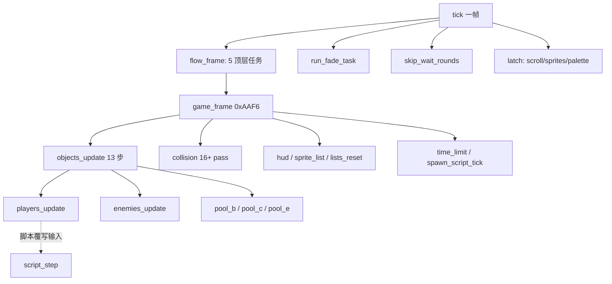

关键点：原机的协作式任务内核被压成**固定调用序列**，任务"睡几帧"改写成 `Flow` 状态字节分支。`flow.rs:78-95` 的 `IntroAfter` enum（Loop / State0 / Title / Wait60 / Redraw / SlideOutEnd）显式记录"一次 sleep 之后回到例程的哪一行"——即把跨帧续算点做成数据。

### 2.2 dino：角色状态机的分层

```
玩家对象字段（语义）:
    +$04 state word = (mode, sub)     # mode 4=死亡, mode 0=复活, sub>=2=受击反应
    +$A0 held pad / +$A8 pressed pad  # 可被脚本覆写
    cmd_state / cmd_t / cmd_flag      # 独立的搓招 FSM (0x6AC8)
    +$D1..+$DE HeroScript            # 脚本状态: state/act/step/ptr/timer/rank/count/tx/tz

敌人对象字段:
    +$06 act                         # 状态号，跳表 0x3E1AA，40 words，0..0x4E
    +$AC timer / +$A8 aim timer      # 独立计时器
    +$AB / +$84 等                   # 形态、弱点索引
```

**独立搓招 FSM**（`player.rs:960-1006`）——与主状态机并行、单独计时：

```
command_fsm():                          # 每帧先跑，识别"下、上、攻击"搓招
  状态0: 若上帧输入恰好是 DOWN 且本帧变化 → cmd_t = t1[角色]; 转状态2
  状态2: cmd_t -= 1
         超时(0xFF) → 回状态0
         held == UP  → cmd_t = t2[角色]; 转状态4，且同帧继续往下跑
         pressed ATK → 回状态0
  状态4: cmd_t -= 1
         超时 → 回状态0
         pressed ATK 且 held == UP → cmd_flag = 2  (发出必杀); 回状态0
```

**敌人状态机**（`class13_ai.rs:13-48`、`class4_states.rs:28-86`）：

```
enemy_state(e):                          # match e.b.act
    0x02 → 等待 +$7A 计时
    0x04 → 朝目标走 +$AC 帧 → decide()
    0x0E → 以速度 id 0xD 逼近槽位，每 30 帧重新瞄准，X 距目标 < 0xC0 提前结束 → decide()
    0x0A/0x0C/0x12/0x3E → 定时动画后 decide()
    0x18 → 爪击等待 → 蹲伏(0x385BA)
    0x1A → 落地判定 → decide()
    ... 40 个状态，每个对应原机一个例程
    未定义状态 → 表里指向数据/无入口（保留原样）

decide():                                # 0x4005C 状态结束决策；另有远决策 0x40118/0x40156
    → 选下一个 state entry (0x3F15E..0x3FC60)

state routine 内部调用共享动作:
    lib_target / lib_face_target / enemy_move_dir / enemy_step / enemy_anim / enemy_step_back
```

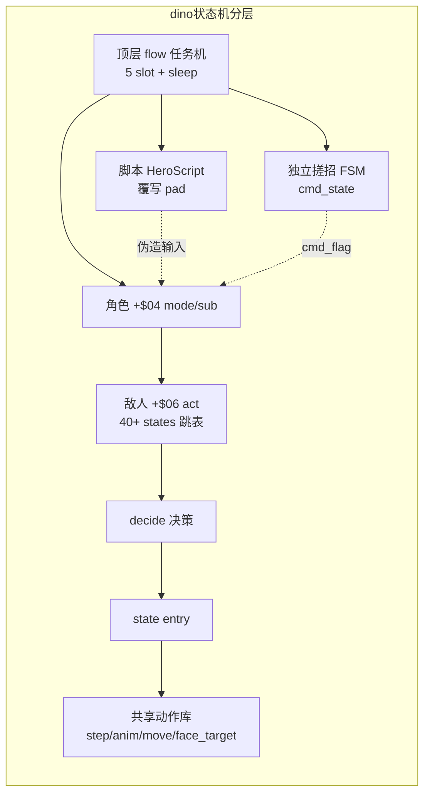

### 2.3 wof：扁平两级 + CharId 大分派

证据：`Cps1EnemyAI.cs:22-49, 61-85, 1595-1607, 2615-2619`、`Cps1PlayerLogic.cs:76`

```
敌人状态（两级）:
    ActStatA / STATE0: IDLE(0) / ACTIVE(2) / SPECIAL(4) / DEATH(6)
    ActStatB / S1   : MAIN_AI(0) / ATTACK(2) / THROW(4) / HIT(6) / FALL(8)

RunScriptSpawnAi(e):                     # 顶层是 if 链，按 ObjId / CharId 分派
    if 波次角色        → Cps1BossWaveEnemyRuntime.主状态分发
    elif ObjId == 24   → Cps1Actor24Runtime.主状态分发_494B4
    elif ObjId == 25   → Cps1Actor25Runtime.主状态分发_4996A
    elif ObjId == 20   → Cps1Actor20Runtime.主状态分发_470F8
    elif ObjId == 21   → Cps1Actor21Runtime.主状态分发_479AE
    ... 共 16 个 Cps1ActorNNRuntime.cs

兵种内分发:
    if ActStatB == S1_MAIN_AI → 正常状态分发
    elif ActStatB == S1_ATTACK → 攻击分支
    switch(ActStatB):
      0x00 主 AI / 0x02 受击入口(表 0x119C2) / 0x04 空(rts) / 0x06 被投 / 0x08 倒地
```

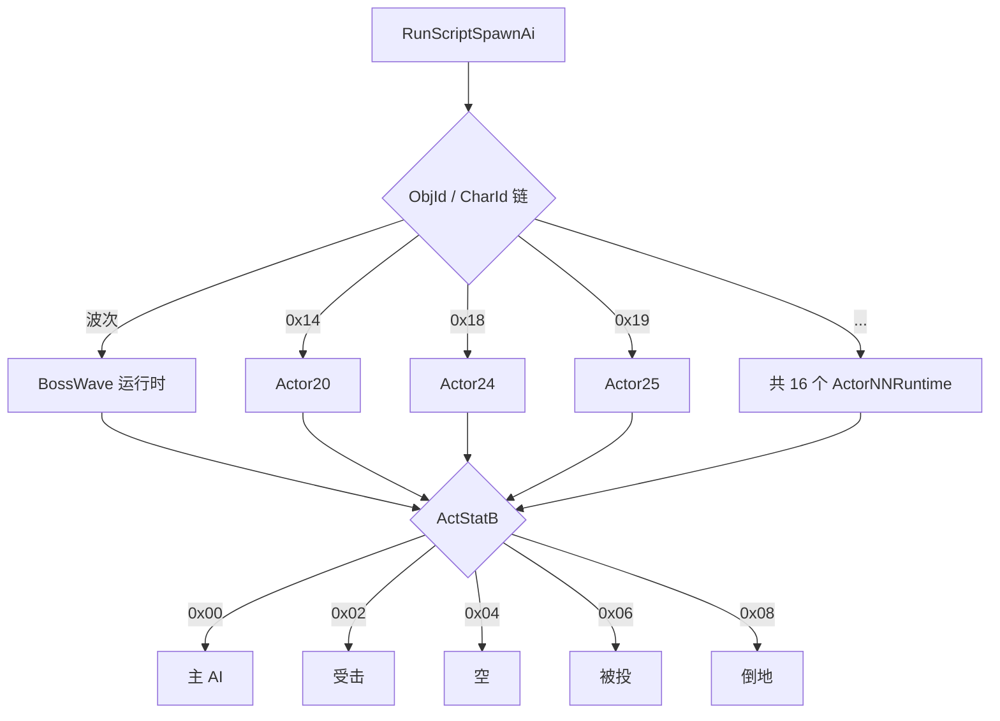

### 2.4 实质差异

- dino 把**输入识别（搓招）、动作状态（mode/sub）、受击/死亡/复活、脚本表演、顶层流程**拆成彼此独立、各自带计时器的层；层与层之间通过"覆写输入"和"状态字 == 0x0200"这类窄接口连接。
- wof 把大多数行为压在两级状态字节里，差异靠 **CharId → ActorNNRuntime** 的横向分派承载，纵向分层少。
- 结果：dino 加一个新系统（换人 tag、car、剧情脚本）是在层上挂新东西；wof 加一个特殊角色就多一个 Runtime 文件 / 一段大分派 if。这一点在下面的文件规模上体现得很直接。

---

## 3. 打击逻辑

### 3.1 dino：固定 pass 管线 + 对象列表栈 + 纯几何 + 多因子伤害

证据：`combat.rs:8-100`、`collide.rs:1-48`、`player_combat.rs:11-76`、`enemy_combat.rs:489,574,601,788,869`

```
collision():                              # 0x10546，顺序固定，不可换
    pass_10664()                          # 玩家 vs 玩家
    if not scripted: pass_10dcc()
    pass_10f96 / 1132a / 107f8(玩家攻击与抓 vs 敌) / 10cd0 / 11962
        / 11a9e / 11f86 / 1201c / 120d2 / 11e56
    if car_mode && car_on:                # car 关卡专属
        pass_121d8 / 122d8 / 12342 [+ pass_12454 if 镜头锁 0x7B4]
    if not scripted: pass_115b0(敌攻击 vs 玩家) / 11cec
    pass_1185a()

pass 内部:
    Lists 是按原机 RAM 地址键控的对象栈（0x6718 玩家表 / 0x671E / 0x69BA 上一帧 hurt list ...）
    push 插到头部 → 访问顺序是"最后 push 的先访问"（对应 68K 的 move.w a6,-(a4) 向下生长）
    特殊语义: combat_hurt_list_seen() 复现"上一帧 hurt 表的高位条目被本帧 push 覆盖"

boxes_hit(attacker, +$49 攻击框, defender, +$48 受击框):    # 纯几何，0x128F8
    table = body.box_table & 0xFFFFFF       # 忽略 24 位地址高字节里的标志位
    boxes = multi_box ? multi(table, idx) : single(table, idx)   # 四种表形态
    overlap = Z轴 && X轴 && Y轴
    每轴: (a0 - b0 + asz) as u16 <= (asz + bsz) as u16     # 16 位 wrapping + 无符号比较，边缘相切算命中
    facing != 0 时 X 框按 -xoff - xsize 镜像

player_damage(base, attack_id, power, level, enemy_kind, enemy_atk, w84, hp, r1, r2)
        -> (damage, counter_flag):          # 0x2B904，纯函数
    d = base
    if enemy_kind == 4 (敌人正在攻击):       # counter hit
        d = (d * counter_scale[enemy_atk]) >> 5 ; counter = true
    if attack_id 命中 w84 处的弱点对 (表 0xA32FA):
        d = (d * weakness_factor) >> 5 ; counter = true       # 弱点命中也算反击
    d = d * power
    d = d * level_type_scale[(w84 << 3) + level]              # 敌人种类 + 难度等级
    d = d >> 10 ; if d == 0: d = 1
    d = d * hp_hundreds_scale[(hp 百位*0x40 + (r1 & 0x3E)) / 2]
    ... 第二次 rand() r2 ...
    return (d, counter)                      # counter 触发第二火花 + 400 分
```

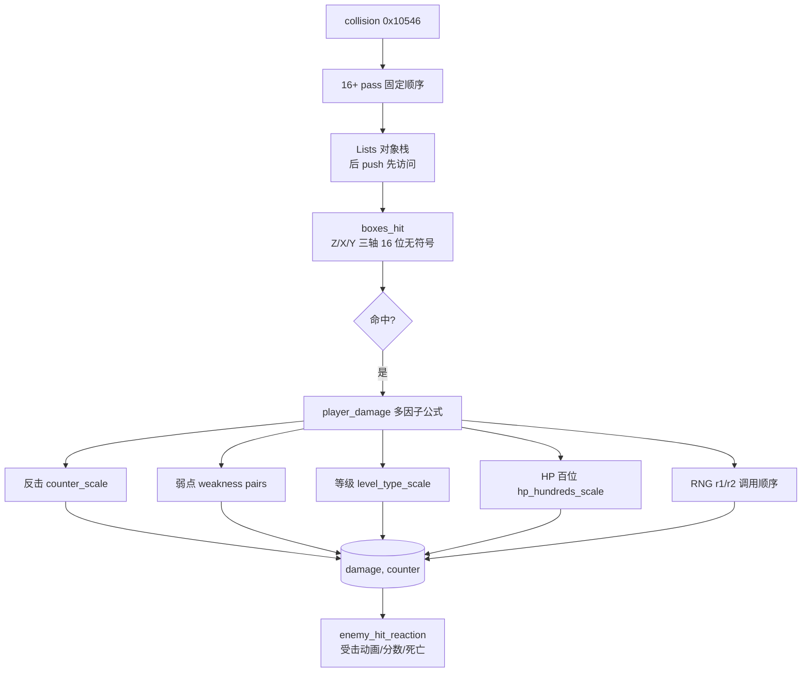

受击侧也拆成独立环节：`enemy_hit_by_player` / `enemy_hit_nonlethal` / `enemy_hit_score` / `enemy_hit_anim` / `enemy_hit_reaction`（`enemy_combat.rs`），而不是塞进攻击方。

### 3.2 wof：ROM 表直读

证据：`Cps1Collision.cs:21-76`

```
HitboxGet(id):
    base = 0xE4F02 + id                  # id 已是相对 A6 的字节偏移
    valX = be16[base]; radX = be16[base+2]; valY = be16[base+4]; radY = be16[base+6]
    X框宽 = be16[base - 2]               # 表项实为 [X框宽, valX, radX, valY, radY] 共 10 字节
                                          # id 指向 valX，故框宽在 id-2（曾系统性取错字段）

伤害参数:
    PLAYER_ATTACK_PARAMETER_TABLE = 0x6DB44
    STACK4_ATTACK_PARAMETER_TABLE = 0x6DB4A   # 奇数地址，ROM 原样
    DAMAGE_RANDOM_TABLE          = 0x1C20 + D6   # PC 相对寻址，(d16,PC,D6w*1)
    SCORE_OFFSET_TABLE           = 0x6933C
    RNG_INCREMENT                = 0x3711
```

`Cps1HitReaction124CA.cs` / `Cps1HitEffectRuntime.cs` / `Cps1TerrainCollision.cs` 也是分开的，所以 wof 并非"没有分层"；差别在**伤害构成**：wof 以查表 + RNG 索引为主，dino 在查表之上叠了 counter hit、弱点克制、等级/HP 缩放这些**显式系统**，且把它们收进一个纯函数。

---

## 4. 事件脚本

注意：两边"脚本"不是同一类东西，别直接对标。
- dino `script.rs` = **英雄过场表演脚本**（入场、走到下一区、Boss 死亡演出、结局）
- dino `spawn_script_tick` (0xFBF4, `game_frame` 第 8 步) = **生成/波次脚本**，这个才对应 wof 的 `Cps1LevelScript`

### 4.1 dino：数据驱动解释器，`script.rs:1-90`

```
数据: 表 0x1E6FC，26 个脚本 × 6 字节记录；41 个 action，各有原地址
      (assets.script / dino-extract/src/script.rs)

入口（只设状态，不执行任何动作）:
    script_area_start(0x1DA10) / script_area_end(0x1D95E) / script_boss_area(0x1DAC4)
        → G.$4DE = script id
        → G.$4DD = 位掩码 (bit i = 英雄 i 受脚本控制)
        → 清空英雄 +$D0

每帧（玩家 update 之后，只要 G.$4DD != 0）:
    for 每个置位英雄:
        if +$D0 == 0: script_hero_start(0x1DB0C)     # 一次性拷贝掩码
        script_step(0x1DB5E):
            if 状态字 +$04 != 0x0200: return          # 受击(sub>=2)/死亡(mode4)/复活(mode0) 期间挂起
            if +$D8 == 0xFFFF:                        # "wait until" 循环
                条件满足 ? 写 1 : 再写 0xFFFF
            else:
                +$D8 -= 1                              # 单位: game frame
                if +$D8 == 0: 读下一条记录 (action, G.$4F0, G.$4FD, G.$506, timer)
            执行 action（41 种）
            多数 action 以 script_pad_clear(0x1DEA6) 结束：清 +$A0 / +$A8 / +$BC

动作如何驱动角色:
    ★ 覆写输入字节 +$A0(held) / +$A8(pressed)，而不是直接改状态
    walk(0x1DF10): 保持上帧方向 +$A0 = +$A1，每 5 帧重算一次朝目标 X/Z
    ... 这样过场复用完整的玩家状态机，不另写一套表演逻辑

保留的怪癖（script.rs:30-36）:
    · 走路比较 X/Z 用无符号（bcs），目标在正、英雄在负 X 时会朝左走
    · 非领队英雄两端点位都被占时得 spot 0
    · action 0x26 只清自己的 bit，导致同帧更新较晚的英雄会从第一条记录重跑
    · G.$4F0 / G.$506 保留上一条记录的值（含 END 记录）直到下一个脚本首记录
```

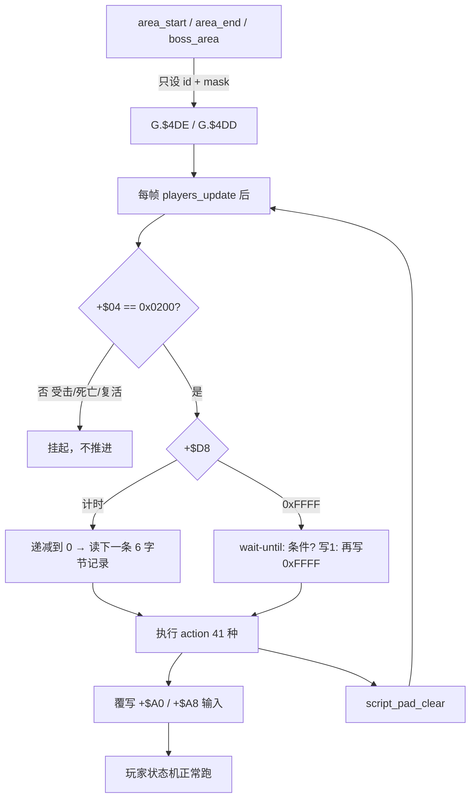

### 4.2 wof：关卡 wave 控制器 + 协程事件队列

证据：`Cps1LevelScript.cs:17-85`、`Cps1EventQueueTask.cs:5-90`

```
关卡脚本 0x106F4:
    记录 = trigger:word, type:byte, payload
    StageScriptTable = 0x1066C ; WaveScriptTable = 0x53B02
    StageSelectorStateTable = 0x1065E ; StageControllerBase = 0xFF7E88 (A5-0x178)
    控制器状态: gateWaiting / waveControllerActive / waveEnemyThreshold / waveTimer
               gateLockedMinX / gateLockedMaxX / MaxRecordsPerFrame = 64
    类型 0..0x55（loggedUnsupportedType[0x55]）
    语义: 敌人数量阈值门 → 锁相机区间 → 放下一波 / 推进关卡

事件队列 0xD000（调度器 slot15，协程任务体）:
    loop:
        if READ_INDEX == WRITE_INDEX: trap#4 让出（等待）
        event = QUEUE_BASE + read ; type = be16[event] ; param = be16[event+2]
        read = (read + 4) & 0xFF
        jmp 跳表[type]        # 9 项: 0x096E / 0x0AFA / 0x0B70 / 0x0B86 / 0x0B9C
                              #       / 0x0E8E / 0x0D34(BCD 加分) / 0x0A58 / 0x2E46(血条)
        pea 返回点 0xD006 → 回到 trap#4 让出
    ★ 一帧消费几项 = 本帧 0x0700 调度循环扫了几轮（由 VBlank 截断决定）
      宿主无法精确复现 → 加了 任务体_带上限_无对应ASM(task, 64) 和 A/B 开关
      （实测 u400 f=14：FBA 消费 2 项，宿主排空式消费 3 项，冷启动多吃一项）
```

**关键设计差异**：
- dino 的过场脚本**接管输入**，被脚本控制的角色仍走完整状态机，所以受击/死亡会自然中断脚本（`+$04 != 0x0200`）；这是把"表演"和"玩法"接在同一套状态机上。
- wof 的事件队列是**任务内核的一部分**，它的执行次数本身就是帧内物理量（VBlank 截断），因此脚本推进与 CPU 负载耦合；这正是前面十几轮讨论的"函数执行次数不确定"在**游戏设计层**的落点，不是实现层 bug。

---

## 5. 怪物策略

### 5.1 dino：决策/执行分离 + 表选择分档 + 厚共享层

证据：`boss_common.rs:1-69`、`class13_ai.rs:1-90`、`enemy.rs:1-10,524-544`、`game/enemy/` 目录统计

```
BossAi = { Morgan, Morgue, Tyrog, Tyrog2, Fessenden }

gate_table(form):        按 G.$5EC (aggression，不是 level) 与 form 选门控表
                         Morgan→0x73B14 / Morgue→0x73D54 / Tyrog→0x74542+form_idx*0x40 / Fessenden→0x74A42
action_table(form, ab):  按 form 与 +$AB 的符号选行为表
                         Morgan: +$AB<0 → 0x73B54 else 0x73C54
                         Tyrog: 0x74602 + form_idx*0x100
form_index(form):        SUBQ.B #1 → BMI/BEQ → 0 / 1 / 2 三档形态

★ boss_common.rs:1-3 原文: "Class handlers keep their own state dispatch, counterattacks and
  transformations. These helpers do not run an invented common AI."
  → 共享的是「选表机制」，不是统一 AI；每个 Boss 仍保留自己的状态分派、反击、变身
```

```
通用怪物循环:
    state dispatch (match +$06 act，跳表)
        → state routine（每个是原机一个例程）
            → 计时器到点 / 条件满足 → decide()
                → 选下一个 state entry
    state routine 内复用共享动作库:
        lib_target / lib_face_target / enemy_move_dir / enemy_step / enemy_anim
        / enemy_step_back / enemy_recover_other

文件按职责拆（game/enemy/ 共 96 个 .rs）:
    classNN.rs 纯实现 63 个
    _ai 7 / _states 3 / _attack 3 / _lib 2 / _tests 2 / _moves 2
    _parts 1 / _entry 1 / _foot 1
```

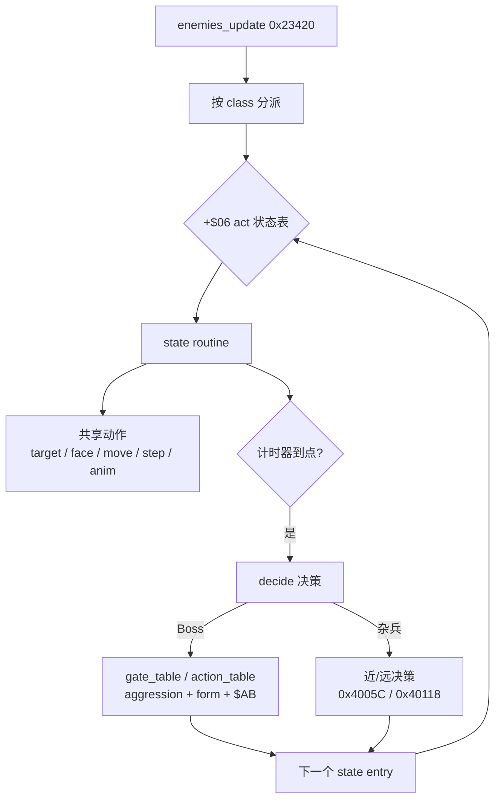

### 5.2 wof：CharId 大分派 + 专用大文件 + 薄共享层

证据：`Cps1EnemyAI.cs:22-49`、文件行数统计

```
Cps1EnemyAI.cs (31944 行) — 单一主入口:
    CHAR_GRUNT5/9 = 0x05/0x09, CHAR_LIDIAN(李典) = 0x06, CHAR_DAGGERSOLDIER = 0x07,
    CHAR_XUCHU(许褚) = 0x08, CHAR_GRUNTA/B = 0x0A/0x0B, CHAR_MEILING = 0x0C,
    CHAR_XIAHOUDUN = 0x0D, CHAR_ZHANGLIAO(张辽) = 0x0E, CHAR_CAOREN = 0x0F,
    CHAR_OBJ10/12/18/20 ...
    主表 0x22DB0 → 各角色 AI 入口（如 0x12 → 0x343B6 → Cps1Actor12Runtime）

按对象号拆的专用运行时（16 个 Cps1ActorNNRuntime.cs）:
    1B / 1C / 1F / 20 / 21 / 22 / 23 / 24 / 25 / 26 / 27 / 28 / 2B / 2C / 2D ...

专用大文件（特例厚）:
    Cps1LidianFinaleRuntime.cs     29107 行   # 李典收尾
    Cps1HardResetRuntime.cs        25320 行   # 硬重置
    Cps1SystemCoroutineRuntime.cs  17005 行   # 系统协程
    Cps1EventObjectRuntime.cs       8848 行
    Cps1PlayerLogic.cs             13906 行
    Cps1BossWaveEnemyRuntime.cs     3971 行
    Cps1ZhangLiaoRuntime.cs         2192 行

共享层（薄）:
    Cps1EnemySubs.cs  2838 行 / Cps1Subs.cs  1121 行
```

对比很直接：dino 的共享行为库（`enemy.rs` 2331 行 + 按职责拆的 96 个类文件）承担通用动作，专属策略按类分散；wof 的 2838 行共享层要托住 31944 行主分派 + 两个 2.5w~2.9w 行的专用文件。**通用层薄、特例层厚**，是 wof 这边最明显的结构特征。

---

## 6. "dino 更成熟"具体落在哪（必须分成两栏）

### 6.1 属于游戏本身的设计（能从 ROM 表/地址结构验证，不是移植者发明）

1. **搓招输入层独立**：`player_command_fsm` 0x6AC8 用 `t1/t2[角色]` 两个窗口计时识别"下→上→攻击"，是独立于动作状态机的必杀识别系统。
2. **反击 / 弱点克制**：伤害公式里 `enemy_kind==4`（敌正在攻击）触发 counter_scale；`0xA32FA + enemy+$84` 的弱点对按 attack_id 匹配。弱点命中同时置 counter（第二火花 + 400 分）。
3. **等级与 HP 缩放**：`level_type_scale[(w84<<3)+level]`、`hp_hundreds_scale[hp百位*0x40 + r1]`——伤害随难度等级、敌人剩余血量、RNG 变化，不是定值表。
4. **Boss 多形态 + aggression 分档**：`gate_table(form)` / `action_table(form, ab)` / `form_index` 三处，`G.$5EC` 明确是 aggression 而非 level；5 个 Boss 各自保留反击与变身。
5. **过场脚本系统**：26 scripts × 6 字节记录 × 41 actions，覆盖入场、走位、Boss 死亡、结局；通过覆写 pad 接到玩家状态机，因此受击/死亡自动中断。
6. **附加玩法系统**：4 角色 + 换人 tag（`player_tag.rs` / `ally.rs` / `tag_trigger`）、car 关卡（`car.rs` + 4 个专属碰撞 pass）、8 关剧情/开场影片/结局（`flow/` 20+ 子模块）。
7. **过场续算点显式化**：`IntroAfter` 把"sleep 后回到哪一行"列成 6 个枚举值，说明原机过场里跨帧续算点很多且被认真管理。

### 6.2 属于移植工程组织红利（**不能**算到游戏设计头上）

- 按职责把类拆成 `_ai` / `_states` / `_attack` / `_lib` / `_parts` / `_tests`
- 文件头的 `Owner:` / `Spec:` / `Quirks kept` 约定
- typed `Handle` / `Lists` / `BossAi` enum 这类命名抽象
- `collision()` 固定 pass 列表本身是**原机 0x10546 的顺序**（`combat.rs:1` 自述），不是 dino 新增的设计
- `ARCHITECTURE.md` 的 `Game` 单名字空间 + 方法前缀约定

### 6.3 一句话

dino 的"成熟"主要是**上层玩法系统的丰富度与切分粒度**（搓招、反击、弱点、多形态 Boss、正式过场脚本、换人、载具），底层引擎与 wof 同构；而代码里看起来的"架构清晰"有相当一部分是重写时 reorganize 出来的，不是 ROM 原本就长得那样。

> **就地警示（这题后来改过答案）**：上面这句是第 1 轮给「成熟」的答案——落在玩法系统多不多、切得细不细。这批系统本身确实是 dino 的设计（§9.7 那批能逐项印证 SPEC 的 data，§11.5 已判定不受勘误影响），但**「成熟 = 系统丰富度」已不是现行结论**：后来改成「成熟说的是同一批系统被怎么组织，以及这套组织法自带的时间与数量预算，不是功能数量」，见总入口「一页设计意图」里「开头那句更成熟，在这页怎么落地」那段与 06 卷 §94.7。别拿这里的「丰富度 / 切分粒度」去覆盖那一层；按 §11.0 也别把 wof 未登记的东西读成缺失。本句按 A.13 保留原貌，不回改。

---

## 7. 证据索引（file:line）

| 结论 | 位置 |
|---|---|
| 帧循环固定序列、game_frame 8 步、objects_update 13 步 | `dino-rs/.../game/mod.rs:331-375` |
| 顶层 5 任务 / sleep / IntroAfter | `dino-rs/.../game/flow.rs:1-15, 78-95` |
| 玩家搓招 FSM | `dino-rs/.../game/player.rs:960-1006` |
| 玩家状态字 mode/sub == 0x0200 | `dino-rs/.../game/script.rs:15-20` |
| 敌人 40 状态跳表 / decide | `dino-rs/.../game/enemy/class13_ai.rs:1-90` |
| 敌人状态分发 / 决策 / 共享动作 | `dino-rs/.../game/enemy/class4_states.rs:28-86` |
| 共享行为库 | `dino-rs/.../game/enemy.rs:1-10, 524-544, 1946` |
| 类文件按职责拆分 / 模块清单 | `dino-rs/.../game/enemy.rs:12-71` |
| 碰撞 pass 固定顺序 / Lists 栈 / hurt list 覆盖语义 | `dino-rs/.../game/combat.rs:8-100` |
| 三轴 hitbox 几何 / facing 镜像 / multi_box | `dino-rs/.../game/collide.rs:1-48` |
| 多因子伤害公式 | `dino-rs/.../game/player_combat.rs:11-76` |
| 受击侧拆分 | `dino-rs/.../game/enemy_combat.rs:489,574,601,788,869` |
| Boss 表选择 / aggression / form | `dino-rs/.../game/boss_common.rs:1-69` |
| 26 scripts / 41 actions / 6 字节记录 / 覆写 pad / 怪癖 | `dino-rs/.../game/script.rs:1-90` |
| wof 两级状态常量 / CharId 链 | `wt1/wof_cs/src/Cps1EnemyAI.cs:22-49, 61-85` |
| wof 状态分派 switch | `wt1/wof_cs/src/Cps1EnemyAI.cs:1595-1607, 2615-2619` |
| wof 玩家主分发 | `wt1/wof_cs/src/Cps1PlayerLogic.cs:76` |
| wof hitbox / 伤害表 | `wt1/wof_cs/src/Cps1Collision.cs:21-76` |
| wof 关卡脚本控制器 | `wt1/wof_cs/src/Cps1LevelScript.cs:17-85` |
| wof 事件队列 + 一帧消费数不确定 | `wt1/wof_cs/src/Cps1EventQueueTask.cs:5-20, 61-90` |
| wof 协程调度器 / 16 槽 | `wt1/wof_cs/src/Cps1CoroutineScheduler.cs:18-53` |
| wof OBJ 槽视图 | `wt1/wof_cs/src/Cps1Types.cs:13-25` |

量化统计（实测）：wof 100 个 .cs / 249041 行；`_对应ASM_` 15064、`_部分对应ASM_` 1787、`_无对应ASM_` 11109；`Cps1ActorNNRuntime` 16 个。dino `game/enemy/` 96 个 .rs，其中 63 个纯 `classNN.rs`，`_ai` 7 / `_states` 3 / `_attack` 3 / `_lib` 2 / `_tests` 2；`game/` 目录 28 个 .rs。

### 7.1 行号校准（第十轮逐行复核，只读 repo 源码）

§7 表格是第一轮写的，本轮用 `Read` 逐行复核：**一处需修正、多处可补精确位置**。原表保留不改，以下为校准。

| §7 原写法 | 校准 | 说明 |
|---|---|---|
| `mod.rs:331-375` 帧循环固定序列 | **`mod.rs:349-377`** | `331-346` 是外层 `Game::tick()`（flow / fade / scroll-sprite-pal 锁存）；`game_frame` 在 `349-358`（8 步），`objects_update` 在 `361-377`（13 步）。原行号把两者混进 331 起 |
| `player_combat.rs:11-76` 多因子伤害 | **`19-89`** | `19-89` = `player_damage` 完整连乘；`92-111` = `enemy_damage`（减算 + mercy），原表未列 |

**§12–§17 新增的精确位置**（原表没有，压缩后按此找最快）：

| 主题 | 精确位置 |
|---|---|
| 命中帧结算 / 击杀战败推迟 | `enemy_combat.rs:489-571`（`:569` 是"下一次 update"那句源码注释） |
| 受击反应 10+ 分派 | `enemy_combat.rs:869-905` |
| 死亡态 mode4 | `enemy.rs:978-1015` |
| `player_frame` 五段输入顺序 | `player.rs:569-607`；`players_update` `:539-549` |
| 脚本 hook / 挂起条件 / pad_clear | `script.rs:190-227,350` |
| census / pick_target / retarget_slot / steer_slot | `enemy.rs:770-805,828-921,1661-1685,1688-1703` |
| tag 换人 / 挂点 | `player_tag.rs:1-45`；`mod.rs:373` |
| car 载具 / 4 个 pass | `car.rs:1-38`；`combat.rs:85-94` |
| Boss 表选择 / 门控 / 抽取 / 续算点 | `boss_common.rs:11-68,96-117,135-168,71-87` |
| 伤害流水线（表地址） | `enemy_combat.rs:636-700,525-534`；`player_combat.rs:19-111` |
| wof 反应分派 9 项 | `Cps1Collision.cs:4882-4950` |
| wof 活跃玩家位图 / 选择锁 | `Cps1Actor1CRuntime.cs:2017-2041`、`Cps1Actor1BRuntime.cs:701-724`（§11.1） |

复核结论：§7 其余行号（`enemy_combat.rs:489,574,601,788,869`、`boss_common.rs:1-69`、`player.rs:960-1006`、`script.rs:15-20`）与当前 repo 一致，**未漂移**。

---

## 8. 不可推断 / 待核

- 两款游戏的发行年份、谁先谁后：本笔记按用户给的前提（dino 更晚）叙述，**未**从代码考证。
- wof_cs 是未完成的直译，其"特例厚、通用薄"里有多少是原版 ROM 本身如此、多少是直译过程中堆积的宿主补偿（`_无对应ASM`），无法仅凭代码区分；若要下结论需回查 `CODEMAP.md` / `REFERENCE.md` 的地址级对应。
- dino_rs 的 `script.rs` 只覆盖**英雄过场**；与 wof `Cps1LevelScript` 对位的 `spawn_script_tick` (0xFBF4) 本轮**未深入读**，若要做严格对拍需补读。
- `Cps1LidianFinaleRuntime.cs` 29107 行 / `Cps1HardResetRuntime.cs` 25320 行 的具体内容未读，仅按文件规模推断"特例厚"，需抽样确认。
- 本笔记刻意不含 Rust/C# 语法、typed/WRAM、端序等实现层对比；那部分见此前对话结论。

### 8.1 待核项结清回执（第十轮复核）

| §8 原待核 | 现状 |
|---|---|
| 发行年份 / 谁先谁后未考证 | **仍开放**：各轮末尾一致声明"全程沿用用户给定前提"，未从代码考证 |
| wof「特例厚」里 ROM 本身 vs 宿主补偿无法区分 | **仍开放，且不宜再扩大**：§11.0 已把 ROM 定位收敛为"只补 data、不审 repo"，此项本就属于被用户叫停的方向 |
| `spawn_script_tick 0xFBF4` 未深入读 | **部分触及**：§13 读了 `spawn.rs` 的 `census` 结构定义（`:51`），但生成脚本命令表本身仍未逐条展开 → 归入 ⏳ data 项 |
| `Cps1LidianFinaleRuntime.cs` / `Cps1HardResetRuntime.cs` 未抽样 | **仍开放**：仅按文件规模推断，按 §11.0 不主动扩大 |
| 实现层对比"见此前对话结论" | ✅ **缺口已补**：阶段 A 的工程结论（三条技术路线 / VBCC·C89 选型 / `AssetPack` 单向门 / FBA vs MAME / 渲染 / 冷启动 / lag 不可模拟 / 完成度 23-of-26）已整理进 **附录 A**，按视角约定隔离存放、不混进设计正文 |

结论：§8 的待核项**没有一条被"解决"**，但都已按 §11.0 重新定性为"刻意搁置"，不是分析欠账；第 5 条指向的会话资产也已落盘（附录 A），不再是压缩风险。

---

# 第二轮深挖：原版 ROM 级验证

> 用户 11-06 追加资源后重新调查。目的：**把"游戏本意"与"移植工程组织"彻底分开**——第 1 轮只读了 `dino_rs` / `wof_cs` 两份移植代码，无法判断哪些是原版 ROM 的设计、哪些是重写者 reorganize 出来的。本轮直接对两款游戏的 68000 原码取证。

## 9.0 取证方法与资源

| | dino | wof |
|---|---|---|
| ROM | `G:/Game/Mame32/roms/dino.zip`（用户提供） | Ghidra 已载入 `wofj.68k.xml` |
| 重组 | 3 片 EPROM 按 `cde_23a.rom → cde_22a.rom → cde_21a.rom` 顺序拼接，每片内 16 位字**字节交换**（`ROM_LOAD16_WORD_SWAP`），得 0x180000 字节大端镜像，加载到 0 | 无需重组 |
| CRC 校验 | `cde_21a.rom`=66d23de2 / `cde_22a.rom`=9278aa12 / `cde_23a.rom`=8f4e585e，与 `dino-extract/src/rom.rs:19-43` 完全一致 | — |
| 反汇编 | capstone 5.0.7，`CS_ARCH_M68K \| CS_MODE_M68K_000 \| CS_MODE_BIG_ENDIAN`；直接对内存镜像切片，未落盘任何中间文件 | **GhidraMCP 7.0** `http://127.0.0.1:8089`，`wt1/agent_scripts/ghidra_http_query.py`（`disassemble`/`decompile`/`find`）；`GET /check_connection?program=wofj.68k.xml` 返回 `{"status":"ok","server_kind":"gui","version":"7.0.0"}` |
| 设计文档交叉验证 | `re/specs/enemy/SPEC.md`（112 KB，§5 census / §6 difficulty / §7 class2 AI / §10 hit reaction / §14 AI design answers） | `wt1/wof_cs/src/*.cs` 里的 `_对应ASM_` 注释 |

**重要**：Ghidra 8089 的 GET `/` `/sse` `/mcp` `/health` 等全部 404；正确方式是**带 `program=wofj.68k.xml` 参数的 `POST /disassemble_bytes` 或 `GET /check_connection`**，见 `ghidra_http_query.py:22-64`（7.0 把 `get_function_*` 全族合并进 `/get_functions?fields=`）。

---

## 9.1 重大更正：wof **也有**这些系统（⚠️ 本节及 §9.5/§9.6 的"重大更正 / 维度更浅 / 全局档位"结论已作废，以 §11.4 为准）

第 1 轮把"wof 缺动态难度 / RNG 表驱动 AI / 目标选择"当成设计差异，**错了**。ROM 反汇编证明两款游戏都有，只是**维度更浅、以分散的 ROM 例程存在**：

| 系统 | dino 原版 ROM | wof 原版 ROM | 第 1 轮判断 |
|---|---|---|---|
| 动态难度 | `Rank` 结构 G.$5EC 起，`rank_tick 0x186CC` 每帧维护，aggression `0x182A2` Markov 重掷 | `A5-0x5A` 单字节，`0x170E` 死亡降、`0xBC04` 按玩家数上下限钳位、`0x7DDA` 伤害难度索引、`0x3B94` 难度概率比较 | 错 |
| RNG 表驱动 AI 决策 | `0x4005C` / `0x40118` / `0x40156`，`rng&0x1F` × variant × X距离 × aggression 查 32 行表 | `0x3E1E` 查行为表 `0x3E62` → 行为 ID → `0x3E82` 参数表；`0x4070` 决策回写 CF；`0x3B94` 概率门 | 错 |
| 目标选择 | `0x32032 pick_target`：census 负载均衡 + 多维加权 | `0x4146 近身抢占写 A06 目标`：3 玩家参数块（0x3E1C/0x3EFC/0x3FDC，间隔 0xE0）轮询 + 位标志；`0x3E1E` 内含 `bsr 0x3F0C` 算目标 | 错 |
| 受击反应分派 | `0x2A606` 表 `0x2A620` 按 `+$06`，10+ 种 | `0x7E4A` 表 `0x7E68` 9 项跳表 | 漏 |
| 关卡/生成脚本 | `0x1DB5E` 过场 + `0xFBF4` 生成 | `0x106F4` 解释器 + 命令表 `0x10744` | 已对，但深度不足 |

**root cause**：第 1 轮看到的是 `wof_cs` 直译工程把同一套 ROM 机制打散成 31944 行 `Cps1EnemyAI.cs` + 16 个 `ActorNNRuntime` + 一堆 `_无对应ASM` 补偿，误把"实现的散"读成"设计的少"。**这是方法论错误，本轮用 ROM 纠正。**

---

## 9.2 状态机（ROM 级）

### dino：四层状态字节是原版布局，不是移植者发明

`body.rs:33-36` 的 `mode/sub/act/step` 对应 ROM 的 `+$04..+$07`，常被当成一个 long 写。ROM 里到处是这种字面量，capstone/反编译多处可见：

| 值 | 含义 | 出处 |
|---|---|---|
| `0x0200_0000` | mode=2 alive, sub=0, act=0, step=0（`reset_ai` 回到状态 0） | `SPEC.md:634` |
| `0x0202_0000` | mode=2 alive, **sub=2 受击** | `SPEC.md:1102`、`enemy_combat.rs:514` |
| `0x0202_1A00` | 受击后起身/眩晕 | `SPEC.md:1177` |
| `0x0400_0000` | mode=4 死亡 → class death routine | `SPEC.md:1173` |
| `0x0200_0202` / `0x0200_0806` / `0x0200_0C00` / `0x0200_1000` | AI 状态 2 / 8 / C / 10 入口 | `SPEC.md:630,637,643,654` |

`0x1DB5E script_step` 的状态字 `== 0x0200` 检查（受击/死亡/复活挂起脚本）也是原版行为：**ROM `0x1DB76` 读 `+$2(a6)` 判 G.$4DD 位、`0x1DB82 subq.w #1,$d8` 递减计时器**。

顶层任务机同样是原版：`flow/scene.rs` 的 `Scene{state,sub,count,sleep,suspended,live}` 复刻 ROM 的 `0x95A sleep` 与 `0xA76=1 / 0xA7A=2 / 0xA7E=30 / 0xA82=60 / 0xA86=120 / 0xA8C=180` 辅助函数（`scene.rs:5-9`）。`flow.rs:490` 的 mode 分派（0x0C → `game_frame`）也是 ROM 0xA914 的模式字节。

### wof：输入边沿 + 计时器 + 状态字

`0x1AA58 玩家主分发` ROM 反汇编（Ghidra）：

```
bsr  $1AAF0                      ; 读输入
move.b (0xa1,A0),D5b             ; prev input
not.b D5b
and.b (0xa0,A0),D5b              ; pressed = held & ~prev
move.b D5b,(0xa2,A0)
btst.l #4,D5 ; beq ... ; st (0xa4,A0)   ; 攻击键边沿 → 标志
tst.b (0x60,A0) ; subq.b #1 ... ; 清 (0x61,A0)
tst.b (0x78,A0) ; subq.b #1 ...
tst.b (0xa8,A0) ; subq.b #1 ...
tst.b (0x9a,A0) ; ...
...（后面接状态分派）
```

即 wof 玩家槽 `A0` 的 `+$A0 held / +$A1 prev / +$A2 pressed / +$A4 攻击标志`，加多个独立计时器字节递减，再进 `ActStatABCD`（`Cps1PlayerLogic.cs:47` 读 `+0x28`）。**两边都是"输入边沿 + 状态字 + 多个计时器"，dino 多出的只是把四层状态字节显式命名并让脚本/受击/AI 各自占用一层。**

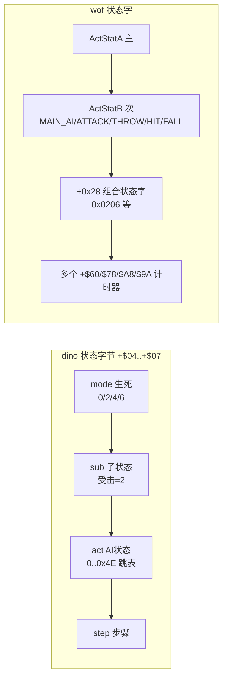

### 顶层流程：dino 压成固定序列，wof 保留协程

- dino `0x10546 collision` ROM 反汇编逐条 `bsr` 印证 `combat.rs:70-100` 的 pass 顺序就是**原机顺序**（`pass_10664 → 10dcc → 10f96 → 1132a → 107f8 → ... → 115b0 → 11cec → 1185a` + car 4 个 pass）。`game_frame 0xAAF6` 的 8 步、`objects_update 0xE90E` 的 13 步同理。
- wof `0xD000` 事件队列任务是**真协程**：每消费一项 `pea` 返回点 + `jmp 跳表` + `trap#4` 让出，**一帧消费几项由本帧 `0x0700` 调度扫了几轮（VBlank 截断）决定**（`Cps1EventQueueTask.cs:61-71`，ROM 层面即 `0xD006 jsr 0x89A` 等待点）。同理 `Cps1EnemyAI.cs:874` 的 `预算边界续跑对象AI_无对应ASM`、`:1225` 的 `应在预算边界推迟处理池对象AI_无对应ASM` —— **AI 更新本身也受帧预算约束**。

> 这是设计层最硬的一条差异，不是实现 bug：dino 把协作式内核压成固定调用序列（删掉了"一帧跑几轮"这个自由度），wof 原样保留，于是"某函数这帧跑几次/跑没跑完"在 wof 里是必须逐点求解的物理量。第 1 轮从移植代码推断出这点，本轮在 ROM 层确认。

---

## 9.3 打击逻辑（ROM 级，大幅深化）

### dino：命中 → 伤害 → 受击反应 → 死亡，四段解耦

**① 命中判定 `0x11008`**（`SPEC.md:1096-1118`、ROM `0x2B904`/`0x2BA2A` 反汇编印证 `player_combat.rs`）：

```
player_hits_enemy(atk, e):
    if e.active & 2: return                       # 已在受击，本列表无敌
    if atk.serial == e.serial: return             # 一次挥击每个目标只命中一次
    if atk.box_49==0 or e.box_48==0 or !overlap: return   # 0x128F8 三轴 Z/X/Y 无符号窗口
    e.serial = atk.serial ; e.credit = atk.credit
    if guard(e): block_fx(); return               # 仅 +$84=0xA4 的类能格挡
    e.active=2 ; e.l4=0x0202_0000 ; e.attacker=atk
    if atk.id in (0x6E,0x6C): nonlethal(HP floor 1); return
    r = attack_record[char][id]                  # stride 8: dmg/poise/reaction/hitstop/snd/score/spark/b7
    d = r.damage ; if charge: d = charge_scale(d)
    d = player_damage_scale(d, atk, e)           # 0x2BA2A，2 次 rng()
    e.hp -= d                                    # >0 才写，否则 0
    e.poise = saturating_sub(e.poise, r.poise)   # 韧性，0 强制击倒
    e.reaction = e.act = r.reaction ; e.step=0
    e.hitstop = atk.hitstop = r.hit_stop         # ★ 命中停顿双方同写，队伍技连伙伴也写
    score / spark / sound / facing 翻转
    # 死亡不在本帧处理 → 下一帧由敌人自己的 hit state 驱动
```

**② 伤害公式 `player_damage_scale 0x2BA2A`**（capstone 在 `0x2B904` 起逐条印证 `player_combat.rs:19-76`）：

```
d = base
if debug_nodamage: return 0
if e.kind == 4 (敌正在攻击):                     # counter hit
    m = W[0xA320C + 2*e.atk] ; if m: d = (d*m)>>5 ; counter_flag = true
p = 0xA32FA + e.w84                              # 按敌人类型的弱点对
if 2*B[p] == atk.id or 2*B[p+2] == atk.id:      # (id/2, factor) × 2 对
    d = (d*factor)>>5 ; counter_flag = true       # ★ 弱点命中也算反击：第二火花 + 400 分
d = lo16(d) * player.power
d = lo16(d) * B[0x2BECE + e.w84*8 + level] >> 10   # 敌人类型 × 难度等级
if d==0: d=1
bar = 0 ; hp = e.hp ; while hp>100: bar+=0x40; hp-=100
d = lo16(d) * W[0x2BC4E + bar + (rng() & 0x3E)]    # HP 百位缩放 + 第 1 次 rng
band = hp>=75?0 : hp>=50?0x40 : hp>=25?0x80 : 0xC0
d = (lo16(d) * W[0x2BB4E + band + (rng() & 0x3E)]) >> 10   # 残血缩放 + 第 2 次 rng
```

capstone 在 `0x2B904` 实际看到：`clr.w $4f4` → `cmpi.b #4,$2e(a3)` → `lea #$a320c,a6` + `mulu/lsr #5` + `st.b $4f4` → `lea #$a32fa,a6` + `move.w $84(a3),d0` + 两次 `add.b d0,d0 / cmp.b $58(a2),d0` → `st.b $4f5` → `move.b $c6(a2),d0 / mulu` → `move.w $5ee(a5),d5`。**逐条吻合。**

**③ 受击反应分派 `0x2A606`，表 `0x2A620` 按 `+$06`**（`SPEC.md:1135-1189`）——这是第 1 轮完全没挖到的系统：

| `+$06` | 处理 | 含义 |
|---|---|---|
| 0x00 / 0x02 | 0x2A63E / 0x2A680 | 轻畏缩；HP=0 / poise=0 / 空中时转击倒 4 / 6 |
| 0x04 / 0x06 | 0x2A6C8 / 0x2A852 | 击倒 A / B（不同起跳速度） |
| 0x08 | 0x2A9C8 | 被玩家投掷；落地弹一次，撞墙滑落 |
| 0x0A / 0x0C | 0x2AC02 | 燃烧击倒（HP=0 且类型 0xC 时炭化死亡） |
| 0x0E..0x12 / 0x14..0x18 | 0x2ADDE / 0x2AEB2 | 后滑不腾空（3 组 `(frames,vx,ax)`：7/1536/-128、10/1792/-177、10/2560/-256） |
| 0x1A | 0x2AFF0 | 起身 / **眩晕**（星星 90+8×20 帧，可被击；同时只允许一个眩晕敌人） |
| 0x1C | 0x2B2E6 | 靠墙滑落（30 帧后以 1.5 px/frame 下滑） |

```
poise 系统: 起始 10；每次命中减攻击的 poise 字节；到 0 下次必击倒；击倒重置 10；
            AI state 0 在 +$79(60 帧) 到点后补满 10
击倒物理:   launch (vx,ax,vy,ay) 按 reaction 类型与 alive/dead 分 4 组；
            屏幕左右边缘反弹（dead 且 big）；落地 lie_time；撞墙 wall_slump
眩晕判定:   起身时按 0x2B180(+$9A/aggression) / 0x2B158(HP 档) /
            0x2B168(存活数) / 0x2B28C(level) 四张位表；Vice T./Walther 永不眩晕
getup_or_die 0x2AF86: HP=0 → e.l4=0x0400_0000 → class death routine
                      + reroll_aggression()   # ★ 每次击杀都重掷 aggression
```

**④ 死亡**：`class2_dying 0x3484E` 记击杀分、闪烁 120 帧后释放槽；`kill_all 0x326F8` 波次超时清场。

### wof：查表 + 难度索引 + 9 项反应表

`0x7DDA 敌方伤害难度索引` ROM 反汇编（Ghidra）：

```
move.b (-0x5a,A5),D6b          # 难度
add.b  (0xa2,A0),D6b           # + 攻击者 +$A2（个体偏移）
bpl/bmi → 负数归零；cmpi #0x1f → 超上限钳到 0x1F
add.w  (A3)+,D6w               # + 记录里的偏移
lea    #0x6ee84,A4
add.b  (0,A4,D6w),D0b          # 查伤害修正表
ext.w D0w ; bgt ... ; moveq #1  # 下限 1
btst.b #6,(0x30,A1)            # 防御衰减门
...
```

`0x1BFA 随机伤害查表` ROM 反汇编（**顺带确认 wof 的 RNG 算法**）：

```
move.w (-0x1c42,A5),D0        # state
move.w D0,D5 ; add D0,D0 ; add D0,D0 ; add D5,D0   # ×5
addi.w #0x3711,D0             # + 0x3711
move.w D0,(-0x1c42,A5)        # 写回
move.b (-0x1c42,A5),D0 ; andi #0x1f,D0
add.w D0,D6 ; move.b (0x1c20,PC,D6),D0 ; ext.w ; rts   # 查表 0x1C20
```

`Cps1Collision.cs:4770-4814` 的伤害流程：随机伤害 → 难度索引 → `0x6EE84` 修正 → **防御衰减** `damage *= (0x20 - max(hpBand, defense)) >> 5`（`hpBand` 由目标 HP 查 `0x1BF0`，`defense` 由 `0x20D4` 取 `OBJ+0x90` 或按难度查表）→ `reaction` 表 `0x7E68` 9 项跳表（`Cps1Collision.cs:4857-4865`）。

### 打击对照（ROM 级）

| | dino | wof |
|---|---|---|
| 命中去重 | `+$5E serial`，一次挥击每目标一次 | 有对应机制（`Cps1Collision.cs:341` combo_level 递增） |
| 命中停顿 | `hitstop` **双方同写**，队伍技连伙伴 | 有 `0x9A` 计时器，未见双方同写的显式语义 |
| 韧性 | **poise 系统**，10 满，0 强制击倒，击倒重置 | 未见独立 poise；以 HP band + defense 衰减 |
| 反击 | **counter hit**（敌攻击中）+ **弱点克制**（按敌人类型 `+$84` 表）→ 第二火花 + 400 分 | 未见对应系统 |
| 伤害因子 | power × 等级类型表 × HP 百位表 × 残血 band 表 × 2 次 rng | 随机表 × 难度索引表 × 防御衰减 |
| 受击反应 | `0x2A620` 10+ 种（含投掷/燃烧/眩晕/后滑/墙壁滑落/起身） | `0x7E68` 9 项 |
| 死亡时机 | **不在命中帧**，下一帧由敌人自己的 hit state 驱动 | 命中内处理（`Cps1Collision.cs` 直接改 HP/状态） |

---

## 9.4 事件脚本（ROM 级）

### dino：两套脚本，记录格式由反汇编逐字节确认

**① 英雄过场脚本 `0x1DB5E script_step`**（capstone 反汇编）：

```
move.b $d1(a6),d0 ; move.w $1db6c(pc,d0.w),d1 ; jmp 跳表   # 按 HeroScript.state 分派
move.b $2(a6),d1 ; btst.l d1,$4dd(a5) ; beq → rts         # 该英雄 bit 未置 → 不跑
subq.w #1,$d8(a6) ; bne → 0x1DBC6                          # 计时器非 0 → 直接执行 action
# 计时器到 0：读下一条记录
clr.b $d2(a6) ; clr.b $d3(a6) ; movea.l $d4(a6),a0
move.b (a0)+,d0                                             # action (1 字节)
cmpi.b #$a,d0 / #$26,d0 → 特殊：bclr 该英雄 bit of G.$4DD
move.b d0,$d2(a6)
move.b (a0)+,$4f0(a5) ; move.b (a0)+,$4fd(a5) ; move.b (a0)+,$506(a5)   # 3 个全局参数
move.w (a0)+,$d8(a6) ; move.l a0,$d4(a6)                    # timer:word + 指针回写
0x1DBC6: move.b $d2(a6),d0 ; move.w $1dbd6(pc,d0.w),d0 ; jmp 跳表 0x1DBD6   # 41 个 action
```

**记录 = `[action:byte, G.$4F0:byte, G.$4FD:byte, G.$506:byte, timer:word]` 正好 6 字节**，26 个脚本，表 `0x1E6FC`。`timer=0xFFFF` 是 wait-until。action 表 `0x1DBD6` 的 41 项在 `script.rs:250-333` 逐条列出：`0x00 pad_clear / 0x02 walk(End) / 0x04 pose / 0x06 scene_done / 0x08 leader_attack / 0x0E walk(Start) / 0x10 walk_point / 0x12 hold_right / 0x14 walk(Spots) / 0x16 jump_kick / 0x18 hold_right_jump / 0x1E walk(Lineup) / 0x20 wait_flag(boss intro) / 0x26 end / 0x2A+0x38 wait_items / 0x2E wait_flag / 0x30 wait_ground_present / 0x32 jump_to_point / 0x34 wait_ground_scripted / 0x3C walk_right_to_b80 / 0x42 clear_sequence(Ep8) / 0x4A barrier / 0x4C wait_flag(car)`，另有 `0x24/0x40/0x46` 生成 pool B 对象（`spawn.rs:300-312`）。

**设计要点**：action 多数是 **wait-until 同步点**或**覆写 pad 字节**（`+$A0 held / +$A8 pressed`）让角色走完整状态机，而不是直接写状态。所以受击/死亡（`+$04 != 0x0200`）会自然中断脚本。

**② 生成脚本 `0xFBF4 spawn_script_tick`**（capstone）：

```
lea $66c(a5),a4                      # Spawn 结构 G.$66C
tst.b $4(a4) ; bne $FC6E              # init 检查
move.b $4d9(a5),d0 ; ×4              # stage
movea.l $fc2e(pc,d0.w),a0 ; movea.l $fc4e(pc,d0.w),a1   # list1/list2 表
move.b $786(a5),d0 ; ×4              # area
move.l (a0,d0.w),$8(a4) ; move.l (a1,d0.w),$c(a4)       # 设置两张列表指针
addq.b #2,$4(a4) ; rts               # init=2
```

记录：list1 14 字节 / list2 16 字节（`spawn.rs:185-222`），触发条件 `camera X <= trig`（垂直场景用 cam_y 有符号 `blt`）；`flags&0x80` 是命令记录（`0x04` 重掷 aggression / `0x08` 强制 aggression / `0x0C` 设时间 / `0x10` 加时间 / `0x00` 跳一条）；`flags&7` 选池（0=A/1=B/3=E）；`flags&0x60` 人数条件；`flags&0x18` + 高字节 = level 条件。

### wof：单套关卡脚本，trigger 比较 + 命令跳表

`0x106F4` ROM 反汇编（Ghidra，26 条指令全部取得）：

```
move.w (A6)+,D1w                # trigger:word
cmp.w (-0x574,A5),D1w ; ble → 0x10708 ; rts      # 触发值比较，未到则本帧不推进
（0x106FE 变体：cmp + bge，用于另一方向）
0x10708: move.b (A6)+,D0b                        # type:byte
movea.l (0x10744,PC,D0w*0x1),A1                 # ★ 命令表 0x10744
jsr (A1)
bcc → 成功：move.w #0x101,(A1) + 6 次 move.x (A6)+,(off,A1)
              # 填 +$21 / +$4 / +$8 / +$22 / +$24 / +$26
bcs → lea (0xb,A6),A6                            # 失败也跳过 11 字节（记录等长 14）
0x10734: move.l A6,(0x40,A0)                     # 保存脚本指针
tst.w (A6) ; bpl → 0x106E2                       # ★ trigger 非负 → 继续下一条
move.b #6,(0x28,A0) ; rts                        # 负 trigger = 结束，控制器状态置 6
```

命令表 `0x10744` 的项是"池分配器 + 填记录"（`Cps1LevelScript.cs:711-830`）：`0x140A` 生成 10 型 / `0x1464` 14 型 / `0x1480` 18 型 / `0x1426` 1C 型，各自从 `0x300/0x306/0x30A/...` 计数 + `0x2EE/0x2F4/0x2F8` 游标分配槽。

### 脚本对照

| | dino | wof |
|---|---|---|
| 套数 | **2 套**：过场表演 `0x1DB5E` + 生成 `0xFBF4` | 1 套关卡脚本 `0x106F4`（另有事件队列 `0xD000`） |
| 触发 | 过场：逐帧 timer；生成：**camera X 位置** | **trigger 值与全局 `-0x574(A5)` 比较** |
| 记录 | 过场 6 字节 ×41 actions；生成 14/16 字节 | 14 字节（trigger+type+11 payload） |
| 分派 | `0x1DBD6` 41 项 action 跳表 | `0x10744` 命令跳表 |
| 终止 | timer 流 / 列表走完 | trigger 负值 → 控制器 `+$28 = 6` |
| 驱动角色方式 | **覆写输入**，走完整状态机 | 直接分配对象并填字段 |
| 一帧推进量 | 固定（脚本 step 每帧 1 次、spawn 走完所有已触发记录） | 事件队列**一帧消费几项由 VBlank 截断决定** |

---

## 9.5 怪物策略（ROM 级，本轮最深的收获）

### dino：class 2 的 9 状态 AI（`SPEC.md:618-723`，全部 [O]）

```
alive(e) 0x33E76:
    kill_all_check(e)
    match e.mode:  0 => ai(e) | 2 => hit_reaction(0x2A606) | 6 => grabbed(0x2B35A)
    clamp_to_playfield(e)

ai(e) 0x33EA4:
    if e.poison_t: 递减，到 0 补满 poise=10
    STATE[e.act](e)                # 跳表 0x33EFA：0,2,4,6,8,A,C,E,10 共 9 态
    floor_collision(e)
    障碍计时 e.bbc-- ; 到 0 且贴障碍 → attack_obstacle (combo 7)
    if e.terrain==0x10: e.l4=0x0200_1000        # 跳下台阶
    register_draw / register_hurtable

reset_ai 0x33F38: e.l4=0x0200_0000 ; set_anim(1) ; set_walk_speed
                  ; retarget_and_slot ; steer_to_slot   # 每次 combo/受击/入场后重选目标
```

| 状态 | 地址 | 行为 |
|---|---|---|
| 0 decide | 0x33F74 | 空中→fall；`b7a` 延时到 0 且 `(rng&0xF) < B[0x33FA4+aggr]`（3,4,5,6,7,8,11,15）→ 出招；否则进 state 2 |
| 2 approach / MAWARIKOMI | 0x33FB8 | 目标失效→重选；撞玩家→wait_then_attack；dash→state A；`near_slot→at_slot`；**每 41 帧重算路径**；`(0x8A886551 >> (rng&0x1F)) & 1` 位掩码决定嘲讽（12/32）；卡住→rotate_slot |
| 4 taunt | 0x340AE | 嘲讽动画（含 anti-tamper 副作用） |
| 6 MAAI 保持距离/绕圈 | 0x340FC | 在槽位悬停，暂停 `B[0x34186+aggr]` 帧（85→15 随 level），每帧重算方向 |
| 8/A/C/E/10 | — | 攻击 combo、冲刺、下落、跳台阶等 |

**at_slot 0x353CE（决策核心）**：

```
if B[0x353B6 + vrow*4 + aggr] > (rng() & 0x1F):  e.act = 8 ; return    # 去攻击
# 否则重新站位，5 次尝试避免重复
loop 5: c = B[0x354B2 + vrow*16 + (rng()&0x1F)] ; if c != prev or tries==0: break
e.slot = c ; e.pause = B[0x3546A + (rng()&0xF)]     # 10..240 帧
match c:
  0 => 绕目标换下一个/上一个槽位（按帧号奇偶）        # circling
  1 => e.act = 6                                    # MAAI 悬停
  _ => 背向目标走直线 50 帧后重选                    # back off
```

**侧翼包抄 `retarget_and_slot 0x35172`**：用**上一帧** census 的 `prev_e2/prev_e3`（目标玩家左/右两侧敌人数）决定初始槽位，让敌人往人少的一侧包抄；目标 6 个接近槽位（每侧 3 个），`facing` 时 +3 取模 6。SPEC 还记了一个 QUIRK：某分支没清寄存器导致 `s` 可达 0xFF，照样索引 `SLOT_3524C` 表。

**目标选择 `0x32032 pick_target`**（capstone 反汇编印证 `SPEC.md:393-413`）：

```
清 score[3]；检查 3 个玩家 active → 位掩码
m = 0x10 ; 逐个比较 prev[p][0]（上次帧被瞄准的敌人数），取最小（平局取后者）
if m < 3: score[best] = 1 ; goto choose                 # ★ 负载均衡：不扎堆
else:  # 所有玩家都已有 >=3 个敌人 → 多维加权
   Manhattan 最近者 += 10
   最大分数 += 1 ; 最大体力 += 2
   每个玩家：特定动作字 += 6 或 3；facing==0 += 4（QUIRK 两分支同条件）；走路中 += 3
choose: 取最大 score，平局 P1 > P2 > P3
无人存活时：按 G.$4CD started 位选第一个开始的角色
```

`0x3242E census` capstone 逐条印证 `SPEC.md:376-388`：3 组 `move.l $3358,$3354`（prev = cur）、`move.b $4fb,$4f3`（alive_prev = alive）、`moveq #$17,d6`（24 槽 dbra）、逐槽 `tst.b $0 / move.b $7d / bmi / cmpi.b #4,$4 / bcc`、`addq.b #1,$4fb`、`movea.w $76,a2` 判 P2/P3/P1、`addq.b #1,$e4/$e5/$e6/$e7`（无符号 `cmp.w $8(a2),d1 / bcs` 判左右）。

**难度/aggression 是全局系统，喂给所有 AI**：

```
rank_tick 0x186CC（capstone）:
    if freeze($602) or scripted($4DD) or stage_clear($4D5): return
    lea $5ec(a5),a6                 # Rank 结构
    rank_timer($c) -= 1 ; 到 0 → rank($4) += 1，clamp 31
    RANK_PERIOD 表 0x187B8 按 speed($a)*2 重装 timer
    ups($e) / downs($10) 各自 1800($708) / 1200 帧计时，到点 rank += 1

aggression reroll 0x182A2（capstone + SPEC §6.5 Markov）:
    if freeze($602): return
    if forced($5f2): aggression = forced_val($5f4)
    else: 表 = ($7b4==1) ? 0x18364 : 0x182E4      # 两张 8×16 表
          aggression = B[表 + aggression*16 + (rng() & 0xF)]   # 多数 +1，偶尔 -1/-2
    调用点：spawn command 4 / 平静期结束 / ★ 每个敌人死亡(0x2AFCA) / 0x4A26E
    ⇒ 玩家杀得越多，aggression 越漂高；continue 后归 0 保持 20 秒
```

`SPEC.md §6.7` 汇总 difficulty 的作用面：
- **level `$5EE`**：HP、伤害缩放、槽位暂停 `T_34186`、受击恢复 `T_345F0`、冲刺概率 `T_35796`、反击延迟 `0x2B8C4`、起身时间与眩晕概率、level-gated 生成
- **aggression `$5EC`**：class2 走/跑速度、槽位攻击概率 `T_353B6`、伏击 roll `T_33FA4`、state-E 暂停 `T_34210`、眩晕行
- **玩家数 `$4EF`**：level 列、生成条件、波次阈值、Boss HP、增援上限

`SPEC.md §14` 的设计结论（值得原文引用）：*"**How a mode is chosen: no central brain.** Each class has its own state machine"*；*"there is **no attack-token system**"*；拥挤靠四件事控制：目标选择偏好 <3 敌人、6 个接近槽位轮换、低 aggression 下低攻击概率（Ferris 在 aggr 0 时 2/32）、波次阈值。

**〔本轮回源补层：census 的第四个计数没人读〕** 上面转述漏了 SPEC §14 紧接着的半句：`+$7D` 标记正在攻击的敌人，census 也按玩家数了这笔账（`+$E5`），但原文写着 **nothing reads that count**（标 [O]，作者 grep 过 `$e1`/`$e5`）。repo 侧全域穷尽复核：`census_prev` 的读点只有 `enemy.rs:838`（`enemy_pick_target` 用 `prev[p][0]` 做 `<3` 负载均衡）与 `enemy.rs:1665`（`retarget_slot` 用 `[2]/[3]` 选侧翼槽）；`lib32.rs:167` 读的是**本帧** `census[p][2]/[3]`；`census[p][1]` 只有 `enemy.rs:798` 的累加写入，`trace.rs` 逐帧对拍字段与 `boss_common.rs:470` 的 Boss 特例写 `prev[2][0]` 按 §0 剥掉。⇒ 四个计数里三个参与分工，「现在有几个正在打你」那格只是记着。**倒推（说人话）**：dino 没有一条「最多几个人能同时打你」的硬规则，连专门数的那本账都没人翻开；玩家觉得「怪围着却不会一起糊脸」，是四件各自局部的事叠出来的——新敌人优先去人少的一侧、六个站位轮流、走到站位才按难度掷一次低概率出手、波次别一次放太多。拥挤控制不住在一本共享账上，而是散在四道小门里。按 §94.17 只限定到 repo 与 SPEC 这两个检索面，不写「原机所有版本都没人读」；按 §11.0 不推断 wof 对应物有无，也不把「记了没人读」写成缺陷。**〔本轮就地订正：上一版把一条命名线索写重了〕** 上一版结尾曾写「SPEC 同节留了条 `[I]`，暗示其他 class 内部可能有等待 / 攻击 / 必攻的出手节奏」——回源 `SPEC.md:545-551`（§7.1，标 [O]）后确认那是把调试用的**命名词汇表**抬成了机制对立面，就地收窄：TAIKI / KOUGEKI / ZETTAI 是调试覆盖层打印出来的名字字符串（`+$06` 名字表 `0x3300A`、`+$A0` 两值表 `0x32FD4`：0=wait / 1=attack），名字本身是观测；`:551` 紧接着明写它们是**开发者通用 AI 词汇表，各 class 用自己的子集与编号，class 2 的 `+$06` 根本不按这个列表，仅作词汇表用** [I]。§14 `:1468` 是混合标注（`[O]` 名字 + `[I]`「suggest a ... model in other classes」），只有「suggest」那半句是推断。⇒ 这些名字**不证明 dino 另有一套攻击状态机**，反倒印证本卷 1307-1311 已登记的「no central brain / 各 class 自己的状态机 / 共享的只有行为库、不含统一决策器」——连状态的命名与编号都各管各的，正是分散式决策的又一处旁证；与「那格没人读」同向，不改写结论。按 §94.17 限定到 repo 与 SPEC 两个检索面，按 §11.0 不推断 wof、不据推断改写结论，也不追名字表逐项值（§94.2 举例层）。

**Boss/近远决策的 ROM 反汇编**（capstone）：

```
0x4005C 决策（状态结束）:
    moveq #6,d0 ; jsr $17a4                 # speed id 6
    clr $a3/$a1/$bc/$af                     # 清 flags
    jsr $3293c ; move.b d0,$a5(a6)          # ★ lib_distance_class → X 距离等级存 +$A5
    move.b $6(a6),$a0(a6)                   # act → +$A0
    jsr $119c ; andi #$1f,d0 ; asl #3,d0    # rng() & 0x1F，×8（32 行）
    + $a5（距离等级） + ($26 variant)<<7
    lea $72a94.l,a0 ; move.b (a0),d1        # ★ 三维查行为表
    add d1,d1 ; move.w $400bc(pc,d1.w),d1 ; jmp 跳表

0x40118 远决策 gate:
    movea.w $76(a6),a0 ; cmpi.w #$202,$4(a0) ; beq → rts   # 目标正在受击 → 不决策
    move.w $5ec(a5),d0 ; asl #3                             # ★ aggression ×8
    + ($26 variant)<<5 + $a5（距离等级）
    lea $72d94.l,a0 ; move.b (a0),d1
    jsr $119c ; andi #$1f,d0 ; cmp.b d0,d1 ; bgt → 0x40156 # ★ gate 值 > rng&0x1F 才进远决策

0x40156 远决策 proper:
    jsr $32b68（face target）; speed id 6 ; 清 flags ; jsr $3293c
    jsr $119c ; andi #$f8,d0                # rng & 0xF8（32 行 × 8）
    + $a5 + variant<<7 ; lea $72f14.l,a0 ; move.b (a0),d1
    jmp 跳表 $401ae(pc,d1.w*2) ; bra $4005c
```

`boss_common.rs:8-68` 的 `BossAi{Morgan,Morgue,Tyrog,Tyrog2,Fessenden}` / `gate_table(form)` / `action_table(form,ab)` / `form_index`（SUBQ.B #1 → BMI/BEQ 三档）——**也是原版**，只是给了名字；`boss_common.rs:2-3` 自己写明 "These helpers do not run an invented common AI"。

### wof：同构但维度更浅（Ghidra ROM 反汇编）

```
0x3E1E 对象_随机选择AI参数:
    move.b (-0x3e,A5),D6 ; andi #7,D6 ; beq → 0x3E0A    # 全局行为标志低 3 位 = 档位
    lsl.w #2,D6                                          # 每档 4 项
    jsr $0F98 ; andi #3,D0 ; add D6,D0                   # ★ RNG & 3（不是 &0x1F）
    move.b (0x3E62,PC,D0),D6                            # ★ 行为表 0x3E62 → 行为 ID
    bmi → rts                                           # 负值 = 无行为
    move.b D6,(0xc3,A0)                                 # OBJ+0xC3 = 行为 ID
    lea (0x3e1c,A5),A1 ; add D6,D6
    adda.w (0x3E82,PC,D6),A1                            # ★ 第二张表 0x3E82 → 参数块偏移
    move.w A1w,(0x3a,A0) ; bsr $3F0C（算目标）
    add.w (4,A1),D0 ; move.w (8,A1),D1 ; jsr $7854       # 设速度/方向
    move.w D6,(0x24,A0)

0x3B94 难度概率比较:
    jsr $0F98 ; andi #$1f,D0 ; bsr $3E88（算索引）
    cmp.b (0,A6,D1),D0b ; rts                            # ★ rng&0x1F 与难度表字节比较

0x4070 C06 决策回写 CF:
    move.w #0x200,(0x2a,A0)                             # 设状态字 0x0200
    jsr $0F98 ; andi #$1f,D0 ; add.w (0xa0,A0),D0
    move.b (0,A6,D0),(0xcf,A0)                          # ★ rng&0x1F + 基偏移 → 查表 → 写行为字节
    （0x408A 变体：按全局 (0x1e2,A5) 决定写 0x1200 或 rng&0x1F 查表写 0xC1）

0x4146 近身抢占写 A06 目标:
    tst.b (0xa4,A0) / tst.b (0x1cb,A5) → 门控
    moveq #2,D5                                          # 3 次循环（dbf）
    move.b (0xcc,A0),D6 ; cmpi.b #1 / bgt 三分支
      → lea (0x3e1c,A5) / (0x3efc,A5) / (0x3fdc,A5)     # ★ 3 个玩家参数块，间隔 0xE0
    btst.b D6,(-0x3e,A5) ; bne → 选中；dbf 继续
```

`0x170E 死亡降难度`（capstone 级 Ghidra 反汇编）：

```
jsr $0F98 ; andi #$1f,D0 ; add.w D0,D0                  # rng&0x1F ×2
move.w (0x1726,PC,D0),D1                                # 32 项 word 表
sub.w D1,(-0x5a,A5)                                     # 难度 -= 表值
jmp $BC04                                               # 钳位
```

`0xBC04 难度钳位`（Ghidra decompile）：`playerAdj = (byte)(A5+0x1AC - 1)*2`；`upper = min(0x1F, playerAdj + byte(A5-0x45))`；`lower = (byte)(A5-0x46) + playerAdj) & 0x1F`；把 `A5-0x5A` 钳进 `[lower, upper]`。**难度上下限随玩家数调整**，这是 wof 动态难度的完整机制。

### 怪物策略对照（ROM 级；⚠️ 下表 wof 列「全局档位(3bit) × rng&3，小表 0x3E62」为已作废读法，正确见 §11.4，data 仍有效）

| | dino | wof |
|---|---|---|
| RNG 算法 | `0x119C`：`x = x*3`，低字节混合（SPEC §73-86），掩码 &0x1F / &0xF / &0x3E | `0x1BFA`：`x = x*5 + 0x3711`，取低字节 &0x1F |
| AI 决策索引维度 | **variant × X距离等级 × aggression × rng&0x1F**，32 行表 `0x72A94` / `0x72F14`；gate 表 `0x72D94` | **全局档位(3bit) × rng&3**，小表 `0x3E62`；另 `rng&0x1F + 基偏移` 查表（`0x4070`） |
| 决策分层 | 近决策 `0x4005C` / 远决策 gate `0x40118` / 远决策 proper `0x40156`；9 状态跳表 | 单一 `0x3E1E` 行为参数选择 + 分散的 `0x3B94`/`0x4070` 概率例程 |
| 目标选择 | census 每帧统计 → `0x32032` 负载均衡（<3 优先）+ 最近/分数/HP/动作多维加权 | `0x4146` 3 玩家参数块轮询 + 位标志；`0x3F0C` 算目标 |
| 侧翼/阵位 | 6 个接近槽位（每侧 3）、`retarget_and_slot` 按上一帧左右人数包抄、卡住轮换 | 未见等价的 census 驱动的槽位系统 |
| 拥挤控制 | 无 attack-token；靠目标选择 + 槽位 + 低攻击概率 + 波次阈值（SPEC §14） | 波次/阈值门（`-0x574(A5)` 触发、`Cps1LevelScript` 敌人阈值） |
| 难度载体 | 集中 `Rank` 结构 G.$5EC 起，时间驱动升降 + Markov aggression + spawn 命令强制 | 单字节 `A5-0x5A`，命中/死亡事件就地增减 + 按玩家数上下限钳位 |
| 难度作用面 | HP、伤害、速度、暂停、恢复、眩晕、生成条件、Boss HP、增援上限（§6.7） | 伤害索引 `0x7DDA`、防御 `0x20D4`、AI 概率 `0x3B94/0x3E88` |
| 共享层 | 厚的 `enemy.rs` 库（census/target/step/anim/recover）+ 96 个按职责拆的类文件 | `0x4202` 抓取状态初始化 / `0x3E1E` 随机选参数 / `0x4070` 决策回写 / `0x4146` 抢占目标等**分散 ROM 例程** |

---

## 9.6 一张图：两边怪物策略的数据流

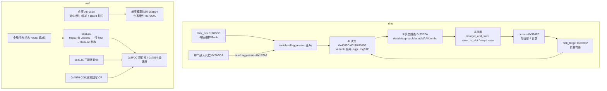

---

## 9.7 "dino 更成熟"的 ROM 级重述（修正版）

第 1 轮把"更成熟"归到"分层清晰 / 系统丰富"，其中"分层清晰"有一部分其实是移植工程红利。ROM 级能站住的只有下面这些，且都是**原版游戏本身的设计**：

1. **AI 决策维度更深**：dino 一次决策同时用 variant（敌人变种）、X 距离等级、aggression（动态）、32 行 RNG 表，并区分近/远决策；wof 多为单一档位 + `rng&3` 或 `rng&0x1F` 的小表。
2. **难度是集中、时间驱动的子系统**：dino `Rank` 结构 + 每帧 `rank_tick` + 1800/1200 帧自动升降 + calm + Markov aggression 重掷（每杀一个敌人重掷）+ spawn 命令强制；wof 是事件驱动的单字节 + 按玩家数钳位。
3. **目标选择有 census 反馈闭环**：dino 每帧统计"每个玩家被几个敌人瞄准/攻击/左右分布"，用**上一帧**值做负载均衡，再叠最近距离/分数/HP/动作多维加权，并有 6 个接近槽位与侧翼包抄；wof 是 3 玩家参数块轮询。
4. **受击系统更细**：dino 有 poise/韧性、counter hit、弱点克制、hitstop 双方同写、10+ 种受击反应（含投掷/燃烧/眩晕/墙壁滑落/起身）、击倒物理与屏幕反弹、起身眩晕概率按 4 张表；wof 是 9 项反应表 + 防御衰减。
5. **脚本分两套且过场脚本只覆写输入**：41 actions 的过场解释器通过伪造 pad 复用完整玩家状态机（受击/死亡自然中断），生成脚本由 camera X 驱动且带条件位与命令记录；wof 单套关卡脚本由 trigger 比较驱动、命令直接分配对象填字段。
6. **附加玩法系统**（第 1 轮已列，不变）：搓招 FSM `0x6AC8`、换人 tag、car 关卡、8 关剧情。

**而下面这些不是游戏设计差异，是移植工程差异**（第 1 轮曾混在一起）：
- 按职责拆 `_ai/_states/_attack/_lib` 文件、typed `Handle`/`Lists`、`BossAi` enum 命名、文件头 `Owner:/Spec:/Quirks kept`
- `collision()` 的固定 pass 顺序、`game_frame` 8 步、`objects_update` 13 步 —— **ROM 反汇编证明原机本来就是这个顺序**
- `wof_cs` 的 31944 行大分派、16 个 `ActorNNRuntime`、29107 行李典收尾 —— 直译工程的组织，不代表原版 ROM 更"扁"

---

## 9.8 新增证据索引（ROM 地址级）

| 结论 | 位置 |
|---|---|
| dino ROM 重组规则 / CRC / 3 片顺序 | `dino-extract/src/rom.rs:1-11,19-43,108-114`；实测 CRC 全部匹配 |
| dino 程序镜像拼法（字节交换） | `rom.rs:111-113` + capstone 验证 `0x542 lea $8000.w,a5` |
| dino 决策 0x4005C / gate 0x40118 / 远决策 0x40156 | capstone 反汇编；`enemy/class13_ai.rs:489-549`；`boss_common.rs:8-68` |
| dino 搓招 FSM 0x6AC8 | capstone（`+$F4` cmd_state / `+$F5` cmd_t / `+$F1` cmd_flag / 表 `0x6B7C`/`0x6B84`）；`player.rs:960-1006` |
| dino census 0x3242E / pick_target 0x32032 | capstone；`SPEC.md:374-415`；`enemy.rs:769-874` |
| dino rank_tick 0x186CC / aggression 0x182A2 | capstone；`SPEC.md:465-512,532-535`；`rank.rs:1-109` |
| dino class2 9 状态 AI / at_slot / 槽位 | `SPEC.md:618-723,866-877` |
| dino 受击 0x2A606 表 0x2A620 / poise / dizzy | `SPEC.md:1084-1202`；`enemy_combat.rs:488-598` |
| dino 伤害 0x2B904 / 0x2BA2A | capstone；`player_combat.rs:11-76`；`SPEC.md:1096-1131` |
| dino script_step 0x1DB5E / action 跳表 0x1DBD6 | capstone（6 字节记录格式逐条）；`script.rs:1-90,247-350` |
| dino spawn 0xFBF4 | capstone；`spawn.rs:1-345`；`SPEC.md:878-1004` |
| dino collision 0x10546 pass 顺序 | capstone；`combat.rs:69-100` |
| dino RNG 0x119C | `SPEC.md:73-86`；capstone 在 0x40086/0x40144/0x182C8 见 `jsr $119c` |
| wof GhidraMCP 用法 | `wt1/agent_scripts/ghidra_http_query.py:1-110`（7.0 端点改动见 `:22-64`） |
| wof 0x170E 死亡降难度 / 0xBC04 钳位 | Ghidra disassemble/decompile；`Cps1PlayerLogic.cs:10690-10716` |
| wof 0x3E1E 行为表 0x3E62 / 参数表 0x3E82 | Ghidra disassemble；`Cps1EnemyAI.cs:1693` 附近 RNG 用法 |
| wof 0x3B94 / 0x3E88 难度概率比较 | Ghidra；`Cps1BossWaveEnemyRuntime.cs:991,1131` |
| wof 0x4070 C06 决策回写 CF | Ghidra；`Cps1EnemyAI.cs:2230` |
| wof 0x4146 三玩家目标轮询 | Ghidra（3 个参数块 0x3E1C/0x3EFC/0x3FDC）；`Cps1EnemyAI.cs:2160` |
| wof 0x7DDA 伤害难度索引 / 0x1BFA RNG | Ghidra；`Cps1Collision.cs:4782-4855,29` |
| wof 0x106F4 关卡脚本 / 命令表 0x10744 | Ghidra 26 条指令；`Cps1LevelScript.cs:17-85,711-830` |
| wof 0x1AA58 玩家主分发 / 0x1BFA 随机伤害 | Ghidra；`Cps1PlayerLogic.cs:76`；`Cps1Collision.cs:21-44` |
| wof 0xD000 事件队列 / 一帧消费数 | `Cps1EventQueueTask.cs:5-90`；`Cps1CoroutineScheduler.cs:18-53` |

---

## 9.9 第二轮后仍待核

- **wof 的 Boss AI**：`Cps1ZhangLiaoRuntime.cs`（2192 行）、`Cps1BossWaveEnemyRuntime.cs`（3971 行）、`Cps1LidianFinaleRuntime.cs`（29107 行）未抽样；`0x22DB0` 主 AI 入口表在 Ghidra 里 disassemble 返回空（该处是数据表，需按 long 读）。
- **wof 受击反应 9 项表** `0x7E68`→`0x7E7A/0x7F14/0x7ECE/0x7F36/0x7F0A/0x7FDA/0x7F78` 各自语义未逐条读。
- **dino 的 `class4_states.rs` / `class25_ai.rs` / `boss.rs`** 未逐个读，Boss 侧的"形态/变身/反击"只从 `boss_common.rs` 与 SPEC §12 推知。
- **两款游戏的具体发行先后**仍未考证，本笔记沿用用户给的前提。
- wof 的 `0x3E88`（概率索引计算）与 `0x3F0C`（目标计算）内部未读；`0x7854` 设速度未读。
- dino `0x1DBD6` 的 41 项 action 跳表**内容**未逐字节读（只从 `script.rs` 的 Rust 分派与 `spawn.rs:300-312` 推知），若需严格验证可 capstone 读表。 → **已解决，见 §10.2**。

---

# 第三轮：表字节级验证与一个架构反转（⚠️ §10.1「架构反转」/ §10.3 的 `0x3E62`「8 档 × 4 项 AI 行为表」/ §10.4「维度差一个量级」结论均已作废，见 §11.3 / §11.4；§10.2 / §10.3 其余表字节 data 有效）

## 10.1 反转：wof 是**集中式**决策，dino 是**分散式**每类状态机

第 1 轮与第 2 轮都隐含一个假设："dino 共享层厚、wof 特例厚"。在**决策层**这个假设是反的，Ghidra 给出了硬证据：

**wof `Enemy_ProcessAIDecision @ 0x3C6A`**（Ghidra 函数，size=12 字节，**caller_count=32**）：

```
// Ghidra 注释（原文）：敌人AI决策处理器 / 输入 A0=敌人Actor, A5=GameState
// 1. 检查全局状态 (GS+0x1E2) → 非零则待机 (Z=0x1200)
// 2. Enemy_CheckTurnCondition - 转向检查
// 3. 检查攻击条件 (全局标志0x80 + GS-0x50)
// 4. RNG决策 → 从行为表选择下一个 Z 状态 (OBJ0x2A)

if GS[0x1E2] != 0:  *(A0+0x2A) = 0x1200 ; return        # 全局暂停 → 待机状态
对象_目标边界转向_579A()
if (全局标志 0x80 且 GS[-0x50] != 0) 或 GS[0x1CB] != 0:
    *(A0+0x2A) = 0x800 ; return                          # 攻击条件满足 → 攻击状态
*(A0+0x2B) = 0
u = RNG_0F98()
*(A0+0x2A) = A6[ (short)(*(A0+0xA0) + (u & 0x1F)) ]     # ★ rng&0x1F + 对象基偏移 → 查表 → 写状态字
```

**32 个调用者**（`ghidra_http_query.py callers 0x3C6A`）涵盖几乎所有敌人类型，且 Boss 与杂兵走同一入口：

| 类别 | 调用者（节选） |
|---|---|
| Boss | `李典_A02C02_主AI入口_2540C`、`许褚_A02C02_27BB0`、`夏侯敦_B00_2D246`/`接近段_2E030`、`曹操_A02_二级02_33502`、`吕布_C00_44FF8` |
| 杂兵 | `小兵9_C02_决策与二级分发_29200`、`弓箭手_C02_决策_3678A`、`肥肥_C02_468CC`、`匕首兵_ZState02_267D8`、`GruntA_ZState02_Walk_2A5C2`、`GruntB_ZState02_2B7EE` |
| 分发/重试 | `C02_重试分发_49198`、`C02_重算C后二级分发_4A28E`、`C2_中转_346E2/3BC5E/3D192`、`态1_41BE0` |

**李典 `0x2540C` 与小兵9 `0x29200` 的反编译体完全相同**（连 Boss 都不特殊化）：

```
BossUpdatePhysics()
if (N) WeaponHandleRelease()
*(A0 + 0xA6) = 0x10            # AI 定时器
Enemy_ProcessAIDecision()      # → 0x3C6A
```

**dino 恰好相反**：`re/specs/enemy/SPEC.md:1459` 原文 *"**How a mode is chosen: no central brain.** Each class has its own state machine (+$06/+$07)"*。决策逻辑复制到每个 class：
- class 2 state 0 decide = `0x33F74`
- class 13 决策 = `0x4005C`，远决策 gate `0x40118`、proper `0x40156`
- Boss 各自 `0x52C50 / 0x55748 / 0x38BD6 / 0x675AE / 0x695B0`（`boss_common.rs:8`）
- 共享的只有 **行为库**（census / pick_target / step / anim / recover）与**表选择机制**，不含统一决策器

**修正表述**：第 1 轮说的"dino 通用层厚、wof 特例厚"只适用于**行为库与文件组织**；在**决策层**，wof 抽出了一个 32 调用者的共享决策器，dino 把决策下放/复制到每个类里。两者都是原版 ROM 的设计（0x3C6A / 0x33F74 都是真实 ROM 函数），不是移植工程造成的。

**〔本轮回源补层：「每个 class」的范围，别把三个数量混成一个〕** 上面两处「每个 class / 每个类」说的是**会做 AI 决策的敌人 class**，不是池里所有对象。回源 `re/specs/enemy/SPEC.md:108-123`（§1 对象池，标 [O]）：游戏有 A/B/C/D/E 五个池，本卷 165 行、03 卷 670 行已登记它们分工与 `pool_e_update 0x233C6` / `enemies_update 0x23420` 两条分开的 update 调用；**pool A 是 enemies / bosses / dinos / scenery，24 槽、原机分派表 `0x2346C` 102 classes**，pool E 才是武器 / 食物 / 弹丸 / 可破坏容器（12 classes）。`SPEC.md:237-270`（§3.2 class map）只列了约 30 个带名字的敌人 / Boss，`:239` 明写「Classes not listed are scenery, projectiles or helpers」，例举 #49/#50 视差鸟（`+$7D = 0xFF`）、#59 Vice T. 子弹。而 repo `enemy.rs:262-352` 的 pool A 分派表是 **89 个分支 / 90 个 class 编号**（0..100 缺 11 个）+ `_ => unported` 兜底，`:358` 注释「every class of the game is ported」；`game/enemy/` 目录下 96 个 `.rs` 文件里，`class14` 一个 class 就拆成 `_ai` / `_states` / `_parts` / `_entry` / `_tests` 等 6 份。⇒ **文件数 ≠ class 数 ≠ 有 AI 决策的 class 数**：pool A 内部，敌人 / Boss / 恐龙 / 视差鸟 / 跟随 parts 都平等地占一个 0xE0 槽、走同一条 `enemies_update` 分派（对象头 `mode/sub/act` 状态字节共用，本卷 §2 已登记）；但「选目标 → 掷攻击概率 → 决定这一帧打不打」这套只属于**会主动找玩家打的那批敌人**（§7 的 class 2 是典型），不是表里约 30 个带名字的敌人 / Boss 人人都跑——Boss 与恐龙有各自的分派 / 反击 / 变身，不据此推断它们走 census 那套（§11.0）。道具、弹丸、木桶根本不在 pool A，在 pool E 走另一条循环，别把 01 卷 1160「全部是同一个池里的正式对象」（讲的是 pool E 内部 12 class）串到敌人池上。**倒推（说人话）**：dino 的「分散」不是散到每个物件上，而是散在**决策层**——同一池内部的对象生命周期与分派高度统一、谁都平等；只有「要不要主动找人打」这件事，才下放给会思考的敌人各自决定。读「no central brain」时别顺手读成「102 个对象各跑各的」。按 §94.11 别拿 repo 的 `match` 分支数当原机「有几套 AI」的证据（分派表是直译，`+$20 = class*4` 是 SPEC 登记的原机语义）；SPEC §1 的 102 是**分派表项数**，`enemy.rs` 的 90 是**有 handler 的 class 编号**，两者口径不同，`:358` 注释明写「every class of the game is ported」，差额按 §11.0 不臆断为「漏移植 12 个」；按 §11.0 只登记并列事实、不推断 wof 侧对应物；按 §94.17 只限定到 SPEC §1 / §3.2 与 `enemy.rs` 这两个检索面，不写「原机恰好 30 类敌人」的精确数（表里有 `84, 86..89` 合并行）。06 卷 2743 是本节 1307-1313 的复述，同一范围限定适用，不另改。

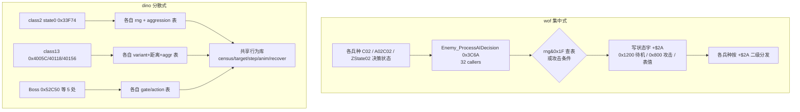

## 10.2 dino：AI 决策表的**字节内容**（capstone 读 ROM 镜像确认）

| 表地址 | 内容（hex / dec） | 含义与印证 |
|---|---|---|
| `0x33FA4` | `03 04 05 06 07 08 0b 0f` | state 0 出招概率，按 aggression 0..7；`rng&0xF < 表值`，即 3/16 → 15/16。**逐项吻合 `SPEC.md:644`** |
| `0x34186` | `55 50 4b 41 3c 37 36 2b 2a 29 28 27 26 25 24 23` | MAAI 槽位暂停帧数，按 level 递减 85→35。**吻合 `SPEC.md:680`** |
| `0x353B6` | 行0 `02 04 07 09` / 行1 `0b 0e 11 15` / 行2 `03 07 0a 0c` / 行3 `10 14 16 18` / 行4 `06 0b 0d 11` / 行5 `15 18 1c 1f` | at_slot 攻击概率表，索引 `variant*4 + (aggression&7)`，与 `rng&0x1F` 比较 → **2/32（Ferris @ aggr 0）到 31/32**。**吻合 `SPEC.md:689` 与 §14 "2/32 for Ferris at aggression 0"** |
| `0x3546A` | `0a 0a 1e 1e 3c 3c 3c 3c 3c 3c 3c 5a 5a 78 96 f0` | 重新站位后的暂停帧，10/30/60/90/120/150/240。**吻合 `SPEC.md:693` "10..240 frames"** |
| `0x354B2` | `00`×7, `01`×16, `02`×8（前 32 字节） | at_slot 站位选择，按 `variant*16 + (rng&0x1F)` 索引 → c=0 绕圈 / 1 MAAI 悬停 / 2 后退；加权约 7:16:8。**吻合 `SPEC.md:692-701`** |
| `0x72D94` | 4 行：`08 06 04 06 08 06 04 02` / `09 07 05 07 09 07 05 03` / `0a 08 06 08 0a 08 06 04` / `0b 09 07 09 0b 09 07 05` | 远决策 gate 表，索引 `aggression*8 + variant*32 + X距离等级`，值 2..11 与 `rng&0x1F` 比。**吻合 `class13_ai.rs:514`** |
| `0x72A94` | 前 32 字节全 `04` | 近决策表（首段），行为值 |
| `0x72F14` | `01 01 01 03 03 07 06 02` ×4 | 远决策表，4 行同构的行为值 |
| `0x182E4` / `0x18364` | A: `01`×10 `00`×6 `02`×10 `01`×4 `00`×2；B: `01`×11 `00`×5 `02`×11 `01`×3 `00`×2 | **两张 8×16 aggression Markov 转移表**，索引 `aggression*16 + (rng&0xF)`，表值即**下一 aggression 状态**（k 段主要给 k+1，偶尔 k 或 k+2）。*注：`SPEC.md:503` 写 "mostly +1, sometimes -1/-2"，与 ROM 字节的"直接给下一状态值"表述略有出入，以 ROM 为准* |
| `0x187B8` | `0258 0208 01e0 01b8 0190 0168 012c 0104 00f0 00dc 00c8 00b4 00a0 008c 0078 003c` | RANK_PERIOD 16 档，600→60 帧递减，rank speed 越高自动升级越快的**时间驱动**证据 |
| `0xFC2E` / `0xFC4E` | l1: `000acd8e 000acf0a 000ad032 000ad106 000ad24a 000ad40c 000ad57a 000ad758`；l2: `000adbf2 000ae032 000ae5e4 000aee80 000af6d4 000b0116 000b0852 000b1702` | 8 个 stage 的 spawn list1/list2 基址表，**吻合 `spawn.rs:129-136` `spawn_set_bases`** |
| `0x1DBD6` | 41 个 word 偏移，目标 `01dee0 01def8 01e200 01e262 01e28c 01e2ba 01e2ee 01e062 01e2fc 01e4ba 01e4c8 01e54a 01e5c8 ... 01e650 01dc60 01dc42` | **41 项 action 跳表逐项吻合 `script.rs:250-333` 的每条原地址注释**（0x1DEE0 pad_clear / 0x1DEF8 walk End / 0x1E200 pose / 0x1E262 scene_done / 0x1E28C leader_attack / 0x1E062 walk Start / 0x1E2FC walk_point / 0x1E4BA hold_right / 0x1E54A jump_kick / 0x1E650 clear_sequence / 0x1DC60 barrier / 0x1DC42 wait car ...） |
| `0x33EFA` | word 偏移 `007a 00be 01b4 0202 0328 0716 085e 030a 08ce` | **class2 的 9 状态跳表**，基址+偏移 = `0x33F74 / 0x33FB8 / 0x340AE / 0x340FC / 0x34222 / 0x34610 / 0x34758 / 0x34204 / 0x347C8`，前 4 项**逐项吻合 `SPEC.md §7.4`** |
| `0x2A620` | word 偏移 `001e 0060 00a8 0232 03a8 05e2 05e2 07be 07be 07be 0892 0892 0892 09d0 0cc6` | **受击反应表**（`0x2A606` 用 `jsr $2a620(pc,d1.w)`）：`+$06=00→0x2A63E`, `02→0x2A680`, `04→0x2A6C8`, `06→0x2A852`, `08→0x2A9C8`, `0A/0C→0x2AC02`, `0E..12→0x2ADDE`, `14..18→0x2AEB2`, `1A→0x2AFF0`, `1C→0x2B2E6`。**逐项吻合 `SPEC.md:1136-1144`** |

**dino `0x33F74` state 0 decide 的 capstone 反汇编**（逐条印证 `SPEC.md:643-645`）：

```
tst.b $51(a6) ; bne $3474E              # 空中 → goto_fall
tst.b $7a(a6) ; beq $33FB2              # 反击延时计时器
subq.b #1,$7a(a6) ; bne → rts
move.w $5ec(a5),d0                       # ★ aggression
move.b $33fa4(pc,d0.w),d1                # ★ 表 0x33FA4[aggr]
jsr $119c ; andi #$f,d0
cmp.w d1,d0 ; blt $342D8                 # ★ rng&0xF < 表值 → choose_combo
$33FB2: move.w #$200,$6(a6)              # 否则进 state 2 approach
```

**dino `0x353CE at_slot` 的 capstone 反汇编**（逐条印证 `SPEC.md:688-701`）：

```
move.b $26(a6),d1 ; ×4                   # variant
move.w $5ec(a5),d0 ; andi #7 ; add       # + aggression&7
move.b $353b6(pc,d0.w),d1                # ★ 攻击概率表
jsr $119c ; andi #$1f,d0 ; cmp.b d0,d1 ; bls $353FC
move.w #$800,$6(a6) ; rts                # 表值 > rng&0x1F → state 8 攻击
$353FC: clr $7d ; moveq #4,d5            # 否则 5 次尝试重新站位
  move.b $26(a6),d1 ; lsl #4             # variant×16
  jsr $119c ; andi #$1f,d0 ; add d1,d0
  lea $354b2(pc),a0 ; move.b (a0,d0.w),d0   # ★ 站位表
  cmp.b $a5(a6),d0 ; dbra d5              # 避免与上次相同
  jsr $119c ; andi #$f,d0 ; move.b $3546a(pc,d0.w),$80(a6)   # ★ 暂停帧表
```

## 10.3 wof：AI 表的**字节内容**（Ghidra `/read_memory` 确认）

> 注意：GhidraMCP 的 `/read_memory` **固定返回 16 字节**，不受 `length` 影响；需按地址分段读。

| 表地址 | 内容 | 含义与印证 |
|---|---|---|
| `0x3E62` 全表 32 字节（`0x3E62` + `0x3E72`） | `ff ff ff ff \| 00 00 00 00 \| 01 01 01 01 \| 00 01 00 01 \| 02 02 02 02 \| 00 02 00 02 \| 01 02 01 02 \| 00 01 02 ff` | **AI 行为表：8 档 × 4 项，值域仅 0/1/2/0xFF**（0xFF = `bmi` 不决策）。索引 = `((GS-0x3E)&7)<<2 + (rng&3)`，见 `0x3E1E`。**这是"维度更浅"最硬的量化证据** |
| `0x3E82` 起 | `000000e0 01c07200 122800a2 d22dffa6` | 行为 ID → 参数块偏移表（`0x3E1E` 中 `adda.w (0x3E82,PC,D6),A1`），后段混入代码 |
| `0x3E88` `Attack_CheckFrameValid` | Ghidra 反编译：`if ((char)(GS[-0x5A] + OBJ[0xA2]) < 0) return`；后续字节 `6a04 7200 4e75 0c01 001f 6f02 721f 4e75` 含 `cmpi.b #0x1f / moveq #0x1f / rts` | **难度概率比较的索引计算 + 0..0x1F 钳位**，吻合 `Cps1Collision.cs:4841-4855` |
| `0x7E68` 反应表（9 项 word） | `0012 00ac 00ac 0066 00ce 00a2 0172 00ce 0110` | 基址+偏移 = `0x7E7A / 0x7F14 / 0x7F14 / 0x7ECE / 0x7F36 / 0x7F0A / 0x7FDA / 0x7F36 / 0x7F78`，**逐项吻合 `Cps1Collision.cs:4861-4864` 的 n=0..8 注释** |
| `0x10744` 命令表（long 地址） | `00010a90 000013b4 0000140a 00001464` / `00001448 00001480 00001426 00010a0a` / `00010a1e 000013d2 0001079c 00010810` | type→命令例程：`0x140A` 生成10型、`0x1464` 生成14型、`0x1448`、`0x1480` 生成18型、`0x1426` 生成1C型。**吻合 `Cps1LevelScript.cs:749,763,793,812,826`** |
| `0x1726` 死亡降难度表（word） | `00c0 00c0 0100 0100 0100 0140 0140 0140 ...` | 32 项，难度扣减 192..320；`0x170E` 按 `(rng&0x1F)*2` 索引 |
| `0x1C20` 随机伤害表 | 前 16 字节全 `00` | 印证 `DAMAGE_RANDOM_TABLE = 0x1C20` 起始是低伤害区；`Cps1Collision.cs:38-43` 记录过误认 `0x7C20` 为本表的教训 |
| `0x22DB0` | 4 个 long 全是 `0x00022dae` | **未确认为主 AI 入口表**（`Cps1EnemyAI.cs:32-41` 说 `22DB0[0x10]->0x327F8`）。可能是 region set 差异或读错基址，**保留待核，不据此下结论** |

## 10.4 量化：不是"有/无表驱动"，是**索引维度差一个量级**（⚠️ 本节标题、wof 列「全局行为档位」与末尾结论均已作废，收敛版见 §11.5；dino 列 data 有效）

| | dino | wof |
|---|---|---|
| 决策 RNG 掩码 | `&0x1F`（32 行）、`&0xF`、`&0x3E` 多粒度 | `&3`（`0x3E1E`）、`&0x1F`（`0x3C6A`/`0x3B94`/`0x4070`） |
| 决策表索引维度 | **variant × aggression × X距离等级 × rng**（4 维），部分再叠 level / form / `+$AB` 符号 | **全局行为档位(3bit) × rng&3**（2 维），或 `rng&0x1F + 单个对象基偏移`（1 维） |
| 行为表规模 | `0x353B6` 6 行×8、`0x354B2` ≥32、`0x72D94` 4×8、`0x72A94`/`0x72F14` 各 ≥32、两张 8×16 Markov 表 | `0x3E62` **全表 32 字节（8×4）** |
| 概率可调范围 | 攻击概率 **2/32 → 31/32**（随 variant+aggression 连续变化）；出招概率 3/16→15/16 | 行为 ID 只有 0/1/2/0xFF 四值 |
| 难度→AI 的通路 | 集中 Rank 结构 + 时间轴 + Markov 重掷，喂给速度/攻击概率/伏击/暂停/眩晕/生成条件 | 单字节 `A5-0x5A` 经 `0x3E88` 钳位后进概率比较与伤害索引 |
| 决策器复用 | **不复用**，每类各自 state 0（96 个 class 文件） | **强复用**，1 个 `0x3C6A` 被 32 处调用（含全部 Boss） |

**结论**：两款游戏都是 RNG 查表的加权行为选择，底层同构；dino 的"成熟"不在机制类型，而在**把同一个决策模式参数化到更细的维度、更大的表、并与一个时间驱动的全局难度系统闭环**。wof 用一个共享决策器 + 一张 32 字节表覆盖了几乎所有敌人（含 Boss），是更省、更统一但也更粗的设计。

## 10.5 决策数据流（最终版）

```mermaid
flowchart TD
    subgraph dino 每类自治 + 全局难度闭环
    R[rank_tick 0x186CC<br/>RANK_PERIOD 600→60帧] --> G[Rank: level/aggression/rank]
    K[每个敌人死亡 0x2AFCA] -->|Markov 0x182A2<br/>表 0x182E4/18364| G
    C[census 0x3242E<br/>每玩家 4 计数] --> T[pick_target 0x32032<br/><3 敌人优先 + 多维加权]
    G --> D1[class2 state0 0x33F74<br/>表 0x33FA4]
    G --> D2[class13 0x4005C/40118/40156<br/>表 0x72A94/72D94/72F14]
    T --> D1 & D2
    D1 --> S[9 状态跳表 0x33EFA]
    D2 --> S
    S --> A[at_slot 0x353CE<br/>0x353B6 攻击概率 2..31/32]
    A --> P[0x354B2 站位 / 0x3546A 暂停 10..240帧]
    P --> L[共享库: retarget_and_slot / steer / step / anim]
    L --> C
    end
    subgraph wof 集中决策 + 单字节难度
    WG[难度 A5-0x5A<br/>0x170E 死亡降 / 0xBC04 钳位] --> WP[0x3E88 索引+钳位]
    WF[全局行为档位 GS-0x3E 低3位] --> WB[行为表 0x3E62<br/>32字节 8档×4项]
    WB --> WC[Enemy_ProcessAIDecision 0x3C6A<br/>32 callers 含全部Boss]
    WP --> WC
    WC -->|rng&0x1F 查表| WS[写状态字 +$2A<br/>0x1200/0x800/表值]
    WS --> WD[各兵种 C02 二级分发]
    WD --> WC
    end
```

## 10.6 新增证据索引（第三轮）

| 结论 | 位置 |
|---|---|
| wof 中央 AI 决策器 0x3C6A 与 32 调用者 | `ghidra_http_query.py callers 0x3C6A`；`decompile 0x3C6A` |
| 李典/小兵9 同模板调 0x3C6A | `decompile 0x2540C` / `decompile 0x29200` |
| dino "no central brain" | `re/specs/enemy/SPEC.md:1458-1473` |
| dino 各表字节与地址 | capstone 读 `dino.zip` 重组镜像（本轮实测，未落盘中间文件） |
| dino state0/at_slot 反汇编 | capstone `0x33F74` / `0x353CE` |
| dino 41 action 跳表 / 9 状态跳表 / 受击反应表 | capstone 读 `0x1DBD6` / `0x33EFA` / `0x2A620`；`0x2A606` 反汇编确认 `jsr $2a620(pc,d1.w)` |
| wof 各表字节 | Ghidra `/read_memory`（`0x3E62/0x3E72/0x3E82/0x3E92/0x7E68/0x7E78/0x10744/0x10754/0x10764/0x1726/0x1C20/0x22DB0`） |
| Ghidra `/read_memory` 固定 16 字节 | 本轮实测（length=20/40/48/64 均返回 16） |
| wof ROM 位置 | `G:/Game/Mame32/roms/wof.zip`（多 region）、`wofj.zip`（Japan，6 文件）；本轮未拼 wof 镜像，全部经 Ghidra 取证 |

## 10.7 仍未解决（诚实边界）

> ⚠️ **本节已在 §18.1 逐条结清**（第十一轮，回到 repo 侧核对，未新增 ROM 取证）：6 条里 5 条以 repo 为准确认，仅"发行先后"仍开放。下面是第三轮当时的原始记录，**读时以 §18.1 为准**——尤其 `0x22DB0` "未确认"与 `0x3E88` 命名两处，是第三轮取证方式偏差，不是 repo 缺 data。

- **`0x22DB0` 主 AI 入口表**：`Cps1EnemyAI.cs:32-41` 称 `22DB0[0x10] -> 0x327F8`，但 Ghidra `wofj.68k.xml` 在 `0x22DB0` 读到 4 个相同的 `0x00022dae`。可能是 region set（wof/wofj/World/Japan）基址差异、或该处是别的表。**未确认，不作为结论依据**。
- **wof 的 9 项受击反应各自语义**：只确认了表项与跳转地址（`Cps1Collision.cs:4857-4865`），未逐条反编译 `0x7E7A/0x7F14/0x7ECE/0x7F36/0x7F0A/0x7FDA/0x7F78` 的处理体，因此**不能**断言 wof 没有 poise/dizzy/燃烧等机制，只能说 dino 的受击表种类更多（15 项 vs 9 项）。
- **dino 的 Boss 专属逻辑**：`class4_states.rs` / `boss.rs` / `class25_ai.rs` 未逐个读；`boss_common.rs` 的 `gate_table/action_table` 已由 `0x40118`/`0x40156` 印证同构，但 5 个 Boss 各自的反击/变身实现只读了 `SPEC.md §12` 标题层。
- **wof 的 `0x3E82` 参数表后半段**混入代码，未完整解析；`0x7854`（设速度）、`0x3F0C`（算目标）未读。
- **wof AI 决策表的"档位"来源**：`GS-0x3E` 低 3 位由谁写、何时变化未追；这决定了 wof 决策是否也有类似 dino 的动态难度联动。
- 两款游戏的**具体发行先后**仍未考证，本笔记全程沿用用户给定的前提。
- 本轮所有 ROM 取证均为**只读**：dino 侧只在内存中拼镜像、未写任何文件；wof 侧只用 GhidraMCP 只读端点（`check_connection` / `disassemble_bytes` / `get_functions` / `find_functions` / `read_memory` / `get_xrefs_to`），未做 rename、未保存数据库。

---

# 第四轮（勘误）：定位说明与两处关键语义更正

> 触发：用户 11-06 反馈——「提供 ROM 侧资源是怕 rep 侧里没 data 部分难理解，不是让你过度怀疑 rep 侧，所以之前我说了『如果 有必要』」。
> 本轮**不新增 ROM 审计**，只做三件事：**把 ROM 的角色摆正**、**更正两处被我读错的语义**、**把前几轮过重的措辞收敛**。
> ⚠️ **§9–§10 里凡"以 ROM 审 repo 结论"的框架与下列具体解释，一律以本节为准；但 §10.2 / §10.3 的表字节、跳表项、命令地址等 data 部分保留有效。§0–§8 不受影响。**

## 11.0 定位说明：ROM 只补 data，不审 repo

| 项 | 正确的定位 |
|---|---|
| repo 侧（`dino_rs` / `wof_cs` / `re/specs`） | **主资料**。函数注释、`_对应ASM_` 命名、原地址、`activePlayers` 这类变量语义，本身就是从 ROM 整理出来的成果，以它为准。 |
| ROM 侧（dino.zip 重组镜像 / Ghidra 8089） | **只补 repo 没展开的 data**：表字节内容、跳表项、命令地址、CRC、镜像拼法。用来"看懂 data"，不用来"验证 repo 对不对"。 |
| 第 1 轮误判（"wof 没有动态难度/RNG AI/目标选择"） | 真实原因是**我读 repo 读得浅**，不是 repo 侧错。§9.1 把它写成"ROM 纠正 repo 的方法论错误"，是双重失真：既摆错了 ROM 的位置，也给自己的阅读失误找了个漂亮说法。 |

由此，§9–§10 里凡"重大更正 / root cause / 反转 / 推翻第 1 轮 / 维度差一个量级"这类**以 ROM 审判 repo 的框架**，一律降级为"补充了 data + 一次没读全的阅读记录"，不作为结论。真正有长期价值的产出是 §10.2 / §10.3 那些**表字节**（data），保留。

## 11.1 语义更正一：`A5-0x3E` 是活跃玩家位图，`0x3E1E` 是「选目标玩家」

这是本轮最该记的一条：上一轮脱离 repo 注释、只对着 ROM 字节，把 `0x3E62` 猜成"AI 行为决策表（8 档 × 4 项，值 0/1/2/0xFF）"，据此还写了"决策维度差一个量级"。**全错，repo 早就写对了。**

### repo 侧早有的正确命名（不是本轮新发现）

| repo 位置 | 原文 | 说明 |
|---|---|---|
| `Cps1Actor24Runtime.cs:1004` | `byte activePlayers = (byte)(Cps1Memory.rb(Cps1Memory.A5_BASE - 0x3E) & 0x07);` | `A5-0x3E` = 活跃玩家位图，低 3 位 = P1/P2/P3 |
| `Cps1Actor24Runtime.cs:1175-1185` | `activePlayers` + 3 参数块 `0x3E1C/0x3EFC/0x3FDC` + `masks{1,2,4}` | 位图按位测玩家有效 |
| `Cps1Actor1CRuntime.cs:2017-2041` | `byte 位图 = rb(A5-0x3E) & 7`；`执行3DEE` 还原 `0x3E04..0x3E5C` | `0x3E82 = 0000/00E0/01C0`；`d6` = 选中的玩家槽号 |
| `Cps1Actor1CRuntime.cs:2018` | `敌人收招按活动位图选择最近玩家_对应ASM_39A0(...)` | `0x39A0` = 按位图选最近玩家 |
| `Cps1Actor27Runtime.cs:612` | `对象_随机选择活动目标_对应ASM_3E1E(ref obj)` | `0x3E1E` 的正式语义 = **随机选择活动目标（玩家）** |
| `Cps1Actor26Runtime.cs:554,562-563` | `活动位图 & 7 == 0`；`FBA 实测 A5-0x3E=0x01 ⇒ d6=1<<2=4, RNG&3=1 ⇒ 索引5 ⇒ 表 0x3E62[5]=0x00 ⇒ 正常出口` | 位图→表索引的实测公式 |
| `Cps1Actor1BRuntime.cs:701-724` | `btst.l d0,-$3e(a5)`；`mask & (1<<(c3&31))` | `+0xC3` 作 bit 号测位图 = **AI 选择锁**校验 |
| `Cps1BossWaveEnemyRuntime.cs:892,908` | `对象_C02入口目标校验_对应ASM_422E_3E12` | `0x3E12/0x422E` = 目标有效性校验 |

### 正确的数据流（伪代码）

```
A5-0x3E = 活跃玩家位图 (bit0=P1, bit1=P2, bit2=P3)

0x3E1E 对象_随机选择活动目标():            # 不是"AI 行为决策"
    bm = rb(A5-0x3E) & 7
    if bm == 0:  goto 0x3E0A              # 无活跃玩家
    idx = (bm << 2) + (rng() & 3)         # 位图分行(8 行) × rng 选列(4 项)
    d6  = B[0x3E62 + idx]                 # ★ 值 0/1/2 = 玩家槽号；0xFF = 无目标/清锁
    if d6 < 0: return (N=1, 0x3E38→rts)   # 本次不选
    OBJ+0xC3 = d6                         # 锁住"当前瞄哪个玩家"
    A1 = 0x3E1C + W[0x3E82 + d6*2]        # 表 0x3E82 = 0000/00E0/01C0
                                          #   → 玩家参数块 0x3E1C / 0x3EFC / 0x3FDC
    OBJ+0x3A = A1                         # 目标玩家对象指针
    bsr 0x3F0C                            # 目标侧向站位偏置
    jsr 0x7854                            # 按目标相对差算方向索引 → OBJ+0x24

0x4244 / 0x422E 目标校验（AI 选择锁）:
    c3 = OBJ+0xC3
    if c3 < 0: 无效
    elif (A5-0x3E 位图 & (1<<c3)) == 0:  # 锁定的那个玩家已不活跃
        OBJ+0xC3 = 0xFF                   # 清除选择锁，下次重选
```

`0x3E62` 全表 32 字节重新解释（行 = 活跃玩家组合，列 = rng&3，值 = 选中的玩家槽号）：

| 位图 | 活跃玩家 | 4 项 | 读法 |
|---|---|---|---|
| 000 | 无 | `ff ff ff ff` | 全不选 |
| 001 | P1 | `00 00 00 00` | 恒选 P1 |
| 010 | P2 | `01 01 01 01` | 恒选 P2 |
| 011 | P1+P2 | `00 01 00 01` | 交替 |
| 100 | P3 | `02 02 02 02` | 恒选 P3 |
| 101 | P1+P3 | `00 02 00 02` | 交替 |
| 110 | P2+P3 | `01 02 01 02` | 交替 |
| 111 | 三人 | `00 01 02 ff` | 三者轮流 + 一次不选 |

**所以"8 档"其实是 8 种活跃玩家组合，不是 8 个 AI 难度/行为档；值 0/1/2 是玩家编号，不是行为 ID；0xFF 是"清除选择锁"，不是"bmi 不决策"。** 这套东西属于**目标选择与目标锁定**，和 dino 对位的是 `pick_target 0x32032` / census，不是 dino 的 `0x4005C` 攻击决策。

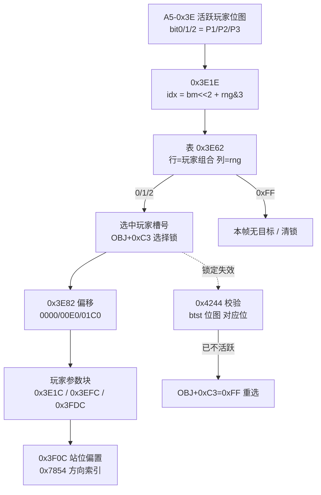

## 11.2 语义更正二：`0x3C6A` 是「共享决策函数 + 每兵种各带概率表」，不是「统一集中决策器」

§10.1 把 `0x3C6A`（Ghidra 名 `Enemy_ProcessAIDecision`，32 callers）当成"wof 集中式、dino 分散式"的**架构反转**硬证据。repo 侧命名其实更朴素：

- `Cps1BossWaveEnemyRuntime.cs:1056`：`0x3C6A：按 A6 概率表 + RNG 重算 OBJ+0x2A（C）`
- `Cps1BossWaveEnemyRuntime.cs:285`：`AI决策_3C6A` 注释
- 调用点各自 `lea` 自己的表再 `jsr`：`0x45E2D`（肥肥）、`0x49C54`（Actor26）、`0x4094E`（Actor27）、`0x40A8E`（Actor1B）……

即：wof 抽出了一个**共享的"按概率表重算 C 字节"函数**，但**概率表 A6 由每个兵种/路径自己传**，产出也只是 C 的 04/06/08 等偶数值（不是 §10.1 写的整体状态字 0x1200/0x800）。这跟 dino "每类自己的 state 0 + 自己的表" 是**同构的程度差异**（共享函数 vs 共享表），不是"集中 vs 分散"的**质的反转**。

**处理**：§10.1 的"反转"结论**作废**；`0x3C6A` 有 32 调用者、是共享函数这一**观察保留**（这是调用关系 data，不是价值判断）。dino `SPEC.md:1459 "no central brain"` 与它并不矛盾——一个说"没有统一大脑"，一个说"有一个共享的重算 C 子程序"，讲的是不同层次。

## 11.3 作废 / 保留清单

| 内容 | 处理 |
|---|---|
| §10.2 dino 各表字节（0x33FA4 / 0x34186 / 0x353B6 / 0x3546A / 0x354B2 / 0x72D94 / 0x182E4 / 0x187B8 / 0x1DBD6 / 0x33EFA / 0x2A620 / spawn 基址表） | **保留**（纯 data，逐项印证 repo 注释） |
| §10.3 wof 表字节里除 0x3E62 外的项（0x3E82 / 0x3E88 / 0x7E68 / 0x10744 / 0x1726 / 0x1C20 / 0x22DB0） | **保留**（data） |
| §10.3 把 0x3E62 解成"8 档 × 4 项 AI 行为表 / 值域 0/1/2/0xFF / 维度更浅最硬证据" | **作废** → 见 §11.1 |
| §9.1 "重大更正 / root cause 方法论错误 / 本轮用 ROM 纠正" | **措辞作废** → 见 §11.0（是读 repo 不深，不是 repo 错） |
| §10.1 "架构反转：wof 集中式、dino 分散式" | **结论作废** → 见 §11.2（降为"共享函数 + 每兵种概率表"的观察） |
| §10.4 "索引维度差一个量级"的量化对比 | **结论作废**（wof 列建立在 0x3E62 误读 + 把"目标选择"混进"攻击决策"上）；dino 列的**表字节 data 仍有效**，收敛版见 §11.5 |
| §10.5 / §9.6 两张 mermaid 里标"全局行为档位 GS-0x3E""8档×4项"的节点 | **按 §11.1 改读**（活跃玩家位图 / 目标选择表） |
| §0–§8 的游戏设计对照 | **不受影响**（读 repo 得出，本轮未涉及） |

## 11.4 逐处措辞更正对照（Grep 可定位；§9–§10 原文按"保留工作记录原貌"约定不改写，已在 §9.1 / §9.5 / 第三轮 / §10.4 各入口加就地警示，见附录 A.13 审计）

| 位置 | 原写法（作废） | 正确写法 |
|---|---|---|
| §9.5 L934 `0x3E1E` 反汇编注释 | `# 全局行为标志低 3 位 = 档位` | `# 活跃玩家位图 & 7；为 0 则 0x3E0A 写 C3=0xFF（无目标）` |
| §9.5 L980 对照表 wof 列 | `全局档位(3bit) × rng&3，小表 0x3E62` | `活跃玩家位图(3bit) × rng&3 选目标玩家（属目标选择，非攻击决策）` |
| §9.6 L1007 mermaid 节点 | `W3[全局行为标志 -0x3E 低3位]` | `W3[A5-0x3E 活跃玩家位图]`（该分支是"目标选择"不是"AI 决策"） |
| §10.3 L1194 `0x3E62` 行 | `AI 行为表：8 档 × 4 项，值域 0/1/2/0xFF… 维度更浅最硬证据` | `目标玩家选择表：8 种玩家组合 × 4 项，值 0/1/2=玩家槽号、0xFF=清锁` |
| §10.4 L1208 对照表 wof 列 | `全局行为档位(3bit) × rng&3（2维）` | `目标选择：活跃位图(3bit) × rng&3；攻击决策另在 0x3C6A（每兵种概率表）` |
| §10.5 L1236 mermaid 节点 | `WF[全局行为档位 GS-0x3E 低3位] --> WB[行为表…8档×4项]` | `WF[A5-0x3E 活跃玩家位图] --> WB[0x3E62 目标玩家选择表]` |
| §10.7 L1265 待核 | `GS-0x3E 低3位由谁写、何时变化未追…是否动态难度联动` | **已解决**：低 3 位 = 活跃玩家位图，与动态难度无关，无需再追 |

## 11.5 收敛后的「目标选择 / 决策」对照（把话题拉回游戏设计，不夸大）

| | dino | wof |
|---|---|---|
| 目标玩家选择 | `0x32032 pick_target`：每帧 census（每玩家被瞄准/攻击/左右人数）→ 上一帧负载均衡（<3 优先）+ 最近/分数/HP/动作多维加权 | `0x3E1E` 按**活跃玩家位图 + rng&3** 查 `0x3E62` 选玩家槽号 → `0x3E82` 换算参数块；`0x39A0` 按位图选最近玩家 |
| 目标锁定 | 6 个接近槽位 + `retarget_and_slot` 侧翼包抄 | `OBJ+0xC3` 选择锁，`0x4244/0x422E` 用 `btst 位图` 校验，玩家消失则清锁重选 |
| 攻击/状态决策 | 每类各自 state 0（`0x33F74` / `0x4005C` / Boss 各自表），"no central brain"（`SPEC.md:1459`） | 共享 `0x3C6A` 按 A6 概率表 + RNG 重算 C 字节，A6 表由各兵种自带（`0x45E2D` 等） |
| 动态难度 | 集中 `Rank` + 时间驱动 + Markov aggression | 单字节 `A5-0x5A` + 按玩家数钳位（`0xBC04`） |

两边的差别是**仍可谈的游戏设计差别**（dino 目标选择有 census 闭环、难度是时间驱动子系统；wof 更直接、省），但**不是**"有/无系统""集中/分散反转""维度差一个量级"那种量级差。§9.7 里从 dino 侧 ROM 表字节得到、能逐项印证 `SPEC.md` 的结论（搓招、反击/弱点、poise/受击反应、过场脚本覆写输入、Rank 时间驱动）**不受本轮勘误影响**——它们本来就是"补 data 印证 repo"，不是"审 repo"；唯一要收敛的是 §9.7 第 1 条里 "wof 多为单一档位 + rng&3" 那半句（那是目标选择，不是攻击决策，按 §11.1/§11.2 改读）。

## 11.6 后续边界（承接「长时间自主推进」）

- ROM 继续只在**必要时**用于补 data 表内容；对 repo 已有明确注释的字段，一律以 repo 语义为准，不再另立抽象解释。**用户 11-06 补充授权**：ROM 主要就是为调查 data；仅在 `wof_cs` 写得「非常可疑」时才可查 ROM 核实——这是条件通道，不恢复「以 ROM 审 repo」框架（§11.4 / A.13 / A.15 的作废结论不变）。
- **两个通道别串成一条（11-07 实例订正）**：用户给的是「ROM **主要**为调查 data」这条**主通道**，外加「`wof_cs` 写得非常可疑时才核实」这条**条件通道**。后面多节与附录 A 反复写「条件通道未触发 / 0 次 ROM 取证」，说的是**没有触发第二条**，不等于第一条不存在；总入口清册里 `0x6E662` 一格曾把「需 ROM data」写成「条件通道未触发」，于是 data 明明在手边（`G:\wof\CpsRes\wofj_68krom.bin`）却一直空等。本轮按主通道查 data：先在 `0x6DB44` / `0x6E754` 验证已知的 16 字节/招结构、确认线性映射可靠，再看 `0x6E662` 处字节与 FBA 注释一致，并由地址差排除它是 `0x6E754` 的列别名（详见总入口清册）。**只核 data，不据此审 repo 结论、不恢复 §9–§10 已作废的框架**；那段参数区与两张攻击表如何分工、各列含义，仍按 §11.0 不臆断。条件通道至今仍未触发。
- 仍待补的 data（按 §10.7，去掉本轮已解决的 `GS-0x3E` 一条）：wof 9 项受击反应处理体 `0x7E7A/0x7F14/...`、`0x3E82` 后半段、`0x7854`/`0x3F0C` 内部、`0x22DB0` region set 差异；dino `class4_states.rs` / `boss.rs` / `class25_ai.rs` 的 Boss 反击与变身。
- 下一轮重点回到**游戏设计本身**：把 §4 事件脚本里 dino「过场脚本覆写输入、受击自动中断」与 wof「事件队列受 VBlank 截断」这条、以及 §5 目标选择，写成可直接对照的伪代码 / 流程图，而不是继续加 ROM 取证。
- 两款游戏发行先后仍未考证，全程沿用用户给定前提。

---

# 第五轮：打击结算的时序设计（回到游戏设计本身）

> 承接 §11.6：本轮**不碰 ROM 取证**，全部以两份 repo 源码为准，把"同一帧里谁先谁后、哪些事跨帧靠状态推进"这类**时序设计**写成可对照的伪代码 / 流程图。
> 关注点仍是用户给的四大主题里的「打击逻辑」与「事件脚本」；状态机、怪物策略见 §2 / §5 / §11.5。

