# 卷 01：早期主线（§12–§25）

> 由 `DESIGN_DIFF_NOTES.md` 按 `^## ` 标题块原样拆出，块内逐行未改，卷内保持原文件出现顺序。
> 总入口、`§N → 卷` 反查表与阅读顺序见 `../DESIGN_DIFF_NOTES.md`。
> 本卷涵盖：§12–§25。附录 A 全部在 `07-appendix-a.md`。

---

## 12.0 为什么要单看"时序"

前几轮对照多停留在"有哪些系统 / 表多大 / 分几层"，但清版格斗有一类设计差异只在**帧的时间轴**上才看得见：一次命中在**哪一帧**扣血、在哪一帧切状态、死亡算哪一帧、脚本能不能被这一帧的受击打断。这些不是实现细节，是"打击手感 / 演出节奏 / 可中断性"的设计决策。两边源码对此都有明确注释，足以直接对照。

## 12.1 dino：命中帧"只结算、不处决"，死亡由敌人自己的受击态在后续帧推进

素材全部来自 `enemy_combat.rs` / `enemy.rs` / `boss.rs` 的**源码与注释**。

```
# frame N：玩家攻击的碰撞 pass（pass_107f8 等）
enemy_hit_by_player(a, d)  0x11008:
    if attack_box==0 or body_box==0 or !boxes_hit(Z,X,Y): return
    e.live = 2
    e.l4   = 0x0202_0000        # 只切到"受击态"(mode2/sub2)，★ 不写 mode4 死亡
    e.attacker = a ; e.WAIT = 0
    if id in (0x6E,0x6C): 非致命(HP floor 1) ; return
    r = player_attacks[char][id/2]           # dmg/stun/reaction/hitstop/snd/score/spark
    dmg = charge_scale? ; dmg = enemy_damage_scale(dmg)   # 0x2BA2A 多因子
    e.hp = max(e.hp - dmg, 0)               # ★ HP 可以在本帧变 0
    e.stun = sat_sub(e.stun, r.stun)         # 韧性
    e.reaction = e.act = r.reaction ; e.step = 0
    e.hitstop = attacker.hitstop = r.hit_stop          # 双方同写；队伍技连伙伴也写
    score / spark / sound / facing
    # 源码注释 enemy_combat.rs:569：
    #   "The boss credit 0x3262A and the defeat come from the boss's own
    #    hit state in its next update (the original does not call them here)."
    #   ⇒ 击杀 credit / 战败 / 死亡演出 ★明确不在此帧★

# frame N+1..：敌人在自己的 alive(mode2) → hit_reaction(0x2A606) 里推进
enemy_hit_reaction(e)  0x2A606: 按 e.act(=r.reaction) 分派 10+ 种
    enemy_flinch:  if e.hp==0 or e.stun==0 or 空中 → 转 knockdown(击倒)
                   else 轻畏缩 + hitstop 递减 + recover
    enemy_knockdown / thrown / burn / slide / getup / slump ...
    # ★ HP=0 的"处决判定"发生在受击反应里，不在命中帧
    getup_or_die 0x2AF86: HP=0 → e.l4 = 0x0400_0000 (mode4 死亡) + reroll_aggression()

# frame N+k：mode4 死亡态（class 分派，如 class2 → enemy_dying_basic 0x3484E）
enemy_dying_basic: 记击杀分 → 闪烁 120 帧(T80=0x78) → e.mode += 2 → 6 → free 槽
```

`boss.rs:516` 的注释把这条时序说得更直白：`e.b.mode = 4; // the hit reaction starts the death state`（受击反应**启动**死亡态），`boss.rs:546` 也写 `set_state(0x0202_0000); // a hit (0x81A7A) that ends at HP 0`——命中打到 HP 0 仍是受击态，死亡是随后的状态。

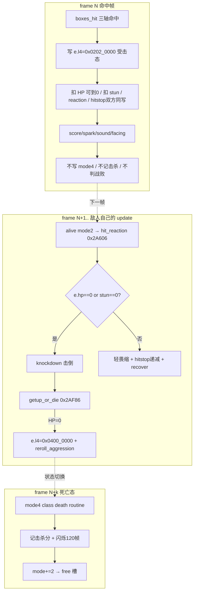

## 12.2 wof：命中链当帧走完伤害 + 反应分派 + 写反应字段 + 双方硬直

素材来自 `Cps1Collision.cs` 的伤害函数与 `受击反应分发_可能对应ASM_7E4A`。

```
# frame N：碰撞/伤害链（多处调用点 799 / 1358 / 2932 / 4764）
扣血链:
    damage = 随机伤害查表(0x1C20) × 难度索引(0x7DDA) × 0x6EE84修正 × 防御衰减
    target.Hp -= damage
受击反应分发_可能对应ASM_7E4A(attacker, target, a3)  0x7E4A:  # 同一条命中链内当帧调用
    reaction = rb(a3) ; a3 += 1
    if target.Hp < 0 且 ObjId > 4: reaction = rb(a3)   # ★ 当帧就用 HP<0 换"死亡备用字节"
    a3 += 1
    switch(reaction 字节偏移 00/02/04/06/08/0A/0C/0E/10):   # 9 项 = 表 0x7E68
        0x00 → 受击反应_轻硬直或累计击飞_可能对应ASM_7E7A
        0x02/0x04 → 0x7F14：Hp<0→0x7E92 / 骑乘→0x7E86 / 否则写
                    StunLeft=0, StunVal=0, DmgReaction=reaction → 命中双方硬直_可能对应ASM_7EA2
        0x06 → 0x7ECE ；0x0A → 0x7F0A（PosZ≥0x10 覆盖为 0x02 落穿）
        ... 0x7E86/0x7E92/0x7F36 各段
    # 反应分派当帧写出 StunLeft / StunVal / DmgReaction / 双方硬直
    # 另有 推迟当帧新硬直递减_无对应ASM（命中当帧不递减新硬直的时序保护）
```

repo 对 9 项反应**已有命名**（`受击反应_轻硬直或累计击飞_可能对应ASM_7E7A`、`受击反应_0x7E86段_可能对应ASM_7E86`、`受击反应_0x7E92段_可能对应ASM_7E92`、`受击反应_0x7F36段_可能对应ASM_7F36`、`累计击飞硬直_可能对应ASM_17B2` 等），并非 §10.7 写的"未逐条解析"——那条待核应收敛为"repo 已命名，未做的是逐段反编译对照"（见 §12.6）。

## 12.3 时序差异的设计后果（不是实现细节）

| 设计面 | dino（结算 / 处决分帧） | wof（命中链当帧分派反应） |
|---|---|---|
| hitstop | 命中帧双方同写、队伍技连伙伴；递减在**受击态**里（`enemy_flinch:902`） | 命中链 `命中双方硬直_可能对应ASM_7EA2` 当帧写；有"当帧新硬直不递减"保护 |
| 韧性 / 击倒 | 命中帧只扣 `stun`；`stun==0 或 hp==0` 在**受击反应帧**转击倒 | 当帧写 `StunLeft/StunVal/DmgReaction`，反应字节按 `Hp<0` 当帧选备用值 |
| 死亡 / 击杀 / 战败 | **明确推迟**：源码注释 `the defeat come from ... its next update (the original does not call them here)`；击杀分在 mode4 死亡态记 | 反应分派在命中链当帧调用，`Hp<0` 当帧换死亡备用反应字节 |
| 演出节奏 | 受击 → 击倒 → 起身或死亡 → 闪烁 120 帧清场，是一条**由对象状态机自驱的多帧时间线** | 反应字段当帧写齐，后续由对象状态推进 |
| 受击期间脚本 | 过场脚本 `+$04 != 0x0200` 挂起（§4.1），与"受击态持续多帧"同构——**表演轨道与玩法轨道用状态字解耦** | 事件队列是任务内核轨道（§4.2），与对象受击态不是同一套挂起机制 |

一句话：dino 把"一次命中"拆成**命中帧结算 / 后续帧处决 / 死亡态演出**三段，且用一条源码注释钉死"原版不在此处调用战败"；wof 在一条命中链里当帧把伤害、反应字节、硬直字段写齐。前者把节奏交给对象状态机，后者把节奏交给命中例程。这是**打击手感与演出编排**的取向差，不是"谁对谁错"。

## 12.4 收口：两种"驱动角色"的哲学（把 §4 事件脚本用时序说清）

```
# dino：脚本覆写输入 → 复用完整玩家状态机（§4.1 / §9.4）
frame: script_step 覆写 +$A0(held)/+$A8(pressed)
       → players_update 照常读输入、跑 mode/sub 状态机
       → 若同帧/前帧被打：+$04 != 0x0200 → script_step 挂起
   设计后果：过场"表演"没有独立轨道，受击/死亡天然打断脚本；
             不需要脚本自己判断"角色是否还能演"。

# wof：关卡脚本直接分配对象填字段 + 事件队列协程（§4.2 / §9.4）
frame: 0x106F4 命令表 0x10744 → 分配对象并填 +$21/$4/$8/$22/$24/$26
       0xD000 事件队列按 VBlank 截断消费 N 项（N 是帧内物理量）
   设计后果：脚本是一条独立轨道，其推进量与 CPU 负载耦合；
             "一帧消费几项"本身要逐点求解。
```

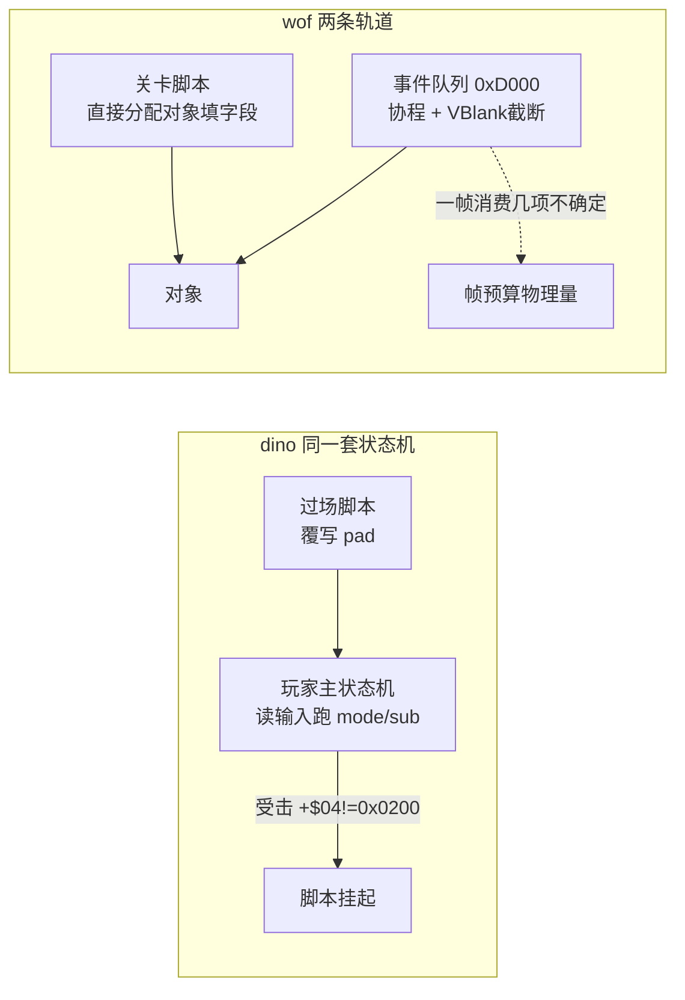

**倒推（说人话，本轮回源补层，不新增节号）**：过场能不能继续，判据不是「刚才有没有发生打断事件」，而是**「这个角色现在还是不是自己在控制自己」**。回源 `dino-rs/crates/dino-game/src/game/script.rs:15-17 / :218-226`：`script_step` 每帧只查 `mode==2 && sub==0`（状态字 `0x0200`）与自己的 `G.$4DD` 位，满足才走；`0x0200` 涵盖待机 / 走 / 跑 / 空中 / 出招 / 摆姿势 / 跳落这些**玩家自己的动作**，只有受击反应（sub≥2）、死亡（mode 4）、复活（mode 0）这些「控制权被拿走」的状态才让它停下。⇒ 脚本不必枚举「被打了怎么办、死了怎么办、续关了怎么办」，它每帧只问一句「我还有没有资格替他写输入」；答案写在玩家本体的状态字上，由玩法自己维护。上面伪代码与流程图把挂起写成「受击 → `+$04 != 0x0200`」是举例式简写，按 A.13 不改历史正文，收窄记在这里：**挂起条件是「不在 0x0200」，不是「被打」**；玩家自己跳、自己出招时演出照走。

**给改造的落点**：想让演出自然可打断，别在脚本里列一张「哪些事件要中断」的清单，把「玩家还在不在自己控制自己」做成一个状态字让脚本每帧读一次即可——枚举清单要跟着新状态一起改，读状态字不用。wof 侧按 §11.0 只登记另一处并列事实：`A5+0x191` bit0 是「脚本先置请求 → 等玩家站定与两道门 → 放行时消费」的显式握手（06 卷 §94.10 对照表，`:2324`），不串等价、不评优劣、不推断原机有无别的写法。按 §94.17 只限定到英雄过场脚本这一条链。

## 12.5 repo 侧证据索引（本轮全部只读源码）

| 结论 | 位置 |
|---|---|
| dino 命中帧写 `0x0202_0000`、扣 HP/扣 stun/reaction/hitstop 双方同写 | `enemy_combat.rs:489-571` |
| dino "击杀/战败来自下一次 update 的 hit state，原版不在此调用" | `enemy_combat.rs:569`（源码注释原文） |
| dino 受击反应 10+ 分派 / HP=0 在受击态转击倒 | `enemy_combat.rs:869-905` |
| dino 死亡态 mode4 闪烁 120 帧后 free | `enemy.rs:978-1015` |
| dino 受击反应启动死亡态 | `boss.rs:516`、`:546` 注释 |
| wof 命中链当帧调反应分派（多处） | `Cps1Collision.cs:799,1358,2932,4764` |
| wof `0x7E4A` 当帧判 `Hp<0` 换死亡备用字节 / 9 项字节偏移 | `Cps1Collision.cs:4882-4950` |
| wof 9 项反应 repo 已有命名 | `Cps1Collision.cs:4909,4933,4938,4983,5061,5088,5104,5129,5179` |
| wof 命中双方硬直 / 当帧新硬直递减保护 | `Cps1Collision.cs:865-874,4945` |

## 12.6 顺带收敛 §10.7 一条待核

§10.7 / §9.9 写"wof 9 项受击反应处理体未逐条解析，不能断言 wof 没有 poise/dizzy/燃烧"。本轮读 repo 发现**这 9 项在 `Cps1Collision.cs` 里已有命名与逐段还原**（`0x7E7A` 轻硬直或累计击飞、`0x7F14` 普通反应、`0x7ECE`、`0x7F0A`、`0x7E86/0x7E92/0x7F36` 段、`累计击飞硬直_可能对应ASM_17B2`）。因此该条应收敛为：**repo 已有命名与直译，未做的是把这些段与 ROM 逐指令对照**；"不能断言 wof 没有 poise/dizzy"这个**谨慎立场仍然正确**——repo 里就有 `StunLeft/StunVal/DmgReaction` 这类硬直字段，本就不该由"表项只有 9 个"推出机制缺失。

---

# 第六轮：怪物策略的「帧间反馈闭环」（§5 的伪代码 / 流程图）

> 承接 §11.6 的第二半：把 §5 / §11.5 的目标选择写成可直接对照的伪代码 / 流程图。
> 本轮同样**全部以 repo 源码为准**（`enemy.rs` 的 census / pick_target / retarget_slot / steer_slot，wof 侧引用 §11.1 已核实的 repo 语义），不做 ROM 取证。

## 13.0 主题：敌人「不扎堆」是靠什么实现的

清版游戏里一群敌人同时扑向一个玩家会很难看也很难打。两边都解决了这个问题，但**机制类型完全不同**：

- dino：每帧做一次**全局 census（人口普查）**，把"上一帧每个玩家被几个敌人瞄着、左右两侧各站了几个敌人"存下来，敌人**本帧**选目标时读的是**上一帧**的统计 → 一个带一帧延迟的**反馈闭环**。
- wof：敌人当帧按**活跃玩家位图 + rng&3** 查一张 32 字节表直接选一个玩家，外加 `0x4244` 选择锁校验（§11.1）→ **无全局统计、无帧间反馈**。

## 13.1 dino：census → pick_target → retarget_slot → steer_slot 四段闭环

全部来自 `enemy.rs` 源码（`enemy_census` / `enemy_pick_target` / `enemy_c2_retarget_slot` / `enemy_c2_steer_slot`）。

```
# ── 每帧第 1 步：objects_update → enemy_census 0x3242E ──
census():
    census_prev = census                    # ★ 先把上一帧快照存下来
    census = [[0,0,0,0],[0,0,0,0],[0,0,0,0]]
    for 每个存活、非死亡、非"攻击标志负"的敌人 e:
        p = e.TARGET 指向的玩家 (0/1/2)
        c = census[p]
        c[0] += 1                           # 该玩家被几个敌人瞄着
        if e.ATTACKING != 0: c[1] += 1      # 其中几个正在攻击
        if player[p].x >= e.x: c[2] += 1    # 该玩家左侧(玩家在敌人右边)的敌人数
        else:                 c[3] += 1    # 该玩家右侧的敌人数
    # census_target / A2 / A3 是 census 留下的寄存器副作用，供伤害 scale / 声像 / 抓取用

# ── 敌人 reset_ai / retarget 时：pick_target 0x32032 ──
pick_target(e):
    present = 3 个玩家是否 live
    if 无人 live: 用 flow.started 位选第一个开始的英雄
    prev = census_prev                      # ★ 读的是【上一帧】统计
    m = min(prev[p][0] over present)        # 被瞄准最少的玩家
    if m < 3:
        score[argmin] = 1                   # ★ 负载均衡：优先补人少的，直接定目标
    else:                                   # 所有玩家都已被 >=3 个敌人瞄着
        score = 0
        最近者(Manhattan |dx|+|dz|)      += 10
        最大分数者                        += 1
        最大体力者                        += 2
        每玩家: 特定动作字 += 6 或 3
                facing==0 += 4             # QUIRK 0x3221C：两分支同条件
                走路中(mode2/sub0/act2) += 3
    return argmax(score)                    # 平局 P1 > P2 > P3

# ── 选完目标：retarget_slot 0x35172（侧翼包抄）──
retarget_slot(e):
    t = pick_target(e) ; e.TARGET = t
    c = census_prev[目标玩家 p]             # ★ 又用上一帧
    l = c[2]-1 ; r = c[3]-1                # 去掉自己后，左/右两侧敌人数
    s = (l > r) ? 3 : (l < r ? r : 3)      # 按左右人数选初始接近槽位
    if e.z < t.z: s += 1                   # Z 深度微调
    ...
    e.SLOT = s                             # 6 个接近槽位之一

# ── 每帧移动：steer_slot 0x351C4 ──
steer_slot(e):
    s = e.SLOT ; if t.facing: s = (s+3) mod 6     # 面向翻转时换到对称槽
    (dx,dz) = SLOTS[s] ; if t.facing: dx = -dx
    朝槽位点转向，最多 4 步
    # state 2 approach / state 6 MAAI 悬停 / rotate_slot 卡住轮换 都用这套槽位
```

关键点只有一句：**`enemy_census` 在帧首先把上一帧那本账封存成 `census_prev`（`census_prev = census`）、清零 `census`，再当场重扫敌人写出本帧新账；`pick_target` / `retarget_slot` 读的始终是 `census_prev` 这本旧账**。于是本帧里敌人刚改的目标、刚发起的攻击，要等**下一帧帧首**才被重新统计进新账。这是刻意把「读」和「写」用帧边界错开，不是 bug。

**〔帧序就地订正（本轮回源）〕** 早期本节把 census 写成「统计在帧末」、流程图把它画在 `frame N-1 末尾` / `本帧末`，是**帧序写反**：`mod.rs:360-372` 里 `enemy_census 0x3242E` 是 `objects_update` 的**第一项**（帧首），`enemy.rs:769-805` 明写先 `census_prev = census` 封存旧账、清零 `census`、再当场重扫敌人写出本帧新账；`dino-rs/ARCHITECTURE.md:84-88`、00 卷 §2.1:210-214、本卷 §15.0:419 三处笔记也都把 census 排在 `players_update` / `enemies_update` 之前。下面流程图与本节对照表已就地回改；总入口清册、02 卷 §38.2 数据定义表、06 卷 §94.22 的「帧末滚动」同源，一并收窄。**按 A.13 的例外**：这是位置事实写反、会改变「为什么隔一帧」的因果，不是措辞宽窄，故就地回改而不是只点名作废；§13 其余结论（负载均衡 / 侧翼槽位 / 与难度联动）不变，跨卷倒推记在 06 卷 §94.22 帧序段。本轮 0 次查 ROM，帧序取自 repo 内已登记的 ROM 语义。

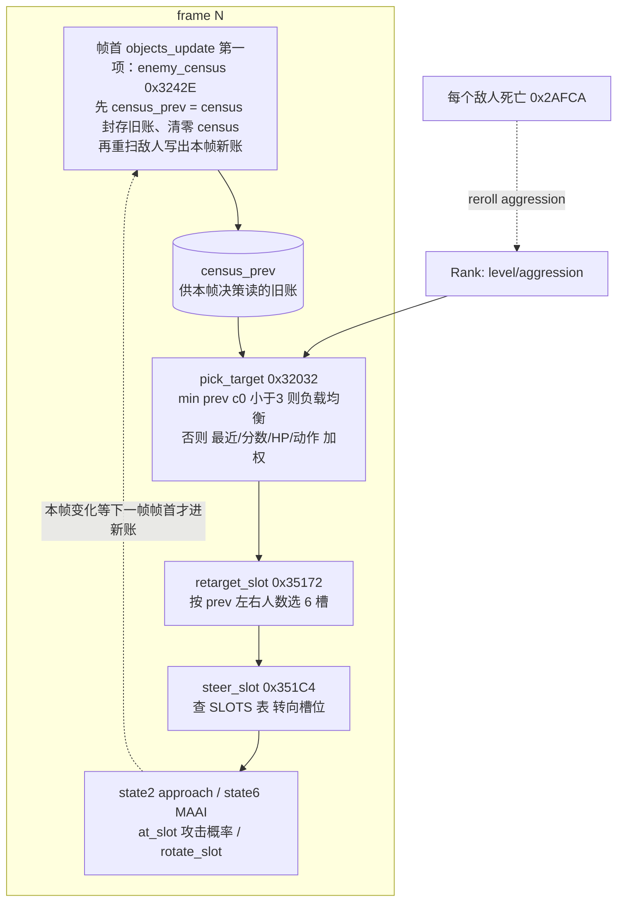

## 13.2 wof：当帧按位图查表选目标，无帧间统计

按 §11.1 已核实的 repo 语义（`Cps1Actor1CRuntime.cs` / `Cps1Actor27Runtime.cs` / `Cps1Actor1BRuntime.cs`）：

```
# 敌人收招 / 入场 / C02 校验时（当帧，不读上一帧统计）
0x3E1E 对象_随机选择活动目标():
    bm = rb(A5-0x3E) & 7                   # 活跃玩家位图
    if bm == 0: 写 OBJ+0xC3=0xFF ; return  # 无有效目标
    idx = (bm << 2) + (rng() & 3)
    d6 = B[0x3E62 + idx]                   # 0/1/2 = 玩家槽号，0xFF = 不选/清锁
    OBJ+0xC3 = d6                          # 目标选择锁
    A1 = 0x3E1C + W[0x3E82 + d6*2]         # 0000/00E0/01C0 → 玩家参数块
    OBJ+0x3A = A1 ; bsr 0x3F0C ; jsr 0x7854 # 站位偏置 + 方向索引

0x39A0 敌人收招按活动位图选择最近玩家():    # 另一条：按位图选最近
0x4244 / 0x422E 目标校验():                # btst.l d0,-$3e(a5)
    if 锁定玩家在位图里已不活跃: OBJ+0xC3 = 0xFF（清锁，下次重选）
```

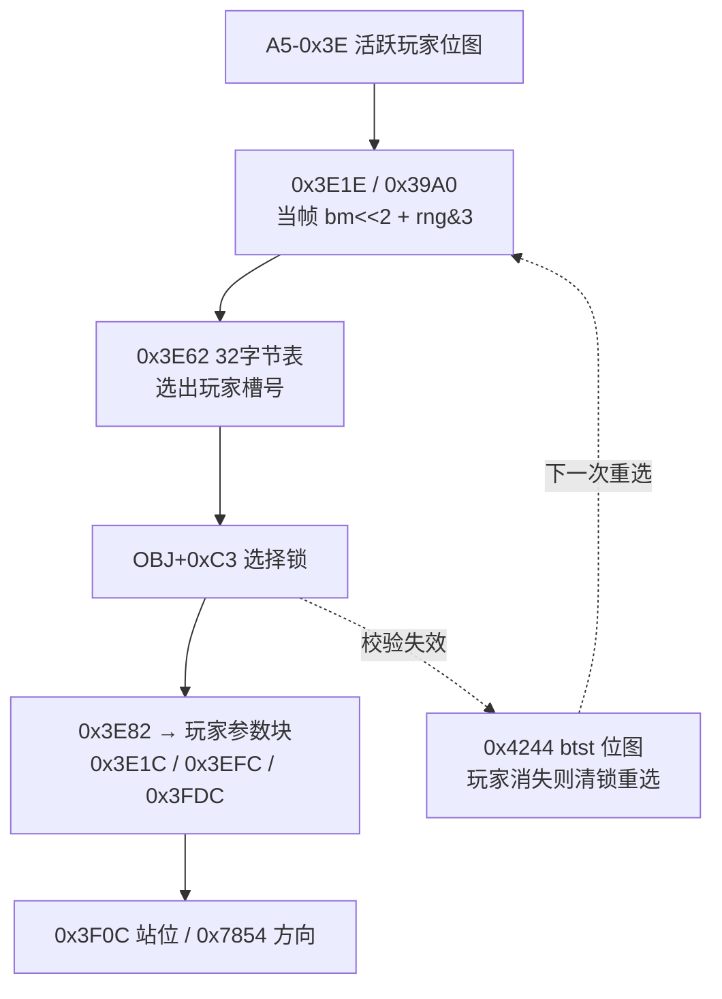

## 13.3 设计后果对照（怪物策略层）

| 设计面 | dino（帧间反馈闭环） | wof（当帧位图查表） |
|---|---|---|
| 不扎堆 | `census_prev[p][0] < 3` 优先补人少的玩家，是**全局负载均衡** | 无全局统计；`0x3E62` 表在多人活跃时用 `rng&3` 轮转（111 行 `00 01 02 ff`），是**概率分散** |
| 侧翼包抄 | 6 个接近槽位 + `retarget_slot` 按上一帧左右人数选槽 + `rotate_slot` 卡住轮换 | 未见等价的 census 驱动槽位系统；`0x3F0C` 只做站位偏置 |
| 决策依据 | 上一帧的**群体状态**（谁被瞄几个、左右分布）+ 本帧的多维个体加权（最近/分数/HP/动作/朝向/走路） | 本帧的**活跃玩家组合** + rng；个体维度只有 `0x39A0` 的"最近" |
| 反馈延迟 | 刻意一帧：**帧首**封账 + 重统计，本帧决策读 `prev` 旧账（不是统计在帧末） | 无（当帧闭环） |
| 目标锁定 | 目标存在 `e.TARGET`，每次 `reset_ai` / 受击 / 入场后重选 | `OBJ+0xC3` 显式选择锁，`0x4244` 用位图校验，玩家消失才清锁 |
| 与难度联动 | census / 槽位攻击概率都读 `Rank.aggression`（§9.5 / §10.2） | 位图与难度无关（§11.1 已收敛：不是 AI 档位） |

**收敛表述**（对齐 §11.5，不夸大）：两边都能让敌人不扎堆，但 dino 是"**统计驱动的群体协调**"（有 census 闭环、侧翼槽位、与难度联动），wof 是"**位图 + 随机表的轻量分散**"（当帧、无全局状态、选择锁校验）。这是策略丰富度的差别，不是"有/无 AI"的差别——和 §11.2 对 `0x3C6A` 的处理一样，不再包装成"架构反转"。

## 13.4 证据索引（本轮全部只读 repo 源码）

| 结论 | 位置 |
|---|---|
| dino census：`census_prev = census`、每玩家 4 计数（被瞄/攻击中/左/右） | `enemy.rs:770-805` |
| dino pick_target：`<3` 负载均衡 / 多维加权 / 平局 P1>P2>P3 | `enemy.rs:828-921` |
| dino retarget_slot 用 `census_prev[p][2]/[3]` 侧翼选槽 | `enemy.rs:1661-1685` |
| dino steer_slot：6 槽、`facing` 时 +3 取模 6、`SLOTS` 表 | `enemy.rs:1688-1703` |
| dino 槽位在状态机里的使用（approach / MAAI / at_slot / rotate） | `enemy.rs:1463-1600`、`enemy_c2_reset_ai:1418-1429` |
| census 结构定义 | `spawn.rs:51`（`census_prev: [[u8;4];3]`）、`trace.rs:1299` 逐字段 trace |
| wof 目标选择 / 选择锁 / 活跃玩家位图 | §11.1 已核：`Cps1Actor1CRuntime.cs:2017-2041`、`Cps1Actor27Runtime.cs:612`、`Cps1Actor26Runtime.cs:554,562-563`、`Cps1Actor1BRuntime.cs:701-724` |

## 13.5 阶段性收口与下一步

- 用户给的四大主题已各自有一轮"游戏设计本身"的深挖：状态机（§2）、打击（§3 / §9.3 / §12）、事件脚本（§4 / §9.4 / §12.4）、怪物策略（§5 / §11.5 / §13）。
- 仍未做的纯设计向工作：把 dino 的**搓招 FSM 与脚本覆写输入在"同一帧的输入优先权"**画成一张时序图（输入层如何被多处覆写：脚本 pad / 玩家真实输入 / cmd_state 的边界）；以及 dino **换人 tag / car 关卡**这两套附加系统如何挂进 §2 的分层状态机（§6.1 只列了现象，没画挂接方式）。
- 仍待补的 data（§10.7 / §11.6 保留项）：wof `0x3E82` 后半段、`0x7854`/`0x3F0C` 内部、`0x22DB0` region set 差异；dino `class4_states.rs` / `boss.rs` / `class25_ai.rs` 的 Boss 反击与变身。这些只在"必要时"补，且一律以 repo 语义为准。
- 全程沿用用户给定前提（dino 更晚更成熟），未考证发行先后。

**〔后一格补层：敌人挨一下打就重新想一遍 —— 它没有计划，只有处境〕**

`§13.3` 那张表里「目标锁定」一格已经记着「每次 `reset_ai` / 受击 / 入场后重选」，但一直只当成组织结构在登记。这一格把它当**设计意图**问一遍：敌人被打断之后，它刚才那个「主意」还在不在？答案是不在。

回源（不转引笔记）：`re/specs/enemy/SPEC.md:620-636` 的 `alive(e)` 里，受击那一帧 `r5 == 2` 走的是 `hit_reaction(e)`，`ai(e)` 那一支根本不跑；`reset_ai` 把状态字直接写成 `0x0200_0000`（回状态 0），接着 `set_anim(1)`、`set_walk_speed`、`e.b7d = 0`，然后 `retarget_and_slot(e)` + `steer_to_slot(e)`——**重挑目标、重算站位**。`SPEC.md:1471` 明写目标选择「在每次 `reset_ai`（每套连招之后、恢复之后、入场之后）重做」[O]；`:1472` 补上半句：硬直等够 `+$7A` 帧后，是在**状态 0** 重新掷一次是否立即反击 [O]。连「到位了要不要出手」都是每次到槽位重新掷一回（`:686-701`），MAAI 每走一步重 steering、到位再按档暂停 85→15 帧（`:1470`）。目标失效、240 帧没打着，也都是同一个 `reset_ai`（`:651` / `:751` / `:773`）。

也就是说敌人**不保管跨拍的主意**。挨打、收招、入场、目标失效，一律回状态 0，重新读一眼场上再挑一次。它唯一读到的「别人」是一份不属于任何人的公开账：`retarget_and_slot` 按 `t.prev_e2 / prev_e3`（上一帧目标左右各有几个敌人）选侧翼槽（`SPEC.md:707-718`），`pick_target` 读的是 `census_prev` 里谁被瞄得少（`notes/01-early.md:195` / `notes/00-overview.md:1098`）。账每帧重写，谁都不记着自己上一拍打算干嘛。

**倒推（[I]，说人话）**：所以「怪围着却不一起糊脸」不是因为它们商量好分工，也不是各自记着轮次，而是**每一拍都在重新分配**。被打断不是计划被打断，是它本来就没有计划。功夫武打里群演被踢开就重新找位，不记仇、不追着刚才那个人，主角在包围里那条能走、能转身、能接下一下的线因此一直还在。接回 `notes/05-objects.md` 末尾那条「留便条，不喊话」：便条不只贴在推进和收尾，也贴在**敌人的意图**上——它每帧自己来看一眼，不把上一拍的主意揣在兜里。当代常见做法是给杂兵一份跨帧存活的目标锁 / 仇恨表 / 行为树黑板，敌人于是会执着、会追、会一起糊脸，只好再写一套「同时最多几个人能打你」的限流把它们拉开；老游戏不需要限流，因为没有可被打断的计划——`notes/00-overview.md:1098` 那格专门数「现在有几个正在打你」的账根本没人读，正是同一件事的反面。这是设计取向的描述，不是对某个产品的断言，也不是本 rep 的取证。

**顺带收窄一句会被继承的概括**：`§13.3` 把 dino 定性为「统计驱动的群体协调」，别读成「系统掌握全局信息再分配」。统计是**上一帧的公开快照**，协调是**各人各自重读一遍**，没有调度器、没有跨拍分工；这与 `notes/00-overview.md:1098` 的「no central brain / 拥挤散在四道小门」同向，不改写它。wof 侧按 §11.0 只并列：`§13.3` 表格里 `OBJ+0xC3` 记的是**这一刻选中的玩家槽号**（0/1/2；`0xFF` = 没选中的哨兵），`0x4244` 用活跃位图校验「这个人还在不在」，位已置就沿用、位未置才清成 `0xFF` 重选（`Cps1EnemySubs.cs:73-113`）。按 §11.1 勘误它**不是行为 ID**，也不是全局 AI 档位；不评优劣、不推断原机缺什么、不串成两款共同架构，也不包装成「架构反转」（沿用 `§13.3` 收敛表述）。

**〔回源压力测试（后一格补，改了一句会被继承的引申）〕** 上面原本写「也就是目标会留住」，拿去撞 wof 敌人侧源码，撞出这层补层的一处读过头。实读 `Cps1EnemyAI.cs:4492-4515` 的通用例程 `0x3E1E`：它每次都重读 `A5-0x3E` 活跃位图，按「位图 << 2 | rng&3」查 `0x3E62` 得到一个玩家槽号，再写回 `+0xC3`；全场无活跃玩家才写 `0xFF`（`:4506` 还注明 ROM 在 `selected < 0` 时并不写 C3）。这个例程在 wt1 里被**二十多处、十几个文件**反复调用（`Cps1Actor12Runtime.cs:751` / `Cps1Actor15Runtime.cs:630,2607` / `Cps1Actor1BRuntime.cs:659,769` / `Cps1Actor27Runtime.cs:612` / `Cps1BossWaveEnemyRuntime.cs:1153,3073` / `Cps1EnemySubs.cs:112,203,262,287` / `Cps1EnemyAI.cs` 内部多处）；`Cps1Actor1CRuntime.cs:2014-2042` 的 `执行3DEE`（函数名直写「敌人**收招**按活动位图选择最近玩家」）也在收招时用 `0x39A0` 重选最近玩家、重写 `+0xC3`，并重算站位与方向。所以 wof 敌人**并不记着上一拍打谁**：目标还在场时允许沿用一小段，一进新决策、一收招、或人不在场了，就重新查一次名册。

**主判断（敌人不保管跨拍的计划）没被推翻，wof 侧也基本成立**；收窄的只是「wof 目标会留住」这句引申。`§13.3` 表格里「玩家消失才清锁」本身没错，它讲的是**清锁的条件**，不是「锁多久」。按 A.13 不回改历史表格原文，只改这里。

**倒推（[I]，说人话，两边合起来读）**：两边都不替敌人存一份「我待会儿要打谁、从哪边包抄」的长期计划，差别在**重选那一刻读什么、以及允许沿用多久**。dino 是每挨一下、每收一招就把自己清回状态 0，重读一份**上一帧场上的势**（谁被瞄得少、目标左右各有几个、六个站位哪个空）；wof 是每次进新决策重读一份**这一局的人员名册**（活跃位图 + 随机挑一个 + 再看谁最近），目标还在场时可以顺手沿用。换句话说，dino 的便条每帧重写、谁都不带在身上；wof 的便条允许那个对象自己揣一小会儿，但一进新决策就得重新看名册。两种都让「怪围着却不一起糊脸」成为每一拍重新分配的结果，而不是靠一份长期分工；这是「留便条，不喊话」在两侧各自的写法，不评优劣。

**边界**：wof 三处全是 wt1 仓库只读源码，按 §0 剥掉 `_无对应ASM` / `可能对应ASM` 宿主补偿标记与 FBA 逐帧补偿注释，不进移植欠账；`0x3E62` / `+0xC3` 语义一律以 §11.1 / §11.4 勘误为准，不复用第三轮「全局 AI 档位」的已作废读法（`notes/00-overview.md:1136-1138` 那段把 `+0xC3` 写成「行为 ID」同属作废）。按 §11.0 只登记并列事实、不推断 wof 原机缺什么、不串成共同架构。0 次 ROM 取证，不改 wt1。

**边界**：主要 dino 侧 [O] 回源 + [I] 倒推；这一层是状态迁移与条件分支，按既有纪律不进 `semantics.json`（不是「取值 → 抽象意义」的表）。`notes/05-objects.md` 末尾「留便条，不喊话」是同一条架构在推进 / 收尾侧的写法，这里补的是敌人侧，不重讲那三张便条。不改总入口、不加节号、不改外推文九节、不改 wt1，0 次 ROM 取证。

---

# 第七轮：一个 `+$A0` 字节的三层写入者（输入层帧内优先权）

> 承接 §13.5 下一步。§2.2 画了状态机的"分层"，但没说清这些层在**同一帧里谁先写、谁后读**。本轮只读 `player.rs` / `script.rs` 源码，把 `+$A0(held)/+$A8(pressed)` 这一个字节的写入顺序钉死。
> 顺带把 §4.1 "玩家 update 之后跑脚本"的措辞**精确化**：脚本 hook 其实在 `players_update → player_frame` **内部**、状态机分派**之前**（`player.rs:576`）。这是时序精确化，不是结论更正。

## 14.1 `player_frame` 的帧内顺序（源码逐行）

```
player_frame(i, cur):                       # cur = 本帧真实输入快照 w.input（players_update:541）
    # ① 真实输入写 pad                     player.rs:570-575
    p.prev(0xA1) = p.held(0xA0)
    p.held(0xA0) = cur
    p.pressed(0xA8) = cur & (cur ^ p.prev)  # 按下边沿

    # ② 脚本覆写 pad                       player.rs:576 → script_player_hook → script_step
    script_player_hook(i):
        if G.$4DD == 0: return
        if 该英雄 +$D0 == 0: script_hero_start(0x1DB0C)
        script_step(0x1DB5E):
            if p.mode != 2 or p.sub != 0: return      # ★ 状态字是【上一帧末】的
            if (G.$4DD & bit) == 0: return
            计时器递减 / 读下一条 6 字节记录
            执行 action → 覆写 +$A0(held)/+$A8(pressed)
            多数 action 末尾 script_pad_clear(0x1DEA6): 清 +$A0/+$A8/+$BC
                                                        # ★ 不清 +$A1(prev)

    # ③ 输入锁清 pad                       player.rs:577-582
    if input_lock(0x11A) != 0: held = prev = pressed = 0

    # ④ 特殊模式门                         player.rs:583-600
    car 关 / Ep8 clear sequence 时可能直接 return（跳过下面的状态机）

    # ⑤ 状态机分派（读 ①②③ 之后的 pad）  player.rs:601-607
    match p.mode: 0→spawn / 2→player_alive / 4→dead / 6→remove
        player_alive 内:
            p.cmd_flag = 0                            # player.rs:927 每帧先清
            player_command_fsm(i)  0x6AC8            # player.rs:929 读 held/pressed 识别搓招
            ... 动作状态 / 攻击判定 / 移动 ...
```

**一句话**：`+$A0/+$A8` 被 **真实输入 → 脚本 → 输入锁** 三层依次覆写，然后才由状态机和搓招 FSM 读。脚本不是"另一条轨道"，它只是排队在真实输入之后、状态机之前的一个 pad 写入者。

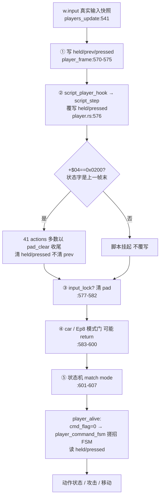

## 14.2 由此得到的几条设计性质（都是"游戏本意"层）

1. **脚本与玩法共用同一套输入 → 同一套状态机**：过场不是另写一套表演逻辑，只是"在真实输入之后塞一个伪造 pad"。所以脚本角色会正常跑走路 / 朝向 / 攻击 / 受击 / 死亡判定（§4.1 的结论在这里有了帧内依据）。
2. **"受击自动中断脚本"是延迟一帧的**：`script_step` 在 ② 处检查 `+$04==0x0200`，而本帧的受击是在 ⑤ 的状态机里才把 sub 改成 2 → 所以本帧脚本仍会执行，**下一帧**才挂起。这是"用上一帧状态字做门控"的自然结果，与 §13 的 `census_prev` 是同一种一帧延迟。
3. **搓招 FSM 也读被脚本覆写过的 pad**：`player_command_fsm` 在 `player_alive` 内（⑤ 之后），读的是 ①②③ 之后的 `held/pressed`。所以理论上一串伪造的"下→上→攻击"脚本输入也能推进 `cmd_state`——必杀识别层并不区分输入来自摇杆还是脚本。
4. **输入锁是第三道门**：`input_lock(0x11A)` 在脚本之后、状态机之前把 pad 全清，用于被投 / 硬直等"角色暂时不接受任何输入"的状态；优先级高于脚本。
5. **`prev` 不清是保留的原机怪癖**：`script_pad_clear` 只清 `+$A0/+$A8/+$BC`，不清 `+$A1(prev)`；下一帧 `pressed = cur & (cur ^ prev)` 仍用残留 prev 计算边沿。§4.1 记的 "walk 保持上帧方向 `+$A0 = +$A1`" 正是这个机制的利用。

## 14.3 与 wof 的输入层对照

| | dino | wof |
|---|---|---|
| 输入边沿 | `pressed = cur & (cur ^ prev)`，`+$A0/A1/A8` 三字节 | §9.2 `0x1AA58`：`not prev & held` → pressed(`+$A2`)，攻击键边沿置 `+$A4` 标志 |
| 输入覆写者 | 真实输入 → **脚本** → input_lock 三层 | 读输入后直接进 `ActStatABCD` 状态分派，未见脚本覆写玩家 pad |
| 独立搓招层 | `cmd_state/cmd_t/cmd_flag` 与主状态机并行，且读最终 pad | 以多个 `+$60/$78/$A8/$9A` 计时器 + 状态字组合承载，未见独立的"下→上→攻击"窗口 FSM |
| 脚本与角色 | 同一套状态机（覆写输入） | 脚本直接分配对象填字段 / 事件队列协程（§4.2、§12.4）——两条轨道 |

这把 §2.4 的"层间窄接口"具体化了：dino 的层与层之间传的不是状态、不是消息，而是**一个被多方覆写的输入字节**；脚本、搓招、状态机、输入锁靠"在帧内排队的先后顺序"耦合，而不是靠显式接口。

## 14.4 证据索引（本轮全部只读 repo 源码）

| 结论 | 位置 |
|---|---|
| `player_frame` 五段顺序（写 pad / 脚本 hook / input_lock / 模式门 / 状态分派） | `player.rs:569-607` |
| 真实输入来自 `w.input` 快照 | `player.rs:540-549` |
| `script_player_hook` 在 player update 内、状态机前 | `player.rs:576`；`script.rs:190-201` 注释 `0x189CE..0x189EE in the player update` |
| `script_step` 挂起条件读状态字 `+$04` | `script.rs:219-227` |
| `script_pad_clear` 清 `+$A0/$A8/$BC` | `script.rs:20,350` |
| `cmd_flag=0` + `player_command_fsm` 在 `player_alive` 内 | `player.rs:927-929,961-1006` |
| `input_lock` 字段 | `player.rs:174` |
| wof 输入边沿 / 状态分派 | §9.2（`Cps1PlayerLogic.cs:76`、Ghidra `0x1AA58`） |

## 14.5 收口：整份笔记的主线

- 到本轮为止，用户给的四大主题都有一条"**帧内 / 帧间时序**"主线：状态机分层（§2 + §14 输入优先权）、打击（§12 命中 / 处决分帧）、事件脚本（§12.4 覆写输入 vs 独立轨道）、怪物策略（§13 census 一帧延迟闭环）。四者共享同一个设计习惯：**把"这一帧做什么、下一帧读什么"当作显式结构**（固定顺序 + 状态字节 + `prev` 快照），而不是靠即时调用链。
- 这条主线也解释了用户前十几轮最关心的"函数执行次数不确定"在 dino 侧为何不构成障碍：dino 把这些时序点做成了固定顺序 + 状态字节 + `prev` 快照，wof 则原样保留了协作式内核的帧预算自由度（§9.2、§4.2）。这是**游戏 / 引擎设计取向**的差别，落到移植工程上才变成"能不能逐帧对拍"的差别。
- 仍未做（保留，不扩张）：换人 tag / car 关卡如何挂进 §2 分层状态机（§6.1 只列现象）；§10.7 / §11.6 的 data 待补项。ROM 继续只在"必要时"用于补 data，且以 repo 语义为准。
- 全程沿用用户给定前提（dino 更晚更成熟），未考证发行先后。

---

# 第八轮：附加玩法怎么挂进固定的帧循环（§6.1 第 6 条的空白）

> 承接 §14.5 明确列出的下一步。§6.1 把"换人 tag / car 关卡"列为"附加玩法系统"，但只列了现象，没说清它们**如何挂进 §2 那套固定顺序的分层状态机**。本轮只读 repo 源码（`player_tag.rs` / `car.rs` / `mod.rs` / `combat.rs` / `player.rs`），把挂接方式画出来。
> 前提仍是用户约定：只谈游戏逻辑怎么组织。全部以 repo 源码/注释为准，不做 ROM 取证。

## 15.0 问题：帧循环是固定的，附加玩法往哪插

§2.1 / §13.1 已经把 `game_frame` 和 `objects_update` 的固定顺序钉死了：

```
objects_update: census → players_update → items → enemies → shake → props → effects
              → held_players → obstacles_swap → tag_trigger → hud_tail → background → terrain
game_frame: rank_tick → objects_update → collision → hud → sprites → lists_reset → time_limit → spawn_script_tick
```

（`mod.rs:352-377`）。有意思的是：这么丰富的附加玩法，**没有一条给主循环加新步骤**（除了 `tag_trigger` 这一个固定钩子），也没有把主循环改成"按模式分派"。它们靠三种不同手法挂进去。

## 15.1 tag 换人：改「对象自身的状态字节」，复用既有玩家状态机

`player_tag.rs` 头部注释（`:1-15`）把整套机制写得很完整：

```
# 每帧 objects_update 末尾（mod.rs:373，0xE9C8，held_players 之后）
tag_trigger 0x670C:
    if G.$4DD != 0: return                 # 过场脚本中不触发
    for a in 0..3: tag_check(a)

tag_check 0x6728（每个发起者 A）:
    if A 已绑 / 无敌 / 持重物件 / input_lock: return
    if A 有任何输入: c2 = c3 = 0x5A ; return    # ★ 一有输入就重置 90 帧计数
    for B in OTHERS[A]（另两个玩家，表 0x66F4）:
        if B live / 非无敌 / normal mode / frame class 0 / action 0 / 无重物件 / 无输入
           且 A.x-B.x ∈ [-32,31] 且 A.z-B.z ∈ [0,15]（A 与 B 齐平或更深）:
            cB -= 1
            if cB == 0: tag_start 0x686E ; break
        else: cB = 0x5A

tag_start 0x686E:
    A.状态字 = 0x0200_001A          # ★ mode2/sub0/act=0x1A，仍是玩家状态机的一个分支
                                   #   → player_alive 内 player_tag_swing 0x19A7C
    B.帧类(0x2E) = 0xE             # ★ 改帧类 → 由 held_players_update 在敌人之后跑
    B 状态按表 0x6902（Jack 跑 / Hannah,Mustapha,Mess 飞）
    tag_follow 0x6922 按表 0x69D4 + A 的 phase(+$2D) 把 B 摆到 A 手上
    双方 +$EC = 180（闪烁无敌 180 帧）
```

**关键**：tag 没有新建"合体技对象"、没有新建状态机、没有改主循环。它只做两件事——
1. 在 `objects_update` 末尾用**两个每帧计数器**检测"两人静止重叠 90 帧无输入"（纯条件触发，不改任何对象）；
2. 触发时**改写两个既有玩家对象的状态字节**（`act=0x1A` / `帧类=0xE`），把它们"挪"到同一套玩家状态机里早已存在的分支/更新队列上。

于是 `player_alive` 的 `match act` 自然分派到 `player_tag_swing`，`held_players_update` 自然接手 partner。和 §14 的"脚本覆写 `+$A0`"是同一种手法：**不新增解释器，只改变既有解释器的输入 / 状态**。

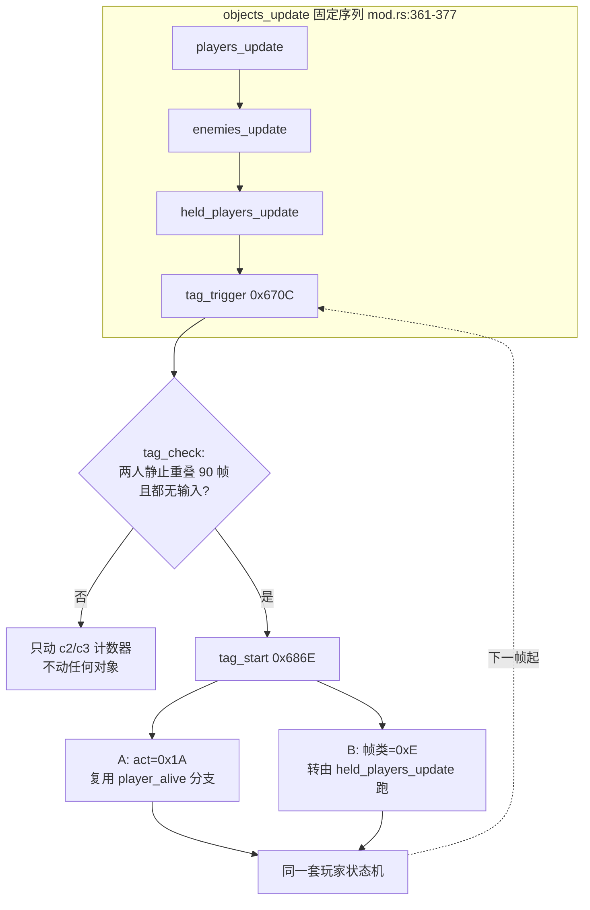

## 15.2 car 载具：一个全局模式位 + 各系统自查 + 一个独立对象 + 插入碰撞 pass

`car.rs:1-8` 与 `combat.rs:85-94` 给出的挂接方式和 tag 完全不同：

```
# 车本身 = pool B class 88 的一个普通对象（0x8BDDC..0x8C886），有自己的四态状态机
car 对象: mode 0 到达(0/2/4/6/8/A/C/E 子态) / mode 2 驾驶 / mode 4 结束 / mode 6 释放
          座位 +$A2..$A4、乘员位 +$A8、转向目标 +$B0/$B2、颠簸 +$AE ...（car.rs:14-38）

# 全局模式位 G.$518 (car_mode)，由 flow / car / boss_common 在多处置 0/1/2
# 关键是：没有"car 主循环"，而是各系统各自检查同一个位
player_frame   : if car_mode: 英雄 respawn 无敌、不进碰撞表、不绘制；可能 return 跳过状态机（player.rs:583-600）
boss.rs        : car_mode != 0 时跳过 Boss 逻辑（:86,:190,:225）
camera.rs      : car_mode != 0 时走追车逻辑（:1495,:1604-1635）
effect.rs      : car_mode != 0 时跳过部分特效（:521）
combat.rs      : if car_mode != 0 && car_on != 0: 在固定 pass 序列里插入 4 个专属 pass
                    pass_121d8 / 122d8 / 12342 / (lock78? 12454)   （:85-94）
```

**关键**：car 是「**一个被多方读取的全局模式位**」+「一个独立 pool B 对象」+「往固定 `collision()` 序列里条件插入 4 个 pass」。它不改主循环结构，但确实**新增了一个对象和一组 pass**；各系统靠"在同一帧里各自 `if car_mode`"来协同，而不是把逻辑收进一个 car 模块。这和 §11.2 里 wof `0x3C6A`（共享函数 + 每兵种各带概率表）是同一类"分散式共享"思路，只是共享的是**模式位**而不是函数。

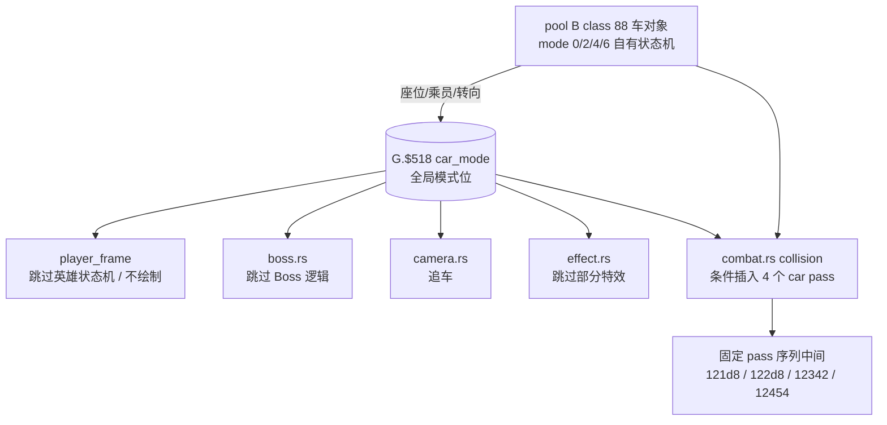

## 15.3 三种挂接方式合表：都不破坏固定帧循环

| 附加玩法 | 挂接手法 | 新增对象 | 新增主循环步骤 | 共享的"接口" |
|---|---|---|---|---|
| 过场脚本（§14） | 在 `player_frame` 内**覆写输入字节** `+$A0/$A8` | 无 | 无（复用 `script_player_hook`） | 一个被三方覆写的 pad 字节 |
| 换人 tag（§15.1） | 在 `objects_update` 末尾用计数器检测，触发时**改对象状态字节**（`act` / `帧类`） | 无 | 1 个固定钩子 `tag_trigger` | 既有玩家状态机的 `mode/sub/act` |
| car 载具（§15.2） | **全局 `car_mode` 位** + 各系统自查 + 插入碰撞 pass | 1 个 pool B 对象 + 4 pass | 无（pass 在既有 `collision()` 内） | 一个被多方读取的模式位 |

三者共同回答了 §6.1 的空白：dino 上层玩法丰富，但**主循环始终是那一条固定序列**；丰富度来自"往既有解释器的输入 / 状态 / 模式位上做文章"，而不是把主循环改成按模式分派的大 switch。这也和 §14.5 的主线一致——**时序点是显式、固定、可枚举的**。

## 15.4 wof 对照（谨慎，不夸大）

| | dino | wof |
|---|---|---|
| 双人合体 / 换人 | `tag_trigger` 90 帧静止检测 + 改 `act`/帧类；有 `PARTNER_STATE 0x6902`、`FOLLOW_PTRS 0x6994` 等表 | repo 中未见等价的"双人静止触发合体技"系统 |
| 载具关卡 | 全局 `car_mode` 被玩家 / Boss / 相机 / 特效 / 碰撞多系统共同检查；独立 pool B 车对象 | repo 中未见等价的**关卡级**载具模式位 |
| 对象挂载 / 骑乘 | 车的座位 `+$A2..$A4`、乘员位 `+$A8` | 有 `Mount(+$63)` 骑乘标志 + `MountObj(+$3A)` 父对象指针：`夏侯敦_骑乘B02_受击与下马链_对应ASM_12884`、`Cps1Collision.cs:4936 target.Mount!=0 → 0x7E86`、许褚子对象 `Cps1EventObjectRuntime.cs:1580` |

**收敛表述**：wof 的 `Mount/MountObj` 是**对象级**的父子挂载 / 骑乘（作用域是单条对象链，进受击反应分支），和 dino `car_mode` 那种**全局关卡级**模式位不是同一层次。但按 §11 的定位，这里只说"repo 中未见等价"，不断言 wof 一定没有——除非真去把 wof 全部流程表读完，而这属于"必要时才做"的范围。

## 15.5 证据索引（本轮全部只读 repo 源码）

| 结论 | 位置 |
|---|---|
| `objects_update` / `game_frame` 固定序列 | `mod.rs:352-377` |
| `tag_trigger` 是序列里唯一新增钩子，在 held_players 之后 | `mod.rs:373`；`player_tag.rs:5` 注释 `0xE9C8, after the held players` |
| tag 机制全文（90 帧、两个计数器、表 0x66F4/0x6902/0x6994/0x69D4、闪烁 180 帧） | `player_tag.rs:1-15,31-45` |
| `tag_start` 后 A 走 `0x0200001A` / B 帧类 0xE 由 held_players 跑 | `player_tag.rs:4-11` |
| car = pool B class 88、四态状态机、座位/乘员字段 | `car.rs:1-38` |
| 4 个 car pass 条件插入 `collision()` | `combat.rs:85-94` |
| `car_mode` 在玩家 / Boss / 相机 / 特效 / flow 的门控 | `player.rs:583-600`；`boss.rs:86,190,225`；`camera.rs:1495,1604-1635`；`effect.rs:521`；`flow.rs:432,1249` |
| wof `Mount` / `MountObj` 对象级骑乘 | `Cps1Collision.cs:1540,1564,1636,1691,4925,4936,5064,5074`；`Cps1Actor2B2CRuntime.cs:332-342`；`Cps1EventObjectRuntime.cs:939,1580` |

## 15.6 阶段性收口（继续保留的边界）

- §6.1 第 6 条的空白已补齐：tag / car 的**挂接方式**已画清，且归纳出"过场=覆写输入、tag=改状态字节、car=全局模式位"三种手法，共同点是**不破坏固定帧循环**。
- 到本轮，用户给的四大主题 + §6.1 的附加玩法系统都已有"游戏设计本身"的深挖。整份笔记的主线（§14.5）再补一块：附加玩法也是靠"显式、固定、可枚举的时序点"挂进去的。
- 仍未做（保留，不扩张）：§10.7 / §11.6 的 data 待补项（wof `0x3E82` 后半段、`0x7854`/`0x3F0C` 内部、`0x22DB0` region set 差异；dino `class4_states.rs` / `boss.rs` / `class25_ai.rs` 的 Boss 反击与变身）。这些严格"必要时才补"、以 repo 语义为准。
- 全程沿用用户给定前提（dino 更晚更成熟），未考证发行先后。

---

# 第九轮：Boss 层是「共享零件 + 每类自己的分派」（§6.1 第 4 条的空白）

> 承接 §15.6。§6.1 第 4 条只写了"Boss 多形态 + aggression 分档 / 5 个 Boss 各自保留反击与变身"，没展开它们怎么组织。本轮只读 `boss_common.rs` / `boss.rs` 源码。
> **特别当心**：这里有个 `BossAi` 枚举，很容易又被写成"dino 有统一 Boss 决策器"——那正是 §10.1 被作废的错误。repo 头部注释 `boss_common.rs:1-2` 自己把边界钉死了：`Class handlers keep their own state dispatch, counterattacks and transformations. These helpers do not run an invented common AI.`

## 16.0 `BossAi` 不是决策器，是「表地址选择器」

`BossAi` 只有 5 个变体（Morgan / Morgue / Tyrog / Tyrog2 / Fessenden，`boss_common.rs:11-17`），它做的全部事情是**按 Boss 种类 + 形态选出该读哪张 ROM 表**：

```
BossAi::phase_tables()  -> (aggressive表, defensive表)   # 每个 Boss 一对，地址各不相同
                                                        #   Morgan 0x5196A/0x5198A、Morgue 0x5418A/0x541AA ...
BossAi::gate_table(form):                               # 按形态选"攻击闸门"表
    Morgan      -> 0x73B14
    Morgue      -> 0x73D54
    Tyrog/Tyrog2-> 0x74542 + form_index(form)*0x40      # ★ 形态换表
    Fessenden   -> 0x74A42
BossAi::action_table(form, +$AB):                       # 按形态 + +$AB符号 选"动作"表
    Morgan      -> +$AB<0 ? 0x73B54 : 0x73C54           # ★ 符号选第二张表
    Morgue      -> 0x73D94
    Tyrog/Tyrog2-> 0x74602 + form_index(form)*0x100     # ★ 形态换表
    Fessenden   -> 0x74A82
form_index(form): 0 / 1 / 2（对应 form 1 / 2 / 3+）     # 0x38BE6 SUBQ+BMI/BEQ
```

也就是说：**没有一张"Boss AI 表"，每个 Boss 有自己成套的表，且 Tyrog/形态、Morgan/符号还会再切一次表**。`BossAi` 只是把"该查哪张表"参数化，决策的执行仍是各 class handler 自己的状态分派。这与 §11.2 对 `0x3C6A` 的收敛是同一判断，也和 §13.1 dino 杂兵"每类自己的 state 0"完全一致。

## 16.1 决策流水线：共享零件只到「抽出一个 action id」为止

```
# ① 相位节拍（每个 Boss 自己的 phase 计时器 +$A6）
boss_phase_tick(e, ai):                         # 0x51928 等
    if --+$A6 != 0: return false                # 相位未到
    r = rand() & 0x1E
    (agg, def) = ai.phase_tables()
    +$A6 = W[当前相位表 + r]                    # ★ 用相位表重装载计时器
    +$A0 ^= 1                                  # 攻击相位 / 防守相位翻转
    boss_pick_target(e)                        # 复用 §13 的 enemy_pick_target，无 RNG
    if ai in (Morgue, Fessenden): slot6/slot4 重算站位

# ② 攻击闸门（要不要进入攻击决策）
boss_gate_limit(e, ai):                        # 0x52C54 等
    row = aggression << 3                      # ★ G.$5EC aggression，不是 G.$5EE level
    return B[ai.gate_table(form) + row + +$A5] # 8 行(aggression) × 列(+$A5)
boss_aggression_gate(e, ai):                   # 0x52C6C
    return (rand() & 31) < limit               # 一次 RNG；Tyrog 命中时锁 +$A4

# ③ 抽动作（注意：返回的是 action id，不是状态字节）
boss_action_pick(e, ai):                       # 0x52C9A
    row = (rand() & 31) << 3
    return B[ai.action_table(form, +$AB) + row + +$A5]   # 又一次 RNG

# ④ 之后交给各 class handler 自己的状态分派 / 反击 / 变身
#    （boss_common.rs:1-2 明确不代跑）
```

**要点**：共享零件在「抽出一个 action id」处**停手**。repo 注释 `boss_action_pick:160` 特意写 "This returns the table's action id, not a state byte. Class handlers dispatch it, including Morgue's +$B9 veto after the draw." ——`Morgue` 甚至能在抽完之后一票否决。所以"5 个 Boss 各自保留反击与变身"不是空话，是**分派权本来就不在共享层**。

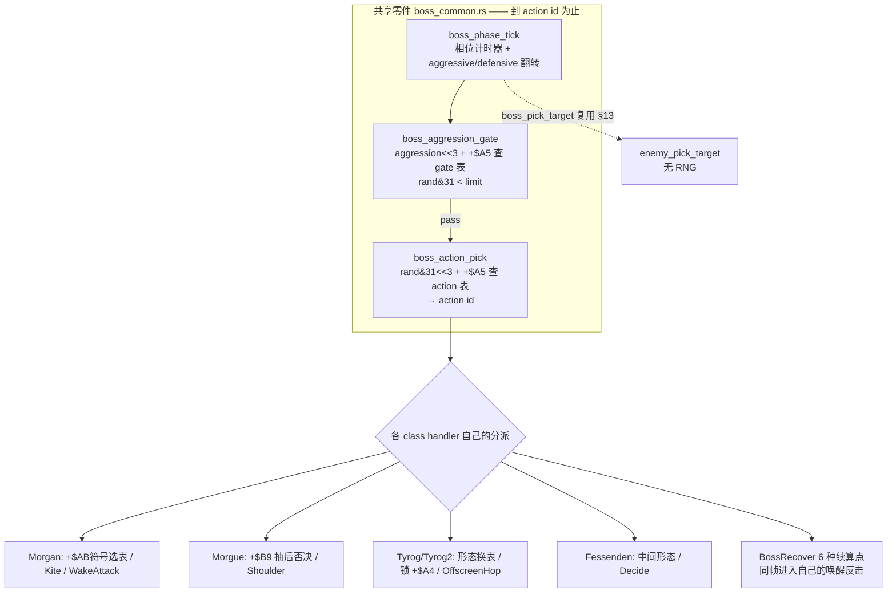

## 16.2 多形态：不是"死一次算输"，是相位 / 中间形态 / 终局三层

| 层 | 机制 | repo 证据 |
|---|---|---|
| 相位翻转 | `+$A0` 在 aggressive / defensive 间翻，`phase_tables()` 各给一张计时器重装表 | `boss_phase_tick:99-117` |
| 形态换表 | `form_index(form)` 让 Tyrog/Tyrog2 的 gate/action 表整体换成另一套（0/1/2 三档） | `form_index:32-41`、`gate_table:48`、`action_table:65` |
| 中间形态命中 | `boss_intermediate_hit`：Morgan/Tyrog form 1/2 命中 → `flow.speed=3` 慢动作 + `kill_all=2` 清场，**但不结束战斗**（无 `0xACEE`） | `:285-296` 注释 "slow the game and kill helpers, not the fight" |
| 终局 | `boss_end_hook 0xACEE` 才真正判负；与 score/leader hook 分离，由 dying routine 稍后调 | `:298-302`、`boss.rs:505-552` |

`boss.rs:516` 的注释 `e.b.mode = 4; // the hit reaction starts the death state` 与 §12.1 的"命中帧只结算、死亡由受击态下一帧推进"在 Boss 层同样成立；`boss.rs:552` 还验证 "only the last death ends the fight"（多形态/多部件要等最后一次死亡）。

## 16.3 反击与「显式续算点」

`BossRecover` 枚举（`:73-87`）列出 6 个 class 专属续算点：`WakeAttack`（唤醒反击，Morgan 0x527A8 / Tyrog 0x382B0 / Tyrog2 0x66CCC）、`OffscreenHop`、`Shoulder`、`Kite`、`Decide`、`Wait`。注释（`:71-72`）：`The future class handler enters its own routine in the same frame, not on the next update.`——**同帧续算**，不是下一帧。

这和 §6.1 第 7 条 `IntroAfter` 把"sleep 后回到哪一行"列成枚举是同一种设计习惯：**跨帧/跨阶段的续算点被显式枚举出来**，而不是靠调用栈或隐式 PC 保存。也和 §14.5 主线一致（时序点显式、可枚举）。

## 16.4 收敛表述（不夸大，对齐 §11）

| 容易写错的说法 | 正确说法 |
|---|---|
| "dino 有统一的 Boss AI 决策器（`BossAi` 枚举）" | `BossAi` 只是**表地址选择器**；repo 明说 helpers 不跑通用 AI，分派/反击/变身各 class 自理 |
| "Boss 难度按 level 分档" | gate 用 **`G.$5EC` aggression**，不是 `G.$5EE` level（`boss_common.rs:9` 原注） |
| "Boss 打一次就死 / 多形态只是换皮" | 相位翻转 + 形态换表 + 中间形态慢动作清场（不结束）+ 最后一次死亡才判负 |
| "Boss 目标选择和杂兵是两套" | `boss_pick_target` 直接复用 §13.1 的 `enemy_pick_target`（含 `>=3` fallback），**无 RNG**（`:90-94`） |

和 §13.3 的收敛口径一致：dino Boss 层的"成熟"是**表切分维度更多（form × aggression × +$A5 × 相位）+ 反击/变身分派权留在各 class**，不是"比 wof 多一个中央大脑"。

## 16.5 证据索引（本轮全部只读 repo 源码）

| 结论 | 位置 |
|---|---|
| "helpers 不跑通用 AI，各 class 保留分派/反击/变身" | `boss_common.rs:1-2`（源码注释原文） |
| `BossAi` 5 变体 / phase_tables / gate_table(form) / action_table(form,+$AB) / form_index | `boss_common.rs:11-68` |
| aggression 而非 level | `boss_common.rs:9` |
| phase_tick 相位翻转 + 计时器重装 + 复用 pick_target | `boss_common.rs:96-117` |
| gate / action pick 两次 RNG、返回 action id 非状态字节 | `boss_common.rs:135-168` |
| `BossRecover` 6 续算点、同帧续算 | `boss_common.rs:71-87` |
| 中间形态命中不结束战斗 / 终局 hook 分离 | `boss_common.rs:275-302` |
| Boss 死亡由受击态启动、最后一次死亡才判负 | `boss.rs:516,546,552` |

## 16.6 阶段性收口

- §6.1 第 4 条（Boss 多形态/反击）与第 6 条（附加玩法挂接）的"只列现象"都已补齐；第 7 条（过场续算点）在 §16.3 找到同构证据。§6.1 的 7 条设计点至此都有对应的机制说明。
- 本轮再次验证了 §11 勘误的方向：**看到枚举/共享函数就写"中央决策器"是错的**，repo 自己会声明边界。今后补 data 时同样先读 repo 注释。
- 仍未做（保留，不扩张）：§10.7 / §11.6 的 ROM data 待补项（wof `0x3E82` 后半段、`0x7854`/`0x3F0C` 内部、`0x22DB0` region set 差异）。这些严格"必要时才补"、以 repo 语义为准；本轮全部结论均来自 repo 源码，未新增 ROM 取证。
- 全程沿用用户给定前提（dino 更晚更成熟），未考证发行先后。

---

# 第十轮：伤害结算的多因子流水线（§6.1 第 2、3 条的空白）

> 承接 §16.6 的自查：§16.6 说"§6.1 的 7 条都补齐"，但第 2 条（反击 / 弱点克制）、第 3 条（等级与 HP 缩放）此前只有一句话 + §9.7 的 ROM 级重述，没有机制展开。本轮补上。
> 全部只读 repo 源码（`player_combat.rs` / `enemy_combat.rs`），wof 侧引用 §9.3 / §12.2 已核实的 `Cps1Collision.cs` 结论。不做 ROM 取证。

## 17.1 dino：玩家 → 敌人，命中帧一次算完的连乘流水线

§12.1 里 `enemy_hit_by_player` 那句 `dmg = enemy_damage_scale(dmg)` 展开后是这样的（`enemy_combat.rs:662-` / `player_combat.rs:19-89` 同一套公式的纯函数版）：

```
base = player_attacks[char][attack_id/2].damage        # 招式基础伤害

# ① 蓄力（可选，enemy_charge_scale 0x2BA2A 之前）
if player_move_word == 0x203:                          # 蓄力攻击
    k = partner 的 T80 / w80（蓄力时长）
    if k > 0x0F: base = (base * {0x28|0x30|0x40}[档]) >> 5

# ② enemy_damage_scale 0x2BA2A（连乘，两次 RNG）
d = base
if enemy.kind == 4:                                    # ★ 反击：敌人正在攻击
    m = W[0xA320C + 2*enemy.atk]                      # 按敌人招式的 counter_scale
    if m != 0: d = (d * m) >> 5 ; counter = true

w84 = enemy.m.w(W84)                                   # 敌人类型/形态索引
# ★ 弱点对：0xA32FA + w84 处 4 字节 (id/2, factor, id/2, factor)
if attack_id == pair0.id*2:   d = (d * pair0.factor) >> 5 ; counter = true
elif attack_id == pair1.id*2: d = (d * pair1.factor) >> 5 ; counter = true
#   弱点命中同时置 counter（G.$4F5）→ 第二火花(type5) + 400 分

if attacker 是玩家: d = d * players[who].power          # 角色力量
f = B[0x2BECE + (w84<<3) + level]                      # ★ level_type_scale：敌类型×难度
d = (d * f) >> 10 ; d = max(d, 1)

d2 = (enemy_hp 百位)*0x40 + (r1 & 0x3E)               # ★ 第一次 RNG
d = d * hp_hundreds_scale[d2/2]                        # 随敌人剩余 HP 百位缩放
band = {hp尾数>=0x4B:0, >=0x32:0x40, >=0x19:0x80, else:0xC0}
d = d * hp_band_scale[(band + (r2 & 0x3E))/2]          # ★ 第二次 RNG + HP 尾数分段
result = max(d >> 10, 1)                               # 高字截断，下限 1

# ③ 落账（§12.1）：hp = max(hp - result, 0)；不写死亡
```

**要点**：伤害不是查一张表就得，而是 **6~7 个因子连乘 + 2 次 RNG + 2 张按 HP 分段的缩放表**；且"反击 / 弱点"不只是加伤害，还置 `counter` 改变**火花与得分**（`player_combat.rs:55-56` 注释：weakness hit is a counter hit too, second spark + 400 points）。§6.1 第 2、3 条说的"随难度等级、敌人剩余血量、RNG 变化，不是定值表"在这里逐因子落地。

## 17.2 反向：敌人 → 玩家，从「乘」换成「减算 + 保底」

`player_combat.rs:92-` 的 `enemy_damage 0x6422` 是另一套（不是同一公式反过来）：

```
d = (base * enemy_level_scale[(w84<<3) + (level&0x1F)]) >> 5
red = enemy_hp_reduce[(band(hp) + (r & 0x3E))/2]      # ★ 减算，不是乘
d = max(d - red, 1)                                    # mercy：至少扣 1
d = (d * defense[chr]) >> 5                            # 角色防御
d = (d * enemy_hp_scale[((hp>>2)&0x1E)/2]) >> 5        # 玩家剩余 HP 缩放
```

玩家侧刻意用了 **减算 + `max(...,1)` 保底**（`mercy`），而不是像敌人侧那样一路连乘——玩家永远只掉有意义的血、不会被一堆小因子乘到 0，这是**难度手感**的设计，不是数值巧合。§6.1 第 3 条的"等级与 HP 缩放"两边都有，但方向不同。

```mermaid
flowchart TD
    B[招式 base] --> C[蓄力 0x203? ×{28/30/40}>>5]
    C --> K[反击 kind==4 ×counter_scale>>5]
    K --> W[弱点 0xA32FA 对 ×factor>>5<br/>同时置 counter→火花/分数]
    W --> P[× players.power]
    P --> L[× level_type_scale 0x2BECE >>10]
    L --> H1[× hp_hundreds_scale<br/>r1 + HP百位]
    H1 --> H2[× hp_band_scale<br/>r2 + HP尾数分段]
    H2 --> R[>>10 下限1 → hp 减账<br/>不判死亡]
    style K fill:#ffe6e6
    style W fill:#ffe6e6
```

## 17.3 wof：加算修正 + 单次衰减（§9.3 / §12.2 已核实）

```
damage = 随机伤害表 0x1C20 取基值
d6 = 计算敌方伤害难度索引_对应ASM_20F8_7DDA(attacker)   # 难度索引
d6 += rws(a3)                                          # 参数表加成
damage += (sbyte)B[0x6EE84 + (d6 & 0xFFFF)]             # ★ 加算修正，不是乘
reduction = max(hpBand, defense)                        # HP 段 / 防御取大
damage = (damage * (0x20 - reduction)) >> 5             # 单次衰减
# 随后 0x7E4A 当帧分派受击反应（§12.2）
```

wof **也有**难度索引、`hpBand`、`defense`、随机伤害表——不是"没有这些系统"（§11 已反复强调别犯这个错）。差别在**组合方式**：wof 以「基值 + 加算修正 + 一次衰减」为主，dino 以「多因子连乘 + 分段查表 + 两次 RNG」为主。

## 17.4 收敛后的对照（不夸大）

| 设计面 | dino | wof |
|---|---|---|
| 因子组合 | counter × weakness × power × level_type × hp_hundreds × hp_band **连乘** | 基值 + 难度索引 + 加算修正，再乘一次 `(0x20-reduction)` |
| RNG | 命中伤害 **2 次**（r1/r2 各进一张 HP 缩放表） | 随机伤害表 + 难度索引（1 次主 RNG） |
| 难度 / 等级 | `level_type_scale[(w84<<3)+level]`：敌类型 × 难度双索引 | `7DDA` 难度索引 → 进 `0x6EE84` 加算表 |
| 剩余 HP 影响 | 敌人侧百位 + 尾数**两张分段表**；玩家侧 `enemy_hp_scale` | `hpBand` 参与 `reduction = max(hpBand, defense)` |
| 反击 / 弱点 | 独立机制：`kind==4` 反击 + `0xA32FA` 弱点对，且**改变火花/得分** | 有 counter/防御衰减，但 repo 未见等价的"招式 ID × 敌类型弱点对 + 第二火花加分" |
| 玩家侧保底 | `enemy_damage` 减算 + `max(...,1)` mercy | 防御衰减后保底（§12.2 未展开 mercy，不断言） |

**收敛表述**：dino 的"成熟"落在**伤害公式的维度与耦合深度**（类型、形态、难度、HP 分段、蓄力、反击/弱点全都进同一条流水线，且触发额外演出/得分），不是"wof 没有难度或 HP 缩放"。两边都是 ROM 表驱动，区别是表的**维度数**与**乘/加组合方式**。这与 §11.5 / §13.3 / §16.4 的口径一致。

## 17.5 证据索引（本轮全部只读 repo 源码）

| 结论 | 位置 |
|---|---|
| 玩家→敌伤害连乘流水线（反击/弱点/power/level_type/两张 HP 缩放表/2 次 RNG） | `player_combat.rs:19-89` |
| 命中链调用 `enemy_damage_scale` 0x2BA2A 与蓄力 `enemy_charge_scale` | `enemy_combat.rs:525-534,636-659,661-700` |
| 弱点命中置 counter → 第二火花 + 400 分 | `player_combat.rs:53-57` 注释 |
| 敌人→玩家伤害：减算 + mercy + 防御 + HP 缩放 | `player_combat.rs:92-111` |
| 反击/弱点/缩放表的默认数据与单测 | `player_combat.rs:629-632,643-771` |
| wof 伤害链（0x1C20 / 7DDA / 0x6EE84 / hpBand / defense） | §9.3、§12.2；`Cps1Collision.cs` 对应函数 |

## 17.6 阶段性收口

- §6.1 的 7 条设计点至此**逐条都有机制说明**：1 搓招（§2.2/§14）、2 反击弱点（§17.1）、3 等级 HP 缩放（§17.1/§17.2）、4 Boss 多形态（§16）、5 过场脚本（§4.1/§14）、6 附加玩法挂接（§15）、7 续算点枚举（§16.3）。§16.6 那句"都补齐"现在成立。
- 本轮仍严格以 repo 源码为准、未新增 ROM 取证；对 wof 一律用"有，但组合方式不同 / repo 未见等价"的收敛口径，不重蹈 §9.1 / §10.1 的覆辙。
- 仍未做（保留，不扩张）：§10.7 / §11.6 的 ROM data 待补项（wof `0x3E82` 后半段、`0x7854`/`0x3F0C` 内部、`0x22DB0` region set 差异）。严格"必要时才补"、以 repo 语义为准。
- 全程沿用用户给定前提（dino 更晚更成熟），未考证发行先后。

---

# 附录 A：阶段 A 工程路线结论存档（**非游戏设计笔记正文**）

> **性质**：§8.1 指出"阶段 A 的工程结论只存在于对话、压缩后会丢"，本附录补这个缺口。它与上面 §0–§17 的**游戏设计本意**分析是两回事，按用户 11-06「话题转向」「rs 和 cs 表面的编程和硬件差异不重要」的约定**隔离存放**，不混进设计正文。
> **诚实边界**：以下是对话阶段 A（比较 dino_rs / wof_cs 方法、完成度、路线取舍）结论的**结构化整理，未在本轮重新验证**；凡属用户自己的判断都标了「用户」。文件 / 行号类证据以当时对话调查为准，若与当前 repo 有出入，以当前 repo 为准（同 §7.1 校准精神）。
> **用途**：保住用户最终目标（**写回 68K ROM / VBCC**）相关的决策资产，供后续会话直接接着用。

## 18.1 §10.7 六条待核逐条结清

| §10.7 原待核 | 结清 | repo 侧证据 |
|---|---|---|
| **`0x22DB0` 主 AI 入口表未确认**（第三轮 Ghidra 读到 4 个 `0x00022dae`） | ✅ **repo 侧早已完整确认**，第三轮是取证方式偏差，不据此改写 repo 结论 | `Cps1EnemyAI.cs:32` 只是常量简记 `22DB0[0x10]->0x327F8`；逐字节证据在 `Cps1Actor15Runtime.cs:9`（`rom_read.py hex 0x22DB0 92` → `00036612/00038844/0003A62C`）、`Cps1Actor16Runtime.cs:8`（`longs 0x22DB0 46`，`0x22E08=00 03 A6 2C`）、`Cps1Actor1CRuntime.cs:20`（`0x22E20=00 04 37 4C`）、`Cps1Actor1BRuntime.cs:7`（`hex 0x22DB0 200`）、`Cps1Actor1FRuntime.cs:8`（`0x22E2C=00 04 6E 5E`）；FBA 铁证 `Cps1Actor18Runtime.cs:469`（`= 0x22DB0[0x18]`）。消费点 `0x22D86 move.w $20(a0),d0 / add×2 / movea.l 0x22DB0(pc,d0.w),a1 / jsr` |
| wof 9 项受击反应各自语义 | ✅ **§12.6 已收敛**：repo 已有命名与逐段还原（`0x7E7A` 轻硬直或累计击飞、`0x7F14` 普通反应、`0x7ECE`/`0x7F0A`/`0x7E86`/`0x7E92`/`0x7F36` 段），未做的是 ROM 逐指令对照；"不能断言 wof 没有 poise/dizzy"的谨慎立场仍正确 | `Cps1Collision.cs:4909,4933,4938,4983,5061,5088,5104,5129,5179` |
| dino Boss 专属逻辑未逐个读 | ✅ **§16 + 本轮 §18.2 补齐**：`boss_common.rs`/`boss.rs` 已读，本轮补 `class4_states.rs` / `class25_ai.rs` | 见 §18.2 |
| `0x3E82` 后半 / `0x7854` / `0x3F0C` 未读 | ✅ **repo 侧都有等价实现**，`0x3E82` 后半"混入代码"是 ROM 布局事实、非待解析表 | `0x3E82` 表 = `0000/00E0/01C0` 三项已在 §11.1 解释；`Cps1Actor1CRuntime.cs:2027-2029`；`0x7854` → `Cps1EnemyAI.cs:6894` `计算方向索引_可能对应ASM_7854`（含 `0x786E..0x78A8` 象限/阈值逻辑）；`0x3F0C` → `Cps1EnemyAI.cs:4440` `对象_写入侧向站位偏置B0_可能对应ASM_3F0C` + `:4450` 公共尾部 |
| wof AI 决策表"档位"来源 `GS-0x3E` 低 3 位 | ✅ **§11.1/§11.4 已解决**：是活跃玩家位图，与动态难度无关，无需再追 | `Cps1Actor24Runtime.cs:1004`、`Cps1Actor1BRuntime.cs:701-724` |
| 发行先后未考证 | ⏳ **仍开放**，各轮末尾一致沿用用户前提 | — |

**结论**：§10.7 的 6 条里 **5 条已被 repo 侧或后续轮次结清，仅"发行先后"仍开放**。真正需要修正的是第三轮两处**取证方式/命名偏差**（见 §18.3），不是 repo 缺 data。

## 18.2 Boss 专属实现补读（补 §16「只读了 SPEC.md 标题层」）

§16 已把共享零件（`BossAi` 表选择 / gate / action_pick / `BossRecover`）说清，但"5 个 Boss 各自反击/变身"只到标题层。本轮读两个 class 文件，看**每类自己的状态分派**到底长什么样。

### 18.2.1 Tyrog（`class4_states.rs`）：`c4_state` + `c4_decide` 两层

```
# 文件头：Tyrog's states (+$06, table 0x36CA0) and actions (decision 0x38B90, jump table 0x38CA6)
c4_state(e, h)  0x36C7A:                     # 按 e.b.act 分派（Tyrog 自己的状态跳表）
    match act:
        0x02 -> WAIT 计时递减
        0x04 -> c4_sidestep_air             # 空中侧步
        0x08 -> c4_walk_to_point
        0x0A|0x0C|0x12|0x3E -> 定时动画后 return c4_decide(e,h)
        0x06 if Tyrog2 -> c91_wait
        ... 后续 1000+ 行里十余处 return self.c4_decide(e, h)

c4_decide(e, h)  0x38B90/0x38C36:           # 决策：注释明写 table[form][rand&31][class]
    if PENDING == 0:                        # 无待发攻击
        TIMER = 0x3C ; speed = 5
        XCLASS = lib_distance_class(e)      # X 距离等级 0x3293C（Tyrog2 同）
        st = (PHASE&1) ? 0x2C : 0x2E       # 相位决定"后跃蹲伏" vs "侧步蹲伏"
        return c4_crouch(...)
    PENDING = 0 ; speed = 5 ; XCLASS = lib_distance_class(e)
    action = boss_action_pick(e, c4_ai(e))  # ★ 调 §16.1 的共享抽取，但传的是 Tyrog 自己的表
    match action & 7:                       # ★ Tyrog 自己的 8 路动作分派
        0|1 -> c4_claw        2 -> c4_crouch
        3   -> c4_hop(...)    4 -> c4_lava_start
        5|6 -> c4_hop(...)    _ -> c4_chain
```

**要点**：`c4_decide` 的注释直接写着 `table[form][rand & 31][class]`——§16.1 说的"form × aggression × X距离 × rng 多维度"在 class 自己的决策里真的落地了；而共享层 `boss_action_pick` 只负责"按 Tyrog 的表抽一个 action id"，**8 路分派是 `class4_states.rs` 自己的**。这再次印证 `boss_common.rs:1-2`「helpers do not run an invented common AI」。

### 18.2.2 Slice（`class25_ai.rs`）：攻击脚本与英雄过场脚本同构

```
# 文件头：decision 0x4C11C、四种 run（+$AC: 0/2/4/6）、attack scripts 0x4C40A
c25_decide(e)  0x4C11C:
    if 目标消失 或 目标 action class == 0x23 或 600 帧到: 重选目标(0x4CBFC)
    if 正在 run (+$07): 继续
    elif +$B3 == 0 且攻击闸门 0x4D242 通过: 启动攻击脚本 0x4C3FA
    else: 新 run —— state 0x02000202、300 帧、run kind(0x4D16E)、point(0x4CD5E)

c25_script(e,h)  0x4C40A:                   # act 4，攻击脚本解释器
    hitstop 递减；到 0 才继续
    match e.b.step:
        0 -> c25_choose_script(0x4D288) ; c25_script_start
        2 -> c25_next_action
        4 -> c25_walk   6 -> c25_kick   8 -> c25_side
        0xA -> c25_single  0xC -> c25_dash  0xE -> c25_slash
        0x10 -> c25_fan  _ -> c25_pause

c25_script_start  0x4C450:  +$BC = script * 6        # ★ 6 字节/记录
c25_next_action   0x4C460:
    if 目标消失 或 目标 action class ∈ {0x22,0x23}: set_state(0x0200_0000) 结束脚本
    d1 = SCRIPTS[0x4C4AE + +$BC] ; if d1 < 0 (0xFF): 新脚本
    +$BC += 1 ; match d1 -> 动作表 0x4C4D2
```

**关键设计观察**：`c25_script` 的「**6 字节/记录、0xFF 结束、按记录字节查动作表、目标受击则终止**」与 §4.1 / §9.4 的**英雄过场脚本**（26 scripts × 6 字节记录 × 41 actions、覆写 pad、状态字 `!= 0x0200` 挂起）是**同一种"表驱动脚本解释器"写法**。

但要按 §11 的口径说准：这是**并行同构**，不是"共享一个脚本引擎"——`c25_script` 是 class25 自己的方法，`script_step`/`script_player_hook` 是玩家过场自己的（`script.rs`），两者都读各自的 ROM 表、各自维护 `+$BC`/`ptr`。共同的是**设计习惯**：把一段多帧行为写成数据表 + 一个逐字节解释器，而不是写成一长串状态跳转；且两者都**天然可被打断**（过场靠状态字、Boss 靠"目标进入受击类 0x22/0x23 就结束脚本"）。

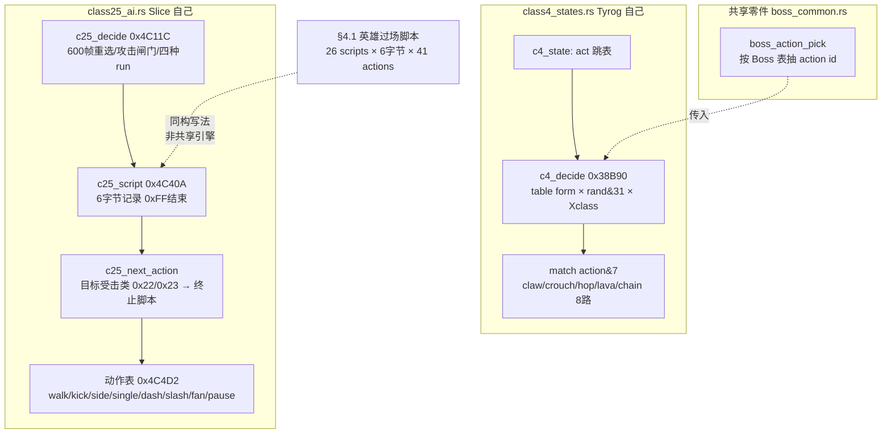

## 18.3 顺带收敛 §10.3 两处第三轮偏差（按 §11 精神，只加勘误不大改正文）

| §10.3 原写法 | 收敛 |
|---|---|
| `0x3E88` 标为表 `Attack_CheckFrameValid`（Ghidra 自起函数名） | repo 里 `0x3E88` 是 **`难度概率比较_对应ASM_3B94_3E88` 例程**（`Cps1EnemySubs.cs:326`，`3B94 调 3E88：D0=(rng&1F)、D1=clamp(byte(A2+A5-5A),0,1F)、cmp.b (A6,D1),D0`），不是表；Ghidra 反编译的钳位字节是该例程的一段，语义以 repo 命名为准 |
| `0x22DB0` 行写「**未确认为主 AI 入口表**…保留待核」 | 改为「**repo 侧已确认**（见 §18.1）；第三轮 Ghidra 读绝对地址得到 4 个 `0x00022dae` 属取证方式偏差（PC 相对 `movea.l 0x22DB0(pc,d0.w),a1` / region 基址），不据此下结论」 |

这两条与 §11.1 的 `A5-0x3E`、§11.2 的 `0x3C6A` 是同一类问题：**脱离 repo 注释、只对着 ROM 字节/反编译自造语义**。按用户定位，一律以 repo 为准。

## 18.4 证据索引（本轮全部只读 repo 源码）

| 结论 | 位置 |
|---|---|
| `0x22DB0` 表项逐字节证据与 FBA 铁证 | `Cps1EnemyAI.cs:32`；`Cps1Actor15Runtime.cs:9`、`Cps1Actor16Runtime.cs:8-9`、`Cps1Actor1CRuntime.cs:20-21`、`Cps1Actor1BRuntime.cs:7-8`、`Cps1Actor1FRuntime.cs:8-9`、`Cps1Actor18Runtime.cs:469` |
| `0x3E88` 是难度概率比较例程 | `Cps1EnemySubs.cs:324-340` |
| `0x7854` / `0x3F0C` 等价实现 | `Cps1EnemyAI.cs:6894-6912`、`:4440-4455` |
| `0x3E82` 三项参数块偏移 | `Cps1Actor1CRuntime.cs:2027-2030`（§11.1） |
| Tyrog 状态跳表 / 决策 / 8 路动作 | `enemy/class4_states.rs:1-2,29-52,198-229` |
| Slice 决策 / 攻击脚本 6 字节 / 动作表 | `enemy/class25_ai.rs:1-37,40-56,296-358` |
| 英雄过场脚本同构参照 | `script.rs:1-20,190-227`（§4.1 / §9.4 / §14） |

## 18.5 阶段性收口

- §10.7 的 data 待核项结清完毕：6 条里 5 条以 repo 为准结清，仅"发行先后"仍开放；**未新增任何 ROM 取证**，符合用户「如果 有必要」「不审 repo」的定位。
- §16 剩余的「5 个 Boss 各自反击/变身只读标题层」补上两个 class 的具体机制，并得到一个额外的设计观察：Boss 攻击脚本与英雄过场脚本是**并行同构**的表驱动解释器写法（不是共享引擎），两者都天然可被打断。
- 本轮再次验证 §11 的方向：看到 Ghidra 自造的函数名 / 单次内存读取就写"repo 未确认"是错的；repo 侧的 `rom_read.py` 证据、FBA 铁证、多处交叉印证才是主资料。
- 仍未做（保留，不扩张）：`0x22DB0` 在不同 region set（wof / wofj / World / Japan）的地址差异本身——按 §11.0 属"审 repo 方向"，不主动追；发行先后未考证。ROM 继续只在"必要时"用于补 data。
- 全程沿用用户给定前提（dino 更晚更成熟），未考证发行先后。

---

# 第十二轮：脚本系统全景对照（把散落的 5 套脚本收拢）

> 承接 §18.2 的发现：dino 的 Boss 攻击脚本与英雄过场脚本同构。但「事件脚本」这个主题在笔记里一直散落在 §4.1 / §4.2 / §9.4 / §12.4 / §14 / §18.2，没有一张全景表。本轮只读 repo 源码，把 **5 套脚本**按「记录格式 / 推进时钟 / 终止条件 / 驱动对象」并列，目的是看清它们各自解决什么、以及为什么推进方式不同。
> 不做 ROM 取证；`MaxRecordsPerFrame=64` 等宿主常量已辨明为防跑飞上限，不当作原机参数。

## 19.1 五套脚本一览

| # | 系统 | repo 位置 / 原地址 | 记录格式 | 推进时钟 | 终止 / 挂起 | 驱动对象 |
|---|---|---|---|---|---|---|
| 1 | **dino 英雄过场脚本** | `script.rs` / `script_step 0x1DB5E`、表 `0x1E6FC`（26 scripts、41 actions） | **6 字节/记录**：`(action, G.$4F0, G.$4FD, G.$506, timer)`；`+$D8` timer | 逐帧 timer 递减，到 0 读下一条；`0xFFFF` = "wait until" 循环（`script.rs:17-19`） | 状态字 `+$04 != 0x0200` 挂起（受击/死亡/respawn）；`G.$4DD` 位门；`0x26` END | **覆写 pad** `+$A0/$A8` → 复用完整玩家状态机（§14） |
| 2 | **dino 生成/波次脚本** | `spawn.rs` / `spawn_script_tick 0xFBF4` | list1 **14 字节** / list2 **16 字节**记录，带 `trig` 字段 | **camera X/Y 坐标触发**（`spawn_trigger_reached 0xFC7E`），无时间轴；`while` 一次推进到触发未达 | `trig` 未达则 `break` 停在下一条；对象池满则丢弃该记录（`spawn.rs:186-222`） | 直接 `spawn_alloc` 填 `class/pos/var` → 生成对象 |
| 3 | **dino Boss 攻击脚本** | `class25_ai.rs` / `c25_script 0x4C40A`、表 `0x4C4AE` / 动作表 `0x4C4D2` | **6 字节/记录、`0xFF` 结束**；`+$BC = script*6` | hitstop 递减 + `e.b.step` 步进（`c25_script` 逐条 `match`） | 目标消失 / 进入受击类 `0x22/0x23` → `set_state(0x0200_0000)` 结束；`0xFF` → 新脚本（§18.2.2） | 直接写 Boss 自己的状态/动作 |
| 4 | **wof 关卡脚本** | `Cps1LevelScript.cs` / `0x106F4`、命令表 `0x10744`、表 `0x1066C` | `trigger:word, type:byte, payload`（`:17`），`type` 决定命令 | **一帧消费几条由 VBlank 截断决定**（`:423-424` 实测 f=2939 CS 消费 0 条 / FBA 消费 6 条）；宿主 `MaxRecordsPerFrame=64` 只是防跑飞上限（`:455`），**非原机参数** | 脚本指针按 `cam >= trig` 推进；命令表分派 | 直接分配对象、填 `+$21/$4/$8/$22/$24/$26`（§4.2 / §9.4） |
| 5 | **wof 事件队列** | `Cps1EventQueueTask.cs` / ROM `0xD000`（调度器 slot15） | 事件项 4 字节：`type:word, arg:word`（`:14-16` 读 `(A4)` / `(2,A4)`） | **协作式任务内核 + trap#4 等待**：队列空 → `0xD006` 继续等，非空取一项分发（`jmp (A0)` 跳表 `0xD038`）；一帧消费几项受 VBlank 截断 | 队列排空 / 帧末；C# 侧按"一次调度处理完所有待处理事件"实现（`:20-21`） | 事件任务体（16 槽 trap#4 协程，§4.2 `Cps1CoroutineScheduler.cs`） |

> 精确边界：#1 与 #3 都是「6 字节记录」，但字段不同（#1 有 timer/参数，#3 是动作字节流 + `0xFF` 结束），是**并行同构的写法**，不是共享同一个解释器（§18.2.2 已定）。#2 与 #4 都有 camera 触发概念，但 #2 是"推进到触发未达即停"，#4 还叠了 VBlank 截断。

## 19.2 按「推进时钟」分组：这是脚本差异的核心

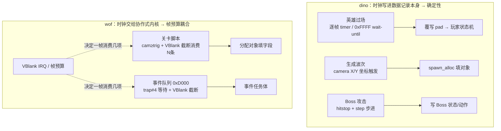

| | dino（3 套） | wof（2 套） |
|---|---|---|
| 推进时机载体 | **记录自带** timer / camera 坐标 / hitstop+step | **任务内核 + VBlank 截断**，"一帧消费几项"是帧内物理量 |
| 与状态机关系 | 都"表 → 解释器 → 作用于既有状态机/对象"；#1 甚至不另建轨道（覆写 pad） | 脚本是**独立轨道**（关卡脚本填对象、事件队列是 slot15 任务） |
| 可打断性 | 都天然可断：#1 状态字挂起、#2 触发未达停、#3 目标受击终止 | 由队列/帧预算控制，不是由被驱动对象的状态字控制 |
| 确定性来源 | 记录里显式写了"什么时候走下一步" | 依赖协作式内核本帧被调度到几轮（§4.2 实测 f=14 消费 2 项、CS 帧末排空消费 3 项 ⇒ 多 1 项） |

## 19.3 与笔记主线、用户关切的连接

- **呼应 §14.5 主线**：dino 把「这一帧做什么、下一帧读什么」做成显式结构——脚本层也一样：三种不同的"下一帧触发条件"都被写进数据记录（timer / trig / step），而不是留给调度器自由裁量。wof 则原样保留协作式内核的帧预算自由度。
- **直接回应用户前十几轮最关心的「随时被硬件中断、无法确定函数执行次数」**：dino 的脚本把推进条件数据化后，一次命中/一次触发消费几条是**记录结构决定的**；wof 的事件队列与关卡脚本消费条数是 **VBlank 截断 + 任务调度决定的**，`Cps1EventQueueTask.cs` 实测「CS 帧末排空消费 3 项 ⇒ 多 1 项」正是这类不确定性的具体代价。这与 §12.4 / §14.5 的结论一致，但本轮给出了**脚本层**的证据。
- **不夸大**：不是说 wof 的脚本"设计更差"，而是两种驱动哲学——wof 更贴近原机协作式内核、dino 更贴近"可重写的确定性语义模型"（同附录 A 末句的关联判断）。

## 19.4 证据索引（本轮全部只读 repo 源码）

| 结论 | 位置 |
|---|---|
| 英雄过场 6 字节记录 / 26 scripts / 41 actions / timer 0xFFFF / 挂起条件 | `script.rs:5-19,41-74,190-227` |
| 生成波次 list1 14B / list2 16B / camera 触发 / 池满丢弃 | `spawn.rs:168-230` |
| Boss 攻击 6B 记录 / 0xFF 结束 / 目标受击类终止 | `class25_ai.rs:296-358`（§18.2.2） |
| wof 关卡脚本记录格式 / 命令表 / 帧消费实测 / 宿主上限 | `Cps1LevelScript.cs:17,20,38-40,264,423-424,455`；`0x106F4` 反汇编见 §9.4 |
| wof 事件队列 0xD000 / trap#4 / 跳表 0xD038 / 4 字节事件项 / 一次调度语义 | `Cps1EventQueueTask.cs:5-31` |
| wof 一帧消费几项不确定（f=14 消费 2 项 vs CS 3 项） | §4.2 / `Cps1EventQueueTask.cs` 任务体注释 |

## 19.5 阶段性收口

- 用户四大主题里「事件脚本」的全景视图补齐：5 套脚本并列，核心差异落在**推进时钟写在哪里**（数据记录 vs 协作式内核），与 §14.5 主线、用户"执行次数不确定"的关切直接对上。
- 辨明一处易错点：`MaxRecordsPerFrame=64` 是宿主防跑飞上限，不是原机参数；原机 wof 脚本推进受 VBlank 截断。
- 仍未做（保留，不扩张）：仅"发行先后"未考证；`0x22DB0` region set 地址差异按 §11.0 不主动追。ROM 继续只在"必要时"用于补 data。
- 全程沿用用户给定前提（dino 更晚更成熟），未考证发行先后。

**〔后一格补层：过场里没有一根自己的秒针（把「计时权分散」推到演出期）〕**

§19.2 按「推进时钟写在哪里」把五套脚本分了组，那是组织结构。这里换一个从没问过的问题：**过场这根秒针能不能替全场定拍子？** 前面几格在战斗期与收尾期立住「好几层各数各的、没有一根总秒针」，演出期还没验过，而它恰恰最像有一根统一拍子的地方。

- **秒针是每个英雄各一份，而且数的是「条件成不成立」，不是「过了几秒」**：`dino-rs/crates/dino-game/src/game/script.rs:218-244` 的 `script_step(i)` 逐个英雄跑，`players[i].sc.timer`（`:52`）挂在各自对象上；`:17-19` 写明 `+$D8` 数的是**游戏帧**、`0xFFFF` 是「条件没成立就写回 0xFFFF、下帧再问一次」的 wait-until。落地形态见 `script_wait_flag`（`:364-367` 等标志位）、`script_wait_ground_*`（`:408-418` 等人落地）、`script_wait_items`（`:438` 等地上道具）——全是「成立就写 1，不成立继续问」。`notes/06-method.md:2653` 已登记「演出与玩法共用一套任务轮、快进是多跑几轮、玩家也跟着多走几帧」；这里补的是：**过场连自己的时钟都没有，借的是玩法那一轮的帧**，而且几个英雄各数各的。
- **挂起也不是中央下令**：`script.rs:219-227` 每帧读这个英雄自己的状态字 `+$04 == 0x0200` 和 `G.$4DD` 位，受击 / 死亡 / 复活就挂起，但游戏帧照走；`notes/01-early.md:396` 已记「延迟一帧」。谁演到哪一格由谁自己的身体状态说了算。
- **「这一镜多长」在这里有了 [O] 源码落点，也顺带修掉上一格一句读反**：`script.rs:422-433` 的 `script_floor_items` 数的是 pool E 里**还躺着**的武器 / 食物 / 箱子 / 宝藏（`mode 0..2`、`sub 0 或 0xC`，没被捡起或打碎）；`:435-448` 的 `script_wait_items`（动作 `0x2A` / `0x38`，正是 `plan/game/mechanics-seen.md:291` T10 那两条 item waits）**只在第一帧看一眼**（`step != 0` 就 return），有东西按记录里的 120 / 180 / 240 帧等、没有就缩到 90 / 160 帧，之后不再重测，注释明写「at most the record's time」、摇杆照样通过（"The pad passes through"）。⇒ 上一格 `notes/04-state.md` 卷末补层那句「**捡完这一镜才收**」已就地收窄：捡东西**不会**让这一镜提前收，开镜那一眼定好的长度照走完；T07 的 96 / 440 帧同样是「开镜时按地上有没有东西分档」，不是实时追着玩家的手。

**倒推（[I]，说人话）**：所以「计时权分散」在演出期也成立，而且更彻底——过场连一根自己的秒针都没有，几个英雄各数各的、数的是条件、借的是玩法那一轮的帧，没有任何一处能替全场喊「这一场演完了」。更准的一层是：编舞**开镜前看一眼布景**定好这一镜的长度，开拍后连玩家有没有把东西捡走都不读；功夫武打导演不会因为你提前挪开一张凳子就喊卡。这把「Beat 的拍子不住在玩家输入里」再推进一层：**也不住在玩家的成果里**，玩家在这一镜里完全自由，却改不了这一镜的长度；「被计价，不是被禁止」又多一层——连「把场上收拾干净了」都不换来决定权。

**边界**：主判断没被推翻（这一镜多长按地上遗留物分档、GO 是按遗留物伸缩的便条、玩家站着不动只是被计价都成立），收窄的只是「捡完才收」这句因果方向。`script.rs:219-244` 的挂起、`§19.2` 的推进时钟两侧对照、`:396` 的延迟一帧都是既有登记，这里只拿来接这条判断、不重讲；`0xFFFF` / 120 / 180 / 240 / 90 / 160 / 96 / 440 都是**量**，按 §94.3 那一刀不转成域、不进 `semantics.json`。`[M]` 是仓库里已有的 MAME 观察记录、不是新做的取证（**0 次 ROM 取证**）；这批全是 dino 侧，wof 侧按 §11.0 只登记 §19.2 已收窄过的并列事实，不串成共同架构、不评优劣、不推断原机缺什么。不新增节号、不改总入口、不改 `GAMEPLAY_LEGACY.md` 九节、不碰缓存 / 脚本 / wt1 / 产物层。

---

# 第十三轮：顶层流程任务机（补「状态机设计」最上层，直答用户最初的问题）

> 用户第 13 轮问过：「我做 wof 的最大困难是随时被硬件中断无法确定有些函数的执行次数和完整度，dino 怎么解决的」。前面 §2 / §14.5 / §19.3 从各子系统侧面回答过，但**最上层** `flow/` 任务机一直没展开。本轮只读 repo 源码（`flow.rs`、`flow/scene.rs`），把 dino 怎么把原机协作式内核**显式建模**讲清楚。
> 不做 ROM 取证；原地址、原任务槽位均来自 repo 头注释。

## 20.1 原机是 5 个协作式任务，按 slot 顺序每帧一轮

`flow.rs:1-9` 头注释直接给出原机结构：

```
slot 0x00  system task        0x9D048   （投币 / credit / start / SERVICE）
slot 0x10  attract 0x97C20  或 join/continue 0x6C4A（游戏中）
slot 0x20  game task         0xA870    （mode 字节 G.$4D0）
slot 0x30  stage intro 0xB9BE 或 stage clear 0xB97E
slot 0x40  fade task          （palette.rs）
```

`flow_frame`（`:316-346`）就是这个内核的复刻：

```
flow_frame():
    flow_coin_isr()                      # 0x9D4BE：中断在任务之前先读投币输入
    lag_tick = false ; join_next = false
    attract_join / start_tick 记账        # 把"哪些 tick 属于同一条 game clock record"算清
    flow_round_start()                   # IntroAfter::SlideOutEnd 这种"跨 vblank 的两条指令"先补跑
    if lag > 0:                          # ★ 一个游戏帧占掉 >1 个 video frame
        lag_tick = true
        lag -= 1
        flow_attract_clear_step()        # 那个占住 CPU 的 clear 0xAE0 在本帧继续
        return                           # ★ 本 video frame 一个任务都不跑，只有中断
    flow_tasks()                         # 正常帧：一轮任务
    prev_input = 本帧输入 ; ticks += 1   # vblank 把本帧输入存成"上帧输入"

flow_tasks():                            # :360-373，内核扫描 0x844，每个 ready 任务跑一次
    flow_system_task()                   # slot 0
    if in_game:
        flow_join_task() ; select_join_task()   # slot 0x10
        flow_game_task()                 # slot 0x20
    else:
        flow_attract_task()              # slot 0x10 / 0x20
    flow_intro_task() ; flow_tally_task()  # slot 0x30
```

**关键**：`flow_frame` 里 `if lag > 0: ... return` 这一句，就是 dino 对「游戏帧跨过 vblank、本 video frame 没有任务运行」的**显式建模**——它不是去模拟 68K 的 PC/USP/栈，而是把结果（哪些 video frame 没有任务、哪些 tick 合成一条 record）记成 `lag` / `lag_tick` / `join_next` / `game_clock` 几个字段（`:189-210` 逐字段注释，含 ep8 录像的 lag 2/3 实证）。这与附录 A.5「dino 不模拟 lag、只显式豁免」一致，且本轮给出了**代码级**依据。

## 20.2 `Scene`：每个任务是一个带 sleep 计数器的状态机

`flow/scene.rs:1-9` 说明原机场景是「直线代码 + 调 `sleep 0x95A`（或 0xA76=1 / 0xA7A=2 / 0xA7E=30 / 0xA82=60 / 0xA86=120 / 0xA8C=180 帧）」，dino 把它写成：

```
struct Scene {
    state: u16,        # 脚本位置（原机一个 RAM 字节/字，如 attract 的 G.-$7030）
    sub: u16,          # 嵌套步骤（如 G.$4D1 配 mode G.$4D0）
    count: u16,        # 帧循环计数器
    sleep: u16,        # 内核 sleep 计数器，0 = ready
    suspended: bool,   # sleep(0) → 内核 state 2，挂起直到 wake
    live: bool,
}

tick() -> bool:                          # 每帧在"原机跑该任务的 slot 位置"调一次
    if !live or suspended: return false
    if sleep > 0: sleep -= 1 ; if sleep > 0: return false
    return true                          # 本帧该任务要跑

sleep(n):  n = frames & 0xFF            # 只算低字节（同内核）
           n == 0 ? suspended = true : sleep = n
wait(n, next): sleep(n) ; state = next  # ★ "睡 n 帧，醒来从 next 继续"
wake(counter): suspended = false ; sleep = counter
kill(): live = false
```

一个场景脚本长这样（`scene.rs:11-20` 原文的伪代码）：

```
fn flow_my_scene():
    if !scene.tick(): return              # 睡着/结束 → 本帧什么都不做
    match scene.state:
        0 => 画第一张图 ; scene.wait(30, 2)   # 睡 30 帧，醒来进 state 2
        2 => 清屏     ; scene.wait(60, 4)
        _ => scene.kill()
```

**要点**：跨帧续算不靠"保存 PC 和栈"，而靠 `state` 字节 + `wait(n, next)` 把「醒来回到哪一行」**写进数据**。这正是 §6.1 第 7 条 `IntroAfter` 枚举（`flow.rs:78-95`：Loop / State0 / Title / Wait60 / Redraw / SlideOutEnd，每个值对应一条原机 sleep 之后的代码地址）的由来，也和 §16.3 `BossRecover` 6 续算点、§19 脚本的 timer/trig 是**同一个设计习惯**。

## 20.3 三类「时序不确定」在 dino 里分别怎么落地

| 原机现象 | dino 的显式建模 | repo 位置 |
|---|---|---|
| 任务每帧按 slot 顺序各跑一次 | `flow_tasks()` 固定顺序调用；`Scene::tick()` 一处判 ready | `flow.rs:360-373`、`scene.rs:66-77` |
| 任务内部 `sleep(n)` 跨帧续算 | `Scene{state, sub, count, sleep}` + `wait(n,next)`；`IntroAfter` 枚举显式列出 6 个续算点 | `scene.rs:31-46,82-95`、`flow.rs:78-95` |
| 一个游戏帧占掉 >1 个 video frame（lag / 过 vblank） | `lag` 计数器 + `lag_tick` / `join_next` / `game_clock` 记账；`lag>0` 的帧**不跑任务只跑中断** | `flow.rs:189-210,316-346`；`flow_round_start` `:348-358` 补跑 `SlideOutEnd` 那两条指令 |
| vblank 存"上帧输入" | `flow_frame` 末尾 `prev_input = 本帧输入`，并注释 `0x738` 的 G.$16..18→G.$1B..1D 拷贝 | `flow.rs:340-345` |
| 投币中断在任务之前 | `flow_coin_isr()` 放在 `flow_frame` 第一句 | `flow.rs:317` |

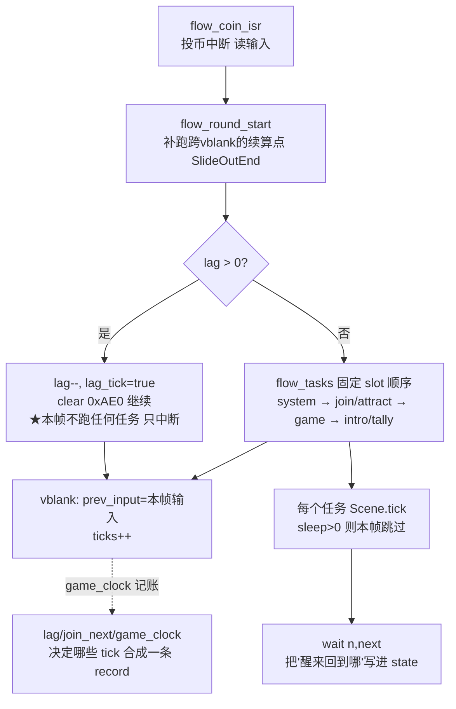

## 20.4 与 wof 的对照：同一个内核，两种建模取向

| | dino `flow/` | wof `Cps1CoroutineScheduler` |
|---|---|---|
| 任务表示 | `Scene` 六字段（state/sub/count/sleep/suspended/live）+ `wait(n,next)` | `TaskContext{Slot, TableAddress, Status, FunctionAddr, IEnumerator<int>, IsFinished}`，C# `IEnumerator` 模拟 `trap #4` |
| 跨帧续算 | **续算点写进 `state` 字节**（`IntroAfter` 枚举显式列出） | **保留 `IEnumerator` 的 PC/栈语义**（`yield` 位置即续算点） |
| lag / 过 vblank | `lag` 计数器 + 不跑任务的帧 + `game_clock` 记账 | 事件队列「一帧消费几项取决于本帧扫了几轮 0x0700（VBlank 截断）」（§4.2） |
| 中断与输入 | `flow_coin_isr` 固定第一句；`prev_input` 显式在帧末存 | 硬件中断插入点、函数执行次数本身要逐点求解（用户最初的困难） |

**收敛表述**：两边底层是同构的协作式内核（§0 已列为公共底座，不能当差异）。差别在**建模取向**——dino 把「这个任务睡几帧、醒来回哪、哪几帧没跑任务、输入是哪帧的」全部变成**可枚举的状态字段与固定顺序**，于是逐帧对拍可行；wof 用 `IEnumerator` 更贴近原机 PC/栈，但把"一帧跑几轮 / 消费几项"留给了 VBlank 与宿主调度，这正是用户说的"无法确定有些函数的执行次数和完整度"。

这也为 §14.5 主线补上最上层证据：**dino 的"固定顺序 + 状态字节 + 上一帧快照"不是某个子系统的局部技巧，而是从顶层任务机一路贯到碰撞 pass 的整体组织方式**。

## 20.5 证据索引（本轮全部只读 repo 源码）

| 结论 | 位置 |
|---|---|
| 5 个原机任务与 slot 顺序、各自入口地址 | `flow.rs:1-9` |
| `flow_frame` 全过程（coin ISR / lag 分支 / flow_tasks / vblank 输入） | `flow.rs:316-346` |
| `flow_round_start` 补跑跨 vblank 续算点 | `flow.rs:348-358` |
| `flow_tasks` 固定 slot 顺序 | `flow.rs:360-373` |
| `IntroAfter` 6 续算点与原地址 | `flow.rs:78-95` |
| lag / game_clock / lag_tick / join_next / skip_tick 逐字段语义 | `flow.rs:189-210` |
| `Scene` 六字段 | `flow/scene.rs:31-46` |
| `tick` / `sleep` / `wait` / `wake` / `kill` | `flow/scene.rs:64-108` |
| 场景脚本伪代码与 sleep 时序（sleep(n) 在 F 帧 → F+n 帧醒来） | `flow/scene.rs:1-25` |
| wof 16 槽 `IEnumerator` 协程 | §4.2 / `Cps1CoroutineScheduler.cs:18-25` |

## 20.6 阶段性收口

- 「状态机设计」主题的最上层补齐：顶层流程任务机（5 任务 / slot 顺序 / `Scene` sleep 模型 / lag 记账），并直答用户最初的「中断与函数执行次数」问题——dino 不是消灭了不确定性，而是把它变成可枚举字段与固定顺序。
- §14.5 主线至此从顶层任务机（§20）贯到输入层（§14）、脚本层（§19）、打击（§12）、目标选择（§13）、附加玩法（§15）、Boss（§16）、伤害（§17）：**整份笔记的主线闭合**。
- 仍未做（保留，不扩张）：仅"发行先后"未考证；`0x22DB0` region set 地址差异按 §11.0 不主动追。ROM 继续只在"必要时"用于补 data。
- 全程沿用用户给定前提（dino 更晚更成熟），未考证发行先后。

---

# 第十四轮：道具 / 武器状态机 —— 一个物件从地上到手里的生命周期

> 视角：只谈**游戏逻辑本意**（用户 11-06「rs 和 cs 表面的编程和硬件差异不重要，那不是游戏本意」）。本轮把 §2 的分层状态机放到「非角色对象」上验证，并再验一次 §14.5 / §20.6 的主线。
> 边界：以两份 repo 源码为准，**不新增 ROM 取证**（§11.0）。wof 的 `Cps1Item.cs` 函数名自标 `_无对应ASM`、正文自标 `(简化)` / `简单的距离检查`，与逐指令直译的 `Cps1PlayerLogic.cs` / `Cps1Collision.cs` 是**同一 repo 内不同模块的对齐进度**，不是「wof 没有这个设计」——本轮据此描述组织方式，不做设计优劣判断。
> 取证：`dino-rs/.../game/item.rs`、`game/item/weapon.rs`、`game/player_weapon.rs`；`wt1/wof_cs/src/Cps1Item.cs`、`Cps1Collision.cs:1945-1955`、`Cps1PlayerLogic.cs:1-13, 339-375`。

## 21.1 一句话结论：两种「道具」的组织哲学

| | dino | wof |
|---|---|---|
| 道具是什么 | **空间里持续存在的对象**，有位置、碰撞盒、被举起 / 手持 / 掉落 / 飞行的完整生命周期 | **一次性效果触发器**（拾取 → 改写玩家字段 → 消失）；另有**独立武器对象**只参与攻击几何 |
| 状态放在哪 | 复用角色那套四层对象头 `mode/sub/act/step` + `kind`，与敌人 / 角色同一个对象池 | 消耗品用 MiscObj 槽的 `Type=0x04` + `ActStatA` 存类型；武器用 `player+0x8C` 引用的对象；主状态机用 `ActStateABCD` |
| 拾取语义 | 双向状态迁移：玩家进入举起态、物品进入举起态，之后才变手持 | 单步：应用效果表 + 清槽 |
| 谁驱动行为 | 物品自己（玩家只留状态机与几个通信字段） | 拾取由 `CheckItemPickup` 扫描，攻击几何由碰撞系统取武器对象 |

## 21.2 dino：一个池、12 个 class、一套状态字节

`item.rs:1-21`：pool E 有 24 个 `0xC0` 字节槽，每帧 `pool_e_update`（0x233C6，在玩家之后、pool A 之前）按 slot 顺序跑每个 live 槽，按 `+$20` 的 class word 查表 0x233F0 分派到 12 个 handler。

| class | 对象 | class | 对象 | class | 对象 |
|---|---|---|---|---|---|
| 0 | weapon（15 种） | 4 | food | 8 | ballistic projectile |
| 1 | explosion | 5 | container | 9 | treasure |
| 2 | ammo box | 6 | overlay of held weapon | 10 | gun projectile |
| 3 | bullet of held gun | 7 | shell / spark | 11 | invisible attack box |

**关键设计**：武器、食物、弹药、容器、爆炸、弹丸、财宝、甚至"不可见攻击盒"**全部是同一个池里的正式对象**，共用同一套对象头与三张注册列表，不是各写一套子系统。这与 §2「对象头 `mode/sub/act/step` 四层状态字节」是同一套模型，只是 `sub` 在物品上取 4 的倍数（`item.rs:24-30`）：

```
mode (+$04): 0 init | 2 alive | 4 break(容器)/free(其它) | 6 free next frame
sub  (+$05): 0 躺地 | 4 被举起 | 8 手持 | 0xC 掉落(下落并着地) | 0x10+ 抛出/飞行(按 class 与 type)
act  (+$06): 2 = "spawned airborne"(掉落物从来源蹦出来)
kind (+$A0): 0x00tt 食物 | 0x0100 弹药箱 | 0x02kk 武器/容器 | 0x03tt 财宝
```

伪代码（`item.rs:154-182`）：

```
pool_e_update():
    for slot in 0..24 (slot 顺序):
        if slot.live == 0: continue
        it = take(slot)                       # 取出，避免借用冲突
        switch it.class:                     # +$20 / 4，表 0x233F0
            0 -> item_weapon    1 -> item_blast   2 -> item_ammo  3 -> item_bullet
            4 -> item_food     5 -> item_container ... 11 -> item_attack_box
            _ -> item_unported               # 表外 class 原机会跳进 data
        put_back(slot, it)
```

生命周期（`item.rs:24-30` + `item/weapon.rs:18-21`）：

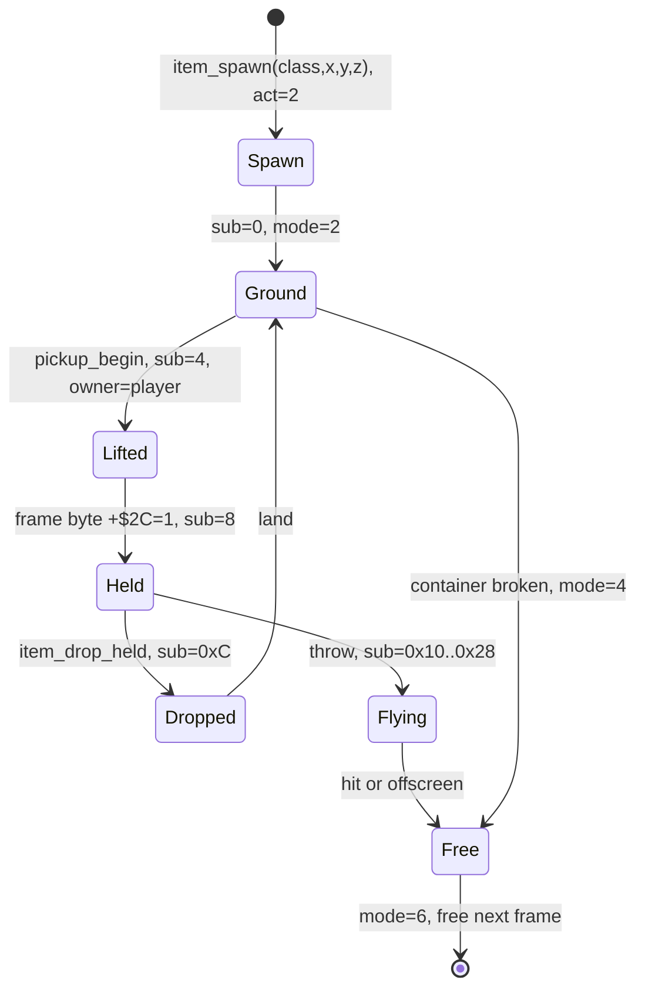

> `item_free`（`item.rs:205-210`）只清 `+$00..+$27`，`+$28` 以上保留旧值——"下一个用这个槽的对象可能读到它"。这是原机对象池复用的真实行为，也说明**状态字节是协议、残留值也是状态的一部分**（呼应 §14.5）。

## 21.3 dino：拾取是双向状态迁移，不是一次性消费

链条（`item.rs:38-53`、`player_weapon.rs:148-208`）：

```
# 1) 找候选（0x5AA2），只读"上一帧"注册的列表
find_pickup():
    for it in item_list($69EE):              # 见 §21.7 的一帧延迟
        if it.live==1 and it.mode==2 and it.sub==0
           and 玩家(X,Z) 落在 it 第一个 hitbox 内 and |dY|<=8:
            cand = it
    player.cand / cand_type = ...

# 2) 进入举起态：玩家与物品同帧各改自己的状态
pickup_entry():
    player.set_state(0x0200_0014)            # 举起态
    player.pickup_cd = 40                    # 40 帧内不再捡武器
    if 已有手持物: item_drop_held(old)        # 旧物 sub=0xC
    item_pickup_begin(cand, player):
        item.who/id = player.who/id
        item.sub = 4 ; item.act = 0 ; item.step = 0
        item.+$70 = player                   # 双向引用

# 3) 物品被持有后，每帧读玩家、自己决定行为
item_weapon():
    read player.+$C4 / +$2C / +$C5 / +$B4 / +$B6 / +$A8 / facing
    if 攻击帧: 发射 / 挥击 / 消耗弹药; 清 player.+$C4
    if 空枪: 把 player.+$B6 改成 0x203(棍) 或 0x201(投掷物)
    if 扔出/损坏: player.+$B6 = 0
```

职责切分是 repo 写明的（`player_weapon.rs:6`）：

> "The player keeps the state machine, the item runs the weapon."

玩家侧只保留状态机 + 一组"两侧在同一帧内写 / 读"的字段（`player_weapon.rs:8-18`）：

| 字段 | 谁写 | 谁读 | 语义 |
|---|---|---|---|
| `+$B4/+$B6` item / item_type | 双向 | 双向 | 手持物与其 kind；空枪时**物品自己**改 `+$B6` |
| `+$C4` weapon_atk | 玩家武器态 | 物品 | "本帧在用武器攻击"，发射后由物品清 0 |
| `+$C5` drop | 玩家 | 物品 | 丢弃请求，物品抄进自己 `+$AE` |
| `+$2C` frame byte | 玩家 | 物品 | 挥击 / 投掷帧 1 或 2，物品读完清 0 |
| `+$F8` pickup_cd | 玩家 | 玩家 | 拾取后 40 帧冷却 |
| `+$EA` aim | 玩家 | 物品 | 最近敌人，子弹目标 |
| `+$10F` | 物品 | 玩家 | 弹药箱没找到枪，等下一把 |

`objects_update` 里**玩家先跑、pool E 后跑**（`mod.rs`），所以这组字段是"这一帧写、同一帧被下游读"的帧内协议：

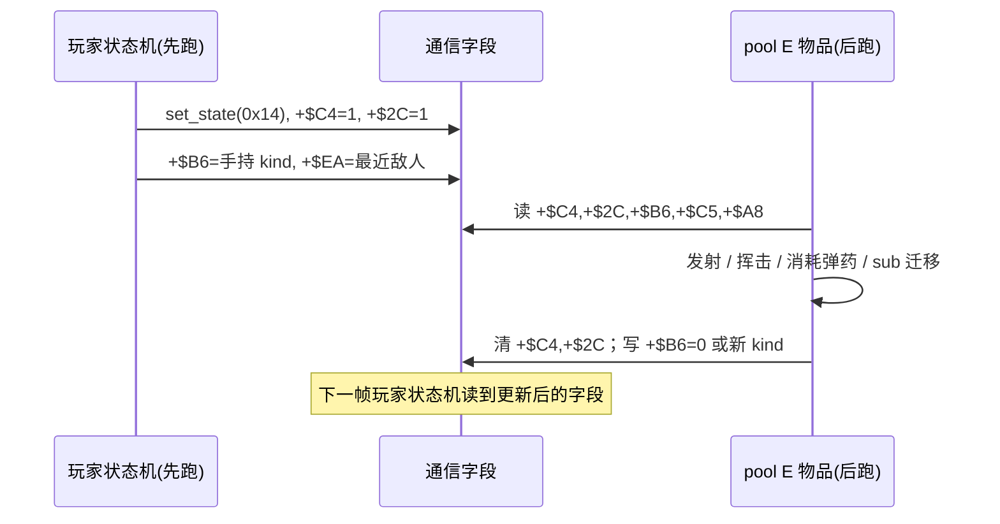

## 21.4 dino：武器是"活的对象"，不是装备栏里一个数

`item/weapon.rs:1-26`：class 0 有 15 种武器，`+$26 = type*2`，各带 `kind / 弹药 / 使用次数` 三元组（`KINDS`，`item/weapon.rs:36-52`）。

| kind | 类别 | 例子 |
|---|---|---|
| 0x201 | 只可投掷 | 炸药、手雷、三种石头 |
| 0x202 / 0x203 | 近战挥击 | 刀、棍、棍棒、屠刀、火把 |
| 0x204..0x209 | 枪械（弹药在 `+$6C`） | 手枪、Uzi、M-16、霰弹、火箭筒、步枪 |

**空枪降级**是物品自己的状态迁移（`item/weapon.rs:15-16`）：`0x204..0x209` 打空 → 变成近战 `0x203` 或投掷物 `0x201`，而不是从玩家身上"消失一个装备"。玩家侧因此有一组专门的武器攻击态（`player_weapon.rs`）：

```
0x14 举起(0x19832)  -> 0x16 挥击/投掷(0x198DC) -> idle
0x1C 站射(0x19AB0)  -> 0x1E 走射(0x19B60)   # 枪 0x206/0x207，腿层单独 step 0x1542
0x20 蓄力(0x19C36)                            # 重武器 0x203
0x22 后坐(0x19CE0)                            # 火箭筒 0x209
```

> 分体动画（`player_weapon.rs:20-26`）：持械走 / 跑 / 射击时上半身与腿是**两层独立动画**，上层用武器 pose 表，下层用 0x1506 启动 / 0x1542 步进的 leg layer——又一处"把一个状态拆成可独立推进的层"，与 §2 四层状态字节、§20 `Scene` 的 `state/sub/count` 同构。

还有"够不够得着"的判断也由物品侧负责：`item_enemy_near`（`item.rs:292-313`，0x6248）读**上一帧**的敌人列表 `$69BA`，按角色专属的 reach 表（0x62AE，每角色 5 个 word）判断挥棒范围内有没有敌人——挥击姿势与命中范围不是玩家状态机拍脑袋定的，是物品查表给的。

## 21.5 wof：道具分三条线，不是"没有武器对象"

这一节先纠一个容易下的错判：**只读 `Cps1Item.cs` 会以为 wof 的武器只是玩家的一个数**。repo 自己把道具分在三条线里：

**线 A — 拾取 / 消耗品（`Cps1Item.cs`）**：`SpawnItem` 在 MiscObj 基址 `0x2F1C` 的 20 个 `0xC0` 槽里找空槽，写 `Exist/DispFlag/Type=0x04`，用 `ActStatA` 存道具类型（`:75-93`）。`CheckItemPickup` 当帧扫全部槽做距离检查（`:153-173`），`PickupItem` = `应用道具效果` + 清槽（`:99-109`）。效果是查表改写玩家字段：回血 `Hp`、`Weapon`、`Invincible=120`、`AtkPow`（`:114-148`）。这份文件的函数名带 `_无对应ASM`、正文带"(简化)" / "简单的距离检查"，是**自标的行为近似模块**。

**线 B — 武器攻击几何（`Cps1Collision.cs:1945-1955`，逐指令直译）**：`0x91FA` 是 `0x91D0[8]` 的入口，取**武器对象**的 hitbox：

```
91FC  movea.w (0x8C,A0),A4        ; A4 = 玩家 +0x8C 指向的"武器对象"
9200  adda.w (0x70,A4),A3        ; A3 += 武器 +0x70 (武器自己的 hitbox 表)
9204  move.w (0x7a,A4),(0x7a,A0) ; 玩家 +0x7A(AtkType) = 武器 +0x7A
920A..921A  按武器朝向翻转 D1/D3/D2/D4
921C..9228  加武器 PosX/PosY/PosZ
```

即：**wof 原机同样有独立武器对象**，且武器对象自带 hitbox 与坐标；攻击参数另查 `PLAYER_ATTACK_PARAMETER_TABLE = 0x6DB44` / `STACK4_ATTACK_PARAMETER_TABLE = 0x6DB4A`（`Cps1Collision.cs:22-28`）。

**线 C — 主状态机（`Cps1PlayerLogic.cs`）**：文件头自标「玩家状态机 (68K ASM 精确翻译)」（`:13`），用 `ActStateABCD` 四字节状态、按 `ObjId` 分派主状态机（`:339-375`，`0x1AB30` 的 9 项 long 表 `:564-566`），含骑马入口 `0x1EC1A` 等。

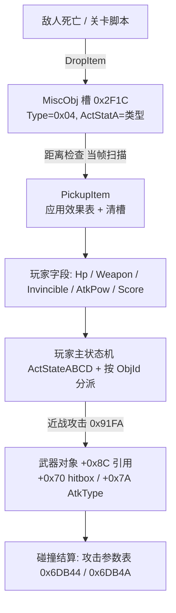

> 因此本节的正确对照不是"dino 有武器对象、wof 没有"，而是：**dino 把拾取物、武器、弹丸、攻击盒统一成一个对象池的一套生命周期；wof 把拾取消耗（线 A）、武器攻击几何（线 B）、角色状态机（线 C）拆成三套对象 / 模块，各管一段**。`Cps1Item.cs` 的 `_无对应ASM` 是该模块的对齐状态，不是整体设计的证据。

## 21.6 逐项对照

| 维度 | dino | wof | 设计含义（本意） |
|---|---|---|---|
| 对象模型 | pool E 12 class 统一分派，共用四层状态字节 | MiscObj / 武器对象 / 特效 / 事件多套对象类 | dino 把"物件"抽象成一类；wof 按用途分对象类 |
| 拾取 | 双向状态迁移（玩家 0x14 + 物品 sub 4→8） | 一次性消费（效果 + 清槽） | dino 拾取是**过程**，wof 拾取是**事件** |
| 拾取后 | 物品继续存在于空间，可投掷 / 掉落 / 损耗 | 物品消失，效果留在玩家字段 | dino 有"持有中"这段时间维度 |
| 武器 | 15 种，带弹药 / 耐久 / 空枪降级，物品自己驱动 | `Weapon` 字段 + 武器对象 hitbox + 攻击参数表 | 两边都有独立武器对象，但 dino 让它跑自己的状态机 |
| 攻击几何 | 物品侧 `item_enemy_near` 查 reach 表、注册攻击盒 | `0x91FA` 取武器对象 `+0x70`，参数查 `0x6DB44` | 都是"武器提供几何"，路径不同 |
| 通信方式 | 一组帧内双向读写字段（`+$B4..+$F8`） | `+0x8C` 引用 + `ActStatABCD` | dino 用字段协议，wof 用对象引用 |
| 列表时机 | 注册列表一帧延迟（§21.7） | `CheckItemPickup` 当帧扫槽 | 见下 |
| 分数 / 特效 | 食物由物品自己在拾取首帧 heal + score + HUD（`item.rs:54-55`） | 得分处自标"待接入 0xD34"（`Cps1Item.cs:127`） | 模块对齐进度差异，不作设计判断 |

## 21.7 与主线闭环：又一处「这一帧写、下一帧读」

`item.rs:33-37` 明确：

> "The list is cleared in `objects_update` **after the players ran**, so `find_pickup` sees the list of the **previous frame's** pool E update, as in the original."

且 `item_enemy_near` 读的是"上一帧的敌人列表 `$69BA`"（`item.rs:292-299`）。三张注册列表本身也是这个模式：

```
$69EE 可捡列表   <- item_register_pickup (物品自己注册) -> find_pickup 消费
$6AFC 可被打列表 <- item_register_hurtable            -> collision pass 0x11F86/0x1201C/0x120D2 消费
$671A 攻击者列表 <- item_register_attacker            -> 帧类 +$2E==4 的 pass 消费
```

这与笔记主线逐一对上：

| 主线出处 | 「这一帧写、下一帧读」的形态 |
|---|---|
| §13 怪物策略 | `census -> pick_target -> retarget_slot -> steer_slot` 的一帧延迟 |
| §14 输入层 | `prev = held` 快照，脚本 / input_lock 按序覆写 |
| §20 顶层任务机 | `Scene` 的 `sleep` 把"醒来回到哪一行"写进 `state`；`lag / game_clock` 跨 vblank 记账 |
| §21（本轮） | `item_list $69EE` / `$69BA` 上一帧列表；候选判据 `live==1 && mode==2 && sub==0` 是**状态字节即协议** |

结论：§14.5 / §20.6 的主线（"把这一帧做什么、下一帧读什么做成显式结构"）**在非角色对象上再次成立**，且代价很低——复用同一套四层状态字节与对象池即可。这也解释了为什么 dino 能把 12 类物件塞进一个 `pool_e_update`：状态字节统一了，分派表就够了。

## 21.8 本轮边界与待办回执

- **未做（保留，不扩张）**：`item/` 下 `container.rs` / `blast.rs` / `small.rs` / `hits.rs` 逐类状态展开；wof 各 `*ObjRuntime.cs` 里道具 / 特效对象的全量普查；两游戏"武器耐久 / 使用次数"是否原机都有（不臆断）。
- **未新增 ROM 取证**，全部以两份 repo 源码为准（§11.0）。
- **未考证发行先后**，全程沿用用户给定前提（dino 更晚更成熟）。
- 本轮只补 §2 分层状态机在「非角色对象」上的落地，不改 §0–§20 任何结论。

---

# 第十五轮：受击反应 —— 命中帧写下什么、谁来解释它

> 视角：只谈**游戏逻辑本意**（用户 11-06「rs 和 cs 表面的编程和硬件差异不重要，那不是游戏本意」）。本轮补上 §12「打击结算时序」与 §17「伤害多因子」之间的那一层：**命中之后，反应由谁、按什么表解释**。
> 边界：repo 侧为主，**不新增 ROM 取证**（§11.0）。§12.6 / §18.1 曾标「wof 9 项受击反应处理体未逐条解析清楚」——本轮补读确认 `Cps1Collision.cs:4882-...` 在 repo 侧**已有按 ROM 直译的 9 项分派**（含表字节、FBA trace 实证、逐分支注释）；当时说的「未做」是**未做额外的 ROM 逐指令对照**，不是 repo 缺实现。按用户「不过度怀疑 rep 侧」定位，本轮只作补读确认，不改 §0–§21 任何结论。
> 取证：`dino-rs/.../game/enemy_combat.rs:1-22, 40-89, 120-205`、`game/combat.rs`；`wt1/wof_cs/src/Cps1Collision.cs:4882-5010, 4861-4880`、`Cps1HitReaction124CA.cs:1-35, 52-70`。

## 22.1 共同的设计本意：命中帧只写一个编号

两边在这一点上是**同一个设计**：命中发生的一帧，攻击方不直接"播放受击动画"，而是往受击对象身上写一组字段（反应编号、硬直、击退、伤害结果）；**受击对象在自己的状态机里、按表去解释这个编号**。这既是 §12「命中帧只结算、不处决」的落点，也是 §21.7「状态字节即协议」的又一处实例。

差别只在"编号放在哪个字段、由哪张表解释"：

| | dino | wof |
|---|---|---|
| 反应编号写进 | 对象头的 `act` 状态字节（`p.b.act = reaction`），同时留一份 `reaction` | 独立字段 `DmgReaction`（`+0x99`），与 `ActStatABCD` 分开 |
| 解释者 | 受击者自己的状态机（下一帧按 `act` 跑） | 两层分派：通用 9 项跳表 + 按 `CharId` 的专属段表 |
| 命中帧还写 | `stun` 累积、`hitstop`（攻击者 / 被击者 / 合体技 partner 三处）、`knock`、`hp_prev`、掉武器 | `StunLeft` / `StunVal` 清零或累加、双方硬直、特定分支发事件队列 |

## 22.2 dino：`reaction` 直接就是 `act` 状态字节

`enemy_combat.rs:40-89`（`enemy_attack_object_hits_hero`，0x10E4A）是一次命中写字段的完整清单：

```
enemy_attack_object_hits_hero(a 攻击对象, d 玩家):
    if 攻击盒/身体盒不相交: return
    rec = player_attacks[ch][ab.atk/2]          # 攻击记录：damage/stun/reaction/hit_stop/...
    p.live = 2 ; p.set_state(0x0202_0000)       # 进入受击态
    p.item_type = 0 ; p.drop = 1                 # 无条件掉武器
    p.attacker = a ; p.hits += 1 ; p.hit_serial = ab.serial
    p.hp_prev = 旧 hp ; p.hp = hp - damage      # 带符号溢出语义
    p.stun_refill = 0x78                         # poise 回充
    p.stun -= rec.stun                           # 累积削韧（saturating）
    p.knock = ab.knock
    reaction = (p.action == 0x22) ? 0x22 : rec.reaction
    p.reaction = reaction ; p.act = reaction ; p.step = 0
    p.hitstop = rec.hit_stop
    a.hitstop = rec.hit_stop                     # 攻击方也停
    if 合体技(0x202/0x203): partner.hitstop = rec.hit_stop   # 第三方也停
    spawn_hit_spark(...) ; player_power_factor(i)  # 本 pass 唯一一次 RNG
```

`enemy_combat.rs:8-22` 列出解释这些编号用的**共享表族**（12 张）：

```
LAUNCH 0x2CBB0 (vx,ax,vy,ay)  THROW 0x2CB46   SLIDE 0x2CB6E
LIE_ADD 0x2B604  LIE 0x2B614   COUNTER 0x2B8C4   HIT_ANIMS 0x2E68C
DIZZY_HP 0x2B158  DIZZY_ALIVE 0x2B168  DIZZY_ROW 0x2B180
DIZZY_SPECIAL 0x2B200  DIZZY_END 0x2B28C
```

模块头（`:1-2`）点明还有**共享敌人受击反应 0x2A606 + get-up / dizzy / grab release**——即"解释逻辑是共享函数，编号是数据"，与 §16 Boss 层「共享零件 + 每类自己的分派」同构。

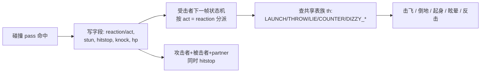

## 22.3 dino：poise / dizzy / 反击 / hitstop 是四套独立但同帧写入的机制

| 机制 | 字段 / 表 | 作用 |
|---|---|---|
| poise（韧性） | `stun -= rec.stun`、`stun_refill = 0x78` | 累积到阈值才进大反应，不是每下都倒 |
| dizzy / get-up | `DIZZY_HP / DIZZY_ALIVE / DIZZY_ROW / DIZZY_SPECIAL / DIZZY_END` + 共享 0x2A606 | 眩晕与起身是独立表族，不是受击动画的子状态 |
| counter（反击） | `enemy_damage_core`（`:235-272`）返回 `(damage, counter)` | 反击因子进 §17.1 的伤害连乘，与 reaction 分开 |
| hitstop | `rec.hit_stop` 写**三处**（攻击方、被击方、合体技 partner `:78`） | 命中定格是全局效果，不只给受击者 |

> 与 §17 的分工：§17 的伤害流水线算"扣多少血 / 是否反击"，§22 的反应表族算"挨了这下之后做什么动作"；两者在**同一命中帧**写进同一个对象头，但由不同表解释。这正是 §12「命中帧只结算、不处决」的字段级实现——击杀 / 战败仍来自受击者**下一次 update**（`enemy_combat.rs:569` 注释）。

## 22.4 wof：两层分派（通用 9 项跳表 + 每兵种专属段表）

**第一层 —— 命中当帧的通用分派（`Cps1Collision.cs:4882`，ROM 0x7E4A）**。表基址 `0x7E68`，18 字节 = 9 项（`:4861-4864`）：

```
n=0 0x00 -> 0x7E7A   n=1 0x01 -> 0x7F14   n=2 0x02 -> 0x7F14
n=3 0x03 -> 0x7ECE   n=4 0x04 -> 0x7F36   n=5 0x05 -> 0x7F0A
n=6 0x06 -> 0x7FDA   n=7 0x07 -> 0x7F36   n=8 0x08 -> 0x7F78
```

入口 `0x7E4A` 先读参数表一字节得 `reaction`，`Hp<0 && ObjId>4` 时改读"死亡备用字节"（`:4885-4890`）；`D0` 是**字节偏移**（非表项索引，`:4892-4900` 有 FBA 实证纠错记录）。各分支当帧写 `StunLeft / StunVal / DmgReaction`，再调 `命中双方硬直_可能对应ASM_7EA2`（双方 hitstop）；`0x7ECE` 分支在特定条件下往事件队列写 `type 0x18 / sub 0x13`（`:4948-4973`）。repo 侧这段是**按 ROM 逐条直译 + FBA trace 实证**的，§12.6 的"未逐条解析"到此可作补读确认。

**第二层 —— 受击者自己按兵种分表（`Cps1HitReaction124CA.cs`，ROM 0x124CA，CharId 0x18 专用）**。一级表 `@0x124D6` 按 `OBJ+0x99`（`DmgReaction`）索引（`:23-28`）：

```
D0=00 -> 0x124E8   02 -> 0x124FC   04 -> 0x12510
    06 -> 0x124FC   08 -> 0x12524   0A -> 0x12538
    0C -> 0x117BE   0E -> 0x117D2   10 -> 0x11796   (共享族落点)
```

文件头（`:14-21`）明确写出设计关系：

> "与 0x11878（小兵9 受击）**入口形态相同**（`move.b (0x99,A0),D0` 按 DmgReaction 分发）……差别在 idx00..0x0A —— 0x124CA 用**本角色专属的 5 个段**……而不是 0x11878 的 0x12108 / 0x11A64 / … ⇒ 所以**不能**直接复用（表不同）。"

即：**后三项复用共享族、前六项每兵种各带自己的段表**。这与 §16「BossAi 只是表地址选择器，class handler 各带自己的状态分派」是同一个组织习惯，只是发生在受击反应上。

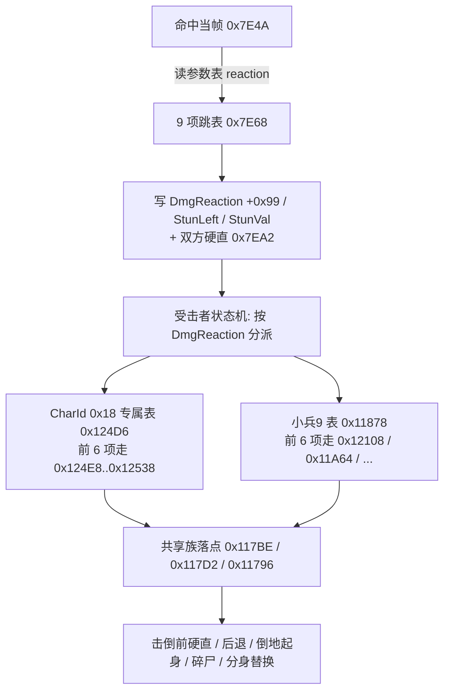

## 22.5 逐项对照

| 维度 | dino | wof |
|---|---|---|
| 反应编号载体 | 对象头 `act` 状态字节（与 `mode/sub/step` 同层） | 独立 `DmgReaction (+0x99)` 字段 |
| 分派层数 | 一层：受击者状态机按 `act` 查共享表族 | 两层：`0x7E4A` 通用 9 项 → 按 `CharId` 专属段表 |
| 表组织 | 12 张共享表（LAUNCH/THROW/SLIDE/LIE/COUNTER/DIZZY_*）+ 共享函数 0x2A606 | 通用 9 项跳表 0x7E68 + 每兵种一级表（0x124D6 / 0x11878 …）+ 共享族落点 |
| 死亡分支 | 命中帧不处决，击杀来自下一次 update（§12） | `Hp<0 && ObjId>4` 当帧改读"死亡备用 reaction 字节"；`0x7ECE` 分支发事件队列 |
| 韧性 / 眩晕 | `stun` 累积 + `stun_refill=0x78` + DIZZY_* 表族 | `StunLeft / StunVal` 清零或累加；两边累计的**形态**差异见 02 卷 §37.3「累计本身是什么形状」 |
| hitstop | 写攻击者 / 被击者 / 合体技 partner 三处 | `命中双方硬直_可能对应ASM_7EA2` 双方 |
| 反击 | `counter` 因子进 §17.1 伤害连乘 | 走 `DmgReaction` 分派 |
| 掉武器 | 命中帧无条件 `item_type=0; drop=1`（:52-54） | 由 0x7E86 骑乘 / 0x7E92 等分支处理 |

## 22.6 与 §12 / §17 / §16 闭环

- **§12（结算时序）**：dino 命中帧"只结算不处决"的字段级实现就是 §22.2 那串写入；wof 侧对应的是 `0x7E4A` 当帧只写状态字段，唯独死亡 / 特殊分支才发事件队列。两边都把"处决 / 起身 / 战败"留给受击者后续 update，不是命中函数里做完。
- **§17（伤害多因子）**：伤害公式与反应表是**同帧、同对象头、不同表**的两套计算；`counter` 在 dino 里同时是伤害因子与反应来源，是两者唯一的交叉点。
- **§16（共享零件 + 每类分派）**：wof 的 `0x124CA` / `0x11878`「入口形态相同、表不同、后三项复用共享族」把这一习惯从 Boss AI 复现到受击反应，说明它不是某个子系统的局部技巧。
- **§21.7 主线**：`reaction` / `DmgReaction` 又是"这一帧写下、下一帧被受击者状态机读走"的协议字段；与 `item_list $69EE`、`Scene.sleep`、`prev = held` 同列。

## 22.7 本轮边界与待办回执

- **补读确认（非新增取证）**：§12.6 / §18.1 标的「wof 9 项受击反应未逐条解析」= repo 侧 `Cps1Collision.cs:4882-5010` 已有 ROM 直译；本轮据此写入 §22.4，未做额外 ROM 逐指令对照，也不据此改 §0–§21 结论。
- **未做（保留，不扩张）**：`0x7F78 / 0x7FDA` 两分支逐段展开；wof 各 `CharId` 专属段表的全量普查；dino `enemy.rs` 里 `act` 状态机的逐 reaction 处理体；两游戏"眩晕 / 起身"是否完全对应（不臆断）。
- **未新增 ROM 取证**，全部以两份 repo 源码为准（§11.0）；**未考证发行先后**，沿用用户给定前提。

---

# 第十六轮：卷轴 / 摄像机 —— vblank 两侧的显示延迟与帧内顺序

> 视角：只谈**游戏逻辑本意**（用户 11-06「rs 和 cs 表面的编程和硬件差异不重要，那不是游戏本意」）。本轮把**附录 A.8 的工程结论（dump 时机）**接回设计主线：为什么游戏逻辑算出来的卷轴，画面要过一两帧才显示。
> 边界：repo 侧为主，**不新增 ROM 取证**（§11.0）。**先纠一个易下的错判**：wof 侧同样有 VBlank shadow 提交（`Cps1CameraRuntime.cs:15` 文件头即写「第一关单玩家相机、远景半速卷轴和 VBlank shadow 提交」），不能只读 dino 就说 wof 没有这层。本轮不对 wof 的卷轴寄存器时序做全量普查，也不臆断其延迟档数与 dino 相同。
> 取证：`dino-rs/.../game/camera.rs:125-150, 257-297`、`game/mod.rs:330-345`、`game/draw.rs:308-325`、`game/vram.rs:92`；`re/harness/record.lua:25-30`（A.8.3 已核）；`wt1/wof_cs/src/Cps1CameraRuntime.cs:15-50`、`Cps1TerrainCollision.cs:43, 888, 953`。

## 23.1 附录 A.8 的 dump 点在这里闭合

A.8.3 引过 `record.lua:25-30`：vblank IRQ（0x542）在 0x5C8 写帧标志 `0xFF0152`，**随后才** flush 声音队列、**写卷轴寄存器**、读输入、tick 任务计时器；dump 挂在这个写帧标志的 tap 上，看到的是"上一游戏帧任务留下的 RAM"。

`camera.rs:278-284` 给出另一半：vblank IRQ（0x6C0）"writes each scroll register from its copy and then copies the shadow"——**X 寄存器取两帧前的 shadow**（`G.$85C/$864/$86C`），Y 与 layer 寄存器取一帧前的。两边拼起来是同一条因果链：

```
[game frame k: 游戏逻辑算出 camera shadow / sprite list / palette]
        |
        |  (dump 之前) mod.rs:343-345 把本帧结果排进显示历史:
        |      cam.latch_scroll(regs) -> sprites.latch() -> pal.latch()
        v
>>> DUMP <<<  record k = 游戏算完、硬件寄存器还没 latch 的 RAM   (附录 A.8.3)
        |
        +-- 同一 vblank IRQ: 写帧标志 -> flush 声音 -> 写卷轴寄存器(取 k-2 的 shadow) -> 读输入 -> tick 任务计时器
        v
[屏幕此时显示的是 k-2 的 X / sprite、k-1 的 Y / layer / palette]
```

所以 `Game::tick()` 末尾那三步（`mod.rs:343-345`）**不是游戏逻辑，是"把本帧结果排进显示队列"**；它必须在 A.8 的 dump 点之前完成，否则 port 复现的画面就会算错延迟。这解释了为什么 dino 的逐帧对拍里画面也算真值：它把硬件时序也建模成了游戏状态的一部分。

## 23.2 dino：`VIDEO_LATENCY = 2`，按通道分档

`camera.rs:144-150` 是这份笔记里把"延迟"写得最显式的一段：

> "the scroll X registers … of a recording's record k are the camera X shadows of record k - 2, and a MAME picture taken at the same moment shows the sprite list of that frame … so the tiles and the sprites stay in step with each other. The Y registers and the layer registers are one record late … the palette is one record late too … the tile maps are shown at once."

| 通道 | 相对当前帧的延迟 | 消费接口 |
|---|---|---|
| scroll X + sprite list | 2 帧（`VIDEO_LATENCY`） | `shown_scroll` 取 `hist[0]` 的 X；`SpriteList::latch`（`draw.rs:308-325`） |
| scroll Y / layer registers / palette | 1 帧 | `shown_scroll` 取 `hist[VIDEO_LATENCY-1]` 的 Y；`shown_layers` 取 `regs[VIDEO_LATENCY-1]`；`PaletteRam::latch`（`vram.rs:92`） |
| tile maps | 0 帧（立即） | 无 latch |

实现是一个长度为 `VIDEO_LATENCY + 1 = 3` 的环形历史（`camera.rs:152-158, 261-276`）：

```
ScrollLatch { hist: [ScrollShadows; 3], regs: [LayerRegs; 3], filled: bool }

latch_scroll(regs):                     # 每帧末调用一次
    now = scroll_now()                  # cam1 / s2 / s3 的当前 shadow
    if 首次: hist = [now; 3]; regs = [regs; 3]   # 冷启动/载入状态立即显示
    else:    hist.rotate_left(1); hist[2] = now
             regs.rotate_left(1); regs[2] = regs

shown_scroll():                         # 硬件此刻显示的卷轴
    old = hist[0]                       # 2 帧前
    last = hist[1]                      # 1 帧前
    return X = old.X, Y = last.Y        # 按通道分档，不是统一一拍
```

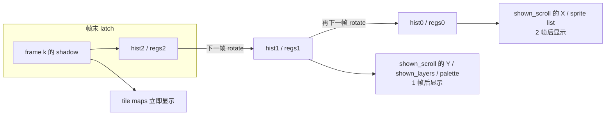

> `camera.rs:284` 还给了实证来源：`attract3.mame.trc` 里每一帧的 CPS-A 寄存器都符合这个模型（"except where the IRQ of a frame did not run"）。这是把**硬件行为**当成可校验的游戏状态，而不是渲染层的黑盒。

## 23.3 wof：相机控制器 + shadow 分片，同样有 VBlank shadow 提交

`Cps1CameraRuntime.cs` 展示的是另一种组织方式——**按控制器 / 用途切分 shadow**：

| 结构 | 地址 / 表 | 作用 |
|---|---|---|
| Scroll2 相机控制器 | `Scroll2ControllerBase = 0xFF7A88`（`:18`） | 主相机状态 |
| 关卡初始化表 | `Scroll2StageInitTable = 0x193E2`，每项 16 字节 / 8 word（`:19-21`） | 按 `A5-0x78` 关卡 selector 取行 |
| 对象展开器专用 X shadow | `ObjectRenderCameraXShadow = A5-0x7CC8 = 0xFF0338`（`:22-25`） | **独立于 Scroll1/2 的 CPS-A shadow**，OBJ 展开用 |
| Scroll2 / Scroll3 控制器 | `0x19360` / `0x19DAC` | ROM 契约：20 个调用点 vs 9 个，11 个点**只调 Scroll2**（`:28-50`，含 FBA `PC_COUNT` 铁证） |

文件头（`:15`）明确列出「远景半速卷轴和 **VBlank shadow 提交**」，所以这一层在 wof 侧是存在的；`Cps1TerrainCollision.cs:43, 888, 953` 则显示相机/卷轴在**对象更新**里的另一重角色：地形纠偏、按相机侧选择活动 X 边界、16 像素格纠偏——相机同时是"对象活动范围"的输入，不只是显示参数。

> 诚实边界：本轮未对 wof 的卷轴寄存器时序做全量普查，**不臆断**其延迟档数、也不判断与 dino 的 `VIDEO_LATENCY=2` 是否相同。可确认的只是：两边都有 VBlank shadow 提交，且都把相机值拆成多个用途不同的 shadow。

## 23.4 逐项对照

| 维度 | dino | wof |
|---|---|---|
| 延迟的表达 | 显式常量 `VIDEO_LATENCY = 2` + 环形历史 + `shown_*` 查询接口 | 以控制器 / shadow 分片组织，文件头列 VBlank shadow 提交 |
| 分档 | 按通道：X/sprite 2 帧、Y/layer/palette 1 帧、tilemap 0 帧 | 本轮未普查，不判断 |
| 冷启动 | `latch_scroll` 首次填满整个历史，"载入状态的场景立刻显示卷轴"（`:261-269`） | 未在本轮对照 |
| 相机在碰撞中的角色 | `item_enemy_near` 等读 reach 表（§21.4），相机主要在显示侧 | `Cps1TerrainCollision.cs` 里相机是对象活动边界的输入 |
| 与 dump 的关系 | `latch_*` 在 dump 点之前完成，画面才对拍得上（§23.1） | wof 的 `.fr/.fs` 逐字节对拍直接含 GFXRAM，路径不同（附录 A.5） |

## 23.5 主线闭环：延迟是显式的、按通道分档的

| 出处 | 「这一帧写、之后几帧读」的形态 | 延迟 |
|---|---|---|
| §13 怪物策略 | `census → pick_target → retarget_slot → steer_slot` | 1 帧 |
| §14 输入层 | `prev = held` 快照 | 1 帧 |
| §20 顶层任务机 | `Scene.sleep` 把"醒来回到哪行"写进 `state`；lag 跨 vblank 记账 | 1+ 帧 |
| §21.7 道具 | `item_list $69EE` / `$69BA` 上一帧列表 | 1 帧 |
| §22 受击 | `reaction` / `DmgReaction` 命中帧写、下一帧状态机读 | 1 帧 |
| **§23（本轮）** | scroll X / sprite 2 帧，Y / layer / palette 1 帧，tilemap 0 帧 | **按通道分档** |

结论：§14.5 / §20.6 的主线不是"统一延迟一拍"，而是**把每个通道的延迟做成显式的、可查询的结构**。§23 把它从游戏对象（列表、状态字节、反应编号）扩展到视频硬件（shadow 历史），并给出直答用户最初「硬件中断 / 两套循环」问题的另一半：**vblank IRQ 是把游戏算出的 shadow 搬进硬件寄存器的桥，游戏逻辑算的本就是"未来第 1–2 帧才显示的画面"**。这与 §20（顶层任务机按 slot 续算）、A.8.3（dump 在 IRQ 写卷轴寄存器之前）三者自洽。

## 23.6 本轮边界与待办回执

- **补读确认**：wof 侧 `Cps1CameraRuntime.cs:15` 已有「VBlank shadow 提交」，本轮据此纠正"只读 dino 会以为 wof 无此层"的潜在错判；未改 §0–§22 结论。
- **未做（保留，不扩张）**：wof 卷轴寄存器时序的全量普查与延迟档数比对；`Cps1StageTileStreamer` 列初始化 / 环形区逐段展开；dino `RowScroll`（stage 2 行卷轴任务，`:83`）逐状态展开。
- **未新增 ROM 取证**，全部以两份 repo 源码为准（§11.0）；**未考证发行先后**，沿用用户给定前提。

---

# 第十七轮：投技 / 抓取 —— 一个状态机跨两个活对象

> 视角：只谈**游戏逻辑本意**（用户 11-06「rs 和 cs 表面的编程和硬件差异不重要，那不是游戏本意」）。本轮把 §21.3「拾取是双向状态迁移」从"玩家–物品"扩展到"玩家–敌人"：**这里两个对象都是活的、各有状态机、每帧都跑**。
> 边界：repo 侧为主，**不新增 ROM 取证**（§11.0）。wof 侧 `Cps1EnemyAI.cs:7B20` 等是带 ROM 直译与表基址纠错的逐指令还原，按用户「不过度怀疑 rep 侧」只作补读，不据此改 §0–§23 结论。
> 取证：`dino-rs/.../game/player.rs:36-49, 147-171, 929-944, 3488-3510, 3682-3713`、`game/enemy_combat.rs:1002-1065, 1464-1534`、`game/mod.rs`（`held_players_update`）；`wt1/wof_cs/src/Cps1EnemyAI.cs:48, 1609-1612, 1665-1748, 1750, 3982-4010`。

## 24.1 共同设计：抓还成不成立，由状态字节仲裁，不是一次事件

投技最容易被写成"命中时把敌人设成被抓态，投出去时改回来"的一次性事件。但两份 repo 显示的都是同一套更稳的设计：**抓取是一个逐帧续存的联合状态，双方每帧互相检查对方的状态字节，任一方离开约定状态就自动解散**。

dino 侧是**双向互检**（这是本轮最硬的一条证据）：

```
# 持有者一侧（player.rs:3500-3508, player_hold）
e = player.partner                       # 被抓的敌人
ok = e 存在 && e.kind == 0xE && e.sub == 6   # 敌人仍在"被抓"子状态
if !ok: 抓取结束（放手）

# 被抓者一侧（enemy_combat.rs:1506-1519, enemy_grabbed_place）
p = enemy.partner                        # 持有者（+$70）
ok = p.live != 0 && p.mode == 2 && p.sub == 4 && p.kind == 0xC
if !ok:  # 持有者不在"抓取中"了
    wall = 0; snap_to_floor(); reaction = 0x20; enemy_recover()   # 落地、回 AI
```

wof 侧是同一个判据（`Cps1EnemyAI.cs:1665-1681`，0x7B20）：

```
player = extw2a(enemy.HitMeObj)
if player 地址越界 || player.ActStatB != 0x04:
    enemy.ActStateABCD = 0x02080000; OBJ9B = 0x1E; return   # 放手
```

即：**持有者的状态字节（`sub==4` / `ActStatB==0x04`）就是"抓还成不成立"的协议**。持有者被打出抓取态、或死亡、或自己转去投掷，被抓者下一帧读到不成立就自行落地——**不需要持有者发一个"放手"消息**。这是 §21.7「状态字节即协议」在 PvP 对象上的最强形态：不是"写个编号下一帧读一次"，而是"每帧互检、任一失效即解散"。

## 24.2 dino：两侧各自的 mode / act 分派

玩家按 `mode` 分派（`player.rs:943-944`）：`4 => player_grabbing`、`6 => player_grabbed`——**"抓人"和"被抓"是玩家自己的两个独立 mode**，与 §2 的四层对象头同构。

| 侧 | 入口 | act / step 分派 |
|---|---|---|
| 玩家 grabbing | `player_grabbing`（`:3488-3496`） | `0` hold、`2/4` knee（膝撞）、`_` throw（投出） |
| 玩家 grabbed | `player_grabbed`（`:3682-3713`） | `0` 初始化、`2` hold（挣扎）、`4` escape、`_` getup |
| 敌人 grabbed | `enemy_grabbed`（`:1464-1495`，sub 6，0x2B35A） | `0` 要血条 / 放到手里、`2` 放到手里、`4` 只检查 |
| 敌人 thrown | `enemy_thrown`（`:1002-1065`，0x2A9C8） | step `0/2/4/6`：初速 → 飞行 → 弹地 → 起身或死亡 |

双向引用：敌人用 `+$70`（`partner`）指持有者，玩家用 `partner` 指被抓敌人；`+$68` 记投掷者（thrower）。`objects_update` 里 `held_players_update`（0x188DA）在 enemies 之后跑，专门处理"被敌人抓住的玩家"——又一处帧内顺序决定语义。

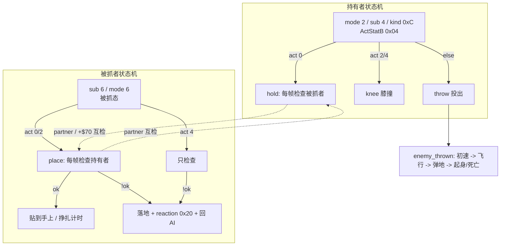

> 注意 dino 的 `enemy_grabbed` 还有一层：`enemy_holder_tag`（`:1497-1503`）读持有者 `+$82`，若 `==4`（不是玩家，而是另一个敌人/物品）就跳过血条与贴手，直接进 act 4「只检查」——**同一套被抓状态机同时支持"玩家抓敌人"和"敌人抓敌人"**，靠持有者类型标记分叉，不另写一套。这与 §16「共享零件 + 每类分派」同构。

## 24.3 dino：挣扎 / 逃脱 / 膝撞 / 投掷是同一状态机的不同 act

| 机制 | 字段 / 表 | 位置 |
|---|---|---|
| 逃脱计时 | `+$73`「frames until the held enemy escapes, refreshed by attack presses」 | `player.rs:43` |
| 搓按键挣扎 | `mash = 0x28`、`mash_cd`、`player_grabbed_mash` | `player.rs:3689, 3760` |
| 重新抓取冷却 | `regrab_cd = 10`（`+F0`） | `player.rs:3561` |
| 膝撞计数 | `+$115` knee counter | `player.rs:167` |
| 膝撞改写被抓者 | "A knee sets `act` to the reaction of the attack record (0, 2): the bar request again" | `enemy_combat.rs:1467` |
| 投掷初速表 | `THROW 0x2CB46` 的 `(vx, ax, vy, ay)`，按 thrower `id` 取行 | `enemy_combat.rs:1011-1030` |

投掷是**独立多步状态机**（`enemy_thrown`，`:1002-1065`）：step 0 按投掷者 id 查表给初速 + 设 `airborne`/动画 → step 2 飞行（含 `hitstop` 递减、`0x6B30` 注册、溅水/落地检查）→ step 4 弹地与地板碰撞 → step 6 起身或死亡（`enemy_getup_or_die`）。**伤害与死亡不在"松手"那一帧处决**，与 §12「命中帧只结算不处决」一致。

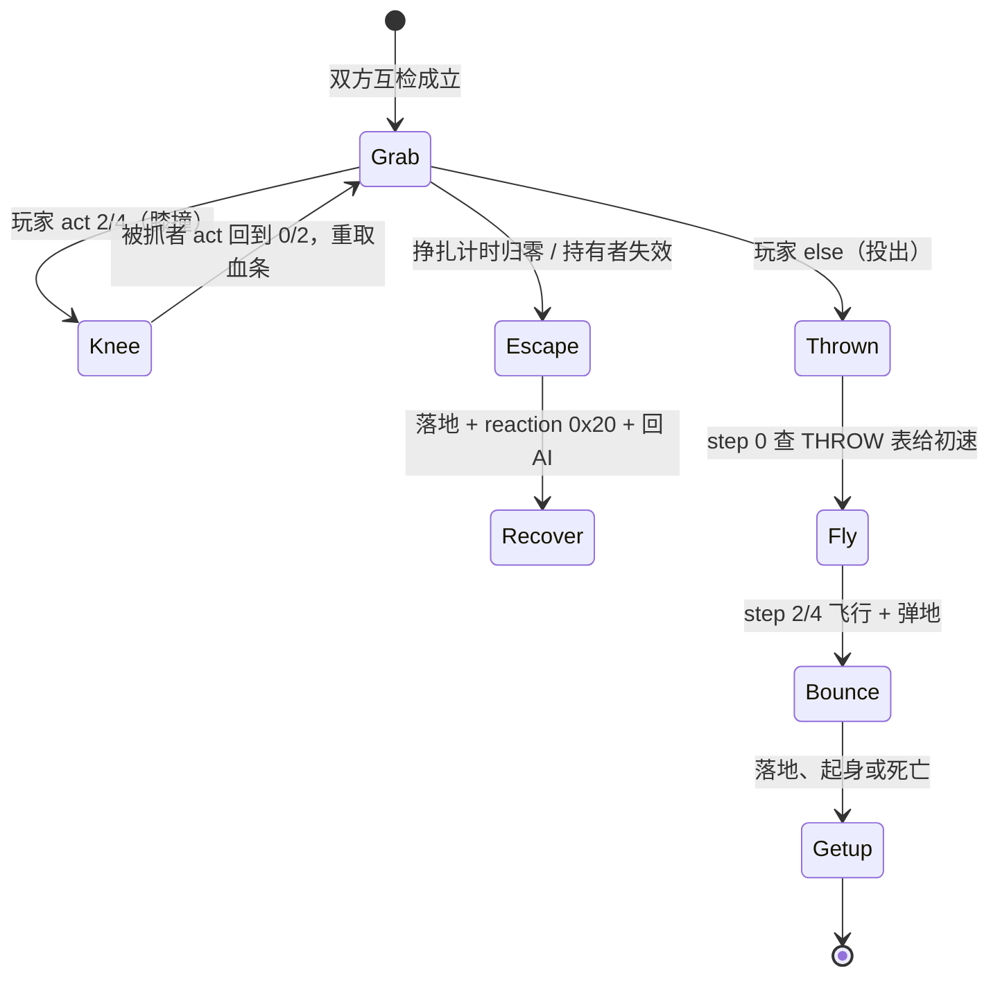

## 24.4 wof：0x7B20 被抓状态 + 两张 RNG 计时表 + 附着

`敌人_被抓状态处理_可能对应ASM_7B20`（`:1665-1748`）按 `ActStatC` 三段：

```
ActStatC == 0（初始化，只建立计时/状态，下一次 C02 才进附着链）:
    AniStat32 = 0; AiDefen = 0; ActStatC = 2; OBJA3 = 0; NewBtnA = 0
    idx = 0x0F98_RNG() & 0x1F
    +0x8B = table[0x792E + idx]        # 逃脱/持有计时（表基址 0x792E，非 0x7930）
    idx2 = (0x0F98_RNG() & 0x1F) + OBJ3D
    +0x8A = table[0x7B90 + idx2]       # 反应计时
    return

ActStatC == 2（每帧）:
    if --(+0x8A) == 0:
        +0x8B += table[0x7C2E + ((RNG()&0x1F) + OBJ3D)]   # 累加，非赋值
        +0x8A =  table[0x7C4E + (RNG()&0x1F)]             # 赋值
    被抓对象_应用持有者动画附着_可能对应ASM_799A(enemy, player)
```

即 wof 把"能挣脱多久 / 何时换反应"做成**两个 RNG 查表字节 `+0x8A/+0x8B` + 每帧递减**，与 dino 的 `+$73` 逃脱计时 + 按攻击键刷新是同一设计意图的两种实现。repo 注释里带表基址纠正（`0x792E` 不是 `0x7930`，有 FBA 实测）与"累加 vs 赋值"的逐分支勘误——按用户「不过度怀疑 rep 侧」，这里只记其存在，不作优劣判断。

投掷落地伤害在 `敌人_抓投弹飞反应_可能对应ASM_11D2E`（`:3982-4010`）：`Damage > Hp` 时走死亡掉落 / 击杀加分事件；注释还指出「`0x11D48` 末尾 `addq.b #2` 把 `ActStatD` 变 2，故 `.fs` 里 D==0 的帧其**下一帧**才真正进入本支」——**又一处"这一帧写、下一帧读"**。

## 24.5 逐项对照

| 维度 | dino | wof |
|---|---|---|
| 抓取的载体 | 玩家 `mode 4/6` + 敌人 `sub 6`，双向 `partner` | 敌人 `ActStateABCD` + `HitMeObj` 指持有者 |
| 续存判据 | 双向互检：`player_hold` 查 `e.kind==0xE && e.sub==6`；`enemy_grabbed_place` 查 `p.mode==2 && p.sub==4 && p.kind==0xC` | 单向检查：`player.ActStatB != 0x04` 即放手 |
| 放手方式 | 检查失败 → `snap_to_floor` + `reaction 0x20` + `enemy_recover` | `ActStateABCD = 0x02080000`，`OBJ9B = 0x1E` |
| 挣扎计时 | `+$73`（按攻击键刷新）、`mash`、`regrab_cd=10`、`+$115` 膝撞计数 | `+0x8B` / `+0x8A` 两个 RNG 查表计时字节（`0x792E` / `0x7B90` / `0x7C2E` / `0x7C4E`） |
| 膝撞 | `player_knee`，把被抓者 `act` 改成 attack record 的 reaction | 由 `ActStatC/D` 分支 + 反应计时处理 |
| 投掷 | `enemy_thrown` step 0/2/4/6，查 `THROW 0x2CB46` 初速表 | `S1_THROW=0x04` + `0x11D2E` 落地伤害 / 击杀加分 |
| 附加系统 | `enemy_holder_tag` 让同一被抓状态机支持"敌人抓敌人"；`held_players_update` 在 enemies 之后跑 | `对象_抓取状态初始化_可能对应ASM_4202` 多处调用 |

## 24.6 与主线闭环

| 出处 | 本轮的对应 |
|---|---|
| §21.7 状态字节即协议 | 从"写个编号下一帧读"升级为**每帧双向互检、任一失效即解散**（§24.1） |
| §21.3 双向状态迁移 | 从"玩家–物品"扩展到"玩家–敌人"两个活对象（§24.2） |
| §12 结算时序 | 投掷伤害 / 死亡在落地或后续帧（dino step 4/6、wof `ActStatD` 下一帧），非松手当帧处决（§24.3 / §24.4） |
| §22 受击反应 | wof 被抓态同样用 `ActStatC/D` 多字节状态 + 表分派，与受击反应同构；dino 膝撞把 `act` 改成 reaction，两系统共用一套字段 |
| §16 共享零件 | `enemy_holder_tag` 靠持有者类型标记分叉，共享被抓状态机支持不同持有者（§24.2） |
| §14 / §20 帧内顺序 | `held_players_update` 在 enemies 之后；wof `0x11D2E` 的 `addq.b #2` 把分派推迟一帧 |

结论：整份笔记反复出现的「把瞬时事件改写成可逐帧续存的显式状态」，在投技上达到最完整形态——**不是给对象加一个"被抓"标志，而是让两个独立状态机通过状态字节互相校验**。dino 把它做成双向互检 + 支持非玩家持有者，wof 把它做成 RNG 查表的计时字节 + 附着链；两边都避免了"一次性事件"的脆弱性。

## 24.7 本轮边界与待办回执

- **补读确认**：wof 侧 `Cps1EnemyAI.cs:7B20 / 0x11D2E / 0x799A` 在 repo 里已有逐指令直译与表基址纠错；本轮据此写入 §24.4，未做额外 ROM 逐指令对照，也未改 §0–§23 结论。
- **未做（保留，不扩张）**：`player_grabbed_mash / escape / stumble` 逐函数展开；`enemy_thrown_fly` 溅水 / 屏幕反弹逐段；wof `0x799A` 附着链全文与两个调用点；两游戏"敌人抓敌人 / 玩家被抓"是否完全对应（不臆断）。
- **未新增 ROM 取证**，全部以两份 repo 源码为准（§11.0）；**未考证发行先后**，沿用用户给定前提。

---

# 第十八轮：动态难度 / rank —— 跨整局的时间驱动状态机

> 视角：只谈**游戏逻辑本意**（用户 11-06「rs 和 cs 表面的编程和硬件差异不重要，那不是游戏本意」）。前面所有状态机都在**帧内 / 帧间**尺度；本轮补的是**分钟级、跨整局**的那一层：难度怎么随"打了多久 / 打得怎样"变化。
> 边界：repo 侧为主，**不新增 ROM 取证**（§11.0）。**不重判有无**——§9.1 已确立「wof 也有动态难度」，§11.2 已确立「`0x3C6A` 是共享决策函数 + 每兵种各带概率表」；本轮只对照**组织方式**，按用户「不过度怀疑 rep 侧」把 wof 侧的 ROM 直译当作 repo 事实。
> 取证：`dino-rs/.../game/rank.rs:1-45, 48-137, 154-221, 241-299`、`game/mod.rs`（`game_frame` 首个 `rank_tick`）；`wt1/wof_cs/src/Cps1EnemySubs.cs:324-348`、`Cps1PlayerLogic.cs:3032, 6413-6414, 10682-10715, 11200, 11275`、各 `Cps1ActorNNRuntime.cs` 的 `难度概率比较_对应ASM_3B94_3E88` 调用。

## 25.1 两种组织方式：集中全局状态机 vs 单字节 + 每兵种概率表

| | dino | wof |
|---|---|---|
| 难度放在哪 | `Rank` 结构（G.$5EC）的一组全局字段：`aggression / level / rank / speed / timer / ups / downs / calm / freeze` | 单一全局字节 `A5-0x5A`（0xFF7FA6） |
| 谁推进它 | `rank_tick`（0x186CC），**`game_frame` 的第一个调用**，每帧跑 | 无独立推进器；由**事件**改写（得分 / 过关 / 死亡 / 续关） |
| 怎么影响敌人 | 各系统读全局 `rank / level / aggression`（伤害缩放、census、approach slots、生成） | 每个 Actor 在决策点调 `0x3B94`，用难度值当**查表索引** |
| 时间维度 | 显式：`RANK_PERIOD` 按 speed 的分钟级计时、pending 升降 1800 / 1200 帧、calm 倒计时 | 隐含在事件序列里，不自带计时器 |

一句话：**dino 把难度做成一个会自己走的状态机；wof 把难度做成一个被各兵种查询的参数**。

## 25.2 dino：`rank_tick` 是 `game_frame` 的第一个调用

`Rank` 结构（`rank.rs:9-42`）字段（均为 G.$5EC 起偏移）：

```
+$00 aggression 0..7        +$0A speed 0..15      +$0C rank-up countdown
+$06 force_x / +$08 force_val  (spawn command 8 强制的 aggression 镜头 X 门限 / 值)
+$0E ups / +$12 ups_t   = 待升次数 + 1800 帧(0x708)计时
+$10 downs / +$14 downs_t = 待降次数 + 1200 帧(0x4B0)计时
+$16 freeze   (0x186CC 测试；game / area start 清零)
+$18/$1A 倒计时  +$1C calm（aggression 强制为 0 的平静期）
G.$4F6       投币后等待帧（system task 0x1827A 每帧累加，进游戏清零）
```

**重算点**挂在顶层流程上（连 §20）：

```
rank_game_start  (0x17F8A, 开局):
    按 G.$4F6 分 4 档（720 / 3600 / 10800 帧）
    × DIP 难度(bit0-2) 查 0x180BA → 0x180FA 表 + rand()&0x1F 定初始 rank
    speed = (DIP bit3-4 >> 3) + 1
rank_stage_start (0x1800E, 每关):
    rank += 表[stage]（带上下钳位 0x1823A）
rank_area_start  (0x18048, 每区域):
    清 force / freeze / calm；timer = RANK_PERIOD[speed]
    aggression = 表 0x18094[stage*4 + area] - 1
rank_compute_level (0x18592):
    按玩家数钳位 rank（1P ≤0x18；2P clamp(4,0x1C)；…）再查 level
rank_waited_tick (0x1827A, system task 每帧):
    非游戏且有投币 → G.$4F6++（0xFFFF 回绕到 0x8000）；进游戏清零
```

每帧的推进（`rank_tick`，`:154-204`，**`game_frame` 第一次调用**）：

```
rank_tick():
    if freeze || scripted || b4d5: return           # 过场 / 冻结期不推进
    if cam_x < force_x: aggression = force_val     # 波次脚本强制档位（连 §19）
    else: force_x = 0
    if --timer == 0:                              # 自动升 rank
        rank = min(rank + 1, 0x1F)
        timer = RANK_PERIOD[speed]
    if ups   && --ups_t   == 0: ups--;   ups_t = 1800; rank = min(rank+1,0x1F)
    if downs && --downs_t == 0: downs--; downs_t = 1200; rank -= 1
    w604--; w606--
    rank_compute_level()                          # 每帧按 rank 重算 level
    if calm: aggression = 0; if --calm == 0: rank_reroll_aggression()
```

```mermaid
flowchart TB
    A[game_frame 第 1 个调用: rank_tick] --> B{freeze / scripted?}
    B -->|是| Z[跳过]
    B -->|否| C[强制 aggression 检查<br/>cam_x vs force_x]
    C --> D[自动 timer 到点 → rank+1<br/>timer = RANK_PERIOD speed]
    D --> E[pending ups 1800帧 / downs 1200帧]
    E --> F[rank_compute_level<br/>按玩家数钳位并查 level]
    F --> G{calm 平静期?}
    G -->|是| H[aggression = 0<br/>结束重掷 Markov]
    G -->|否| I[保持 aggression]
    I --> J[各系统读全局量:<br/>伤害缩放 / census / 生成 / 伤害公式]
    H --> J
```

> 关键点：**难度不是一个被动的"当前值"，而是一个有计时器、有挂起队列、有冻结门、有平静期的状态机**；`rank / level / aggression` 三者每帧被重算，其他系统只读结果。这与 §20 顶层流程任务机同构——"把时间推进做成显式结构"。

## 25.3 dino：aggression 是 Markov 转移，不是线性爬升

`rank_reroll_aggression`（`:206-221`，0x182A2）：

```
if freeze: return
if force_x != 0: aggression = force_val        # 脚本强制
else:
    table = (cam.s2.lock78 == 1) ? 0x18364 : 0x182E4   # 镜头锁定选第二张表
    r = rand() & 0xF
    off = (aggression << 4) + r                  # 当前档 16 项一行
    aggression = table[off]                      # 下一档由转移表决定
```

即 aggression 0..7 的**下一档由"当前档 + RNG"查转移表得到**（马尔可夫链），不是"时间越长越高"。calm 期把它按 0、到期重掷；波次脚本（spawn command 8）可用 `force_x/force_val` 在特定镜头位置强制档位（连 §19 波次脚本）。`rank_event_*`（`:241-299`）则由死亡、续关、加命等事件往 `ups/downs` 队列里塞挂起次数——**事件不直接改 rank，而是排进 1800 / 1200 帧的队列**。

## 25.4 wof：`A5-0x5A` 单字节 + `0x3B94` 概率门

wof 侧的难度是**一个字节 + 一张共享比较函数 + 各兵种自带的表**。

难度字节的写入点（`Cps1PlayerLogic.cs`）：

```
得分 / 过关 / 特定事件:  A5-0x5A += 0x10        (:3032-3033, :4420-4421, :7618-7619, :11200, :11275)
玩家死亡:                A5-0x5A -= 0x20        (:6413-6414)
玩家死亡_降低动态难度_可能对应ASM_170E (:10690-10697):
    seed = RNG(); 查表 0x1726 + ((seed>>8)&0x1F)*2  → 减量
    难度_钳位动态等级_可能对应ASM_BC04 (:10700-10715) → 上下钳位
```

消费点 `难度概率比较_对应ASM_3B94_3E88`（`Cps1EnemySubs.cs:324-348`，§18.3 已收敛其命名）：

```
roll       = RNG() & 0x1F
difficulty = clamp_s8( Obj.+$A2 + byte(A5-0x5A), 0, 0x1F )   # 对象自身偏置 + 全局难度
threshold  = tableA6[difficulty]                              # 每兵种 / 每分支自带表
return roll < threshold                                       # 决定是否走该 AI 分支
```

`tableA6` 各兵种不同：`0x33A30 / 0x33A70`（Actor12）、`0x38A56 / 0x38A6C / 0x38A76 / 0x38AA4 / 0x38AC6`（Actor15）、`0x3C536 / 0x3C696 / 0x3C556 / 0x3C576`（Actor18）、`0x476AE`（Actor21）等；`Cps1Actor20/21/24Runtime.cs` 还有按 `A5-0x5A` 修正对象 `+0xA2` 的写法。

```mermaid
flowchart LR
    subgraph dino
        D1[rank_tick 每帧] --> D2[rank / level / aggression<br/>计时器 + 挂起队列 + Markov]
        D2 --> D3[各系统读全局量]
    end
    subgraph wof
        W1[事件: 得分+0x10 / 死亡-0x20 / RNG查表] --> W2[A5-0x5A 单字节]
        W2 --> W3[0x3B94 概率门<br/>difficulty = 对象偏置 + 全局字节]
        W4[各兵种自带 tableA6] --> W3
        W3 --> W5[roll < threshold → 走该 AI 分支]
    end
```

> 这正是 §11.2 / §16 已确立的 wof 习惯「共享函数 + 每兵种各带表」在难度层的复现：难度不自己跑状态机，而是**作为查表索引注入每个兵种的决策点**。repo 侧这些调用点带 ROM 直译与 FBA 实测注释，按「不过度怀疑 rep 侧」只作补读。

## 25.5 逐项对照

| 维度 | dino | wof |
|---|---|---|
| 载体 | `Rank` 结构（9+ 字段） | 单字节 `A5-0x5A` |
| 推进 | `rank_tick` 每帧（`game_frame` 首调用） | 无；由事件改写 |
| 时间机制 | `RANK_PERIOD[speed]` 自动升、pending 1800/1200 帧、calm 倒计时、freeze 门 | 无独立计时器（时间隐含在得分/死亡事件序列） |
| 敌人档位 | `aggression` 0..7，Markov 转移表 + 脚本强制 `force_x` | 概率门 `roll < table[difficulty]`，`difficulty` 由对象偏置 + 全局字节合成 |
| 表组织 | 全局表：`0x18094`(按 stage/area)、`0x182E4/0x18364`(Markov)、`0x187B8`(周期)、`0x1823A`(每关) | 每兵种 / 每分支自带 `tableA6` |
| 事件响应 | 死亡 / 续关 / 加命排进 `ups/downs` 挂起队列，不立即改 rank | 得分 `+0x10`、死亡 `-0x20` / RNG 查表减量，立即改字节后钳位 |
| 重算点 | game / stage / area start + 每帧 `rank_compute_level`（按玩家数钳位） | `BC04` 钳位 |
| 下游 | 伤害缩放（§17.1 `level_type/hp_hundreds/hp_band`）、census（§13）、生成、波次 | 每兵种 AI 分支选择（§11.2）、`DAMAGE_RANDOM_TABLE` 难度索引（§17.3） |

## 25.6 主线闭环：把「打了多久」也做成显式字段

| 出处 | 时间尺度 | 显式结构 |
|---|---|---|
| §14 输入层 / §21.7 列表 / §22 反应 / §24 互检 | 帧内、1 帧 | `prev` 快照、注册列表、状态字节协议 |
| §23 显示延迟 | 1–2 帧，按通道分档 | `VIDEO_LATENCY` 环形历史 |
| §20 顶层流程 | 帧 ~ 场景 | `Scene.sleep`、`lag` 记账、5 任务 slot |
| **§25（本轮）** | **分钟级、跨整局** | `RANK_PERIOD`、pending 1800/1200 帧、calm、`G.$4F6` 投币等待、Markov 转移 |

整份笔记的主线是「把瞬时事件改写成可逐帧续存的显式状态」。§25 把这条主线推到**最大时间尺度**：dino 连"机器投币后等了多久""这一局打了多久""玩家死了几次该缓一缓"都变成可查询字段与计时器，而不是隐含在流程里；wof 则把同样的意图压进一个全局字节，让每个兵种在决策点自己查表。

与既有结论自洽：
- §17 伤害多因子：dino 的 `level_type_scale / hp_hundreds_scale / hp_band` 正是本轮 `level / rank` 的下游；wof 的"难度索引 + 单次衰减"对应 `A5-0x5A`。
- §13 怪物策略：dino `aggression` 档位是 census / 接近槽位的输入；wof 是每兵种概率门。
- §19 波次脚本：spawn command 8 的 `force_x / force_val` 是脚本直接改难度档位的挂接点。
- §11.2 / §16：wof「共享函数 + 每兵种表」第三次复现（决策 → 受击反应 → 难度概率门）。

**倒推（说人话，本轮回源补层，不新增节号）**：这套难度系统改的不是「敌人会怎么打」，是「同一套打法被拧得多紧」。回源 class 2 的 `enemy_c2_at_slot`（`dino-rs/crates/dino-game/src/game/enemy.rs:1604-1630`）：走到站位后先查 `ATTACK_CHANCE`（`0x353B6`，索引 `variant*4 + (aggression&7)`）跟 `rng&0x1F` 比，决定这一趟**出不出手**；没中就查 `REPOS_CHOICE`（`0x354B2`，索引 `variant*16 + (rng&0x1F)`）决定**绕圈 / 悬停 / 后退**，再用 `rng&0xF` 取 `REPOS_TIME`。两张走位表的索引里**都没有难度**，权重也固定（`00-overview.md:1341` 记 `0x354B2` 约 7:16:8）；含难度的只有出手概率，另加速度、部分暂停与恢复、伤害（`re/specs/enemy/SPEC.md:533-534 / :1473`、`00-overview.md:1084-1085`）。⇒ 难度升上去，敌人不是学会新招或改用更聪明的走位，还是「走近 → 站位 → 掷一次 → 出手或绕圈」那几个状态，只是掷中的机会变大、等待变短、跑得更快。玩家觉得「变凶了」，是节奏被调紧，不是换了一套 AI。按 §94.17 只限定到 class 2 这条 `at_slot` 链，不写「全部敌人 / 所有状态都如此」。

**给「学 dino 优化 wof」的落点**：想做动态难度，别给高难度另写一套状态机或加新行为，把概率、速度、停顿做成按档位查的表挂回原来的状态机即可；逐项表值按 §94.2 属举例，不展开。wof 侧按 §11.0 只登记另一处并列事实：一个全局难度字节经钳位后进 `0x3B94` 概率比较（01 卷 §25.4、00 卷 §11.5），不串等价、不评优劣、不推断原机有无别的写法。落笔前按 §94.11 查过笔记内部：`00-overview.md:1339 / :1341` 已分别登记两张表的索引维度，无相反结论；本节只把「谁含难度、谁不含」这个对比倒推成判断，不改任何 data。

## 25.7 本轮边界与待办回执

- **补读确认**：wof 侧 `Cps1EnemySubs.cs:3B94` 与各 `Cps1ActorNNRuntime.cs` 调用点在 repo 里已有逐指令直译；§9.1 / §11.2 的既有结论不改，本轮只对照组织方式。
- **未做（保留，不扩张）**：dino `rank_event_18410 / 183e4 / 1842c / 1843c / continue` 逐事件展开；`time_limit` / BCD 时间链；`RANK_PERIOD` / `0x18094` / Markov 两表的逐项字节；wof `A5-0x5A` 全部写入点全量普查与各 `tableA6` 内容比对。
- **未新增 ROM 取证**，全部以两份 repo 源码为准（§11.0）；**未考证发行先后**，沿用用户给定前提。

---

# 第十九轮：HUD / 分数 / 奖命 —— 从游戏状态到玩家可见反馈

> 视角：只谈**游戏逻辑本意**（用户 11-06「rs 和 cs 表面的编程和硬件差异不重要，那不是游戏本意」）。本轮把 §19「事件队列」与 §20「顶层任务机」在**反馈层**合流，并回到用户最初那个问题——「随时被硬件中断，无法确定有些函数的执行次数和完整度」。
> 边界：repo 侧为主，**不新增 ROM 取证**（§11.0）。wof 侧 `Cps1HudRuntime.cs` / `Cps1EventObjectRuntime.cs` 带 ROM 直译与 FBA 实测注释，按用户「不过度怀疑 rep 侧」只作补读，不改 §0–§25 结论。
> 取证：`dino-rs/.../game/hud.rs:1-35, 111-120, 150-211, 453-468, 489-552, 679-683, 809`、`game/mod.rs`（`game_frame`）；`wt1/wof_cs/src/Cps1HudRuntime.cs:3-37`、`Cps1EventObjectRuntime.cs:275-296, 357-380`、`Cps1Item.cs:127`、§19 / §20 / §21.6 / §25.4 既有记录。

