# 卷 02：机制铺开（§26–§39）

> 由 `DESIGN_DIFF_NOTES.md` 按 `^## ` 标题块原样拆出，块内逐行未改，卷内保持原文件出现顺序。
> 总入口、`§N → 卷` 反查表与阅读顺序见 `../DESIGN_DIFF_NOTES.md`。
> 本卷涵盖：§26–§39。附录 A 全部在 `07-appendix-a.md`。

---

## 26.1 两条路径：同步脏标志 vs 异步事件投递

一次击杀该加多少分、什么时候把分数画到屏幕上——两边给出了两种组织方式：

| | dino | wof |
|---|---|---|
| 加分动作 | `hud_add_score` 直接把 BCD 值加到玩家分数，置**脏标志** | `投递击杀加分事件` 往**公共事件队列**写一项（`type 0x18`） |
| 何时重绘 | 帧末 `hud_objects_tail` / `hud_update` 消费脏标志，固定顺序 | 事件队列由 slot15 协程消费，一帧消费几项由 VBlank 截断决定（§19） |
| 反馈的确定性 | 重绘时机由帧循环固定 | 分数写入时机取决于协作式内核本帧扫了几轮 |

## 26.2 dino：BCD 分数 + `score_dirty` + 帧末重绘

`hud.rs:1-18`：原机 HUD 直接往 **scroll1 VRAM 绝对地址**（`0x908000..0x90BFFF`，一格 = code word + attr word）写；port 保留这些地址，所以每个例程读起来像反汇编。对外的入口是一组语义函数：

```
hud_hit / hud_hit_credit (0x16B18 / 0x16B36): 在打中它的玩家 HUD 显示敌人名字 + 血条
hud_food / hud_treasure (0x1693C / 0x16A5A): 道具消息
hud_add_score (0x10036): 给 who (+$02) 记分的玩家加一个 BCD 分数
hud_life_bar (0x16446): 玩家 HP 变了之后重画血条
g.hud.boss (G.-$70BC): Boss 自己设 handle，空闲 HUD 显示它的条
```

状态结构（`hud.rs:29-35, 111-120`）：`Stats{score_prev, low_hp}`、`Message` 环（每玩家 G.$6BDE/$6CDE/$6DDE，含等待帧 / step / 60 帧显示计时 / 跟随对象）、`Bar`（段数 / 属性 / 额外条）、`score_dirty` + `score_dirty_p[3]`、`hiscores` 50 条、`update_done` 防重入。

加分与重绘（`:453-468, :489-511`）：

```
hud_add_score(h, off):  hud_add_score_to(who, text.u32(0x10292, off))   # 查表取 BCD 值
hud_add_score_to(who, value):
    i = 玩家槽(who)
    stats[i].score = bcd_add32(stats[i].score, value)   # BCD 加法，非十进制
    score_dirty = true ; score_dirty_p[i] = true         # 只置标志，不画

帧末（hud_objects_tail 或 hud_update，二者由 update_done 互斥）:
    if !score_dirty: return
    for i with score_dirty_p[i]: 重画该玩家分数格 ; 清标志
    score_dirty = false
```

BCD 运算是独立函数族（`:150-211`：`to_bcd / abcd / bcd_add32 / bcd_sub32`），分数槽是 BCD 而非十进制整数。奖命检查 `hud_extra_life`（`:526-552`，0x6B98）在分数越过 DIP 阈值表的下一档时给一条命并 `snd_extra_life()`。

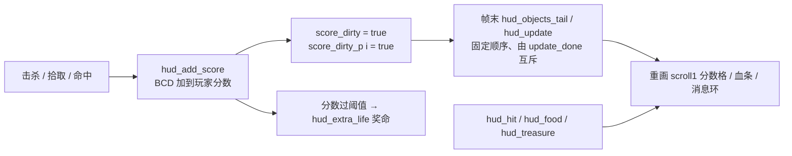

> 设计本意：**加分只改状态 + 置脏标志，重绘被固定到帧末一次**。任何一帧里加分发生几次、在哪个子系统发生，都不改变"重绘发生在哪一步"——这正是 §14.5 主线在反馈层的实例。

## 26.3 wof：加分是事件队列里的一项

`投递击杀加分事件_对应ASM_126D0`（`Cps1EventObjectRuntime.cs:357-380`）：

```
if Hp >= 0: return
if OBJ.type == 0: return
if ComboLev(+$AE) == 0: return
parameter = 0x0200 | OBJ.+$7F
写入公共事件_对应ASM_12AE(type = 0x0018, parameter)     # 投递到 0xD000 事件队列
```

即：**击杀不直接写分数，而是往 §19 那条 `ROM 0xD000` 事件队列投一项**，由 slot15 协程 `trap #4` 等待后按类型分发（§19 已记录：`u400 f=14` FBA 消费 2 项、CS 帧末「排空」消费 3 项，多 1 项）。`Cps1EnemyAI.cs` 多处死亡路径都会调它（`:3725, :3791, :7629`）。

HUD 本身是 `Cps1HudRuntime.cs:3` 的「0x29C4 HUD 状态机」，状态分散在多个全局槽：`HUD_STATE_BASE (A5+0x288)`、`HUD_QUEUE_BASE (A5-0xB28)`、`PLAYER_SCORE_BCD_BASE (A5-0x74)`、`PLAYER_LIVES_BASE (A5-0x65)`、`HUD_HIGH_SCORE_MARK_SLOT (A5-0x75)`，加上多张 tile 表（`0x2FCE / 0x0EEA / 0x2FE6 / 0x0EFE / 0x11410`）与 `重绘玩家信息_可能对应ASM_305A`。`Cps1Item.cs:127` 自标「道具得分必须等确认 CPS1 的拾取事件索引后再接入 `0xD34`，不能把十进制直接写进 BCD 槽」——**得分链路在 repo 里仍未全接通**（§21.6 已记，按「不过度怀疑 rep 侧」这只是该模块的对齐状态）。

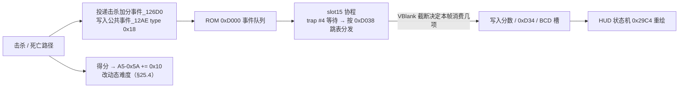

> 得分还同时是 §25.4 的动态难度输入（`A5-0x5A += 0x10`）。所以 wof 里"这一分有没有被消费"不只影响 HUD，还会往后影响敌人概率门——**反馈层和难度层共用同一条事件链**。

## 26.4 回到用户最初的问题：执行次数不确定为什么伤到 wof 的分数

用户最早问（阶段 A）：「我做 wof 的最大困难是随时被硬件中断无法确定有些函数的执行次数和完整度」。§19 记录了具体形态：`Cps1EventQueueTask.cs` 注释「一帧内消费几项取决于本帧扫了几轮 0x0700（VBlank 截断决定），宿主无法精确复现」，实测 FBA 消费 2 项、CS 排空 3 项。

把它与 §26.3 拼起来就得到因果链：**wof 的加分是事件队列项 ⇒ 一帧消费几项不确定 ⇒ 分数写入的帧与次数不确定 ⇒ 逐字节对拍（含 GFXRAM / BCD 槽）会差**。这不是某个函数写错，而是"反馈被挂在协作式内核的调度上"这一组织方式带来的。

dino 的对应做法（§26.2）不是"解决了中断"，而是**把重绘从内核调度里摘出来，固定成帧末的脏标志消费**；再叠加附录 A.5 已记录的取舍——`step/lagsync` 把 lag / catch-up 显式豁免，不模拟原机 CPU 时间片。诚实表述：dino **把不确定性移出了真值范围**，而不是复现了它；§20 的 `Scene` / `lag` 记账是"把跨 vblank 的结果显式记账"，与 wof 想逐字节复现每一轮扫描是两条路。

## 26.5 逐项对照

| 维度 | dino | wof |
|---|---|---|
| 加分入口 | `hud_add_score(0x10036)` 直接 BCD 加 | `投递击杀加分事件_126D0` → `写入公共事件_12AE(0x18, param)` |
| 中间层 | `score_dirty` / `score_dirty_p[3]` 脏标志 | `ROM 0xD000` 事件队列 + slot15 协程 |
| 重绘时机 | 帧末 `hud_objects_tail` / `hud_update`，`update_done` 互斥 | 队列被消费时；一帧几项由 VBlank 截断决定 |
| 分数表示 | BCD（`bcd_add32 / abcd / to_bcd`），存 `Player.+$100` / `Stats` | BCD 槽 `A5-0x74`；`Cps1Item.cs:127` 自标待接入 `0xD34` |
| 敌人血条 | `hud_hit / hud_hit_credit`，消息环 + `g.hud.boss` | `Cps1HudRuntime` 的 0x29C4 状态机 + tile 表 |
| 奖命 | `hud_extra_life(0x6B98)` 按 `score_prev` 越 DIP 阈值 | 本轮未展开，不臆断 |
| 旁链 | 分数 → 奖命 / 血条 / 消息 | 得分 → `A5-0x5A += 0x10` → 动态难度（§25.4） |

## 26.6 主线闭环：把「何时让玩家看到」也做成显式结构

| 出处 | 被显式化的东西 |
|---|---|
| §13 / §14 / §21.7 / §22 / §24 | 这一帧写、下一帧读（列表 / `prev` / 状态字节 / 互检） |
| §20 | 顶层任务的 slot 顺序、`Scene.sleep`、`lag` 记账 |
| §23 | 显示延迟按通道分档（0 / 1 / 2 帧） |
| §25 | 跨整局的时间推进（分钟级计时器、挂起队列） |
| **§26（本轮）** | **游戏状态 → 玩家可见反馈的重绘时机**（dino 帧末脏标志；wof 事件队列消费） |

结论：整份笔记的主线在反馈层收口——dino 连"什么时候把分数画出来"都做成固定顺序的一步，于是"本帧加了多少次分"不影响验收；wof 把它挂在协作式内核上，于是内核调度的一次多消费就变成逐字节差异。这与 §19（事件队列）、§20（两套循环）、附录 A.5（lag 豁免）、A.8.3（dump 桥接点）是同一个问题的四个切面，也直答了用户最初的困惑。

## 26.7 本轮边界与待办回执

- **补读确认**：wof 侧 `Cps1EventObjectRuntime.cs:126D0` / `Cps1HudRuntime.cs:29C4` 在 repo 里已有 ROM 直译与 FBA 实测注释；`Cps1Item.cs:127` 的"得分待接入 0xD34"是该模块的对齐状态，不作整体设计判断。
- **未做（保留，不扩张）**：`hud_objects_tail` / `hud_update` 逐行展开；消息环 / 血条段表逐项；`bcd_add32` 逐字节；wof `0x12AE` 公共事件写入全文、`0xD038` 跳表逐项、HUD 各 tile 表内容、奖命链路。
- **未新增 ROM 取证**，全部以两份 repo 源码为准（§11.0）；**未考证发行先后**，沿用用户给定前提。

---

# 第二十轮：搓招 / 指令技 —— 输入序列怎么变成一招

> 视角：只谈**游戏逻辑本意**（用户 11-06「rs 和 cs 表面的编程和硬件差异不重要，那不是游戏本意」）。本轮把 §6.1 第 1 条「搓招输入层独立」从现象展开成机制，并接回 §14「输入层帧内优先权」。
> 边界：repo 侧为主，**不新增 ROM 取证**（§11.0）。wof 侧 `Cps1PlayerZhaoyun1CA46.cs:104-147` 是带逐条 ROM listing 的直译，按用户「不过度怀疑 rep 侧」只作补读，不改 §0–§26 结论。
> 取证：`dino-rs/.../game/player.rs:33-34, 147-151, 918-929, 960-1005, 1083, 1255, 1587-1599, 3489`；`wt1/wof_cs/src/Cps1PlayerZhaoyun1CA46.cs:102-147, 149-175, 326, 458-476, 551-614`、`Cps1PlayerMulti.cs:44-61, 330-382, 753, 859-890`。

## 27.1 一句话对照：独立 FSM vs 编进角色主状态机

| | dino | wof |
|---|---|---|
| 放在哪 | 独立 `player_command_fsm`（0x6AC8），在 `player_frame` 里与玩家主状态机**并行**跑 | 编进**每个角色主状态机的入口**（赵云 0x1CA46 的前 0x98 字节就是搓招缓冲） |
| 状态变量 | `cmd_state 0/2/4` + `cmd_t` 按角色的两段时间窗 + `cmd_flag` 结果位 | `RKey1(+0xB0)` 一个带符号字节三态：`>0` 搓招中 / `<0` 已确认倒计时 / `=0` 空闲；`RKey1Left(+0xB1)` 计时 |
| 检测与执行 | **分离**：FSM 只判序列，置 `cmd_flag`，由主状态机在别处消费 | **合一**：同一入口先判搓招，再按 `ActStatA` 查跳表分派（`case 0x0E` 直接是必杀态） |
| 角色差异 | `command_time` 表按角色给 `t1/t2` 两个窗口长度 | 每角色一整套主状态机 + 角色特有的 `UPPERCUT_ATK_TABLE` |

## 27.2 dino：三态时间窗 FSM，检测与执行分离

`player_command_fsm`（`player.rs:960-1005`，0x6AC8）的序列是 **down → up → attack while holding up**，每一段都有按角色的时间窗：

```
ch = player.id & 3
[t1, t2] = player_pd().command_time      # 每角色两窗长度

switch cmd_state:
  0:  if prev != held && prev&0xF == DOWN:   # 输入变化、且上一帧恰好是"下"
          cmd_t = t1[ch]; cmd_state = 2
  2:  if --cmd_t 超时: cmd_state = 0
      elif held&0xF == UP:                   # 在 t1 窗内摇到"上"
          cmd_t = t2[ch]; cmd_state = 4
          # 同帧落入 state 4（0x6B44）
          if --cmd_t 超时: cmd_state = 0
          elif pressed&ATK && held&0xF == UP: cmd_flag = 2
      elif held&ATK: cmd_state = 0           # 中途按攻击 → 作废
  4:  if --cmd_t 超时: cmd_state = 0
      elif pressed&ATK && held&0xF == UP: cmd_flag = 2; cmd_state = 0
```

关键在**帧内位置**（`player.rs:927-929`）：`player_frame` 先 `p.cmd_flag = 0`，紧接着 `player_command_fsm(i)`，之后才轮到主状态机。而 §14 已确立 `player_frame` 更早的顺序是 `prev = held` → `held = cur` → `pressed` → `script_player_hook` → `input_lock`。所以 **FSM 读到的 `prev/held/pressed` 正是三层覆写之后的输入**；脚本覆写与 `input_lock` 会一并影响搓招判定，不需要另写一套过滤。

结果位 `cmd_flag = 2` 不自己出招，而是被主状态机在几个入口消费：

```
player.rs:1255   if atk_buf==0 && cmd_flag==2 -> player_command_move_entry(i)
player.rs:1083   0x24 => player_cmd_dash(i)         # 0x19DDA，指令技冲刺态
player.rs:3489   player_grabbing 开头: if cmd_flag==2 -> player_command_move_entry(i)   # 连 §24：抓取中也能接指令技
```

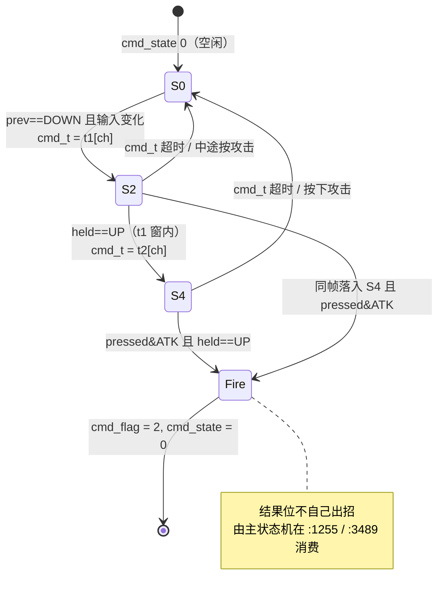

> 设计本意：**"这段时间里输入序列对不对"与"用哪一招"是两个独立问题**。FSM 只回答前者，把答案压成一个 `cmd_flag`；主状态机按当前 `mode/sub/act` 决定是站立发、跑动发还是抓取中发。这与 §2 四层状态字节分工一致，也让 §15 / §24 的附加玩法不必重写搓招。

## 27.3 wof：一个带符号字节 + 每角色主状态机入口

赵云主状态机 `0x1CA46`（`Cps1PlayerZhaoyun1CA46.cs:102-147`，文件头就是逐条 ROM listing）**入口先跑搓招缓冲，再分派主状态**：

```
tst.b RKey1(+0xB0)
  < 0 (已确认倒计时):  --RKey1Left; 归零则 RKey1 = 0                    # 1CAD4..1CADA
  > 0 (搓招中判方向):  d1 = Input & 0x0F
                        上 0x08 -> Xuan2(+0xC2)=0 ; 下+右 0x0A -> -5 ; 下+左 0x09 -> +5
                        命中: RKey1Left = 0x0C ; RKey1 = 0xFF (st.b)     # 1CAC4..1CACE
  = 0 (空闲):          下键? 按住 -> RKey1Left++ 到 4 停住
                        松开且满 4 -> RKey1 = 2 ; RNG()&0x1F 查 0x1F5C 表给 RKey1Left  # 1CA7C..1CA96
1CADE:  D0 = ActStatA(+0x28); jmp 跳表 0x1CAEC[D0]     # 之后才是主状态分派
```

即：`RKey1` 的**符号**编码了三态（正=搓招中、负=已确认倒计时、零=空闲），`RKey1Left` 既是蓄力计数也是倒计时，一个字节省掉了显式状态枚举。搓招确认后 `ActStatA` 分派里 `case 0x0E: 赵云_必杀_对应ASM_1CCC4`（`:326`，0x1CCC4 下劈起跳+落地）——**检测结论直接就是主状态机的一个状态号**，不经过中间结果位。

角色差异（连 §16「共享零件 + 每类自己的分派」）：

| 角色 | 主状态机 / 必杀入口 | 特色 |
|---|---|---|
| 赵云 | `0x1CA46` / 必杀 `0x1CCC4` | 逐指令直译，本轮主要取证对象 |
| 关羽 | 下上拳 `0x1B0C2`（通用形态 D00） | `Cps1PlayerMulti.cs:763-782` 参照 |
| 张飞 | 必杀 `0x1BE38`、下上A冲拳 `0x1BD48` | 下上拳确认时 `VelX=±0x300` 可衔接冲刺（`:879-880`） |
| 魏延 | `UPPERCUT_ATK_TABLE = {0x60,0x250,0x420,0x600,0x7E0}` | 距离感知下上拳（`:106, :870`） |
| 黄忠 | 同上表，远程最高 | `Cps1PlayerMulti.cs:44-46` |

`Cps1PlayerMulti.cs:48-49` 明写「下上拳攻击类型（角色特有）」+ `UPPERCUT_ATK_TABLE`；`检测下上搓招_1F7C` 被 `:338/364/382` 多处调用，是共享检测；但每个角色的主状态机各自实现（`:1564` 注释「先把 0x1CA46..0x1D13x 按 ROM 逐指令直译，再接线」）。

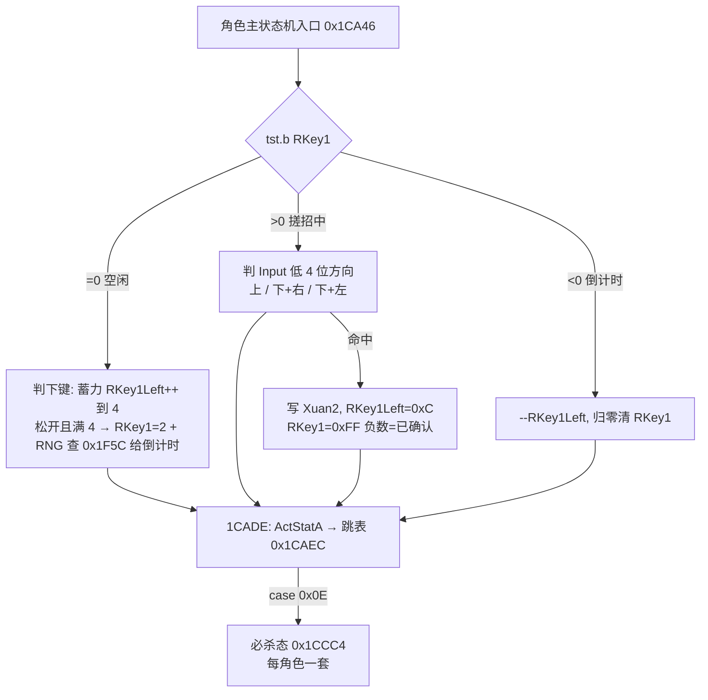

> 与 dino 的对照不是"谁更先进"，而是**同一个设计意图的两种落点**：dino 把搓招从角色状态机里**拆出来**做成共享输入层，角色差异压成一张 `command_time` 表；wof 把搓招**编进**每个角色主状态机，角色差异体现为整段入口代码 + 攻击表。后者正是 §11.2 / §16 / §22.4 / §25.4 反复出现的「共享检测 + 每类自己的分派」在玩家侧的第四次复现。

## 27.4 逐项对照

| 维度 | dino | wof |
|---|---|---|
| 位置 | `player_command_fsm` 独立，`player_frame` 内先于主状态机 | 角色主状态机入口前 0x98 字节，之后才 `ActStatA` 分派 |
| 状态 | `cmd_state 0/2/4` 显式枚举 + `cmd_t` 两窗 | `RKey1` 符号三态（正/负/零）+ `RKey1Left` 复用计数 |
| 输入序列 | down → up → attack，时间窗 `t1/t2` 约束 | 下蓄力松开 + A 键；`>0` 分支再判方向（上 / 下+右 / 下+左） |
| 时间约束 | 两个按角色查表的窗口，超时归零 | 蓄力满 4、`RKey1Left=0xC`、RNG 查 `0x1F5C` 表给倒计时 |
| 结果传递 | `cmd_flag` 结果位 → 主状态机在 `:1255` / `:3489` 消费 | 结论即 `ActStatA` 的一个状态号（`case 0x0E`） |
| 角色差异 | `command_time[t1][t2]` 一张表 | 每角色整套主状态机 + `UPPERCUT_ATK_TABLE` + 各自必杀入口 |
| 与输入层关系 | 读 §14 三层覆写后的 `prev/held/pressed` | 读 `+0xA0` Input / 低 4 位方向 |
| 与附加玩法 | 抓取中 `cmd_flag==2` 也能接指令技（`:3489`，连 §24） | 本轮未展开马上/载具下的搓招，不臆断 |

## 27.5 主线闭环

| 出处 | 本轮对应 |
|---|---|
| §14 输入层帧内优先权 | `cmd_flag=0` → FSM → 主状态机，读的是脚本 / `input_lock` 覆写后的输入（§27.2） |
| §2 四层状态字节 | 搓招 FSM 是**平行于** `mode/sub/act` 的第五个状态位，不挤进对象头 |
| §6.1 第 1 条 | 「搓招输入层独立」由现象展开为 `0x6AC8` 的三态时间窗 + `cmd_flag` 协议 |
| §16 / §11.2 / §22.4 / §25.4 | wof「共享检测 + 每类自己的分派」在玩家侧第四次复现（§27.3） |
| §24 投技 | `player_grabbing` 开头 `cmd_flag==2` 打断抓取进指令技（`:3489`） |
| §14.5 主线 | `cmd_flag` 是"这一帧确认、主状态机消费"的结果位；wof `RKey1` 是跨帧倒计时——又是两种「显式时间结构」 |

结论：把"一串输入"变成"一招"这件事，两边都做成**跨帧状态机**而非单帧比较；差别只在它挂在输入层还是挂在角色状态机上。dino 因此能用一张 `command_time` 表覆盖四个角色并让抓取/跑动共用同一招，wof 因此让每个角色的必杀各有自己的分派与衔接（张飞冲刺、魏延距离感知）。这与整份笔记「把瞬时事件改写成可续存的显式结构」的主线一致。

## 27.6 本轮边界与待办回执

- **补读确认**：wof 侧 `Cps1PlayerZhaoyun1CA46.cs` 带逐条 ROM listing，`Cps1PlayerMulti.cs` 有角色特有攻击表与多次调用；本轮据此写入 §27.3，未做额外 ROM 逐指令对照，也未改 §0–§26 结论。
- **未做（保留，不扩张）**：`player_command_move_entry` / `player_cmd_dash` 逐函数展开；`command_time` 表逐角色数值；wof 各角色主状态机（关羽 / 张飞 / 黄忠 / 魏延）全文、`检测下上搓招_1F7C` 实现、`0x1CAEC` 跳表逐项；两游戏"马上 / 载具下能否搓招"是否对应（不臆断）。
- **未新增 ROM 取证**，全部以两份 repo 源码为准（§11.0）；**未考证发行先后**，沿用用户给定前提。

---

# 第二十一轮：同屏预算与波次编排 —— 一关的量怎么被切到多帧

> 视角：只谈**游戏逻辑本意**（用户 11-06「rs 和 cs 表面的编程和硬件差异不重要，那不是游戏本意」）。本轮把 §19「脚本格式」、§13「census 反馈闭环」、§20「顶层任务机」、§23「摄像机」串成"一关的量如何逐帧放出来"。
> 边界：repo 侧为主，**不新增 ROM 取证**（§11.0）。wof 侧 `Cps1LevelScript.cs` / `Cps1EnemySpawn.cs` 里大量 `_无对应ASM` 的宿主补偿、调试开关、逐帧对拍修正，按 §0 的约定**剥掉不谈**；只读其中描述原机关卡 / 波次控制器的部分，按用户「不过度怀疑 rep 侧」只作补读，不改 §0–§27 结论。
> 取证：`dino-rs/.../game/spawn.rs:14-70, 160-278`、`prop.rs:555-625`、`boss.rs:203-258`、`rank.rs:313-323`、`flow.rs:430-432`、`car.rs:51-84`；`wt1/wof_cs/src/Cps1LevelScript.cs:17-58, 90-118, 448-476, 1074-1088, 1180-1254`、`Cps1EnemySpawn.cs:30-51, 82-99`。

## 28.1 一句话对照

两边都**不把一关的敌人一次性铺满**，而是做成"计数 + 阈值 + 计时器"的跨帧节流系统；差别在**计数是什么**、**超时做什么**、**门控写在哪**：

| | dino | wof |
|---|---|---|
| 计数 | `g.alive`：census 数出来的**存活人头** | `A5+0x1AD`：20 槽处理池里各对象 `+0xAC` 的**权重和** |
| 阈值 | `thr[players_minus_one % 3]` 按在场玩家数分档 | `waveEnemyThreshold` / `gateEnemyThreshold` 由波次脚本记录自带 |
| 超时 | `wave_timer = 0x1C20`（7200 帧）归零 → `kill_all = 2` **清场且不给 killer 记分** | `waveTimer == 0` → **推进波次状态**，脚本继续，不清场 |
| 太满时 | 阈值未到 → 整组不推进（计时器仍在递减） | 权重超阈值 → `return`，**连计时器都不递减**，整个控制器暂停 |
| 门控载体 | **对象状态机**：波次 prop 的 `sub 0/2/4`、Boss 门控 prop | **关卡脚本解释器**：gate / wave controller + 相机 min/max 锁定 |

**就地补层（倒推，不是新机制）**：`re/specs/enemy/SPEC.md §9` 把第一关的谱逐条摊开后，§28.1 这张表还能再读一层——它不只是「一关的量怎么切到多帧」，也是**一场戏的段落怎么被编排出来**。

其一，除了 §6 那根全局的 rank / aggression 轴，关卡谱还会在特定段落把进攻性**钉在 1**（`0x3A0`，直到镜头走过 `0x4E1`），到 Area 1 又**拉到 7**（`0x100`，直到 `0x220`），两条都自带「镜头越过某处就解除」的条件。这一段的密度是谱里人挑的，不是全局轴算出来的；换的仍旧是节奏，不是敌人的状态机——和 §25.6「难度只拧节奏、不改打法」是同一件事在更大尺度上的样子。

其二，wave 1 的收尾写成 `[4,5,6] → GO`：场上还剩 4 / 5 / 6 人（按 1 / 2 / 3 人局）就放行，**不是清零才放行**；SPEC 明写剩下的敌人会跟着玩家走进下一屏。所以「这一段演完了」不是一个清场标志，是**场面稀疏到能走了**；结尾不是切干净，是渐弱，残敌变成下一段的引子。连同 `wave_end` 把「走过去 / GO / 设时限 / 进 Boss 区」都写成同一张波次表的一行，还有 wave 3 那种**不放人、只负责走过去**的空波，可以看出编舞的不只是每一招的帧，**整场戏的段落切换也写在谱里**，由场上的局部事实放行：剩几个人、镜头到哪、玩家回到没回到正常控制态。它仍是一个个当事对象各自读出来的结果，不是一个不读处境的中央裁决说「这一幕结束」。

边界：这里读的是 `spawn_command` / `wave_ctrl` / `wave_end` / `camera_lock` 这些**跨关通用机制**在第一关谱里的实例，不是把第一关的剧情编排或单个 Boss 的出场当通则。`0x3A0` / `0x100` / `4,5,6` 的具体数值是量，按 §94.3 不转成「取值 → 意义」，只登记「有这一段、由谁解除」。两侧波次组织法的差别仍按 §28.1 表，不评优劣、不串成两款游戏共同架构。

## 28.2 共同骨架：一关的量由四个闸门切到多帧

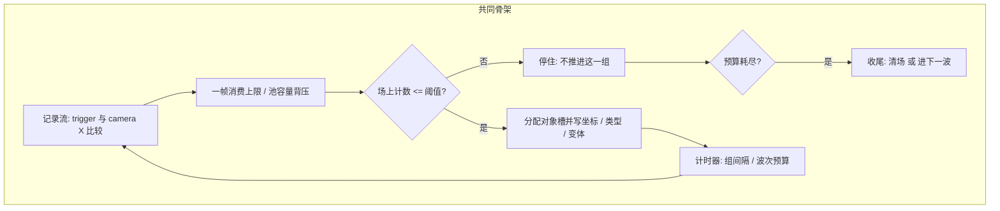

四个闸门是：① **触发**（记录自带的 camera X/Y 阈值，见 §19 / §23）；② **背压**（池容量或单帧记录条数上限）；③ **同屏门**（存活计数 vs 阈值）；④ **计时**（组间隔 / 波次预算）。任何一帧"消费几条记录"都是这四者共同决定的，不是脚本表长决定的——这正是用户最初「硬件中断 → 函数执行次数不确定」在关卡层的又一实例（§20 顶层任务机、§26 加分事件队列之后第三次出现）。

## 28.3 dino：人头数 + 7200 帧预算 + 超时清场

**计数来自 census**（§13）：`spawn.rs:17` 的 `g.alive` 是"上一次 census 数出的存活敌人数"，`g.alive_run` 是运行计数；`flow.rs:430-432` 在 area start 把 `alive / wave_timer / kill_all` 一并清零，`rank_area_start` / `time_area_start` / `spawn_reset` 是同一次区域切换的配套调用（`spawn.rs:4-9`）。

**阈值按玩家数分档**：`prop.rs:559-566` 取 `w.groups[g].thr[players_minus_one % 3]`，`boss.rs:210-214` 取 `assets.boss.alive_limit[...]`、`boss.rs:250` 取 `thr[...]`。同一张波次表，1 / 2 / 3 人时放敌量不同；记录级还有 `spawn.rs:253-267` 的 `flags & 0x60`（按 `players_minus_one` 跳过）与 `flags & 0x18`（按 `w.level` 难度跳过）。

**超时是主动清场**：`prop.rs:572-574` 在终组 `wave_timer < 0` 时写 `kill_all = 2`，`spawn.rs:20` 注明"2 = no credit (wave timeout)"；相对地 `kill_all = 1` 才把击杀记给 `killer`（`car.rs:84`、`boss_common.rs:298`）。也就是说"玩家拖太久"会由系统把场上敌人清掉、且**不把分数记到任何玩家头上**——这是一条明确的关卡结算规则，不只是计时显示。

**背压在 allocator**：`spawn.rs:195-199` 的 list1 在 `spawn_alloc` 返回 `None`（池满）时 `l1 += 1` **丢弃该记录并 `break` 停止消费后续记录**；`spawn.rs:268` 的 `spawn_record` 池满返回 `false`。注意 `prop.rs:594-596` 的波次 prop 对池满**不中断**，只是不给 `SPAWNED` 计数——两种背压策略并存，取决于记录来自帧末生成表还是波次 prop。

**就地补层（两侧对照，本轮回源实读两侧实现，不是新机制）**：§28.1 表里「超时做什么」「太满时计时器走不走」那两格，各读一遍实现就能倒推出「**时间归谁管**」的差别。

- dino `prop.rs:563-574`：等阈值那一拍**先无条件**把 `wave_timer` 减一，再判 `bt != 0 && alive > lim` 才 `return`；场上再挤，预算照走。走到终组（`g >= groups.len()`，读到负 end word）且预算已减成负数，写 `kill_all = 2`（`spawn.rs:20` 注明 `2 = no credit`）。也就是拖到这一段的预算耗尽，系统主动把场上敌人清掉，**而且不把击杀记给任何玩家**。
- wof `Cps1LevelScript.cs:1222-1233`（`二级波次等待计时`）：`return` 的门在计时器**之前**——`取得敌人处理权重() > waveEnemyThreshold` 就直接返回，连 `waveTimer--` 都不执行；真走到 0 也只是 `切换二级波次状态(waveScriptPointer)` 把脚本指针拨到下一条，不清场、不结算。

⇒ 同一个「这一段等太久」的时刻，两款游戏让时间做完全不同的事。dino 里时间是一个**会自己数、数满了替场面做决定**的当事方，还顺手把拖延能换来的收益（分数）收走——不扣血、不弹提示、不打断动作，只是让「等」不划算；wof 里时间是脚本的一个读数，决定权仍在「脚本读到哪一行」与「场上还剩多少权重」两处，它不替任何人收拾场面。

这跟 §28.1 表后那段「这一段演完了由局部事实放行」是同一条线的两侧对照：dino 连拖太久都由系统清场回嘴，wof 把这一拍留给脚本，不额外加一层裁决。两边都把「一关的量」切成多帧，差别不在有没有计时器，在**计时器是一条会结算的规则，还是一段不带后果的节拍**。

边界：repo 侧为主、不新增 ROM 取证；wof 侧函数名带 `可能对应ASM` / `_无对应ASM` 是宿主补偿标记（§0 / `notes/08`），按「不过度怀疑 rep 侧」只作补读，不等于移植欠账，也不臆断原机有无别的写法。只限定到这两条链（dino `prop_wave_wait` / wof `二级波次等待计时`），不写「两款游戏所有计时器都如此」；不评优劣、不串成共同架构、不把未登记写成缺失；逐项表值按 §94.2 属举例，不展开。

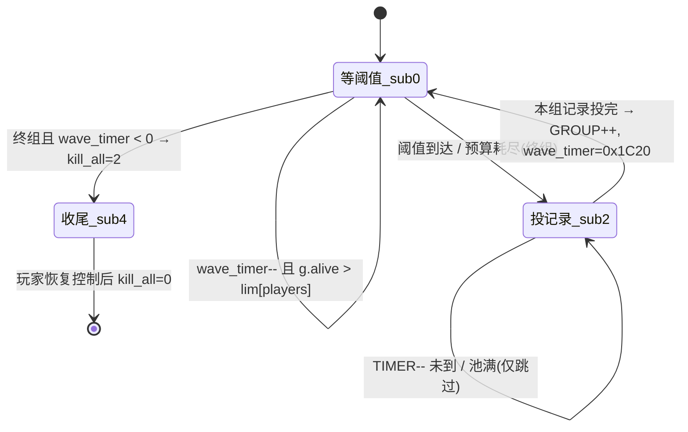

## 28.4 wof：权重和 + 相机锁定 + 单帧 64 条上限

**计数是"权重"而非人头**：`Cps1EnemySpawn.cs:44-51` 定义 `0x22D06` 扫描 20 个 `0xE0` 槽（处理池 `A5+0x40BC`），`:82-99` 给出 ROM 逐条 `move.b (0xac,a0),d0 / add.b d0,(0x1ad,a5)` —— **每个存活敌人把自己 `+0xAC` 的权重累加进 `A5+0x1AD`**。重兵种可以顶多个轻兵种，这比单纯数人头更能表达"同屏预算"。`:97-99` 明确该字节就是波次生成门的比较对象。

**同屏门同时卡住计时器**：`Cps1LevelScript.cs:1189` 生成前判 `取得敌人处理权重() > waveEnemyThreshold` 就 `return`；`:1230-1233` 更关键——波次等待里同一判断在 `waveTimer--` **之前**，所以场上太满时**连倒计时都不走**，整个波次控制器暂停，而不是"超时后强制推进"。`waveTimer` 归零的动作是 `切换二级波次状态`（推进脚本指针），不是清场。

**门控是空间约束**：`:1080-1087` 的 gate 把 `gateEnemyThreshold` 与 `gateLockedMinX/MaxX`（当时的 `CAMERA_MIN_X/MAX_X`）一起存下并置 `gateWaiting`；`:92-107` 的调试开关也只是在这两个锁定的相机值之间切换。结合 §23，摄像机在 wof 这里不只是显示/触发，还是**"敌人没清完不许往前走"的门闩**。

**背压按记录条数**：`:40` `MaxRecordsPerFrame = 64`、`:455` 的 `for (int records = 0; records < MaxRecordsPerFrame; records++)` —— 一帧最多消费 64 条关卡脚本记录。与 dino 按池容量截断不同，这是按条数截断；两者目的相同：不让一帧把整关铺完。

**玩家数也是记录条件**：`:1183-1188` 的 `requiredPlayers > (A5+0x1AC)` 时跳过该波次记录，与 dino `thr[players]` 呼应，但 wof 把它做成"这条记录需要至少几人"的逐记录条件，dino 做成"这一组最多放几个"的分档阈值。

## 28.5 逐项对照

| 维度 | dino | wof |
|---|---|---|
| 触发 | `spawn_trigger_reached`：横版 `t <= cam_x`，纵向场景按 `cam_y` 有符号比较（`spawn.rs:225-233`） | 关卡脚本记录 `trigger:word` vs `cameraX`（`Cps1LevelScript.cs:17, 463`） |
| 记录格式 | list1 14B / list2 16B，`flags & 0x80` = 命令不生成对象（`spawn.rs:185-222`） | `trigger:word, type:byte, payload`，命令表 `0x10744`（§19） |
| 同屏计数 | `g.alive` 人头（census，`spawn.rs:17`） | `A5+0x1AD` 权重和（20 槽 × `+0xAC`，`Cps1EnemySpawn.cs:44-51`） |
| 阈值来源 | 表 `groups[g].thr[3]` / `boss.alive_limit[3]` 按玩家数（§25 rank 同族） | 波次脚本记录里读 `waveEnemyThreshold` / `gateEnemyThreshold`（`:1080, :1130, :1246`） |
| 玩家数影响 | 分档阈值 + 记录级 `flags & 0x60` 跳过 | 逐记录 `requiredPlayers` + `A5+0x1AC` 比较（`:1183`） |
| 难度影响 | 记录级 `flags & 0x18` 按 `w.level` 跳过（`spawn.rs:258-267`） | 本轮未展开，不臆断 |
| 计时 | `wave_timer = 0x1C20` 组间重载（`prop.rs:604`），`rank.rs:382/388` 另有 `+0x258 / +600` 时间奖励 | `waveTimer` 从脚本记录装载后递减（`:1224-1231`） |
| 超时后果 | `kill_all = 2` 清场、不记分（`prop.rs:573`） | 推进波次状态 / 收尾门（`:1232-1233, :1236-1253`），不清场 |
| 太满后果 | 池满丢记录 + break；波次 prop 仅跳过不中断 | 权重超阈值 → 生成与计时**一并暂停** |
| 背压 | 对象池容量（`spawn_alloc` 返回 `None`） | 单帧 64 条记录上限 |
| 门控载体 | 波次 prop / Boss prop 的 `sub` 状态（`prop.rs`、`boss.rs:224-258`） | 关卡脚本解释器的 gate / wave controller |
| 相机的第二重角色 | 触发 + 生成坐标基准（`spawn.rs:269` `screen_x` 时 X += cam_x） | 触发 + **锁定 min/max 作为清场门闩**（`:1081-1082`） |

## 28.6 伪代码：两边并排

```
# dino：帧末生成表（spawn.rs:167-223）+ 波次 prop（prop.rs:555-613）
while record.trig <= cam_x:                       # 或纵向 cam_y
    if record.flags & 0x80: spawn_command(record); cursor++; continue
    Some(h) = spawn_alloc(flags) else { cursor++; break }   # 池满：丢弃并停消费
    write(h, class, x, z, var); cursor++

# 波次 prop sub0
wave_timer -= 1
lim = groups[g].thr[players_minus_one % 3]
if wave_timer != 0 and g.alive > lim: return     # 人还多，整组不推进
if g == last: sub = 4; if wave_timer < 0: g.kill_all = 2; return
sub = 2; REC = 0; TIMER = groups[g].spawns[0].trig

# wof：20 槽权重 + 关卡脚本（Cps1EnemySpawn.cs:82-99 / Cps1LevelScript.cs:455, 1222-1233）
weight = sum(pool[s].OBJ_AC for s in 0..19 if pool[s].live); A5[0x1AD] = weight
for records in 0..63:
    trigger = rw(scriptAddress)
    if trigger >= 0 and camera_x < trigger: break
    dispatch(type)                                # 0x04 生成 / gate / wave

# 波次等待
if weight > waveEnemyThreshold: return            # 太满 → 连 waveTimer 都不递减
if waveTimer != 0: waveTimer--
if waveTimer == 0: next_wave_state()

# gate
gateEnemyThreshold = rw(secondaryScript + 2)
gateLockedMinX, gateLockedMaxX = CAMERA_MIN_X, CAMERA_MAX_X
gateWaiting = true                                # 相机锁死，清场前不前进
```

## 28.7 主线闭环与本轮边界

| 出处 | 本轮对应 |
|---|---|
| §19 脚本系统全景 | 补上"推进时钟写在哪里"之后的**第二问**：一帧到底推进几条，由同屏门 + 背压决定 |
| §13 census 反馈闭环 | `g.alive` 不只是 AI 选目标用，**还是关卡放量的输入**（§28.3） |
| §20 顶层任务机 | 波次门控写在对象状态机（dino）/ 脚本解释器（wof），与"5 任务按 slot"是上下两层，不冲突 |
| §23 卷轴 / 摄像机 | wof 把相机 min/max 当**清场门闩**，是摄像机除触发与显示延迟外的第三重角色 |
| §25 动态难度 / rank | 两边都按玩家数调节放量；dino 还按 `w.level` 跳过记录，与 `rank_tick` 共用同一个"跨整局状态" |
| §26 / 用户最初「执行次数不确定」 | 关卡层第三次回扣：脚本一帧消费量取决于池容量 / 权重门 / 计时器 / VBlank 截断，不是表长 |

结论：一关的敌人不是"表里有几条就生成几个"，而是**被同屏预算按帧挤出来的流**。dino 把预算做成"人头阈值 + 7200 帧预算 + 超时清场"，挂在对象状态机里；wof 做成"权重阈值 + 相机锁定 + 单帧 64 条"，挂在关卡脚本解释器里。两边都让"清场"成为推进条件，但 dino 的超时是**结算**（清场且不记分），wof 的超时是**续算**（推进脚本）。这与整份笔记「把瞬时事件改写成可续存的显式结构」的主线一致，也把 §6.1「dino 更成熟」里的"脚本系统"从格式层推到了编排层。

- **未做（保留，不扩张）**：`prop_wave_script` 各关组表逐项数值；`Cps1LevelScript.cs` 全部 `type` 命令逐条展开；`0x53B02` 波次表与 `0x1066C` 关卡表逐字节；wof 难度如何影响波次阈值；两游戏"波次超时"是否都有玩家侧提示（不臆断）。
- **未新增 ROM 取证**，全部以两份 repo 源码为准（§11.0）；**未考证发行先后**，沿用用户给定前提。
- 按 §0 边界，wof 侧 `_无对应ASM` 的宿主补偿 / 调试开关 / 逐帧对拍修正未纳入设计对照；本轮不据此评价 rep 侧实现。

---

# 第二十二轮：受击之后的恢复链 —— 倒地、起身、无敌、眩晕

> 视角：只谈**游戏逻辑本意**（用户 11-06）。本轮把 §22「受击反应」从"命中帧写了个编号"往后推一步：编号之后那条**有出口的跨帧状态链**长什么样。
> 边界：repo 侧为主，**不新增 ROM 取证**（§11.0）。wof 侧 `Cps1Collision.cs` 的 `调试无敌锁定_无对应ASM` 等宿主开关按 §0 剥掉，只读描述原机 `+0x78` 无敌与倒地字段的部分；按用户「不过度怀疑 rep 侧」只作补读，不改 §0–§28 结论。
> 取证：`dino-rs/.../game/player.rs:47, 107, 130, 139, 144, 147, 152-155, 490-493, 850-856, 1082, 1581-1585, 2659-2674`、`enemy_combat.rs:1, 66-67, 879, 1284-1410, 1453-1518`；`wt1/wof_cs/src/Cps1Collision.cs:1390, 3600`、`Cps1Types.cs:314, 356-372, 972, 1039, 1051, 1065`、`Cps1EnemyAI.cs:44-49`。

## 29.1 一句话对照

受击**不是"扣血后结束"**，而是进入一条有出口的状态链：反应编号 → 动画 / 位移 → 起身 → 无敌窗口 → 回 idle。两边都有这条链，但 dino 把它做成**显式状态机 + 多个各管一段的计时器 + 一次带全局限流的起身决策**，wof 做成**对象字段 + 9 项反应分派 + 一个无敌字节**。

| | dino | wof |
|---|---|---|
| 反应入口 | `b.act` 分派 14+ 种（`0x04/0x06` 倒地、`0x08` 投掷、`0x0A/0x0C` 燃烧、`0x0E..0x18` 击退、`0x1C` 背后倒地、`0x1E` 起身、`0x20` 撞墙、`0x22` 踉跄） | 通用 9 项跳表 `0x7E68` + 每 `CharId` 段表（§22） |
| 无敌 | **按角色查表的时长** `invuln[(d0+ch)&15]`（0x6C2A），另分 `+0xF9` 受击 / `+0xEC` 复活两种 | `+0x78` 单字节，命中链入口 `tst.b (0x78,A1) / bne` 跳过 |
| 起身 | 敌人 `enemy_getup_or_die` 是**决策点**：HP 0 → 死亡 + 记 kill + 重掷 aggression；否则起身并掷眩晕 | `+0x99 DmgReaction` / `+0x9B` / `+0xA7 DownUpA` / `+0xB5 UpDown` 字段组 |
| 眩晕 | 起身完成那一刻 `enemy_dizzy_roll`，**五重门**（poise / 镜头 / rank / HP / 全局限流） | 本轮未展开到概率层，不臆断 |

## 29.2 共同骨架：受击是一条有出口的链

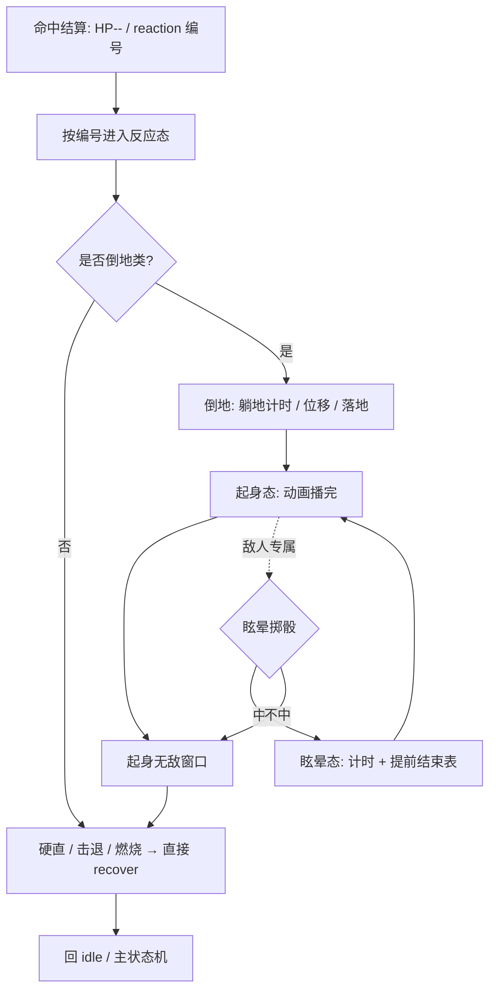

要点是**每个环节都跨帧且有各自的计时器**，所以"受击"在游戏中是一个过程而不是一个事件；这也解释了为什么 §12 说 dino 命中帧"只结算、不处决"——击杀 / 起身 / 眩晕都排在后续帧。

## 29.3 dino 玩家：四个计时器各管一段，无敌是查表得来的

`player.rs:130-155` 的对象头注释直接列出这条链的字段协议：

| 字段 | 含义 |
|---|---|
| `+0xCC` / `+0xCD` | tech roll 标志；`1` = 起身后眩晕，`2` = 死亡慢落 |
| `+0xE8` / `+0xE9` | 躺地计时；**上一次打中我的攻击序列号**（防同一击重复命中） |
| `+0xEC` | 复活无敌计时 |
| `+0xF6` / `+0xF9` | stun refill 计时；受击无敌计时 |
| `+0xBE` / `+0xBF` | 挣扎 mash 计量 / 冷却（§24 抓取复用同一套） |
| `+0x76` | **认领这个倒地玩家的敌人**（0x6606，敌人 AI 用）——倒地玩家仍是 AI 的目标资源（§13） |

`+0xE9` 的"上次攻击序列号"尤其关键：它把"这一击是否已经结算过"做成数据，而不是靠碰撞框这一帧是否还重叠。`+0xF9` 与 `+0xEC` 分开，说明**受击无敌**和**复活无敌**是两段时间窗，不是同一个布尔。

无敌时长不是常量：`player.rs:490-493` 的 `player_set_invuln(i, d0)`（0x6C2A）取 `player_pd().invuln[(d0 + ch) & 15]` —— **按角色 `ch` 与来源 `d0` 查表**；`player.rs:1514, 2421` 用 `d0 = 12` 设置，`:854-856` 每帧递减、归零才解除。

反应分派 `player.rs:2659-2674` 一口气列出 14+ 个 `act` 分支，`_ => player_recover(i)` 兜底；`player_recovery`（`:1581-1585`）只是"动画步进完成就回 idle"。也就是说**恢复链的出口是统一的**，入口才分流。

## 29.4 dino 敌人：起身是决策点，眩晕是稀缺资源

`enemy_combat.rs:1284-1307` 的 `enemy_getup_or_die` 把"倒地结束"分成两条：

```
if HP == 0:
    set_state(0x0400_0000) 死亡态; kills[who] += 1（car_mode 时全员 +1）
    return rank_reroll_aggression()        # §25：死亡会重掷 aggression
else:
    set_state(0x0202_1A00) 起身态; hit_anim(4); enemy_getup()
```

死亡不只是消失：它**记击杀数**（`g.kills`，与 §28 的 `g.alive` 同属关卡计数族）并**重掷整局 aggression**（`rank_reroll_aggression`，§25）。于是"打死谁、什么时候打死"会反馈到后续敌人行为概率——这是 §13「帧间反馈闭环」在打击结算里的延长。

`enemy_getup`（`:1309-1340`）在起身动画播完的那一刻调 `enemy_dizzy_roll`（`:1342-1370`）。这个掷骰有**五重门**：

1. `POISE_T != 0` → 不掷（poise 未耗尽，§17 的硬直累计）；
2. 敌人必须在**镜头内** `cam_x .. cam_x+0x180`，否则不掷（屏幕外不产生眩晕）；
3. 查 `DIZZY_ROW` 表，行由 `rank.aggression` 与 `b9a`（Boss 变体）决定，`rand()&0x1F` 命中掩码才过；
4. 按当前 HP 相对 `hp_bar` 的分档给不同权重；
5. **`g.dizzy_prev != 0` → 直接返回 false**：上一帧已有敌人眩晕时，本帧不再产生新的。

第 5 条把眩晕做成**全局稀缺资源**：同一时刻场上最多一个敌人在转圈。`enemy_getup` 的 step 分支（`:1320-1340`）还用 `DIZZY_END` 表按 `w.level` 决定眩晕能否提前结束，`g.dizzy` 计数每帧递增供下一帧的 `dizzy_prev` 使用（`spawn.rs:46-47`）。这又是「这一帧做什么、下一帧读什么」的 `prev` 快照习惯（§20.6 主线）。

## 29.5 wof：一个无敌字节挡在命中链入口

`Cps1Types.cs:314` 的 `[FieldOffset(0x78)] BS16 Invincible` 与 `Cps1Collision.cs:1390` 的 ROM 注释 `970A: tst.b (0x78,A1) / bne 下一个`、`:3600` 的 `9D42 move.b (0x78,a1),d0 / bne 9D54 Invincible!=0 跳过` 一致：**无敌是命中链最前面的一个字节判断**，非无敌才走后面的伤害 / 反应分派。

倒地 / 起身相关字段是分散的字段组（`Cps1Types.cs:356-372`）：`+0x99 DmgReaction`（注释写 `DownType?`）、`+0x9B OBJ9B`、`+0xA7 DownUpA`、`+0xB5 UpDown`；`Cps1EnemyAI.cs:44-49` 的 `S1_FALL = 0x08` 是受击态之一。§22 已确认 wof 的 9 项受击反应在 repo 侧有 ROM 直译分派（`Cps1Collision.cs:4882` 起）。

按 §0 边界，`调试无敌锁定_无对应ASM`（`Cps1Collision.cs:878-923`）是宿主调试开关，不纳入设计对照；本轮只取 `+0x78` 的原机语义，不据此评价 rep 侧实现。

## 29.6 逐项对照

| 维度 | dino | wof |
|---|---|---|
| 反应数量 / 分派 | `b.act` 14+ 分支 + 兜底 `player_recover`（`player.rs:2659-2674`） | 9 项通用跳表 + 每兵种段表（§22） |
| 防重复命中 | `+0xE9` 上次攻击序列号（`player.rs:139`） | 本轮未展开，不臆断 |
| 无敌表示 | 计时器，按角色 + 来源查表 `invuln[16]`（`player.rs:490-493`） | `+0x78` 字节，命中链入口 `tst.b / bne` |
| 无敌来源 | `+0xF9` 受击 / `+0xEC` 复活，**两段时间窗** | 单一 `Invincible` 字段 |
| 起身 | 统一出口 `player_recovery`；敌人 `enemy_getup_or_die` 是决策点 | `+0x99 / +0x9B / +0xA7 / +0xB5` 字段组 + `S1_FALL` |
| 起身后的分支 | 掷眩晕（五重门）、或死亡（记 kill + 重掷 aggression） | 本轮未展开到概率层，不臆断 |
| 眩晕限流 | `g.dizzy_prev != 0` → 全局同时最多一个（`enemy_combat.rs:1360`） | 本轮未展开，不臆断 |
| 击杀反馈 | `g.kills[who] += 1` + `rank_reroll_aggression()`（§25） | 击杀加分事件投递 `0x126D0`（§26） |
| 倒地者仍是资源 | `+0x76` 认领倒地玩家的敌人（§13 目标选择） | 本轮未展开，不臆断 |

## 29.7 伪代码与状态图

```
# dino 敌人起身链（enemy_combat.rs:1284-1340）
on knockdown_end(e):
    if e.hp == 0:
        state = 0x0400_0000; kills[e.who] += 1; rank_reroll_aggression(); return
    state = 0x0202_1A00; hit_anim(4)
    if dizzy_roll(e): state = DIZZY; g.dizzy += 1
    else: enemy_recover(e)

dizzy_roll(e):
    if POISE_T != 0: return false                    # ① poise 未耗尽
    if not (cam_x <= e.x < cam_x + 0x180): return false   # ② 镜头内
    row = f(b9a, rank.aggression)
    if not bit(DIZZY_ROW[row], rand() & 0x1F): return false  # ③ rank 表
    k = hp_band(e.hp, e.hp_bar)                     # ④ HP 分档
    if g.dizzy_prev != 0: return false               # ⑤ 全局限流
    ...

# wof 命中链入口（Cps1Collision.cs:970A / 9D42）
if target[0x78] != 0: skip_hit_chain()              # 无敌 → 整条命中链不走
else: dispatch_reaction(DmgReaction)                 # 9 项分派（§22）
```

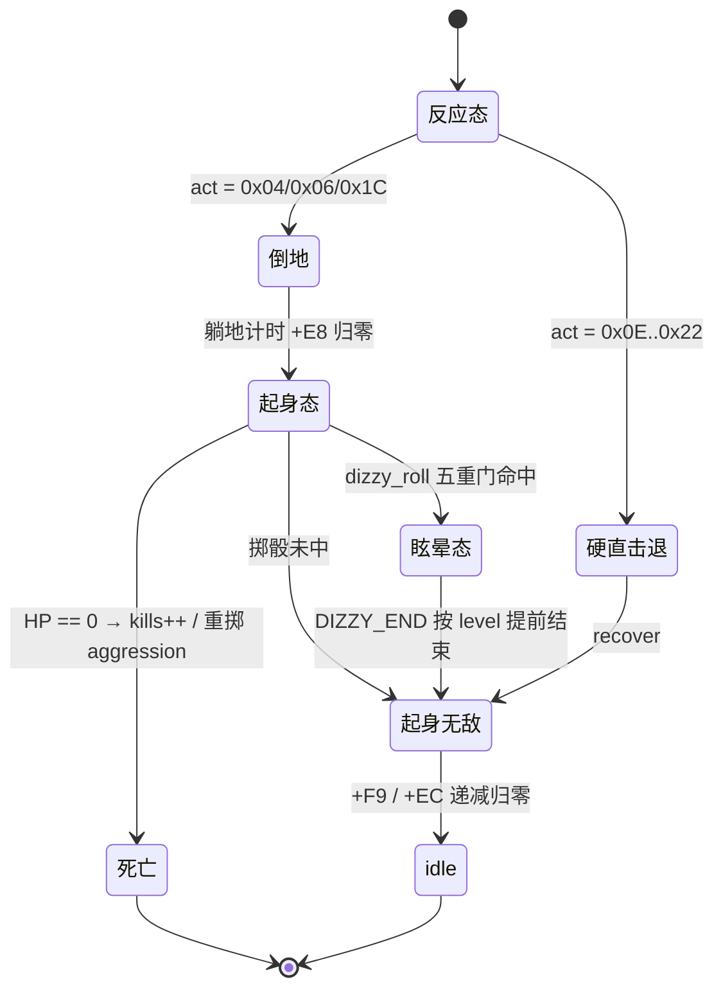

## 29.8 主线闭环与本轮边界

| 出处 | 本轮对应 |
|---|---|
| §22 受击反应 | 从"编号写进 `act`"推进到编号之后的**恢复链与统一出口** |
| §12 打击结算时序 | 解释"命中帧只结算不处决"：死亡 / 起身 / 眩晕都排在后续帧 |
| §17 伤害流水线 | `POISE_T`、`stun`、`hit_stop` 在这里成为起身链的输入 |
| §24 投技 / 抓取 | `+0xBE/+0xBF` 挣扎计时被抓取与倒地复用；`0x08` 投掷态是反应分支之一 |
| §25 动态难度 / rank | 死亡触发 `rank_reroll_aggression`；眩晕概率按 `rank.aggression` 查表 |
| §13 怪物策略 | `+0x76` 认领倒地玩家；`g.dizzy_prev` 全局限流与 census 同属"每帧快照 + 下一帧读" |
| §28 同屏预算 | `g.kills` 与 `g.alive` / `g.dizzy` 同属 `spawn::Globals` 的关卡计数族 |

结论：受击在两款游戏里都是**跨帧过程**，不是一次扣血事件。dino 把这段过程显式切成分派 → 倒地 → 起身 → 无敌 → idle，并让"起身"承担一次带全局限流的决策（死亡记分、重掷 aggression、眩晕掷骰）；wof 用 `+0x78` 无敌字节守住命中链入口、用字段组维持倒地态。共同主线仍是「把瞬时事件改写成可续存的显式结构」，而 dino 更成熟的地方在于：**恢复链上的每个分叉都被做成了会影响后续系统（rank / 目标选择 / 关卡计数）的状态**，而不只是把角色扶起来。

- **未做（保留，不扩张）**：`player_knockdown` / `player_getup` / `player_thrown` / `player_burn` 逐函数全文；`invuln[16]` 与 `DIZZY_ROW` / `DIZZY_END` 表逐项数值；wof `+0x99 / +0x9B / +0xA7 / +0xB5` 各字段的完整状态机与 9 项反应逐条对照；两游戏"起身无敌时长是否按角色不同"（dino 已确认查表，wof 不臆断）。
- **未新增 ROM 取证**，全部以两份 repo 源码为准（§11.0）；**未考证发行先后**，沿用用户给定前提。
- 按 §0 边界，wof 侧宿主调试开关与逐帧对拍修正未纳入设计对照；本轮不据此评价 rep 侧实现。

---

# 第二十三轮：关卡结束 / 过关 / 续关 —— 顶层流程的下半段

> 视角：只谈**游戏逻辑本意**（用户 11-06）。§20 写了顶层 5 个协作任务怎么按 slot 跑，本轮补它的**下半段**：Boss 倒下之后，整局状态怎么走到过关 / 续关 / game over / 结局。
> 边界：repo 侧为主，**不新增 ROM 取证**（§11.0）。wof 侧 `收尾对白量子链_无对应ASM`、`ResetPool` 孤儿调用、调试开关等宿主层事实按 §0 剥掉；只描述原机侧的 `0x42C2` 出口、`A5+0x188` 信号与收尾对白对象。**不据此断言 wof 原机没有集中流程状态机**（按 §11.0 不扩大，不过度怀疑 rep 侧），只对照"repo 侧呈现出来的组织方式"。
> 取证：`dino-rs/.../game/flow.rs:2-15, 80, 118, 150, 171, 182, 185, 316, 350-353, 387, 428, 490-507, 522, 539, 575, 822-877, 893, 941-946, 990`；`wt1/wof_cs/src/Cps1EnemyAI.cs:3160-3161, 8524-8550, 30034-30045`、`Cps1EventObjectRuntime.cs:226-243`、`Cps1EnemySpawn.cs:2951-2955`、`Cps1SystemProcessQueue.cs:6-24`、`Cps1Actor27Runtime.cs:2163-2166`、`Cps1Actor1BRuntime.cs:133-134`、`Cps1StageProgressRuntime.cs:1180`。

## 30.1 一句话对照

「Boss 倒下 → 这一局怎么收尾」两边组织方式不同：dino 有**一个显式 `flow.mode` 状态机**把整局切成 8 个态，过关是其中一次 mode 迁移；wof repo 侧呈现的是**多个 Boss 类共用的一个公共出口 `0x42C2` + 一个全局信号 `A5+0x188` + 收尾对白对象 + 清池**，由对象与信号接力，而不是一个 mode 变量的分支。

| | dino | wof |
|---|---|---|
| 顶层容器 | `flow.mode` 字节，`flow_frame` 每帧 `match` 分派（`flow.rs:490-502`） | 系统调度层是 16 任务槽的 68K 骨架（`Cps1SystemProcessQueue.cs:6-24`），与游戏流程分层 |
| 过关入口 | **唯一** `flow_boss_defeated`（0xACEE，`flow.rs:822`） | **共享出口** `0x42C2`，李典 / 夏侯敦 / ObjId 0x1B / 0x27 / 0x15 等各自 `jmp` 进去 |
| 入口动作 | 一次写 7 个字段：慢动作 / 清场 / 记 killer / HUD 清理 / 结局标志 | 只写 `A5+0x188 = 0xFF` 等少量信号，后续交给别的环节 |
| 续关 / 无续关 | `mode 0x10` 是 continue 分支；`G.$4D7` 显式记录"DIP 或最终关清完 → 禁续关" | 本轮未展开，不臆断 |
| 收尾演出 | speed=4 慢动作 + `hud_clear_idle_blocks` + `flow_lag(1)` | `A5-0x60 == 0x1C` 时生成收尾对白对象 `ObjId=0x03 / OBJ26=0x000A` |

## 30.2 dino：一个 mode 字节管完整局

`flow.rs:490-502` 的 `flow_frame` 是整局的分派表：

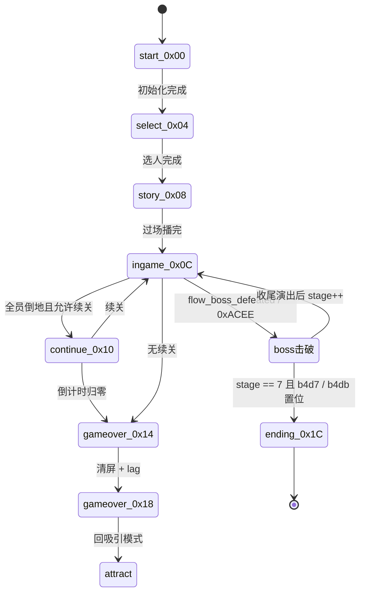

注意 `0x1C => flow_ending_mode`（0xAC48）与 `0x14 | 0x18 => flow_game_over` 是**同一个 mode 变量的不同取值**，不是三套独立流程；`_ => flow_game_over()` 兜底。这与 §2 的 `mode/sub/act/step` 四层状态字节是同一种习惯，只是抬到了整局层。

`flow_boss_defeated`（`flow.rs:822-835`）尤其能说明"过关不是一次事件，而是一组状态的原子迁移"：

```
w.stage_clear = 1
flow.speed    = 4                    # 慢动作演出
g.b4d5        = 1                    # stage clear in progress（§28）
g.killer      = boss
g.kill_all    = 1                    # 与 §29 的 kill_all=2（超时清场）对照
flow.sub      = 2
rank_speed_add(1)                    # §25 rank 时间链
hud_clear_idle_blocks()              # §26 HUD
if w.stage == 7: b4d7 = 1; b4db = 1 # 最终关：禁续关 + 结局标志
```

一次 Boss 击破同时改了**演出速度、关卡标志、记分归属、rank 时间、HUD、整局后续走向**六个系统——这正是 §20.6 主线「把这一帧做什么、下一帧读什么写成显式结构」在整局层的形态。

`flow.rs:150, 171, 182, 185` 的字段注释把续关也收进同一套结构：`G.$4D7 no continue (DIP, or the last stage was cleared)`、`G.$510 game mode saved while the continue screen (mode 0x10) runs`、`G.$5CC continue screen state`、`join_task: Scene`。也就是说"能不能续关"是**一个显式标志 + 一个 mode 分支 + 一个 `Scene` 任务**，不是散落在 UI 代码里的判断。

## 30.3 game over 的跨帧：lag 被显式记账

`flow_game_over`（`flow.rs:838-877`）是用户最初「硬件中断 → 函数执行次数不确定」在整局层最直白的一处：

- `cont.exit_wait` 倒计时分多帧走；
- `0x14 → 0x18` 迁移时 `flow_clear_screen()` 那一帧**超出预算**，于是代码显式 `flow_lag(1)`，并注释"one lag frame: no task runs"；
- `flow.resume = true` 表示同一 pass 继续（0xAC26），`:503-507` 又处理"mode 里设的 speed 从本游戏帧起算"。

§20 已证明 dino 把顶层任务机、`Scene` sleep、`lag` / `game_clock` 记账全部显式建模；这里看到它连"清屏那一帧没有任务跑"都写进了流程。这不是模拟器细节，而是**原机流程本身的时序**被做成数据。

## 30.4 wof：共享出口 + 信号 + 场景对象接力

`Cps1EnemyAI.cs:8542-8550` 给出的 `0x42C2` 是"通用「BOSS 被击败 → 通知关卡结束」出口"，与调用者无关：

```
0x42C2..0x42DC:
    move.b $29(a0),d0 / bne $42da
    move.w #$c,$e322(a5)
    clr.b -$56(a5)
    addq.b #2,$29(a0)
    st.b $188(a5)                  # 关卡结束/退场信号 = 0xFF
$42da: jmp $15bc                   # 加入渲染
```

多个 Boss / 敌人类在**自己的状态分派里**跳进这个公共出口：李典 `A=04` 经 `0x25C5E`（`Cps1EnemyAI.cs:8524-8535`）、ObjId 0x1B 经 `0x4253E`（`Cps1Actor27Runtime.cs:2163-2166`）、`Cps1Actor1BRuntime.cs:133-134`、夏侯敦经 `0x2DED4`（`Cps1EnemyAI.cs:24244-24246`），`Cps1Actor15Runtime.cs:25` 的表项注释也写 `04 → 0x3936A（jmp $42C2 通知关卡结束）`。这与 §16「Boss 层 = 共享零件 + 每类自己的分派」是同一个形状：**连"过关"这件事，wof 也是共享出口 + 各对象自己决定何时跳**。

出口之后由三样东西接力：
1. **信号字节** `A5+0x188 = 0xFF`（`Cps1EnemyAI.cs:3160-3161, 30034-30045` 多处 `st.b`），注释明写"关卡结束/退场信号"；
2. **场景态** `A5-0x60 == 0x1C` 表示第一关收尾对白（`Cps1StageProgressRuntime.cs:1180`）；
3. **收尾对白对象** `生成第一关收尾对白_对应ASM_1552C`（`Cps1EventObjectRuntime.cs:229-243`）分配 `ObjId=0x0003 / OBJ22=0x0005 / OBJ24=0x009C / OBJ26=0x000A`，注释说明它"不经过关卡脚本 type1C"，且 `ObjId03` 在下一轮对象 pass 才锁 `1AA`。

`Cps1EnemySpawn.cs:2951-2955` 的 `ResetPool` 是"过关清池"直译，但 repo 自己注明"全源码零调用者（孤儿）"，属宿主层事实，按 §0 剥掉，不写成设计结论。

`Cps1SystemProcessQueue.cs:6-24` 是 68K 系统调度层骨架（0x0700 扫描 `A5-0x2A00` 的 16 个任务槽，状态达 4 进 0x0786 跳表），**与游戏流程分层**。按 §11.0 不扩大：本轮只说 repo 侧没有把「过关 / 续关 / 结局」收成一个 `flow.mode` 式的枚举，**不据此断言 wof 原机没有集中流程状态机**。

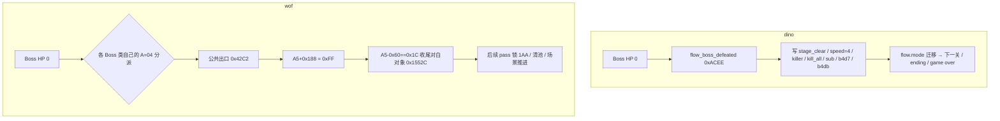

## 30.5 逐项对照

| 维度 | dino | wof |
|---|---|---|
| 整局状态 | `flow.mode` 单字节 8 态，`flow_frame` 每帧分派 | 系统调度层 16 任务槽 + 场景态 `A5-0x60` + 信号 `A5+0x188`（repo 侧呈现） |
| 过关入口 | 唯一 `flow_boss_defeated`（0xACEE） | 共享 `0x42C2`，多类各自 `jmp` |
| 入口职责 | 演出 / 记分 / rank / HUD / 后续走向一次写完 | 写信号 + 加渲染，后续由对象接力 |
| 慢动作 | `flow.speed = 4` + `rank_speed_add(1)` | 本轮未展开，不臆断 |
| 清场 | `kill_all = 1`（记 killer）vs `=2`（超时，§28） | `ResetPool` 为宿主孤儿调用，按 §0 剥掉 |
| 续关 | `mode 0x10` + `G.$4D7` 禁续关标志 + `join_task: Scene` | 本轮未展开，不臆断 |
| 最终关 | `stage==7 → b4d7 / b4db`，`mode 0x1C` ending | 本轮未展开，不臆断 |
| 收尾对白 | 过场脚本系统（§4.1 / §19） | `0x1552C` 分配 `ObjId=0x03`，不经过关卡脚本 type1C |
| game over | `0x14 → 0x18`，`exit_wait` + `flow_lag(1)` + `resume` | 本轮未展开，不臆断 |
| 跨帧续算 | `Scene::wait(n, next)` 把醒来行号写成数据（§20） | 协作式任务内核 + 对象 pass（§19 / §20） |

## 30.6 伪代码

```
# dino 整局分派（flow.rs:490-502）
flow_frame():
    match flow.mode:
        0x00: flow_mode_start()          # 初始化 4 帧
        0x04: flow_select_mode()
        0x08: flow_story_mode()          # 0xD898
        0x0C: game_frame(); flow_ingame_switch()
        0x10: flow_continue_mode()
        0x14|0x18: flow_game_over()      # exit_wait / flow_lag(1) / resume
        0x1C: flow_ending_mode()         # 0xAC48
        _:    flow_game_over()

# dino 过关（0xACEE）
flow_boss_defeated(boss):
    w.stage_clear = 1; flow.speed = 4
    g.b4d5 = 1; g.killer = boss; g.kill_all = 1; flow.sub = 2
    rank_speed_add(1); hud_clear_idle_blocks()
    if w.stage == 7: flow.b4d7 = 1; flow.b4db = 1

# wof：Boss 类各自分派 → 公共出口
case A=04: jmp 0x42C2                   # 0x25C5E / 0x4253E / 0x2DED4 / ...
0x42C2:
    A5-0x1CDE = 0x000C; A5-0x56 = 0
    obj.ActStatB += 2
    st.b 0x188(A5)                       # 0xFF 关卡结束/退场信号
    jmp 0x15BC                           # 加入渲染
if A5-0x60 == 0x1C: 生成第一关收尾对白_1552C()   # ObjId 03 / OBJ26 000A
```

## 30.7 主线闭环与本轮边界

| 出处 | 本轮对应 |
|---|---|
| §20 顶层流程任务机 | 补上下半段：`flow.mode` 8 态、过关迁移、game over 的 `flow_lag(1)` |
| §16 Boss 层 | wof「共享出口 + 每类自己分派」在"过关"这件事上再次复现 |
| §19 脚本系统全景 | wof 收尾对白对象不经过关卡脚本 type1C，是另一条对象驱动路径 |
| §25 动态难度 / rank | `rank_speed_add(1)`：过关直接改 rank 时间链 |
| §26 HUD / 分数 | `hud_clear_idle_blocks`；`killer` / `kill_all=1` 与击杀加分链同源 |
| §28 同屏预算 | `b4d5`（stage clear in progress）与 `kill_all=1/2` 同属 `spawn::Globals` |
| §29 受击恢复链 | Boss 死亡 → `flow_boss_defeated`，与杂兵死亡记 `kills` / 重掷 aggression 是两条不同出口 |
| 用户最初「执行次数不确定」 | `flow_game_over` 显式 `flow_lag(1)` + `resume`：连"哪一帧没有任务跑"都被写成流程数据 |

结论：整局收尾在 dino 里是**一个 mode 状态机的一次迁移**——`flow_boss_defeated` 把演出、记分、rank、HUD、后续走向一次性写成新状态，之后由 `flow_frame` 每帧分派；wof repo 侧呈现的是**共享出口 `0x42C2` + 全局信号 + 场景态 + 收尾对白对象**的接力，各 Boss 类自己决定何时跳进公共出口。两者都把"过关"做成跨帧过程而非瞬时事件，差别仍在**状态收在哪里**：一个收进整局枚举，一个散在对象与信号。按 §11.0 不扩大，本轮不据此断言 wof 原机缺少集中流程状态机。

**〔本轮回源补层：玩家问「这一关凭什么算打完」，答案不在「怪清光了」〕** 上面 §30 讲的是 Boss 倒下**之后**怎么收尾，§28 讲的是一波怪怎么推进，§52 讲的是相机什么时候不许跟；三层各自都登记过，但中间缺一环——**从「场上没敌人了」到「过关」之间，还有一个由波次脚本的结束代码决定的放行步骤**，全库 Grep `prop_wave_end|wave end type|end type|G.$7A9|cam_go|GO 箭头|波次放行|Boss intro` 未见相关登记（唯一命中是 06 卷 2303 的 `no_clamp`，属过场脚本另一面）。回源 `re/specs/enemy/SPEC.md:936-1000`（§8.2 / §8.3，标 [O]）与 `prop.rs:628-660`：

- 波次控制器（pool B class 15）里，每组靠「存活敌人数 `G.$4F3` 低于按人数分档的阈值 **或** 7200 帧预算耗尽」推进（§28.3 已登记）；**终组跑完不是结束，是去读波次脚本末尾那格 `end & 0xE`**。
- 这格是**数据不是代码**，三选一（`prop.rs:633-650`）：`0` → `prop_wave_end_go` 置 `G.$7A9`、显示 GO 箭头，玩家自己往前走；`2` → `script_area_end 0x1D95E`，英雄自动走向下一区域；`4`（及兜底）→ `script_boss_area 0x1DAC4`，进 Boss 登场过场。`end type 6` 指向 `0x7D054`，注释明说「no working stage uses it」。三种都要先过 `:628-631` 那道门：**所有在场玩家回到 `mode 2 / sub 0`（正常控制）才放行**——有人还在受击 / 倒地 / 演出里，就算怪清光了也不推进。
- `G.$7A9` 是相机锁的钥匙：SPEC §8.3 的 mode 4（wave lock）每帧把 `camX` 钉在波次起点、`lock78 = 1`，直到 `$7A9` 非零才切回跟随；§52.3 已登记 `lock78` 三态与 `go` 的 FSM。也就是说**「清光一波」在玩家眼里是「镜头解开、可以往前走了」，不是「过关」**——镜头锁在波次起点这件事本身就是「这一段还没放行」的可见信号。
- 「**过关**」只有一个入口信号：Boss HP 归零 → `0x4385C` 调 `0xACEE`（SPEC `:1345-1346`、§30.2），一次写 `$4D1 = 2`（stage clear flow）/ `$50E = 1`（帮手全死、分数算给 killer）/ rank +1；`flow.rs:797-801` 注释「when the clear task is done, the next stage (or the ending)」说明下一关 / 结局都是它之后的下游。§30 写「过关入口唯一 `0xACEE`」经回源成立。**别把「过关」和「所有终局」混成一个**：关卡时钟走完是清玩家 HP、走 §72 死亡态 / §30 game over（05 卷 §75 已登记），不是过关；按 §94.17 这里只限定到「过关」这个语义面。

**倒推（说人话）**：dino 不把「打完一关」做成一次「敌人数量归零」的判定，而是**把它拆成两级放行 + 一个终局信号**。清光一小波只是让波次往下读一格；一格读完，由**写在波次表末尾的一个数字**决定这一段怎么放你走——给个箭头让你自己走、自动走到下一区、或者直接进 Boss 登场；而且必须等所有玩家都站回正常状态。镜头在这期间锁死，玩家看到的「走不动」不是卡住，是这一段的放行还没签字。真正宣布「这关打完了」的只有 Boss 倒下那一下，随后才是 §30 那一整串原子迁移。**所以玩家觉得「怪清了却没过关、还要往前走一段」，不是延迟，是设计：关卡推进的钥匙握在波次脚本的结束代码和 Boss 血量手里，不握在敌人计数器手里。** 按 §94.17 只限定到 SPEC §8 与 `prop.rs` / `script.rs` 这两个检索面，不写「所有关卡都只有三种放行」（SPEC 明说 end type 6 有入口但无关卡使用）；按 §11.0 不推断 wof 对应放行方式，也不把 `0x1DAC4` 写成「出关」——SPEC `:970` 管它叫 `stage_end_1dac4` 是命名误导，`script.rs:177` 明写它是「boss intro is running」（`G.$4FC = 1`），只是进 Boss 区域，不是过关。

- **未做（保留，不扩张）**：`flow_*` 各 mode 全文与 `Scene` 逐场景脚本；`0x42C2` 之后 `0x15BC` 链与 `A5+0x188` 的全部消费点；wof 续关 / game over / 结局路径；`A5-0x60` 其他取值；`ResetPool` 与收尾对白量子链的宿主补偿（按 §0 剥掉）。
- **未新增 ROM 取证**，全部以两份 repo 源码为准（§11.0）；**未考证发行先后**，沿用用户给定前提。
- 按 §0 / §11.0 边界，不把 repo 侧"未呈现集中 mode"写成 wof 原机缺陷；本轮只对照组织方式。

---

# 第二十四轮：角色差异化 —— 数据索引 vs 每角色一套状态机

> 视角：只谈**游戏逻辑本意**（用户 11-06）。本轮做一个横向切面：前面各节反复出现 `ch = id & 3`、`command_time[ch]`、`invuln[d0+ch]`、`GetAtkTable(charId)`，这里把"角色差异到底放在哪"单独说清。
> 边界：repo 侧为主，**不新增 ROM 取证**（§11.0）。`dino-assets/src/player.rs` 每个字段的注释都直接标了 ROM 表地址，属**原机数据组织**，不是 §0 所说"移植者加的工程分层"；wof 侧 `_无对应ASM` 宿主补偿按 §0 剥掉，不据此评价 rep 侧实现。
> 取证：`dino-rs/crates/dino-assets/src/player.rs:1-75`、`dino-rs/.../game/player.rs:205, 214, 492, 645, 962, 1640, 2109, 2216, 2288, 2488, 3608`、`body.rs:30, 48`；`wt1/wof_cs/src/Cps1PlayerMulti.cs:13, 26-30, 42-60, 141-146, 163, 198-213`、`Cps1PlayerZhaoyun1CA46.cs:35, 104`。

## 31.1 一句话对照

四个 / 五个可选角色的差异，dino 放在**一张按 `ch` 索引的 ROM 表族**里，四个角色共用同一套状态机；wof 放在**「分派到哪个角色的主状态机」**里，五个武将各有自己的入口段，局部参数再用小表。

| | dino（4 人：Jack / Mustapha / Hannah / Mess） | wof（5 人：关羽 / 张飞 / 赵云 / 黄忠 / 魏延） |
|---|---|---|
| 角色标识 | `obj+$03`，`body.rs:30`；`+$20 = character * 4`（`:48`） | `CharId` 常量 0..4（`Cps1PlayerMulti.cs:26-30`） |
| 差异载体 | `PlayerData` 表族，索引 `ch` / `class/4*4 + ch` / `d0 + ch` | 各角色独立 ROM 入口段 + `GetAtkTable(charId)` switch |
| 状态机 | **一套** `player_frame` / `b.act` 分派（§29），四个角色共享 | **每角色一套主状态机入口**，徒步 / 骑马还各分一套 |
| 加一个角色 | 约等于加一行表 | 约等于写一整套状态机 + 骑马变体 |
| 局部共享表 | 全在 `PlayerData` | 也有 `XXX_ATK_TABLE` / `UPPERCUT_ATK_TABLE` / 公共 `jsr 1F7C` |

要点：wof **不是没有数据驱动**（它有攻击表、必杀表、公共检测），而是"角色级主状态机"这一层是分函数的；dino 连这一层都收进了同一段代码，只让数据随 `ch` 变。这是整份笔记「共享检测 + 每类自己的分派」的**第五次复现**（§16 Boss / §11.2 敌人 AI / §22 受击 / §27 搓招 / §31 角色），只是这次 dino 站在"共享"一侧。

## 31.2 dino：`PlayerData` 是一张带 ROM 地址的按角色索引表族

`dino-assets/src/player.rs:1-5` 文件头把约定写死：*"Per-character arrays are indexed by the character id in obj+$03: 0 Jack, 1 Mustapha, 2 Hannah, 3 Mess"*，且每个字段注释都标了 ROM 地址：

| 字段 | ROM 地址 / 索引 | 本笔记对应 |
|---|---|---|
| `speed[16][8][2]` / `speed_heavy` | `0x5064` / `0x50A4`，索引 `class/4*4 + ch` | §2 移动 |
| `jump[16][9]` | `0x53A2`，同索引 + 8 方向 | §2 / §27 |
| `invuln[16]` | `0x6C3A`，索引 `d0 + ch`，`d0 = 0 起身 / 4 投掷 / 8 拾取 / 12 必杀` | **§29**（`player_set_invuln`） |
| `command_time[2][4]` | `0x6B7C / 0x6B84`，每角色两段时间窗 | **§27**（`player_command_fsm`） |
| `attacks: [Vec<AttackRecord>; 4]` | `0xA26FC`，按 `obj+$58/2` 索引 | **§17**（多因子伤害） |
| `defense[4]` | `0x2C88E`，每角色受伤系数 | §17.2 |
| `pushback[3][3]` / `knockdown[6][4]` | `0x1D27C / 0x1D28E` | §29 恢复链 |
| `start_pos[stage][area][player]` | `0x4E56` | §28 关卡开始 |
| `power` / `counter_scale` / `weakness` / `*_scale` | `0x2C9B6 / 0xA320C / 0xA32FA / ...` | §17.1 伤害连乘 |

`player_pd()`（`player.rs:205`）只返回 `&'static PlayerData`，没有分支；角色差异通过 `let ch = ...id as usize & 3` 在 **10+ 处**直接当数组下标：`invuln`（`:492`）、`player_box_tables[ch]`（`:645`）、`command_time`（`:962`）、`heavy_fall_anim[ch*2+..]`（`:2216`）、`knee_spark`（`:3608`）、状态号数组 `[0x0416, 0x0428, 0x042A, 0x042C][ch]`（`:2488`）。

也就是说：**dino 的角色差异是"同一段代码读不同行"**，连招式状态号的差异都做成 `[...; 4]` 常量数组。这与 §0 的边界不冲突——表本身是 ROM 里的原机数据（`0x6C3A` 等），移植者只是把它命名成 `PlayerData`。

## 31.3 wof：五个武将各有自己的主状态机入口

`Cps1PlayerMulti.cs:26-30` 定义 5 个 `CharId`；`:42-46` 是**每角色一条** `XXX_ATK_TABLE`，`:49` 是 `UPPERCUT_ATK_TABLE[5]`，`:51-60` 的 `GetAtkTable(charId)` 用 switch 选表，`:141-146` 的 `GetUppercutAtkType(charId)` 按 `charId` 取必杀类型——这些是**参数层**的数据驱动。

但 `:198-213` 的 S02 注释给出了**结构层**的形状：

```
ROM JSR 1F7C：1ADB6 关羽徒步 / 1BC0A 张飞 / 1D4AA 黄忠 / 1DE16 魏延
黄忠 1D4A2、关羽骑马 1ED1E、其它骑马 1F64A / 1FDD2 / 2055E / 20C50
赵云 1CA46：内联 B0/B1 缓冲（jsr 0F98），**不** jsr 1F7C
```

即每个武将有**独立的主状态机入口段**，徒步与骑马还各有一套；赵云更特别——§27 已确认 `0x1CA46` 前 0x98 字节就是内联的 `RKey1` 搓招缓冲，因此不经过公共 `jsr 1F7C`。`:163` 还记着"张飞特有（抓取扣血等）"，`:65-83` 记着黄忠连射、`:106` 记着魏延距离感知下上拳——**角色特性是散在各角色段里的专属逻辑**，不是一张统一表的某一行。

按 §0 边界，我不把"分函数"写成缺陷：wof 同样有 `GetAtkTable` / `UPPERCUT_ATK_TABLE` / 公共 `jsr 1F7C` / `检测下上搓招_1F7C` 这些共享零件，只是**角色级主状态机**这一层没有收成单段代码。

## 31.4 逐项对照

| 维度 | dino | wof |
|---|---|---|
| 角色数 | 4（`obj+$03`） | 5（`CharId` 常量） |
| 主状态机 | 一套，`ch` 只影响读表 | 每角色一套 ROM 入口段；徒步 / 骑马再分 |
| 移动 / 跳跃 | `speed[16][8][2]` / `jump[16][9]` 按 `class*4+ch` | 各角色段内处理 |
| 攻击记录 | `attacks[ch][$58/2]`（§17） | `GetAtkTable(charId)` 每角色 3 项表 |
| 必杀 / 搓招 | `command_time[ch]` 两窗（§27） | `UPPERCUT_ATK_TABLE[charId]`；赵云内联 `RKey1`（§27.3），魏延另走距离感知 |
| 无敌时长 | `invuln[d0+ch]`（§29），4 种来源 × 4 角色 | `+0x78` 单字节（§29.5） |
| 受伤系数 | `defense[ch]` | 本轮未展开，不臆断 |
| 受击几何 | `player_box_tables[ch]` / `knockdown` 表 | 每 `CharId` 段表 `0x124D6` / `0x11878`（§22） |
| 角色专属机制 | 本轮未见独立分支，均落表 | 张飞抓取扣血、黄忠连射、魏延距离感知 |
| 扩展成本 | 加一行表 | 新增一整套状态机 + 骑马变体 |

## 31.5 伪代码与分派形状

```
# dino：一套状态机 × 一张按角色索引的表族
ch = obj.$03 & 3
pd = assets.player                       # player_pd():205，无分支
speed   = pd.speed[class/4*4 + ch][dir8]         # 0x5064
jump    = pd.jump[class/4*4 + ch][dir]           # 0x53A2
invuln  = pd.invuln[d0 + ch]                     # 0x6C3A；d0 = 起身/投掷/拾取/必杀
[t1,t2] = pd.command_time[ch]                    # §27 搓招两窗
atk     = pd.attacks[ch][obj.$58 / 2]            # §17 攻击记录
defense = pd.defense[ch]                         # §17.2
box     = assets.sprites.player_box_tables[ch]
state   = [0x0416, 0x0428, 0x042A, 0x042C][ch]  # 连状态号都做成表

# wof：按 CharId 分派到各角色自己的主状态机
switch CharId:
    关羽 -> 1ADB6 / 骑马 1ED1E
    张飞 -> 1BC0A / 1F64A      (+ 抓取扣血)
    赵云 -> 1CA46 / 1FDD2      (内联 RKey1 缓冲，不 jsr 1F7C)
    黄忠 -> 1D4AA / 2055E      (+ 连射)
    魏延 -> 1DE16 / 20C50      (+ 距离感知下上拳)
GetAtkTable(charId)        -> 每角色 3 项 ATK_TABLE
GetUppercutAtkType(charId) -> UPPERCUT_ATK_TABLE[charId]
```

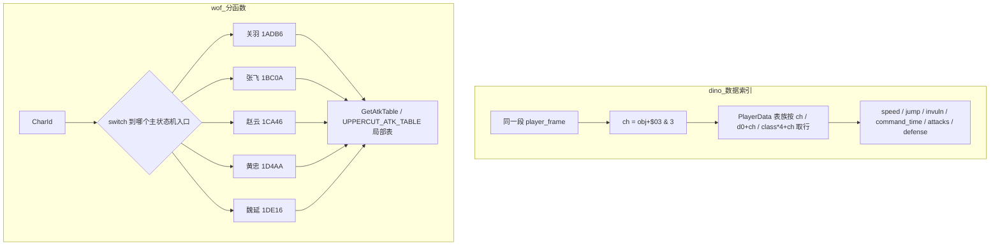

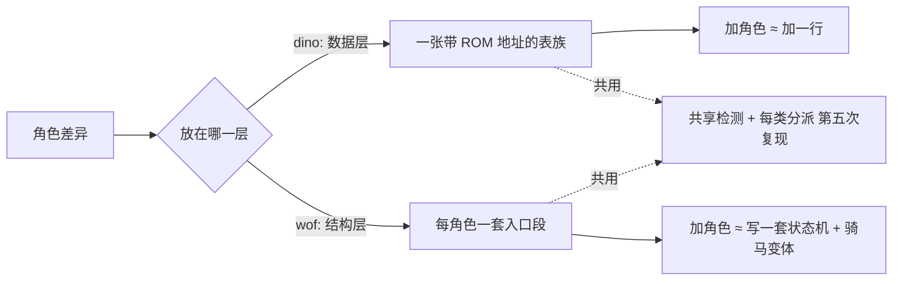

## 31.6 主线闭环与本轮边界

| 出处 | 本轮对应 |
|---|---|
| §27 搓招 / 指令技 | `command_time[ch]` 是"一张表覆盖四角色"的出处；wof `RKey1` 内联在赵云段 |
| §29 受击恢复链 | `invuln[d0+ch]` 的 `d0` 四种来源在这里展开；wof `+0x78` 单字节 |
| §17 伤害流水线 | `attacks[ch]` / `defense[ch]` / `counter_scale` / `weakness` 是连乘因子的角色维 |
| §22 受击反应 | wof 每 `CharId` 段表 `0x124D6` / `0x11878` 是"角色差异放到受击层" |
| §16 / §11.2 / §22 / §27 | 「共享检测 + 每类自己的分派」第五次复现；这次 dino 站共享一侧 |
| §0 边界 | `PlayerData` 每个字段标 ROM 地址 → 属原机数据组织，不是移植者工程分层 |
| §6.1「dino 更成熟」 | 落到具体机制：角色差异做成数据维而非代码维，扩展成本差一个量级 |

结论：角色差异在 dino 是**数据维度**（同一段状态机 × 不同表行），在 wof 是**结构维度**（不同角色段 × 局部共享表）。两者都能表达"五个人打起来不一样"，但 dino 把 `ch` 做成一个贯穿 10+ 处取值的索引，连状态号、无敌时长、搓招时间窗、攻击记录、受伤系数都收进同一张带 ROM 地址的表族；wof 让每个武将拥有自己的主状态机入口（徒步 / 骑马两套），角色专属机制（张飞抓取、黄忠连射、魏延距离感知）散在各段里。按 §0 不把"分函数"写成缺陷——wof 同样有 `GetAtkTable` / `UPPERCUT_ATK_TABLE` / 公共 `jsr 1F7C` 等共享零件；本轮只对照组织方式。

- **未做（保留，不扩张）**：`PlayerData` 各表逐项数值（speed / jump / invuln / command_time / attacks 全表）；wof 5 个角色主状态机全文与各自 `ATK_TABLE` 数值；`0x1F7C` 公共检测内部；骑马 / 载具状态下角色差异；两游戏角色平衡性比较（不臆断）。
- **未新增 ROM 取证**，全部以两份 repo 源码为准（§11.0）；**未考证发行先后**，沿用用户给定前提。
- 按 §0 边界，wof 侧 `_无对应ASM` 宿主补偿未纳入设计对照；本轮不据此评价 rep 侧实现。

---

# 第二十五轮：地形与载具 —— 空间约束和"临时主体"

> 视角：只谈**游戏逻辑本意**（用户 11-06）。§15 只讲了 tag / car 怎么**挂进**固定帧循环，没讲挂上去的那个东西自己是什么状态机；本轮补空间层的两块：地形约束按对象类别怎么分入口，以及载具作为"临时主体"怎么组织。
> 边界：repo 侧为主，**不新增 ROM 取证**（§11.0）。wof `Cps1TerrainCollision.cs` 里"宿主每帧多调一次 `0x26AA`"之类逐帧对拍修正、`_无对应ASM` 开关按 §0 **剥掉**，只取 ROM 侧"每类 handler 自己调用公共地形函数"的契约；不据此评价 rep 侧实现。
> 取证：`dino-rs/.../game/terrain.rs:1-39, 45-48`、`car.rs:1-7, 16-23, 33-37, 90-106, 130-211, 356, 409-451, 495, 587-590, 637-638, 706-719`、`combat.rs:85-94`；`wt1/wof_cs/src/Cps1HorseRuntime.cs:6-14, 40-71, 97-109`、`Cps1TerrainCollision.cs:43-60, 245-248`、`Cps1PlayerMulti.cs:201-205`。

## 32.1 地形：同一套共享例程，按对象类别选不同入口

`terrain.rs:7-21` 是一张原机例程表，说明地形不是"一个函数给所有对象"，而是**一组共享例程 + 按类别挑入口**：

| 例程 | 地址 | 谁调用 |
|---|---|---|
| `terrain_area_start` | `0x12BE4` | 区域开始（flow / camera），装 floor list 到 `G.$6B0` |
| `terrain_advance` | `0x12C90` | `objects_update` 末尾，floor list 指针跟着 camera 走 |
| `terrain_collide` | `0x12CB4` | 地板 + 墙（5 passes）+ 障碍 + snap：敌人 / props / items |
| `terrain_collide` + `terrain_ceiling` | `0x12CAC` + `0x1361E` | **玩家**（多一个天花板检测） |
| `terrain_floor_only` | `0x12D4E` | `G.$4F0` 时的玩家 / respawn |
| `terrain_effect_floor` | `0x12DAC` | effects（5 次 floor lookup） |
| `terrain_collide_free` | `0x12E20` | 免障碍测试的某些 enemy class |
| `floor_lookup` / `terrain_wall` / `shape_handler` | `0x12FE4 / 0x1309C / 0x13138` | scroll2 tilemap 属性 + 形状跳表 |
| `scene_class` | `0x136E4` | 纵向（电梯）场景图同一套查表 |

`terrain.rs:30-39` 还记着这些例程用 68000 oracle 跑了 250,000 组向量，并**故意保留 5 个 quirks**（`ble/bgt` 有符号溢出比较、形状 0x10 变体移位、纵向场景 ceiling 恒为 class 0、障碍表本帧/上帧共用、`+$50` 用 `move.b` 而非 OR）——说明"地形"在原机是有精确边界条件的系统，不是粗略的碰撞盒。

wof 侧对应物是 `0x2698` / `0x26AA` 这对"对象地形与活动范围修正"公共函数：`Cps1TerrainCollision.cs:43-47` 的玩家入口 `玩家_地形纠偏与屏幕范围_可能对应ASM_171A8` 调 `应用对象地形纠偏_可能对应ASM_2730`；`:245-248` 记着 ROM 的跳表里**只有主 AI 项含 `jsr 0x26AA`**，其余状态项不含。也就是说 wof 也是**共享函数 + 每类 handler 各自决定在哪个分支调**，与 §11.2 的 `0x3C6A`「共享决策函数 + 每兵种各带概率表」同形，是这一习惯的第六次复现。

## 32.2 载具：dino 的复合演出状态机 vs wof 的对象池 + 玩家分支

**dino Cadillac**（`car.rs:1-7`）：一个 radio event `0x8BD24` 生成 **3 个对象**——车（variant 0）、前轮（2）、后轮（4），轮子 `+$76` 指回车；另有池 C helpers：座位（class 36）、送车队友（class 37）、烟尘（class 41）。它自己的 `mode` 是 4 态（`car.rs:90-106`）：

```
mode 0 arrival  (0x8BDEC)  ← sub 8 步：init / drive in 5px / brake / wait120
                              / wait60 / boarding jumps(45帧) / accelerate / drive start
mode 2 drive    (0x8C0A4)  ← variant 0 = 车，其它 = 轮子；steer / lane / band / bump / smoke
mode 4 end      (0x8C810)  ← 英雄跳下、残骸滚出镜头（camera X + 0x200）后 mode 6
mode 6 free     (0x8C880)
```

`car.rs:16-23` 的字段协议几乎是一张"载具状态表"：座位 `+$A2..$A4`（角色号，0xFF 空）、`+$A5..$A7` 构建中座位、`+$A8` 乘员位、`+$A9` bump 计时、`+$B0/$B2` 转向目标 vx/vz、`+$B4` 队友角色。`:208` 置 `G.$518 = car_mode = 1`，§15 已说明这个全局位让输入 / 碰撞 / 生成各自改道（碰撞侧多插 4 个 pass `0x121D8..0x12454`，`combat.rs:85-94`）；`:719` 退场时清零。车自身有 HP 120 / bar 100、可 bump（`0x8C41C`）、可发 attack 0x66——**载具是一个有血量、有攻击、有完整入场/退场演出的临时主体**，玩家被"装"进去，pad 被接管（`:235` `+$11A = 1`）。

**wof 马**（`Cps1HorseRuntime.cs:6-14`）：独立马对象池 `A5+0x6BBC`，**6 槽 × 0xC0**，与玩家的 `Mount/MSpr` 字段分开。`:51-70` 的 `ActStatA` 分派是 4 态：

| `ActStatA` | 入口 | 含义 |
|---|---|---|
| `0x00` | `0x213A4` | 初始化 / **下马后待机** |
| `0x02` | `0x21426` | 待机与**重新上马** |
| `0x04` | `0x214F4` | 离场判定 |
| `0x06` | `0x21564` | 清 `A5+0x1CA` 后压回马池（回收） |

关键在 `:6-10` 的注释：**挂马期间马槽 `OBJ+0 = 0`**，只由玩家对象的 `5E5DA` 展开 `MSpr`；`1F3BE` 下马后才把马槽置 `0101`，`0x213A4` 再把它变成可渲染的普通对象。也就是说 wof 的马在挂载时**退化成玩家的显示附属**，马自己只保留"下马 → 待机 → 可被重新上马 / 离场 → 回收"的生命周期。玩家侧则有§31 已列的**每角色骑马主状态机入口**（`1ED1E` 关羽 / `1F64A` 张飞 / `1FDD2` 赵云 / `2055E` / `20C50`）。

## 32.3 逐项对照

| 维度 | dino Cadillac | wof 马 |
|---|---|---|
| 对象构成 | 1 车 + 2 轮 + 座位 / 送车队友 / 烟尘，复合对象 | 独立 6 槽马池（步长 0xC0），单对象 |
| 状态机 | `mode` 4 态，arrival 内还有 8 步 `sub` | `ActStatA` 4 态（初始化 / 待机 / 离场 / 回收） |
| 挂载期间 | 玩家被装进车、pad 接管；车是主体 | 马槽 `Exist=0`，由玩家 `MSpr` 展开；玩家是主体 |
| 全局联动 | `G.$518 car_mode` 让输入 / 碰撞 / 生成改道 | `Mount/MSpr` 字段 + 每角色骑马入口 |
| 演出 | 入场 8 步（含 120/60/45 帧等待）、驾驶、跳下、残骸离场 | 上马 / 下马 / 重新上马 / 离场回收 |
| 可受击 | 车有 HP 120 / bar 100、bump、attack 0x66、4 个碰撞 pass | 本轮未展开，不臆断 |
| 地形 | 共享例程按类别分入口（玩家带 ceiling、部分 class 免 obstacle） | `0x2698/0x26AA` 公共函数，每类 handler 自己调 |
| 生命周期终点 | `mode 6 free` | 压回马池（`0x21564`） |

## 32.4 伪代码与流程图

```
# dino 地形：同一套例程 × 按类别选入口
terrain_area_start(stage, area)      # 0x12BE4：floor list → G.$6B0
per frame: terrain_advance(camera)   # 0x12C90：指针跟 camera
on object update:
    player  -> terrain_collide + terrain_ceiling     # 0x12CAC
    enemy   -> terrain_collide（5 passes + obstacles）# 0x12CB4
    class X -> terrain_collide_free                  # 免障碍
    effect  -> terrain_effect_floor                  # 5 次 floor lookup
    G.$4F0  -> terrain_floor_only                    # respawn

# dino 载具
prop_car(mode):
    0: arrival(sub 0..0xE)  # 0x8BDEC
    2: drive  -> steer / lane / band / bump / smoke  # 0x8C0A4
       wheel  -> prop_car_wheel                     # variant != 0
    4: end    -> 英雄跳下 → camera X+0x200 → mode 6  # 0x8C810
    _: free
G.$518 = car_mode   # §15：各系统自查改道

# wof 马池
for slot in 0..5:
    if slot.Exist == 0: continue
    switch slot.ActStatA:
        0x00: 初始化与下马后待机  # 0x213A4
        0x02: 待机与重新上马      # 0x21426
        0x04: 离场判定            # 0x214F4
        0x06: 回收压回马池        # 0x21564
挂马中: slot.OBJ+0 = 0，玩家 5E5DA 展开 MSpr
下马  : 1F3BE 置 0101 → 0x213A4 变普通对象
```

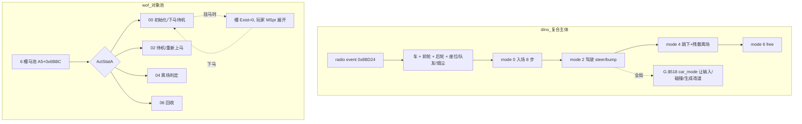

## 32.5 主线闭环与本轮边界

| 出处 | 本轮对应 |
|---|---|
| §15 附加玩法挂接 | 补上"挂上去的东西自己是什么"：`car_mode` 背后的 4 态演出状态机 |
| §31 角色差异化 | wof 每角色**骑马**入口是"结构维度"的又一实例；dino 座位 `+$A2..$A4` 是数据维度 |
| §11.2 / §16 / §22 / §27 / §31 | 「共享函数 + 每类自己调用」第六次复现：地形 `0x26AA` / 例程表 |
| §2 状态机 | 载具证明四层状态字节不只给角色用，也抬到了"临时主体"层 |
| §23 卷轴 / 摄像机 | `terrain_advance` 让 floor list 跟 camera；车退场用 `camera X + 0x200` 判定 |
| §28 同屏预算 | 车 / 座位 / 队友 / 烟尘都是 pool B / C 对象，受同一套池容量约束 |
| §0 边界 | wof 地形文件里的逐帧对拍修正是宿主补偿，已剥掉，不当设计结论 |

结论：地形与载具是"空间约束"和"临时主体"两层。地形两边都做成**共享例程 + 按对象类别选入口**（dino 一张 0x12BE4..0x136E4 例程表，玩家带 ceiling、部分 class 免 obstacle；wof `0x2698/0x26AA` 由每类 handler 自己调）。载具则明显分岔：dino 把 Cadillac 做成**有入场 / 驾驶 / 退场演出的复合对象状态机**，玩家被装进去、全局 `car_mode` 让各系统改道；wof 把马做成**可复用对象池 + 玩家状态机的骑马分支**，挂载期间马槽隐身、由玩家 `MSpr` 展开，马自己只留下马 → 待机 → 离场 → 回收的生命周期。一个让载具当主体，一个让玩家当主体——这正是 §15「附加玩法挂接方式」在对象层的根因。

- **未做（保留，不扩张）**：`car.rs` 各 `sub` 步逐段、`0x8C886` 转向表 / `0x8C404` bump 表数值；wof 马 4 态 handler 全文、`1F3BE` 下马链与 `5E5DA` MSpr 展开；dino `shape_handler` 各形状与 5 个 quirk 的逐类展开；wof `0x26AA` 全部 49/50 个调用点；两游戏载具是否可被攻击 / 有 HP（dino 已确认，wof 不臆断）。
- **未新增 ROM 取证**，全部以两份 repo 源码为准（§11.0）；**未考证发行先后**，沿用用户给定前提。
- 按 §0 边界，wof 侧 `Cps1TerrainCollision.cs` 的宿主逐帧修正与 `_无对应ASM` 开关未纳入设计对照；本轮不据此评价 rep 侧实现。

---

# 第二十六轮：多人协作 —— 活跃位图、玩家槽与人数分档

> 视角：只谈**游戏逻辑本意**（用户 11-06）。前面各节反复出现 `A5-0x3E`、`0x3E62`、`players_minus_one`、`census[3]`、`who & 3`，本轮把"多人"这个贯穿全系统的维度单独说清，并把 **§11 的勘误放回设计主线**。
> 边界：repo 侧为主，**不新增 ROM 取证**（§11.0）。wof 侧 `_无对应ASM` 宿主补偿与逐帧对拍修正按 §0 剥掉；`A5-0x3E` / `0x3E62` 的语义一律以 §11.1 / §11.4 更正为准，**不再复用第三轮"全局 AI 档位"的旧解释**。
> 取证：`dino-rs/.../game/flow.rs:133`、`spawn.rs:51-52`、`camera.rs:994-997`、`boss.rs:210, 250`、`car.rs:333`、`script.rs:453-468`、`enemy_combat.rs:227-229, 285`、`snd.rs:1-30`；`wt1/wof_cs/src/Cps1EnemyAI.cs:4503, 4548, 4595-4601, 14040, 14071-14072, 22021, 29286`、`Cps1Collision.cs:977, 1878, 2966, 3608, 5318, 5656`、`Cps1CameraRuntime.cs:378, 443-449, 1515`、`Cps1PlayerMulti.cs:4670`、`Cps1EffectActorRuntime.cs:4281`、`Cps1PrototypeRoster.cs:18`。

## 33.1 一句话对照

"几个人在玩"在两款游戏里都**不是一处 if/else**，而是一个贯穿目标选择、相机、波次、碰撞、击杀归属的**索引 / 位图数据**。差别在编码方式：wof 用**活跃玩家位图 + 固定三槽扫描**，能表达任意组合；dino 用**人数档位 + 每玩家计数数组**，按"几人"分档但保留每玩家身份。

| | dino | wof |
|---|---|---|
| 主索引 | `players_minus_one`（0/1/2 = 1/2/3 人） | `A5-0x3E` 活跃玩家位图（3 bit，任意组合） |
| 玩家槽 | `players[3]` + `census[[u8;4];3]` 每玩家 4 类计数 | `A5+0x3E1C` 起 3 槽，步长 `0xE0`，被各 pass `dbra` 扫 3 次 |
| 目标选择 | census → `pick_target` → 6 个接近槽位（§13） | `0x3E62[bitmap<<2 \| rng&3]` 查表选槽（§11.1） |
| 按人数调节 | `thr[3]` / `alive_limit[3]`（§28）、`PUSH_BY_PLAYERS[3]`、记录 `flags & 0x60` | `A5+0x1AC` 玩家数 → `0x3D5E = {00,00,08,10}` 偏移表 |
| 身份归属 | `who & 3` → `players[who % 3]` 记分 / `power` | `A5+3E20/3F00/3FE0` 三份玩家 X |

## 33.2 wof：位图决定"谁参与"，三槽是固定扫描单元

**位图是参与资格**。`Cps1EnemyAI.cs:4595-4601` 的 `39A0` 注释写得最清楚：*"不读取玩家 Exist，而是由 `A5-0x3E` 的活动位图决定参与者，并直接比较 `A5+3E20/3F00/3FE0` 的 X"*，而且**不同位图的平局方向不同**（P1/P2 与 P2/P3 取前者，P1/P3 取后者，三人时按 P2/P3 结果再与 P1 比）。也就是说"1P+3P 在场、2P 不在"这种组合是能被表达的，且会影响选目标的平局规则——这是位图相对"人数"多出来的信息量。

**目标选择是查表**。`Cps1EnemyAI.cs:4503, 4548` 的 `0x3E62` 按「位图 << 2 | rng&3」索引，§11.1 已更正为**目标玩家选择表**（值 0/1/2 = 玩家槽号、0xFF = 清锁），不是全局 AI 行为档位；`Cps1EnemyAI.cs:22021, 29286` 也把 `A5-0x3E` 当活动位图用。

**三个玩家槽是固定扫描单元**。`Cps1Collision.cs:977` 定义 `玩家槽表基址_对应ASM_3E1C = A5+0x3E1C`，`:1878, 2966, 3608, 5318, 5656` 的多个碰撞 / 抓取 pass 都用 `lea (0x3E1C,A5),A1` + `moveq #2,D7` + `dbra` 扫 3 个 `0xE0` 槽；`Cps1PlayerMulti.cs:4670` 的 `1DF2E..1DF8A` 同样是三玩家槽；`Cps1EffectActorRuntime.cs:4281` 的 `0x4E31E` 是玩家 1/2/3 的 `+0x3E1C/+0x3EFC/+0x3FDC` 三路目标检测。槽布局本身成了全系统的公共约定。

**相机与 AI 资料表也读人数 / 位图**：`Cps1CameraRuntime.cs:378` `tst.b (-0x3E,A5)`、`:443-449` `activePlayers == 0 → return` 后取三份玩家 X 做卷轴跟随、`:1515` 纵向跟随传位图；`Cps1EnemyAI.cs:14040, 14071-14072, 22063-22066, 28270-28271` 用 `A5+0x1AC` 玩家数查 `0x3D5E = {00,00,08,10}` 取资料表偏移。

## 33.3 dino：人数分档 + 每玩家 census 计数

dino 没有"任意组合位图"，主索引是 `players_minus_one`（几人在场），但它**同时保留每玩家身份**：

- **阈值按人数分档**：§28 的 `groups[g].thr[players_minus_one % 3]`、`boss.alive_limit[...]`、`spawn.rs:253-257` 记录级 `flags & 0x60` 跳过；都是同一张表取 3 档。
- **相机按人数**：`camera.rs:994-997` `PUSH_BY_PLAYERS[players.min(2)]` 决定横向推屏量。
- **每玩家计数**：`spawn.rs:51-52` 的 `census_prev / census: [[u8;4];3]`——3 个玩家各 4 类计数（盯我的 / 其中在攻击的 / 我左侧 / 我右侧），§13 已证明它驱动 `pick_target` / `retarget_slot` 的 6 个接近槽位。
- **身份归属**：`enemy_combat.rs:227-229` 伤害因子按 `who & 3` 取对应玩家的 `power`；`boss.rs:210, 250` 门控按人数；§29 的 `kills[who]` 与 §30 的 `g.killer` 都带玩家槽。
- **"不在场的角色"也是资源**：`car.rs:333` 送车队友是"第一个不在场的角色（0,1,2 顺序，三人全在则 3）"；`script.rs:453-468` 过场脚本把"在场英雄"与"没人玩的角色"都生成对象，`id = players[k].b.id & 7` 取角色号。

所以 dino 的"多人"是**两层**：外层人数决定难度 / 波次 / 相机档位，内层 `who & 3` 与 `census[3]` 保留每个玩家的身份与战场态势。

## 33.4 §11 勘误为什么必须放回主线

§11 曾把 `A5-0x3E` 误读成"全局 AI 行为档位"、`0x3E62` 误读成"8 档 × 4 项 AI 行为表"，后来更正为**活跃玩家位图 / AI 选择锁**与**目标玩家选择表**。本轮说明这次更正不是措辞问题：这两个值正处在"多人协作"主线上——

| 若按旧（错误）解释 | 实际（§11.1 / §11.4） | 会串错的章节 |
|---|---|---|
| `A5-0x3E` = 全局难度档位 | 活跃玩家位图（谁在场） | §13 目标选择、§23 相机、§25 动态难度、§28 波次 |
| `0x3E62` = AI 行为表 | 按位图 + RNG 选**目标玩家槽号** | §13 选目标、§11.2 共享决策函数 |

一旦把"目标玩家槽号"读成"行为档位"，整条「敌人 → 选哪个玩家 → 相机跟谁 → 波次按几人放敌」的链就全断了。§11.3 作废"架构反转"结论也因此站得住：两边都有多人维度，只是编码不同。

## 33.5 逐项对照

| 维度 | dino | wof |
|---|---|---|
| 组合表达 | 人数档位 0/1/2（不直接表达"1P+3P"） | 位图可表达任意在场组合，且影响平局规则 |
| 目标选择 | census 每玩家计数 + 6 接近槽位（§13） | `0x3E62[bitmap<<2 \| rng&3]` 查表（§11.1） |
| 重选目标 | census 一帧延迟反馈闭环（§13） | `39A0` 按位图比较三份玩家 X，平局方向随位图变 |
| 玩家槽布局 | `players[3]` typed 数组 | `A5+0x3E1C` 起 3 × `0xE0`，各 pass 统一 `dbra` 扫 |
| 相机 | `PUSH_BY_PLAYERS[players]` | `tst.b (-0x3E,A5)` + 三份玩家 X 跟随 |
| 波次 / Boss 门控 | `thr[3]` / `alive_limit[3]`（§28） | `A5+0x1AC` 玩家数 → `0x3D5E` 偏移表 |
| 击杀 / 伤害归属 | `who & 3` → `players[who%3]` 记分 / `power` | 本轮未展开，不臆断 |
| 不在场角色 | 送车队友 / 过场生成"没人玩的角色" | 本轮未展开，不臆断 |
| 公共形状 | 「共享函数 + 每类自己调用」的索引维 | 同一习惯的位图维（第七次复现） |

## 33.6 伪代码与流程图

```
# wof：位图 + 三槽
bitmap = A5-0x3E                          # 活跃玩家位图（§11.1）
if bitmap == 0: return                    # 相机 0x19586
target = 0x3E62[(bitmap << 2) | (rng & 3)]   # 目标玩家槽号 / 0xFF 清锁
on 收招后重选(39A0):
    participants = bits(bitmap)           # 不读 Exist
    compare A5+3E20 / 3F00 / 3FE0 的 X  # 平局方向随位图变
for pass in collision_passes:
    A1 = A5+0x3E1C ; D7 = 2
    dbra: 扫 3 个 0xE0 玩家槽
资料表 = 0x2C052 + 0x3D5E[A5+0x1AC]

# dino：人数分档 + 每玩家 census
n = players_minus_one                     # 0/1/2
lim = groups[g].thr[n % 3]                # §28 波次阈值
push = PUSH_BY_PLAYERS[n.min(2)]          # 相机推屏
for i in 0..3:
    census[i] = [盯我的, 攻击中的, 左侧, 右侧]   # spawn.rs:51-52
    pick_target(i) -> retarget_slot -> 6 接近槽位  # §13
who = attacker.who & 3
power = players[who % 3].power            # §17 伤害归属
```

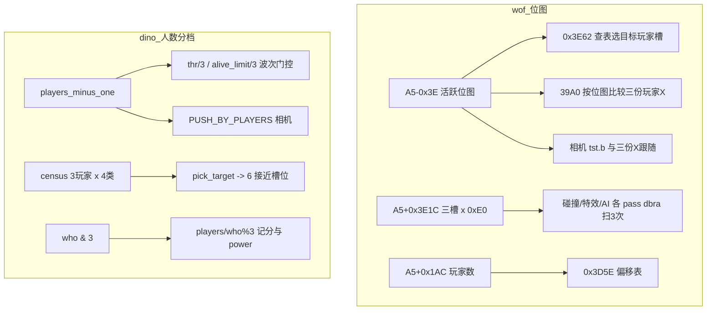

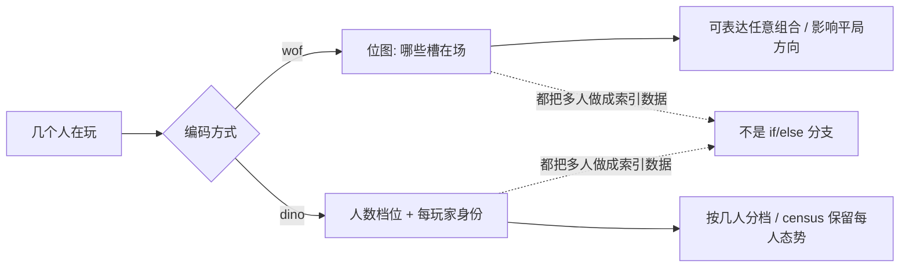

## 33.7 主线闭环、边界与音频登记

| 出处 | 本轮对应 |
|---|---|
| §11 勘误 | `A5-0x3E` = 活跃玩家位图、`0x3E62` = 目标玩家选择表，放回多人主线后说明为何不能读作 AI 档位 |
| §13 怪物策略 | census（dino）/ `39A0` + `0x3E62`（wof）是两种选目标编码 |
| §23 卷轴 / 摄像机 | 两边相机都读人数 / 位图；`PUSH_BY_PLAYERS` vs 三份玩家 X |
| §28 同屏预算 | `thr[3]` / `alive_limit[3]` 按人数分档；wof `0x3D5E` 按玩家数选表 |
| §31 角色差异化 | `who & 3` / `players[k].b.id & 7` 把"玩家槽"和"角色号"分开 |
| §32 载具 | 座位 `+$A2..$A4`、送车队友"第一个不在场的角色"是多人维度的具体用途 |
| §0 / §11.0 | 不把 wof 宿主补偿或未实现部分写成设计差异 |

**音频反馈登记为边界外**：本轮取证确认 `wt1/wof_cs/src/` 无 Sound / Audio 实现（与用户「我承认我没做音频，但用现代方式独立实现很容易」一致）。按 §0「宿主补偿不算设计」与「不把缺实现写成设计差异」，音频不作为本笔记的 dino-vs-wof 设计对照对象；dino 侧 `snd.rs:1-30` 的 `SndRequest` / `snd_passes`（`0xFF00` 停止 / `0x0030` 投币 / demo 开关）/ `bchg` 切换位属**反馈层工程实现**，其"音频输出"结论已在附录 A.6 / A.8 覆盖，不单独开节。此前的「音频反馈与战斗节奏」横向切面到此以**边界登记**方式结清，不是欠账。

结论：多人协作在两款游戏里都是一个**贯穿全系统的索引数据**，不是局部开关。wof 用活跃位图 + 固定三槽扫描，能表达"谁在场"的任意组合并影响选目标平局规则；dino 用人数分档 + 每玩家 census 计数，外层按几人调难度 / 波次 / 相机、内层用 `who & 3` 保留身份。§11 的勘误因此不是细节修正，而是这条主线的入口定义。§0–§32 反复出现的「共享函数 + 每类自己调用」在这里表现为「多人索引 + 各系统自己读」，是第七次复现。

- **未做（保留，不扩张）**：`0x3E62` 32 字节逐项数值与平局分支全表；`0x3D5E` 各玩家数偏移后的资料表内容；dino `PUSH_BY_PLAYERS` / `thr[3]` / `alive_limit[3]` 数值；wof 击杀归属与玩家间碰撞；两游戏"不在场角色"更多用途。
- **未新增 ROM 取证**，全部以两份 repo 源码为准（§11.0）；**未考证发行先后**，沿用用户给定前提。
- 按 §0 边界，wof 侧 `_无对应ASM` 宿主补偿与逐帧对拍修正未纳入设计对照；本轮不据此评价 rep 侧实现。

---

## 34.1 一句话对照

dino 把"一关"显式切成 **area（区域）**：`area` 是一级状态字节（`cam.s2.area` / `G.$786`），切换由相机控制器的一段 `sub` 状态机完成（锁在事件 X → 等 `go` → 淡出 → 改 `area` → 装地图/调色板 → 淡入），并触发一次集中的 `0xAA0E` 把玩家、脚本、对象池、rank、计时、地形、生成列表一起重置。wof 侧 repo 呈现的不是"区域字节 + 集中重置"，而是**关卡脚本记录流 + 相机门闩**：推进由 `trigger <= cameraX` 决定（`0x106F4` 解释器一帧可消费多条），敌人没清完时 `gateWaiting` 把 `CAMERA_MIN/MAX` 锁死；记录里的 `scene` 字节只是调色板参数索引。**一个是"显式分段状态 + 段切换时的一次迁移"，一个是"连续相机坐标上的一串触发条件"**。

## 34.2 dino：`area` 是显式状态，切换是相机的一段 sub FSM

`camera.rs:868/932` 的通用分派里，事件加载后按 `mode` 进两种区域收尾；`camera.rs:1513/1521` 的 stage 2 控制器复用同两个函数（模式表编号见 `camera.rs:1492`：`0 follow / 1 area end with a fade / 2 lock / 3 stage end / 4 sub area / 5 auto scroll / 6 area change without a fade / 7 stage end with a fade / 8 the car drive`）。事件本身由相机 X 触发（`camera.rs:1501` `ev.x <= cam_x` → `load_event`）。

```
通用分派 (camera.rs:868/932)          stage2 控制器 (camera.rs:1507-1523)
    mode 0x01 -> mode_area_end()          mode 1 -> mode_area_end()
    mode 0x12 -> mode_area_change()       mode 6 -> mode_area_change()

mode_area_end (0x20C.., camera.rs:1070)  sub 0/2/4/6/8:
    sub 0      : lock78=1, go=0，进入等待
    sub 2      : area_end_wait_go——相机锁在事件 X，go 未到就不动
    sub 4      : area_end_next_area(true)——跳到 x==0 的下一条事件，
                 s.area = ev.area，hook_acd0，load_all_palettes，area_setup
    sub 6      : area_end_fade_in——淡入
    sub 8      : area_end_load_next——go 清零后载入下一条事件，sub=0

mode_area_change (0x20CFE, camera.rs:1160) sub 0/2/4/6：
    无淡入的硬切；sub 4 的地图/调色板装载跨过下一个 vblank，
    MAME 里表现为 2~4 个黑帧——是 lag 帧，由 flow.lag 记账
    （接 §20 顶层任务机 / 附录 A.5「lag 不可模拟」）。
```

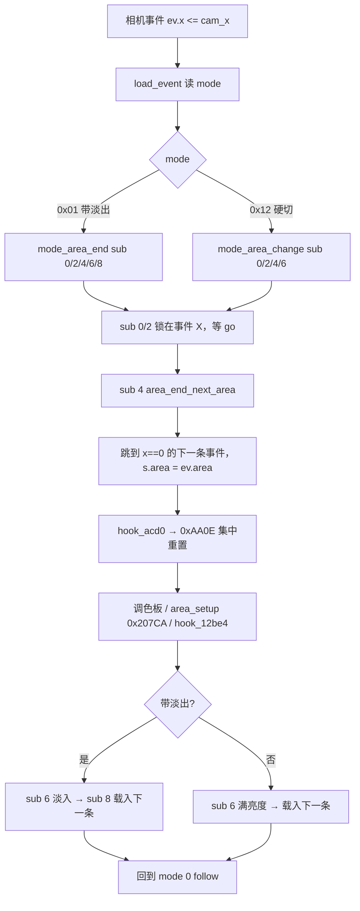

## 34.3 dino：一次 `0xAA0E` 把多少个系统一起重置

`flow.rs:638-664` 把 `flow_area_reset`（`0xAA0E..0xAAF4`，同时是相机 hook `0xACD0`）拆成 a / b 两段；`spawn.rs:4-9` 的文件头接口注释把它与 `rank_area_start` / `time_area_start` / `spawn_reset` 列为同一批"区域切换配套调用"。

| 系统 | 调用 | 段切换时做什么 |
|---|---|---|
| 玩家起点 / 状态 | `flow_player_area_start` `0x4E0A`（表 `0x4E56`，按 `stage` × `area` × `player`，`player.rs:528`） | 三个在場玩家各取 `(X,Y,Z)` 起点，状态字清零 |
| 英雄过场脚本 | `script_area_start` `0x1DA10`（表 `0x1DA64` 按 `stage`/`area`，`script.rs:143-152`） | 设 `G.$4DE` 脚本 id 与 `G.$4DD` 位掩码（哪些英雄受控），接 §4.1 / §19 |
| 对象池 | `pool_a_init` `0x4C48` / `Pool::new(POOL_C)` `0x4CA4` / `spawn_area_reset_objects`（`flow.rs:653/658/660`） | 清池 A / B / C，清 `G.$4F1..` 一片全局标志 |
| 障碍与地形 | `terrain_obstacles_reset` `0x4A76` / `hook_12be4` → `terrain_area_start` `0x12BE4`（`terrain.rs:568-570`） | 清障碍列表，装本关本区 floor list 与 `G.$6B0`（接 §32） |
| 动态难度 | `rank_area_start` `0x18048`（`flow.rs:662`） | 按 `stage × area` 重掷 aggression（接 §25） |
| 计时 / 生成 | `hook_aae2` → `time_area_start` `0x1031A` / `spawn_reset` `0xFBE8`（`flow.rs:663`） | 清 `wave_timer` / `alive` / `kill_all`、重置 spawn list 指针（接 §28） |
| 表现层 | `load_all_palettes` / `area_setup` `0x207CA`（`camera.rs:781-792`） | 装区域 scroll2 header、`map_area`、重画第一屏 |

`spawn.rs:9` 还有一句关键兜底：**"Until the flow port calls `spawn_reset`, `spawn_script_tick` notices an area change by itself"**——生成解释器自己也会发现 `area` 变了并重置。也就是说段切换不押注在单一调用者上，这是笔记里反复出现的"共享函数 + 各系统自己读状态"的又一次复现。

## 34.4 wof：推进 = 脚本记录流 + 相机门闩

| 证据 | 位置 | 游戏逻辑本意 |
|---|---|---|
| 关卡脚本表 | `Cps1LevelScript.cs:20` `StageScriptTable = 0x1066C`，`:120-123` 按 `stage` 取脚本 | 一关一条脚本流，不是一张区域状态表 |
| 推进时钟 | `:455` 每帧最多 `MaxRecordsPerFrame=64` 条、`:463` 读 `trigger`、`:474` 负 `trigger` 为结束标记；`:1102-1105` ROM 解释器同帧循环消费多条 | **"走到哪"由 `trigger` 与 `cameraX` 的比较决定**；相机不动则脚本不前进（`:387/:420` 的因果说明），呼应 §19「推进时钟写在哪里」 |
| 门闩 | `:1081-1086` 存 `gateEnemyThreshold` 与 `gateLockedMinX/MaxX`、置 `gateWaiting`；`:95-104` 等待期把锁定值写回 `CAMERA_MIN/MAX` | "敌人没清完不许往前走"是相机坐标上的约束，不是段状态迁移（§28 已展开） |
| `scene` 字节 | `:608-617` type `0x40` 记录 `[trigger:w][40][scene:b]` → `A5-0x47 = scene`，`0xAABA0 + scene*2` 选参数表，写 32 组 × 8 long 到 sprite palette；`:874` `MarkSceneObjectCreatedThisFrame` | repo 侧 `scene` 是**表现层色板 / 场景对象索引**，不携带 dino `area` 那种"切换时批量重置一批系统"的语义 |
| 结束 / 收尾 | `Cps1EnemyAI.cs` 的 `0x42C2` + `A5+0x188=0xFF`、对白对象接力（§30） | 整局 / 关卡结束走信号 + 对象接力，不是区域状态机的一部分 |

按 §0 边界，wof 文件里的 `-Cpu 400` 帧号声明、逐帧对拍修正、`_无对应ASM` 宿主旗标（`:296-297` 自注 `gateWaiting` / `waveControllerActive` 是宿主静态旗标）一律剥掉，不写成设计差异；按 §30 的教训，**不据此断言原机没有集中的区域 / 关卡管理器**——repo 侧呈现的是"脚本流 + 门闩"，这只是当前复刻的组织方式，不是对原机结构的否定。

## 34.5 对照表

| 维度 | dino | wof（repo 侧呈现） |
|---|---|---|
| 分段单位 | `area` 字节（`cam.s2.area` / `G.$786`），按 `[stage][area]` 索引多张表 | 相机 X 上的 `trigger` 序列；`scene` 是记录里的色板索引字节 |
| 谁决定换段 | 相机事件表 `ev.x <= cam_x` + `go` 标志 | 脚本记录 `trigger <= cameraX`，一帧可消费多条 |
| 换段动作 | 一段 `sub` 状态机：锁 → 等 go → 淡出 → 改 area → 装地图/调色板 → 淡入 | 门闩锁相机 → 阈值达标放行；无独立的段切换状态机 |
| 换段时的系统重置 | `0xAA0E` 一次集中重置 7 类系统，且生成解释器自带兜底 | 无等价集中重置；阈值 / 控制器状态由脚本记录自带 |
| 玩家位置 | 按 `[stage][area][player]` 表重放起点、状态清零 | 相机 / 门闩约束下连续移动 |
| 与既有章节的接口 | §4.1 / §19 脚本、§20 顶层任务机、§23 卷轴、§25 rank、§28 波次、§30 整局流程、§32 地形 | 同 |

## 34.6 主线闭环

§14.5 / §20.6 的主线是"把**这一帧做什么、下一帧读什么**做成显式结构（固定顺序 + 状态字节 + `prev` 快照）"。本轮看到它的空间版：**dino 把"一关里的阶段边界"也做成一个可枚举的状态**（`area` 字节 + 相机 `mode/sub`），并让跨界成为一次可枚举的批量重置；**wof 把同样的空间推进做成连续量上的一串触发条件**，推进时钟写在脚本解释器里。这不是"谁更先进"，而是两种放置边界的位置：一个放在状态机内部，一个放在坐标 / 脚本流上。它同时是 §19「推进时钟写在哪里」和 §23「相机不只是显示」的收口。

- **未做（保留，不扩张）**：dino `cam_events` 事件表逐项数值与每关区域数；`0x4E56` / `0x1DA64` / `0x1D9B0` / `0x1DAFC` / `0x1E3F4` 各表内容；`mode 4 sub area` / `mode 5 auto scroll` / `mode 7 stage end with fade` 全文；wof `0xAABA0` 色板表逐项、各 stage 脚本全量记录、type `0x40` 之外的 `scene` 用途、`Cps1SceneObjRuntime` 全文；两游戏区域切换与 Boss 战边界的逐关对照；wof 是否有等价集中重置的原机结构（按 §30 不据此断言）。
- **未新增 ROM 取证**，全部以两份 repo 源码为准（§11.0）；**未考证发行先后**，沿用用户给定前提。
- 按 §0 边界，wof 侧 `_无对应ASM` 宿主补偿与逐帧对拍修正未纳入设计对照；本轮不据此评价 rep 侧实现。

---

# 第二十八轮：非角色对象怎么组织（可破坏物、控制器、场景装置）

> 承接：§2（对象池与固定更新顺序）、§15 / §32（车是 pool B 的一个 class）、§21（道具是 pool E）、§28（波次控制器）、§34.3（区域切换清池）都碰过"不是玩家也不是敌人的对象"，但没把**这类对象整体怎么组织**当一条主线展开。本轮补上。
> 位置说明：按"轮次线性追加"接在 §34 之后；导航更新一律"改内容不增行"，A.9 / A.10 的统计仍是 §33 定稿时的快照。全部只读两份 repo 源码，未新增 ROM 取证、未改任何代码（§11.0）。

## 35.1 一句话对照

两边都把"非角色、非敌人的东西"做成**带状态的对象 + 按 id 分派 + 每类自己的状态机**，但装它们的容器不同：**dino 用一个 pool B 装下全部**（波次控制器、Boss 增援控制器、车、可破坏装置、街景动画），按 `class` 号分派到 80 多个专用 handler，共享的是**"能不能被打"的契约与几项服务**，不是分派器本身；**wof 按用途分成多个对象池**（6 槽场景演员池、特殊 18 型对象池……），每个池一张 `ObjId` 分派表，波次控制器、背景切换、火焰闪烁各自是一个对象。这是笔记里"共享框架 + 每类自己调用"在非角色对象上的第八次复现，也把 §28 里"wof 门控载体是关卡脚本解释器"深化为"解释器本身也是一个对象"。

## 35.2 dino：一个池装全部，共享的是契约与服务

`prop.rs:1-29` 的文件头把"可破坏 prop 的统一契约"写得很完整，它是**跨所有 class 的公共协议**，而不是某个 class 的实现：

```
可破坏 prop 的四段契约（prop.rs:4-29 / pass_10cd0 = 0x10CD0）：

  mode 0  init      : Prop::hit_init(box_table, hp)
                      body box +$48=1、attack box +$49=0、盒表 +$44、HP +$6C/+$6E
  mode 2  可被击中  : Game::prop_register_hit(handle)  # 0x4BFA
                      注册进 list 0x6724 / count 0x671C
                      ★ 列表每帧由 0x105E8 清空：这一帧不注册，这一帧就打不到
  命中 pass          : 玩家攻击盒 +$2E 为 4 或 6、序列号 +$5E 与上次不同（新挥击）、
                      box 测试 0x128F8 命中 → 写 +$04 = 0x04000000（mode 4）
                      ★ pass 从不看 HP：一次重叠的命中就把 prop 打碎
                        （只有火焰喷口 class 45 自己数 HP）
  mode 4  break     : 由 prop 自己完成（tile_block 写砖 / 音效 / 特效 / prop_free）
```

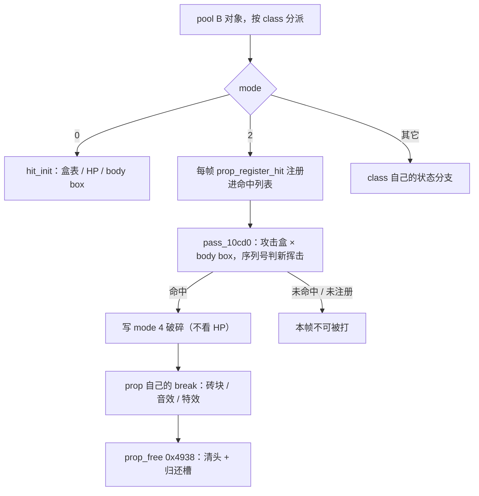

**共享的是服务，不是分派器**：`prop/drivers.rs:1-26` 列出四类被多个 class 复用的公共例程——调色板循环（B60/B61/B63 共用 `+$A4` 倒计时，重载 8/16 即每 9/17 帧一步）、tile 时钟（`G.$7AE` 当前相位 / `G.$7AF` 上一帧相位，两者不等才重画，又一处"这一帧写、下一帧读"）、door burst（等待 → 写砖块 → 生成 pool C 碎片 → 音效 → 下一个 mode 释放）、hero reach（复用普通盒测试 0x128F8，没有第二套规则）。每个 class 自带表（`drivers.rs:2-3` 明说 "they pass their own tables (nothing is extracted here)"），`prop/b*.rs` / `prop/class*.rs` 80 多个文件各自按 `p.b.mode` 分支（`prop.rs:470` / `:511` 是其中两个例子：class 73 投鸟器、class 15 波次控制器）。

**这个池里什么都有**：`prop.rs:1-2` 开头即点名"波次控制器（class 15, `0x7B336`）和 Boss 增援控制器（class 22, `0x7BEF6`）"与可破坏物同池；§32 的车是 class 88。也就是说"关卡推进器"和"场景砖块"在 dino 里是同一种东西——一个带状态字节的 pool B 对象。

## 35.3 wof：按用途分池，每池一张 ObjId 分派表

| 池 | 证据 | 组织方式 |
|---|---|---|
| 场景演员池 | `Cps1SceneObjRuntime.cs:60-88`（基址 `A5+0x5CBC`、6 槽、步长 `0xC0`） | `0x4E500` 每帧先重置指针表，再按 `ObjId` 扫描 20 槽；只判 `Exist == 0` 跳过（`:138` ROM 直译） |
| 场景分派表 | `:142-185` `switch (ObjId)`，表 `0x4E534` 共 7 项（`:147-150` 逐字：`4E550 / 4E686 / 4E726 / 4E740 / 4EB8C / 4EDA2 / 4F010`） | `ObjId 0..6` 各自一个 handler；`ObjId0` 还有自己的状态表 `0x4E55E`、资料表 `0x4E7B6`、道具随机 / 回退表 `0x4E9CE / 0x4EA2E`；`ObjId3` 有武器随机 / 参数表 `0x4EABC / 0x4EB1C`（`:77-84`） |
| 特殊 18 型对象池 | `Cps1SpecialObjRuntime.cs:18` 完整 `ObjId` 表 `0x4F28A`；`:95` 分配槽、`:130` 入场对象 | 波次脚本执行器（`ObjId 0x0A` / `0x53AE0`）、Scroll3 背景切换（`ObjId 0x08` / `0x537C6`）、色板相位动画（`ObjId 0/1`，`:828-835`）、入场对象 `ObjId 0x0B` 等 |
| 波次控制器本身是对象 | `:236-255` + `:317-357` `switch (phase)` | `0x53AE0` 首帧初始化后，主链按 phase `0x00/02/04/06/08/0A/0C` 分派：装载脚本状态 / 生成波次敌人 / 门等待自增 / 相对跳转 / 门推进 / 生成 / 门等待，并有专用回收 `0x53CE8`（`:682`） |

最后一行是本轮最有用的一处深化：§28 把 wof 的门控载体写成"关卡脚本解释器 + 相机 min/max 锁定"，这里看到**那个解释器在 repo 侧也是一个带 phase 状态机的对象**（特殊 18 型 `ObjId 0x0A`），和 dino 把波次控制器做成 pool B class 15 是同一个思路——把"关卡推进器"降格成一个普通对象。两边都有，只是 dino 把它和砖块装在一个池、wof 把它单列在特殊对象池。

按 §0 边界，wof 两个文件里大量的"主机近似 / 取消宿主发明判据 / 逐帧对拍补洞 / `_无对应ASM` 诊断数组"一律剥掉，只取上面的分派与状态机结构；按 §30 的教训，**不据此断言原机没有别的池或集中管理器**。

## 35.4 对照表

| 维度 | dino | wof（repo 侧呈现） |
|---|---|---|
| 容器 | 一个 pool B：控制器、车、可破坏物、街景动画同池 | 多个池：场景演员池（6 槽）/ 特殊 18 型对象池等，按用途分开 |
| 分派键 | `class` 号 → 80 多个 `b*.rs` / `class*.rs` | `ObjId` → 每池一张跳表（`0x4E534` 7 项、`0x4F28A` 全表） |
| 共享层 | 契约（hit_init / register_hit / break）+ 服务（drivers.rs 四类） | 每池一个 `switch(ObjId)` 扫描循环；handler 自带资料表 |
| "能不能被打" | prop 每帧自己注册进命中列表，不注册即打不到；命中 pass 不看 HP | 场景池按 `ObjId` 分派，道具 / 武器掉落各带随机与回退表 |
| 关卡推进器 | pool B class 15 波次控制器（`0x7B336`）、class 22 增援控制器 | 特殊 18 型 `ObjId 0x0A`（`0x53AE0`）波次脚本执行器 |
| 与既有章节 | §2 固定更新顺序 / §15·§32 车 / §21 道具是 pool E / §28 波次 / §34.3 清池 | §28 门闩 / §30 关卡结束信号 / §34 相机推进 |

## 35.5 主线闭环

§14.5 / §20.6 的主线在 §34 落到"空间边界做成显式状态"，本轮落到**"对象类别边界做成显式分派"**：两边都不写"if 是可破坏物 / 是控制器 / 是背景动画"的散落分支，而是给每个对象一个 id，用一张表把它交到自己的状态机里。差别只在**这个 id 隶属于一个统一池还是多个专用池**——dino 选"统一池 + 共享契约"，wof 选"按用途分池 + 每池一张表"。§28 的"wof 门控是脚本解释器"由此补成"解释器自己也是一个对象"，两款游戏在这一点上其实同构。

- **未做（保留，不扩张）**：dino 80 多个 prop class 逐类语义、`pass_10cd0` 全文与盒表数值、class 45 火焰喷口自数 HP 的完整状态机、`drivers.rs` 各服务逐函数；wof `0x4E534` / `0x4F28A` 各跳表逐项、`ObjId 0..6` 与特殊 18 型各 handler 全文、道具 / 武器随机表内容、场景池 20 槽与 6 槽视图的关系；两边"可破坏物掉落"规则的逐关对照。
- **未新增 ROM 取证**，全部以两份 repo 源码为准（§11.0）；**未考证发行先后**，沿用用户给定前提。
- 按 §0 边界，wof 侧 `_无对应ASM` 宿主补偿与逐帧对拍修正未纳入设计对照；本轮不据此评价 rep 侧实现。

---

## 36.1 为什么单列一节

笔记里至少七处独立章节都得出过同一句结论——"把时序点做成显式数据"，但每处只举自己那个子系统的例子。把它们并排后能看出两件事：**(a)** dino 侧这些字段不是零散技巧，而是覆盖输入、显示、反馈、战斗、生成、场景的全套写法；**(b)** wof 侧同样有跨帧时序，但多数寄存在队列 / shadow / 调度里，没有统一的命名快照。这正是用户最初"硬件中断 → 函数执行次数不确定"在两边走向不同的根因（§26.4 / 附录 A.5）。

## 36.2 dino 侧实例全表（逐条核准）

| # | 实例 | 写（本帧） | 读（下一帧 / 帧末） | 设计语义 | 出处 |
|---|---|---|---|---|---|
| 1 | 输入边沿 | `flow.rs:335/343` 帧末 `prev_input = w.input` | `flow/join.rs:174` `input & (input ^ prev_input) & 0x10`、`flow/cont.rs:69/320`、`flow/select.rs:352/837`、`flow/cards.rs:466` | "新按下" = 本次按下且上次没按；菜单 / 投币 / 续关全靠同一份快照 | §14 / §20 |
| 2 | census 人头 | `spawn.rs:17-19` `alive`（上次 census 数）/ `alive_run`（运行计数） | 波次门控与难度按 `alive` 判断（§28 / §13） | 敌人数反馈隔一帧生效，不从运行中计数直接读 | §13 / §28 |
| 3 | 命中 → 处决分帧 | `enemy_combat.rs:569` 注释：击杀 / 战败来自 boss 自己**下一次 update**，原机不在此调用 | 下一次 update 的 hit state | 命中帧只结算字段，不处决对象 | §12 / §22 / §29 |
| 4 | 显示锁存 | `mod.rs:343-345` `latch_scroll` / `sprites.latch()` / `pal.latch()`（原注 `the palette one frame late`） | 下一次显示（§23 的 `VIDEO_LATENCY=2`、VBlank shadow） | 画面读的是上一帧算好的值 | §23 / 附录 A.8.3 |
| 5 | HUD 脏标志 | `hud.rs:112-113` `score_dirty` / `score_dirty_p[3]`、`:467-468` 置位、`:120` 注释"so `hud_update` does not run it a second time this frame" | `hud.rs:498-511` 帧末消费并清零、`hud_update:809` | 一帧内加多少次分只重绘一次，"执行次数"不进验收 | §26 |
| 6 | 清池只清 free stack | `flow.rs:659` `draw_special_init` 原注 "the free stack only, the slots keep their bytes"；`mod.rs:139-143` `reset_free` "leaves the slots as they are" | 后续复用槽 | 槽里是上一帧残留字节，靠重建空闲栈而非擦除来换段 | §34.3 / §35 |
| 7 | tile 时钟 | `prop/drivers.rs:40-49` `prop_tile_clock` / `_prev` / `_edge`（`G.$7AE` 当前相位 / `G.$7AF` 上一帧相位） | 相位不等才重画 | 重画比相位变化晚一帧 | §35.2 |

七个实例横跨**输入、敌人统计、战斗结算、显示、反馈、对象池、场景动画**，且写法一致：一个本帧写入的命名字段 + 一个固定顺序的读取点。这印证 §20.6「不是某个子系统的局部技巧」。

## 36.3 wof 侧并排：同样的时序，放在哪里

| wof 实例 | 位置 | 对应 dino 哪一条 | 时序放在哪 |
|---|---|---|---|
| 卷轴 / 相机 shadow 提交 | `Cps1CameraRuntime.cs:15`（VBlank shadow 提交）、`:205` `提交卷轴与渲染相机Shadow_每帧一次_对应ASM_5DEA6_5DF74()`、`:1158` "提交当前 shadow，随后才让恢复点写入本轮 `NEXT_Y/CURRENT_Y`" | #4 显示锁存 | shadow 本身就是"上一帧算好、这一帧提交"，但读写分散在渲染与恢复点，不是统一 `latch` 步骤 |
| 生成对象跨帧 | `Cps1ObjectRuntime.cs:302/324/392` 注释所记 ROM 行为「本帧入队、下一帧消费」；`Cps1LevelScript.cs:1284`「与 AI 由**下一帧**的 `0x22D02`」、`:1264`「交给下一帧 `0x106A4`」 | #2 / §28 生成跨帧 | 隐含在队列与调度里，不是命名的 `prev` 字段 |
| 命中链当帧完成 | §12 / §22 已述：`Cps1Collision.cs` 命中链当帧分派 9 项反应、写 `StunLeft/StunVal/DmgReaction` | #3 | **当帧完成、不跨帧**——这正是 §12「dino 分帧 vs wof 当帧」的差别，不是 wof 缺时序 |
| 相机门闩 | `Cps1LevelScript.cs:95-104 / 1081-1086`（`gateWaiting` 锁 `CAMERA_MIN/MAX`） | §34 区域切换 | 把"上一帧的相机范围"锁存到阈值达标，不是 `area` 状态迁移 |

按 §0 边界，wof 文件里 `_无对应ASM` 宿主旗标、逐帧对拍补洞、同帧去重入口一律剥掉，只取上表的结构；按 §30 教训，**不据此断言原机没有命名快照或集中管理器**。

## 36.4 一张总图

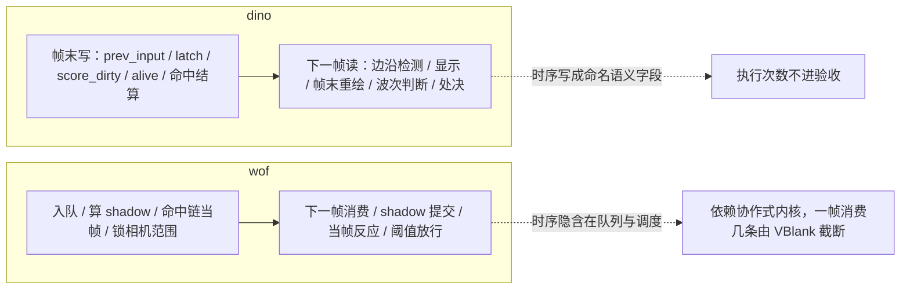

## 36.5 主线闭环与边界

两边都有跨帧时序，差别在**放置位置**：dino 做成命名语义字段 + 固定读取点，wof 更多寄存在队列 / shadow / 当帧链里。于是用户最初的"函数执行次数不确定"在 dino 侧被改写成"帧末字段写了什么、下一帧读到什么"，次数本身不进验收；wof 保留协作式内核，一帧消费几条由 VBlank 截断决定（§19 / §26），调度差异直接变成逐字节差异。本表是 §20.6 主线的封顶收口，也把 A.11 的"骨架 ~98%"落到可查实例；**不宣称目标终止**，开放目标仍按 `长时间自主推进` 继续。

- **未做（保留，不扩张）**：`prev_input` 全部消费点、`latch_*` 各通道延迟值逐项、`score_dirty_p[3]` 与 `weapon_dirty` 全链路、`G.$7AE/$7AF` 各关相位表；wof `0x5DEA6` shadow 段全文、`0x22D02` 对象分发全文、各"下一帧"pending 点全量；两边跨帧时序的逐帧对拍数值。
- **未新增 ROM 取证**，全部以两份 repo 源码为准（§11.0）；**未考证发行先后**，沿用用户给定前提。
- 按 §0 边界，wof 侧 `_无对应ASM` 宿主补偿与逐帧对拍修正未纳入设计对照；本轮不据此评价 rep 侧实现。

---

## 37. 命中反馈层：停顿与震动是两条独立的状态机，不是命中帧的一个字段

> 触发：§17 / §22 / §29 记录的是"命中帧写了哪些字段"（`reaction / stun / hitstop / knock`），没回答"写完之后谁推进、谁复位、作用到哪一层"。本轮把 `hitstop` 与屏幕震动单独拎出来看它们**各自的状态机形态**——这是战斗节奏怎么被组织，不是 Rust/C# 或 WRAM 布局差异。
> 归属：设计正文（§0–§37），按"轮次线性追加"接在 A.13 之后；物理位置在附录 A 之后，与 §34–§36 同例。结论全部以两份 repo 源码为准，未新增 ROM 取证（§11.0）。
> 边界：特效对象状态机（pool C / `Cps1HitEffectRuntime`）在 §21.8 / §35.5 已登记"保留、不扩张"；音频触发按 §0 边界外。本节只把命中链"创建特效对象"记为挂接点，不展开。

### 37.1 分工：命中结算 vs 反馈推进

| | §17 / §22 已写 | 本节补 |
|---|---|---|
| 时段 | 碰撞 pass 命中当帧 | 命中**之后**若干帧 |
| 问题 | 写了哪些字段、写几处（攻击方 / 被击方 / 合体技 partner） | 这些字段由谁递减、递减时谁被门控、何时复位 |
| 屏幕震动 | 未展开 | 相机级 / 全局级两套完整形态 |

一句话：dino 把"停顿"放在**每个对象的对象头**、把"震动"放在**相机控制器的一个子状态机**，两条线互不相干；wof 把"停顿"压进**一个 `+0x62` 字节**（兼硬直门 / 闪烁 / 群体命中锁），把"震动"交给**全局计数器 + 偏移表 + VBlank shadow**。

### 37.2 dino：对象头 `hitstop` 与相机 `step_shake`

**A. 停顿——对象头字段 + 状态机入口门**

命中帧 `e.hitstop = attacker.hitstop = rec.hit_stop`，合体技连 partner 也写（§22.3，01 卷）。之后它不由一个全局计时器统一推进，而是**每个对象在自己的状态机里自查**：

```rust
// player.rs:1835-1842
fn player_hitstop_wait(&mut self, i: usize) -> bool {
    let p = &mut self.players[i];
    if p.b.hitstop != 0 { p.b.hitstop -= 1; return true; }  // 本帧跳过该玩家后续状态推进
    false
}
```

`player_hitstop_wait` 在 run / attack 等状态分支入口被反复调用（`player.rs:1668 / 1698 / 1717 / 1754 / 1797`），另有 `player.rs:1309 / 1398 / 1427 / 1468 / 1508 / 1552 / 1605` 直接 `hitstop != 0` 门控；特定动作直接写 `p.b.hitstop = 0x10`（`player.rs:889`），初始化清零（`player.rs:256`）。即 **hitstop 是"本帧该对象不推进"的分布式门，不是全局冻结**——与 §20 顶层任务机 `flow_lag` 是两回事。

**B. 震动——相机控制器的显式子状态机（`0x222D6`）**

7 个字段都在逐帧 trace 里（`trace.rs:1731-1739`：`shake_state / shake_req / shake_strength / shake_timer / shake_sign / shake_amp / shake_scroll1_y`），是验收字段。`screen_shake`（`camera.rs:1727-1729`）每帧调 `step_shake`：

```rust
// camera.rs:208-254，0x222D6 / 0x222EE / 0x22316
fn step_shake(&mut self, scroll1: bool) {
    if state == 0 { strength = req;
                    if strength == 0 { scroll1_y = cam1_y; return; }   // 空闲：只同步显示 Y
                    state = 2; req = 0; timer = 0; amp = strength; sign = -1; }
    // 运行中可被更强请求覆盖；保留 timer 相位（camera.rs:1731-1735 注释）
    if req != 0 && (req as i8) > (strength as i8) { strength = req; amp = req; sign = -1; }
    req = 0;
    off = sign < 0 ? -amp : amp;
    display_y = (scroll1 ? cam1_y : s2.cam_y) + off;        // 只写显示 Y
    (timer, borrow) = timer - 1;                              // 每 3 帧换向
    if borrow { timer = 2; sign = -sign;
                if sign < 0 { amp -= 1; strength -= 1;
                              if strength == 0 { scroll1_y = cam1_y + dy1; state = 0; } } }
}
```

形态是**幅度递减的方波**：每 3 帧换向，负半周把幅度减 1，减到 0 收尾并回到 `state 0`。单测 `shake_duration_decay_and_layer_selection`（`camera.rs:1794-1832`）逐帧断言 `shake_dy2 / shake_timer / shake_sign`，包括 `req = 0xFF` 按有符号比较不覆盖、弱请求不打断相位。

两个设计要点：
1. **作用层隔离**：`screen_shake` 注释明确 `Only the vblank Y shadow moves. Sprites, collision and camera streaming keep their coordinates.`（`camera.rs:1726`）——震动只改显示 Y，不污染碰撞坐标与相机流送，反馈不回写游戏状态。
2. **复位与脚本化**：`flow_game_clear_ram (0xA836)` 把 6 个 shake 字段连同 `shake_scroll1_y` 一次清零（`flow.rs:443-449`）；`flow.rs:1239` 在某关开场直接 `cam.shake_state = 2`，说明这段震动可被流程脚本当作持续状态用，不必由命中触发。`cam_shake(strength)`（`camera.rs:1733`）只写 `shake_req`，"last write wins"（`camera.rs:1731`）。

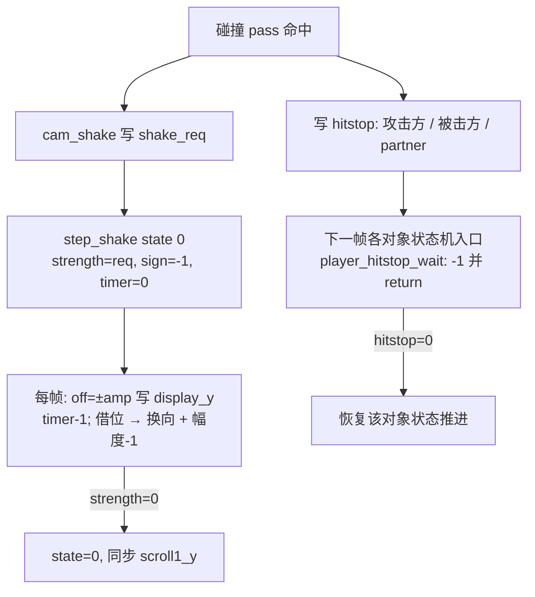

### 37.3 wof：`+0x62` 一字节三用 + 全局 VBlank 震动

**A. 对象级——`+0x62` 同时是硬直门、闪烁、群体命中锁**

命中链从 `0x6E75F + (signed)attacker+0x7A` 取一字节，**双方同写** `+0x62`（`Cps1Collision.cs:3464-3470`）；`受击反应` 段再走 `命中双方硬直_可能对应ASM_7EA2(attacker, target, shake)`（`Cps1Collision.cs:5116-5119`），该值多数调用点恒 3、个别为 4 / 5（同文件 `:4907 / :5058 / :5087 / :5125` 的逐点注释）。

推进方式与 dino 同构但更省：各 Actor 主体入口直接查这个字节，非 0 就 -1 并 **rts 跳过本帧**（`Cps1Actor1BRuntime.cs:385-392`，`Cps1Actor26Runtime.cs:258-261`、`Cps1Actor2DRuntime.cs:529-531` 同构）。

它一字节兼三职：
- 硬直门（上面）；
- 受击闪白（`:5127` 提到 `0x121BA` 的 `tst.b (0x62,A0)` 闪烁循环）；
- **群体命中锁**：`Cps1Collision.cs:337-341` 注释——命中 A 后 `attacker.+0x62 = 3`，3 帧后归 0 而攻击动画仍活跃，于是同一套攻击可依次命中 B、C（3–5 个目标），每命中 `combo_level++` 且伤害递增。

即 wof 用**一个字节的生命周期**同时规定了"定格多久、闪多久、这套攻击还能不能再打中人"；dino 的 `hitstop` 只管定格，群体命中由 §12「命中帧只结算不处决 + 多 pass」另行组织。

**顿帧从哪一格来：一处累计阈值门（就地补，不新增节号）**

上面「多数恒 3、个别 4 / 5」不是散落的例外。`0x7E86` 段（`Cps1Collision.cs:5097-5120`）是 reaction 0/1/2/6「轻硬直 / 累计击飞」这一档的共用落点，它先 `jsr 0x17B2` 做累计，再按 `StunVal` 挑顿帧：

```text
StunVal <  0x1E  -> 0x7EC4，shake = rb(A3)：攻击参数行顺推到的下一格（招式自带值）
StunVal >= 0x1E  -> 0x7E92，清 StunLeft / StunVal，shake 固定 3
```

`blt` 是有符号比较，`StunVal` 落在 0x80..0xFF 也走取表那一支（`:5108-5110`）。`0x7EC4` 的 A3 不是另开一张 shake 表，而是命中链把当前攻击参数行一路推进后「顺手取下一格」（`:4879-4881`、`:5116-5117`）——与 §94.13「含义在读它的那条链里」是同一件事，也说明总入口清册 `0x6E662` 那格在 repo 内没有独立消费端。

**倒推到设计本意（说人话）**：两边都有「累计」，但挂的不是同一个问题。dino 命中结算把 `AttackRecord.hit_stop` 这一格直接写给攻防双方（合体技连 partner），之后各对象在自己的状态机里逐帧 -1 到 0；全库 `hitstop` 用法里另有几处按招式 / 对象写固定值，以及连段命中确认时给玩家 +1 帧（`player.rs:1427-1431`），但**没有一处读累计硬直再决定这一帧用哪个顿帧档位**。它的累计（`stun` / `POISE_T`）走的是另一个问题——决定倒不倒地、起身后会不会眩晕（§17 / §29.4），不回头改顿帧。wof 把累计直接接在顿帧的取值门上：连打前几下用这招自带的顿帧，累计到阈值就换成固定短顿并把累计清零，等于**主动给连打反馈踩刹车**；这也解释了 `+0x62` 为什么既是硬直门又是群体命中锁（本节 A）。不评优劣，只登记组织位置；wof 侧按 §11.0 只登记并列事实，FBA 逐帧补偿差异按 §0 剥掉。玩家可见的「连打手感怎么变」这一角没做逐帧 trace，按 §94.11 标**未验**，不把代码推断写成实测手感。

**累计本身是什么形状（就地补，不新增节号）**

上面那道阈值门读的 `StunVal` 也不是「每挨一下 +1」。`0x17B2`（`Cps1Collision.cs:5179-5219`）按**被打者** `+0x72 & 6`（上一击的火花 / 特效等级）查 `0x17DE`，取 `stunWindow` 写进 `StunLeft`、取 `baseAdd` 当增量；再取一次 RNG 低 5 位查 `0x17E4` 得有符号 `delta`。`baseAdd + delta` 与 `StunVal += d2` 都是**字节运算自动回绕、无钳制**。而 `StunLeft` 是逐帧 -1 的时间窗，归零就把 `StunVal` 清掉（`Cps1EnemyAI.cs:1132-1139` 的 `0x22D30..0x22D3C`；玩家侧 `Cps1PlayerLogic.cs:141` 同构）。所以它是**会自己过期、带噪声、增量取决于上一击效果**的短期压力计，不是一条固定上限的资源条。

dino 那边的 `b.stun` 正好相反：10 满的韧性条，命中按 `rec.stun` 扣减、到 0 强制击倒、击倒重置，`stun_refill = 0x78` 到点回满 10（`body.rs:131` / `enemy_combat.rs:66-67` / `player.rs:897-901`）；`POISE_T` 另管起身眩晕准入（§29.4）。

**倒推到设计本意（说人话）**：dino 让设计者能精确安排「连拳第几下把人打倒」——每招写明扣多少、扣光就倒、过一阵自己回满；wof 不安排「第几下倒」，而是让连打压力按上一击的效果和一点随机自己涨、自己过期，涨到一定程度就换一套顿帧。两边都有累计，但一个是**可预期的资源条**，一个是**会过期的短期压力计**。按 §11.0 不串等价、不评优劣；这与 §9.3 对照表「wof 未见独立 poise」不矛盾——它不是独立资源条，是耦合在硬直字节上的累计器，也不据此断言原机没有别的韧性机制。玩家可见一角同上一节，仍标**未验**。

**B. 全局级——计数器 + 偏移表 + VBlank shadow**

与对象 `+0x62` 完全分离的是屏幕震动（`Cps1CameraRuntime.cs:1261-1283`）：

```csharp
// 取得Y震动偏移_对应ASM_5DEAA_5DEB2
ushort shake = rw(SCREEN_SHAKE_Y_COUNTER_ADDR);       // A5-62
return shake == 0 ? 0 : rws(SCREEN_SHAKE_Y_OFFSET_TABLE_ADDR + shake);

// 帧末提交并递减Y震动Shadow_对应ASM_5DED0_5DEF0
offsetY = 取得Y震动偏移();
ww(SCROLL2_NEXT_Y, CAMERA_Y + offsetY);
ww(SCROLL3_NEXT_Y, BACKGROUND_Y + offsetY);
if (shake != 0) ww(SCREEN_SHAKE_Y_COUNTER_ADDR, shake - 2);   // 每帧 -2
```

对象显示 Y 也走这条：`取得显示相机Y_5DEB4 = CAMERA_Y + 偏移`，再由 `写入对象渲染相机YShadow_5DEA6_5DEB4` 快照进 `A5-7CC4`，后续展开器读 shadow 而不现算（`Cps1CameraRuntime.cs:1243-1259`）。硬件 `CURRENT` 由 IRQ `5A8` 轮换（`:1273`）。形态是**一个自减计数器查一张偏移表**，没有 state / 请求仲裁 / 幅度包络；衰减速度由"每帧 -2"和表内容决定。

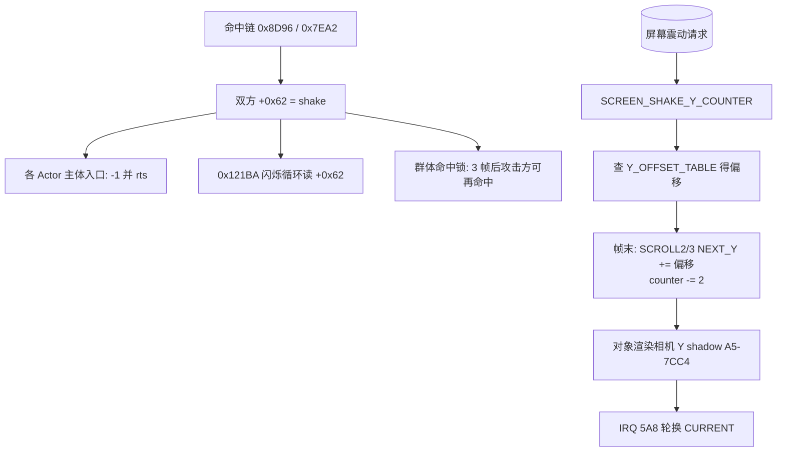

### 37.4 对照表

| 维度 | dino | wof |
|---|---|---|
| 停顿归属 | 对象头 `hitstop`，攻击方 / 被击方 / 合体技 partner 三处同写（§22.3） | 对象 `+0x62` 一字节，双方同写 |
| 停顿推进 | `player_hitstop_wait` 状态机入口 -1 并 return（`player.rs:1835`） | 各 Actor 主体入口 -1 并 rts（`Cps1Actor1BRuntime.cs:385`） |
| 连打时顿帧来源 | 每招固定一格，累计另管倒地 / 眩晕；连段命中确认只给玩家 +1 帧 | `0x7E86` 按 `StunVal` 阈值切换：未达阈值取招式自带值，达到就固定 3 并清累计（§37.3「顿帧从哪一格来」） |
| 累计的形态 | 10 满的韧性条：按 `rec.stun` 扣、到 0 击倒、`stun_refill` 定时回满 | 带时间窗的短期压力计：按被打者特效等级 + RNG 查表增量、窗口归零清累计（§37.3「累计本身是什么形状」） |
| 一字段多职 | 否，只管定格 | 是：硬直门 + 闪白 + 群体命中锁（`Cps1Collision.cs:337-341`） |
| 群体命中 | 靠「命中帧只结算不处决 + 多 pass」（§12 / §22） | 靠攻击方 `+0x62` 3 帧解锁，combo 递增 |
| 屏幕震动归属 | 相机控制器**显式子状态机**（6 字段） | 全局计数器 + 偏移表 + VBlank shadow |
| 震动推进 | `step_shake` 幅度递减方波，每 3 帧换向、负半周衰减、到 0 收尾（`camera.rs:208`） | 帧末 `counter-2` + 查表偏移加到 scroll2/3 `NEXT_Y`（`Cps1CameraRuntime.cs:1270`） |
| 触发 / 仲裁 | `cam_shake` 写 `req`，有符号比较可重触发且保留 timer 相位 | 命中链直接写字节 / 计数器，无独立请求接口 |
| 作用层 | **只动 vblank Y shadow**，精灵 / 碰撞 / 相机流送坐标不变（`camera.rs:1726`） | 对象显示 Y 走 shadow、scroll2/3 `NEXT_Y` 加偏移，对象 `+0x62` 另算 |
| 复位点 | `flow_game_clear_ram (0xA836)` 集中清 6 字段（`flow.rs:443`） | 计数器自减到 0；shadow 每帧覆盖 |
| 可被流程脚本直接用 | 是（`flow.rs:1239` 开场置 `shake_state=2`） | 未见等价（不臆断） |
| 验收可见 | 7 个 shake 字段全进逐帧 trace（`trace.rs:1731-1739`） | 计数器 / shadow 属实现表相，按 §0 视角约定不比较 |

### 37.5 "更成熟"落在哪（只谈设计本意）

1. **反馈与游戏状态解耦**：dino 的 `screen_shake` 明写只改显示 Y、不碰碰撞与流送坐标，并用独立字段承载；wof 的 `+0x62` 把定格、闪白、群体命中资格压进同一个字节，紧凑但三者生命周期被绑死（注释里"3 帧"既是硬直也是再命中窗口）。
2. **震动从"计数器"升级为"控制器"**：dino 有 state / 请求仲裁 / 幅度包络 / 相位保持 / scroll1-vs-scroll2 分层选择，且可被流程脚本直接置状态；wof 是"自减计数器查表"，强度曲线由表与 `-2` 步长隐含。
3. **两条独立线**：dino 的停顿在对象、震动在相机，各自复位、各自验收；wof 是对象级一字节 + 全局 VBlank 两层，但对象字节被复用，两层之间靠注释里的"3 帧"耦合出群体伤害节奏。
4. 一句保留：这是**组织方式**差异，不是"wof 没有反馈"——wof 的群体命中锁（同一攻击打 3–5 个目标、combo 递增）反而是 dino 侧笔记里没有单独展开的节奏设计，按 §11.0 不据此断言 dino 没有类似机制。

### 37.6 未做（保留，不扩张）

- 特效对象状态机：pool C 与 `Cps1HitEffectRuntime.创建普通攻击命中特效_可能对应ASM_8366`（`Cps1Collision.cs:3472`）只记为挂接点；全量普查在 §21.8 / §35.5 已登记保留。
- 音频 / 音效触发时机：`attack_record` 的 `snd` 字段按 §0 边界外。
- wof 各 Actor 的 `+0x62` 逐类差异：仅抽样 `1B / 26 / 2D` 三处同构入口，不普查其余。
- 不臆断 wof 是否有"脚本直接置屏幕震动状态"的等价入口；不追 `0x6E75F` 表全部内容（§11.0 只在必要时补 data）。

**结论**：§37 把"命中之后几帧的反馈节奏"补成两条可对照的状态机；`长时间自主推进` 仍是开放目标，本节不宣称终止。

---

## 38. 友军伤害与记分归属：`pass_10664`（玩家 vs 玩家）到底做什么

> 触发：§3.1（00 卷）把 `collision()` 的第一个 pass 写成 `pass_10664()  # 玩家 vs 玩家`，此后再没解释它做什么；§33.6（02 卷）把"wof 击杀归属与玩家间碰撞"明列为"保留、不扩张"。本轮只把 **dino 侧两份 repo 已有的证据**补成一条完整链，wof 侧严格维持该边界、不臆断。
> 归属：设计正文（§0–§38），按"轮次线性追加"接在 §37 之后。结论全部以两份 repo 源码为准，未新增 ROM 取证（§11.0）。
> 分工：§3 / §12 讲固定 pass 顺序，§17 讲伤害多因子公式，§22 讲受击反应，§33 讲多人索引，§37 讲命中停顿 / 震动的反馈状态机；本节讲**"谁打谁"的过滤规则与"算谁的分"的归属规则**。

### 38.1 三个悬置问题

1. 玩家之间能不能互相打到？（§3.1 只写了个 pass 名）
2. 能打到的话，伤害怎么算、会不会误杀队友？
3. 这条命中记到谁的 HUD / 分数环上？

答案分散在 `player_combat.rs` / `enemy_combat.rs` / `hud.rs`，正好构成"碰撞层 → 结算层 → 归属层"三段。

### 38.2 碰撞层：两条玩家互伤路径，都只在非过场时跑

**A. `pass_10664`（玩家角色 vs 玩家角色）** —— `combat.rs:71` 是 `collision()` 第一个 pass，本体在 `player_combat.rs:173-250`：

```rust
if w.scripted != 0 { return; }                    // 过场不许玩家互伤
let list = combat.get(0x6718);                    // 英雄列表
if list.len() < 2 { return; }                     // 少于 2 人无意义
for a in list { for v in list {
    if v == a || v.live & 2 != 0 { continue; }    // 自己 / 已受击
    if a.serial == v.hit_serial { continue; }     // 同一次攻击不重复命中
    if a.attack_box == 0 { break; }
    if v.body_box == 0 || matches!(v.kind, 6 | 8 | 0xA) { continue; }
    let (ha, hb) = boxes_hit(a.attack_box, v.body_box);
    let g = player_g4f3();                        // G.$4F3：上一帧存活敌人数（§28 census）
    if g >= 3 { continue; }
    let (add, limit) = [(1, 2), (0, 1), (0, 0)][g];
    if (a.zi() - v.zi()) + add > limit { continue; }   // ★ Z 差容忍按同屏敌人数收紧
} }
```

**本轮回源订正（§94.21 就地改正文，不新增节号）**：上一版把 `player_g4f3()` 写成「同屏人数分档（§33 复现）」，推出「人越多越不许隔着高度层误伤队友」——**主语错了**。`player_combat.rs:168-170` 直读 `spawn.g.alive`，`spawn.rs:17` 明写 `G.$4F3 = alive enemies counted by the previous census`（`G.$4FB` 是运行计数）；`enemy.rs:772-782` 每帧 `g.alive = g.alive_run`、`alive_run` 按敌人槽逐个累加，02 卷 §312 与 00 卷 §1062 的 `move.b $4fb,$4f3` 反汇编都已独立登记这个语义。**它是「上一次 census 数出的存活敌人数」，不是 `G.$4EF` 的玩家人数**。

**三方对账（§94.11 第三道闸）**：

| 角 | 事实 |
|---|---|
| 数据定义 | `G.$4F3` 存活敌人数，**帧首** `enemy_census` 内 `alive = alive_run; alive_run = 0` 封账（`enemy.rs:775-776`，不是帧末滚动），`flow.rs:430` 换区清零 |
| 谁读 | `pass_10664` 的 `player_g4f3()`（`player_combat.rs:204-208`）；同一字节另被 `boss.rs:211/250` 放怪闸门（§94.22）、`prop.rs:562` 波次阈值、`enemy_combat.rs:1379` 眩晕概率表、`class6_ai.rs:361` 出招脚本表索引共读 |
| 玩家看得见 | 场上敌人 0 / 1 / 2 个时，两名玩家隔着高度层还能互相打到；敌人到 3 个，玩家互伤整段不判 —— 乱战里不再自己人打自己人 |

**改了哪句判断**：这条规则不是 §33「人数分档 + 各系统自己读」在碰撞层的复现，而是**拥挤控制**的一部分。00 卷 §1088 登记了 `SPEC.md §14` 的四件事（目标偏好 <3 敌人 / 6 槽位轮换 / 低攻击概率 / 波次阈值），`pass_10664` 是同一思路落在玩家侧的另一件：同屏敌人多到一定程度，连队友互伤也一起关掉。两根轴要分清 —— `G.$4EF`（几个人在玩）在玩家状态变化的事件点重算、平时稳定（§94.22 就地订正，不是开局定死），调 Boss HP / 波次 / 镜头 / 结算；`G.$4F3`（场上有几个敌人）是逐帧滚动、调放怪 / 眩晕 / 出招 / 友军误伤容差。**§94.22 刚把前者补成贯穿全局的调参轴，若不订正，这里会凭空多出一个假消费点**，把「拥挤度」误记成「人数」。

**按 §94.17 别写全称**：不是所有友军误伤都读这个字节 —— `pass_10dcc` 的 friendly 分支（`enemy_combat.rs:26-89`）走的是同 Z 层 + 排除两类攻击，不读 `g`；只有 `pass_10664` 这条读。也不是「人多就关掉」，`g >= 3` 数的是敌人不是玩家。

**按 §11.0 / §94.23**：这一格只订正 dino 侧主语，不放大成两款游戏共同架构；wof 侧玩家间碰撞按 §33.6 保留、不扩张，不臆断有无对应做法。0 次查 ROM（§11.6 未触发，结论全在 repo 源码与既有反汇编内）；按 A.13 不回改 §38 其余历史结论（结算层 / 归属层 / 三段结构都成立）。

**B. `pass_10dcc`（攻击对象 vs 英雄）的 `friendly` 分支** —— `enemy_combat.rs:26-89`：

- pass 用 `+$5E` 而非 `+$E9` 序列号去重（`:31`），`ab.who == db.who` 直接跳过（`:32`，自己不打自己）；
- 结算函数里 `let friendly = (ab.who as i8) >= 0;`（`:44`）——**用 `who` 的符号位区分"这个攻击对象属于玩家还是敌人"**；
- 友军额外两道门：必须同 Z 层（`ab.zi() == db.zi()`）、排除 `atk 0x6E / 0x6C` 两类攻击（`:45`）；
- 查表用 `ch = if friendly { ab.id } else { 0 }`（`:47`）——友军按**攻击者自己的角色 id** 取招式表，敌人统一 `ch=0`。

### 38.3 结算层：同一套受击状态机，只把伤害压到 1 并保底 1 HP

两条路径写入的字段与 §22 普通受击链一致（`live=2` / `set_state(0x0202_0000)` / `attacker` / `hits++` / `hit_serial` / `hp_prev` / `stun_refill=0x78` / `stun` / `knock` / `reaction / act / step` / `hitstop` 双方同写 / spark / `player_power_factor`），差别集中在伤害：

| | 玩家 vs 玩家（`pass_10664`） | 友军攻击对象（`pass_10dcc` friendly） | 敌人攻击对象（非 friendly） |
|---|---|---|---|
| 伤害 | `hp -= 1`（`player_combat.rs:226`） | `damage = 1`（`enemy_combat.rs:61`） | `rec.damage` 查表 |
| HP 归零 | `hp <= 0 → hp = 1`（`:227-229`） | 归零时 `u16::from(friendly) = 1`（`:65`） | 可到 0 |
| 掉武器 | 不写 `drop`，另由 `player_drop_check` 判（`:246`） | `p.drop = 1`（`:54`） | 同左 |
| 受害者 combo | `combo = 0`（`:223`） | 未显式清 | — |
| hitstop | 双方同写（`:237-238`） | 双方 + 合体技 partner（`:75-79`，呼应 §37） | 同左 |

关键设计：**友军伤害是"真实命中但不可致死"**——走完整受击状态机（会硬直、会掉武器、会停帧、会进 HUD），但伤害恒 1 且 HP 保底 1，玩家互误伤不会变成 team kill。这比"干脆禁止玩家互伤"更省：不用为多人另写一套碰撞过滤，只需在结算处夹一个下限。

### 38.4 归属层：`hud_hit (0x16B18)` 把"英雄被击中"记到**攻击者**的 HUD 环

`hud.rs:384-397`：

```rust
/// when the attacker's +$82 is 0 (a hero, or a pool C/D object; not pools A/B/E)
/// and it is not e, queue kind (2: a hero was hit) in the HUD of the player in
/// the attacker's +$02. Natural play: only a hero's hit on another hero (friendly fire).
pub fn hud_hit(&mut self, e: Handle, kind: u8) {
    let a = self.body(e).attacker;                          // +$68 最后攻击者
    if self.orig_u8(base + 0x82) != 0 || a == e { return; }  // 攻击者是池 A/B/E 或自己 → 挡住
    let who = self.orig_u8(base + 2);                       // 攻击者的玩家槽
    self.hud_push_hit(e, who, kind);
}
```

- `hud_push_hit`（`hud.rs:405-411`）只收 `who ∈ 0..2`，生成消息后 `hud_ring_push(who, m, 6)`；`ring_w[who] += 0x10`（`hud.rs:367-375`）。
- 单测 `hud.rs:1465-1476` 钉死语义：hero 0 被 hero 1（`who=1`）打 → `ring_w = [0, 0x10, 0]`，**记到攻击者 player 1 的环**；把攻击者换成 pool A 敌人（`+$82` 的 tag 4）→ 被 `:392` 挡住，不排。
- 同套 ring 的另一入口是 `enemy_hud_hit`（`enemy_combat.rs:773-785`）：按 `b.who` 归到对应玩家环，槽未读（`m[0] >= 0`）则丢弃请求，`ring_w[i] += 0x10`。即"英雄被击中"与"敌人被击中 / 击杀"共用同一套三玩家 HUD 环，只是入口过滤条件不同。

```mermaid
flowchart TD
    C[collision 0x10546 第一个 pass] --> P[pass_10664 玩家 vs 玩家]
    C --> Q[pass_10dcc 攻击对象 vs 英雄]
    P -->|scripted / 玩家不足 2 人 / 敌人≥3 / Z 差超档 / 同序列号| X[跳过]
    Q -->|who 符号位| F{friendly?}
    F -->|是 玩家攻击对象| G[同 Z 门 + 排除 0x6E/0x6C]
    F -->|否 敌人攻击对象| H[正常查表伤害]
    G --> S[结算: 伤害=1, HP 保底 1]
    P --> S
    H --> S2[结算: rec.damage 可到 0]
    S --> A[写 attacker, hitstop 双方]
    S2 --> A
    A --> U{hud_hit: 攻击者 +$82 == 0?}
    U -->|是 英雄 / pool C D| R[记入攻击者 +$02 的 HUD ring]
    U -->|否 池 A/B/E 敌人| V[不排, 走 enemy_hud_hit 另一入口]
```

### 38.5 对照表与 wof 边界

| 维度 | dino | wof |
|---|---|---|
| 玩家互伤入口 | `collision()` 首 pass `pass_10664`（`combat.rs:71`）+ `pass_10dcc` friendly 分支 | 按 §33.6 保留、不扩张 |
| 敌我判定 | 攻击对象 `who` 符号位；`who` 同时是玩家槽号 | repo 侧见三玩家槽扫描（`Cps1PlayerMulti.cs:4670` `A5+0x3E1C` 步长 `0xE0`、3 次；`Cps1Actor19Runtime.cs:2130` 弓箭手 `0x4642` 三玩家目标轮询） |
| 致死性 | 伤害恒 1、HP 保底 1，走完整受击状态机 | 不臆断（§11.0） |
| 记分 / 反馈归属 | 攻击者 `+$02` 的三玩家 HUD 环；池 A 敌人被 `+$82` 挡住 | 不臆断（§33.6） |
| 拥挤度参与碰撞取舍 | Z 差容忍按 `G.$4F3` 上一帧存活敌人数收窄、`g>=3` 不判（§38.2 本轮回源订正）；**不是人数分档** | 按 §33.6 保留、不扩张（§11.0） |

**wof 侧严格不动**：§33.6 已把"wof 击杀归属与玩家间碰撞"列为保留项，02 卷 §33.6 对照表的 wof 列写"本轮未展开，不臆断"。本节只登记"按槽扫描玩家"这一结构存在，**不推断 wof 是否允许玩家互伤、如何归属**——符合用户「不过度怀疑 rep 侧、ROM 只在必要时补 data」的约束。

### 38.6 "更成熟"落在哪（只谈设计本意）

1. **不另写系统**：dino 没有为多人加"友军免疫"开关，而是让互伤走同一套受击状态机，只在结算处把伤害夹到 1、HP 保底 1；过场用 `scripted` 一个位关掉。多人协作因此不止"共同对敌"（§33），彼此之间也有真实碰撞关系且不会误杀。
2. **归属跟着攻击者走**：HUD / 记分环按攻击者 `+$02` 归属，而不是受害者；`+$82` 池标签让"敌人打玩家"自然走另一入口。一个字段同时承担"是谁打的"与"记给谁"。
3. **不把友军伤害做成开关，而是按场面松紧调容差**：Z 差容忍读的是上一帧存活敌人数（`G.$4F3`，§38.2 本轮订正），敌人少时隔着高度层还能互相打到，敌人到 3 个就整段不判；与 00 卷 §1088 那四件拥挤控制（目标偏好 / 6 槽位 / 低攻击概率 / 波次阈值）是同一思路落在玩家侧的又一件。**这不是 §33「人数分档」的复现**：人数轴 `G.$4EF` 与拥挤度轴 `G.$4F3` 是两根不同的全局事实，别混。

### 38.7 未做（保留，不扩张）

- wof 击杀归属、玩家间碰撞、是否有友军伤害：§33.6 已明列保留，本节不触碰。
- `0x6718 / 0x671A` 两张对象列表的完整生产 / 消费方普查；`G.$4F3` 其余读点（`DIZZY_ALIVE` 表、`0x3ADE0` 出招脚本表）的逐项数值（§38.2 已核语义，逐值属举例，§94.2）。
- 合体技 `0x202 / 0x203` partner 的 hitstop 传播已在 §22 / §37 覆盖，不重复。
- 音频（`rec.sound` 触发）按 §0 边界外。

**结论**：§38 把 §3.1 悬置的 `pass_10664` 与 §33.6 的归属边界补成"碰撞 → 结算 → 归属"三段；`长时间自主推进` 仍是开放目标，本节不宣称终止。

---

## 39. 连击 / 连续技：输入时间窗 vs 等级查表

> 触发：笔记里"连击"一直只是别处的顺带一句——§17 / §12 表格提过 `Cps1Collision.cs:341` 的 `combo_level++ 伤害递增`，§9 的 9 状态跳表列过 `combo`，§24 提过投技；但**连击本身作为一套系统**从未成节。两侧 repo 的证据都很完整，本轮补上。
> 归属：设计正文（§0–§39），按"轮次线性追加"接在 §38 之后。结论全部以两份 repo 源码为准，未新增 ROM 取证（§11.0）。
> 分工：§27 讲搓招输入序列，§24 讲投技多步状态机，§17 讲伤害多因子，§22 讲受击反应，§31 讲角色差异化；本节只讲**"连按攻击键时，谁决定下一击是什么、什么时候断"**。

### 39.1 同一个问题，两种载体

一句话：dino 把连击做成**输入侧的时间窗状态机**（按键缓冲 + 命中计数 + 倒计时），wof 做成**角色状态机里的等级字段 + 按角色查攻击表**。前者挂在"输入解析 → 招式分派"这条线上（与 §27 同族），后者挂在"角色主状态机的攻击分支"上（与 §31 同族）。

### 39.2 dino：`combo / combo_t / atk_buf` 三字段 + 4 段链

字段（`player.rs:81-94`、`body.rs:109`）：

| 字段 | 语义 |
|---|---|
| `+$AD atk_buf` | 缓冲的攻击键（combo） |
| `+$AE combo_t` | 连击时间窗计时 |
| `+$B2 combo` | 已命中段数 |
| `+$B3 lock` | 挥空后移动锁 |
| `+$5A knock` | `"force knockdown" / last hit of a combo flag`（连击最后一击强制击倒） |

`combo / combo_t` 都是逐帧 trace 字段（`trace.rs:416 / 1131 / 1133`）。

主链（`player.rs`）：

```text
player_hit_confirm_entry (0x19464, :1328-1336)
    命中确认 → combo += 1 ; atk_buf = 0

player_hit_confirm (0x1947E, :1338-1364)
    hitstop 未结束：把 pressed(ATK) 存进 atk_buf 并 return
    本段动画走完：combo_t = 0x28 (40 帧窗口)
                  if combo == 4: 清 atk_buf / combo / combo_t → idle
    否则 → player_chain_continue

player_chain_continue (:1366-1384)
    d3 = combo
    1 → player_punch2_entry / 2 → player_punch3_entry
    3 → player_finisher_entry / >=4 → 丢缓冲
```

续链门在 `player_idle`（`:1164-1198`）：`atk_buf != 0` 直接续；否则 `combo != 0 && combo_t != 0` 也续；`combo_t >= 0x24` 时锁朝向（`:1191`）。断连点很多且都是显式写 `p.combo = 0`：挥空 `pstep`（`:1316-1317`）、受击（`player_combat.rs:223`）、tag 切换（`player_tag.rs:338 / 425`）、武器动作重设（`player_weapon.rs:759`）、被抓（`enemy/class10_hold.rs:355`），以及 `player.rs:1302 / 1410 / 1496 / 1534 / 1627 / 2300 / 2342 / 2375 / 2441`。

**终结技与投技合流**：第 4 段 `player_finisher_entry`（0x195B2，`:1436-1462`）检查 `b.partner` 是否抓着敌人且方向键满足条件——成立则给敌人 `set_state(0x0206_0000)` 并转 `player_throw_from_combo(i) 0x1D888`（§24 投技状态机）；否则普通收招 `player_new_attack(i, 4)`。抓取目标由 `0x108FA combo-throw probe`（`player_combat.rs:270`，记住第一个进入探针盒的普通敌人）预先备好。即**连击链的第 4 段不是一招新拳，而是一个可以改道进投技的分支点**。

```mermaid
flowchart TD
    A[攻击键按下] --> B[player_jab_entry: combo=0]
    B --> C[命中确认 hit_confirm_entry: combo+=1]
    C --> D[hit_confirm: hitstop 期间存 atk_buf]
    D --> E{本段动画结束?}
    E -->|否| D
    E -->|是| F[combo_t=0x28]
    F --> G{combo==4?}
    G -->|是| H[清空 → idle]
    G -->|否| I[chain_continue 按 combo 分派]
    I -->|1| J[punch2]
    I -->|2| K[punch3]
    I -->|3| L[finisher]
    J --> C
    K --> C
    L --> M{抓着敌人且方向满足?}
    M -->|是| N[player_throw_from_combo 0x1D888 → §24 投技]
    M -->|否| O[普通收招 new_attack 4]
    X[挥空 / 受击 / tag / 武器切换<br/>combo_t 耗尽] --> H
```

### 39.3 wof：`ComboLev / ComboLeft` + 按角色查攻击表

字段是角色对象的 `+0xAE ComboLev`（连击等级）与 `+0xAD ComboLeft`（剩余额度）。

- **待机递减**：`Player_Y00_Idle`（`Cps1PlayerMulti.cs:405-412`）每帧 `if (ComboLeft != 0) ComboLeft--`。
- **攻击分支**：`Player_Z08_Punch`（`:572-615`）
  - 初始化：`if (ComboLeft != 0 || ComboLev > 2) ComboLev = 0`；`combolev = min(ComboLev, 2)`；`AtkType = GetAtkTable(CharId)[combolev]`（`:578-590`）
  - 五角色各一张**三档攻击类型表**（`:42-46`，`GetAtkTable` 在 `:51`）：关羽 `{0x00,0x10,0x20}`、张飞 `{0x00,0x10,0x250}`、赵云 `{0x00,0x10,0x420}`、黄忠 `{0x00,0x10,0x600}`（最高 / 远程）、魏延 `{0x00,0x10,0x7E0}`（距离感知）
  - 动画结束：`if (ComboLeft != 0) { ComboLev++; ActStatD = 0 重新初始化连击 } else { 退出攻击 }`（`:605-613`）；`:1064-1067` 是另一处同构分支
  - 即 **ComboLeft 决定"还能不能续"，ComboLev 决定"这一击用哪档"，且档位内容按角色分表**——§31「wof 是结构维 / 5 武将各自主状态机」在连击层同样成立。
- **命中链清连击**：`Cps1Collision.cs:3872-3876` 按 `TypeWord == 8` 决定清 `+0xAE (ComboLev)` 还是 `+0xAD (ComboLeft)`；`Cps1Collision.cs:341` 的群体命中注释同时记「每次命中 `combo_level++`，伤害递增」（§38 已引）。
- **同一对字节在敌人 AI 里被复用**：`Cps1EnemyAI.cs:2740-2744` 的 Grunt5 攻击态 `ComboLeft = 8`，`> 0` 时每帧递减并 `MoveTowardPlayer(4)`，归零切 `ActStatC = 0x12` 恢复态——这里它是**追击剩余帧**；repo 注释还见 `ComboLev <= 0 则不写事件` 与 `comboEventParameter` 写事件 `0x0018`（`:7966-7984`），以及多处把 `ComboLev / ComboLeft` 赋成 `0x80 / 0x81 / 0x82 / 0x83 / 0x88 / 0x8B` 之类的枚举值（`:8187 / 14012 / 22077 / 28386 / 33074`）。即这两个字节在 wof 里**不止服务玩家连击**；本节只登记 repo 侧可见的复用事实，不臆断各枚举的 ROM 语义。

### 39.4 对照表

| 维度 | dino | wof |
|---|---|---|
| 载体 | 输入侧 `atk_buf / combo_t / combo` + `+$5A knock` | 角色对象 `ComboLev / ComboLeft` + `AtkType` |
| 推进 | 命中确认 `combo += 1`，缓冲键续链 | 动画结束 `ComboLev++`，`ComboLeft` 额度允许才续 |
| 时间窗 | `combo_t = 0x28`（40 帧），`>= 0x24` 锁朝向 | `ComboLeft` 待机逐帧递减 |
| 上限 | 4 段，`combo == 4` 清空，第 4 段是 finisher | 3 档，`ComboLev > 2` 归零 |
| 分派 | `combo` → `punch2 / punch3 / finisher` 固定链 | `GetAtkTable(CharId)[min(ComboLev,2)]` 按角色查表 |
| 终结 | finisher 可改道 `player_throw_from_combo 0x1D888`（§24）；`+$5A` 强制击倒 | 未见等价投技终结（不臆断） |
| 对伤害的影响 | 连击链本身不改伤害数值（数值由 §17 的 power / 等级 / HP 等决定） | 每次命中 `combo_level++`、伤害递增（`Cps1Collision.cs:341`） |
| 断连 | 挥空 / 受击 / tag / 武器切换 / 时间窗耗尽 | 命中链按 `TypeWord` 清 `+0xAE` 或 `+0xAD` |
| 字段复用 | 连击专用，4 字段全进逐帧 trace | 敌人 AI 复用为追击倒计时与 0x8x 枚举、事件参数 |

### 39.5 "更成熟"落在哪（只谈设计本意）

1. **连击属于输入层还是角色层**：dino 把连击挂在"输入解析 → 招式分派"上（缓冲键 + 时间窗 + 命中确认推进），与 §27 搓招 FSM 是同一条显式管线；wof 把连击放进角色主状态机的攻击分支，档位内容按角色查表（§31 结构维）。这决定了"加一段连击"在 dino 是改输入分派表，在 wof 是改角色攻击表。
2. **终结技与投技合流**：dino 第 4 段 finisher 在抓着敌人时直接改道 `player_throw_from_combo`，连击链、抓取、投技是同一套状态机（§24）；wof 侧 repo 未见等价（不臆断）。
3. **专用字段 vs 复用字段**：dino 为连击单列 4 个字段并全部进 trace；wof 的 `ComboLev/ComboLeft` 在玩家、敌人 AI、事件投递里被复用为等级 / 追击倒计时 / 0x8x 枚举——与 §37 的 `+0x62` 一字节三用、§33 的 `who` 索引复用是同一种"紧凑但耦合"的取向，按 §0 只记组织方式、不评价实现表相。

### 39.6 未做（保留，不扩张）

- dino `player_punch3_entry` / `player_throw_from_combo` 逐条状态表：§24 已覆盖投技多步，不重复。
- wof `GetAtkTable` 三档数值的 ROM 语义、五角色表逐项差异：§31 已覆盖角色差异化，不重复。
- wof `ComboLev = 0x8x` 各枚举的逐类含义：repo 侧是命名赋值，不臆断语义。
- 连击加分 / HUD 显示：§26 已覆盖分数脏标志，combo 计分本轮未展开。
- 音频（`player_sfx`）按 §0 边界外。

**结论**：§39 把"连击"补成输入时间窗 vs 等级查表的完整对照；`长时间自主推进` 仍是开放目标，本节不宣称终止。

---

