# 卷 03：帧、判定与数据表示（§40–§53）

> 由 `DESIGN_DIFF_NOTES.md` 按 `^## ` 标题块原样拆出，块内逐行未改，卷内保持原文件出现顺序。
> 总入口、`§N → 卷` 反查表与阅读顺序见 `../DESIGN_DIFF_NOTES.md`。
> 本卷涵盖：§40–§53。附录 A 全部在 `07-appendix-a.md`。

---

## 40. 过关结算：`stage clear tally` 怎么把一局表现变成分数

> 触发：§20 把 `flow_tally_task` 列为 slot 0x30 的一个任务，§30 讲 `flow.mode` 8 态的过关迁移，§26 讲 `score_dirty` 帧末重绘——但"Boss 死后那段结算画面本身"从未展开。`flow/tally.rs` 是完整独立模块，`prop/b25.rs` 是它的数字对象，两侧 repo 证据充分。
> 归属：设计正文（§0–§40），按"轮次线性追加"接在 §39 之后。纯 repo 侧，未新增 ROM 取证（§11.0）。
> 分工：§20 任务机 / Scene sleep、§26 HUD 分数脏标志、§30 过关流程、§35 pool B 统一契约、§36 跨帧时序；本节讲**"分数分项 → 面板 → 累加 → 倒扣进总分"这条链**。

### 40.1 它不是一个函数，是一个 6 状态 / 9 子步的任务

- 任务 `0xB97E`（slot 0x30）：`flow.rs:372` 每帧调度，`flow.rs:790` 在 Boss 死后 `flow_tally_start()` 拉起（`flow/tally.rs:1-3`）。
- **`G.$735E` 结构（`Tally::raw` 字节图）与 stage intro 任务 `0xB9BE` 共享**：任务创建不清这块（`flow.rs:892` "keeps the bytes of the last task"），`flow.rs:899-905` 靠 `tally.owner` 决定谁读；`trace.rs:1866-1875` 用 `fl.tally.owner = fl.sub >= 6 && fl.mode == 0xC` 判归属。不是"清干净重来"，而是**保留上一个任务留下的字节**——§20「Scene / 共享结构 / 续算点」在内存层的对应。
- 状态表 `0xB9A4`（`flow/tally.rs:24-27`）：state 0 起动 + 4 步淡出 → 2 九个 sub step → 4 地图面板 → 6 滑入 + marker 闪 → 8 → 0xA 结束（`G.$4E2 = 0`）。
- 九个 sub step（`flow/tally.rs:29-39`）：

| sub | 内容 |
|---|---|
| 0 | VITALITY 面板（最佳体力），30 帧 |
| 2 | ENEMIES 面板（最佳击杀数） |
| 4 | FINAL BLOW 面板（持 final blow flag 的英雄） |
| 6 | M.V.P. 面板（最佳伤害，平局共享） |
| 8 | 清四行文本，`counter +4 = 14` |
| 0xA | 14 帧后 TOTAL（多人时 WINNER! + pool C class 34 火花），30 帧 |
| 0xC | 每帧各 TOTAL 倒扣 100 进分数（`0x101E6`），每 11 帧一次音效，最佳总分肖像闪 |
| 0xE | 清面板格、亮回 |
| 0x10 | 淡出后转 state 4、释放 pose lock `G.$503` |

每段用 `jsr 0xA7E`（30 帧 sleep）+ `After` 续算点，routine 末尾 `jsr 0xA76`（一帧）——正是 §20「Scene sleep / 续算点显式化」在结算层的实例。

### 40.2 分数规则：四个分项 + 一个 BCD 累加器

`flow/tally.rs:41-43`：

| 分项 | 计算 | 满值示例 |
|---|---|---|
| VITALITY | `(HP - 1) * 100` | HP 100 → 20000 |
| ENEMIES | `kills * 100`（`+$10B`） | 按击杀数 |
| FINAL BLOW | 固定 | 20000 |
| M.V.P. | 固定 | 10000（`+$10C` 造成伤害最高者，平局共享） |
| TOTAL | 四项之和（BCD） | 每帧 100 倒扣进 score |

数值为 BCD，用 `hud.rs` 的 `bcd_add32 / bcd_sub32 / to_bcd`（`flow/tally.rs:46`）。`anti tamper roll 0xD860` 在第一个英雄 HP 为偶数时抽一个随机数（注释 "it never finds a patch"）——只登记事实，不展开（附录 A 阶段 A 已记 dino 裁掉 anti-tamper）。

### 40.3 数字是 pool B 对象画的，不是结算任务自己画

`prop/b25.rs:1-22`：

- pool B class 25（`+$20 = 0x64`，handler `0x7E7B4`），每英雄每面板一个 + 每个 TOTAL 一个（变体 8）。
- 变体 0 / 2 / 4 / 6 对应四块面板，字段 `+$58` 指向 tally 里的英雄块、`+$5C` 玩家对象、`+$60` 显示值（BCD）、`+$64` 前导零是否空白。
- mode 链：0 取 pool D 槽建数字精灵表 → 2 **等 tally 的 sub step 变成 variant+2** → 4 换成第二种形式（完整数值，如 `(HP-1)*100`）并在 16 帧内移到目标 Y `0x50` → 6 tally 倒扣开始时归还槽并 free。
- 变体 8（TOTAL）的 mode 4 **每帧从 total 重建精灵表**，直到 sub 0xE。

即：**结算任务只推进 sub step 与写分项，数字怎么显示、什么时候把值加进 total，是二十多个 pool B 对象各自按 `mode/sub` 与 tally 的 `sub step` 对齐完成的**——§35「pool B 统一契约」与 §36「这一帧写、下一帧读」的又一次复现。

```mermaid
flowchart TD
    B[Boss 死亡] --> T[flow_tally_start 任务 0xB97E / slot 0x30]
    T --> S0[state 0: 4 步淡出]
    S0 --> S2[state 2: 9 个 sub step]
    S2 --> P[sub 0/2/4/6: 四面板分项]
    S2 --> C[sub 0xC: 每帧 TOTAL 倒扣 100 进 score]
    P --> N[pool B class 25 数字对象<br/>mode 2 等 sub step = variant+2]
    N --> A[mode 4: 换完整数值<br/>把值加进 block total]
    C --> R[变体 8 每帧从 total 重建数字表]
    A --> E[sub 0xE 清面板 → state 4 地图 → 0xA 结束]
    R --> E
    S2 -.共享 G.$735E 字节图.-> I[stage intro 任务 0xB9BE<br/>tally.owner 判归属]
```

### 40.4 对照表与 wof 边界

| 维度 | dino | wof |
|---|---|---|
| 载体 | 独立任务 `0xB97E`（slot 0x30）+ `Tally::raw` 字节图 | repo 侧未见等价过关分数面板（不臆断） |
| 分项 | VITALITY / ENEMIES / FINAL BLOW / M.V.P. / TOTAL | §30 已记：共享出口 `0x42C2` + `A5+0x188 = 0xFF` + 收尾对白对象接力 |
| 推进 | 6 个 state + 9 个 sub step，30 帧 sleep + 续算点 | 不臆断 |
| 显示 | pool B class 25 数字对象按 sub step 对齐 | 不臆断 |
| 共享结构 | `G.$735E` 与 intro 任务共享，靠 `tally.owner` 判归属 | 不臆断 |

**wof 侧严格不动**：Grep `wt1/wof_cs/src/` 命中的"结算"全是命中结算 / 逃跑结算 / 落地结算，未见过关分数面板；按 §11.0 与用户「不过度怀疑 rep 侧」，只登记"repo 侧未见等价"，**不断言原机没有集中结算**。

### 40.5 "更成熟"落在哪（只谈设计本意）

1. **结算是任务 + 子状态机 + 对象协同**，不是"算完分数刷新一下"：分项、显示、累加、倒扣分给任务与二十多个对象按帧对齐，节奏可逐帧验收（§20 / §36）。
2. **共享结构的归属显式化**：`G.$735E` 与 intro 任务共用一块字节图，靠 `tally.owner` 决定谁读，保留上一个任务留下的字节——这是 §20「续算点」在内存层的对应，也回扣用户最初的"函数执行次数 / 遗留任务"之问。
3. **与 §26 分工清楚**：`score_dirty` 是**游戏中**每次加分置脏、帧末重绘；本节是**关卡结束**把一局统计以每帧 100 的速度倒扣进总分。两条分数链时间尺度完全不同。

### 40.6 未做（保留，不扩张）

- `flow/tally.rs` 各 state routine 逐条 ROM 对照、`0xB9A4` 状态表全项：本节只用文件头注释的语义。
- `prop/b25.rs` 数字精灵表构造与 pool D 槽管理逐条：§35 已覆盖 pool B 契约。
- wof 过关收尾对象接力已在 §30 覆盖，不重复；不追 wof 是否有未实现的 tally。
- `0xD860` anti-tamper roll 只登记事实；音频（sound `0x49` / 每 11 帧）按 §0 边界外。

**结论**：§40 把"过关结算"补成任务 / 分项 / 数字对象三层按帧对齐的链；`长时间自主推进` 仍是开放目标，本节不宣称终止。

---

## 41. 非战斗流程：投币 → 选人 → 开场 → 进关

> 触发：§20 给了 5 个任务 slot 与 `Scene` sleep 模型，§30 给了 `flow.mode` 8 态，§40 给了过关 tally，但"还没进战斗之前那段"从未展开。`flow/` 22 个子模块里 `front.rs / boot.rs / select.rs` 三个文件头本身就是完整设计说明。
> 归属：设计正文（§0–§41），按"轮次线性追加"接在 §40 之后。纯 repo 侧，未新增 ROM 取证（§11.0）。
> 边界：按 §0，wof 侧宿主按键映射（`WofIni.cs` / `Sdl2MainWindow.cs`）与冷启动回放配置（`Program.cs`）属宿主补偿，不作为设计对照；只登记 repo 可见的流程事实。

### 41.1 一个入口、多个 Scene：`Front` 结构

`front.rs:1-40`：

| slot / 字段 | 内容 |
|---|---|
| slot 0 | system task `0x9D048`（投币 / credit / start / SERVICE）→ `Front.sys_task` + `Sys` |
| slot 0x10 | boot `0xA69A` → attract `0x97C20`（永不返回）→ `Front.task` |
| slot 0x20 | INSERT COIN blink `0x98874` 或 press start `0x978EE`（两个 Scene 二选一）→ `Front.blink / Front.press` |
| — | `Front.select`（`select.rs`）、`Front.demo`（`demo.rs`）、`Front.sys` |
| — | `prev_system` + `prev_input[3]`：上一帧输入，用于边沿检测 |
| — | `title` 0..0x258、`attract_state` 0/2/4/6、`demo_counter`、`ticks`、`sys_skip` |

`sys_skip`（`front.rs:38-40`）：attract 忙时系统任务跳过几轮（"the scan of the task slots does not come round"）——又一处"帧预算不保证每个任务每帧都跑"的显式记账，呼应 §20 与用户最初的「函数执行次数不确定」之问。

### 41.2 power-on 到 title：一个 `Scene` 的脚本位置

`boot.rs:1-20`：

- slot 0x10 的 boot→attract 是**一个 `Scene`**，state 就是脚本位置 `st`（`RESET / RESET_PALETTE / SOUND / ENTRY / CLEAR / CLEAR_END / ...`）；title 的 600 次 frame loop 是同一任务的一部分。
- slot 0x20 是 blink 或 press start 两个 Scene，其一 alive；全部由 `Game::flow_attract_task` 按 slot 顺序驱动。
- **时序对齐是关键设计**：`A sleep of n frames runs again n frames later (scene.rs)`；原机长动作（清所有层 `0xAE0` 约 1.3 个 video frame CPU、EEPROM 读约 26 帧）被写成**测得长度的 sleep**，好让每个可见变化落在 MAME 录制的 video frame 上（`re/out/traces/attract.mame.trc`，record k = video frame k + 2 = port tick k）。两处越过 video frame 边界（首个 title pass 与 setup 同帧、第四 title block 在 setup 帧末画一半）单独处理。
- 即：**冷启动不是"跑一段初始化"，而是一串按 video frame 对齐的 sleep 续算点**——§20 顶层任务机在最前端的实例，也解释了附录 A「冷启动从 power-on 严格对拍」为什么反而是验收对象。

### 41.3 选人：10 秒倒计时 + 三份 12 字节记录 + join 四态

`select.rs:1-27`：

- game mode 4，routine `0xAD46`，三个 sub mode（`G.$4D1`）：0 set-up `0xAD5E` / 2 main pass `0xAF7C`（每帧一次）/ 4 end `0xB810`。
- `Select` 结构 `G.$62C`：3 个玩家各 12 字节记录（`+0xC / +0x18 / +0x24`），共享 10 秒计时器在 `+9 / +$A`。
- 一条记录 = 一个玩家的光标：`+0` player、`+1` state（0 new / 2 choosing / 4 picked）、`+2` cursor 0..3（Jack / Hannah / Mustapha / Mess，hero id `0,2,1,3` 表 `0xB24A`）、`+4` picked 态的调色板闪步、`+5` lock counter（加入后 10 帧不许 pick）、`+6..8` flash。
- main pass：计时器 60 帧/秒；某玩家 lock 计时中则**把计时器按在 10 不动**；到 0 时给所有未选玩家发一个 attack press，自动取当前光标下的英雄（超时兜底）。
- 每个已开始玩家（`G.$4CD`）走自己的记录状态机：state 0 建 tag 对象并取第一个空光标位 → state 2 读左右移动 / attack / jump / start 选定，画 POWER SPEED SKILL 面板 → state 4 英雄调色板闪 60 帧。
- end：无人 busy 且有记录到 picked 末步 → 60 帧 hold → 16 步调色板（每 2 帧）暗掉未选、亮起已选 → fade out → `stage start 0xAC4E`。
- **join task**（slot 0x10，`0x6C4A`）四态：`0` 无 credit 缺席（提示闪）/ `2` 有 credit 缺席（等 start 或 attack，取 credit 并加入）/ `4` 已加入选人 / `6` 游戏中；游戏中另有 `8..0xC` 的 HUD 提示态。

即：**"中途加入"不是特殊分支，而是与选人共用一条记录状态机**——`G.$4CD` 哪些位被置，就驱动哪些 12 字节记录走 0→2→4。这与 §15 tag / car「不新增解释器，只改变既有解释器的输入或状态」是同一种手法。

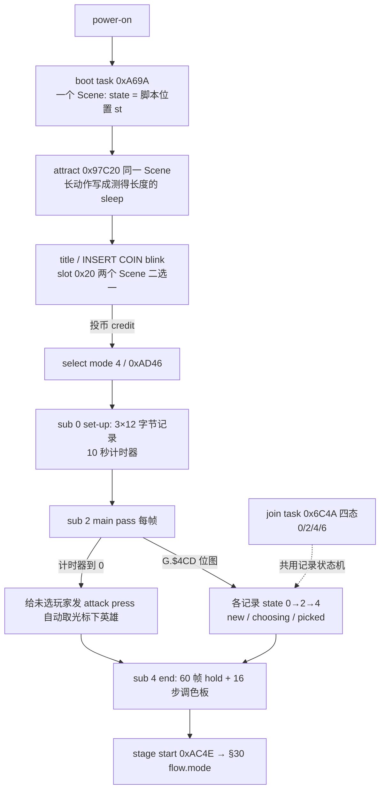

### 41.4 与 §20 / §30 / §40 的接口

- `flow.rs:317` `flow_coin_isr()` 放在 `flow_frame` 第一句（投币中断先于任务，§20 已记）。
- 选人 end 走 `0xAC4E` stage start，接 §30 的 `flow.mode` 8 态；§40 的 `flow_tally_start()`（`flow.rs:790`）是这条链另一端的收尾。
- §40 的 `G.$735E` 与 intro 任务共享、本节 `Front.task` 与 boot/attract 共享一个 Scene ——**同一块状态被多个阶段复用、靠"当前任务归属"解释**，是本笔记反复出现的设计习惯（§20 Scene / §40 `tally.owner` / §35 对象池）。

### 41.5 对照表与 wof 边界

| 维度 | dino | wof |
|---|---|---|
| 顶层容器 | `Front` 多个 `Scene`（task / blink / press / sys_task） | 不臆断（§11.0） |
| 投币 / credit | slot 0 system task `0x9D048` + `flow_coin_isr` 中断先读 | repo 可见冷启动路径经「投币 → 开始 → 选人」（`Program.cs:1046`） |
| 选人 | mode 4 `0xAD46`，3 sub mode，3×12 字节记录，10 秒超时兜底 | 不臆断是否等价 |
| 中途加入 | join 四态与选人共用记录状态机 | 不臆断 |
| 冷启动对齐 | 长动作写成测得长度 sleep，逐 video frame 对齐 MAME 录制 | 按 §0，宿主回放配置属宿主补偿，不作设计对照 |

**wof 侧严格不动**：`WofIni.cs:45-47`（投币键 5/6/7/8、Service F1）、`Sdl2MainWindow.cs:446-453`（F2 三玩家位同时投币）、`Program.cs:856-900 / 1046-1048`（冷启动回放配置、"走不到选人界面"）都是宿主 / 回放层，按 §0「宿主补偿不算设计」与附录 A 的 F2 / service / 冷启动 scope 结论原样隔离，**不把"宿主侧走不到选人界面"写成 wof 游戏没有选人流程**。

### 41.6 "更成熟"落在哪（只谈设计本意）

1. **一条 `Scene` 贯穿多阶段**：boot → attract → title 是同一个 `Scene` 的脚本位置，不是每阶段新建状态机；投币 / blink / press 是另外的 Scene 按 slot 并列。状态复用靠"当前谁拥有这块结构"，与 §40 `tally.owner` 同构。
2. **超时兜底与中途加入都是数据**：10 秒到 0 自动给未选玩家发按键；`G.$4CD` 位图决定哪些 12 字节记录要走。没有"选人专用解释器"。
3. **逐 video frame 对齐**：把 CPU 耗时超过一帧的长动作显式写成 sleep，让可见变化落在录制的 video frame 上——§20 顶层任务机在最前端、也最能回答用户最初「硬件中断 / 函数执行次数」之问的一处。

### 41.7 未做（保留，不扩张）

- `attract.rs / demo.rs / movie.rs / slides.rs / ending.rs / ranking.rs / name_entry.rs / cards.rs / profiles.rs / picture.rs / skip.rs / config.rs / cont.rs` 其余 13 个子模块逐类展开：本节只用 `front / boot / select` 三个文件头。
- wof 投币 / 选人 / 冷启动的 ROM 级对照：按 §0 与 §11.0 不做。
- EEPROM / service / test menu：附录 A 已记 dino 明确 out of scope，不重复。

**结论**：§41 把"进战斗之前"补成 Front 多 Scene + 一条 boot/attract Scene + 选人记录状态机的对照；`长时间自主推进` 仍是开放目标，本节不宣称终止。

---

## 42. 生成帧的跨帧契约：新对象为什么"这一帧还不算活着"

> 触发：§28 讲"这一帧允许生成几个"（波次预算 / 门闩 / 64 条上限），§36 把 `alive / alive_run` 列为跨帧实例之一，但"一个新敌人从被分配到第一次跑 AI 之间发生什么"从未成节。两侧 repo 都有帧内顺序的硬证据。
> 归属：设计正文（§0–§42），按"轮次线性追加"接在 §41 之后。纯 repo 侧，未新增 ROM 取证（§11.0）。
> 边界：wof `Cps1EnemySpawn.cs` 里大量 `_无对应ASM` 的 pending 数组 / 帧号 / 轮号属宿主补偿，按 §0 只登记、不作为设计对照；只取其中带 ROM 地址与 FBA cycles 实证的**原机帧内顺序**。

### 42.1 一句话

**两款游戏都把"生成"排在帧内分发表之后，所以新对象第一次 AI 必然落在下一帧**；dino 是生成脚本排在 `game_frame` 最后，wof 是生成命令排在 `0x22C40 / 0x22D8E` 之后。差别不在"要不要推迟"，而在"推迟由帧序列的哪一段保证"。

### 42.2 dino：生成脚本是 `game_frame` 的最后一步

- `mod.rs:349-357`：`game_frame()` → `objects_update()` (`0xE90E`) → … → `spawn_script_tick()` (`0xFBF4`)；`spawn.rs:167` 自述 **"Runs last in the frame"**。
- 于是 `spawn_alloc` 写入的新槽（`live=1 / k20=class / x,y,z / var26`，`spawn.rs:195-209`）在生成帧**没有任何对象更新扫到它**；`spawn.rs:284` 明写 `The prop's own handler runs from the next pool B update.`
- 生成坐标与过滤：`spawn_record`（`spawn.rs:245-277`）`screen_x` 时 `x += cam_x`（屏幕相对坐标），`f & 0x40 / 0x60` 按人数跳过、`f & 0x18` 按 `level` 跳过；`enemy_set_spawn_extras` 把记录里的 `+$5C / +$5B (entrance facing) / +$96` 写进新对象（`enemy.rs:162-163, 481-492`）。
- 可见判定 `enemy_draw_check`（`enemy.rs:496-503`）：`dx = xi - cam_x + 0x100`、`dy = yi + zi - cam_y + 0x40`，`visible = dx <= 0x380 && dy <= 0x1C0` —— 生成点可以在镜头外，由 `visible` 决定是否进 draw list，而不是"生成时必须可见"。
- 池满：`spawn.rs:196-199` 丢掉该记录并 `break`（§28 同屏预算在生成层的落点）。
- 人头计数：`alive`（上次 census）/ `alive_run`（本次，`enemy.rs:782` 每帧累加）——生成帧不计入预算，下一帧才被 census 看到（§13 / §36）。

### 42.3 wof：生成命令在 per-object 分发之后（FBA cycles 实证）

`Cps1EnemySpawn.cs:420-441` 注释给出的 ROM 契约：

- spawn 命令体 `0x1082E`（写 `Exist=01 / +0x21 CharId / +0x16 / +0x04 / +0x08`）由关卡脚本 `0x10734` 推进。
- 帧内 pc 顺序（FBA cycles 实证）：`pc=22C40 cyc=714846`（渲染队列重建）→ `pc=11F2/1628 cyc=717252` → `pc=13B4/1082E cyc=728500` → `pc=10734 cyc=728770`。
- ⇒ 本帧 `0x22D8E` per-object 分发表**已经跑完**，新槽本帧不被任何 AI 处理器扫到，A00（资料装载链 `0x2A3F6 → 0x3DF6 → 0x3D62`）只能落到下一帧。f400 实证（`slot2spawn` watch，`0xFFD15C`）：分配帧 f=1225 零写点，f=1226 才有 `+0x36` 资料装载。
- `Cps1EnemySpawn.cs:497-502`：`0x53B8E` 整条生成链（`53BBE / 53BF4 / 53C5E / 53C8A / 53BCC / 53C96 / 53CBE → 53CE8 → 1552`）**不含** `jsr 0x2698 / 0x26AA` ⇒ 生成当帧不可能被整池地形尾链纠偏。
- `Cps1EnemySpawn.cs:233-234`：`0x16F76 jsr 0x10620`（关卡脚本可生成新对象）⇒ 第 R 轮生成的对象到第 R+1 轮 `0x22D8E` 才被扫到跑 A00。

**宿主层隔离**：`scriptSpawnAiPending / scriptSpawnAiPendingFrame / scriptSpawnAiPendingRoundPlus1 / enemyJustActivated / 脚本生成AI本帧推迟_无对应ASM / 尝试取出脚本生成AI待执行_无对应ASM`（`:420-441 / 449 / 491-508 / 542-568`）是 C# 为复现上述帧内顺序引入的宿主侧标记，按 §0「宿主补偿不算设计」原样隔离，不把它们写成 wof 的游戏机制。

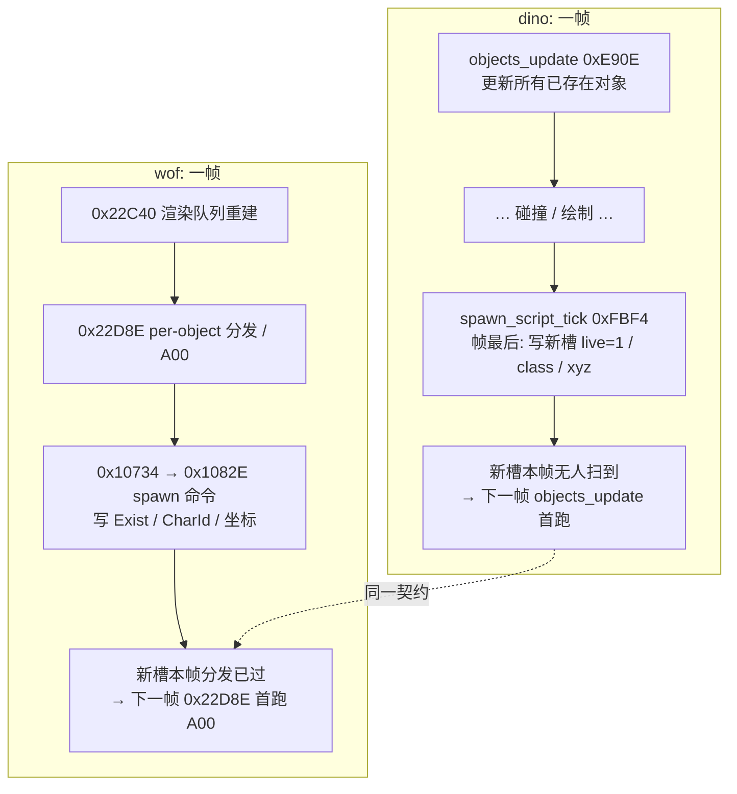

### 42.4 对照表

| 维度 | dino | wof |
|---|---|---|
| 生成何时发生 | `spawn_script_tick 0xFBF4`，`game_frame` **最后一步**（`mod.rs:357`） | 关卡脚本 `0x10734` 的 `0x1082E`，帧内在 `0x22C40 / 0x22D8E` 之后 |
| 首帧 AI | 下一帧 `objects_update 0xE90E` | 下一帧 `0x22D8E` 分发跑 A00 |
| 保证方式 | 固定帧序列的顺序（生成在更新之后） | 帧内命令顺序（生成在分发表已跑完之后） |
| 生成帧不做什么 | 不进 `objects_update`、不计入 `alive` census | 不跑 A00、不进整池地形尾链（`0x53B8E` 无 `0x2698/0x26AA`） |
| 生成坐标 | 记录带 x/y/z 或 `x += cam_x` 屏幕相对；`dx<=0x380 && dy<=0x1C0` 定可见 | 不臆断（§11.0） |
| 池满 | 丢记录并 `break`（`spawn.rs:196-199`） | 不臆断 |
| 记录过滤 | `f & 0x40/0x60` 按人数、`f & 0x18` 按 level | 不臆断 |

### 42.5 "更成熟"落在哪（只谈设计本意）

1. **生成帧不是"半个对象"**：两侧都让新对象在生成帧只被写入字段、不被任何更新链解释；第一次 AI 统一落下一帧。这是 §36「这一帧写、下一帧读」在**对象生命周期起点**的实例，也直接回答用户最初的「函数执行次数不确定」——帧内位置本身就是语义。
2. **不靠标志靠顺序**：dino 没有"刚生成"标志，靠 `spawn_script_tick` 排在 `game_frame` 最后；wof 原机也没有该标志（宿主 pending 是 C# 补的），靠 spawn 命令落在 `0x22D8E` 之后。把"这一帧算不算活着"交给帧序列，而不是给每个对象加一个 bool。
3. **与 §28 分工清楚**：§28 管"这一帧允许生成几个"（预算 / 门闩 / 超时清场），本节管"生成出来之后哪一帧开始动"。前者是数量，后者是时序。

### 42.6 未做（保留，不扩张）

- dino `SpawnRec` 两张表逐项数值、41 actions 全表：§19 已记脚本格式，不重复。
- wof `0x1082E` 命令体逐指令、`0x22C40` 渲染队列重建全文、`0x53B8E` 生成链 8 段逐条：本节只用 repo 注释里的 ROM 契约与 FBA cycles 实证。
- wof 宿主 pending 机制逐项语义（按 §0 隔离）。
- 两游戏"入场无敌帧是否存在"：不臆断。

**结论**：§42 把"生成帧"补成固定帧序列 / 帧内命令顺序两条同构的跨帧契约；`长时间自主推进` 仍是开放目标，本节不宣称终止。

---

## 43. 离场与回收：从"跑出画面"到"槽位归还"

> 触发：§42 写了"入场"，§35 写了 pool B 的 `prop_free`，§28 写了 `kill_all` 超时清场，§32 表里已有 wof 马池的 `0x04 离场 / 0x06 回收`——但"对象怎么退场、槽位怎么归还"从未单独成节。
> 归属：设计正文（§0–§43），按"轮次线性追加"接在 §42 之后。纯 repo 侧，未新增 ROM 取证（§11.0）。
> 分工：§42 生成帧跨帧契约、§29 受击恢复链（死亡起点）、§35 对象池组织、§28 同屏预算、§32 载具；本节讲**退场路径与槽位归还**。

### 43.1 一句话

两侧都不在判定的那一帧直接释放对象，而是**先切进一个"退场 / 回收"状态，由后续帧或公共回收例程真正归还槽位**；dino 用 `e.b.mode = 6`，wof 用 `ActStatA = 0x06 → 0x14B8`。与 §42「生成帧首帧 AI 落下一帧」正好成对：**生命周期的两端都跨帧**。

### 43.2 dino：三条退场路径 + 一个 free 出口

**A. 跑出画面（clamp / despawn）**

- `enemy_clamp_to_playfield`（`enemy.rs:653-699`，`0x193E`）：普通场景把 X 夹在 `camX-0x50 .. camX+0x1D0`（`d = xi - cam_x + 0x50`，越界回推），Z 带宽 `0x100`；vertical scene 用固定 `0x10..0x160` / `0..0x140`。**`car_mode != 0` 时不夹，改调 `enemy_despawn_if_far`**（`:655-657`）——载具关卡里"离场"取代"夹回"。
- `enemy_despawn_if_far`（`:701-715`，`0x173C`）：`d = xi - cam_x + 0xC0 >= 0x300` → `e.b.mode = 6`；vertical 用 `|X+0x80| >= 0x280` 或 `Z+Y+0x80 >= 0x200`。注释明写 **"free next frame (+$04 = 6)"**。
- `enemy_despawn_near`（`:717-731`，`0x1760`）：更窄的门（"the barrel"），`d = xi - cam_x + 0x40 >= 0x240` → `mode = 6`。两档阈值说明"离场"不是一刀切。

**B. 死亡 → 演出 → free**

- `enemy_dying_basic`（`:978-990`，`0x3484E`）：`sub 0` 记击杀分 `enemy_award_kill_score`（`:970-976`，按 `who` 记给玩家）、设 `T80 = 0x78`（120 帧），之后每帧 `enemy_dying_blink`（`:992-1003`）闪烁，`t == 0` 时 `mode += 2`。与 §29「死亡记 `g.kills` 并重掷 aggression」呼应。

**C. 超时清场**

- `enemy_kill_all_check`（`:952-968`，`0x326F8`）：`kill_all != 0` 且 `hp != 0` → `hp=0 / state 0x0202_0000 / hitstop=2 / stun=0 / attacker=killer`；`kill_all == 2` 时 `who = 0xFF`（不记分，§28）。**不是直接 free，而是把全场变成 dying knockdown，让各自的死亡态去走完演出**。

**D. 真正归还槽位**

- `enemy_free_pool_a`（`:469-479`，`0x48FC`）：`clear_header` 清 `+$00..+$27` 与 `+$59 +$63 +$7D +$87 +$96`，但 **`+$84 / +$5C` 故意存活**（注释 "HT1: deliberately survive free and slot reuse"），最后 `self.enemies.release(i)`。
- `:364` 与 `:1014` 是 free 的调用点（后者是 class2 `mode` 分派的默认分支）。

即：**判定离场 → `mode=6` → 后续帧的 mode 分派 → `enemy_free_pool_a` → `release`**，中间还有"哪些字节要留着给下一个占用者"的约定。

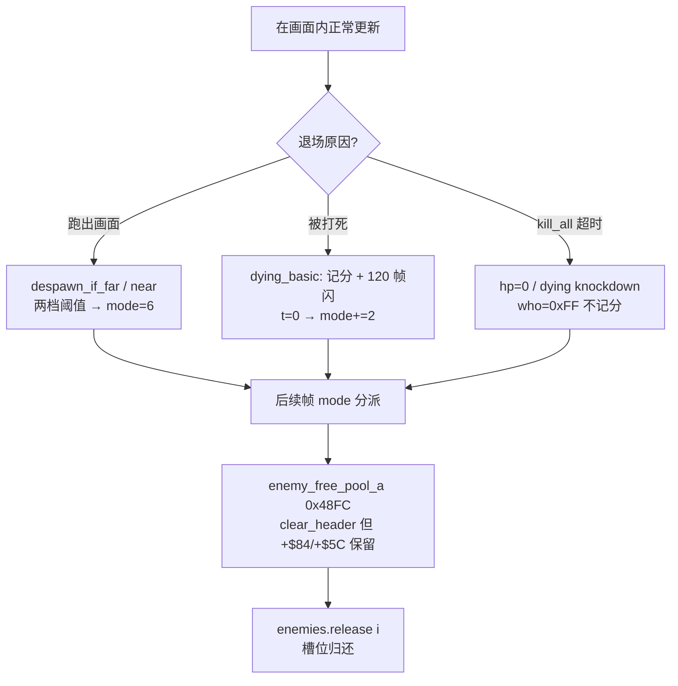

### 43.3 wof：公共回收例程 + 出场淡出 + 清槽

- `Cps1EnemyAI.对象_死亡状态回收_对应ASM_14B8`：多个 Actor 的 `A=06 / case 0x06` 统一跳 **`0x14B8` 公共回收**（`Cps1Actor1BRuntime.cs:138-139, 167`、`Cps1Actor13Runtime.cs:77, 205`、`Cps1Actor1ARuntime.cs:63`、`Cps1Actor12Runtime.cs:771`；后者注释 `34e7c jmp 0x14b8` 在 `:774`）。
- `Cps1Actor1CRuntime.出场淡出与回收_对应ASM_42DE`（`Cps1Actor16Runtime.cs:186 case 0x04`、`Cps1Actor13Runtime.cs:76, 205`）：`ActStatA = 0x04` 是"出场淡出与回收"，与 `0x06` 死亡回收并列两条退场路径。
- `清槽_对应ASM_3628`（`Cps1Actor16Runtime.cs:2109-2110`）：清槽指针低字 + 落 `0x3812` 清空；同文件 `:1981` 注释"归零 ⇒ 清槽"。`Exist = 0`（`Cps1Actor1BRuntime.cs:22` f=1000 起）是对象存在位归零。
- `共享_离场门与走位D分发_对应ASM_50EA`（`Cps1Actor16Runtime.cs:1587`）、`共用离场分发_对应ASM_5488`（`Cps1Actor12Runtime.cs:592`）：离场是**共享例程，各兵种自己调用**——§11.2「共享函数 + 每兵种各带表」在退场层的复现。
- 逃跑结算 `0x1BB0A`（`Cps1PlayerLogic.cs:10886-10904`）：`ActStatC` 0→+2 或 `0x02` 逃跑分支，末尾 `jmp 0x1E62` 做 `边界钳制X`（`:10893` 注释"返回值丢弃"）——与 dino `enemy_clamp_to_playfield` 是同一类边界钳制，只是挂在逃跑结算尾部。
- 笔记 §32 已记马池 `ActStatA` 4 态（初始化 / 待机 / **离场 0x04** / **回收 0x06**）——wof 把"离场 / 回收"直接编进载具对象的状态号，不是敌人专属。

### 43.4 对照表

| 维度 | dino | wof |
|---|---|---|
| 退场状态 | `e.b.mode = 6`（"free next frame"） | `ActStatA = 0x04 出场淡出 / 0x06 回收` |
| 公共回收 | `enemy_free_pool_a 0x48FC` → `release(i)` | `对象_死亡状态回收_0x14B8`，各 Actor 的 `case 0x06` 调用 |
| 退场路径 | 跑出画面（两档阈值）/ 死亡演出 / `kill_all` 清场 | 出场淡出 `0x42DE` / 死亡回收 `0x14B8` / 清槽 `0x3628` / 逃跑结算 `0x1BB0A` |
| 离场判定 | `despawn_if_far 0x173C` / `despawn_near 0x1760`，car_mode 才启用 | `共享_离场门_50EA` / `共用离场分发_5488`；X 边界钳制 `0x1E62` |
| 边界处理 | `enemy_clamp_to_playfield 0x193E` 夹回；car_mode 改为不夹直接 despawn | `边界钳制X_0x1E62` 挂在逃跑结算尾部 |
| 死亡演出 | 记分 + 120 帧闪烁 → `mode += 2` → free | `Exist = 0` 后清槽 |
| 槽位归还 | `clear_header` 但 `+$84 / +$5C` 故意存活供复用 | `清槽_0x3628` 清指针低字 + 落 `0x3812` 清空 |
| 超时清场 | `kill_all` 把全场变 dying（`who=0xFF` 不记分） | §28 已记：推进波次状态，不清场 |

### 43.5 "更成熟"落在哪（只谈设计本意）

1. **生命周期两端都跨帧**（§42 入场 / 本节退场）：生成帧不跑 AI、离场帧不释放槽位，都交给后续帧的状态分派。中间态是数据（`mode=6` / `ActStatA=0x06`），不是立即副作用。
2. **退场路径按原因分叉**：dino 把"跑出画面 / 被打死 / 超时清场"汇到同一条 dying / mode 链，但 `kill_all=2` 用 `who=0xFF` 掐掉记分；wof 把"出场淡出 / 死亡回收 / 清槽 / 逃跑"分成不同 ROM 例程与状态号，由各兵种 `case` 调用。
3. **槽位复用有字节级契约**：dino `enemy_free_pool_a` 故意不清 `+$84 / +$5C`（下一个占用者会用），wof `清槽_0x3628` 清指针低字再落 `0x3812` 清空。两边都把"归还"做成有约定的操作，不是简单 drop。
4. **共享例程 + 各兵种调用**：wof 的 `0x14B8 / 0x50EA / 0x5488` 是 §11.2「共享函数 + 每兵种各带表」在退场层的复现。

### 43.6 未做（保留，不扩张）

- dino 各 class 的 dying / mode 分派逐类展开（§29 已覆盖恢复链）；`+$84 / +$5C` 存活字段的下游读点（不臆断）。
- wof `0x14B8 / 0x3628 / 0x3812` 逐指令语义、`Exist` 位完整生命周期（repo 注释已给语义，不逐条 ROM 对照）。
- 两游戏"离场对象是否仍进碰撞 / 渲染队列"不臆断。
- 音频（死亡音）按 §0 边界外。

**结论**：§43 把"退场与回收"补成与 §42 成对的下游半环；`长时间自主推进` 仍是开放目标，本节不宣称终止。

---

## 44. 纵深空间与跳跃：地面是"数据"还是"带"

> 触发：§3 写了命中几何的三轴 `overlap = Z && X && Y`，§31 表里出现过 `jump[16][9]`，§24 反复出现"落地"，§32 写了"地形是共享例程 + 按对象类别选入口"——但"纵深空间本身怎么建模、跳跃是一个什么状态"从未单独成节。
> 归属：设计正文（§0–§44），按"轮次线性追加"接在 §43 之后。纯 repo 侧，未新增 ROM 取证（§11.0）。
> 分工：§3 命中几何、§32 地形调用者分工与载具主体、§24 投技落地、§34 `area` 分段；本节讲**地面 / 高度 / 跳跃这套 2.5D 契约**。轴名字母属实现表相，下文只说"横向 / 高度 / 纵深"。

### 44.1 一句话

dino 把地面做成**按横向位置查表的地形数据**（有落差、台阶、下层、天花板、水面、可推的容器），把跳跃做成**带空中操控、按离地高度分招、可蹬墙的完整状态机**；wof 把地面做成**一条活动带 + 屏幕钳制 + 地形格 class**，把跳跃**编进每个角色的招式状态号**（起跳 / 空中 / 落地 / 跳踢），垂直物理是逐招式写死的常量。§3 的三轴 hitbox 在两处是同一套坐标系的两种消费方式：一个"地面本身是数据"，一个"地面是边界"。

### 44.2 dino：地形是一张表，跳跃是一段状态机

**A. 地面是"按 X 查出来的"**

- `terrain.rs:1-39` 的文件头就是完整例程表：X = `+$08`、高度 = `+$0C`、纵深 = `+$10`；地图查找用 `X` 与 `Z + floor`（脚下接地点）查墙，用 `Z + Y + 头高` 查天花板。
- `floor_lookup 0x12FE4`（`:131-135`）按 X 取"第一个覆盖该 X 的 floor segment"，把地面高度写进对象的 `floor / floor2`；`player_height`（`player.rs:386-390`）= `Y - floor - floor2`，即**离地高度**，是跳跃 / 跳攻 / 蹬墙判定的公共量。
- `terrain_wall 0x1309C`（`:605-607`）取脚下 scroll2 格子的 class → 选 `shape_handler`（`:19`，表 `0x1370C`）把对象推出斜面 / 街沿；`terrain_ceiling 0x1361E`（`:622-624`）只给玩家；`scene_class 0x136E4`（`:20`）是电梯场景的同一套查找。
- 因此**台阶 / 落差 / 下层**是数据：`G.$6B0` 是下层高度（`terrain.rs:56-57`），street edge shapes 用它算落差；文件头 `:33-39` 还明列 5 条"刻意保留的原机怪癖"（`ble/bgt` 有符号比较、shape 0x10 variant 12 移位、垂直场景无天花板、obstacle 表读写共用、shape 只 `move.b` 不清位）。
- `terrain_obstacles 0x12E9A`：容器是**注册进障碍表、会把对象推开**的实体（`player.rs:41` 记 `+$94` 上次撞到的容器），不是贴图画。

**B. 跳跃是六分量 + 空中操控 + 分高度出招**

- `player_set_jump_velocity 0x5364`（`player.rs:371-384`）：按 `class + 角色` 索引 `jump[16][9]` 表，**一次给 `vx/ax/vy/ay/vz/az` 六个分量**（横向 / 高度 / 纵深三轴各有速度与加速度）。
- `player_jump_entry 0x1A5D0`（`:2036-2068`）→ `player_jump 0x1A64A`（`:2070-2102`）：置 `airborne`、按输入选方向 / 动画，之后**每帧** `player_pstep / player_pmove / player_air_control`（空中仍可控）→ `player_jump_attack_check` → `player_wall_jump_check`；`vy < 0` 且 `airborne == 0` 才转 `player_landing_entry`。
- `player_jump_attack_check 0x1A704`（`:2104-2121`）：按 `jump_attack_height[ch]` 把**离地高度**分成 high / low 两档跳攻，不是"空中只有一招"。
- `player_wall_jump_check 0x1A744`（`:2123-2156`）：仅角色 1/2，墙 class `4/0x18/0x1C` + 有横向速度 + 离地 ≥ `0x20` 时蹬墙，重新调 `player_set_jump_velocity(i, 8)` 给另一组初速；并用 `skip_post` 跳过本帧末尾的 post 处理（`player.rs:87-88` 记这是"墙跳首帧"的跨帧约定）。
- 水也是地面状态：`wading` / `player_water_ripple 0x60E2`（`:392-409`）/ `player_splash_check 0x606E`（`:411-412`）——落地要判是不是落进水里。

**C. 地形例程按对象类别选入口**（§32 的细化）

- 玩家 `0x12CAC` = 地面 + 墙 + 障碍 + snap + **天花板**（`terrain.rs:682`）；敌人 / 道具 `0x12CB4`；某些敌人类 `0x12E20` 免障碍测试；effect `0x12DAC` 只做 1 次 floor lookup + snap（`:696-697`，注释说明"代码里没有循环也没有墙测试"）；respawn `0x12D4E` 只查地面。
- `terrain_advance 0x12C90`（`:579-581`）在 `objects_update` 末尾让 floor list 指针跟相机走；`terrain.rs:38` 明写 **obstacle list 的本帧注册与上一帧读取共用同一批 word**——又一处 §36「这一帧写、下一帧读」。

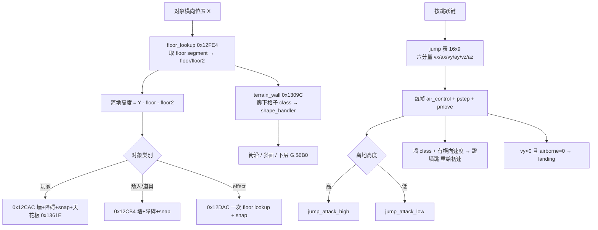

### 44.3 wof：地面是活动带，跳跃编进招式号

- `Cps1TerrainCollision.cs:17-18`：`TERRAIN_MAP_BASE = 0x90C000`、`TERRAIN_JUMP_TABLE = 0x027A4`——地形是**按格子 class 查跳表**。
- `玩家_地形纠偏与屏幕范围_可能对应ASM_171A8`（`:43-58`）= `应用对象地形纠偏_可能对应ASM_2730` + **屏幕范围钳制**：X 夹在 `camera+0x20 .. camera+0x160`，纵深夹在 `camera+0x10 .. camera+0xA0`；`敌人_逐活动槽地形与范围修正_可能对应ASM_2698_26AA`（`:60-70`）扫 `22D02` 处理池逐槽做同一件事。
- `地面高度钳位_对应ASM_1E3C`（`Cps1PlayerLogic.cs:3834-3849`）：把对象位置钳在 `[A5-0x570 + 0x14, +0x8C]` 这一条**固定宽度的地面带**里——不是按 X 查出来的连续地面高度，而是一个上下界。
- 跳跃是**角色状态机的一个编号**：`关羽_A02B00C0C_浮空_1B20A`（`:6782-6791`）按 `ActStatD` 分派 `起跳 0x1B21E / 空中 0x1B26E / 落地 0x1B2E8 / 跳跃中踢 0x1B2AA`；注释直接写 `Z=0x0C 跳跃`（`:6780`）。
- 垂直物理是**逐招式写死的常量**：`浮空起跳_1B21E`（`:6793-6810`）给 `VelZ = 0x05D1 / AccelZ = -0x43`；下上拳 D00 初始化（`:6649-6678`）给 `VelZ = 0x0500 / AccelZ = 0x0010`，D02 上升（`:6681-6702`）到顶时 `VelZ = 0 / AccelZ = -0x90` 转下落，D04 下落（`:6704-`）到 `PosZ = 0`（`:6215 / :6722`）落地；`对象_空中减速_对应ASM_10D2`（`:5361`）是共享的空中处理。
- 也就是说：**"跳多高、怎么落"归招式段，不归一张全局地形表**；抓投 / 抱摔的落地同样写成 `C=04/06/0E` 各段里的 `落地判定`（`:4491 / :4607 / :5015-5058`），与 §24 的投掷分帧一致。

### 44.4 对照表

| 维度 | dino | wof |
|---|---|---|
| 地面是什么 | 按 X 查 `floor segment` 表得到的**连续高度**（`0x12FE4`），`floor/floor2` 存在对象头 | 一条**固定宽度地面带** `+0x14..+0x8C`（`0x1E3C`）+ 屏幕范围钳制（`0x171A8`） |
| 落差 / 台阶 / 下层 | 地形数据：`G.$6B0` 下层高度 + street edge `shape_handler`（`0x1309C`）+ 天花板（`0x1361E`） | `TERRAIN_MAP_BASE 0x90C000` 格子 class → `TERRAIN_JUMP_TABLE 0x027A4` |
| 障碍物 | 容器注册进 `terrain_obstacles 0x12E9A`，会**把对象推开**（`+$94` 记上次撞到的） | 地形纠偏 `_0x2730` 内处理，未单列对象级障碍契约 |
| 跳跃入口 | 独立 `player_jump_entry 0x1A5D0` 状态机，`airborne` 字节 | 角色状态号 `Z=0x0C`（`0x1B20A`），按 `ActStatD` 分起跳/空中/落地/跳踢 |
| 起跳参数 | `jump[16][9]` 表按 `class+角色` 给 **6 个分量** `vx/ax/vy/ay/vz/az` | 逐招式常量 `VelZ=0x05D1 / 0x0500`、`AccelZ=-0x43 / -0x90` |
| 空中 | 每帧 `air_control + pstep + pmove`，**可再改向** | `对象_空中减速_0x10D2` + 招式段内推进 |
| 跳攻 | 按**离地高度**分 high / low 两档（`jump_attack_height[ch]`） | 跳跃中踢是 `ActStatD=6` 的一个分支（`0x1B2AA`） |
| 蹬墙跳 | 角色 1/2 专属 `0x1A744`，墙 class + 横向速度 + 离地门槛 → 重给初速 | 未见等价（不臆断） |
| 落地 | `vy<0 且 airborne=0` → `landing`；入水另判 `wading / splash` | `PosZ = 0`；抓投各段自带 `落地判定` |
| 地形例程分工 | 按对象类别 5 个入口（`0x12CAC/12CB4/12DAC/12E20/12D4E`），`terrain_advance 0x12C90` 跟相机 | 玩家 `0x171A8` / 敌人 `0x2698_26AA` 两条逐槽修正 + 共享 `0x2730` |
| 跨帧契约 | obstacle list 本帧注册 / 上帧读取共用 storage（`terrain.rs:38`） | 逐槽修正落在帧末活动池扫描（`Cps1TerrainCollision.cs:60-70`） |

### 44.5 "更成熟"落在哪（只谈设计本意）

1. **地面从"边界"变成"数据"**：dino 的 `floor/floor2` 让"站得多高"成了对象的一个可读字段，离地高度进而被跳攻分档、蹬墙门槛、入水判定、屏幕钳制（`player.rs:1027-1044` 用 `Z + floor` 算纵深边界）反复消费；wof 的地面是一条带，消费点集中在"别越界"。
2. **跳跃从"招式的一段"变成"一套可操控状态"**：dino 跳跃有初速表、空中操控、高度分档出招、蹬墙重启、入水分支，是能挂接多个系统的动作层；wof 把跳跃编进 `Z=0x0C` 与每个必杀的 D 层，垂直物理随招式写死，复用面更窄。
3. **地形例程按对象类别分入口而非一套通用**：§32 的"共享例程 + 按类别选入口"在纵深层具体化为 5 个入口（玩家多一个天花板、effect 免墙测、某些敌人免障碍）；wof 是玩家 / 敌人两条逐槽修正共用一个 `_0x2730`。
4. **水 / 容器 / 天花板都被纳入"地面"这一层**：`wading`、容器障碍、天花板、垂直场景无天花板（`terrain.rs:36-37`）都是同一套地形查找的分支，不是各自的子系统。
5. 与 §42 / §43 同构：地形也有"这一帧写、下一帧读"（`terrain_advance` 跟相机、obstacle list 共用 storage），§36 的跨帧清单再添两条。

### 44.6 未做（保留，不扩张）

- `floor segment` / `shape_handler` 全部条目逐类展开（`terrain.rs` 已有 250000 向量 oracle 测试，本节只引文件头契约）。
- wof `TERRAIN_JUMP_TABLE 0x027A4` 各 class 的 shape 语义、`0x2730` 逐指令（repo 注释已给语义，不逐条 ROM 对照）。
- 两轴字母命名差异（谁是高度、谁是纵深）属实现表相，不据此判断设计高低。
- "跳跃中是否无敌 / 是否进碰撞队列"不臆断；音频（落地音）按 §0 边界外。

**结论**：§44 把 §3 的三轴命中几何补成"三轴怎么被移动与地形消费"的上游半环；`长时间自主推进` 仍是开放目标，本节不宣称终止。

---

## 45. 渲染优先级与遮挡：谁画在前面

> 触发：§23 写了 sprite list 的 2 帧显示延迟，§42 写了 `0x22C40` 渲染队列重建的帧内位置，§44 写了 Z 轴纵深怎么被地形消费——但"同一帧里谁画在谁前面"从未单独成节。
> 归属：设计正文（§0–§45），按"轮次线性追加"接在 §44 之后。纯 repo 侧，未新增 ROM 取证（§11.0）。
> 分工：§23「什么时候显示」、§42「渲染队列在帧内哪一步重建」、§35「对象池组织」；本节讲**遮挡顺序由什么决定**。队列用数组还是链表、GPU 怎么画，属实现表相，不谈。

### 45.1 一句话

dino 把"谁在前"统一成**一个排序键 `(depth, handle)`**：全池对象（玩家 / 敌人 / 道具 / 特效 / 影子）进同一张 draw list，按纵深升序排完依次画，第一条在最上层；wof 把对象**分进多张按类别划分的渲染队列**（普通纵深 / 闪烁 / 影子 / 特殊 1C 对象），层级靠"哪张队列先被消费"决定，普通队列在入队时按 Y 插入、消费时再冒泡排序。§44 的 Z 轴在 dino 里既是地面高度也是遮挡键，两套系统共用一个坐标。

### 45.2 dino：一个排序键统一全池

**A. 键就是 `(depth, handle)`**

- `mod.rs:230-231`：`draw_list: Vec<u32>`，每项 `(depth << 16) | handle`，注释直指原机 `0x49C0 / 0x49CA`。`draw_list_add_if_visible`（`:379-386`）用 `b.zi()`（**§44 的纵深轴**）当 depth 高 16 位；`draw_list_add_check`（`:388-396`）先用 `height + depth` 做可见性判定再入表。
- `build_sprite_list 0x13FA6`（`:398-412`）：`sort_unstable()` 升序 → 逐个 `draw_object(key as u16, cam)` → `shadow_pass(&list, cam)` → 清表。注释明写 **"first drawn = on top"**。
- `mod.rs:10-12` 解释了为什么次级键是 `handle`：对象用原机 16-bit RAM 地址命名，"这也是原机链接对象（目标玩家 / 上次攻击者 / 抓取伙伴）与**打破 depth-sort 平局**的方式"——同纵深时谁在前由对象身份定，不靠入队先后。
- 这与 `draw.rs:7-8` 闭合：原机写硬件 sprite entry `(x, y, code, attr)` 时**第一条优先级最高**，port 保留这张表再倒序交给渲染器。所以"排序 → 列表顺序 → 优先级"是原机契约，不是重写时加的抽象。

**B. 屏幕位置也用同一个坐标**

- `draw.rs:382-385`：`d4 / d5` 是 X 与 `height + depth`（`b.yi() + b.zi()`）；`screen_y`（`:399`、`:531`）把"离底部的高度"换算成硬件 sprite Y；影子 `0x14EC0`（`:508-543`）用同一个 `b.zi()` 定位。
- 即 §44 里"地面高度 `floor/floor2`、离地高度 `player_height`"这一套纵深数据，在 §45 里直接变成**遮挡顺序与屏幕 Y**——不是另立一套显示坐标。

**C. 局部顺序是排序键上的补丁，不是第二套系统**

- 抓取对 `0x141F8`（`draw.rs:439-462`）：持有者 `sub==4 / kind==0xC` 且伙伴 `kind==0xE` 时，`0x14114` 按**伙伴 `+$62`** 决定 `[h, p]` 还是 `[p, h]`，两个对象连着画完就返回，不走各自的 split-body 分支。即抓取这一对的遮挡由状态字节局部覆盖，其余全池仍归统一排序。
- 拆分体 `0x14136` / 复合帧 `0x14180` / 常规与 alt 合成 `0x142AA/0x14494` / 涉水裁剪 `0x1439C/0x1463E` / 水花 `0x14BC6` / 原始精灵表 `0x147FE`（`draw.rs:1-5`）都是**同一条 draw list 上的画法分支**。
- `0x14EC0` 影子 pass 复用 `build_sprite_list` 排好的 `list`（`mod.rs:408`），影子与本体同序；`:10-12` 还注明涉水裁剪会回写 `+$53` bit7，被影子 pass 与玩家代码后续读取——**绘制不是只读的**。
- 帧契约：`build_sprite_list` 是 `game_frame` 固定一步（`mod.rs:354`），`SpriteList::latch`（`draw.rs:313-320`）把列表存档，屏幕显示 2 帧前的那份（§23）；`0xAE0 / 0xB10`（`draw.rs:298`）一次清空两个 sprite buffer，下一帧黑屏。

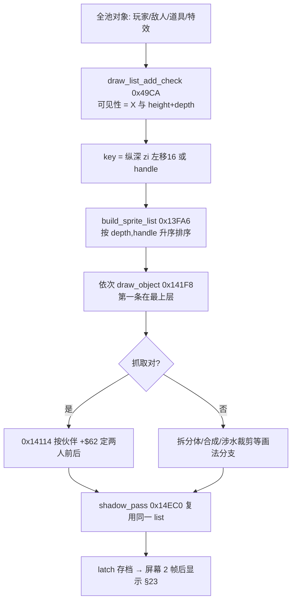

### 45.3 wof：多张队列 + 分阶段消费

- `Cps1ObjSpriteSubmitter.cs:22-33`：至少三张队列表各带指针与计数——普通纵深队列 `A5+0x8740`（`+0x312 / +0x30C`）、闪烁队列 `A5+0x8840`（`+0x316 / +0x310`）、特殊队列 `A5+0x87C0`（`+0x314 / +0x30E`）；另有 `0x15F8` 独立对象队列（`:309-311`）。
- **入队阶段就分桶**：`0x159C 渲染_按Y与A4偏移加入排序队列_159C`（`:931`）——普通纵深队列按 Y 位置插入；而特殊 / 对白头像队列"按入队顺序直接调用 `0x5E0BE`，**不排序**"（`:380-381`）。
- **消费阶段再排序、再分先后**：`:491-493` 给出阶段顺序 `5DEBC → 5DF9C`（特殊队列，按入队顺序先分发）→ `5DEC0 → 5DFBC`（普通队列**冒泡排序**消费）→ `5DEC4 → 5DFFE`（闪烁 / 影子队列）；`:935` 明说 `0x5DFBC` 只做"原地冒泡排序 + 逐项展开"，消费阶段不再重新入队。
- 影子单独成队：`0x5E160`（`:98-100`）把对象压入 `A5+0x840` 队列，`0x5DFFE` **从栈顶反向消费**，注释"影子必须晚于所有普通砖块写入"——靠队列阶段而不是排序键保证影子在最后。
- 帧末 `0x18B12` 无条件复位三张队列表（`:229-239`、`:255-269`）；`Cps1ObjectRuntime.cs:913` 记"帧末复位三张渲染队列表"，`:951` 还指出**每个提前 return 的分支都必须复位**，否则污染下一帧。`0x22C40` 重建敌人渲染队列（`:3179`）是 §42 已记的帧内位置。
- 抓取对同样不从主排序里独立出来：`Cps1ObjSpriteSubmitter.cs:1870` 记 "ROM 5E450 从抓取者内展开，不能再独立排序"——与 dino `0x141F8` 的局部顺序是同一类处理。
- 还有一层**背景 / 前景优先级**是独立开关：`提交优先级阴影_无对应ASM`（`Cps1VideoMemory.cs:504`，`Cps1ObjectRuntime.cs:187-191` 记用户报"角色遮挡了前景，背景局部优先级错误"后补上），`Cps1SystemCoroutineRuntime.cs:657 / :5346-5379` 在对白锁解除后"恢复三组常态背景优先级"。这属于**层与层之间**的优先级，和对象间的纵深队列是两件事。

### 45.4 对照表

| 维度 | dino | wof |
|---|---|---|
| 遮挡由什么决定 | **一个排序键** `(depth=zi, handle)` 升序，全池一张 draw list | **多张分类队列** + 消费阶段先后，普通队列再按 Y 排序 |
| 深度键 | `b.zi()`（§44 的纵深轴）直接当 `depth << 16`（`mod.rs:383`） | `0x159C` 按 Y 与 A4 偏移加入排序队列（`Cps1ObjSpriteSubmitter.cs:931`） |
| 排序时机 | `build_sprite_list 0x13FA6` 一次 `sort_unstable`（`mod.rs:403`） | 入队按 Y 插入 + `0x5DFBC` 消费时**冒泡排序**（`:935`） |
| 同深度平局 | `handle`（对象 RAM 地址）当次级键（`mod.rs:10-12`） | 入队顺序 / 栈反向消费；特殊队列不排序（`:380-381`） |
| 对象是否分桶 | 不分：玩家 / 敌人 / 道具 / 特效 / 影子同一张表 | 分：普通纵深 / 闪烁 / 影子 / 特殊 1C 对象，至少 3 张表 + 1 独立队列 |
| 影子 | `0x14EC0` 复用同一 `list`（`mod.rs:408`） | `0x5E160` 独立队列 + `0x5DFFE` 栈顶反向消费（`:98-100`） |
| 抓取对 | `0x14114` 按伙伴 `+$62` 局部定序（`draw.rs:454-456`） | `0x5E450` 从抓取者内展开，不独立排序（`Cps1ObjSpriteSubmitter.cs:1870`） |
| 层间优先级 | 未单列（列表顺序统一） | `提交优先级阴影` + 三组背景优先级开关（`Cps1VideoMemory.cs:504`） |
| 帧契约 | `build_sprite_list` 是 `game_frame` 固定步 + `latch` 2 帧延迟（§23） | `0x22C40` 重建 + `0x18B12` 帧末复位三表 + 每个早退分支都要复位（`Cps1ObjectRuntime.cs:913,951`） |
| 绘制的副作用 | 涉水裁剪回写 `+$53` bit7 供后续读（`draw.rs:10-12`） | 入队 / 消费阶段分离，影子入队门与展开门分开（`:975`） |

### 45.5 "更成熟"落在哪（只谈设计本意）

1. **一个键 vs 一套阶段协议**：dino 把"谁在前"压缩成 `(depth, handle)` 一个数，加到新对象类别时不需要新增队列或消费阶段；wof 的层级由"哪张队列、哪个阶段、是否排序、是否反向消费"共同决定，规则散在入队点、消费点、帧末复位点三处（`:951` 的早退分支复位就是这套协议的代价）。
2. **纵深坐标被复用**：§44 的 `zi()` 在 §45 既是地面 / 跳跃的纵深，也是 `screen_y = height + depth` 与遮挡键；dino 的地形、移动、绘制共用一套坐标语义。wof 的对象纵深队列按 Y 排，另有独立的背景层优先级开关，两者分开管理。
3. **平局有稳定判据**：`handle` 作为次级键让同纵深对象的遮挡在每一帧都可复现；wof 靠入队顺序 / 栈序，跨帧稳定性依赖入队点的一致（repo 里多处 `入队门两处完全相同`、`:1875` 成员资格由入队时刻决定这类注释正是证据）。
4. **但 wof 的分桶也有明确职责**：特殊 / 对白头像"不排序、按入队顺序直接分发"（`:380-381`）、影子"必须晚于所有普通砖块"（`:98-100`）、背景优先级单独开关——把"不参与纵深排序的对象"显式隔离，而不是让它们混进主排序再打补丁。
5. 与 §42 / §43 / §44 同构：绘制队列也有"这一帧建、下一帧用"的契约（dino `latch` 2 帧延迟、wof 帧末复位三表），§36 的跨帧清单再添一条。

### 45.6 未做（保留，不扩张）

- `0x13FA6` / `0x141F8` / `0x14EC0` 逐指令语义、各画法分支（拆分体 / 合成 / 涉水裁剪）全表（repo 文件头已给契约）。
- wof `0x159C` 按 Y 插入的具体比较、`0x5DFBC` 冒泡排序逐指令、三组背景优先级开关的完整状态（repo 注释已给语义，不逐条 ROM 对照）。
- 「对象优先级与 §3 三轴 hitbox 是否共用同一 Z」「前景层是否参与碰撞」不臆断；音频（绘制无关）按 §0 边界外。
- GPU 侧如何倒序提交、调色板 atlas / pen mask 等渲染实现（阶段 A 已存档于附录 A），不进设计正文。

**结论**：§45 把 §44 的纵深坐标补成"纵深怎么变成谁画在前面"的下游半环；`长时间自主推进` 仍是开放目标，本节不宣称终止。

---

## 46. 一次攻击是一个什么数据：聚合记录 vs 分散表

> 触发：§17 的伤害流水线里写过 `r = attack_record[char][id]  # stride 8`，§22 / §29 写过命中帧往对象写 `reaction / stun / hitstop / knock`，§31 写过 `PlayerData` 表族——但"一次攻击在游戏里到底被表示成什么"从未单独成节。
> 归属：设计正文（§0–§46），按"轮次线性追加"接在 §45 之后。纯 repo 侧，未新增 ROM 取证（§11.0）。
> 分工：§3 命中几何、§17 伤害公式、§22 受击反应、§31 角色差异、§39 连击档；本节讲**攻击数据本身的组织与消费分工**。ROM 地址 / 字节序属实现表相，不谈。

### 46.1 一句话

dino 把一次攻击做成**一条 8 字段的 `AttackRecord`**（伤害基值 / 韧性 / 受击反应 / 命中停顿 / 音效 / 得分 / 火花 / 保留字节），玩家四个角色、全体敌人、Boss 共用同一种记录，命中 pass 取一条记录再把 8 个字段分发出去；wof 没有这样的聚合记录，一次攻击是**同一个 ID 在几张独立表里各取一段**（`0xE4F02` hitbox 几何 / `0x1C20` 随机伤害 / `0x7E68` 9 项反应 / `0x7DDA` 难度索引 / `0x20D4` 防御 / 按角色与连击档的 `AtkType`）。§17 说的"收进一个纯函数 vs 分散 ROM 例程"，在数据层就是这个差别。

### 46.2 dino：一条记录，八个字段，五个消费者

**A. 记录本体**

- `dino-assets/src/sprites.rs:149-158`：`AttackRecord { damage: i8, stun: u8, reaction: u8, hit_stop: u8, sound: u8, score: u8, spark: u8, b7: u8 }`——**8 个单字节字段**，与 §17 伪代码 `stride 8: dmg/poise/reaction/hitstop/snd/score/spark/b7` 逐项对上。
- `dino-assets/src/player.rs:48` `attacks: [Vec<AttackRecord>; 4]`（四角色各一份表）、`:50` `enemy_attacks: Vec<AttackRecord>`（全体敌人共用一份）；`dino-assets/src/enemy.rs:176` 敌人数据里同样是 `attacks: Vec<AttackRecord>`。**玩家 / 敌人 / Boss 用的是同一种记录结构**——§31「dino 角色差异是数据维、四角色共用一套状态机」在攻击数据层落地：换角色只是换一张表。
- 选记录：`player_attack_record`（`player_combat.rs:133-135`）按 `p.b.id & 3` 取角色表；敌人攻击按 `eatk` 取 `enemy_attacks`（`:527`）。

**B. 一条记录被拆给谁**

- 伤害公式：`player_damage`（`player_combat.rs:19-31`）以 `base`（`rec.damage`）为起点，叠反击 / 弱点 / power / 等级 / HP 分段 / 2 次 RNG（§17）；敌人打玩家走 `enemy_damage(..., rec.damage as u8, ...)`（`:576`）。
- 受击状态：`rec.reaction` 同时写 `eb.reaction` 与 `eb.act`（`:404-405`、`:503-504`、`:583`）——这就是 §22「状态字节即协议」的**上游**：记录里的一个编号决定受击对象下一帧进 `b.act` 的哪个分支。玩家 vs 玩家路径还会因 `action == 0x22` 覆盖成 `0x22`（`:233`）。
- 命中停顿：`rec.hit_stop` 同写攻击者与被击者（`:237-238`、`:407-409`、`:545-547`），§37 的分布式 `hitstop` 门由这个字段点燃。
- 特效 / 反馈：`rec.spark` → `spawn_hit_spark`（`:245,421`）；弱点命中额外 `fx_spawn_hit_spark_alt(..., 5)` + `player_add_score(i, 0x20)`（`:423-424`，§17 的第二火花 + 400 分）。
- 得分 / HUD：`rec.score` 作为 `player_add_score(i, off)` 的**字节偏移**（`:139-155`、`:420,511`），再去 `score_bcd`（`player.rs:113`）取 BCD 加数、置 `score_dirty`（§26）。
- 音频 `sound` 字段按 §0 边界外（§37 已登记）。

**C. 紧凑表的"按消费者约定读"**

- `:506` 明写一条 quirk：`eb.b9a = rec.spark; // quirk: byte 6 here (byte 7 in the normal hit path)`——**同一条 8 字节记录，不同命中路径读的字节位置不同**；`:555` 敌人攻击路径把 `rec.score` 直接当 spark 参数传给 `spawn_hit_spark`。
- 即记录不是自描述结构，字段含义由"哪条 pass 在读"约定；`b7` 也是留给特定分支的保留字节。这与 §21.7「状态字节即协议」是同一种紧凑设计习惯。

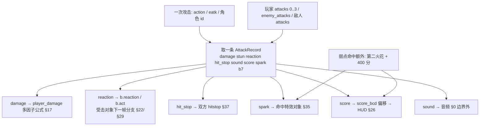

### 46.3 wof：一招一行聚合参数行，另查几张被引用的表

> 〔§94.11 就地订正〕原标题「一个 ID，多张表，各取一段」已作废：wof 自己也有「一招一行」聚合参数表（`0x6DB44` / `0x6E754`；§94.12 补：两张布局不同）。下面列的是这张主记录**另外引用**的表，不是「一个 ID 散在几张表里、没有主记录」。

- **几何**：`HITBOX_ROM_BASE = 0xE4F02`（`Cps1Collision.cs:21`），`rom_read 核过 0xE4F02 起 8 字节一项`（`:3318-3322`）；`HitboxBoxWidthX`（`:62-71`）按 `HITBOX_ROM_BASE + id` 取表项。对象上 `+0x6C/6E/70` 存的**不是 box 数据，而是相对 `A6=0xE4F02` 的字节偏移**，`0` 合法（`:70,1991,4603`）——`AtkBoxId / HurtBoxId / BeheldBoxId`（`:4535,5274`）都是这种"ID 即偏移"。
- **伤害**：`DAMAGE_RANDOM_TABLE = 0x1C20`（`:44,90`）随机伤害表，再叠 `0x7DDA` 难度索引、`0x6EE84` 修正、`0x20D4` 防御衰减（§17）。
- **反应**：`0x7E68` 起 9 项 word 跳表（`:786-792` 给出实证字节 `0012 00AC 00AC 0066 00CE 00A2 0172 00CE 0110`，`:4858-4866` 说明 `D5 = 表[0x7E68 + reaction]` 后 `jmp`）——**反应编号是跳表索引，不是记录里的一个字段**；表外值会读到表后的代码字节（`:5034`）。
- **档位**：`AtkType` 由 `GetAtkTable(charId)` 按 `ComboLev` 三档查（§39 `Cps1PlayerMulti.cs`）；各角色还有自己的 `0x124D6` / `0x11878` 段表（§22 / §31）。
- **场景对象**：`场景对象攻击表项_命中体_0x9DEC` / `_空处理_0x9DAA`（`:3625-3626,3695,3784`）说明除角色外还有一类"攻击表项"，但仍是**按 handler 地址分派**，不是聚合记录。
- 即 wof 的"一次攻击"是**一张 16 字节聚合参数行当主记录，再按需要去几何 / 伤害随机 / 反应跳表 / 难度 / 角色段表里各取一段**，命中链当帧把各表结果分派掉（§12 的 9 项反应、写 `StunLeft/StunVal/DmgReaction`）。主记录见 §46.4 / §94.12；旧写法「一个 ID 散在多张表」已按 §94.11 作废。

### 46.4 对照表

| 维度 | dino | wof |
|---|---|---|
| 一次攻击的表示 | **一条聚合 `AttackRecord`**（8 个单字节字段，`sprites.rs:149-158`）；玩家 4 张表 + 敌人 1 张表，但**结构完全相同** | **同样是「一招一行」聚合参数表**，但按攻击方分成两张：`0x6DB44`（我方）/ `0x6E754`（敌方），均按 `AtkType` 索引、每招 16 字节；攻击力 / 击退 / 命中特效 / 音效 / 反应 / 硬直都在一行里，命中链再另查 `0xE4F02` / `0x1C20` / `0x7E68`；**两张表行内布局不同**（§94.12）〔§94.11 订正：原文「一个 ID 散在多张表」是错的，两边都是「一招一行」；§94.12 补：wof 是两张布局不同的表，dino 是多张结构相同的表〕 |
| 玩家 / 敌人 / Boss | 共用同一种记录结构（`player.rs:48,50` + `enemy.rs:176`） | 角色段表 + 敌人 hitbox 表 + 场景攻击表项分派，形态不统一 |
| 角色差异 | 换一张 `attacks[ch]` 表，状态机不变（§31 数据维） | `AtkType` 按 `CharId` + `ComboLev` 查，各角色有自己的段表与状态机入口（§31 结构维） |
| 反应字段 → 状态 | `rec.reaction` 写进 `b.reaction / b.act`，下一帧由对象自己解释（§22） | `reaction` 是 `0x7E68` 9 项跳表索引，命中链当帧分派（§12） |
| 命中停顿 | `rec.hit_stop` 同写双方（§37） | 双方硬直 / `+0x62` 一字节三用（§37） |
| 得分 / 火花 | `rec.score` 是 `score_bcd` 的字节偏移、`rec.spark` 决定特效类型 | 得分与特效沿事件队列 / 反应表分派（§26 / §35） |
| 紧凑性 | 8 字节记录 + **按 pass 约定读**（`:506` byte6/byte7、`:555` score 当 spark） | `+0x6C/6E/70` 存相对表基址的字节偏移、`0` 合法（`:70,4603`） |
| 谁选记录 | `attacks[id&3][action]` / `enemy_attacks[eatk]`（`player_combat.rs:133-135,527`） | `AtkBoxId / HurtBoxId / BeheldBoxId` + `AtkType` + `CharId` 段表 |
| 例外处理 | `action==0x22` 覆盖 reaction、弱点对改道第二火花（`:233,423`） | 表外 reaction 读到表后代码字节（`:5034`）、场景对象按 handler 分派 |

### 46.5 "更成熟"落在哪（只谈设计本意）

> **§94.11 订正（下列 1/3/4 原以「wof 分表、dino 聚合」为前提，该前提已推翻）**：两边都是**一招一行聚合参数表**（dino 8 字节 / wof 16 字节）。真正的差异不在「聚合 vs 分散」，而在两点：① wof 把**致死时的反应单独放一列**（`+0C` 平时反应 / `+0D` 致死反应，命中当帧按 `HP<0` 二选一），烧死 / 两段 / 全碎 / 上身碎因此是攻击数据里的编号；dino 只有一个 `reaction`，怎么死由受击方状态机按血量决定。② wof 的反应是命中当帧走 `0x7E68` 跳表分派，dino 写进对方状态、下一帧由对象自己认领。以下各条凡是拿「五张表 / 分表 / ID 对齐」作对比的，只保留 dino 侧仍然成立的那一半。

1. **聚合记录让"一次攻击"成为一个可命名、可复用、可整体替换的单元**：dino 加招式是往表里加一条 8 字节记录，四角色 / 全体敌人复用同一结构（§31 数据维在攻击数据层的落点）；wof 同样是一招 16 字节一行，只是行更长、且命中链还要再查几张被引用的表。
2. **记录是各子系统的公共接口**：§17 伤害、§22 受击状态机、§26 HUD、§29 恢复链、§35 特效、§37 hitstop 都以这条记录的某个字段为输入——"命中帧写什么"因此有单一出处，§12「命中帧只结算、不处决」的字段包也有明确来源。
3. **紧凑约定是双刃**：按 pass 读 byte6/byte7、`score` 当 spark，让 8 字节塞下 8 类信息，但字段语义依赖消费者约定〔§94.11：这一条讲 dino 侧仍成立；wof 是 16 字节一行，「ID 即表偏移」只适用于被引用的判定盒表，不适用于攻击参数表本身〕。
4. **wof 也有清晰职责分工**：攻击参数表一行给齐攻击力 / 击退 / 特效 / 音效 / 反应 / 硬直，几何 / 伤害随机 / 反应跳表另表可独立改、独立按 `CharId` / `ComboLev` 索引；`0x7E68` 跳表把"反应编号 → 处理例程"直接做成代码分派〔§94.11 订正：删去原文「wof 的分表」与「不需要中间字段层」的对比，wof 自己也有中间字段层〕。
5. 与 §17 / §22 / §31 闭合：§17 说"多因子收进一个纯函数"、§22 说"状态字节即协议"、§31 说"数据维 vs 结构维"——本节给出这三句话共同的数据底座。

### 46.6 未做（保留，不扩张）

- `AttackRecord` 各招式逐条数值、`attacks[ch]` / `enemy_attacks` 全表内容（§10 的 ROM data 与 §31 表族清单已给入口）。
- `b7` 保留字节的全部用途、`byte 6 / byte 7` quirk 的全部命中路径（repo 已标 quirk，不逐条 ROM 对照）。
- wof `0xE4F02` hitbox 表项 8 字节逐字段语义、`0x7E68` 9 项处理体逐条（§12.6 / §18.1 已收敛为 repo 侧有命名与逐段还原，不臆断机制缺失）。
- 音频 `sound` 字段按 §0 边界外；「两游戏招式总数是否对应」不做量化对比。

**结论**：§46 把 §17 / §22 / §31 共用的数据底座补成独立一节；`长时间自主推进` 仍是开放目标，本节不宣称终止。

---

## 47. 一帧的完整调度链：从 `tick()` 到 VBlank 锚点

> 触发：§20 记了顶层 5 任务 / `Scene` sleep，§7 证据索引记「`game_frame` 8 步 / `objects_update` 13 步」，§36 收过跨帧实例，§42 记了生成在帧最后，§45 记了 `build_sprite_list` 与 `latch`——但从没把**一帧从上到下所有阶段**汇成一张可查表。这也是用户最初「随时被硬件中断无法确定有些函数的执行次数和完整度」问题的最终落点。
> 归属：设计正文（§0–§47），按"轮次线性追加"接在 A.15 之后。纯 repo 侧，未新增 ROM 取证（§11.0）。
> 边界：wof 侧 `Cps1FrameRunner_无对应ASM` / `AFC4` 阶段机 / 帧首刷新 / pending 数组属宿主补偿，按 §0 **只登记、不作为 wof 游戏机制**；只列带 ROM 地址的原机侧锚点。

### 47.1 一句话

dino 把一帧做成**三层嵌套的固定调用序列**：`tick()` 的显示快照与 latch → `game_frame()` 的 8 步 → `objects_update()` 的 14 次更新调用，没有任何一处会"这帧少跑几次"；wof 原机是**协作式任务内核 + VBlank 中断**，repo 侧只能确认若干帧首 / 帧内 / 帧末锚点，`0x050E` 帧首 VBlank 先于 slot14、`0x22C40` 渲染队列重建、`0x1082E` 生成、`0x18B12` 帧末复位三张队列——**单帧内某函数跑几次 / 跑没跑完是必须逐点求解的物理量**。§20 说"dino 删掉了一帧跑几轮这个自由度"，本节把那张被删掉的自由度表补回来。

### 47.2 dino：三层固定序列（`mod.rs:331-377`）

**A. 外层 `tick()`（`mod.rs:331-346`）——显示快照与 latch**

| 序 | 调用 | 作用 |
|---|---|---|
| 1–2 | `cam.display_y2 / display_y1` 取帧首相机 Y | 震动例程稍后会覆写，所以先存快照 |
| 3–4 | `w.sounds.clear() / snd_reqs.clear()` | 清空本帧声音请求 |
| 5 | `flow_frame()` | 顶层流程任务机（§20 / §30） |
| 6 | `run_fade_task()` | 淡入淡出任务 |
| 7 | `skip_wait_rounds()` | `0x9E38C` 脚本场景按住攻击/跳时跳过等待轮 |
| 8 | `cam.latch_scroll(regs)` | 卷轴寄存器进历史（§23 `VIDEO_LATENCY`） |
| 9 | `sprites.latch()` / `pal.latch()` | sprite list 2 帧延迟、调色板 1 帧延迟（§23 / §45） |

**B. 中层 `game_frame 0xAAF6`（`mod.rs:348-358`）——8 步固定序**

`rank_tick 0x186CC` → `objects_update 0xE90E` → `collision 0x10546` → `hud_update 0x16BEA` → `build_sprite_list 0x13FA6` → `combat_lists_reset 0x105E8` → `time_limit 0x103FE` → `spawn_script_tick 0xFBF4`。

- 每一步都对应一个已有结论：`rank_tick` 是 §25 动态难度、`collision` 是 §3/§12 的 16+ pass、`hud_update` 是 §26 `score_dirty`、`build_sprite_list` 是 §45 的 `(depth,handle)` 排序、`spawn_script_tick` 排最后是 §42 的跨帧契约。
- **顺序即语义**：碰撞在 HUD 之前（分数当帧可见）、sprite list 在碰撞之后（画的是结算后的状态）、生成在最后（新对象首帧 AI 落下一帧）。`combat_lists_reset` 与 `time_limit` 夹在中间，把"这一帧的列表"与"下一帧的列表"分开（§36）。

**C. 内层 `objects_update 0xE90E`（`mod.rs:360-377`）——14 次调用 + 1 次赋值**

`car_on=0` → `enemy_census 0x3242E` → `players_update 0x18834` → `items_reset` → `pool_e_update 0x233C6` → `enemies_update 0x23420` → `screen_shake 0x222D6` → `pool_b_update 0x23604` → `pool_c_update 0x237B2` → `held_players_update 0x188DA` → `terrain_obstacles_swap 0xE9B0` → `tag_trigger 0x670C` → `hud_objects_tail 0x100DA` → `background_update 0x2042E` → `terrain_advance 0x12C90`。

- **三类顺序约束**都在这 15 行里：census 在玩家/敌人更新之前（§13 一帧延迟反馈）、`held_players_update` 在 `enemies_update` 之后（§24 被抓的玩家）、`terrain_obstacles_swap` 与 `terrain_advance` 在末尾（§44「这一帧写、下一帧读」）。
- **口径说明**（非作废）：§7 证据索引 `:586` 记「`game_frame` 8 步 / `objects_update` 13 步」，是当时的计数口径；当前 `mod.rs:360-377` 为 **14 次函数调用 + 1 次 `car_on=0` 赋值清零**。差别来自把首行赋值与末尾两步是否计入，不改变任何结论；按 A.13「保留工作记录原貌」约定不回改 §7，当前值以本节为准。

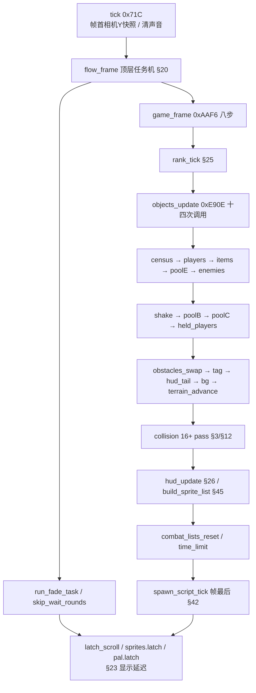

### 47.3 wof：原机侧帧首 / 帧内 / 帧末锚点

- **帧首 VBlank**：`0x0506` 处理器、`0x050E` 必须**先于 slot14 任务**（`Cps1ObjectRuntime.cs:45,247`）；帧首把 priority / layer 阴影提交到 CPS 硬件寄存器，读到的是**上一帧帧末**的值（`:182-185`）——与 §23 的 VBlank shadow、§45 的 `0x18B12` 复位是同一类"帧边界交接"。
- **帧内分发表**：`0x22C40` 重建敌人渲染队列（内含 `0x22D02` 清 `A5+0x1AD`）→ `0x22D8E` per-object 分派 → `0x1082E` 生成命令 → `0x10734` 关卡脚本推进（§42 的 FBA cycles 实证：`22C40 cyc=714846` → `1082E cyc=728500` → `10734 cyc=728770`）。
- **帧末**：`0x18B12` 无条件复位三张渲染队列表（`Cps1ObjSpriteSubmitter.cs:229-239,255-269`），消费阶段 `0x5DF9C`（特殊队列）→ `0x5DFBC`（普通队列冒泡排序）→ `0x5DFFE`（闪烁 / 影子队列，栈顶反向消费）（`:491-493`，§45）。`Cps1ObjectRuntime.cs:913,951` 记每个提前 return 的分支都必须复位，否则污染下一帧。
- **宿主层隔离**：`执行一帧核心_无对应ASM`（`Cps1FrameRunner_无对应ASM.cs` 帧核心入口）、`AFC4` 同帧去重键（`:115`）、帧首事件队列复位（`:112-119`）、帧末 slot15 补消费（`:208-216`）、`帧末收尾Trap4保存相位`（`:291`）都是 C# 为复现原机时序引入的**宿主补偿**，按 §0 原样登记，不写成 wof 的游戏机制。

### 47.4 对照表

| 维度 | dino | wof（原机侧） |
|---|---|---|
| 一帧的表示 | 一张三层嵌套固定调用序列（`mod.rs:331-377`） | 协作式任务内核 + VBlank 中断，若干帧首/帧内/帧末锚点 |
| 单帧执行次数 | **确定**：每步恰好一次 | **不确定**：被中断切走后下一帧帧首接着跑（`Cps1FrameRunner_无对应ASM.cs` 帧首续跑注释） |
| 帧边界交接 | `latch_scroll / sprites.latch / pal.latch`（§23）、`terrain_obstacles_swap`（§44） | 帧首 `0x050E` 先于 slot14、帧首提交上一帧末的 priority/layer 阴影、帧末 `0x18B12` 复位三表 |
| 显示延迟 | `VIDEO_LATENCY=2` 帧（sprite/scroll X）、1 帧（scroll Y/layer/palette）明确写进 `tick()` | 帧首读上一帧帧末寄存器值，延迟档数按 §23 不臆断 |
| 生成位置 | `spawn_script_tick` 是 `game_frame` 第 8 步、最后一步（§42） | `0x1082E` 在 `0x22C40 / 0x22D8E` 之后（§42） |
| 绘制位置 | `build_sprite_list` 是 `game_frame` 第 5 步，排序后交 `tick()` latch（§45） | `0x22C40` 帧内重建 + `0x5DFBC/5DFFE` 帧末分阶段消费（§45） |
| 难度 / 计时 | `rank_tick` 第 1 步、`time_limit` 第 7 步 | 事件驱动，散在任务与 ROM 例程（§25.4） |
| 宿主补偿 | 无（native port 直接是固定序列） | `Cps1FrameRunner_无对应ASM` / AFC4 阶段机 / pending，按 §0 隔离 |

### 47.5 直答用户最初的两个问题

- **「随时被硬件中断无法确定有些函数的执行次数和完整度」**：wof 原机保留协作式内核，`0x050E` 帧首 VBlank 与 slot 任务交错，一条指令流被切断后**下一帧帧首接着跑**，所以"某函数这帧跑几次 / 跑没跑完"是必须逐点求解的物理量；dino 把内核压成 `tick → game_frame → objects_update` 的固定序列，**删掉了这个自由度**——代价是复现不了 lag / 协作挂起（A.5），收益是每步执行次数恒为 1、可用逐帧 trace 定位（§20 / A.4）。
- **「游戏循环大致有两套，基于 VB 和 续算完之前遗留任务的 PC」**：dino 的 `tick()` 把"VB 侧"（`latch_scroll / sprites.latch / pal.latch`）显式放在外层，`game_frame` 是"续算完的任务"这一套；wof 是帧首 `0x050E` VBlank + 帧内任务链 + 帧末 `0x18B12`，两套循环在帧边界交接（读上一帧末值 / 复位本帧队列）。§20.3 的三类时序不确定在 dino 里分别落地，本节把它们挂回同一张帧表。
- 这不是"dino 更优"：目标不同（native port 的可定位性 vs 逐字节等价），A.4 / A.6 已记清楚。

### 47.6 未做（保留，不扩张）

- `collision()` 16+ pass 逐条、`objects_update` 各子调用逐函数全文（§3 / §12 / §20 已有骨架，逐类展开按 A.14 属主动边界）。
- wof `0x0506` / `0x050E` / slot14-15 逐指令、VBlank 中断与任务抢占的完整求解（repo 注释已给语义，不逐条 ROM 对照；宿主 `_无对应ASM` 按 §0 隔离）。
- 两游戏"一帧内是否存在多次 VBlank / lag 帧是否算一帧"按 A.5 的 lag 豁免处理，不臆断；音频（帧首清 `sounds`）按 §0 边界外。

**结论**：§47 把 §20 / §23 / §36 / §42 / §44 / §45 的帧内散点合成一张完整调度链，直答「执行次数 / 两套循环」；`长时间自主推进` 仍是开放目标，本节不宣称终止。

---

## 48. 一次挥击的判定窗口：命中去重与列表生命周期

> 触发：§3 讲了三轴 hitbox 怎么算重叠，§12 讲命中帧只结算不处决，§22 讲命中帧写哪些字段，§29 讲下游恢复链，§46 讲攻击数据记录，§47 讲 `collision()` 在帧内第 3 步——但一次挥击往往跨好几帧，**「同一个目标只能被这一挥击打中一次」靠什么保证**从未单独成节。
> 归属：设计正文（§0–§48），按"轮次线性追加"接在 §47 之后。纯 repo 侧，未新增 ROM 取证（§11.0）。
> 边界：用户 11-06 补充授权「ROM 主要为调查 data，仅在 `wof_cs` 非常可疑时可查 ROM」；本轮 wof 侧 `Cps1Collision.cs:4562-4585` 已自带 ROM 逐指令与 `-MemWatch` 直读 FBA 实证，**未触发可疑条件**，故不查 ROM。分工上 §38 已讲友军伤害的记分归属，本节只讲去重机制本身。

### 48.1 一句话

dino 用**全局单调递增的攻击流水号** `attack_serial`（G.$67BE → 对象 `+$5E`）标记"这一挥击"，被击者记下"上次被哪个号打过"，pass 里号相同就跳过；wof 用**动画相位锁 + 目标引用**（`+0x79` 存攻击者 `AniStatA` 的 bit5、`HitMeObj` 存地址，XOR 判同一次攻击）。两边都把"一次挥击每目标只中一次"做成**对象上的持久状态**而不是 pass 里的临时集合；真正的差别在「挥击边界由什么定义」：dino 由「什么时候重新取号」决定（与动画解耦），wof 由动画相位 bit 决定（与动画耦合）。

### 48.2 dino：一个全局递增号，一个字节两种角色

**A. 起手三件事**

- `body.rs:105-112` 把四个字段排在一起：`+$58` 当前招式 id（选 §46 的 `AttackRecord`）、`+$59` hitstop、`+$5A` 强制击倒、`+$5E` **"attack serial of the current swing (one swing hits each target once)"**。
- `enemy/class13_attack.rs:5` 文件头把起手动作写全：*"Every attack sets `+$58` (attack id), clears `+$5A` / `+$59` and takes the next attack serial G.$67BE into `+$5E` (`enemy_begin_attack`)"*——**设招式 id、清上一击的击倒/停顿标志、取新号**，三件事是一次挥击的起点。
- 号来自全局 `w.attack_serial`，每次取号 `wrapping_add(1)`：`enemy/class22_foot.rs:54-56`、`enemy/class24.rs:722-723`、`enemy/class31.rs:358-359`、`enemy/class100.rs:67-68`、`car.rs:126-127`。即**多段技的每一段、载具攻击、变身后的新招各自决定"何时算新一击"**；`car.rs:408` 还记 HP 变化会重武装一个新号（不在 hit flash 期间）。

**B. 去重判据：`+$5E` 是一个双向字段**

- 玩家打敌人：`player_combat.rs:332-351` 的 `player_attack_10962` 遍历 `0x671E` 列表，`if eb.live & 2 != 0 || eb.serial == self.players[i].b.serial { continue; }`；命中后 `player_hits_enemy` 在 `:354-362` 写 `eb.serial = serial`。
- 敌人打玩家：`:514-515` 明说 *"the enemy pass 0x115B0 did the loop, the serial test and the box test"*，`:528-530` 取 `eb.serial`，`:571` 写 `pl.hit_serial = eserial`。
- 玩家互伤（§38）：`:192` `if attacker.serial == victim.hit_serial`、`:224` `vp.hit_serial = serial`。
- 载具撞敌人：`car.rs:941` `if m.kind != 4 || m.serial == car.serial || m.attack_box == 0`、`:951` `v.serial = m.serial`。

即**同一个 `+$5E` 字节按角色复用**：挂在攻击者身上是"我这一挥击的号"，写到被击者身上就成了"我上次被哪个号打过"。这与 §37 `+0x62` 一字节三用、§39 `ComboLev/ComboLeft` 在 AI 里复用、§33 `who` 索引复用是同一种紧凑取向。号由全局计数器保证不同挥击互不相同，于是"这一挥击"的边界 = "上次重新取号以来"，与动画播到第几帧无关。

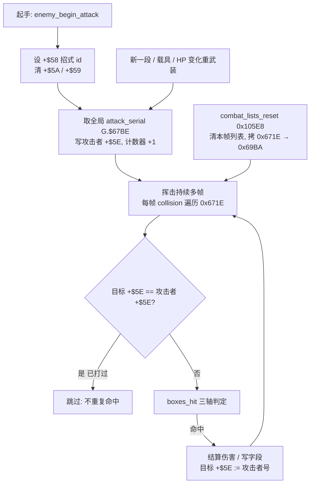

### 48.3 wof：相位锁 + 目标引用 + 群体节奏

- **重复命中门控**：`Cps1Collision.cs:4577-4585` 的 `玩家AniB14重复命中门控_对应ASM_8E5A` 先比 `player.HitMeObj` 与攻击者地址，再读 `player+0x79`（注释：由 `0x8228` 写入"上次命中的攻击者相位 `enemy.AniStatA`"），返回 `((playerPhase ^ attacker.AniStatA) & 0x20) != 0`。`:4562-4576` 附了逐帧实证：f=20170 命中、f=20171 相位相同 `bit5=0` 不命中、f=20174 相位翻转 `bit5=1` 才再命中；旧实现误用 `+0x30` 导致"每帧都可能命中"。**"一次挥击"的边界由动画相位的 bit5 定义**。
- **目标引用**：`HitObj1 = +0x68`（`:1338,1651,1710,3862,4422,4557`）记被打中的对象地址，`HitMeObj` 记攻击者地址——与 dino 的号不同，wof 用**地址 + 相位**两个量共同去重。
- **群体节奏**：`:333-341` 注释明写「群体伤害机制（`+0x62=3` 硬直锁）：命中敌人 A → 双方 `shake_timer=3`，3 帧后攻击者解锁、攻击动画仍活跃 → 可命中敌人 B，同一套攻击动画可依次命中 3–5 个目标，每次命中 `combo_level++`、伤害递增」。这与 dino 的"同一目标不重复"是**互补的两条规则**，§37 已登记 `+0x62` 一字节三用。
- **列表层级**：wof 命中链当帧分派 9 项反应（§12），没有 dino 那种全局 `Lists` 栈与帧间拷贝；去重信息全在对象字节上。

### 48.4 列表生命周期：又一处「这一帧写、下一帧读」（§36 主线）

- `combat.rs:8-13`：`Lists` 按**原机 RAM 地址键控**（`0x6718` 玩家表等），原机是向下生长的栈（`move.w a6,-(a4)`），所以 `get` 返回"后 push 先访问"的顺序——同一帧多个攻击盒谁先判定由入栈顺序决定。
- `combat.rs:19-47`：`push / get / clear / copy / items_reset` 五个原语；`items_reset` 在 `objects_update` 里 pool E 之前清 `$69EE`（§21.7）。
- `combat.rs:102-112` `combat_lists_reset 0x105E8`：清 `0x6718 / 0x671A / 0x671C / 0x671E`，**`copy(0x671E → 0x69BA)`**（把本帧 hurt list 留成下一帧的），再清 `0x6B64 / 0x6AC2 / 0x6AFC / 0x6B30`。
- `combat.rs:56-67` `combat_hurt_list_seen`：读者是 Rock Hopper（class 29）与 Shivat（class 24）；注释直说上一帧列表的高位**已被本帧注册覆写**，port 按原机怪癖保留。
- 位置（`mod.rs:355`）：`combat_lists_reset` 是 `game_frame` 第 6 步，在 `build_sprite_list` 之后、`spawn_script_tick` 之前（§47）——本帧候选列表在这里作废，只留一份给下一帧。
- 与 §21.7 的 pool E 三张注册列表、§36 的 7 个跨帧实例同构：**候选集合也是"这一帧建、下一帧读"的数据**，不是每次现算。

### 48.5 对照表

| 维度 | dino | wof |
|---|---|---|
| 去重键 | 全局递增 `attack_serial`（8-bit，G.$67BE） | 动画相位 bit5 + `HitMeObj` 地址 |
| 存在哪 | `+$5E`（攻击者持号 / 被击者记「被哪个号打过」，同字节两用） | `+0x79` 相位 / `+0x68 HitObj1` / `HitMeObj` 地址 |
| 判据 | 号 `==` 相等即跳过 | `(相位 ^ AniStatA) & 0x20` |
| 挥击边界 | 显式「重新取号」：起手 / 多段 / 载具 / HP 变化重武装 | 动画相位翻转（与动画耦合） |
| 跨帧持续性 | 号不变即持续有效，与动画帧解耦 | 相位随动画推进，bit5 翻转才算新一击 |
| 群体命中 | 每目标独立记 `hit_serial`，一次挥击可打多个 | `+0x62=3` 硬直锁，3 帧后解锁下一个，`combo_level++` 伤害递增（§37） |
| 列表层级 | `Lists` 栈 + `combat_lists_reset` 一帧延迟 hurt list | 当帧命中链，去重信息全在对象字节上（§12） |
| 与 §47 接口 | `collision` 第 3 步、`combat_lists_reset` 第 6 步 | 帧内 `0x94EA` 三阶段碰撞 |
| 实证方式 | repo 源码逐行 | repo 注释自带 ROM 逐指令 + `-MemWatch` 直读 FBA（`:4562-4585`） |

### 48.6 "更成熟"落在哪（只谈设计本意）

1. **把"一次挥击"从动画里解耦**：dino 用可主动重取的号，让多段技 / 载具 / 变身自己定义"何时算新一击"；wof 靠动画相位 bit，改动画就得同步改锁（`:4566-4576` 的旧实现修正史正是耦合的代价）。
2. **一个字节两种角色**：`+$5E` 既是攻击者的本次号、又是被击者的"上次被谁打过"，紧凑且无需额外字段；与 §37 / §39 / §33 的复用习惯一致。
3. **wof 的群体节奏是另一条设计**：`+0x62=3` 硬直锁让同一套动画依次命中 3–5 个目标并递增伤害，是"同帧内跨目标"的节流；dino 侧笔记未单独展开等价机制，按 §11.0 不臆断其有无。
4. **候选列表也是跨帧数据**：`combat_lists_reset` 的 `copy(0x671E → 0x69BA)` 与 `combat_hurt_list_seen` 的覆写怪癖，给 §36 的跨帧清单再添一条，且与 §21.7 pool E 三张注册列表是同一套做法。

### 48.7 未做（保留，不扩张）

- `attack_serial` 8-bit 回绕时是否处理号碰撞、多段技逐类重取次数（不臆断）。
- wof `+0x79` 相位锁的全部调用点、`0x8E5A` 逐指令语义（repo 已给逐帧实证，不逐条 ROM 对照）。
- **ROM 核查未触发**：按用户 11-06 授权，仅 `wof_cs` 非常可疑时才查 ROM；本节涉及的 wof 门控函数自带 ROM 字节与 FBA 实证，故保持纯 repo 侧（§11.0 / §11.6）。
- 音频（命中音）按 §0 边界外；「两游戏一次挥击最长几帧」不做量化对比。

**结论**：§48 把 §3 / §12 / §22 / §29 之间「一次挥击怎么保证不重复命中」这层补上，并把 §36 的跨帧清单延伸到碰撞候选列表；`长时间自主推进` 仍是开放目标，本节不宣称终止。

## 49. 判定盒的数据与开关：动画帧怎么决定「这一帧有没有盒」

> 触发：§3 讲 `boxes_hit` 三轴几何怎么算重叠，§46 讲命中后读哪条 `AttackRecord`，§48 讲一次挥击怎么不重复命中——但**「这一帧到底开没开攻击盒、盒子数据存在哪、谁把它写上去的」**从未独立成节。一次挥击跨多帧（§48），判定盒必然逐帧变，这层正好补在 §46 与 §48 之间。
> 归属：设计正文（§0–§49），按"轮次线性追加"接在 §48 之后。纯 repo 侧，未新增 ROM 取证（§11.0）。
> 边界：用户 11-06 授权「ROM 主要为调查 data，仅 `wof_cs` 非常可疑时可查 ROM」；本节 wof 侧 `0xE4F02` / `0x848E` / `0x247C` 的注释自带 `rom_read` 逐字节与 FBA 实证，**未触发可疑条件**，故不查 ROM。分工上 §3 只讲几何、§21 讲武器对象自带盒，本节讲"盒 ID 的载体与逐帧开关"。

### 49.1 一句话

两边都**不把判定矩形写死在招式代码里**，而是把「这一帧用哪个盒」编成**动画帧记录里的一个 ID**，由动画播放器每帧加载进对象头，碰撞 pass 再拿这个 ID 去查一张共享盒表。差别在「ID 怎么定位一张表」：dino 是**对象头自带可切换的表基址 + 表内索引**（双参数，且 `0` = 关盒），wof 是**全局固定大表 `0xE4F02` + 绝对字节偏移**（单参数，且 `0` = 合法的表第 0 项）。

### 49.2 共同底座：盒 ID 住在 frame record 里，随换帧重载

- dino `body.rs:193-211` 的 `load_frame`（`0x1236` 10 字节 / `0x143E` 12 字节记录）每次换帧把 `f.body_box` / `f.attack_box` 写进 `+$48` / `+$49`，同时写 `param_a/param_b/kind/timer`；`body.rs:213-230` 的 `tick_anim` / `start_anim` 在计时到 0 或起手时调它。即**"这一帧开什么盒"是动画数据，不是状态机代码**。
- wof `Cps1Subs.cs:761-768`（`0x247C` 加载动画帧）：`boxIdWord = rw(sprite-2)`、`boxes = rd(sprite-6)`，然后 `BeheldBoxId = boxIdWord`、`HurtBoxId = boxes>>16`、`AtkBoxId = boxes`，再 `ww(Addr+0x6C)` / `wd(Addr+0x6E)` 写回对象头；`Cps1Subs.cs:842-846` 另一条路径同构。**盒 ID 就放在 sprite 帧记录头部 6 字节里**，`Program.cs:6155` 的「首帧 AniB=08；Spr 87520 的 AtkBox=0CA0」正是帧号与盒 ID 的绑定实例。
- 所以「起手帧 / 判定帧 / 收招帧」的差别，两边都是**靠动画推进换记录 → 换盒 ID** 实现的，而非招式函数里 `if (frame==3)` 开盒。§25 的 rank、§39 的 combo 链都建立在"动画记录自带时长与盒"这一层之上。

### 49.3 dino：可切换表基址 + 两个索引 + 一帧多盒

- 对象头四项（`body.rs:86-91`）：`+$44 box_table`（盒表 ROM 基址）、`+$4A multi_box`（单盒 / 多盒）、`+$48 body_box`（被击盒索引）、`+$49 attack_box`（攻击 / 探测盒索引）。
- 盒表本身（`sprites.rs:91-100`）：一个 `HitBox` 是 **6 个 i16 = 12 字节的三轴盒**（`zoff/zsize/xoff/xsize/yoff/ysize`）；`sprites.rs:102-145` 的 `HitBoxBank` 用 `single(table,index) = table + 12*index`，`multi(table,index)` 支持**一帧返回多个盒**，`try_single` 对越界 / 陈旧指针返回 `None`。
- 查表入口（`collide.rs:8-14`）：`boxes(s,b,index)` 取 `b.box_table & 0xFF_FFFF`（68000 24 位地址，pool E 对象把标志位塞在最高字节，查表要忽略），按 `multi_box` 走 `multi` 或 `try_single`；`collide.rs:36-48` 的 `boxes_hit(s,a,ia,b,ib)` 里 `ia` 通常就是 `+$49`、`ib` 是 `+$48`，返回第一对重叠盒给 spark（§3）。
- **表基址可被状态机改**：`enemy/class10.rs:96` 显式 `e.b.box_table = 0x103000` 换整套盒表；`item/weapon.rs:408`、`item/blast.rs:659`、`prop.rs:234` 在状态推进里直接覆写 `attack_box`（`-=0` 关盒、`=0xC9` 指定盒）。即"用哪张表 / 用哪个盒"两层都可在运行时重定向。
- **哪些对象的帧记录带盒是显式区分的**：`effect.rs:226-234` 的 `fx_load`（`0x160A`）注释直说 *"copying only +$2C..+$2F (no boxes, no extra bytes)"*；`effect.rs:236-246` 的 `fx_load_sprite_frame`（`0x1236`）才多拷 `+$48/+$49` 两个盒字节；`effect.rs:266-278` 池 C 对象同理。特效 / 纯显示对象与可碰撞对象走不同的 frame loader。

### 49.4 wof：全局单表 + 三个绝对偏移

- `Cps1Types.cs:309`：`OBJ+0x70 AtkBoxId`（配套 `+0x6C BeheldBoxId`、`+0x6E HurtBoxId`）；`Cps1DebugRenderer.cs:2` 注释「红=攻击 AtkBox(0x70)，蓝=被击 HurtBox(0x6E)」。
- `Cps1Collision.cs:21` `HITBOX_ROM_BASE = 0xE4F02` 是**全局唯一基址**；`:68-76` `HitboxGet(id,...)` 直接 `baseAddr = 0xE4F02 + id` 读 4 个 word = `(valX, radX, valY, radY)`，注释明写「OBJ+6C/6E/70 保存的已是相对 A6=0xE4F02 的**字节偏移**」。`:51-66` 的 `HitboxBoxWidthX(id)` 还从 `id-2` 取 X 框宽，推出表项实际是 10 字节布局 `[X框宽, valX, radX, valY, radY]`；`:2740` 的 `861A A3 = 0xE4F02 + (0x6E,A1)` 是另一处取表。
- 即 wof 的盒 ID 是**大表内的绝对偏移**，不是"某张小表 + 索引"；`Cps1Collision.cs:4588-4623` 的 `0x848E` 装载攻击框把 `(valX,radX,valY,radY)` 加上面朝镜像与 `PosX/PosY/PosZ/PosZ2` 变成屏幕矩形（`atkX/atkW/atkY/atkH`），并注明全工程 8 处调用点都按此形参序。
- 武器走同一张表、只是换了取 ID 的入口：`Cps1Collision.cs:1948` 的 `0x91FA` 用 `+0x70` 从武器对象取 `AtkBoxId`（§21 的线 B），`Program.cs:3833` 记「ROM 0xE4F02+0x78 = {X=0,Y=0x23}，位于 0x0AF8 攻击框」——都是同一全局表的偏移。

### 49.5 最容易误读的一处：`0` 在两边含义相反

这是本节最有设计意味、也最容易被"用另一边的直觉读这一边"带偏的地方：

- **dino：`attack_box == 0` = 这一帧没有攻击盒（关盒）**。`player_combat.rs:195,272,340`、`enemy_combat.rs:42,122,491,739` 等几乎所有攻击 pass 都以 `if ab.attack_box == 0 { return/continue }` 开头；关盒是**显式写 0**（`prop.rs:234`）。收招帧 / 非判定帧就是靠动画记录给 `attack_box=0` 表示"这帧不打人"。
- **wof：`AtkBoxId == 0` = 表第 0 项，合法且有实体矩形**。`Cps1Collision.cs:4588-4614` 的 `0x848E` 注释给出 `rom_read` 核实的表第 0 项 `valX=FFFD(-3) radX=0024(36) valY=FFEB(-21) radY=0000`，并逐指令说明 `0x848E..84B6` **没有任何前置门**、调用点 `0x922E` 也不检查 D0。宿主 C# 曾加 `AtkBoxId == 0 -> return false` 与 `radX<=0 || radY<=0 -> return false` 两道门，实测**两道都拦住了 f=6361 的玩家近战**（火花 / 事件 / 派生对象全缺），已按"ROM 直译"删除；`:1991-2006`（`0x91FA` 武器）记同族**第三次复发**，`:5621-5624` 记**第四次复发**。wof 的"这帧不打人"不靠 0，而靠动画帧不给攻击阶段 / `+0x62` 一类的门（§37 / §48）。

> 这条不是实现 bug 记账，而是**设计语义差异**：同一个数值 0，在一边是"关"，在另一边是"第 0 号盒"。把 dino 的写 0 习惯带进 wof，或把 wof 的"0 合法"带进 dino，都会静默改掉打击手感。按 §11.0 立场，这里只陈述两份 repo 呈现的组织方式，不臆断哪边"缺"了什么。

### 49.6 流程图与对照表

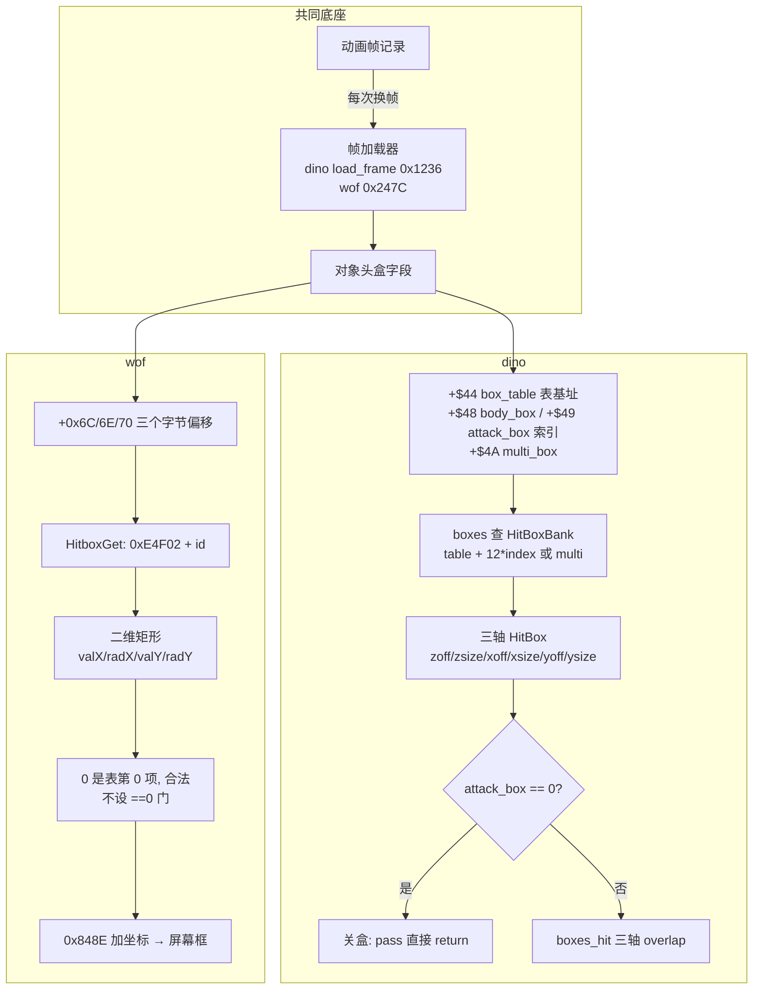

| 维度 | dino | wof |
|---|---|---|
| 盒 ID 载体 | frame record 的 `body_box` / `attack_box` 字节，换帧重载（`body.rs:193-211`） | sprite 帧记录头部 `spr-6` / `spr-2`，换帧重载（`Cps1Subs.cs:761-768`） |
| 定位方式 | 双参数：`+$44` 表基址 + 表内索引，基址可换（`class10.rs:96`） | 单参数：全局 `0xE4F02` + 绝对字节偏移（`Cps1Collision.cs:21,68-76`） |
| 对象头字段 | `+$48 body_box` / `+$49 attack_box` / `+$4A multi_box` | `+0x6C BeheldBoxId` / `+0x6E HurtBoxId` / `+0x70 AtkBoxId` |
| 盒数据 | 12 字节三轴（z/x/y 各 off+size），一帧可多盒（`sprites.rs:91-145`） | 8~10 字节二维（valX/radX/valY/radY）+ Z 另算（`Cps1Collision.cs:51-76`） |
| `0` 的含义 | 关盒，攻击 pass 显式判 0 早退（`player_combat.rs:195`） | 合法表项，禁止 `==0` 门（`Cps1Collision.cs:4588-4614`） |
| 谁决定换盒 | 动画记录换帧 + 状态机可覆写表基址 / 盒字节 | 动画记录换帧，武器另从 `+0x70` 取（`Cps1Collision.cs:1948`） |
| 与相邻节接口 | `boxes_hit`（§3）→ `AttackRecord`（§46）→ serial 去重（§48） | hitbox 表 → 9 项反应分派（§12 / §22）→ 相位锁去重（§48） |

### 49.7 "更成熟"落在哪（只谈设计本意，带收敛限定）

1. **双层可重定向**：dino 把"用哪张盒表"和"用表里第几项"拆成对象头的两个字段，武器 / 变身 / 特殊对象可以整表替换而复用同一套 `boxes_hit`（`class10.rs:96`）；wof 用一张全局表 + 偏移，最直接但盒数据与全局表地址绑死。这是**组织方式**差异，不据此断言 wof 不能表达等价几何。
2. **多盒与三轴进同一结构**：`multi_box` + 12 字节三轴盒让"一帧多个判定区""纵深判定"（§44）成为盒表的自然属性；wof 侧本笔记只登记 repo 呈现的二维矩形 + 独立 Z 处理，按 §11.0 不臆断其缺少多盒 / 三轴能力。
3. **关盒是一等状态**：dino 的 `attack_box=0` 把"这帧无判定"写成数据而非分支，于是所有 pass 共用同一道早退、起收招帧只需换记录；配合 §49.5，wof 把 0 用作合法项、把开关放在别处——两种都自洽，但 dino 的"0 = 关"让判定窗口和动画数据在同一个字节里闭合。
4. **与 §46 / §48 串成完整链**：`+$58` 选攻击记录（§46，命中后读什么）← `+$49` 决定这帧有没有盒（§49）← `+$5E` 决定这一挥击打过谁（§48）。三者是对象头三个不同字节、三条不同时间尺度的契约，没有混在一个字段里。

### 49.8 未做（保留，不扩张）

- 两游戏盒表的总容量 / 逐项数值穷举、`BeheldBoxId`（`+0x6C`）的精确语义（repo 未完全展开，按 §11.0 不臆断）。
- dino `multi_box` 逐类用例、`HitBoxBank::try_at` 陈旧指针的具体来源（§3 已覆盖几何，不逐类展开）。
- wof `0x848E` 之外 8 处调用点逐条、`0x247C` 正负路径 A6 自减的逐指令（repo 已有 `rom_read` / FBA 实证，不逐条 ROM 对照）。
- **ROM 核查未触发**：按用户 11-06 授权，仅 `wof_cs` 非常可疑时才查 ROM；本节 wof 侧盒表与门控均自带 ROM 字节与 FBA 实证，故保持纯 repo 侧（§11.0 / §11.6）。
- 音频（命中音）按 §0 边界外；「两游戏一帧最多几个盒」不做量化对比。

**结论**：§49 把 §46（攻击记录）与 §48（挥击去重）之间「判定盒本身是什么数据、由哪一帧打开」补上，并给出两条最容易混淆的语义分界（双参数 vs 单参数、`0`=关盒 vs `0`=合法项）；`长时间自主推进` 仍是开放目标，本节不宣称终止。

## 50. 对象池全景：谁住在哪个池、多大、怎么分配与更新

> 触发：§2（对象池与固定更新顺序）、§15 / §32（车是 pool B 一个 class）、§21（pool E 24 槽 12 class）、§28（池容量背压）、§34.3（区域切换清池）、§35（pool B 统一契约 vs wof 多池）、§42（生成帧时序）、§43（离场回收）都用过"池"，但都是**为各自主题顺带引用**，从没有一张"五池 + 玩家"的完整总表：基址 / 步长 / 容量 / 装什么 / 谁更新 / 怎么分配 / 怎么判定身份。本轮收束成一条主线。
> 归属：设计正文（§0–§50），按"轮次线性追加"接在 §49 之后。纯 repo 侧，未新增 ROM 取证（§11.0）。
> 边界：本节只读两份 repo 的池常量与更新序列；按用户 11-06 授权「ROM 主要为调查 data，仅 `wof_cs` 非常可疑时可查 ROM」，池信息在 `mod.rs` / `Cps1EffectActorRuntime.cs` 注释里自带地址与槽数，**未触发可疑条件**，故不查 ROM。分工上 §35 讲"非角色对象怎么组织"是设计主线，本节是它的**容器层数据底座**。

### 50.1 一句话

dino 把"所有非玩家对象"切成 **5 个固定容量的静态池 + 3 个固定玩家对象**，对象的**身份大半由它在哪个池决定**，而池归属又由 RAM 地址区间算术反解——`handle = 基址 + stride×槽号`，`slot_of(handle)` 就能算出 `Slot::{Player,Enemy,Prop,Item,Effect,Special}`，不需要在对象里存一个 type 字段。wof 同样是多个固定容量池，但每个池只当**容器**，槽里跑什么逻辑由槽上的 `ObjId` 再查一张跳表决定。

### 50.2 dino 六容器总表（精确常量）

`mod.rs:47-58` 一次性给出全部基址 / 步长 / 容量：

| 容器 | 基址 | 步长 | 容量 | 装什么 | 更新 pass（`objects_update`） | 分配器 | 池 tag `+$82` |
|---|---|---|---|---|---|---|---|
| players | `0xB274` | `0x180` | 3 | 玩家（固定，非池） | `players_update 0x18834` | — | 无 |
| pool A | `0xC8F4` | `0xE0` | 24 | 敌人 / Boss / 恐龙 | `enemies_update 0x23420` | `0x483C` | 4 |
| pool B | `0xB6F4` | `0xC0` | 24 | 波次控制器 / 机关 / 可破坏物 / 车 class 88 / 街景 | `pool_b_update 0x23604` | `0x4860` | 8 |
| pool E | `0x8874` | `0xC0` | 24 | 道具 / 食物 / 武器 / 容器 / 弹丸 / 攻击盒 | `pool_e_update 0x233C6` | `0x4818` | `0xC` |
| pool C | `0x9A74` | `0x80` | 48 | 特效 / 射击 / 火花 | `pool_c_update 0x237B2` | `0x4884` | 无 |
| pool D | `0xDDF4` | `0x80` | 16 | special：tally 数字对象、typewriter 文本的**附属数据槽** | **无独立 pass**，由 pool B 的 b25 / b31 handler 直接借用 | `0x48A8` | 无 |

- 六个容器在 `Game` 里一一对上（`mod.rs:233-239`）：`players[3]` / `enemies` / `props` / `items` / `effects` / `specials`；名字与池字母不是一一对应（props=B、items=E、effects=C、specials=D），所以读源码要按 `POOL_*` 常量而不是字段名。
- `trace.rs:1214-1220` 的 `POOLS` 表把六者按 `enemy / prop / item / effect / special` 登记给逐帧 trace；`trace.rs:2699` 遍历顺序是 `[PLAYERS, POOL_A, POOL_B, POOL_E, POOL_C, POOL_D]`——**既不是字母序也不是内存地址序**，是 trace 自己的登记序。
- 区域切换时 `flow.rs:653-661` 重建 A / B / C 三池并清 `G.$4F1..` 一片全局标志，`spawn.rs:141-142` 另调 `pool_a_init` / `pool_b_init`；§34.3 / §42 的"清池 + 重装"落在这里。

### 50.3 分配与身份：handle 就是地址，池 tag 是冗余

- **反解身份**：`mod.rs:60-85` 的 `slot_of(h)` 遍历 `(base, stride, n)` 六元组，`h >= base && h < base + stride*n && (h-base) % stride == 0` 就返回对应 `Slot` 变体。`mod.rs:150-152` 反过来 `handle(i) = base + stride*i`。即**对象引用是它在 WRAM 里的真实地址**，池归属纯算术可得。
- **LIFO free stack**：`mod.rs:87-101` 的 `Pool<T>` 用 `free: Vec<usize>`，`new` 压入 `0..n`；`mod.rs:125-137` 的 `alloc()` = `free.pop()`、`release(i)` = `free.push(i)`，注释直说 *"init pushes slot 0 first, so the first allocation returns the last slot (23 for a 24-slot pool)"*。`mod.rs:139-143` 的 `reset_free()` 只重建栈、**槽字节保留**（`0x4CCC` pool D 的 init 就是这样），`free_count()` 对应原机 `$65F4 / $65F6 / $65F8 / $65FA / $65FC` 五个空槽计数。
- **池满即背压**：`alloc()` 返回 `None`（原机 carry set）就是 §28 波次生成被截断的地方——"这一帧允许生成几个"不是脚本说了算，是池里还剩几个 free slot。
- **`+$82` 是第二套、且只覆盖三个池的 tag**：`mod.rs:104-106` 明说 `pool_a_init` 写 tag 4、`pool_b_init` 写 8、`pool_e_init` 写 `0xC` 到每槽 `+$82`，**free 例程不动它**，C / D 两池根本没有 init 写 tag。§38 的 `hud_hit` 正是靠 `+$82` 把 pool A 敌人挡在"英雄被击中"记分环之外（`:392`）。所以"池身份"有**两套并存**：地址区间（全体六容器）+ `+$82` 字节（仅 A/B/E 的粗分类）。
- free 例程按池分开：`0x48FC` A / `0x4938` B / `0x4964` C / `0x4994` D 与 E（`mod.rs:132-133`）；§43 讲的 `enemy_free_pool_a` 只清部分字段、故意留 `+$84 / +$5C` 供复用，就是这套"释放只归栈、不清槽"的一例。

### 50.4 更新顺序按游戏语义，不按池字母

`mod.rs:361-377` 的 `objects_update`（§47 的 14 调用）里池相关顺序是：

```text
players_update → items_reset → pool_e_update → enemies_update → screen_shake
              → pool_b_update → pool_c_update → held_players_update → terrain_obstacles_swap
              → tag_trigger → hud_objects_tail → background_update → terrain_advance
```

- **玩家 → 道具(E) → 敌人(A) → 机关/控制器(B) → 特效(C)**：与 §21 的"玩家先跑、pool E 后跑，所以 `find_pickup` 读到上一帧的注册列表"、§28 的 census 在玩家之前、§42 的 `spawn_script_tick` 在 `game_frame` 最后，串成同一条帧内因果链。
- **pool D 不在这条序列里**：`prop/b25.rs:146` / `prop/b31.rs:76` 里 pool B 的 handler 从自己字段取出一个 handle，`slot_of(...)` 解成 `Slot::Special(k)`，再直接读写 `self.specials.slots[k]`；`flow/tally.rs:684` 数 specials 的 live 槽。也就是 **D 是被 B 借用的私有数据区，不是一类会自己 tick 的对象**——这是总表里最反直觉的一格。
- 与 §45 对照：**更新按池分批**（每池一个 pass、各自 class 分派），**绘制却全池统一**（`build_sprite_list` 把六容器对象一起按 `(depth,handle)` 排序）。分治在逻辑侧，统一在显示侧。

### 50.5 wof：多池 + 每池一张 `ObjId` 跳表

- 同样有精确池常量：`Cps1EffectActorRuntime.cs:21-22` 写「池基址 `A5+0x1D9C`（`0xFF9D9C`）／槽步长 `0xE0`／槽数 20」，空闲槽计数在 `A5+0x2FE`、初值 `0x14`；另有「特殊 18 型对象池」（`Program.cs:2123` 等处调 `Cps1SpecialObjRuntime.更新特殊18型对象池_部分对应ASM_4F266`），§35 已确认波次脚本执行器本身就是这个池里的 `ObjId 0x0A` 对象。
- 差别在**类型放哪**：wof 槽上带 `ObjId`（`Cps1Types.cs:13-25` 的 OBJ 槽视图），每池配一张按 `ObjId` 分派的跳表（`Program.cs` 里 `probe.ObjId = Cps1Actor24Runtime.OBJ_ID` 一类的锚点、§35 的"每池一张 ObjId 跳表"）；槽里跑什么逻辑由 `ObjId` 决定，而不是由"进了哪个池"决定。
- 即：**dino 把类型压进"容器选择"**（进 A 就是敌人、进 E 就是道具、进 D 就是被借用的数据），**wof 把类型压进"容器内的一张跳表"**（池只是内存，逻辑靠 ObjId 二次分派）。两边都是固定容量静态池，都没有动态分配。按 §11.0 立场，这里只陈述两份 repo 呈现的组织方式，不臆断 wof 缺统一对象模型（§35 已有收敛限定）。

### 50.6 流程图与对照表

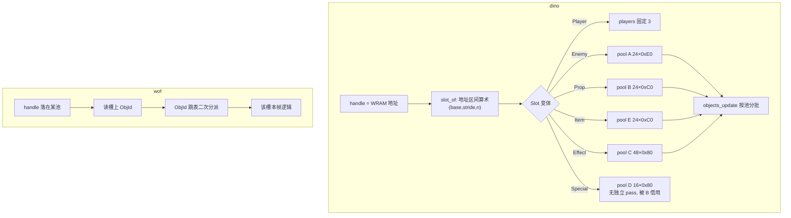

| 维度 | dino | wof |
|---|---|---|
| 容器数 | 5 池 + 3 固定玩家，常量集中在 `mod.rs:47-58` | 多个池（特效演员池 20 槽、特殊 18 型池等），按用途分 |
| 类型载体 | "进哪个池" + 地址区间 `slot_of`（`mod.rs:60-85`） | 池只当容器，类型在槽上的 `ObjId` + 跳表（§35） |
| 引用形式 | `handle = base + stride*i`，就是 WRAM 地址 | OBJ 槽包装 + `ObjId` |
| 分配 | 每池 LIFO free 栈，`alloc` 为 `None` 即池满背压（§28） | 空闲槽计数（如 `A5+0x2FE` 初值 `0x14`） |
| 重置 | 区域切换重建 A/B/C 并清全局标志（`flow.rs:653-661`） | 各池各自的清槽 / 复位例程（§34 / §43） |
| 更新 | `objects_update` 按池分批、顺序按语义（`mod.rs:361-377`） | 协作式任务 + 各池 update（§20 / §47） |
| 特殊一格 | pool D 无独立 pass，被 pool B 的 b25 / b31 handler 当数据槽借用 | 特殊 18 型池里 `ObjId 0x0A` 波次执行器本身就是对象（§35） |
| 与 §45 关系 | 更新分池、绘制全池统一 `(depth,handle)` | 更新与渲染都按多队列分阶段（§45） |

### 50.7 "更成熟"落在哪（只谈设计本意，带收敛限定）

1. **身份零冗余**：dino 让 `handle` 直接是 WRAM 地址，池归属由地址算术反解，碰撞 / 绘制 / 记分 / trace 都拿同一个 `u16` 当主键，不必在每个对象里维护"我是什么类型"；`+$82` 只是 A/B/E 的粗分类冗余（且 §38 用它挡记分）。这是"地址即类型"的紧凑取向，与 §48 `+$5E` 双向字段、§49 `0` 语义分界同源。
2. **容量即规则**：`free.pop()` 为 `None` 直接把"同屏上限"变成生成器的物理事实（§28 的 7200 帧预算 / 清场是另一层），不需要脚本自己数；wof 用 `MaxRecordsPerFrame=64` 按记录条数截断（§28），两条路都达成了"一帧不铺完整关"，但一个落在容器、一个落在解释器。
3. **pool D 的"借用"是一种显式分工**：把 tally 数字 / typewriter 文本这类**不需要自己 tick、但要有独立 sprite 列表与句柄**的数据，单独放一个不参与 `objects_update` 的池，由 pool B 持有者驱动；比把它们塞进特效池或做成完整对象更省。按 §11.0 不据此断言 wof 缺等价手段，只登记 dino 侧的这种组织。
4. **与既有节闭合**：§35 的"pool B 统一契约"、§42 的"生成帧最后"、§43 的"`mode=6` 归栈"、§45 的"全池统一绘制"、§47 的"14 次更新调用"——本节给这些散点补上同一张容器地图。

### 50.8 未做（保留，不扩张）

- 各池 free 例程（`0x48FC / 0x4938 / 0x4964 / 0x4994`）逐字节清哪些字段的全量对照；§43 已就 pool A 展开，其余按 §11.0 不扩张。
- wof 全部池的基址 / 槽数 / `ObjId` 跳表逐项普查（§35 已给组织方式，本节只取一例精确常量）；`A5+0x1D9C` 之外的池不逐一列举。
- pool D 全部借用者（b25 / b31 之外）、`0x4CCC` init 的逐指令；`trace.rs` 的 `POOLS` 登记序与逐帧 dump 的关系按 §47 / A.8 已覆盖，不重复。
- **ROM 核查未触发**：按用户 11-06 授权，仅 `wof_cs` 非常可疑时才查 ROM；池常量在两份 repo 的注释里已自带地址与槽数，故保持纯 repo 侧（§11.0 / §11.6）。
- 音频（对象触发音）按 §0 边界外；「两游戏池总容量谁大」不做量化优劣对比。

**结论**：§50 把 §2 / §21 / §28 / §35 / §42 / §43 / §45 / §47 反复引用的"池"收成一张六容器总表，给出"地址即身份""容量即背压""更新分池·绘制全池""pool D 被借用"四条组织结论，并对 wof 收敛为"容器 + ObjId 二次分派"；`长时间自主推进` 仍是开放目标，本节不宣称终止。

---

## 51. RNG：一个种子，被哪些系统分用

> 触发：§9.3 记过两边 RNG 算法 data（`0x119C: x=x*3` / `0x1BFA: x=x*5+0x3711`），§17 记 dino 命中伤害取 2 次 RNG、§25 记 aggression 重掷、§24.4 记 wof 两张 RNG 计时表、§27 记 `0x1F5C` 给倒计时、§33 记 `rng&3` 选目标——但**「一个全局随机状态被哪些系统分用、怎么取、取几次算不算帧契约」**从未独立成节。
> 归属：设计正文（§0–§51），按"轮次线性追加"接在 A.16 之后。纯 repo 侧，未新增 ROM 取证（§11.0）。
> 边界：§9.3 的 RNG 算法 / 表地址属 §9–§10 的 **data 部分，按 §11.0 保留有效**；本节不引用该区任何已作废的措辞（§11.4 / A.13）。wof 宿主层 `诊断帧` / `宿主帧序号_无对应ASM` / `WOF_TRACE_RNG_FILE` 按 §0 隔离为宿主补偿，不作为 wof 游戏机制。按用户 11-06 授权「ROM 主要为 data，仅 `wof_cs` 非常可疑时可查 ROM」：本节涉及的 RNG 算法与查表在两份 repo 注释里自带逐指令与 `rom_read` 实证，**未触发可疑条件**，故不查 ROM。

### 51.1 一句话

两边都是**一个全局种子、一次调用推进一次**、所有系统共享同一条随机流；差别在「取出来的数怎么用」：dino 把 `rand()` 返回的 `u16` **直接当值用**（`& 0x1F` 当概率、`& 3` 当槽号、`& 0x3E` 当表行、当散布方向），wof 把更新后的种子低字节 **只当查表索引的扰动**（`& 0x1F + offset` → `0x1C20` 伤害表、`& 0x0F` → 行为）。而正因为是共享单流，**「某个分支有没有取随机」在两边都成了跨系统的全局契约**。

### 51.2 共同底座：单流、单次推进、顺序敏感

- dino `mod.rs:162-163` 把种子写成 `Game` 的一个字段 `w.rng: u16`，注释「G.$14 state of rand() (0x119C)」；`mod.rs:280-287` 的 `rand()` 是唯一入口：`s*3` 后高低字节混合写回，**注释直说 "Shared by all combat and AI code: call order matters"**。算法与 §9.3 data 行 `0x119C: x = x*3` 一致。
- wof `Cps1Rng.cs:35-48` 把种子放在 WRAM（`A5_RNG_SEED_ADDR`），`UpdateSeed` 是唯一更新点：`seed = seed*5 + 0x3711`（`RNGUpdateSeed @ 0x0F98`）；`Cps1Collision.cs:81-84` 的 `0x1BFA` 逐指令注释同式，并提醒「偶地址取高字节，不能把 C# ushort 低字节当 68K D0 低字节」。算法与 §9.3 data 行一致。
- 即**两边都没有"每个系统一个 RNG"**：换人攻击、Boss 决策、特效散布、伤害、AI 目标、难度、载具，全在同一条流上依次取号。§48 的 `attack_serial` 是"这一挥击"的全局号，RNG 则是"这一帧"的全局流——同一种把全局状态做成单一写入者的取向。

### 51.3 dino：取出来的数直接当值

`rand()` 返回的 `u16` 被各系统按位掩码当场消费，没有中间表：

| 系统 | 取法 | 用途 |
|---|---|---|
| 动态难度 / rank | `rank.rs:68` `& 0x1F`、`:216` `& 0xF`、`:305` `& 1` | Markov aggression 重掷、自动升级判定（§25） |
| 敌人 AI / 目标 | `enemy.rs:1202` `& 0x3E`、`:1446` `& 0xF`、`:1515` `& 0x1F`、`:1608/1618` `& 0x1F`、`:1629/1832` `& 0xF` | 接近槽、概率门、行为选择（§13 / §16 / §33） |
| Boss 决策 | `boss_common.rs:105` `& 0x1E`、`:124` `& 3`、`:151` `& 31 < limit`、`:163` `& 31 << 3`、`:212/226/228` `& 15` | 目标槽、表行、概率门、唤醒 / 追击（§16） |
| 载具 | `car.rs:612` `& 0xF`、`:614/655` `& 1` | 转向、hop、随机重武装（§32） |
| 特效 / 火花散布 | `effect.rs:462-468` `rand() & 7` 查 scatter 行、`:568` 两次 RNG 给整数偏移 | 火花方向 / 位置（§37） |
| 伤害公式 | `enemy/class13_attack.rs:214` 一次随机抽表 + 一次按 level 抽表 | §17 的两次 RNG |

- 还有**显式记录的怪癖**：`class13_attack.rs:214` 注「The first draw is thrown away」、`car.rs:589` 注「`rand() & 15`, then `rand() & 1` = 0」——连续取多次、丢弃第一次这类细节被逐字还原，因为它们决定后续流的位置。
- `trace.rs:2860` 在逐帧 trace 里直接 `a.w.rng = 0xA753` 注入种子：**种子本身是帧状态的一部分**，与 §3 的 typed 字段、§47 的固定调度链同属"逐帧可重放"契约。

### 51.4 wof：RNG 只扰动查表索引

- `Cps1Collision.cs:85-90` 的 `随机伤害查表_对应ASM_1BFA(offset)` 是范式：`index = (更新种子并取低字节_可能对应ASM_0F98() & 0x1F) + offset`，再 `rb(DAMAGE_RANDOM_TABLE + index)` 读 `0x1C20` 表——**RNG 不产生伤害值，只在 32 项窗口里挑一个偏移**；`:613` 另用 `& 0x0F` 取 16 项窗口。注释还强调「统一经过 0F98 入口…不能在这里复制一份公式」，即连"更新几次"都要归到同一个入口便于审计。
- 同类还有 §17 的难度索引 `0x7DDA`、§25 的 `难度概率比较_对应ASM_3B94_3E88`、§27 的 `0x1F5C` 倒计时表、§24.4 的两张 RNG 计时表、§9.3 的行为概率表——**都是"取低字节 & 掩码 → 查一张表"**，与 §49「盒 ID 查全局大表」同属表驱动取向（§46 旧称「一个 ID 散在多张表」已按 §94.11 作废，见 §46.4；wof 自己也有「一招一行」聚合参数行）。
- 宿主层的 `Cps1Rng.cs:12-30`（`诊断帧` vs `宿主帧序号_无对应ASM`）与 `:59-67`（`WOF_TRACE_RNG_FILE` 逐帧日志、`读写顺序法`）**按 §0 隔离为宿主补偿**：它们服务于"CS 与 FBA 逐帧对齐 RNG 调用次数"的工程对拍，不是 wof 的游戏机制。日志里「CS 比 FBA 多 1~2 次裸 F98」正是 §51.5 那条契约的工程侧证据，但按用户「不过度怀疑 rep 侧」立场，本笔记不把它写成 wof 设计缺陷。

### 51.5 最有设计意味的一处：「不取 RNG」也是契约

因为种子是全局单流，**任何一个分支少取或多取一次，后面所有系统的随机结果都会整体错位**——于是"这一帧取了几次"变成跨系统的全局契约，两边都用各自方式把它钉死：

- dino 把「不取」写成显式注释与单测：`boss_common.rs:91` *"No RNG draw"*、`:98` *"On that escape they must not call this helper (or consume its RNG draw)"*、`:211` *"The random call precedes the reaction check, even for a light hit"*；`boss_common.rs:432-451` 的单测遍历 `seed = 0..128`，断言 `g.w.rng` 在门控失败时仍恰好推进一次（*"one draw even when the gate fails"*）；`effect.rs:1057-1073` 断言某些路径 `g.w.rng == seed`（完全不推进）。
- wof 用「统一 0F98 入口 + 逐帧 RNG 日志」把调用次数做成可对外比对的有序事件流（`Cps1Rng.cs:59-67`），同样是"次数即契约"，只是落在工程对拍层而非类型化单测。
- 这与 §47（固定调用序列）、§48（serial 去重）、§36（这一帧写下一帧读）同构：**dino 把随机也纳入"逐帧建模字段"**，所以 trace 能重放、单测能断言；按 §11.0 不据此断言 wof 无法等价建模，只登记两份 repo 呈现的承载层不同。

### 51.6 流程图与对照表

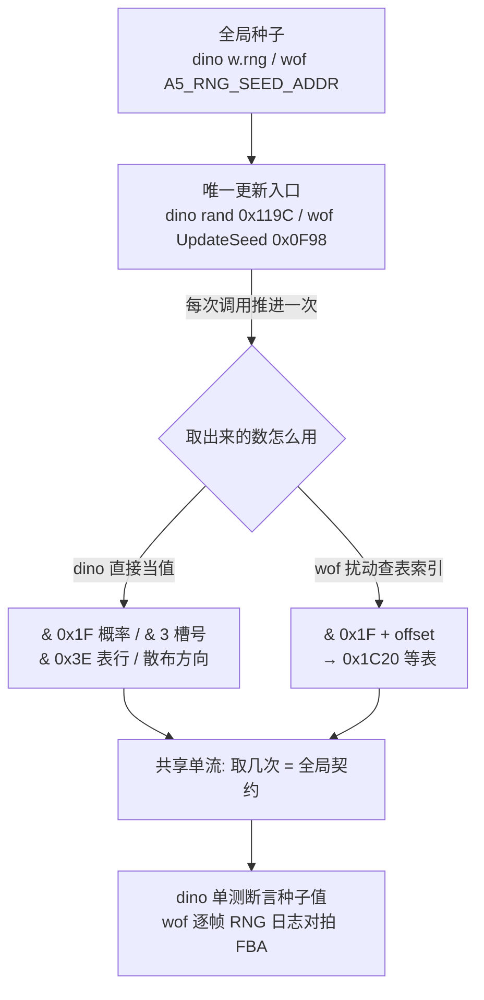

| 维度 | dino | wof |
|---|---|---|
| 种子载体 | `Game.w.rng: u16`（`mod.rs:162-163`） | WRAM `A5_RNG_SEED_ADDR`（`Cps1Rng.cs:35`） |
| 算法（§9.3 data） | `0x119C: x = x*3` + 低字节混合 | `0x1BFA: x = x*5 + 0x3711`，取低 / 高字节 |
| 唯一入口 | `rand()`（`mod.rs:280-287`） | `UpdateSeed` / `更新种子并取低字节_可能对应ASM_0F98`（`Cps1Rng.cs:41`） |
| 消费形态 | 返回值直接当值：`& 掩码` → 概率 / 槽号 / 表行 / 方向 | 低字节 `& 掩码 + offset` → 查 `0x1C20` 等表 |
| 分用系统 | rank / AI / Boss / 载具 / 特效 / 伤害（§17 / §25 / §33） | 随机伤害 / 难度 / 行为 / 倒计时表（§17 / §24.4 / §27） |
| 顺序敏感 | 注释 "call order matters" + `trace.rs:2860` 注入种子 | 统一 0F98 入口 + 逐帧 RNG 日志（宿主层按 §0 隔离） |
| 「取几次」的钉法 | 类型化字段 + 单测断言（`boss_common.rs:432-451`） | 有序事件流对拍 FBA（工程侧） |
| 怪癖还原 | 丢弃第一次抽样、连续取两次（`class13_attack.rs:214` / `car.rs:589`） | 偶地址取高字节、禁止复制公式（`Cps1Collision.cs:81-90`） |

### 51.7 "更成熟"落在哪（只谈设计本意，带收敛限定）

1. **随机也是逐帧字段**：dino 把 `w.rng` 做成 `Game` 的一个可注入、可断言、可 trace 的字段（`trace.rs:2860` / `effect.rs:1057`），于是"这一帧取了几次随机"和 §47 的"这一帧跑了哪些 pass"一样是可重放契约；这是把 §3 的"真值改语义字段"推到随机源上。
2. **"不取"被显式建模**：`boss_common.rs:91/98/211` 与遍历 128 个 seed 的单测，把"某个分支不能消耗一次 RNG"写成代码级约束——共享单流的代价被正面承认，而不是靠"概率上差不多"糊过去。按 §11.0 不据此断言 wof 缺等价约束，只登记 dino 侧把约束落在类型化单测、`Cps1Rng.cs` 把约束落在逐帧日志这一承载差异。
3. **取值 vs 取索引**：dino 让 `rand()` 返回值直接参与判定（概率、槽号、方向），wof 让它只扰动表索引。这与 §49「可切换盒表 vs 全局大表」同族；§46 原用的「一个 ID 散在多张表」已按 §94.11 / §94.12 收窄成「两边都是一招一行聚合参数表，wof 按攻击方分两张布局不同的表」，不再拿它当这条轴的论据。**只到 RNG 取值方式这一层**：dino 偏向"值在手里"，wof 偏向"值在表里"。两边都自洽，不评优劣。
4. **与既有节闭合**：§17 的两次 RNG、§25 的 aggression 重掷、§27 的 `0x1F5C` 倒计时、§33 的 `rng&3` 选目标、§24.4 的两张 RNG 计时表，本节给这些散点补上同一条"全局单流"底座。

### 51.8 未做（保留，不扩张）

- `0x119C` / `0x1BFA` 算法的逐指令推导、各概率表逐项字节（§9.3 已给 data，按 §11.0 不重复取证）；`0x1C20` 表全量值、难度 / 行为概率表逐条不展开。
- dino 全部 `rand()` 调用点逐系统普查（本节取 rank / AI / Boss / 载具 / 特效 / 伤害六类代表）；wof 全部 `0F98` 调用点、`WOF_TRACE_RNG_FILE` 日志格式逐条（宿主层按 §0 隔离）。
- 两游戏 RNG 周期 / 分布质量不做量化对比；「共享单流是否导致可预测性」不做玩法优劣判断。
- **ROM 核查未触发**：按用户 11-06 授权，仅 `wof_cs` 非常可疑时才查 ROM；本节 RNG 算法与查表在两份 repo 注释里自带逐指令与 `rom_read` 实证，故保持纯 repo 侧（§11.0 / §11.6）。§9.3 仅取其 data 行，不触碰已作废措辞（§11.4 / A.13）。
- 音频（随机音效）按 §0 边界外。

**结论**：§51 把散落在 §9.3 / §17 / §24.4 / §25 / §27 / §33 的随机源收成「一个全局单流」，给出「取值 vs 取索引」「取几次即契约」「不取也被建模」三条组织结论，并把 wof 宿主层的 RNG 诊断明确隔离在 §0 边界外；`长时间自主推进` 仍是开放目标，本节不宣称终止。

---

## 52. 摄像机：跟随谁、怎么钳制、与卷轴显示延迟的分工

> 触发：§23 讲 `VIDEO_LATENCY=2` 与 VBlank shadow 提交（**算出来之后几帧才显示**），§34 讲 `area` 与相机 `mode/sub` FSM（**区域切换时相机怎么被接管**），§28 讲 wof 相机 min/max 门闩，§44 讲屏幕钳制，§45 讲绘制队列，§47 把 `background_update` 记成 `objects_update` 倒数第二步——但**「相机 X 这个数本身怎么算出来、多人时跟谁、什么时候不许跟」**从未独立成节。§33 那句「外层人数决定难度 / 波次 / **相机档位**」正好在这里展开。
> 归属：设计正文（§0–§52），按"轮次线性追加"接在 §51 之后。纯 repo 侧，未新增 ROM 取证（§11.0）。
> 边界：§23 的显示延迟、§34 的区域切换 FSM、§45 的绘制排序本节只作接口引用，不重复展开。按用户 11-06 授权「ROM 主要为 data，仅 `wof_cs` 非常可疑时可查 ROM」：本节相机逻辑在两份 repo 注释里自带 ROM 逐指令、FBA 逐笔与 `rom_read` 实证，**未触发可疑条件**，故不查 ROM。wof 侧 `Cps1CameraRuntime.cs:15` 自述「第一关单玩家相机」，本笔记只登记 repo 呈现的这一形态，**不据此推断整个 wof 游戏没有其他关卡的多人相机逻辑**（§11.0 / `Cps1LidianFinaleRuntime` 类按既定边界不主动扩大）。

### 52.1 一句话

dino 把相机做成一个**带状态机与事件表的 `Scroll2` 控制器**：每帧取所有活跃玩家的世界 X 极值（`max_x60 / min_x64`），按**人数分档**的推屏阈值 `push50` 决定要不要推、限速 6px/帧，再被 `lock78` / 事件列表 / `go` 在波次与区域切换时整段接管；wof repo 侧呈现为**第一关单玩家相机**：用**上一帧相机 X** 算玩家世界边界，按 `+0x28` 的 state 跳表更新，并把 Scroll2 相机与 Scroll3 控制器拆成两个入口。两者共同点是相机 X 都是全局量、对象都靠「世界 X − 相机 X」算相对位置，且卷轴 shadow 的提交时机都是逐帧契约（§23 / §47）。

### 52.2 dino：跟随的是"全体玩家的包围盒"，不是某个玩家

`camera.rs:8-81` 的 `Scroll2`（结构在 G.$73C）把相机状态全摊开：`state/mode/sub` 三层、`cam_x/cam_y` 16.16、`w14/w16`（跟随前坐标 / mode 5 速度）、`area`（G.$786）、`vfollow`（垂直跟随开关）、`x4c/y4e` 事件 X/Y、`push50` 推屏阈值、`up52/down54` 垂直阈值、`x5a/y5c`（事件加载时的相机坐标）、`max_x60/min_x64/max_y62/min_y66` **玩家 extents**、`event_idx/go`、`lock78`。

`camera.rs:985-1018` 的推屏核心（伪代码，按原机 16 位回绕语义）：

```text
max_x60 = 所有活跃玩家世界 X 的最大值
min_x64 = 最小值（若 < 0 则夹到 0x10）
push50  = PUSH_BY_PLAYERS[min(玩家数, 2)]        # 推屏阈值按人数分档
lead    = max_x60 - cam_x                          # 最右玩家离相机右缘多远
if lead <= 0x40 或 lead < push50: 不推
spread  = max_x60 - min_x64                        # 玩家之间拉开的距离
if spread >= push50 - 0x10:                        # 拉太开 → 以最左者为基准回拉
    d = min_x64 - 0x10 - cam_x  (带符号)
else:
    d = min(lead - push50, 6)                     # 每帧最多推 6px
cam_x += d
if vfollow == 0: 跳过垂直跟随
```

- **"跟谁"的答案是包围盒**：`max_x60 / min_x64` 是所有活跃玩家的极值，多人时相机看的是「队伍最右 / 最左」，不是锁定 1P；`spread` 太大时改以最左玩家回拉，避免有人被甩出屏幕。这正是 §33「人数分档」在相机侧的落地，也和 §33 的 `census[[u8;4];3]` 每玩家计数同属"多人作为一层显式输入"。
- **"推多少"是限速的**：`min(lead - push50, 6)` 把跟随做成每帧有上限的平滑量，而不是瞬时对齐；`w14/w16` 存跟随前坐标供 mode 5（ chase / 速度积分）复用（`camera.rs:20-30`）。
- 玩家 extents 与 `vfollow` 都进逐帧 trace（`trace.rs:1614` / `trace.rs:1684-1686`），和 §3 / §47 / §51 一样是**可重放字段**，不是临时局部变量。
- 换人 tag 的伙伴跟随另有一条 `tag_follow`（`player_tag.rs:151`），单测用 `cam.s2.cam_x = 500` 钉死"Jack 在相机右 0xC0 外时朝向"（`player_tag.rs:473`）——§15 的 tag 挂接在相机侧也有对应。

### 52.3 dino：什么时候"不许跟"——锁、事件、区域

相机不是一直跟随，控制权会被三层显式接管，全部写在同一结构里：

- **锁 `lock78`**（`camera.rs:73-77`）：`0` 自由、`1` 波次 / 区域末锁定、`2` 关底或 Boss 战。 aggression 表 `0x182BA`、区域音乐 `0xA55A`、超时检查 `0x1042E`、提示 `0x7BBF4`、开场 `0xACAC` 都读并清它；多个 Boss init 每帧写 2。这是"同一字节被多方读、单一写入者"的又一处（§14 输入层 / §33 `who` 复用同族）。
- **事件列表**（`camera.rs:42-57`）：`next_event` 指向关卡事件记录，命中事件 X/Y 时把 `push50`（`:682`）、`vfollow`（`:688`）、`x5a/y5c` 整套换成事件给的值；`by_y79` 让事件改按 Y 触发并冻结 scroll3 视差。
- **`go` 与 `mode/sub` FSM**（§34 已展开）：锁事件 X → 等 `go` → 淡出 → 改 `area` → 装地图 / 调色板 → 淡入；`camera.rs:926 / 1110 / 1134 / 1249` 清 `go`，`:1148` 起按 mode 分派，`:1194 / :1210` 写 `lock78 = 2`，`:1234-1236` 在 `go` 有效时解锁。`camera_go`（`:1738`）是流程侧放行入口。
- 即：**自由期按包围盒跟随，事件期按脚本给的参数，Boss / 波次期直接锁死**——三种模式共用同一个 `Scroll2` 结构，靠 `mode` 与 `lock78` 切换，而不是三套相机代码。

### 52.4 wof：单玩家相机、上一帧 X、Scroll2/Scroll3 分离

- `Cps1CameraRuntime.cs:15` 开头自述范围「第一关单玩家相机、远景半速卷轴和 VBlank shadow 提交」；控制器基址 `0xFF7A8C`（`:18`，即全局相机 X `A5-0x574`，`Cps1Actor1BRuntime.cs:225` 等 Actor 用 `sub.w -$574(A5),D0` 把世界坐标换成相对相机坐标）。
- `更新Scroll2相机_对应ASM_19360`（`:51-82`）：先 `previousCameraX = rws(CAMERA_X_ADDR)`，再 `更新玩家世界边界_可能对应ASM_19364(previousCameraX)`；注释 `:62-69` 给出 ROM 顺序契约——**先用旧 limits 算玩家边界、再按 `+0x28` 的 state 跳表写新 limits**，宿主把顺序做反会造成 f=1619 起两字节持续差异；`:73-82` 的跳表是 `state 0 初始化 / 2 更新 / 4 空操作`。
- **Scroll2 与 Scroll3 必须拆**：`:28-50` 用 `xref_rom_bytes` 字节级统计——`jsr 0x19360` 有 20 个调用点、`jsr 0x19DAC` 只有 9 个，11 个点**只调 Scroll2 不调 Scroll3**；原 C# 把两者绑成一个函数属「宿主发明的配对」，已拆成纯 `0x19360` 与配对版 `更新第一关相机_可能对应ASM_19360_19DAC`（`:195-201`）。
- **卷轴 shadow 每帧一次且帧内时机有契约**（`:203-232`）：`0x5A8` 属 IRQ2，先于槽 5 任务体的 `SCROLL1_NEXT_Y := 0x0100`；FBA 逐笔实证 f=19 读到 0、f=20 才读到 0x0100。另有 `ObjectRenderCameraXShadow`（`A5-0x7CC8`，`:22-25`）作为**对象展开器专用的相机 X shadow**，独立于 CPS-A 的 Scroll1/2 shadow（`:269-275`）。
- 与 §28 的分工：关卡脚本侧的相机 min/max 门闩（`gateWaiting`）管"这一关能不能往前推进"，本节的 `0x19360` 管"这一帧相机 X 与玩家世界边界怎么算"。按 §11.0 不臆断 wof 缺多人相机 FSM，只登记 repo 呈现的单玩家形态与其 state 跳表。

### 52.5 与 §23 / §45 / §47 的分工（算 vs 显示 vs 调度）

| 环节 | 谁负责 | 本节位置 |
|---|---|---|
| 相机 X 怎么算 | `background_update`（`mod.rs:375`，`camera.rs:574`）里的 `Scroll2` 控制器 | §52.2 / §52.3 主体 |
| 算完几帧后才显示 | §23 `VIDEO_LATENCY=2` / `latch_scroll` / VBlank shadow（`camera.rs:144-152, 263`） | 只作下游接口引用 |
| 对象怎么按相机定位 | §45 全池 `(depth,handle)` 绘制、`ObjectRenderCameraXShadow`（wof） | 只作接口引用 |
| 在帧里第几步 | §47 `objects_update` 倒数第二步 `background_update` | 只作时序接口引用 |

即 §52 补的是链条最上游「**值从哪来**」，§23 是「**值几帧后生效**」，§45 是「**值怎么被消费**」，三者不重叠。

### 52.6 流程图与对照表

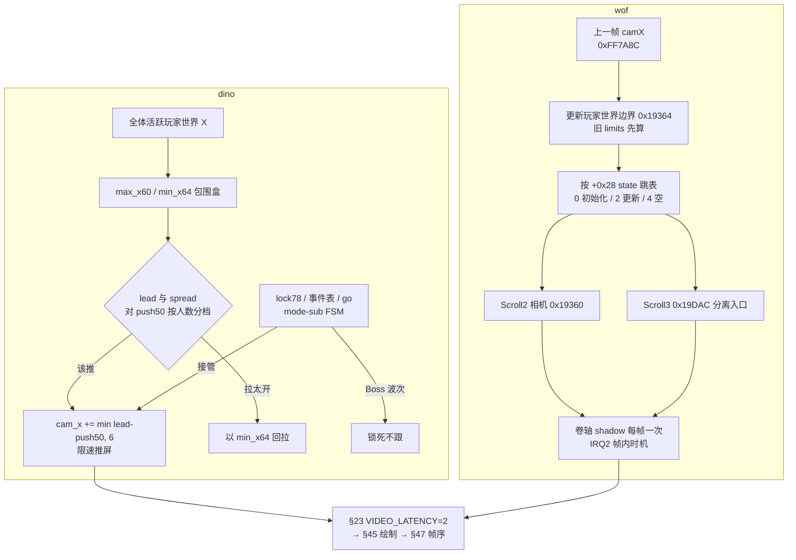

| 维度 | dino | wof（repo 呈现，第一关单玩家） |
|---|---|---|
| 载体 | `Scroll2` 控制器对象，`state/mode/sub` + 事件表（`camera.rs:8-81`） | 全局 `CAMERA_X_ADDR` + Scroll2 控制器 `0xFF7A8C`，按 `+0x28` state 跳表（`Cps1CameraRuntime.cs:18,73-82`） |
| 跟谁 | 全体活跃玩家 X 极值 `max_x60/min_x64`（`camera.rs:985-988`） | 单玩家世界边界，用**上一帧** camX 算（`:70-71`） |
| 推屏条件 | `lead` 与 `spread` 对 `push50 = PUSH_BY_PLAYERS[min(人数,2)]`（`:997-1006`） | 按 `+0x28` state 分派更新，旧 limits 先算边界（`:62-69`） |
| 限速 / 平滑 | `min(lead - push50, 6)` 每帧上限（`:1010`） | 远景半速卷轴、Scroll3 依「上一相机坐标 + ROM 速度表 + 0x40 边界」（`:198-199`） |
| 多人 | 人数分档 + 包围盒 + `spread` 回拉（§33 落地） | 本节不推断单玩家以外的形态（§11.0） |
| 被接管 | `lock78` 三态 / 事件覆写 `push50` / `go` + `mode-sub` FSM（`:682,688,1194`） | 关卡脚本相机 min/max 门闩（§28）、Boss / 区域流程（§30） |
| 分层 | Scroll2 / scroll3 在同一个 `background_update` 控制器里 | Scroll2 `0x19360` 与 Scroll3 `0x19DAC` **必须拆**（20 vs 9 调用点，`:28-50`） |
| 显示接口 | `latch_scroll` / `VIDEO_LATENCY`（§23） | 卷轴 shadow 每帧一次 + IRQ2 帧内时机 + 独立对象渲染相机 X shadow（`:203-232,22-25`） |

### 52.7 "更成熟"落在哪（只谈设计本意，带收敛限定）

1. **"跟谁"显式化**：dino 把多人跟随写成「包围盒 + 人数分档阈值 + 拉开回拉」而不是"锁定 1P、其他人自己别掉队"，配合 §33 的 census 与 §28 的同屏预算，把"多人"做成贯穿难度 / 波次 / 相机的一层输入。按 §11.0 不据此断言 wof 缺等价机制，只登记 dino 侧把这条规则写成可读字段与 trace。
2. **三种模式共用一个结构**：自由跟随 / 事件参数 / 锁死，全在 `Scroll2` 的 `mode` 与 `lock78` 上切换，没有三套相机代码；与 §32「载具是全局 `car_mode` + 各系统自查」、§14「输入三层覆写」是同一种"单一状态字节被多方读"的紧凑取向。
3. **相机值也是逐帧字段**：`cam_x` 16.16、`w14` 跟随前坐标、玩家 extents 全部进 trace（`trace.rs:1614,1684-1686`），于是 §23 的显示延迟才能被精确建模成"第几帧的哪个值"；这与 §47 固定调度链、§51 RNG 种子是同一条"把全局状态做成可重放字段"的主线。
4. **wof 侧的强项是帧内时机契约**：`Cps1CameraRuntime.cs` 把「旧 limits 先算」「Scroll2/Scroll3 拆分」「IRQ2 先于槽 5」「shadow 每帧一次且只在帧首提交」都写成带 FBA 逐笔实证的顺序约束——按 §11.0 只陈述这份 repo 呈现的工程精度，不评两边优劣、不臆断 dino 缺等价时序。

### 52.8 未做（保留，不扩张）

- `PUSH_BY_PLAYERS` 三档具体数值、`mode/sub` 全部状态逐条（§34 已展开 FSM，不重复）、`up52/down54` 垂直跟随阈值逐项；`camera.rs:1148-1236` 的 mode 分派逐分支不展开。
- wof `Cps1LidianFinaleRuntime` 的分拆调用、`Cps1StageTileStreamer.更新Scroll3控制器状态02` 逐指令、`Cps1TerrainCollision` 的屏幕钳制全量（§44 已记）；`0x193A0` 跳表三态以外的 state 不追。
- 两游戏相机 X 与 `VIDEO_LATENCY` 的逐帧数值对拍（§23 / A.8 已有 dump 点闭合）；host 层 `_无对应ASM` 相机去重键按 §0 隔离。
- **ROM 核查未触发**：按用户 11-06 授权，仅 `wof_cs` 非常可疑时才查 ROM；本节相机逻辑在两份 repo 注释里自带 ROM 逐指令、`xref_rom_bytes`、FBA 逐笔与 `rom_read` 实证，故保持纯 repo 侧（§11.0 / §11.6）。
- 音频（相机移动音）按 §0 边界外；「两游戏谁推得更平滑」不做手感优劣判断。

**结论**：§52 把 §33 那句「人数决定相机档位」展开成 `Scroll2` 的包围盒跟随 + 人数分档 + 限速推屏，并给出「自由 / 事件 / 锁死三种模式共用一个结构」「相机值也是逐帧字段」两条组织结论；wof 侧收敛为 repo 呈现的单玩家相机、上一帧 X 算边界、Scroll2/Scroll3 分离与帧内 shadow 时机契约，不臆断其缺多人 FSM；`长时间自主推进` 仍是开放目标，本节不宣称终止。

---

## 53. 动画帧状态机：一帧记录怎么推进、怎么把「播完了」交给状态机

> 边界：纯 repo 侧，未新增 ROM 取证（§11.0 / §11.6）。本节只谈「动作时序怎么组织」，不谈 Rust/C#、typed struct / WRAM 字节映像、端序这类实现表相。wof 侧的 ROM 逐指令与 FBA 实证都是两份 repo 注释里自带的证据，不是本轮新查 ROM；按用户 11-06 授权，未触发「`wof_cs` 非常可疑」条件。wof 侧结论只登记 repo 呈现的组织方式，**不臆断其缺循环 / 缺完成事件 / 缺输入改速**（§11.0）。宿主层 `WofDiag` / `CPS1_TRACE_*` / `_无对应ASM` 诊断按 §0 隔离。

### 53.1 一句话

两边都是**「动画 = 一串帧记录 + 每帧一个倒计时」**：状态机选一段动画开始，推进器每帧只做「计时减一，到点换下一帧并整包重载该帧的语义字段」，判定盒、时长、状态参数都随换帧一起换（§49.2 已点明这一层）。差别在**「循环 / 播完」这件事写在哪里、以及怎么通知状态机**：dino 把时长、下一帧、终止位全编进 frame record，推进器返回一个「播完了」事件；wof 把时长与跳转标志编进序列表项，换帧时把一整个状态字写进对象头，由状态机读状态位 / 空指针 / 计时门自己判断——并因此长出主推进器、第二推进器、无计时门强制装载口等多个入口。

### 53.2 共同底座：一帧不是一张图，是一条带时长的记录

frame record 里除了「画哪个 sprite」，还同时装着这一帧的**全部语义**：

- dino `Frame`（`sprites.rs:53`）：`duration`（+7 低 7 位，`0` 表示 256）、`last`（+7 bit7）、`next`、`param_a/param_b/kind`、`body_box/attack_box`、`attach`（12 字节记录才有）、`extra`。
- wof 序列表项（`Cps1Subs.cs:389`）：每项 10 字节 `sprite 指针(4) / stat long(4) / dur(2)`；换帧时 stat long 整字写进对象头 `+0x30`（AniStatCD），dur 写进 `+0x34`（AniLeft）。

→ **换帧 = 一次性替换「这一帧的画面 + 盒 + 状态位 + 时长」**。§49 的盒 ID、§46 的攻击记录索引、§39 的 combo cancel 窗（`param_a`）都靠这一层逐帧生效，招式代码里没有 `if (frame==3)` 开盒。动画表（`sprites.rs:82` 的 `AnimTable` / wof 的序列地址 A4）只是「从哪一帧开始」的入口。

### 53.3 dino：记录自带链接，完成以返回值上报

`load_frame`（`body.rs:195`）把记录各字段拷进对象头，`set_frame` 顺带递增换帧计数；`tick_anim`（`body.rs:215`）就是全部推进逻辑：

```text
timer -= 1
if timer != 0: return false        # 这一帧还没播完
f = frame(current)
load_frame(f.next)                 # 换帧：新 timer / 新盒 / 新 param 一起装入
return f.last                      # 68000 carry：状态代码读作「动画播完」
```

- `start_anim(id)`（`body.rs:227`）从 `AnimTable.anims[id]` 取首帧；玩家版 `start_player_anim`（`body.rs:233`）按 `player_sets[set][ch&3]` 分表 → 接上 §31「角色差异化是数据维」。
- **循环 / 跳段编在数据里**：`next` 指回自身即循环，`last` 置位即结束并上报；推进器不查表、不认状态，只按数据走。
- 状态机与动画层的接口很窄：`start_anim(id)` 进入 + 读 `tick_anim()` 的 bool 迁移；另有大量 class handler 直接写 `e.b.timer = 1`（如 `class10_ai.rs:355`）强制「下一帧立刻结束」，`fx19.rs:42` 的搓招甚至 `timer -= 3` 让输入改动画速度——这是 §39 连击 / §27 搓招的底层。特效侧还有独立推进器（`effect.rs:250`）与第二条帧序列 `frame2`（`body.rs:188`），一个对象可挂多套帧序列。

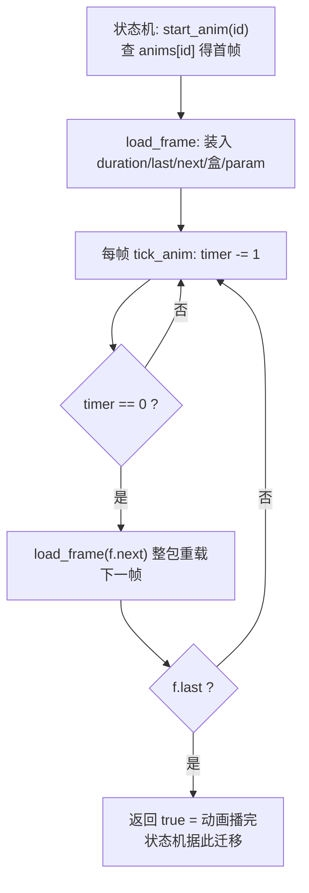

### 53.4 wof：序列表项 + 计时门 + 随帧写入的状态字

- `动画推进_对应ASM_2470`（`Cps1Subs.cs:415`）：`AniLeft(+0x34) -= 1`，`>0` 直接返回不装载；到 0 才 `加载动画帧_247C(ref Obj, next)`。这个计时门是硬契约——repo 注释（`Cps1Subs.cs:340`）记录漏掉它会每帧重装载、把 `+0x32` 写成负值、让状态机提前迁移 15 帧。
- `加载动画帧_任意A4_对应ASM_247C`（`Cps1Subs.cs:449`）：A4 指向帧序列，逐项读 `sprite → +0x30(AniStatCD) → dur → AniLeft → AniNext`，同时从 `sprite-2 / sprite-6` 装盒 ID（§49）。
- **负 dur（bit15）编码跳转**：`andi.w #$7fff,d1` 去符号后 `movea.l (a4),a4` 从当前项取链接目标覆写 AniNext（`Cps1Subs.cs:358` / `Cps1Subs.cs:923`）；`dur=0x7FFF` 项（`Cps1Subs.cs:394`）就是「这段播完跳走」。这与 dino 的 `last + next` 是同一件事的两种编码，**不臆断 wof 缺循环或跳转**。
- **「播完 / 该动作了」不靠单一返回值**：状态机读 `AniNext==0` 早退、`tst.w $32(a0)` 判 AniStatCD 低 word、`AniStatA & 0x80` 门（`Cps1Subs.cs:962`），满足才 `分发动画回调特效_251A`（`Cps1Subs.cs:979`）——即**帧数据里的状态位直接触发动作回调**。
- 多个入口并存：`0x2470`（带计时门，主）、`强制加载动画帧_对应ASM_2478`（`Cps1Subs.cs:405`，跳过计时门直接装载，「播完动画」循环用）、`加载动画帧_任意A4_对应ASM_247C`（调用者自带 A4，如剑的抛出弧线 `Cps1Subs.cs:441`）；另有**第二动画推进器** `SUB_257E`（`Cps1Subs.cs:927`，同构但走 `+0x5C/+0x54` 另一组字段）与 `SUB_24BE`（`Cps1Subs.cs:950`）。class runtime 里则是海量 `加载动画帧_任意A4_对应ASM_247C(ref obj, ANI_xxx)` 调用点（如 `Cps1Actor12Runtime.cs:235`），状态机每个分支直接给序列地址。

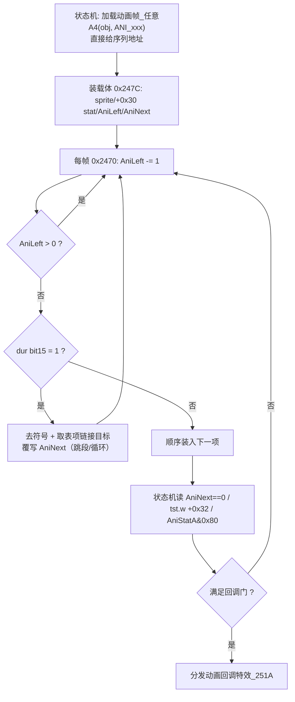

### 53.5 对照表

| 维度 | dino | wof（repo 呈现） |
|---|---|---|
| 一帧数据 | frame record 10/12 字节，自带 `duration/last/next/盒/param/attach` | 序列表项 10 字节：`sprite / stat long / dur` |
| 计时 | 对象头 `timer`，`tick_anim` 每帧 -1 | 对象头 `AniLeft(+0x34)`，`0x2470` 每帧 -1 + `bgt` 门 |
| 循环 / 跳段 | `last` 位 + `next` 指回或指别段（数据自带链接） | `dur` bit15 负标志 → 去符号 + 取表项链接目标覆写 `AniNext` |
| 「播完 / 该动作」信号 | 推进器返回 bool（carry），状态机读事件 | `AniNext==0` / `tst.w +0x32` / `AniStatA&0x80` 多入口轮询 + `251A` 回调 |
| 动画入口 | `start_anim(id)` 查 `anims[id]`；玩家按 `player_sets[set][ch&3]` 分表 | 状态机直接传序列地址 A4（海量调用点） |
| 帧数据驱动状态 | `param_a/param_b/kind` 随帧装入对象头供状态机读 | `AniStatCD/AniStat32` 随帧写入 `+0x30`，状态机以状态位为判据 |
| 多套帧序列 | 主体 `frame` + `frame2` + effect 独立 loader | 主推进器 `0x2470` + 第二推进器 `SUB_257E` + `SUB_24BE` |
| 立即结束 / 改速 | 写 `b.timer=1`；搓招 `timer-=3`（`fx19.rs:42`） | `强制加载动画帧_2478` 跳过计时门 |

### 53.6 与既有章节的关系

- §49：盒 ID 是 frame record 的两个字节；本节补上「换帧」这个动作本身——§49 讲盒在哪，§53 讲盒何时被换。
- §46 / §48：一次攻击的数据表示与判定窗口，都建立在「起手 / 判定 / 收招由动画推进换记录」之上。
- §39 / §27：combo cancel 窗即 `param_a`，搓招改速即 `timer-=3`。
- §31：玩家动画按 `player_sets[set][ch&3]` 分表，是「角色差异化是数据维」的又一实例。
- §36 / §20.6：`timer`、`AniLeft` 都是「这一帧写、下一帧读」的字段。
- §47：动画推进跑在 `objects_update` 的各池 update 里，是完整一帧调度链的一环。

### 53.7 "更成熟"落在哪（只谈设计本意，带收敛限定）

dino 把「动作时序」更彻底地下沉到数据表：循环 / 终止 / 下一帧全在记录里，推进器是无状态的一条 `timer` 递减 + 一次重载，状态机只需选 id 与读一个 bool 事件；wof 的时序则与状态字纠缠更深——换帧顺带写 `+0x30`，状态机用状态位、空指针、计时门多重判据自己判断「播完没 / 该不该回调」，并因此需要主 / 副 / 强制装载多个入口。这是**两种组织方式**：一个把「播完」做成显式事件，一个把它做成帧数据里的状态位查询；不据此断言 wof 缺循环、缺完成事件或缺输入改速（§11.0），也不做设计优劣判断。

### 53.8 未做（保留，不扩张）

- 音频 / 帧事件音效按 §0 边界外。
- wof 第二推进器 `SUB_257E` 具体服务哪类附属动画、`0x251A` 回调特效的完整清单，不在本节展开；repo 已有命名与逐段还原，按 §11.0 不主动扩大。
- `Cps1ActorNNRuntime.cs` 全量 `加载动画帧` 调用点分类、玩家动画 `characterTable`（`Cps1Subs.cs:717`）逐项对照，保留不扩张。
- 两游戏发行先后未考证；ROM 主要为 data，本节未触发「`wof_cs` 非常可疑」条件，**0 次新增 ROM 取证**（§11.6）。

**结论**：§53 把 §49.2 所指的「动画记录自带时长与盒」这一层展开成完整帧状态机，给出「循环 / 播完」两种编码与「事件上报 vs 状态位查询」两种通知方式，并串起 §46 / §48 / §49 / §39 / §31 的上游依赖；wof 侧收敛为 repo 呈现的序列表项 + 计时门 + 状态位回调 + 多入口，不臆断其缺循环或完成事件；`长时间自主推进` 仍是开放目标，本节不宣称终止。

---

