# 卷 04：状态、时间与全局资源（§54–§67）

> 由 `DESIGN_DIFF_NOTES.md` 按 `^## ` 标题块原样拆出，块内逐行未改，卷内保持原文件出现顺序。
> 总入口、`§N → 卷` 反查表与阅读顺序见 `../DESIGN_DIFF_NOTES.md`。
> 本卷涵盖：§54–§67。附录 A 全部在 `07-appendix-a.md`。

---

## 54. 对象间引用与归属：一个 handle 怎么指向另一个对象

> 边界：纯 repo 侧，未新增 ROM 取证（§11.0 / §11.6）。本节只谈「对象之间怎么互相指向、身份怎么在状态机之间传递」，不谈 Rust/C#、typed struct / WRAM 字节映像、端序这类实现表相。wof 侧 `Cps1Collision.cs` 里的 ROM 逐指令与 FBA 实证是 repo 注释自带的证据，不是本轮新查 ROM；按用户 11-06 授权，未触发「`wof_cs` 非常可疑」条件。wof 侧的记分归属与抓取关系按 §33.6 / §11.0 保留、不臆断其缺失；两边 `+$62` 同名不同义只登记、不评优劣。

### 54.1 一句话

两边都**不做「中央对象注册表 / ID → 指针表」**，而是把「对方」直接写进自己的对象头：引用是**分布式、成对、跨帧持有**的。差别在**引用的形态**：dino 把它拆成一族语义各异的小字段（`who` 记分归属、`attacker` 上次攻击者 handle、`partner` 抓取伙伴 handle、`serial` 挥击号、`attach` 附着点），wof 收敛成一对**对象地址** `HitObj1` / `HitMeObj` 双向互写，外加一个 `+0x79` 相位字节区分「是不是同一挥击」。

### 54.2 共同底座：引用住在对象头，命中帧写、下一帧读

- 命中 / 抓取发生的那一帧，双方各自把「对方」写进自己对象头；这两个字段**不随帧末列表清理而清空**——§48 的 `combat_lists_reset` 清的是候选列表，对象头里的引用继续留到下一次被覆写，属于 §36 的「这一帧写、下一帧读」。
- 引用的消费者不是中央管理器，而是下一次碰撞 pass（去重，§48）、HUD（记分，§38）、绘制排序（§45）、抓取状态机（§24）各自去读对方对象头。
- 因此「地址即身份」（§50）在这里是前提：存一个 handle / 地址就等于存了可直接解引用的身份，不需要再查表。

### 54.3 dino：引用按语义拆成一族字段

`Body`（`body.rs:22`）里与「指向别的对象 / 归属」相关的字段：

| 字段 | 偏移 | 语义 | 消费者 |
|---|---|---|---|
| `who` | `+$02` | 玩家：index 0..2；敌人：**记分归哪个玩家**（负值 = 无人）（`body.rs:29`） | `hud.rs:401` 按它入 HUD ring（§38）、`script.rs:224` 当 `1<<who` 位图（§33）、`car.rs:80` 载具继承 |
| `attacker` | `+$68` | 上次攻击者的 **handle**（`body.rs:122`） | 受击反应 / 反击（§29） |
| `partner` | `+$70` | 抓取伙伴（holder 或 held 的 handle，`body.rs:128`） | 投技联合状态机（§24）、`car.rs:85` 的 killer |
| `b62` | `+$62` | 抓取对的**绘制定序开关**（`body.rs:116`） | `0x14114` 局部排序（§45） |
| `b72` | `+$72` | 允许被抓的持握时长（`body.rs:130`） | 挣扎 / 投掷（§24） |
| `serial` | `+$5E` | 本次挥击号（`body.rs:112`） | 命中去重（§48） |
| `attach` | `+$60` | 帧记录给的附着点（`body.rs:114`） | 武器 / 挂载物随帧定位（§53） |

- **最关键的一处证据**：`prop.rs:767` 的单测把 `(state, serial, who, attacker)` 并列断言，其中 `who=0` 而 `attacker=Game::player_handle(0)`——**「记分归属的小整数」与「攻击者对象引用」是两个独立字段**，不是同一个东西。§38 讲的 HUD 归属走 `who`，§48 讲的去重走 `serial`，互不混用。
- 这些字段全部进逐帧 trace（`trace.rs:302` 的 `who`、`trace.rs:374` 的 `partner`），所以引用也是「可逐帧对拍的语义字段」，与 §0 的真值口径一致。
- `who` 还能被写成 `0xFF`（`car.rs:852`）表示「无人归属」，与 §43 的 `kill_all` 不记分是同一种「归属置空」手法。

### 54.4 wof：一对地址 + 一个相位字节

`Cps1Types.cs` 里与引用直接相关的字段：`HitObj1`（`+0x68`，`Cps1Types.cs:304`）、`HitMeObj`（`+0x6A`，`Cps1Types.cs:305`），以及 `+0x79` 的攻击者相位。命中帧是**成对双向写**：

```text
# 命中成立，一次写两边（Cps1Collision.cs:1337-1338，多处同构 :1650 / :1709 / :4365 / :4556）
target.HitMeObj = attacker.Addr68K     # 被击者记「谁打了我」
attacker.HitObj1 = target.Addr68K      # 攻击者记「我打了谁」
target.+0x79    = attacker.AniStatA    # 顺带存攻击者相位（:1345）
```

- `Cps1Collision.cs:4579` 的去重门读的正是 `HitMeObj`：先比地址是否同一个攻击者，再用 `(player.+0x79 ^ attacker.AniStatA) & 0x20` 判相位翻转才算「新一挥击」（§48）。
- 于是 wof 把「对方是谁」和「是不是同一击」**合在地址对 + 相位字节**里；dino 则把「谁打我」放在 `attacker`、「哪一次」放在 `serial`（§48）。两种编码，同一目的。
- **同名不同义登记**：wof 的 `+0x62` 是 `ShakeLeft`（`Cps1Types.cs:298`，§37 的硬直 / 闪白门），**不是** dino `+$62` 的抓取绘制定序；本节只登记这一差异，不据此断言 wof 缺绘制定序（§11.0），也不做优劣判断。

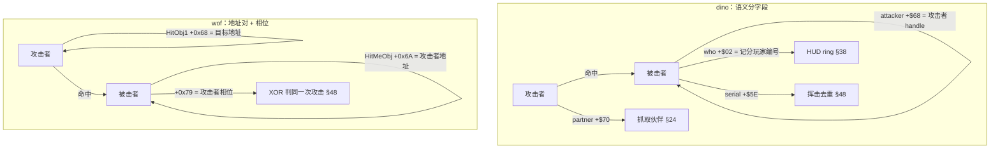

### 54.5 对照表

| 维度 | dino | wof（repo 呈现） |
|---|---|---|
| 引用形态 | 语义分字段：`who` / `attacker` / `partner` / `serial` / `attach` / `b62` | 一对地址：`HitObj1`(+0x68) / `HitMeObj`(+0x6A) 双向互写 + `+0x79` 相位 |
| 身份粒度 | handle（地址即身份，§50）用于对象引用；小整数（who / serial）用于归属与去重 | 一律对象地址（16 位 `Addr68K`），另加相位字节区分同一挥击 |
| 「谁打我」与「哪一次」 | 拆成 `attacker` 与 `serial` 两字段 | 合在 `HitMeObj` 地址 + `+0x79` 相位（§48） |
| 记分归属 | `who` 独立字段，HUD 按它入 ring（§38） | 按 §33.6 保留、不臆断 |
| 抓取关系 | `partner` 双向 handle + `+$62` 绘制定序 + `+$72` 持握时长（§24 / §45） | 本节未展开，按 §0 / §11.0 保留 |
| 引用生命周期 | 命中帧写、跨帧持有、列表清但对象头引用不随清（§36 / §48） | 命中帧成对写、下一帧被新命中覆盖，相位 XOR 判新一击（§48） |

### 54.6 这一族字段把哪些既有章节串起来

§48 的去重（`serial` / `HitMeObj`+相位）、§38 的记分归属（`who` → HUD ring）、§24 的投技联合状态机（`partner` / `b72`）、§45 的抓取对绘制定序（`+$62`）、§29 的受击反应（`attacker`）、§50 的地址即身份、§36 的跨帧字段、§53 的 `attach` 随帧重载——都是「把对方写进自己对象头」这一条的实例化。§54 是把它们收拢到同一条设计主线下，不新增机制。

### 54.7 "更成熟"落在哪（只谈设计本意，带收敛限定）

dino 把「引用」按用途拆成多个窄字段，每个字段只服务一个消费者，归属（`who`）、去重（`serial`）、抓取（`partner`）互不干扰且都能单独进 trace；wof 用两个地址字段承担大部分关系，靠相位字节补「同一击」的区分。这是**两种组织方式**：一个偏「语义分字段、各管一事」，一个偏「地址对复用 + 附加字节」；不据此断言 wof 缺记分归属、缺抓取引用或缺绘制定序（§33.6 / §11.0），也不做设计优劣判断。

### 54.8 未做（保留，不扩张）

- wof 的击杀归属与玩家间碰撞按 §33.6 保留；抓取伙伴在 wof 侧如何表示，repo 已有命名但本节不展开。
- `HitObj1` / `HitMeObj` 在各类对象池里的逐路径写入清单、`+0x79` 的全部写入点，按 §11.0 不主动扩大。
- 音频 / 服务菜单按 §0 边界外；两游戏发行先后未考证。
- ROM 主要为 data，本节未触发「`wof_cs` 非常可疑」条件，**0 次新增 ROM 取证**（§11.6）。

**结论**：§54 把散在 §24 / §29 / §36 / §38 / §45 / §48 / §50 / §53 的「对象怎么互相指向」收成一条主线，给出 dino 语义分字段与 wof 地址对 + 相位两种编码的对照，并明确「记分归属」与「攻击者引用」在 dino 是两个独立字段；wof 侧收敛为 repo 呈现的地址对与相位门，按 §33.6 / §11.0 不臆断缺失；`长时间自主推进` 仍是开放目标，本节不宣称终止。

---

## 55. 续关这一个动作，动了哪些全局状态

> 边界：纯 repo 侧，未新增 ROM 取证（§11.0 / §11.6）。本节**不展开 `flow_*` 各 mode 全文**——§30.7 已把它与 `0x42C2` 后续链、`A5+0x188` 全部消费点、wof 续关与结局路径一起明列为「保留、不扩张」，本节维持该边界，只把 `flow/cont.rs` 里**续关对其他系统的契约**抽成横切面，作为 §51 / §25 / §28 / §30 / §41 / §52 的下游补证。wof 侧按 §30.7 / §11.0 保留、不臆断其续关路径；音效 `snd_request` 按 §0 隔离。只谈游戏逻辑本意，不谈 Rust/C#、typed/WRAM、端序这类实现表相。

### 55.1 一句话

续关**不是「重开一局」**，而是一个「只改少数全局状态、刻意保留其余状态」的动作：dino 在 `flow_continue_player` 里明写 `0x4DE8 preserves hero, score and RNG`，并刻意**不重置对象、不取 RNG**（`cont.rs:82`、`cont.rs:92`）——这是 §51「不取 RNG 也是跨系统帧契约」在整局流程层的又一实例；它只补 HP / lives / 状态字 / 倒计时，再给 `wave_timer += 600`（§28）与 `rank_add_time(0x400)` / `rank_speed_add(-2)`（§25）作为时间补偿。

### 55.2 投币门：进续关要过几道

`flow_continue_player`（`cont.rs:28`）一帧里依次判：

- 输入边沿照 §14 算：`p.prev = p.held; p.held = input[i]; p.pressed = held & !prev`（`cont.rs:37`）。
- `join[i].seconds <= 18` 且按攻击键 `pressed & 0x30` → `frames = 60; seconds--`（`cont.rs:40`）：**玩家按键可以加速倒计时**，这是 §41 join 状态机的同一套记录。
- `seconds < 0` → `flow_join_clear` + `name_qualify`（`cont.rs:47`），进排名资格而不是继续等。
- 然后才是投币门（`cont.rs:59`）：`!free_play && credits == 0`、`b4d7 != 0`（最终关 / DIP 禁续关）、`starts`（必须有 start 按键边沿）、region 的分槽攻击键快捷投币；credits 扣减**在 free play 也执行、饱和到 0**（`cont.rs:73`），`flow.started |= 1 << i` 记谁续了关。
- 四态分派在 `flow_continue_mode`（`cont.rs:154`）里按 `flow.sub` 走 `0 setup / 2 countdown / 4 game_over / 6 return`——补的是 §30 那张 `flow.mode` 8 态图**内部的 sub 层**，不是重写 §30.7 保留的 mode 全文。

### 55.3 「保留什么」才是设计本意

| 类别 | 续关时的处理 | 位置 | 呼应 |
|---|---|---|---|
| **保留** | 英雄身份、分数、**RNG 种子**、角色对象本体（不重置、不取 RNG） | `cont.rs:82`、`:92` | §51 不取 RNG 也是契约；§50 对象不被回收 |
| **重置** | 状态字 `0x0002_0000`、`hp / hp_prev / hp_bar = 100`、`facing = 1`、lives、`w80 = 0`、join 倒计时 | `cont.rs:83`–`:99` | §29 受击恢复的初值；§14 输入边沿 |
| **时间补偿** | `wave_timer += 600`；`rank_add_time(0x400)`（4:00 BCD 时间） | `cont.rs:104` | §28 波次计时；§25 rank 时间驱动 |
| **难度补偿** | `rank_speed_add(-2)`（续关降速度档） | `cont.rs:91` | §25 `rank_event_*` 把续关当降档事件 |
| **投币 / 归属** | credits 饱和扣减、`flow.started` 位图、`flow_join_scores` | `cont.rs:73`、`:81`、`:90` | §26 / §40 分数与奖命归属；§33 玩家位图 |

- 最值得单列的是 `cont.rs:92` 的注释：续关走的是**「without the ordinary join's object reset or RNG call」**——普通中途加入会重置对象并取 RNG，续关刻意两者都不做。同一份 `flow.join[i]` 记录状态机（§41）被两种入口复用，差别就在这一行。于是「取几次 RNG」和「不取」在整局流程层同样是可逐帧对拍的契约，与 §51 的结论一致。

### 55.4 HUD 倒计时：什么时候**不走**

`flow_continue_hud_tick`（`cont.rs:110`）开头三选一直接 return：

```text
if scripted != 0 或 HUD hold(b4d5) != 0 或 flow.mode > 0x0C:
    return                      # 倒计时整段暂停
frames -= 1
if frames != 0: return
frames = 60                     # 60 帧 = 1 秒
if seconds >= 0: seconds -= 1; 重绘大数字
if front.sys.hold != 0:
    seconds = 21; frames = 1    # HUD hold 把倒计时拨回起点
```

- 过场脚本接管、HUD 冻结、或已经不在 `ingame` 态时，**倒计时不推进**——与 §25 的 rank `freeze` 门、§28 的「场上太满连倒计时都不走」是同一类「全局时间门」。
- `flow_continue_setup`（`cont.rs:213`）给每个 `join[i]` 设 `seconds = 20; frames = 100`；`flow_continue_countdown`（`cont.rs:294`）另有一套闪烁 / 数字重绘 / 提前响应按键边沿（`cont.rs:318`），但这些属于显示层，按本节边界不展开。

### 55.5 显示上下文另存与四态

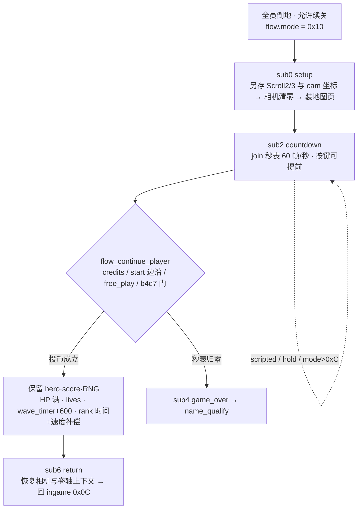

- setup 把 `Scroll2` / `Scroll3` 控制器与四个相机坐标另存进 `flow.cont`（`cont.rs:214`），再把相机清零、装新页（`cont.rs:225`–`:232`）；return 态再恢复——呼应 §52 的 `Scroll2` 结构与 §34 的区域切换「先存上下文再换场」。
- `b4d7`（禁续关，最终关 / DIP）时 setup 跳过 digits / bubble / taunt 文本（`cont.rs:243`），与 §30 的「最终关禁续关 + 结局标志」是同一个字节在两层生效。

### 55.6 与既有章节的关系

§30 的 `flow.mode` 8 态图给的是「整局走到哪」，本节给的是「续关这一下改了哪些全局状态」：`sub` 四态是它的内部，投币 / 保留 / 补偿是它的横切面。§51（不取 RNG）、§25（rank 降速 + 加时间）、§28（`wave_timer`）、§41（join 记录状态机复用）、§52（相机结构另存）、§34（换场上下文）、§36（跨帧字段）、§26 / §40（分数归属）都在这里有一个具体消费者。本节不新增机制。

### 55.7 这一节补了什么（带收敛限定）

把「续关」从 §30 的一个状态节点，还原成一张**跨系统契约清单**：哪些全局状态被刻意保留（尤其 RNG 与对象不重置）、哪些被补偿（波次时间 / rank 时间 / 难度速度）、哪些门会让倒计时整段停住。这是「整局流程不是孤立状态机、而是若干全局计数器的协调动作」的一个实例；**不据此断言 wof 缺续关或续关契约不同**（§30.7 / §11.0 明列保留），也不做设计优劣判断。

### 55.8 未做（保留，不扩张）

- `flow_*` 各 mode 全文、`0x42C2` 后续链、`A5+0x188` 全部消费点、**wof 续关与结局路径**：按 §30.7 保留，不展开、不臆断。
- `flow_continue_countdown` / `flow_continue_game_over` / `flow_continue_return` 的显示层逐帧细节、`name_qualify` 排名表、Episode 3 保存与 row scroll 标志，按 §11.0 不主动扩大。
- 音效 `snd_request` 按 §0 边界外；两游戏发行先后未考证。
- ROM 主要为 data，本节未触发「`wof_cs` 非常可疑」条件，**0 次新增 ROM 取证**（§11.6）。

**结论**：§55 把续关还原成「保留 hero / score / RNG、不取 RNG，只重置 HP 与倒计时，并给 `wave_timer` / rank 时间 / 难度速度做补偿」的跨系统动作，补上 §51 在整局流程层的「不取 RNG」实例与 §28 / §25 的时间补偿下游，同时明确 §30.7 的保留边界不被打破；wof 侧按 §30.7 / §11.0 保留、不臆断；`长时间自主推进` 仍是开放目标，本节不宣称终止。

---

## 56. 调色板与淡入淡出：显示状态怎么跟着游戏状态走

> 边界：纯 repo 侧，未新增 ROM 取证（§11.0 / §11.6）。本节只谈「显示状态怎么被游戏逻辑排队、查表、延迟生效」，不把 Rust/C#、typed struct / WRAM 字节映像、端序这类实现表相当作设计结论。wof 侧只登记 repo 呈现的组织方式，**不臆断其缺全屏淡入淡出**（§11.0）；宿主层 `_无对应ASM` / 诊断日志按 §0 隔离。音频按 §0 边界外。

### 56.1 一句话

两边都把**调色板当数据表**：按关卡 / 区域 / 对象查表装入，且改动都**延迟一帧才上屏**（§23 / §36）。差别在「淡入淡出」被放在哪一层：dino 把它做成**顶层任务机里的一个异步任务**——`Fade` 控制块（G.$44A）+ task slot 0x40 的 `FadeTask{fade_in, sleep, started}`，16 步、步间可 sleep、跑完把 `mask` 清零供调用者轮询；wof repo 侧呈现的是**对象级调色板配置**（每个敌人按 profile 表查 `+0x17` → `+0x5F`）与**对象出场淡出**（`ActStatA=0x04 → 0x42DE`，§43），不是全屏 fade 任务。

### 56.2 共同底座：调色板是数据，改动延迟一帧生效

- dino `PaletteRam`（`vram.rs:62`）是 4 个 bank（OBJ / scroll1 / scroll2 / scroll3）× 32 调色板 × 16 色；`vram.rs:67` 明写「屏幕显示的是**上一帧**的调色板，视频硬件在 VBlank 才把调色板内存拷过去」，并有单测 `the_screen_shows_the_palette_one_frame_late`（`vram.rs:123`）；`mod.rs:345` 的 `pal.latch()` 就是这一个延迟提交点。
- 这与 §23 的 `VIDEO_LATENCY` / VBlank shadow、§36 的「这一帧写、下一帧读」是同一条规律：**游戏逻辑写一帧、显示硬件下一帧才读**，所以「换调色板」不是瞬时动作，而是一个可被逐帧对拍的状态。
- wof 侧同样把卷轴 / 调色板类改动挂在 VBlank shadow 时机（§23 / §52），repo 注释里自带 ROM 逐指令与 FBA 实证；本节不新增 ROM 取证。

### 56.3 dino：Fade 是顶层任务机里的一个异步任务

`Fade` 控制块（`palette.rs:8`，G.$44A）：

| 字段 | 语义 |
|---|---|
| `mask`（+0） | bank 掩码：bit0 OBJ / bit1 scroll1 / bit2 scroll2 / bit3 scroll3；**`0` = idle，调用者轮询它** |
| `steps`（+1） | 剩余步数 |
| `delay`（+2） | 步间 sleep 帧数 |
| `task` | 异步 fade 任务（task slot 0x40），`None` = 没在跑 |

`FadeTask`（`palette.rs:20`）只有 `fade_in` / `sleep` / `started` 三个字段；`start_fade_task`（`palette.rs:99`）固定写 `steps = 16, delay = 1`（**调用者设的 delay 会被覆盖**），`run_fade_task`（`palette.rs:106`）由 `tick` 的 task phase 每帧跑一次：

```text
run_fade_task():
    t = fade.task or return                  # 没任务就什么都不做
    if not t.started:
        t.started = true
        if mask == 0 或 delay == 0 或 steps == 0:
            mask = 0; task = None; return   # 参数不全则直接收工
    if t.sleep > 0:
        t.sleep -= 1
        if t.sleep > 0: task = t; return    # 续算点：这一帧只睡，不推进
    fade_step(t.fade_in)                    # 对 mask 里每个 bank 走一步
    steps -= 1
    if steps == 0: mask = 0; task = None; return   # 完成 → 置空闲供轮询
    t.sleep = delay; task = t
```

- 这正是 §20 顶层 5 个协作任务 / `Scene{...sleep...}` 的**同一套模型**：一个显式 `started` 标志、一个 `sleep` 续算点、一个「跑完把状态字清零」的收尾，且 `mask == 0` 就是「空闲」信号。淡入淡出不是渲染层的特效调用，而是**排队进任务机的游戏逻辑动作**。
- `fade_step`（`palette.rs:89`）按 OBJ → scroll1 → scroll2 → scroll3 的固定顺序走，`fade_bank_step`（`palette.rs:77`）只测 colour 0 的亮度半字节作探针，然后给该 bank **每个字 ±0x1000**：16 步正好把 4-bit 亮度从 `0` 走到 `F`（`brightness_full` / `brightness_low`，`palette.rs:53` / `:68`）。「淡入淡出」= 逐帧改调色板字的高 4 位，不改 RGB。

### 56.4 调色板按 (stage, area) 二维查表

- `load_obj_palettes 0x8E4C`（`palette.rs:31`）：`key = (w.stage, cam.s2.area)` → `obj_palette_sets[key]` → 装 OBJ 调色板槽。
- `load_all_palettes 0x8A44`（`palette.rs:42`）：OBJ + scroll1 + 该 area 的 scroll2 / scroll3 调色板 + `priority_masks` 一起装（§45 的三组背景优先级）。
- 于是 §34 的「改 `area` → 装地图 / 调色板 → 淡入」有了具体落点：**换区域 = 换一张按 (关卡, 区域) 索引的调色板集合**，配合 56.3 的 fade 任务做「先淡出再换数据再淡入」。敌人配色另有按关卡查表的分支（`enemy.rs:438`），`enemy.rs:1260` 还把单步 fade 拷进对象调色板 —— 怪物策略的配置层也落在同一套调色板数据上。

### 56.5 wof：repo 呈现的对象级调色板配置与出场淡出

- 多个 `Cps1ActorNNRuntime.cs` 用 `ProfilePaletteTable + rb(obj+0x17)` 查表，把结果写到 `obj+0x5F`（`Cps1Actor20Runtime.cs:229` / `Cps1Actor25Runtime.cs:155` 等，每个兵种一张自己的 profile 表）：**调色板是「每个对象按自己类型查表」的配置**，不是全局按 (stage, area) 换一套。
- 出场调色板由 `对象_加载出场调色板_对应ASM_3B5A(ref obj, TBL_xxx)` 按兵种给表（`Cps1Actor18Runtime.cs:242` / `Cps1Actor17Runtime.cs:177` 等），与 §31「5 武将 / 各兵种各带表」的组织方式一致。
- 「淡出」在 repo 里是**对象出场回收态** `ActStatA = 0x04 → 出场淡出与回收_对应ASM_42DE`（`Cps1Actor1CRuntime.cs:182`，§43 已记），不是全屏亮度任务。**不据此推断 wof 没有全屏淡入淡出**（§11.0），只登记 repo 呈现的这一层。

### 56.6 对照表与流程图

| 维度 | dino | wof（repo 呈现） |
|---|---|---|
| 调色板索引 | `(stage, area)` 二维表 → 整套装 OBJ / scroll1/2/3 | 每个对象按兵种 profile 表查 `+0x17` → `+0x5F` |
| 淡入淡出 | 顶层任务机里的异步 `FadeTask`（16 步 / 步间 sleep / `mask=0` 供轮询） | 对象级出场淡出 `0x42DE`（§43）；全屏形态按 §11.0 保留 |
| 亮度实现 | 调色板字高 4 位 ±0x1000，16 步走完 | 本节未展开，按 §11.0 保留 |
| 生效时机 | `pal.latch()` 一帧延迟（`vram.rs:67` / `:123` 单测） | VBlank shadow 时机（§23 / §52） |
| 优先级 | `priority_masks` 随 area 装入（`palette.rs:49`） | 三组背景优先级（§45） |

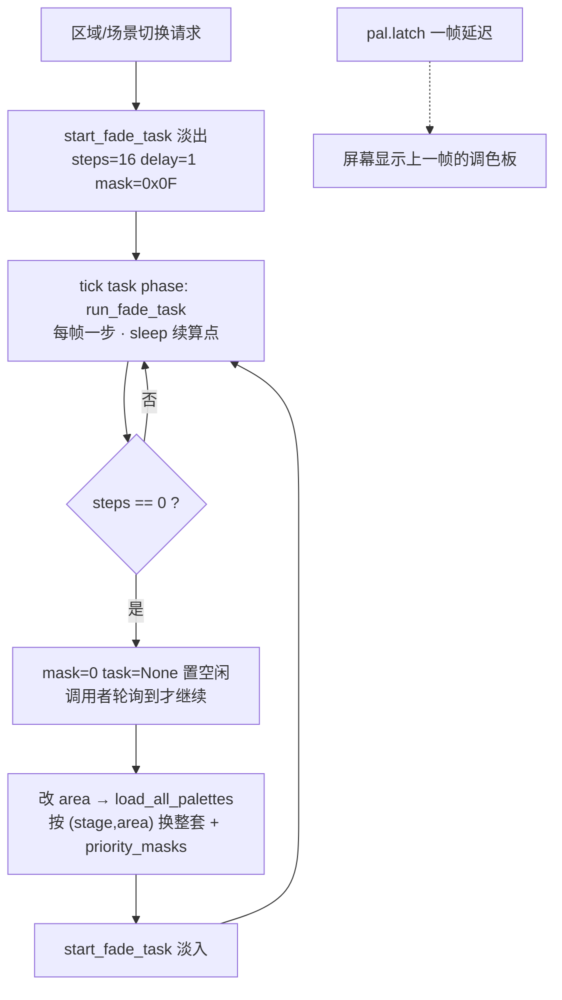

### 56.7 与既有章节的关系 / "更成熟"落点（带收敛限定）

§20 的顶层协作任务机、`Scene` sleep 续算点，在 `run_fade_task` 里又得到一个独立实例；§23 / §36 的显示延迟在 `vram.rs` 单测里被钉死；§34 的区域切换「淡出 → 换数据 → 淡入」补齐了「换数据」的具体内容；§45 的三组背景优先级落在 `priority_masks`；§43 的 wof 出场淡出是同一词在对象层的用法。dino 把「淡入淡出」做成**可被轮询、可 sleep、有明确完成信号的顶层任务**，因此区域切换、Boss 战、整局流程都能复用同一条排队协议；wof repo 侧呈现的是对象级调色板配置与出场淡出。这是**两种组织层次**，不据此断言 wof 缺全屏淡入淡出或缺亮度任务（§11.0），也不做设计优劣判断。

### 56.8 未做（保留，不扩张）

- wof 全屏淡入淡出 / 亮度任务是否存在、调色板 bank 与 VBlank 提交的逐指令对照：repo 已有命名但按 §11.0 不主动扩大、不臆断。
- dino `fade_bank_step` 的 colour-0 探针原机怪癖、`obj_palette_sets` 全量表内容、各兵种 profile 调色表逐项：保留不扩张。
- 音频 / 服务菜单按 §0 边界外；两游戏发行先后未考证。
- ROM 主要为 data，本节未触发「`wof_cs` 非常可疑」条件，**0 次新增 ROM 取证**（§11.6）。

**结论**：§56 把「显示状态」收成一条设计主线——调色板是按 (关卡, 区域) / 按兵种查表的数据，改动一律延迟一帧生效；dino 进一步把淡入淡出做成顶层任务机里的异步 `FadeTask`（16 步 + sleep 续算点 + `mask=0` 完成信号），补齐 §34「换数据」的落点与 §20 任务机模型的又一实例；wof 侧收敛为 repo 呈现的对象级调色板配置与出场淡出，按 §11.0 不臆断缺失；`长时间自主推进` 仍是开放目标，本节不宣称终止。

---

## 57. 时间：一局里的计时器由谁推进、谁让它停

> 边界：纯 repo 侧，未新增 ROM 取证（§11.0 / §11.6）。本节只做**收束**：把 §25 / §28 / §29 / §37 / §39 / §40 / §43 / §53 / §55 / §56 已经分别写过的计时器按「谁推进、谁让它停」归到一张表，不逐节重述机制、不展开 §25.8 已保留的 `time_limit` / BCD 时间链。wof 侧只登记 repo 呈现的同类字段，**不臆断其缺计时器或时钟模型**（§11.0）；逐字节对拍方式属工程层，按 §0 隔离，不做设计优劣判断。

### 57.1 一句话

两边都**不给每个状态机配一个私有时钟**，而是把「还剩多少帧」写成对象头 / 全局状态里的**计数字段**，由固定帧序列（§47）按序递减，并全部进逐帧 trace（`trace.rs:830` / `:1131` / `:1180` / `:1418` 分别登记 `wave_timer` / `combo_t` / `invuln` / `calm`）。于是「时间」和 §50 的对象池、§51 的 RNG 一样是**一条全局共享资源**：真正的设计问题不是「怎么计时」，而是**「哪一批计时器在过场脚本 / HUD hold / 同屏满 / freeze 时同时不走」**——这些暂停门是跨系统契约，与 §51「取几次 RNG 也是契约」同构。

### 57.2 三类计时器

| 类别 | dino 代表字段 | 谁推进 | 谁让它停 | 出处 |
|---|---|---|---|---|
| **① 每帧无条件递减**（对象头局部时钟） | `frame timer`（`+$2F`）、`hitstop`（`+$59`）、`combo_t`、`invuln`、`fade steps/sleep`、shake 幅度递减 | `tick_anim`（`body.rs:216`）、`run_fade_task`（`palette.rs:124` / `:116`）、`step_shake`（`camera.rs:207`）、各池 update | 归零即触发语义（换帧 / 恢复 / 结束），无全局门 | §53 / §37 / §39 / §29 / §56 |
| **② 带全局暂停门**（不是每帧都走） | `join.seconds/frames`（续关倒计时）、`wave_timer`（波次）、`calm`（rank 平静期） | `flow_continue_hud_tick`（`cont.rs:122` / `:126`）、波次控制器、rank 计时 | `scripted != 0` / `b4d5`(HUD hold) / `flow.mode > 0xC`（`cont.rs:112`）；同屏太满连 `waveTimer--` 都不执行（§28）；rank `freeze` 门（§25） | §55 / §28 / §25 |
| **③ 事件重置 / 补偿**（不靠递减） | `wave_timer += 600`、rank 挂起 1800/1200 帧队列、120 帧死亡闪烁、tally 每帧 100 倒扣 | 续关（`cont.rs:106`）、`rank_event_*`（`rank.rs:249` 附近的 cooldown）、离场 / 结算状态机 | 由**事件**改写，不自带每帧时钟；事件排进队列而不是立即生效 | §55 / §25 / §43 / §40 |

- ① 是「状态机自己的节拍」，② 是「整局节奏」，③ 是「跨帧补偿」；三者共用同一批全局字节，靠**固定帧序列**（§47 `tick → game_frame 8 步 → objects_update 14 调用`）保证谁先递减、谁后读。
- ② 最值得单列：它不是「某个系统决定暂停」，而是**同一组全局条件同时挡住多个系统的计时器**。`cont.rs:112` 一行里 `scripted` / `b4d5` / `mode > 0xC` 三个门合起来，让续关倒计时、HUD 提示、大数字重绘整段不推进；§28 的「场上太满时连 waveTimer 都不走」是同一类门。这与 §25 的 `freeze`、§37 的 hitstop 门一起，构成「全局时间门」清单。

### 57.3 wof 侧：同一批「一个字段一个计时」

wof repo 里同样是每类计时一个字节 / 字、各自带门：`AniLeft`（动画帧计时，`0x2470` 的 `subq` + `bgt` 早退，§53）、`StunLeft` / `StunVal`（`Cps1Types.cs:292` / `:293`，§29）、`ShakeLeft`（`Cps1Types.cs:298`，§37）、`RKey1Left`（搓招蓄力 / 倒计时，§27）、`waveTimer`（波次，§28，同样有「同屏满就不递减」的门）。**不臆断 wof 缺全局时钟或缺少哪一类计时器**（§11.0），只登记这些字段与 dino 的 ①②③ 是同一分工。两边逐字节对拍方式的差异属工程层，按 §0 隔离。

### 57.4 流程图：全局时间门挡在哪

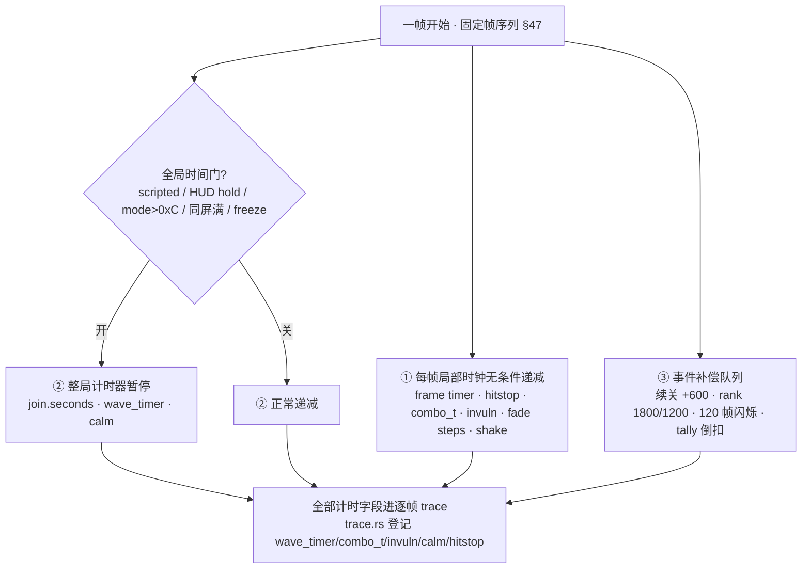

### 57.5 组织性结论（带收敛限定）

把时间收成一条主线后，§50（对象池）、§51（RNG）、§57（时间）构成三条并列的**全局共享资源**：都不是每个状态机自带一份，而是集中字段被固定顺序读写、且都能逐帧对拍。由此得到一条此前各节没合起来说的结论：**「暂停哪些计时器」和「取几次 RNG」一样是帧契约**——过场脚本接管时，一批计时器与一批 RNG 调用同时不发生，任何一处多减一帧 / 多取一次都会让整条 trace 对不上。这是「逐帧语义精确」这一真值口径（§0）在时间维度的体现；**不据此断言 wof 缺全局时间门或时钟模型不同**（§11.0），也不做设计优劣判断。

### 57.6 未做（保留，不扩张）

- `time_limit` / BCD 时间链按 §25.8 保留；各计时器初值表、rank 挂起队列全量、wof 各计时字段全部写入点，按 §11.0 不主动扩大。
- wof 全局时间门是否存在、逐帧对拍的字节口径：repo 已有命名但按 §0 / §11.0 不展开、不臆断。
- 音频 / 服务菜单按 §0 边界外；两游戏发行先后未考证。
- ROM 主要为 data，本节未触发「`wof_cs` 非常可疑」条件，**0 次新增 ROM 取证**（§11.6）。

**结论**：§57 把散在十节里的计时器按「每帧无条件 / 带全局暂停门 / 事件补偿」收成三类，并给出「时间是继对象池、RNG 之后第三条全局共享资源、暂停门与取 RNG 次数同属帧契约」这条组织性结论；wof 侧收敛为 repo 呈现的同类字段，按 §11.0 不臆断缺失；`长时间自主推进` 仍是开放目标，本节不宣称终止。

---

## 58. 一次确认命中之后：特效火花怎么被造出来、落在哪、播完即消

> 边界（先立，避免踩保留）：§21.8 / §35.5 / §37.6 已把「特效对象状态机全量普查」与「wof 各 `*ObjRuntime.cs` 特效对象逐类普查」明列**保留、不扩张**；本节不展开任何特效对象内部状态机，只把散在 §3 / §12 / §22 / §37 / §45 / §46 / §48 / §49 / §50 / §53 / §54 的**「确认命中 → 生成反馈对象」这一条生成契约**收成一条数据流。纯 repo 侧（命名 / 注释 / 单测），不新增 ROM 取证；wof 侧按 §11.0 只登记 repo 呈现的入口形态，不臆断缺机制、不评优劣。

### 58.1 一句话与两边分野

dino 把「这一击打在什么位置、冒什么火花」做成**攻击记录的一个字段 + 两个判定盒的几何**：`collide::boxes_hit` 一旦返回第一对重叠盒，`spawn_hit_spark 0x12720` 就拿这对盒算出火花坐标，再从 pool C 分配一个**真正的对象**，由 frame record 播完即释放；wof repo 侧则把命中特效的**种类交给被击者状态**裁决（`HpDisp` / `Hp` / `OBJ+0x72 bit5` 三选一），坐标由调用者给、先过屏幕范围裁剪，通用特效另走一个「分配特效环槽 + 写参数记录」的共享入口 `创建特效记录_对应ASM_5B80`。

差别可压成一句：**dino 的火花类型住在攻击方的数据里，wof 的命中火花类型住在被击方的状态里**——这正是 §46「dino 8 字段 `AttackRecord` 聚合 vs wof 一个 ID 散在多处」在反馈层的延伸。

### 58.2 dino：从一对重叠盒到一个 pool C 对象

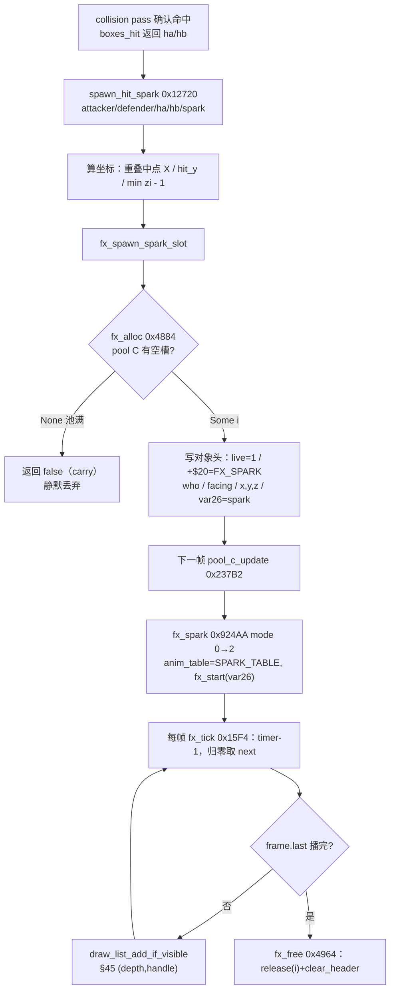

命中链调用点覆盖四类主体，全部汇入同一个入口：

- 玩家 → 敌人 / Boss：`player_combat.rs:245`、`:370`（`d5=2`）、`:421`
- 敌人 → 玩家：`enemy_combat.rs:87`、`:179`、`:327`、`:564`
- 载具容器：`car.rs:823`、`:922`、`:965`（另有 `:858` 走 `spawn_hit_spark_d0` 保留 `d0_hi`）
- 可破坏物：`prop.rs:441`

`spark` 的来源是 `AttackRecord.spark`（8 字节记录的第 7 字节，`sprites.rs:149-158`）；少数调用点直接写常数（`2` / `5` / `1` / `0`），说明「用记录里的值」是约定而非强制。§46 已列这条记录被伤害公式 / 受击状态机 / hitstop / spark / score-HUD 五路消费，本节展开的正是 spark 这一路。

`spawn_hit_spark 0x12720`（`effect.rs:860-892`）的位置算法：

```text
al = left(attacker, ha) ; bl = left(defender, hb)      # collide::left 已含 facing 镜像
l0,r0 = al+0x400, al+ha.xsize+0x400                    # 加偏置后按无符号比较
l1,r1 = bl+0x400, bl+hb.xsize+0x400
x = ((max(l0,l1) + min(r0,r1)) >> 1) - 0x400           # 重叠区中点（不是攻击者位置）
y = hit_y(a,ha,d,hb)                                    # 两盒"底的最大值 + 顶的最大值"/2，原机如此
z = max(min(attacker.zi, defender.zi) - 1, 0)          # 深度取较靠前的一方再往前 1
→ fx_spawn_spark_slot(x,y,z, a.facing, a.who, spark)
```

两处值得留意的原机约定：Y 用的是「两盒底的最大值 + 两盒顶的最大值再折半」，不是重叠区中点；X 用 `+0x400` 偏置把有符号比较转成无符号比较（与 §12 `collide.rs` 的 `axis()` 同构）。变体 `spawn_hit_spark_d0` 还把调用者留下的 `d0` 高字带进 `add.l / lsr.l #1`，载具容器那一路会用到（`effect.rs:868-880`）。

`fx_spawn_spark_slot`（`effect.rs:846-858`）是唯一的落槽点：

```text
i = fx_alloc()          # 0x4884，pool C 的 LIFO free 栈；None = 池满（68000 carry），返回 false
b.live   = 1
b.k20    = FX_SPARK     # +$20 class word，决定 0x237E6 跳表选中 fx_spark
b.who    = who          # 继承攻击者的记分归属（§54 / §38）
b.facing = facing
b.x/y/z  = 传入坐标
b.var26  = spark        # 动画 id 暂存，init 时才用
```

### 58.3 谁来让它消亡：播完事件，不是计时器

`fx_spark 0x924AA`（`effect.rs:695-719`）只有两个有效 mode：

```text
mode 0（init，当帧 fall-through 到 mode 2）:
    b.anim_table = SPARK_TABLE(0x924F6)
    fx_start(b, fx, b.var26)        # 0x15E4：按 id 取动画首帧
    visible=1 ; draw_flags=0x10 ; mode=2
mode 2（run）:
    if fx_tick(b, fx):  fx_free(i)              # 播完 → 当帧释放
    else:               draw_list_add_if_visible(h)   # 否则进 §45 的 (depth,handle) 绘制表
```

`fx_tick 0x15F4`（`effect.rs:281-290`）每帧 `timer -= 1`，归零才 `fx_load(next)`，并返回 frame record 的 `last` 位——**「播完」是动画数据自带的终止位，不是对象自己数的倒计时**。这正是 §53「frame record 自带时长·链接·终止位 / `tick_anim` 返回播完事件」在 pool C 的落地实例；`fx_free 0x4964`（`effect.rs:604-608`）`release(i)` 回 LIFO 栈并 `clear_header` 清 `+$00..+$27`，与 §43 离场回收「只清部分字段」同构。

于是这条对象的完整生命周期是：**生成帧不跑 update（§42）→ 下一帧 init + run 同一帧 → 每帧一 tick → 播完当帧释放**，没有独立的「存活帧数」字段。

### 58.4 一个入口，几种变体

| 入口 | 地址 | 谁给坐标 | 特点 |
|---|---|---|---|
| `spawn_hit_spark` | `0x12720` | 两个判定盒几何 | 主路径，`spark` 来自 `AttackRecord` byte 6 |
| `spawn_hit_spark_d0` | `0x12720` | 同上 | 带调用者 `d0` 高字进 X 折半（载具容器 `car.rs:858`） |
| `fx_spawn_hit_spark_alt` | `0x127FC` | 同上（有符号） | X 用 word 折半、Y `+0x10`、depth 再 `-1`、`facing=0`（`enemy_combat.rs:181`、`player_combat.rs:423`） |
| `fx_spawn_spark_at` | `0x92422` | 调用者给 (x,y,z) | 取调用者 `facing`（`enemy/class79.rs:353`） |
| `fx_spawn_spark_jitter` | `0x92450` | 调用者给 + 抖动 | 抖动对按 `frame & 0xE` 查 `spark_jitter` 表，`facing=0`（`enemy/class18.rs:883`、`class79.rs:370`） |
| `fx_spawn_spark_simple` | `0x128C8` | 调用者给 (x,y) | type 0，depth / facing 取调用者 |
| `fx_spawn_spark_facing` | `0x92422` | 调用者给 | slot 中已无对象时由调用者直接传 `facing`（`effect.rs:924-928` 的 MAME 朝向修正） |

几种形态共用同一个 `fx_spawn_spark_slot`；差异只在「坐标 / 朝向 / 类型从哪来」，**不各写一套对象初始化**。

### 58.5 wof repo 侧：两个入口、三路选择、一个环槽

- **命中专用入口** `创建普通攻击命中特效_可能对应ASM_8366`（`Cps1HitEffectRuntime.cs:65-102`）：先用 `x - cameraX + 0x20` 做屏幕裁剪（`> 0x1C0` 直接返回 `false`，出屏不生成），再按**被击者状态**三选一：`HpDisp == Hp` → `0x8406`（无伤火花）；`OBJ+0x72 bit5` 置位 → `0x8438`（飙血）；否则 → `0x83D4`（普通火花）。场景对象（宝箱）另有 `创建场景对象命中特效_对应ASM_8360` 固定走 `0x83D4`，不经过这三路（`Cps1HitEffectRuntime.cs:104-111`）。
- **通用共享入口** `创建特效记录_对应ASM_5B80`（`Cps1PlayerLogic.cs:12562-12592`）：签名为 `(ref OBJ src, ushort d0, uint d1, byte d4, byte d5, short d3, ...)`，先 `分配特效环槽_对应ASM_5D3C(out a4)` 拿一条环记录，翻转时查 `0x5BD8` 表并把 `d3` 取反，再写 `a4+0 = d0` 等参数。各调用点自带参数：例如 `Cps1Actor17Runtime.cs:1096/1109` 传 `0x000D, 0x02000180, 5, 8, 0x0E`，`Cps1PlayerLogic.cs:2660` 用 `0x53 + ComboLev` 让**连击档**参与特效 ID（呼应 §39），`Cps1EnemyAI.cs` / `Cps1HorseRuntime.cs` / `Cps1BossWaveEnemyRuntime.cs` 亦各有调用。
- 组织形态：**一个共享创建入口 + 各站点自带参数 + 命中时按被击者状态再分路**；特效演员池（`Cps1EffectActorRuntime.cs`，§50 已取证 `A5+0x1D9C` / stride `0xE0` / 20 槽）是对象层。按 §11.0 / §35.5 只登记 repo 呈现的这两层，不臆断其整体组织、不做逐 Actor 普查、不评优劣。

### 58.6 对照表：一次命中反馈的五问

| 问 | dino | wof（repo 呈现） |
|---|---|---|
| 火花类型谁定 | `AttackRecord.spark`（攻击记录 byte 6，`sprites.rs:156`），少数站点写常数 | 命中入口按被击者 `HpDisp`/`Hp`/`OBJ+0x72 bit5` 三选一（`Cps1HitEffectRuntime.cs:79-86`） |
| 坐标谁定 | `spawn_hit_spark` 用两个判定盒的重叠几何算（`effect.rs:870-892`） | 调用者传入 (x,y,z)，入口先做屏幕范围裁剪（`Cps1HitEffectRuntime.cs:73-76`） |
| 生成到哪 | pool C 的一个对象槽，`live=1` + `+$20` class word（`effect.rs:846-858`） | 「特效环槽」一条记录（`Cps1PlayerLogic.cs:12567`）；另有特效演员池（§50） |
| 谁让它消亡 | frame record 的 `last` 位 → `fx_tick` 返回播完 → 当帧 `fx_free`（`effect.rs:281-290`、`:713-716`） | 按 §35.5 保留，不展开 |
| 容量 / 出屏怎么办 | 池满 `fx_alloc()=None` → 返回 `false`（68000 carry），静默丢弃 | 出屏直接返回 `false`，不生成 |
| 归属怎么传 | `b.who` / `b.facing` 继承攻击者（`effect.rs:851-852`，§54） | 按 §33.6 / §38 保留，不臆断 |

### 58.7 与既有节的关系、未做与边界

- 上游：`§49`（frame record 载盒 ID）→ `§48`（判定窗口 / `boxes_hit` 返回第一对重叠盒）→ 本节（`spawn_hit_spark`）；下游：`§45`（`(depth,handle)` 绘制表）、`§50`（pool C 容量 / LIFO）、`§53`（播完事件）、`§54`（`who` 归属）、`§38`（记分归属）、`§46`（`AttackRecord` 五路消费之 spark 一路）。
- **未做（保留，不扩张）**：特效对象内部状态机逐类展开（§21.8 / §35.5 / §37.6 保留）；pool C 全部 20 余 class 的逐个 handler（`effect.rs:7-24` 只列清单不展开）；wof 各 `*ObjRuntime.cs` / 特效演员池逐类普查（§35.5 保留）；wof 命中三路 `0x8406/0x8438/0x83D4` 的逐段动画内容（§11.0 只在必要时补 data）；两游戏「伤害数字弹出」是否等价（不臆断）；音频 / 音效触发按 §0 边界外。
- ROM 条件授权（§11.6）未触发：本节全部结论来自两份 repo 的命名 / 注释 / 单测，`wof_cs` 相关实现自带 ROM 逐指令对照与 FBA 诊断注释，不属「非常可疑」，**0 次 ROM 取证**。

**结论**：§58 把「确认命中」到「反馈对象消亡」之间这段此前只被 §37 / §45 / §46 分散引用的链路收成一条完整数据流，给出「火花类型由攻击方数据定 vs 由被击方状态定」「坐标由判定盒几何算 vs 由调用者给」「播完事件由动画终止位给 vs 按 §35.5 保留」三处分野，并明确 dino 的反馈对象是 pool C 里一个走 frame record 状态机、播完即释放的**真对象**；wof 侧收敛为 repo 呈现的共享创建入口 + 命中三路选择 + 环记录，按 §11.0 不臆断缺失、不扩张逐类普查；`长时间自主推进` 仍是开放目标，本节不宣称终止。

---

## 59. Boss 登场这一刻：HP 怎么按人数·难度取、血条怎么上屏、头像台词怎么写

> 边界（先立）：§38 已把 HUD ring 作为「记分归属」写过（`hud_push_hit` / `enemy_hud_hit` 按 `who` 入三玩家环），本节不重复 ring 归属，只在需要时一句话带过；§16 已定「`BossAi` 不是统一 AI 决策器、class handler 各自持有状态分派」，本节沿用。wof 侧只登记 repo 呈现的 Obj16 血条创建 / HUD 绘制链，按 §11.0 不臆断这就是全游戏的 Boss 血条实现、不评优劣。纯 repo 侧（命名 / 注释 / 单测），不新增 ROM 取证。

### 59.1 一句话与两边分野

dino 把 Boss 的登场拆成三件彼此独立的事：**HP 数值查一张三维表**（Boss 种类 × 玩家人数 × 难度）、**血条是 HUD 的一个 tracked 对象引用**（每帧从对象头读 `hp / hp_prev / hp_bar` 重画）、**头像与台词由 class timeline 自带参数调公共文字服务**写进 scroll1 tilemap；wof repo 侧则把血条做成**一条专用 HUD 绘制链**（`3CE2 → 3DEE → 347A → 34B0 → 3556`），带对象状态字节 `+0x3D`、全局 bit4 重建信号，以及一个独立于真实 HP、每帧 `-2` 渐降的「显示血量」。

### 59.2 dino：HP 三维表 + tracked 引用

`enemy_set_boss_hp 0x31E14`（`enemy.rs:758-765`）：

```text
row = assets.enemy.boss_hp[boss_idx][players_minus_one % 3]   # ① Boss 种类  ② 玩家人数 0/1/2
hp  = row[(level & 0x1C) >> 2]                                # ③ 难度档 0..7，取 level 的 bit2..4
b.hp_bar = min(hp, 100) ; b.hp = hp ; b.hp_prev = hp           # 血条上限钳到 100 格
```

三点值得留意：

- 普通敌人走另一张 `hp[id][level & 31]`（`enemy.rs:750-756`），**Boss 与普通兵的 HP 来源不同**；
- 玩家人数与难度都参与取值，这是 §33「人数分档」与 §25「`rank_tick` / 时间驱动难度」在 Boss 数值层的落点；
- `hp_bar` 是对象头字段（`body.rs:124-126`，与 `hp` / `hp_prev` 并列），`min(hp, 100)` 说明**血条被归一到 100 格**，真实 HP 可以超过 100。

血条上屏不是每帧从对象池扫一遍，而是 HUD 显式记住「正在跟谁」：`hud.rs:966-970` 把 `hud.slots[i].tracked = boss`，并组一条 `boss_msg = [id, hp_bar, hp_prev, hp, 0xFFFF, boss, 0, 0]`；`m[3] == 0`（HP 归零）时清 `hud.boss`。颜色 / 格数由 `hud_bar_hp`（`hud.rs:688`）、`hud_bar_colours(i, hp)`（`:1061`）从这组值算。被击时的增量更新仍走 §38 的 ring：`enemy_hud_request 0x16B36` → `enemy_hud_hit`（`enemy_combat.rs:768-785`）按 `b.who` 投进对应玩家环，槽未读则丢弃；单测 `enemy_combat.rs:1641-1658` 钉死「act 0 请求血条后当帧转 act 2，且只投一条消息」的契约。

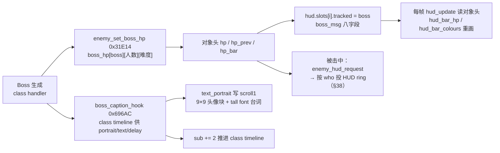

### 59.3 dino：头像与台词是「数据 + 公共文字服务」，不是 Boss 专用脚本

`boss_caption_hook`（`boss_common.rs:331-337`）只有三步：`text_portrait(0x90A29C, portrait, text)`、把 `delay` 写进 `T80` 计时、`sub += 2`。注释明确 **"Class timeline supplies portrait, string id and delay from its instructions; no boss-specific script here"**——与 §16「class handler 自己持有状态分派」一致，公共层不替 Boss 做决策。

`text_portrait`（`flow/text.rs:279-310`）做的是纯数据搬砖：按 `portrait` 查 `0x8461A` 调色板 / `0x8463E` 字形码 / `0x84696` 或 `0x846DE` 属性表，往 scroll1 写一个 **9×9 的头像块**（`hud_put`，列 `+0x80`、行 `+4`），再按 `text` 从 `0x84800` 取字符串用 tall font 输出；`text == 0x2A..0x2D` 之外先 `text_clear_box` 清 35×9 格。`flow/text.rs:8-23` 列出整套 scroll1 字符串体系：byte string（`col,row,attr,字符…,'@'`，`'/'` 换块）、word string（`0x4040` 结束）、big font（2×2 格）、tall font（1×2 格）、`0x7EC20 / 0x7EC48` 的 typewriter——**字符串是 tile code 列表，不做字母解码**，位置由 `BASE 0x90A000 + (col<<7) + (row<<2)` 算出。

### 59.4 wof repo 侧：一条专用绘制链 + 一个渐降的显示值

`Cps1Actor16Runtime.cs` 呈现的是一条从对象状态出发的绘制链：

| 环节 | 位置 | 做什么 |
|---|---|---|
| 创建 | `血条创建_对应ASM_3CE2`（`:1788-1793`） | 写 `+0x3D = 0x40`，调 `执行3DEE`（与 Obj1C 共用），`jmp 血条HUD布局_对应ASM_347A` |
| 布局 | `血条HUD布局_对应ASM_347A`（`:1796-1808`、`:1850-1866`） | 设 VRAM 地址 `0x90A370`、`d6 = 0x4C`；依 `A5-0x1C46` 标志切到 `+0x80` 偏移布局、`d6 = 0x32 / 0x3F` |
| 重画 | `血条HUD重画从34B0起_对应ASM_34B0`（`:1870-1920`） | 调 `Cps1EnemySubs.绘制血条HUD尾链_对应ASM_3414`、`Cps1HudRuntime.绘制敌方血条外框竖线_对应ASM_332A`、`绘制血条单元序列_对应ASM_2EF8 / 2EF0` |
| 通用尾 / 渐降 | `0x3556`（`:1929-1947`） | `bclr.b #4, -$7f6c(a5)` 清**Boss 血条重建请求位**，原位为 1 则从 `0x34B0` 重画；否则取「显示血量」`FF805A` 与真实 HP `OBJ+0x82` 比较，`subq.w #2` 每帧 -2 渐降 |

最后一行是本节最值得记的一点：**wof 把「当前画出来的血量」存成一个独立变量，让它每帧向真实 HP 逼近**（`bne` 重建 / `beq` 不动 / `bmi` 直接取真实 / 否则 `-2`）。这与 §37 的 `SCREEN_SHAKE_Y_COUNTER` 每帧 `-2` 查偏移表、§56 的 `pal.latch` 一帧延迟是同一种组织方式——**显示状态不直接等于游戏状态，而是单独持有一份、按自己的节奏收敛**。按 §16 / §11.0 只登记 repo 呈现的 Obj16 这条链，不臆断其他 Boss 是否共用。

### 59.5 对照表：Boss 登场的五个问题

| 问 | dino | wof（repo 呈现，Obj16） |
|---|---|---|
| HP 从哪来 | `boss_hp[boss][players_minus_one%3][(level&0x1C)>>2]` 三维表（`enemy.rs:758-765`） | 本节只登记血条绘制链；HP 数值表按 §11.0 不主动追 |
| 血条归一 | `hp_bar = min(hp, 100)`，100 格（`body.rs:124`） | `d6 = 0x4C / 0x32 / 0x3F` 按布局取格数（`Cps1Actor16Runtime.cs:1800-1808`） |
| 血条怎么上屏 | HUD `tracked = boss` 每帧读对象头 + 被击时投 ring 增量（`hud.rs:966-970`、§38） | 专用绘制链 `3CE2 → 3DEE → 347A → 34B0 → 3414 / 332A / 2EF8`（`Cps1Actor16Runtime.cs:1788-1920`） |
| 重画由谁触发 | HUD 每帧自己重画；ring 消息是增量加速 | 全局 bit4 重建请求位（`-$7f6c(a5)`） + `+0x3D` 对象状态字节 |
| 显示值与真实值 | 直接读 `hp / hp_prev`，无中间变量 | 独立「显示血量」`FF805A`，每帧 `-2` 渐降逼近真实 HP（`Cps1Actor16Runtime.cs:1931-1947`） |
| 头像 / 台词 | `boss_caption_hook` → `text_portrait` 写 scroll1；class timeline 供参数（`boss_common.rs:331-337`） | 按 §11.0 保留，不臆断 |

### 59.6 与既有节的关系、未做与边界

- 上游：`§16`（Boss 层不是统一 AI）→ 本节（class timeline 自带登场参数）、`§25`（难度档）→ `boss_hp` 第三维、`§33`（人数分档）→ 第二维、`§38`（`who` → HUD ring）→ 增量消息；下游：`§26`（HUD 反馈时机）、`§37`（`-2` 自减计数的同构）、`§45`（绘制队列）、`§50`（scroll1 / tilemap 是显示层而非对象池）、`§56`（显示状态独立于游戏状态）。
- **「显示值追真实值」这条主线至此有三个实例**：§37 屏幕震动（`SCREEN_SHAKE_Y_COUNTER` 每帧 -2）、§56 调色板（`pal.latch` 一帧延迟）、§59 wof 血条（`FF805A` 每帧 -2 渐降）。三者都不是"游戏状态直接映射像素"，而是显示层单独持状态、按自己的节奏收敛。dino 的血条则走另一条路：直接读对象头，把延迟放在 HUD ring 这一帧上（§36 / §38）。按用户要求只谈组织方式，不评优劣。
- **未做（保留，不扩张）**：wof 其他 Boss / Actor 的血条实现是否同构（§11.0 不主动追）；`boss_hp` 表全部逐项字节（§11.0 只在必要时补 data）；`0x8461A / 0x8463E / 0x84696 / 0x84800` 各表的逐条内容；`flow/text.rs` 全部字符串与 typewriter 逐状态展开；两游戏「Boss 登场无敌 / 演出时长」是否等价（不臆断）；音频 / 音效按 §0 边界外。
- ROM 条件授权（§11.6）未触发：本节全部结论来自两份 repo 的命名 / 注释 / 单测，`wof_cs` 血条链自带 ROM 逐指令注释与 FBA 现象记录，不属「非常可疑」，**0 次 ROM 取证**。

**结论**：§59 把「Boss 从生成到出现在 HUD 上」这段此前只被 §16 / §25 / §33 / §38 / §56 分散引用的链路收成一条主线，给出「HP 是三维数据表 vs 血条是专用绘制链」「HUD tracked 引用每帧读对象头 vs 独立显示血量每帧 -2 渐降」「登场台词由 class timeline 供参数写 scroll1」三处分野，并把「显示值追真实值」补成 §37 / §56 之后的第三个实例；wof 侧收敛为 repo 呈现的 Obj16 绘制链，按 §11.0 不臆断缺失、不扩张逐类普查；`长时间自主推进` 仍是开放目标，本节不宣称终止。

---

## 60. 排行榜这一屏：一个长任务怎么被 video frame 边界切断、又怎么对齐 MAME 录制

> 边界（先立）：§41 已把 `attract.rs / demo.rs / … / ranking.rs / name_entry.rs / …` 共 13 个 flow 子模块的**逐类展开**明列「保留、不扩张」，本节不做逐模块普查，只取 `ranking.rs` 一个例证，收束一条**组织原则**：长任务跨多个 video frame 时，「执行到哪被切断」怎么被外化成可测的常量。这是 §20（`Scene` sleep 续算点）、§41（长动作写成测得长度 sleep 以逐 video frame 对齐 MAME 录制）与 §47（两套循环）的最具体证据，也正面回应用户最初「随时被硬件中断、无法确定函数执行次数和完整度」的问题。纯 repo 侧（文件头注释 / 常量表 / 单测），不新增 ROM 取证；wof 侧只登记 repo 呈现的让出帧协程，按 §11.0 不臆断全局。

### 60.1 一句话与为什么值得单列

排行榜绘制是 **2000 个 cell 写入**，原机一帧做不完，会被 **video frame boundary** 在「取决于之前 CPU 时间」的位置切断。dino 不模拟 CPU 时间片，而是按原机顺序构建写入序列（`ranking_ops`），把「调用后那一帧写前多少个 word」做成一张**从 MAME 录制实测出来的切分表** `CUTS`；wof repo 侧则把同一类长流程写成**让出 N 帧的协程**（`866(N)`），让出帧数同样是从 ROM 逐条数出来的常量（601+30+24 = 655、559）。

两边做的是同一件事：**把「被中断打断的执行次数」从不可观测的 CPU 时间，翻译成可观测、可对拍的帧数 / 切分点**。这正是 §20.6 与 §41 那条结论落地的地方。

### 60.2 dino：测得切分点，而不是模拟 CPU

`ranking.rs:25-32` 文件头把机制写得很直白：绘制超过一帧剩余时间，被 video frame 边界在依赖前序 CPU 时间的位置切断；port 按原机顺序构建写入，调用后那一帧做前 `ranking_cut` 个 **word**（一个 cell = 一个 code word + 一个 attribute word，帧可能恰好切在两者之间），其余写入、绘制收尾与第一个 pass 落到下一帧。

```text
# flow_ranking_script，rst::DRAW1（ranking.rs:136-147）
ops = ranking_ops()                       # 原机顺序的全部 cell 写入
cut = min(ranking_cut(), 2 * ops.len())  # cut 以 word 计
ranking_apply(ops[..cut/2])              # 整格部分
if cut % 2 == 1:                         # 帧切在 code 与 attribute 之间
    只写 ops[cut/2] 的 code word        # 半个 cell，下一帧补 attribute
```

`ranking_cut()`（`ranking.rs:93-108`）不是算出来的，是**查表**：

| 常量 | 值 / 含义 |
|---|---|
| `CUTS[9]` | `[3958, 3054, 3786, 3958, 3786, 3051, 3786, 3957, 3786]`，按 `front.rank_runs` 第几次运行取值，`ranking.rs:78` |
| `CUT_AFTER_PROFILES` / `CUT_AFTER_SLIDES` / `CUT_AFTER_DEMO` | `3786 / 3051 / 3957`，前序屏幕不同则切分点不同，`ranking.rs:79-81` |
| `CUT_AFTER_ENDING` | `2664`，结局后 game over 的排行榜另测，`ranking.rs:83` |
| 数据来源 | 注释明确：**Measured in `attract3.mame.trc`（`ranking_cut_report` in `mame_check.rs`）**，`ranking.rs:74-76` |
| 首次运行 | 比后续早一帧（第二次 pass 落在第一次那一帧：422 vs 423 帧），与 profile cards 同构，`ranking.rs:31-32` |

三点设计意味：

- 切分点**按「这次运行前跑了什么」分档**（profiles / slides / demo / ending / 第几次 run），因为前序 CPU 时间不同、帧边界落点就不同——这正面承认了「执行次数由中断决定」，但把结果**冻结成常量表**而不是去跑一个 CPU 时序模型；
- `cut % 2 == 1` 的半格分支说明模型精确到 **word 级**，不是「估个帧数」；
- 与 §51「取几次 RNG 是帧契约」同构：两者都把不可从静态代码看出的运行时事实，外化成可重放、可对拍的观测值。

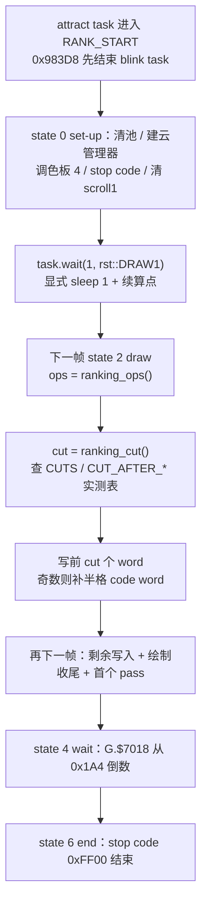

### 60.3 dino：任务机视角——一个 pass 里到底有什么

`ranking.rs:4-17` 给出这条例程在顶层任务机里的完整形状：

- 它**不是一个独立任务**，而是跑在 attract slot 里的一个「脚本位置」：`front.task` 的 script position 取 `rst` 值，`task.count` 就是 wait counter `G.$7018`；
- 状态字节 `G.$7012` 四态：`0` set-up、`2` draw、`4` wait、`6` end，其中 set-up 与 draw 是**同一个 pass**；
- 一个 pass 的固定序列（`ranking.rs:7-10`）：状态 handler → scroll2 相机 `+8` 与 scroll3 相机 `+4`（沙漠背景走过）→ `pool A 0x23420` → `pool B 0x23604` → `pool C 0x237B2` → 精灵表 `0x13FA6` → **`sleep 1`**；state 6 在对象之前用 stop code `0xFF00` 结束例程；
- wait 态从 `G.$7018 = 0x1A4`（420 帧，`ranking.rs:15`）倒数，降到 0 以下转 state 6。

也就是说 §47 的「一帧完整调度链」在非战斗流程里照样成立，只是把 `game_frame` 换成了「scroll 相机推进 + 三个池 update + 精灵表 + sleep」；**没有第二套引擎，只有同一任务机里的不同脚本位置**。这与 §20「5 个协作任务按 slot 顺序每帧运行、`Scene` 显式建模 sleep / 续算点」完全一致。

### 60.4 wof repo 侧：让出 N 帧的协程

`Cps1HardResetRuntime.cs` 把长流程写成带「让出帧数」的协程片段：

| 位置 | 让出 / 帧数 | 说明 |
|---|---|---|
| `:285-296`（`0xA39A..0xA3FA`） | `让出 3` ×2、`让出 240`、`让出 24`、`让出 12` | 冷启动 / 色板清理段；`0xA3BE jsr $CE56` 注明「排行榜初始化（协程，3 次让出 1）」 |
| `:333-352`（`0xF9FA..0xFAE4`） | 601 次 `866(1)` + `866(0x1E)`=30 + `866(0x18)`=24 = **655 帧** | attract 排行榜显示段；注释明确 5979 + 655 = 6634 正好接上录制窗口 `633A/633C` 第二段 |
| `:353-362`（`0xA764..0xA972`） | **559 帧** | 排行榜「载入下一组」，由 `0xFAE4 rts` 同帧进入 |
| `:13467-13472` | `MoveNext()` / `Current = 让出帧` | 宿主用 C# 迭代器逐帧推进，`让出帧` 即本帧挂起长度 |

与 dino 的对照很清楚：**dino 把「被切断的位置」写成写入序列的一个下标（`ranking_cut`）**，**wof 把「这段流程占多少帧」写成协程的让出帧数**；两者都没有模拟原机 CPU 时间片，都是把「执行次数不确定」外化成从录制 / ROM 逐条数出的常量，供逐帧对拍。按 §16 / §11.0 只登记 repo 呈现的这些片段，不臆断 wof 全部前端流程都如此、不评优劣。

### 60.5 对照表：长任务怎么跨帧

| 问 | dino | wof（repo 呈现） |
|---|---|---|
| 一帧做不完怎么办 | video frame 边界切断写入序列，按 `ranking_cut` 个 word 切（`ranking.rs:27-32`、`:136-147`） | 协程 `866(N)` 主动让出 N 帧（`Cps1HardResetRuntime.cs:343-350`） |
| 切断点 / 帧数从哪来 | `CUTS` 等常量，**MAME 录制 `attract3.mame.trc` 实测**（`ranking.rs:74-83`） | ROM 逐条数出（601+30+24=655、559），注释与录制窗口对齐（`Cps1HardResetRuntime.cs:350-356`） |
| 按什么分档 | 第几次 run + 前序屏幕（profiles / slides / demo / ending） | 流程段不同（初始化 / 显示 / 载入下一组） |
| 精度 | word 级，支持「半格」`cut % 2 == 1`（`ranking.rs:142-147`） | 帧级让出 |
| 续算点怎么表示 | `task.wait(1, rst::DRAW1)` + `Scene` 状态字节（`ranking.rs:132`、§20） | 协程 `MoveNext()` / `Current`（`Cps1HardResetRuntime.cs:13467-13472`） |
| 是否模拟 CPU 时间片 | 否，冻结成常量表 | 否，冻结成让出帧数 |

### 60.6 与既有节的关系、未做与边界

- 直接回答用户最初的问题（§20 已给框架，本节给最具体证据）：**「随时被硬件中断、无法确定函数执行次数和完整度」在 dino 里不是靠复现 CPU 时序解决的，而是靠把结果录制下来、外化成常量表 + 显式 sleep 续算点**；wof repo 侧同样把长流程写成让出帧数，宿主逐帧推进。
- 串起：`§20`（顶层任务机 / `Scene` sleep）、`§41`（非战斗流程 / 长动作写成测得长度 sleep）、`§47`（一帧完整调度链 / 两套循环）、`§36`（跨帧时序）、`§51`（RNG 取几次即帧契约，同构的「外化运行时事实」）、`§57`（时间 / 全局暂停门）、`§56`（ranking screen 的云 `fx_cloud.rs` 是同一屏的 pool B class 89）。
- **未做（保留，不扩张）**：§41 明列的其余 12 个 flow 子模块逐类展开；`ranking_ops` 全部 2000 格写入的逐条内容；`CUTS` 九个值各自的录制推导细节（§11.0 只在必要时补 data）；`name_entry.rs` 的 `Block` / `blink` / `name_finish` 逐状态展开（§41 保留）；wof 全部前端流程的协程化普查（§11.0 不主动追）；两游戏「排行榜数据持久化 / EEPROM」是否等价（不臆断，且 §0 已把 EEPROM edits 列为边界外）。
- ROM 条件授权（§11.6）未触发：本节全部结论来自两份 repo 的文件头注释 / 常量表 / 宿主协程代码，`wof_cs` 相关片段自带 ROM 逐条反汇编与录制窗口对齐注释，不属「非常可疑」，**0 次 ROM 取证**。

**结论**：§60 把 §20 / §41 那条「长动作写成测得长度 sleep 以逐 video frame 对齐 MAME 录制」的结论落到最具体的一屏上，给出 dino「按原机顺序构建写入 + 从录制实测的 `CUTS` 切分点 + word 级半格处理 + `Scene` sleep 续算点」与 wof「让出 N 帧的协程 + ROM 逐条数出的 655 / 559 帧」的对照，并明确两边都**不模拟 CPU 时间片、而是把不可观测的执行次数冻结成可对拍的常量**；wof 侧收敛为 repo 呈现的协程片段，按 §11.0 不臆断缺失、不扩张逐模块普查；`长时间自主推进` 仍是开放目标，本节不宣称终止。

---

## 61. 一次射击：弹丸与枪口火花怎么跨两个池生成、怎么追踪、怎么消亡

> 边界（先立）：§21 已列 pool E 的 12 个 class（含「8 ballistic projectile / 10 gun projectile / 3 bullet of a held gun」）与「拾取物、武器、弹丸、攻击盒统一成一个对象池」这条结论，本节不重列 class 表，只把**「扣一次扳机」到「对象回收」这一条生命周期**收成主线；§58 讲的是**命中侧**的 spark 生成（`spawn_hit_spark` 由 `boxes_hit` 驱动），本节讲的是**武器侧**的枪口火花，两者是不同生成链。wof 侧只登记 repo 呈现的 `投射物1C` 分派与弓箭手对象，按 §11.0 不臆断二者与 dino 弹丸的完整等价关系、不评优劣。纯 repo 侧，不新增 ROM 取证。

### 61.1 一句话与两边分野

dino 把弹丸做成 **pool E（道具池）里的正式对象，语义上却是攻击者**：它进 `$671A` 攻击者列表、自带 attack id 与流水号、走玩家攻击记录那条命中链（`blast.rs:6-8`）；扣一次扳机同时从 **pool E** 分配弹丸、从 **pool C** 分配枪口火花，两者各自受本池容量背压；弹道由「`partner` → 射手的 `aim` 目标」这条对象引用链与一张按枪械 variant 查的记录表共同决定；每隔一帧做一次地形 / 碰撞检查，撞到地面、墙或水面就转成命中火花动画，播完即释放。wof repo 侧呈现的是事件对象里的 `投射物1C_主分发_对应ASM_58C78`（`ActStatA` 四态 + 目标引用 + 速度表 + **隔帧相位门**），另有弓箭手（ObjId `0x14`）作为独立敌人对象。

### 61.2 dino：一次射击，两个池，各背各的压

`weapon_spawn_shot 0x26414`（`item/weapon.rs:489-508`）与 `weapon_spawn_flash 0x96B40`（`:510-517`）：

```text
# 弹丸本体：pool E
j = items.alloc() 或返回 false（池满，68000 carry，本次射击丢失）
n.b.live=1 ; who/id/facing/partner 全部复制自武器 ; k20 = class_word
n.b.x/y/z = weapon_shot_pos(it, dx, dy)   # 按枪械给枪口偏移
n.b.var26 = variant ; n.m[A9] = it.m[A9]

# 枪口火花：pool C，另一个分配器
j = effects.alloc() 或返回 None（pool C 满，火花丢失，不影响弹丸）
e.b.live=1 ; k20 = 0x84（class 33, effect/fx33.rs）; 继承武器 facing 与 kind word
```

- 霰弹 `weapon_spawn_pellets`（`weapon.rs:480-487`）一次循环 6 发（variant 5..0），**任一发 `alloc()` 失败就 `break`**——同屏上限直接由 pool E 容量表达，与 §50「`alloc() = None` 即池满背压」一致；
- 六种枪各有自己的枪口偏移与 variant（`weapon_shot_pos`，`:604`、`:638-835`），是数据驱动的射击配置，不是每把枪写一套生成逻辑；
- `item_spawn_effect`（`item.rs:526-535`）是 pool C 的通用落槽点，与 §58 的 `fx_spawn_spark_slot` 同构但**入池路径不同**：§58 从 `collision()` 确认命中后来，本节从武器状态机来。

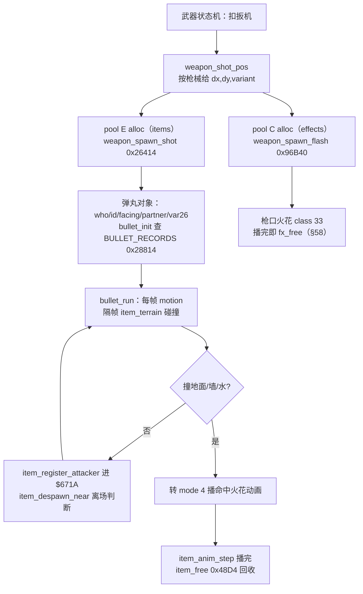

### 61.3 dino：弹丸是「伪装成道具的攻击者」

`blast.rs:6-8` 文件头把语义说破：**explosions and projectiles are attackers** —— 它们加入列表 `$671A`（4BDA）、携带自己的 attack id（`+$58`），由 `hits.rs` 与 `enemy_combat.rs` 的 pass 用**玩家攻击记录**去伤敌人、容器与玩家。于是 `bullet_init`（`blast.rs:269-336`）里几行字段就不是道具字段而是攻击字段：

| 字段 | 值 / 来源 | 呼应 |
|---|---|---|
| `b.box_table` | `0xC010_0000`，最高字节是标志位，查表要忽略（`§49`） | `collide.rs:8-14` 的 `& 0xFF_FFFF` |
| `b.atk` | `BULLET_RECORDS` 的 attack id | §46 `AttackRecord` 五路消费 |
| `b.serial` | `w.attack_serial`，随后 `+1` | §48 全局攻击流水号去重 |
| `anim_table / vx / vy / vz` | 按 variant 查 `BULLET_RECORDS 0x28814`（8 字节：vx / animation / attack id / aim） | 数据驱动弹道 |
| `b.airborne` / `hitstop` | init 置 1 / 0 | §37 命中停顿门 |

也就是说 §46 / §48 / §49 那条「一次攻击的数据表示 → 判定盒 → 判定窗口 → 命中火花」的链，对**飞行中的攻击**同样成立：弹丸只是把攻击者从玩家对象换成了一个会移动、会自己回收的 pool E 对象。`item_register_attacker`（`item.rs:248`）每帧把它的 handle 登记进攻击者列表；`item_despawn_near`（`:367`）与 §43 的 `enemy_despawn_if_far / near` 同构，负责出界离场。

### 61.4 追踪靠一条对象引用链，不靠每帧全局搜索

`bullet_init` 的 `aim` 分支（`blast.rs:288-335`）把「这一发往哪飞」拆成两种：

```text
rec = BULLET_RECORDS[variant]        # aim = 该枪械的瞄准参数
if aim >= 0:                         # 固定散射
    行 = BULLET_PTRS[射手角色] + aim
    vy = BULLET_VY[表[行 + (rand() & 0xF)]]        # §51：一次 RNG 取表项
else:                                # 追踪
    target = slot_of(b.partner) → 射手玩家 → players[p].aim（+$EA 最近敌人）
    d0 = clamp(|target.x - bullet.x| - 0xA0, 0, 0xE0)
    vy = AIM_A 或 AIM_B[d0 >> 4] + min(A9,0x18)*0x30
    vz = AIM_VZ[...]（按 A9 奇偶与位模式取符号）
```

- `partner` 是 §54 那条「把对方 handle 写进自己对象头」的实例：弹丸不自己找目标，而是**继承武器 → 射手玩家 → `aim` 字段**这条链；`player_weapon.rs:18` 明确 `+$EA aim` 是「最近敌人、子弹目标」；
- `rand() & 0xF` 是 §51「取一次 RNG 即跨系统帧契约」的又一实例，且只在固定散射分支取——「这一帧取不取 RNG」同样是对拍项；
- 水平距离先减 `0xA0` 再夹到 `0xE0`、按 `d0 & 0xE0` 查表，说明追踪不是连续函数，而是**按距离档查一张小表**。

### 61.5 隔帧相位门：两边同构的「按槽位错开帧」

这是本节最值得记的一条。dino `bullet_run`（`blast.rs:338-345`）：

```text
item_anim_step(it) ; b.motion()
if hitstop != 0: item_free
if (w.frame + item_d7(i)) & 1 == 0:        # item_d7(i) 由槽位 i 推出（blast.rs:56）
    item_terrain(it, h)
    判 airborne / wall / wading → 命中动画 或 item_free
item_register_attacker(h) ; item_despawn_near(it) ; item_draw_check(it, h)
```

wof `投射物1C_主分发_对应ASM_58C78`（`Cps1EventObjectRuntime.cs:6968-7032`）的 `ActStatA = 0x02` 分支：

```text
if 目标(a1+0x28) 已脱离 0x02020600: 回收碎尸1C对象_部分对应ASM_1510
d1 = (A5-0x1CCC + 对象池渲染D7_对应ASM_1608(ad)) & 1
if d1 != 0: 加入渲染_15C0（本帧只提交渲染，不推进动画）; return
else: 落到共用尾段 0x58D6A（推进帧相位 +0x40、按方向表写 4 个偏移字段、再 0x15C0 入队）
```

两边都是 **「全局帧计数器 + 由槽位推出的 D7」取奇偶**，让同屏多个投射物**错开帧**执行较重的工作（dino 是地形 / 碰撞，wof 是动画推进），另一帧只做渲染提交。这与 §50「`slot_of` 地址即身份、按槽顺序更新」、§57「时间三类计时器」、§36「这一帧写、下一帧读」是同一套按槽 / 按帧分摊预算的组织方式。按用户要求只谈组织方式，不评优劣、不臆断二者同源。

### 61.6 wof repo 侧与 dino 的消亡

- wof `投射物1C` 的 `ActStatA` 四态：`0x00` init（校验目标状态 `a1+0x28 == 0x02020600`，写 `VelZ` / 动画表 / 速度表 `0x58CFC` 按 `OBJ+0x8E` Dismount 索引，然后**直接**进共用尾段）、`0x02` run（相位门）、`0x04 / 0x06` → `jmp 0x1510` 回收；目标脱离也在 `0x02` 分支回收。目标对象由 `OBJ+0x3A` 的 16 位地址经 `extw2a` 符号扩展取得（`Cps1EventObjectRuntime.cs:6970-6975`），与 dino 的 `partner` 同属「投射物持有目标引用」。另有弓箭手（ObjId `0x14`）作为独立敌人对象（`Cps1BossWaveEnemyRuntime.cs:18`）。按 §11.0 只登记 repo 呈现的这些，不臆断全游戏的远程攻击组织、不评优劣。
- dino 的消亡有三条：`bullet_run` 撞地面 / 墙 / 水 → 转 mode 4 播 `item_anim` → `item_anim_step` 返回「播完」→ `item_free`（`blast.rs:360-368`）；`hitstop != 0` 直接 free；`item_despawn_near` 出界离场（§43）。`item_free 0x48D4`（`item.rs:205-210`）`release(i)` 回 LIFO 栈并只清 `+$00..+$27`，`+$28` 以上保留陈旧值——与 §43 `enemy_free_pool_a`、§58 `fx_free` 完全一致的三池同构回收。

### 61.7 对照表：一次飞行攻击的六个问题

| 问 | dino | wof（repo 呈现，`投射物1C`） |
|---|---|---|
| 弹丸住在哪 | pool E（道具池），与食物 / 武器 / 容器同池（`item.rs:1-4`、§21） | 事件对象里的 1C 分派（`Cps1EventObjectRuntime.cs:6968`） |
| 命中语义 | **攻击者**：进 `$671A`、带 `+$58` attack id、走玩家 `AttackRecord` 命中链（`blast.rs:6-8`） | 按 §11.0 保留，不臆断 |
| 枪口火花 | 另从 pool C 生成 class 33（`weapon.rs:510-517`），与 §58 命中火花不同生成链 | 按 §11.0 保留，不臆断 |
| 弹道 / 追踪 | `BULLET_RECORDS 0x28814` 按 variant + `partner → aim` 引用链（`blast.rs:269-335`） | 速度表 `0x58CFC` 按 `OBJ+0x8E` 索引 + 目标 `OBJ+0x3A`（`Cps1EventObjectRuntime.cs:6988-6997`） |
| 容量 / 背压 | 霰弹 6 发遇 `alloc()` 失败即 `break`（`weapon.rs:480-487`、§50） | 按 §11.0 保留，不臆断 |
| 隔帧节奏 | `(frame + item_d7(i)) & 1` 隔帧做地形 / 碰撞（`blast.rs:345`） | `(A5-0x1CCC + D7) & 1` 隔帧推进动画（`:7011-7023`） |
| 消亡 | 撞到转 mode 4 播完 `item_free` / `hitstop` / 出界（`blast.rs:338-373`） | `ActStatA 0x04/0x06` 或目标脱离 → `0x1510` 回收（`:7004-7027`） |

### 61.8 与既有节的关系、未做与边界

- 上游：`§21`（pool E 12 class）、`§50`（对象池 / 背压 / 地址即身份）、`§54`（`partner` 引用）、`§51`（RNG 与 `aim` 取值）、`§49`（`box_table` 标志位）、`§48`（`attack_serial`）、`§46`（`AttackRecord`）、`§58`（命中侧火花生成链）；下游：`§3` / `§12`（命中链）、`§43`（离场回收）、`§36`（跨帧）、`§57`（时间 / 相位门）、`§53`（播完事件）。
- 本节给 §58 补上**另一条火花生成链**：§58 是 `collision() → boxes_hit → spawn_hit_spark`（命中侧），本节是 `武器状态机 → weapon_spawn_flash → pool C class 33`（发射侧），两者都落到 pool C 但入池路径不同；也给 §54 补上「目标引用决定弹道」这一实例。
- **未做（保留，不扩张）**：pool E 其余 11 个 class（爆炸 / 火箭弹 / 霰弹 / 不可见攻击盒 / 火把 overlay 等）的逐类状态机展开（§21 / §35.5 保留）；`BULLET_RECORDS` / `AIM_A` / `AIM_B` / `AIM_VZ` / `0x58CFC` 各表逐项字节（§11.0 只在必要时补 data）；wof 弓箭手与 `投射物1C` 的关系、全部远程攻击组织（§11.0 不主动追）；两游戏「弹丸能否被格挡 / 反弹」是否等价（不臆断）；音频 / 音效按 §0 边界外。
- ROM 条件授权（§11.6）未触发：本节全部结论来自两份 repo 的文件头注释 / 函数 / 常量，`wof_cs` 投射物实现自带 ROM 逐指令注释，不属「非常可疑」，**0 次 ROM 取证**。

**结论**：§61 把「扣一次扳机」到「对象回收」收成一条完整生命周期，给出「弹丸住在道具池但语义是攻击者」「一次射击跨 pool E / pool C 两个分配器、各背各的压」「弹道由 `partner → aim` 引用链与 variant 记录表共同决定」「两边同构的按槽位隔帧相位门」「撞到转动画播完即回收、三池同构只清头部」五条结论，并把 §58 的火花生成链补成发射侧 / 命中侧两条；wof 侧收敛为 repo 呈现的 `投射物1C` 四态与相位门，按 §11.0 不臆断缺失、不扩张逐类普查；`长时间自主推进` 仍是开放目标，本节不宣称终止。

---

## 62. 打碎一个箱子：一次掉落怎么从表里的一个格子变成地上可捡的东西

> 边界（先立）：§21 已把「拾取是双向状态迁移」和 pool E 12 class 生命周期讲透，§35 已立「可破坏 prop 的统一契约」并把 80 多个 class、两边「可破坏物掉落」的**逐关对照**列为保留、不扩张，§61 刚把 pool E 里「弹丸 = 攻击者」那一面收成主线。本节不重列 class 表、不做逐关对照、不逐类展开 §35.5 的保留项，只把**「破坏 / 死亡事件 → 查一张表的一个格子 → 生成掉落物 → 进拾取列表 → 玩家拾起」这一条链**收成主线，顺便补上 pool E 的另一面：**不是攻击者、而是等待被捡的被动对象**。wof 侧只登记 `Cps1SceneObjRuntime.cs` 里 repo 呈现的场景宝箱掉落链（`0x4E534` 分派 / `4E604` 掉落选择 / 两张随机表 / `1448` 分配器），按 §11.0 不臆断全游戏掉落规则、不评优劣。纯 repo 侧，不新增 ROM 取证。

### 62.1 一句话与两边分野

dino 把「这个对象死了掉什么」写成**对象头里的一个行号**（`+$96 DROP`），三个来源（敌人 / 容器 / pool A 木桶）共用**同一个 roll 例程**：行号左移 5 位得到一张 32 字节的行，取一次 `rand() & 0x1F` 挑一格，格子里的 code 决定生成武器 / 食物 / 财宝 / 弹药箱，最后从 pool E 分配一个 `act = 2`（spawned airborne）的新对象。wof repo 侧把同一件事写成**场景对象按 `ObjId` 分派**：`0x4E534` 7 项更新函数表里 A=04 的分支先走 `4E604` 掉落选择，按 `OBJ+0x3E` 的 category 分别查 `0x4E9CE` 道具随机表或 `0x4EABC` 武器随机表，同样 `item << 5` + `RNG & 0x1F`，再从**道具空闲表**分配 `ObjId = 1` 的掉落对象。两边都是「32 字节一行、一次 RNG 挑一列、池满就丢」，但 dino 把行号挂在**每个对象头**上，wof 把 category 挂在**场景对象**上。

### 62.2 dino：三个入口，共用一个行号

三个公开入口只是取行号的表不同（`item.rs:404-425`）：

| 入口 | 触发 | 表 | 行号来源 |
|---|---|---|---|
| `item_drop_from_enemy` | 敌人死亡 / 攻击记录要求 | `0xB6D12` | 敌人 `+$96` |
| `item_drop_from_container` | 容器被打碎 / 爆炸 | `0xB64F2` | 容器 `+$96`（`DROP`） |
| `item_drop_container_enemy` | pool A 木桶（class 65/66） | `0xB64F2` | 敌人 `+$96` |

调用点散在各处：敌人死亡链在 `enemy_combat.rs:940`、`:1050`、`:1087`、`:1126`、`:1136`；容器在 `item/container.rs:112-116` 的 `container_explode`（爆炸 → roll → free）与多处破坏分支；木桶在 `enemy/class65.rs:167`、`class66.rs:165`。**它们都不自己决定掉什么**，只把「位置 + 行号」交给 `item_drop_roll`；字符串与表字节按 §11.0 只在必要时补 data，本节不抄表内容。

破坏那一侧本身是 §35 的契约：`pass_10cd0` 命中可破坏 prop 时不看 HP，一次重叠就把状态写成 `0x0400_0000`（routine 4 = break），同时走 `AttackRecord` 的分数 / hitstop / `spawn_hit_spark`（`prop.rs:407-441`）——也就是 §58 的**命中侧火花**在这里同样出现，随后 prop 自己的 mode 4 才做碎块、tile、音效与释放。

### 62.3 dino：一次 RNG、条件第二次、四类 code

`item_drop_roll`（`item.rs:463-498`）：

```text
d0 = *drop                      # 对象头 +$96 的行号
if d0 == 0: return              # 没有掉落行 → 不取 RNG（§51 取几次即契约）
*drop = 0                       # 写回对象头：一个对象只掉一次
row = d0 << 5                   # 每行 32 字节
loop:
    code = table[row + (rand() & 0x1F)]     # 一次 RNG 挑一列
    0        → return                        # 空格：什么都不掉
    0x0F     → 屏上有枪 ? 生成 AMMO : (table = 0xB64D2, d0 = 0, 再 loop)   # 条件第二次 RNG
    1..0x13  → WEAPON, var = (code-1)*2
    0x14..0x27 → FOOD, var = code-0x13
    其它     → TREASURE, var = code-0x27
item_spawn(class*4, pos, var)   # pool E alloc；池满 None，掉落丢失
```

四条值得记：
- **行号是数据不是代码**：换一张表、换一个行号就能改「这个敌人掉什么」，不用改 roll 逻辑；
- **`*drop = 0` 写在取 RNG 之前**：这是 §36「这一帧写、下一帧读」与 §54「对象头字段跨帧持有」的又一个实例，也是「同一个对象不会被打两次掉两次」的去重；
- **`code = 0x0F` 是条件分支的第二次 RNG**：先看 `item_gun_on_screen()`（`item.rs:500-505`），有枪才掉弹药箱，否则换 `0xB64D2` 的 fallback 行再 roll 一次——「这一帧取几次 RNG」取决于屏上有没有枪，正是 §51 单流 RNG 的帧契约；
- **池满丢掉落**：`item_spawn` 的 `items.alloc()?`（`item.rs:215-216`）与 §50 / §61 的背压一致，不排队、不重试。

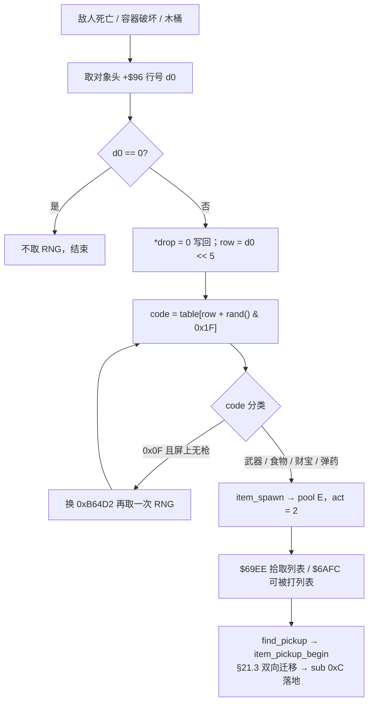

### 62.4 wof：`ObjId` 分派、两张随机表、一个空闲表分配器

`Cps1SceneObjRuntime.cs` 的掉落链（repo 呈现，按 §11.0 只登记）：

```text
0x4E534 更新函数表（7 项，按 ObjId 分派）
  └─ A=04 掉落分支：+0x29 == 0 → 4E604；+0x29 < 0 → 0x4ED84 隔帧闪烁
4E604 处理场景掉落选择：
    创建环记录_5AB6（写 OBJ+0x3C）
    category = OBJ+0x3E
    category < 0  → return
    category == 0 → 生成ObjId3武器掉落_4EA4E
    否则          → 生成ObjId0道具掉落_4E956
4E956 道具：table = (OBJ+0x3F) << 5 ; index = RNG() & 0x1F
            item = 0x4E9CE[table + index]
            item == 0 → 再取一次 RNG 查 0x4E9CE 的回退表
            尝试分配0020道具对象_1448 → drop.ObjId = 1, OBJ26 = item*4
4EA4E 武器：index = item << 5 ; rng = RNG() & 0x1F
            item = 0x4EABC[index + rng]；写回 OBJ+0x3F（0x4EA70）
            item < 0 → return；否则按 item & 7 置全局位 A5-0x3D
```

- 两张表 `ObjId0道具随机表 = 0x4E9CE`（`:81`）/ `ObjId3武器随机表 = 0x4EABC`（`:83`）与 `0x4E534` 分发表（`:147-148` 注明 `rom_read.py longs 0x4E534 7` 逐字核对）都是 repo 侧具名常量；
- `4E604` 里 `创建环记录_对应ASM_5AB6`（`:1819-1820`）会推进环写指针，注释明写它与特效记录相关；音频 / 特效细节按 §0 边界外，不展开；
- 分配器 `尝试分配0020道具对象_对应ASM_1448`（`:2098-2121`）从**道具空闲表**（读指针 + 空闲数量）取槽，取不到就 `return false`——与 dino 池满丢掉落同构；另有 `尝试分配1C掉落对象_对应ASM_1426` 生成 8 个 ObjId5 子对象（`:1467-1471`）；
- `4EA4E` 的 `写回 OBJ+0x3F`（`:1891`）带 FBA 逐帧实证注释（i400 f=592，`+0x3F = 0xFF` 后 `bmi` 返回），并明写「两侧 RNG 消耗相同、种子链未分叉」——直接呼应 §51「取几次即跨系统帧契约」。`Program.cs:2477-2479` 还有一条 `验证场景宝箱掉落链` 的 smoke，自述「不宣称 MAME 掉落随机表逐帧一致」。按用户「不过度怀疑 rep 侧」，这些自带 ROM 逐指令与 FBA 实证的片段不属「非常可疑」，§11.6 条件通道未触发，**0 次 ROM 取证**。

### 62.5 两边同构的四个格子

| 维度 | dino | wof（repo 呈现） |
|---|---|---|
| 行结构 | `row = d0 << 5`，32 字节 / 行 | `table = item << 5`，同样 32 字节 / 行 |
| 挑列 | `rand() & 0x1F` | `0x0F98() & 0x1F` |
| 空结果回退 | `code 0x0F` → 屏上有枪掉弹药，否则换 `0xB64D2` 再取一次 | `item == 0` → 再取一次 RNG 查 `ObjId0道具回退表` |
| 一次性 | `*drop = 0` 写回对象头 | 武器按 `item & 7` 置全局位 `A5-0x3D`、写回 `+0x3F` |
| 池满 | `items.alloc()?` → 掉落丢失 | 空闲表分配器 `return false` → 不生成 |
| 信息挂在哪 | **每个对象头** `+$96` | **场景对象** `OBJ+0x3C / 0x3E / 0x3F` |

两边都把「掉什么」做成**一张按行查的小表 + 一次 RNG**，并且都留有「表值为空时再取一次 RNG」的条件分支、都把「这个对象掉过了」写回某个持久字段、都在容器满时静默放弃。差异只在**行号 / category 挂在哪一层对象上**：dino 挂在每一个可能掉落的对象头，共用一份 roll 例程；wof 挂在场景对象的 `ObjId` 分派与各字节字段上，道具 / 武器各走一张表。按用户要求只谈组织方式，不评优劣、不臆断二者同源。

### 62.6 从生成物到玩家手里

生成之后两边都还有一段「落地 → 可被捡」的过程：

- dino `item_spawn` 给新对象 `act = 2`（spawned airborne，`item.rs:226`），位置直接取来源对象的 `(x, y, z)`；之后 `item_register_pickup` 把它推进 `$69EE` 拾取列表（`find_pickup` 从栈顶走）、`item_register_hurtable` 推进 `$6AFC` 可被打列表（`item.rs:232-250`）——与 §61 弹丸用的 `$671A` 攻击者列表是**同一套注册机制、三种不同列表**；玩家 `find_pickup` → `item_pickup_begin`（`item.rs:269-282`）才进入 §21.3 那条「玩家举起态 + 物品举起态」的双向迁移，物品 `sub` 后续走 `0xC` 下落着地（§21.2）。
- wof 侧 `drop.ObjId = 1`、`OBJ26 = item * 4`（`:1861-1867`），另有 8 个 ObjId5 子对象与 `+0x29 < 0` 的**隔帧闪烁**（`:1447-1449`）——又一处按帧分摊的表现节奏，与 §61 的隔帧相位门、§57 的时间三类计时器同族。按 §11.0 只登记 repo 呈现的这些，不臆断 wof 拾取规则的完整等价关系、不评优劣。

### 62.7 对照表：一次掉落的六个问题

| 问 | dino | wof（repo 呈现） |
|---|---|---|
| 谁触发 | 敌人死亡 / 容器破坏 / 木桶，三入口 | 场景对象 A=04 掉落分支（`4E5FA / 4E8A8 / 4ED18`） |
| 掉什么由谁定 | 对象头 `+$96` 行号 + 表 `0xB6D12 / 0xB64F2` | `OBJ+0x3E` category + `0x4E9CE / 0x4EABC` |
| 随机怎么取 | `rand() & 0x1F` 一次，`0x0F` 时条件第二次 | `0x0F98() & 0x1F` 一次，`item == 0` 时条件第二次 |
| 分配到哪 | pool E，`act = 2` | 道具空闲表，`ObjId = 1`（+ 8 个 ObjId5 子对象） |
| 一次性与去重 | `*drop = 0` | 写回 `+0x3F` + 全局位 `A5-0x3D` |
| 之后怎么被捡 | `$69EE` 拾取列表 → `find_pickup` → 双向迁移 | 按 §11.0 保留，不臆断 |

### 62.8 与既有节的关系、未做与边界

- 上游：`§21`（pool E 生命周期 / 拾取双向迁移）、`§35`（可破坏 prop 契约 / `pass_10cd0`）、`§46`（`AttackRecord`）、`§50`（对象池与背压）、`§51`（RNG 单流 / 取几次即契约）、`§58`（命中侧火花）、`§61`（pool E 的攻击者一面 / 隔帧相位门）；下游：`§26`（加分 / HUD）、`§36`（跨帧写读）、`§43`（离场回收）、`§54`（对象头字段）、`§57`（时间 / 相位门）。
- 本节给 pool E 补上**另一面**：§61 是「住在道具池、语义是攻击者」，本节是「住在道具池、语义是等待被捡的被动对象」；两者共用 `items.alloc()` / `item_free` 与三张注册列表，但进的是 `$671A` 还是 `$69EE`，决定它在命中链里扮演谁。
- **未做（保留，不扩张）**：§21 的 12 class 表不重列；§35.5 的 80 多个 prop class、`pass_10cd0` 全文与盒表数值、两边「可破坏物掉落」规则的**逐关对照**继续保留；`0xB6D12` / `0xB64F2` / `0xB64D2` / `0x4E9CE` / `0x4EABC` 各表逐项字节（§11.0 只在必要时补 data）；wof `0x4F28A` 各跳表、`0x4E534` 7 项逐 handler 全文、ObjId5 子对象完整状态机、全部关卡掉落规则（§11.0 不主动追）；两边「掉落物能否被攻击击飞 / 反弹」是否等价（不臆断）；音频 / 音效按 §0 边界外。
- ROM 条件授权（§11.6）未触发：本节全部结论来自两份 repo 的函数 / 常量 / 文件头注释，`wof_cs` 掉落片段自带 ROM 逐指令与 FBA 逐帧实证注释，不属「非常可疑」，**0 次 ROM 取证**。

**结论**：§62 把「打碎一个箱子」收成一条完整链，给出「行号挂在对象头、三入口共用一份 roll」「`<<5` 32 字节行 + `&0x1F` 一列 + 空结果条件第二次 RNG + 池满丢掉落，两边同构」「生成物先 `act=2` 蹦出、再进 `$69EE` 拾取列表、最后才走 §21.3 的双向迁移」「pool E 的攻击者一面与被动可捡一面共用同一分配器」四条结论；wof 侧收敛为 repo 呈现的 `ObjId` 分派与两张随机表，按 §11.0 不臆断缺失、不扩张逐关普查；`长时间自主推进` 仍是开放目标，本节不宣称终止。

---

## 63. attract demo 里谁在操作角色：预录输入流怎么顶替真实按键

> 触发：§41 把「进战斗之前」收成 Front 多 Scene + 选人记录状态机，但 §41.7 明列 `attract.rs / demo.rs / movie.rs / ...` 13 个 flow 子模块「逐类展开」为保留、不扩张；§60 只取了排行榜这条长任务跨帧主线。两处都没回答一个更基本的问题：**吸引模式里那三个角色是谁在按方向键和攻击键**。本节只取这一条主线，紧邻 §41.7 的保留边界取横切面（同 A.26 的先例），不逐类展开 13 个子模块。
> 归属：设计正文（§0–§63），按「轮次线性追加」接在 §62 / A.26 之后。纯 repo 侧，未新增 ROM 取证（§11.0）。
> 边界：按 §0，wof 宿主层 `FbaFr回放_无对应ASM` / `Program.cs` 冷启动回放配置属宿主补偿，不作设计对照；本节对照的 `0x114C0` 是**原机输入链里的内建按键重播**。§14.3「关卡内未见脚本覆写玩家 pad」与 §19「5 套脚本」的口径维持原貌，不改写、不推翻；§41.7 的保留清单不动。

### 63.1 一句话结论

两边都没有给 attract demo 写一套 AI：**角色收到的仍是「按键」，只是按键不来自面板，而来自 ROM 里的预录流**。dino 把 demo 做成「一局被裁剪过的真游戏」——清 RAM 后重走一次 game start，只删掉 rank 与 time limit 两个会破坏可重复性的系统，每个英雄各持一条 2 字节记录流，帧循环临时把输入源换成录制 pad；wof 把 demo 做成「全部玩家输入总入口里的一个分支」——`FF63AA == 0`（无剧情 / attract mode）时 `0x1142A` 转进 `0x114C0` 三态剧本机，一条 4 字节记录同时给三个强制输入槽，并在装载时连带重置 RNG / 计时等 9 个全局字段。两种组织方式不同，**不做设计优劣判断、不臆断二者同源**。

### 63.2 dino：一局被裁剪过的真游戏

`demo.rs:1-9` / `attract.rs:9-22`：demo 是 attract task（slot 0x10）state 2 / 6 的一个例行程序，标题结束后由 `0x97CC0 / 0x97D02` 调用，`demo_counter`（`G.$757A`）已经步进；它播的是 row 指定的**真实关卡**，三个英雄「按下」录制的按钮。

- **setup 是一次 game start**（`demo.rs:11-34`, `demo.rs:416-451`）：清掉大部分工作 RAM 后，重新做 DIP 解码（`0xA804`）、rank（`0x17F8A`）、三个玩家对象（`0x4D46...`）、关卡 setup（`0xAC6A` 调 `0xA9BE`）、卷轴控制器起点（`0x2228A`）与 HUD（`0x162AE`）。清 RAM 特意**保留**输入 / 系统 / 投币字节、视频寄存器、调色板、fade、高分表、设置、demo counter；`G.$77A2`（car word）与 Episode 3 的 row scroll task 甚至留着上一场演示或游戏的残值（`demo.rs:58-59`, `demo.rs:245-249`）。
- **RNG 被钉死**：`w.rng = 0x1C3`（`G.$14`，`G.$4..$E = 0`），`flow_demo_map` 还把 `rank.aggression = 0`、`w.level = 0`、`rank.freeze = 0x100`（`demo.rs:441`, `demo.rs:489-494`）。同一 row 每次演示都一样——与 §51「取几次 RNG 也是帧契约」同一层考虑。
- **frame loop 是 `game_frame` 少两步**（`demo.rs:49-53`, `demo.rs:217-231`）：`objects_update 0xE90E → collision 0x10546 → hud_update 0x16BEA → build_sprite_list 0x13FA6 → combat_lists_reset 0x105E8 → spawn_script_tick 0xFBF4`，**没有 `rank_tick 0x186CC` 与 time limit `0x103FE / 0x1037E`**。对照 §47 的 8 步，删掉的恰是两个跨整局 / 按真实时间推进的系统。
- **顶层仍是 `Scene` sleep 续算点**（`demo.rs:75-107`, `demo.rs:291-395`）：`dst` 常量把「原机约 10 帧 CPU 的 clear + setup」写成 A..A+10 的逐 video frame 脚本位置；`0x4B0` = 1201 个游戏帧后定格 100 帧（`FROZEN_FRAMES = 0x64`），再 16 步淡出返回 attract。第一遍演示与 Episode 1 的相位各差一帧（`demo.rs:36-47`），与 §41.2 / §60 的「长动作按录制对齐」同族，不在本节重开 CPU 时间片模型。

### 63.3 dino：每个英雄一条流，pad 在状态机之前被换掉

`demo.rs:61-69`, `demo.rs:110-149`, `demo.rs:154-185`：

| 项 | 内容 |
|---|---|
| row 表 | `ROWS_3P 0x9A1E2` / `ROWS_2P 0x9A1EE` 各 6 行，由 `demo_counter`（≥6 归零）与 2P/3P 布局（`dip_a & 0x10`）选；一行 = `stage, area, frames` + 每英雄 6 字节（stream index / `who,id` word / class word） |
| 流指针 | `STREAMS_3P 0x9A2DE` / `STREAMS_2P 0x9A326` 各 18 项 long；模块头称 30 条录制输入流（两者如实并列，不臆断映射） |
| 记录格式 | **2 字节**：`(buttons, frames)`；bit0 右 / 1 左 / 2 下 / 3 上 / 4 攻击 / 5 跳 |
| 运行时状态 | `Demo.rec[(ROM 地址, 剩余帧数); 3]` 挂在 `G.$758A + 0x10*who`；`Demo.pad[3]` = `G.$77A4 + who` |
| 调试显示 | `0x18F8` 在 scroll1 左上角写 4 个 hex：换记录那一帧是 `0xFFFF`，否则 `who*4`（`demo.rs:187-211`；单测 `demo.rs:532-567` 钉死） |

`flow_demo_playback 0x9A146`（`demo.rs:191-213`）由玩家更新 `0x18834` 为每个英雄调用：剩余帧数 `subq.b #1`，到 0 就取 `ptr+2` 的下一条记录并把新 count 装回去，当前记录的 buttons 字节写进 `G.$77A4 + who`。原机是「先把真实输入 `G.$16..18` 拷进 `G.$77A4..6`，再用流覆写」（`demo.rs:220`, `player.rs:538-549`）；repo 把这一步放在 demo 帧循环里，**只在 `objects_update()` 期间**把 `w.input` 换成 `Demo.pad`，出来立刻还原（`demo.rs:222-225`），`player.rs:542` 明写玩家更新内的 `0x9A146` playback 未逐句移植。两边表达的是同一个游戏本意：**状态机读到的 pad 是录制流，真实输入保持不动**（`G.$16` 的唯一读者 `lib_target_input 0x32B94` 调用者未移植，`demo.rs:65-68`）。

```
# dino：一次 demo game frame（设计本意，不是源码逐句）
playback():                       # 0x9A146，每英雄各一条流
    for who in active_heroes:
        (ptr, left) = rec[who]
        left -= 1
        if left == 0:
            ptr += 2              # 下一条 2 字节记录
            pad[who] = buttons(ptr)
            rec[who] = (ptr, frames(ptr))
        else:
            pad[who] = buttons(ptr)
            rec[who] = (ptr, left)

demo_frame():
    frame += 1
    playback()
    saved_input = input
    input = pad                   # 只在本帧对象更新期间顶替
    objects_update()              # 0xE90E：玩家 / 敌人 / 道具全走真状态机
    input = saved_input
    collision()                   # 0x10546
    hud_update()                  # 0x16BEA
    build_sprite_list()           # 0x13FA6
    combat_lists_reset()          # 0x105E8
    spawn_script_tick()           # 0xFBF4
    # 没有 rank_tick、没有 time_limit
    left -= 1; if borrow: sleep(100) → fade(16) → 回 attract
```

这与 §14 的三层覆写（真实输入 → 脚本 → `input_lock`）不冲突：demo 换掉的是**「真实输入」这一层的来源**，之后 `script_player_hook` / `input_lock` / 状态分派照常跑（`player.rs:569-582`）。即 §14.5 那句「层与层之间传的是一个被多方覆写的输入字节」在吸引模式里多了一个上游写入者，而不是多了一套解释器。

### 63.4 wof：输入总入口里的三态剧本机

`Cps1InputBridge.cs:580-609`, `Cps1InputBridge.cs:658-670`：

- `0x1142A` 是「处理全部玩家输入」的总入口，第一件事看 `A5-0x1C56`（`FF63AA`）：**非 0**（有剧情 / 正常游戏）落穿 `0x11436` 复制主体；**== 0**（无剧情 / attract mode）转 `0x114C0`，先同样 `bsr 0x11436`，再走 `0x114D0` 三路跳表。`Cps1InputBridge.cs:592-595` 明确这不是空桩，而是**内建按键重播**剧本机；`Cps1StageTileStreamer.cs:1883-1885` 把 u400 记为「启动后无输入循环演示（attract mode），没有剧情对话段」，正是这条门成立的场景；`Cps1PlayerMulti.cs:1541-1544` 记 u400 第二遍 attract 循环把 P2 的 ObjId 换成 2——演示里跑的仍是真角色对象。
- 剧本机状态住在 `A0 = A5-0x1F8`（`0xFF7E08`）：`+0 word mode`（0 未初始化 / 2 保存态 / 4 回放中）、`+2 long 回放游标`、`+6 byte 本段剩余帧数`（`Cps1InputBridge.cs:606-609`, `Cps1InputBridge.cs:674-700`）。
- **mode 0 装载 `0x114D6`**（`Cps1InputBridge.cs:611-641`, `Cps1InputBridge.cs:705-760`）：按关卡号（`move.w -0x1C5E` ×4）查表 A `0x1154A`（4 项 long = 4 个关卡）或表 B `0x115AA`（保存区）；**先重置 9 个全局字段**——`1CCE / 1CCC / -0x1C42(RNG 种子) / +0x1B0` 四个 word 加 `-0x65/-0x64/-0x63/-0x45/-0x46` 五个 byte——再置 `mode=4`、写游标、`+6 = *a1`，并**立即**把 `*(a1+1..3)` 写进三个强制输入槽 `-0x44/-0x42/-0x40`。也就是说 wof 的一条回放记录不只是「按键」，还自带「这一段的起始快照」。
- **mode 4 消费 `0x115EC`**（`Cps1InputBridge.cs:645-652`, `Cps1InputBridge.cs:793-813`）：每帧 `subq.b #1, +6`；未借位就把 `a1+1..3` 再写一次三槽；借位（`bmi`）则 `游标 += 4`（**一条记录 4 字节：`[剩余帧数][P1][P2][P3]`**），重载倒计时并立即应用新记录。
- **mode 2 保存 `0x1155A`**：把当前 9 字段写回表 B。`0x115BA`（mode 2 且 `btst#3, -0x1C70` 非 0）的比较 / 累计分支 repo 明写未移植、显式报警（`Cps1InputBridge.cs:653-657`）——按 §11.0 只登记，不臆断其完整语义。
- `0x11436` 自己同时做两件事：把 `-0x44/-0x42/-0x40` 复制成 `-0x43/-0x41/-0x3F`（镜像，**取的是上一帧末值**），又把输入环值写回 `-0x44/-0x42/-0x40`（`Cps1InputBridge.cs:815-818`）。真实输入与回放输入因此**汇合在同一组强制输入槽上**，与 §14.3 的「读输入后直接进 `ActStatABCD` 分派」是同一条链，只是 attract 分支多了一个写入者。

```
# wof：0x1142A 一帧的选路（repo 呈现）
handle_all_player_inputs():       # 0x1142A
    copy_and_route_input()        # 0x11436：镜像 -0x43.. + 写 -0x44..
    if FF63AA != 0: return       # 正常游戏：到此为止
    switch word[A5-0x1F8]:        # 0x114C0 / 0x114D0
        case 0:                  # 0x114D6 装载起始快照
            idx = level * 4
            ptr = tableA[idx] 或 tableB[idx]     # 0x1154A / 0x115AA
            (1CCE, 1CCC, RNG, +1B0, -65, -64, -63, -45, -46) = *(ptr)   # 9 字段
            mode = 4; cursor = ptr + 9; countdown = *cursor
            (-44, -42, -40) = *(cursor+1..3)    # 立即应用第一段
        case 4:                  # 0x115EC 消费一帧
            countdown -= 1
            if countdown < 0:
                cursor += 4                      # 4 字节 / 记录
                countdown = *cursor
            (-44, -42, -40) = *(cursor+1..3)
        case 2:                  # 0x1155A 保存当前快照
            write 9 fields back to tableB
```

### 63.5 推进时钟：调用点数量就是帧契约

`Cps1InputBridge.cs:585-587` / `Cps1StageProgressRuntime.cs:813`：ROM 里 `0x1142A` 有 **5 个条件调用点**（`0xB296 / 0xB404 / 0xB7A0 / 0xBAEE / 0x16E58`），分属不同帧体。`Cps1SystemCoroutineRuntime.cs:11623-11635` 与 `Cps1SystemCoroutineRuntime.cs:11754-11778` 记了一次具体代价：旧实现把 `0x16E58` 的 `jsr 0x1142a.l` 降级成只 `bsr 0x11436`，于是 `A5-0x1F8` 的 mode 4 消费段 `0x115EC` 永不执行，游标与倒计时冻住 → **attract demo 输入脚本不推进**；实测缺口形态是每帧本该出现 `0x11436 + 0x114AC + 0x115F6`，CS 侧却只有复制。

这正面接上用户最初「硬件中断 / 函数执行次数不确定」之问：在 wof 的前端层，「本帧是否调用了 `0x1142A`」直接决定回放流是否走一帧，而这个调用是**分散在 5 个帧体里的条件调用**，不是每帧无条件一次。§19 在关卡脚本层、§20 在任务机层、§60 在长任务层各记过一次同类现象，本节是它在**吸引模式输入层**的实例。按 §11.0 只登记 repo 呈现，不臆断其余 4 个调用点的完整逐帧分布、不评优劣。

### 63.6 流程图：两边都在「状态机读输入之前」换源

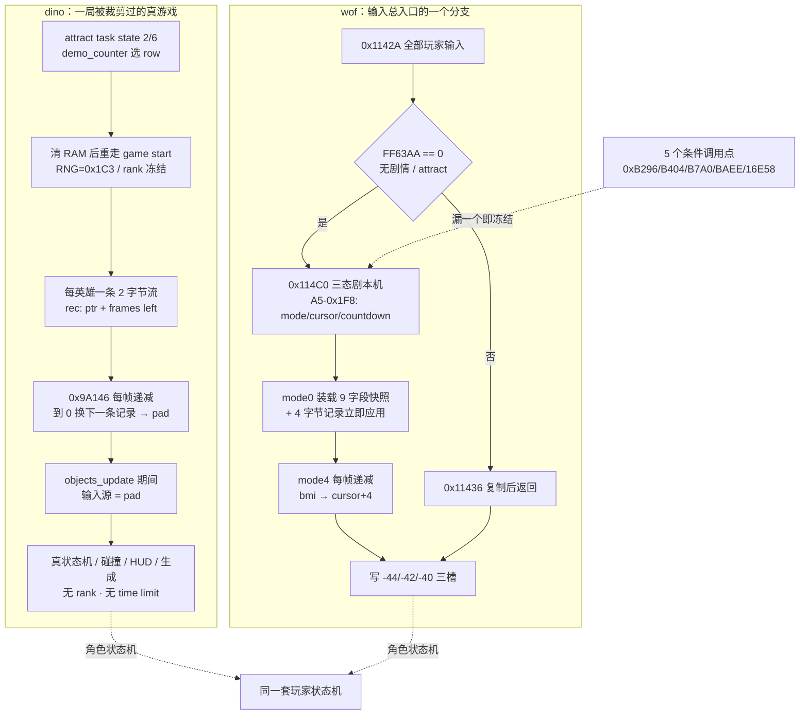

### 63.7 对照表：一次演示的七个问题

| 问 | dino | wof（repo 呈现） |
|---|---|---|
| 谁在给指令 | 预录输入流，**每个英雄一条** | 内建按键重播剧本机，**一条流写三个强制输入槽** |
| 记录格式 | 2 字节 `(buttons, frames)` | 4 字节 `[frames, P1, P2, P3]` |
| 状态住在哪 | `Demo.rec[3]` (`G.$758A+0x10*who`) + `pad[3]` (`G.$77A4+who`) | `A5-0x1F8` 的 `mode / cursor / countdown` |
| 怎么启用 | attract task state 2/6 调 demo routine，row 表选关卡与英雄 | `FF63AA == 0` 在 `0x1142A` 内选路到 `0x114C0` |
| 确定性怎么保证 | RNG 钉 `0x1C3`、清 RAM 重建 game start、跳过 rank 与 time limit | 装载段重置 `1CCE/1CCC/RNG/+1B0` 等 9 字段，记录自带倒计时 |
| 推进时钟 | `flow_demo_playback` 每帧减 count，到 0 换记录；顶层 `Scene` sleep 对齐 video frame | `0x115EC` 每帧 `subq.b #1`、`bmi` 游标 +4；是否推进取决于 5 个条件调用点 |
| 收尾 / 总长 | 1201 游戏帧 + 100 帧定格 + 16 步淡出（`dst` sleep 续算点） | 按 §11.0 保留，不臆断演示总长 |

两边都**不模拟 CPU 时间片**：dino 把 setup 的 CPU 耗时写成测得长度的 sleep（§41.2 / §60 同族），wof 把「本帧有没有调用 `0x1142A`」留成帧体事实。这句是组织方式的并列，不是优劣判断。

### 63.8 与既有节的关系、未做与边界

- 上游：`§14`（输入层帧内优先权 / 一个被多方覆写的输入字节）、`§19`（5 套关卡内脚本 / 推进时钟写在哪里）、`§20`（顶层任务机 `Scene` sleep）、`§41`（Front 多 Scene / 逐 video frame 对齐）、`§47`（`game_frame` 8 步）、`§51`（RNG 单流 / 取几次即契约）、`§60`（长任务跨 video frame 边界）；下游：`§21`（道具状态机在 demo 里照常跑）、`§57`（时间三类计时器，demo 删掉的正是其中两类）。
- **§19 的 5 套脚本表不改写**：那 5 套是关卡内事件脚本；本节是吸引模式前端层的**输入流**，不并入「第 6 行」，也不把 §19.2 的分组结论推倒重来。§14.3「关卡内未见脚本覆写玩家 pad」同理维持原貌——wof 的 `0x114C0` 是 attract 专用分支，不是关卡内脚本。
- **§41.7 保留清单不动**：13 个 flow 子模块「逐类展开」继续保留；本节只取 `demo.rs` 一条主线，不展开 `attract.rs` 其余 state routine、`movie.rs / slides.rs / ending.rs / ranking.rs` 等。这是 A.26「紧邻保留边界取横切面」的第二次实例。
- **未做（保留，不扩张）**：`0x115BA` 比较 / 累计分支、`0x1154A / 0x115AA` 各表逐项字节、4 个关卡回放数据全文、5 个 `0x1142A` 调用点的逐帧分布与 u400 逐帧差异（§11.0 不主动追）；dino 30 条流与两张 18 项指针表的逐条映射、其余 12 个 flow 子模块（§41.7）；两边演示总长 / 角色 AI 在 demo 中是否与真人完全一致（不臆断）；宿主层 `FbaFr回放_无对应ASM` / `Program.cs` 冷启动回放配置按 §0 隔离，不作设计对照；音频 / 音乐按 §0 边界外。
- ROM 条件授权（§11.6）**未触发、0 次 ROM 取证**：本节全部结论来自两份 repo 的函数、常量与文件头注释；`wof_cs` 输入回放片段自带 ROM 逐指令与 FBA 逐帧实证注释，不属「非常可疑」，按用户「不过度怀疑 rep 侧」不再另查 ROM。

**结论**：§63 回答「attract demo 里谁在操作角色」——两边都不是 AI，而是 ROM 预录输入顶替真实按键；dino 做成「重走一次 game start、删掉 rank 与 time limit、每英雄一条 2 字节流、帧循环临时换输入源」，wof 做成「输入总入口在 `FF63AA == 0` 时转三态剧本机、一条 4 字节记录写三槽并连带重置 9 个全局字段、推进依赖 5 个条件调用点」。两者都在状态机读输入之前换源，与 §14 / §19 / §20 / §60 的时序主线闭合；wof 侧收敛为 repo 呈现，按 §11.0 不臆断缺失、不评优劣；`长时间自主推进` 仍是开放目标，本节不宣称终止。

---

## 64. 一次「开一局」的四种写法：全量设定 / 差分补偿 / 白名单重建 / 数据快照

> 触发：§34.3 写「一关内部换段」的集中重置，§55 写「续关不是重开一局」的差分，§63 写「demo 清 RAM 后重走 game start」的白名单，§41 写选人 end 到 `stage start 0xAC4E` 的流程——四条材料散在四处，但从没把**「把一局游戏的状态定下来」这件事本身**当主线并列过。§63 又刚暴露 wof 的 `0x1154A` 起始快照表 / `0x115AA` 保存区，正好补上第四种写法。
> 归属：设计正文（§0–§64），按「轮次线性追加」接在 §63 / A.27 之后。纯 repo 侧，未新增 ROM 取证（§11.0）。
> 边界：§30.7 / §55.8 明列的「wof 续关与结局路径」保留、不扩张——本节 wof 侧**只取 §63 已取证的 attract 开局快照表**，不臆断 wof 新游戏 / 续关路径。§41.7 的 13 个 flow 子模块「逐类展开」保留清单不动；本节只用 `flow.rs` / `cont.rs` / `demo.rs` 三处**已记结论**做并列。§34.3 是「换段」不是「开一局」，不重列其 7 类系统表。按 §0，宿主 `.fr` 回放 / 冷启动回放配置与音频仍在边界外。

### 64.1 一句话结论

两边都没有「新建一个游戏对象」这种东西：**一局的状态就是那一片全局状态，谁开局就由谁按自己的粒度去写它**。dino 有三种粒度——新游戏是**全量设定**（`stage start` 链 + `0xAA0E` 集中重置）、续关是**差分补偿**（只改 6 类状态、刻意保留 RNG 与对象）、attract demo 是**白名单重建**（清 RAM 后重走一次 game start，但明确保留输入 / 高分 / 设置 / 视频状态）；wof 在吸引模式里把「开局状态」直接**做成数据**（每关一张 9 字段起始快照，另有保存区可把当前状态写回）。四种写法对应四种确定性来源，且**都要在开局这一刻显式处理 RNG 与计时**——§50 对象池、§51 RNG、§57 时间三条全局资源线在这里收拢。两种组织方式不同，**不做设计优劣判断、不臆断二者同源**。

### 64.2 四条路径各自怎么写状态

**① dino 新游戏：一条链把全局状态全部设定**（§41.3 / §34.3）。选人 end 走 `stage start 0xAC4E`，随后 `0xA9BE` 关卡 setup、`0xAA0E` 区域重置（`flow.rs:638-664`）。`0xAA0E` 一次把玩家起点、英雄过场脚本 id、对象池、障碍与地形、动态难度、计时与生成列表、表现层七类系统一起归位；`spawn.rs:4-9` 还把 `rank_area_start` / `time_area_start` / `spawn_reset` 列为同一批配套调用。特点是**没有「保留项」**：`rank_game_start 0x17F8A` 开局取一次 `rand()`（§25 / §51），`wave_timer` / `alive` / `kill_all` 清零，池 A/B/C 重建。

**② dino 续关：只写差分，且把「不写什么」写成注释**（§55）。`flow_continue_player`（`cont.rs:28`, `cont.rs:82`, `cont.rs:92`）保留英雄身份、分数、**RNG 种子**与角色对象本体，明写 "without the ordinary join's object reset or RNG call"；只补 `hp / hp_prev / hp_bar = 100`、状态字、facing、lives、join 倒计时，再给 `wave_timer += 600`（`cont.rs:104`）、`rank_add_time(0x400)` 与 `rank_speed_add(-2)`（`cont.rs:91`）。setup 还把 `Scroll2/Scroll3` 与四个相机坐标另存进 `flow.cont`，return 态再恢复（§55.5）——**连「开局」期间暂时换掉的显示上下文都走存/取，而不是重建**。

**③ dino attract demo：清 RAM 后重走 game start，但保留项是一张白名单**（§63）。`flow_demo_clear_ram`（`demo.rs:235-270`）建一个全新 `Game`，把输入 / 系统 / 投币字节、视频寄存器、调色板、fade、sprite buffers、高分表、设置、demo counter、`cam.row` 与 car word 搬过去，其余归零；然后 `flow_demo_setup`（`demo.rs:416-451`）重做 DIP 解码、rank、三个玩家对象、关卡 setup、卷轴起点与 HUD。RNG 钉 `0x1C3`（`demo.rs:441`），`flow_demo_map` 再冻结 `rank.aggression / level / freeze`（`demo.rs:489-494`）。特点是**重建但删掉两个会随时间漂移的系统**（rank / time limit），并明列「清 RAM 保留清单」。

**④ wof attract 开局：把开局状态做成一张表**（§63.4）。`0x114D6` 按关卡号 ×4 查表 A `0x1154A`（4 项 long = 4 个关卡），从指针处先灌回 **9 个全局字段**——`1CCE / 1CCC / -0x1C42(RNG 种子) / +0x1B0` 四个 word 加 5 个 byte——再置 `mode=4`、写游标与倒计时，并立即把第一段输入写进三槽（`Cps1InputBridge.cs:611-641`, `Cps1InputBridge.cs:705-760`）。`0x1155A` 反向把当前 9 字段写回表 B `0x115AA` 保存区（`Cps1InputBridge.cs:763-790`）。即：**一次开局 = 把一段数据灌回全局状态**，而不是跑一串初始化调用；保存区让「当前状态」也能变成下一段快照。按 §11.0 只登记 repo 呈现的这一形态，不臆断 wof 新游戏 / 续关是否同构。

### 64.3 差分表：同一个状态，四条路径怎么处理

| 全局状态 | dino 新游戏 | dino 续关 | dino demo | wof attract 快照（repo 呈现） |
|---|---|---|---|---|
| RNG 种子 | `rank_game_start` 取一次 `rand()`（§25 / §51） | **刻意不取、不重置**（`cont.rs:92`） | 钉 `0x1C3`（`demo.rs:441`） | 快照第 3 个 word 就是 RNG 种子（`Cps1InputBridge.cs:611-641`） |
| 帧 / 计时 | `wave_timer` / `alive` / `kill_all` 清零（§34.3） | `wave_timer += 600` + rank 时间补偿 | 帧计数归零，跳过 time limit（§63.2） | `1CCE / 1CCC` 两个 word 由快照给定（§63.4） |
| 对象池 | 池 A/B/C 重建（`flow.rs:653/658/660`） | **对象本体不重置**（§55.3） | 新 `Game` 里池全空后重建三玩家（`demo.rs:427-429`） | 按 §11.0 保留，不臆断 |
| 玩家身份 / 分数 | 由选人记录给（§41.3） | **保留 hero / score**（`cont.rs:82`） | row 表给 hero / class，分数按清 RAM 归零 | 按 §11.0 保留，不臆断 |
| 难度 / rank | 按 `stage × area` 重掷 aggression（§34.3） | `rank_speed_add(-2)` 降档 | `aggression=0 / level=0 / freeze=0x100`（`demo.rs:489-494`） | 9 字段里的 `+0x1B0` 等由快照给定 |
| 相机 / 显示上下文 | 装区域 scroll2 header 与地图页（§34.3） | 另存再恢复 `Scroll2/Scroll3`（§55.5） | 保留视频内存 / 调色板 / fade / `cam.row`（`demo.rs:235-270`） | 按 §11.0 保留，不臆断 |
| 输入源 | 真实输入（§14） | 真实输入 + join 记录状态机（§41 / §55.2） | 预录流临时顶替（§63.3） | 回放记录立即写三槽（§63.4） |
| 保留项的载体 | 无 | 代码注释 + 契约清单 | **清 RAM 保存清单** | **表 A / 表 B** |

三条 dino 路径的共同点：**写入粒度不同，但写的是同一片全局状态**，没有为「续关局」或「演示局」另建一份状态副本。这与 §40「`G.$735E` 与 intro 共享、靠 `tally.owner` 解释」、§41「`Front.task` 与 boot/attract 共享一个 Scene」、§35「一个 pool B + 共享契约」是同一种习惯——**共享结构靠「当前谁在用」解释**。

### 64.4 伪代码：四种开局的形状

```
# ① 全量设定：一条链，无保留项
new_game(hero, stage):
    stage_start()            # 0xAC4E
    stage_setup()            # 0xA9BE
    area_reset()             # 0xAA0E：七类系统一次归位
    rank_game_start()        # 取一次 RNG
    time_area_start(); spawn_reset()
    # 没有 keep 列表

# ② 差分补偿：只写少数状态，其余不动
continue_game():
    keep(hero, score, rng, objects)        # 明确「不写」的清单
    hp = 100; lives = ...; state = 0x0002_0000
    wave_timer += 600
    rank_add_time(0x400); rank_speed_add(-2)
    # 不取 RNG、不重置对象

# ③ 白名单重建：先全清，再把保留项搬回来
demo_game(row):
    fresh = Game::new()
    move_into(fresh, KEEP_LIST)             # 输入 / 高分 / 设置 / 视频 / fade / cam.row ...
    state = fresh
    game_start(row.stage, row.area)         # 重走 setup
    rng = 0x1C3; rank.freeze = 0x100
    frame_loop = level_frame MINUS (rank, time_limit)

# ④ 数据快照：把一段表数据灌回全局
wof_attract_start(level):
    ptr = tableA[level * 4]                 # 0x1154A
    (1CCE, 1CCC, RNG, +1B0, b65, b64, b63, b45, b46) = *(ptr)
    mode = 4; cursor = ptr + 9; countdown = *cursor
    apply(cursor + 1..3)                    # 第一段输入立即生效
    # 反向：save_current() 把同样 9 字段写回 tableB[level*4]  # 0x1155A
```

### 64.5 流程图：四条入口汇到同一片全局状态

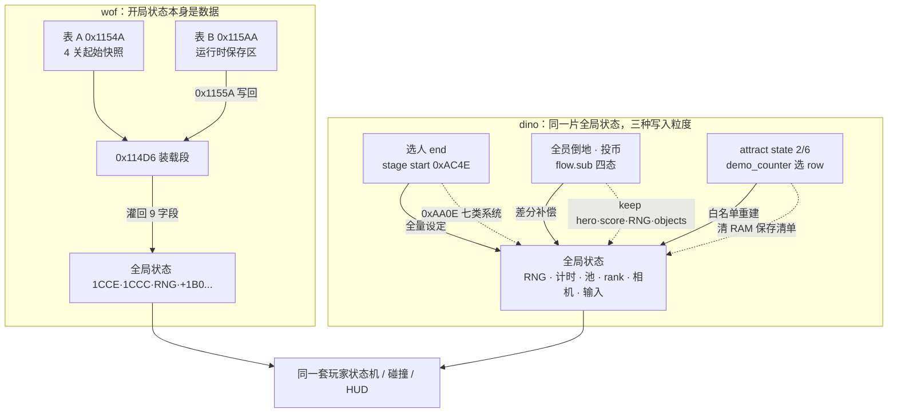

### 64.6 组织结论：开局是三条全局资源线的收拢点

1. **§50 对象池 / §51 RNG / §57 时间在开局这一刻被集中定义**：新游戏取一次 RNG、续关刻意不取、demo 钉死并冻结 rank、wof 把 RNG 种子与两个帧计数写进快照表。也就是说「取几次 RNG」「计时从哪起」「池是空是满」不是初始化细节，而是**决定这一局是否可复现的显式契约**（§51 / §55 / §63 各记过一次，本节是它们的汇合点）。
2. **「保留什么」被三种载体显式化**：dino 续关靠代码注释与契约清单、demo 靠清 RAM 保存清单、wof 靠表 A / 表 B。三者都不把「哪些状态该变」隐含在初始化调用里，而是变成可逐帧对拍的事实——与 §36「这一帧写、下一帧读」、§41.2「长动作写成测得长度 sleep」同族。
3. **不模拟 CPU 时间片，但模拟「状态起点」**：§60 / §63 记过两边把长任务的 CPU 耗时写成常量或条件调用点；本节补上另一半——**起始状态本身也被写成常量表 / 白名单 / 差分清单**，于是「同一 row 每次演示一样」「续关不重掷随机」「新游戏从零起」各自有明确来源。这是组织方式的并列，不是优劣判断。

### 64.7 与既有节的关系、未做与边界

- 上游：`§25`（rank 时间驱动）、`§28`（wave_timer）、`§30`（`flow.mode` 8 态）、`§34.3`（`0xAA0E` 换段重置）、`§41`（选人 → stage start）、`§50`（对象池）、`§51`（RNG 单流）、`§55`（续关差分）、`§57`（时间三类计时器）、`§60`（长任务跨帧）、`§63`（demo setup 与 wof 快照表）；下游：`§26 / §40`（分数归属在四种开局里的去留）、`§52`（`Scroll2` 另存恢复）。
- **§34.3 不重列**：那是「一关内部换段」的 7 类系统，本节只把它当「新游戏全量设定」的一个调用点；两者粒度不同（换段 vs 开局），不合并。
- **§30.7 / §55.8 保留边界不动**：wof 续关与结局路径、`0x42C2` 后续链、`A5+0x188` 全部消费点继续按 §11.0 保留、不臆断。本节 wof 侧只登记 §63 已取证的表 A / 表 B，不把 attract 快照推广成「wof 所有开局方式」。
- **§41.7 保留清单不动**：13 个 flow 子模块逐类展开仍为保留；本节只用三处已记结论做并列，不展开 `movie.rs / slides.rs / ending.rs / cont.rs` 全文。
- **未做（保留，不扩张）**：dino `flow_stage_setup` 逐字段清单、`rank_game_start` 全表、`cont.rs` 显示层逐帧、`demo.rs` 30 条流与两张 18 项指针表的逐条映射；wof `0x1154A / 0x115AA` 各表逐项字节、4 个关卡快照全文、`0x115BA` 比较 / 累计分支、5 个 `0x1142A` 调用点逐帧分布（§11.0 不主动追）；两边新游戏 / 续关 / 演示三条路径的**逐帧等价对照**（不臆断）；宿主 `.fr` 回放 / 冷启动回放配置按 §0 隔离，不作设计对照；音频 / 音乐按 §0 边界外。
- ROM 条件授权（§11.6）**未触发、0 次 ROM 取证**：全部结论来自两份 repo 的函数、常量与文件头注释；`wof_cs` 输入回放片段自带 ROM 逐指令与 FBA 逐帧实证注释，不属「非常可疑」，按用户「不过度怀疑 rep 侧」不再另查 ROM。

**结论**：§64 把「开一局」收成四种写法——dino 全量设定 / 差分补偿 / 白名单重建，wof 数据快照——给出「四条路径写的是同一片全局状态、靠当前谁在开局解释」「RNG / 计时 / 对象池三条全局资源线在开局这一刻被集中定义」「保留项分别靠注释清单 / 清 RAM 白名单 / 表 A·表 B 显式化」三条结论；wof 侧收敛为 repo 呈现的 attract 快照表，按 §11.0 不臆断缺机制、不评优劣、不扩张 §30.7 与 §41.7 的保留边界；`长时间自主推进` 仍是开放目标，本节不宣称终止。

---

## 65. 一组机器设置怎么变成玩法规则：三字节接口与直读的全局难度字节

> 触发：DIP 在笔记里散落六处——§25 难度初值与 rank 速度、§26 奖命阈值、§30 / §55 禁续关 `b4d7`、§41 选人前置、§63 的 2P/3P 布局与 demo 解码、§64 把 DIP 解码列为「开一局」的一个步骤——但从没把**「机器设置 → 玩法规则」这条链本身**当主线。§64 之后又发现 boot / game start / demo 三处都重跑解码，需要说清重跑的到底是什么。
> 归属：设计正文（§0–§65），按「轮次线性追加」接在 §64 / A.28 之后。纯 repo 侧，未新增 ROM 取证（§11.0）。
> 边界：附录 A 已记 dino 的 EEPROM test menu / service / debug dip switches **明确 out of scope**；本节只谈「cook 出来的三个字节怎么被读」，不展开 EEPROM 编辑界面，也不把 `dino.cfg` 这个便携层当游戏设计（按 §0，宿主配置层不算设计）。音频相关位（QSound / demo sound / stereo）只登记位定义，按 §0 边界外。§25 / §26 / §30 / §41 / §55 / §63 / §64 的既有结论维持原貌，不改写。wof 侧按 §11.0 只登记 repo 呈现，**不臆断其 DIP 解码路径、不评优劣**。

### 65.1 一句话结论

dino 的做法是**一次性解码成稳定接口**：EEPROM 的 19 字节选项在 boot 由 `0xAC794` cook 成三个字节 `G.$777A / $777B / $777C`，之后**整个游戏只读这三个字节**，各系统用命名位域（`difficulty()` / `timer_level()` / `continue_allowed()` …）取自己那几位，不碰原始选项。wof repo 侧呈现的是**各系统直读一个全局字节**：难度 / 波次字节 `A5-0x5A` 被共享概率门 `0x3B94 / 0x3E88` 与各个 Actor runtime 的 `difficultyAdjusted` 直接取用，与对象自己的 `+0xA2` 叠加后钳位查表。前者把「配置」收敛成一份三字节契约，后者把「配置」保持成一个被多方读取的全局状态——两种组织方式不同，**不做设计优劣判断、不臆断二者同源**。这是继 §14 输入字节、§51 RNG 单流、§57 时间之后，**第四条被多方共享的全局状态线**。

### 65.2 dino：19 字节选项 → 11 个命名项 → 3 个「熟字节」

`config.rs:1-26` 的文件头把整条链写得很直白：原机在 EEPROM 里放 19 字节选项（出厂镜像 `0xACBF4`），boot 时 `0xAC794` 把它们「cook」成三个字节 `G.$777A`（投币 / 槽位 / QSound）、`G.$777B`（难度 / 计时档 / 奖命）、`G.$777C`（命数 / 续关 / 演示音效 / 免费游玩）；**其余游戏代码只读这三个字节**。`Settings` 结构就是这三个字节（`config.rs:33-44`）：

| 字节 | 位域 | 命名读取 | 消费者 |
|---|---|---|---|
| `dip_a` `G.$777A` | bit7 | `qsound()` | boot 的声音输出标志（按 §0 只登记位定义） |
| | bit6 + bits0-2 | `coin_mode()` 0..8 | system task `0x9CFC6` 查投币比表 `0x9D038`（`system.rs:147-170`） |
| | bits3-4 | `chute_mode()` 0..2 | 三槽 / 单槽 / 2P 布局；bit4 另作 `b4cf`（`flow.rs:382`, `system.rs:153-158`） |
| `dip_b` `G.$777B` | bits0-2 | `difficulty()` 0..7 | `rank.dip` → `rank_game_start` 查表定初始 rank（§25、`rank.rs:34-36`） |
| | bits3-4 | `timer_level()` 0..3 | `rank_speed = level + 1`（§25、`rank.rs:34-36`） |
| | bits5-6 | `extra_life()` 0..3 | `Flow::extend_sel`（`flow.rs:225-231`）算 `0x6BFE` 奖命表偏移（§26） |
| `dip_c` `G.$777C` | bit6 | `continue_allowed()` | `0xA804` 置 `b4d7` 禁续关（§30 / §55、`flow.rs:383-385`） |
| | bit5 | `demo_sound()` | 声音刷写 `0x610`（按 §0 只登记位定义） |
| | bit2 | `free_play()` | `Sys.free_play`（`system.rs:150-152`）、续关投币门（§55.2） |
| | bits0-1 | `lives()` | `flow_lives_init 0x4DD6`（`flow.rs:465-470`） |

`Config::cook`（`config.rs:166-184`）是这条链的唯一写入点：11 个命名选项经掩码、越界截断（coin mode > 8 归 0、chute > 2 归 1）拼成三字节；`Settings` 的方法（`config.rs:52-97`）是唯一解释点，把「位」翻译成「玩法语义」。也就是说 **「配置长什么样」与「配置什么意思」被分在两个地方**，中间只隔三个字节。

### 65.3 三处重跑解码，重跑的是「解释」不是「配置」

| 时机 | 位置 | 做了什么 |
|---|---|---|
| boot frame 68 | `boot.rs:155-181` | `self.flow.dip = self.flow.config.cook()`（`0xAC794`），随后 `st::CLEAR_END` 里再按 `dip_a & 0x10` / `dip_c & 0x40` 置 `b4cf` / `b4d7`，并建 system task |
| 每次 game start | `flow.rs:377-395` | `0xA804` 重读 `dip_a & 0x10` → `b4cf`、`dip_c & 0x40 == 0` → `b4d7`；`extend_sel()` 与 `flow_player_init` 各取所需 |
| attract demo setup | `demo.rs:16`, `demo.rs:413-425` | 清 RAM 后「the same as a game start: the DIP decode (0xA804)」，`rank.dip = dip_b`（`0x17F8A` 读 `G.$777B`） |

三处都没有重新读 EEPROM / 重新 cook，而是**对同一份 `Flow::dip` 重新执行一遍「把位解释成全局状态」**（`flow_apply_config` 的接口注释 `flow.rs:237-241` 明确它要在 `flow_boot` 或 `start_stage` 之前调用一次）。这与 §64「四条开一局路径写的是同一片全局状态」是同一层结论：DIP 不是每局重配的开关，而是**一份稳定的机器设定，在每个需要它的阶段被重新解释一次**。`trace.rs:1854-1859` 还把三个字节与 `rank.dip` 一起登记进逐帧 trace——配置值本身也是可逐帧对拍的状态。

### 65.4 wof：一个被多方直读的全局难度字节

`Cps1EnemySubs.cs:324-348` 的共享概率门 `0x3B94 → 0x3E88` 是 repo 侧最清楚的一处：

- `roll = 0F98() & 0x1F`；`difficulty = clamp.s8(OBJ+0xA2 + A5-0x5A, 0, 0x1F)`；`threshold = table[difficulty]`；`ok = roll < threshold`。
- 也就是**全局字节 `A5-0x5A` 与每个对象自己的 `+0xA2` 相加后钳位**，再当概率表索引；`Cps1Actor16Runtime.cs:153` 直接把它注为「难度/波次字节」。
- 这个门被大量 Actor runtime 调用：`Cps1Actor15Runtime.cs:536`、`Cps1Actor23Runtime.cs:43`（`0x3C6A` 重掷 `C` 值的概率表）、`Cps1Actor12Runtime.cs:659` 等；`Cps1Actor20Runtime.cs:193-198` 的 `difficultyAdjusted` 也是「`+0xA2` 减 `A5-0x5A`」的同一套修正。
- 与 §9.2 / §11.5 / §17 已记的结论一致：wof 侧是「一个单字节难度档 + 概率表」，不是集中决策器（§11.3 的纠偏维持原貌）。

按 §11.0 只登记 repo 呈现的这条读取链，**不臆断 wof 有没有三字节式的解码接口、不臆断 `A5-0x5A` 的全部写入点、不评优劣**。宿主层的 `.ini` 诊断开关与回放配置按 §0 隔离，不作设计对照。

### 65.5 伪代码与流程

```
# dino：一次 cook，三字节接口，多处重新解释
boot_frame_68():
    dip = config.cook()          # 19 字节 EEPROM 选项 → G.$777A/B/C
    b4cf = dip.a & 0x10; b4d7 = (dip.c & 0x40 == 0)
    sys_init(dip.a, dip.c)       # 投币比 / 槽位 / free play

game_start():                    # 0xA804，每次开一局
    b4cf = dip.a & 0x10; b4d7 = (dip.c & 0x40 == 0)
    rank.dip = dip.b             # 难度 bits0-2、计时档 bits3-4
    b4e5 = extend_sel(dip.b)     # 奖命阈值的表偏移
    lives = dip.c & 3

# 消费者只读命名位域，不碰原始选项
rank_game_start():  table[ dip.difficulty() ] + rand() & 0x1F
flow_continue_player():  if !dip.continue_allowed(): b4d7 = 1 ...

# wof：概率门每次直接读全局字节
probability_gate(obj, table):
    roll = rng() & 0x1F
    d = clamp_s8( obj.a2 + GLOBAL_DIFFICULTY_A5_5A, 0, 0x1F )
    return roll < table[d]
```

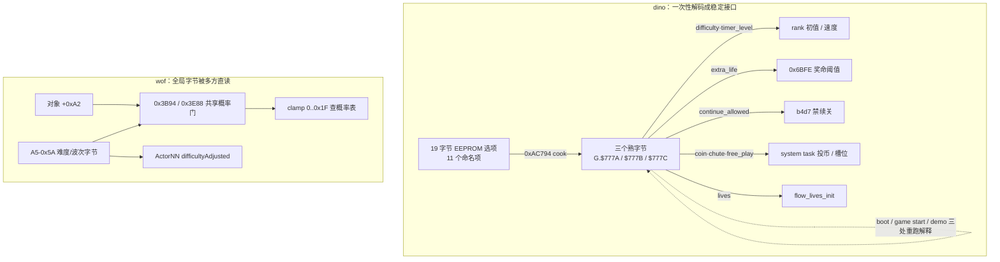

### 65.6 对照表与组织结论

| 维度 | dino | wof（repo 呈现） |
|---|---|---|
| 原始配置 | 19 字节 EEPROM 选项 / 11 个命名项（`config.rs:1-26`） | 按 §11.0 保留，不臆断 |
| 稳定接口 | 三个熟字节 `G.$777A/B/C`（`config.rs:33-44`） | 全局难度字节 `A5-0x5A`（`Cps1EnemySubs.cs:324-348`） |
| 语义在哪 | `Settings` 的命名方法集中解释（`config.rs:52-97`） | 各调用点自己叠加 / 钳位 / 查表 |
| 谁读 | rank / 分数 / 音效 / system / flow / demo 各自只读自己那几位 | 共享概率门 + 各 Actor runtime 的 `difficultyAdjusted` |
| 重跑时机 | boot、game start、demo setup 三处重跑「解释」（§65.3） | 按 §11.0 保留，不臆断 |
| 与 RNG 的关系 | `rank_game_start` 用难度查表后再取一次 `rand() & 0x1F`（§51） | 概率门先取 `rng() & 0x1F` 再与难度索引比较（§9.2 / §51） |

1. **第四条全局共享状态线**：§14 是「一个被多方覆写的输入字节」、§51 是「一个全局 RNG 单流」、§57 是「一局里的时间由谁推进」；本节补上「一份机器设定由谁解释」。四者都靠**单一状态被多方读**而不是各系统各存一份，与 §40 `tally.owner` / §41 `Front.task` / §64「同一片全局状态」同族。
2. **「解码一次」与「解释多次」分开**：`Config::cook` 只在 boot 跑一次，之后 boot / game start / demo 三处重跑的是把位翻译成 `b4cf / b4d7 / rank.dip / b4e5` 的动作。于是 §64 的四种「开一局」在配置维度上并不冲突——它们复用同一份设定，只是各自把需要的几位重新落到全局状态里。
3. **配置也是逐帧可验的状态**：`trace.rs:1854-1859` 把 `dip_a/b/c` 与 `rank.dip` 一起登记，续关的 `b4d7`、demo 的 `b4cf`、奖命的 `b4e5` 都是可从配置位推出的确定值——与 §36「这一帧写、下一帧读」、§51「取几次 RNG 即契约」同一层考虑。这是组织方式的并列，不是优劣判断。

### 65.7 与既有节的关系、未做与边界

- 上游：`§9.2` / `§11.5` / `§17`（wof 单字节难度 + 概率门）、`§25`（rank 初值 / 速度）、`§26`（奖命阈值）、`§30` / `§55`（`b4d7` 禁续关）、`§41`（选人 / join）、`§51`（RNG 单流）、`§63`（2P/3P 布局 / demo 解码）、`§64`（开一局的四种写法）；下游：`§14`（多方覆写输入字节）、`§57`（时间）、`§50`（对象池）。
- **既有结论不改写**：§25 的 `rank_game_start` 伪代码、§26 的 `hud_extra_life`、§30.7 / §55.8 的保留边界、§63 / §64 的 demo setup 与四条开局路径全部维持原貌；本节只把散落的 DIP 引用收成一条链。
- **未做（保留，不扩张）**：`Config::cook` 11 项逐项与 EEPROM 19 字节布局、`0x9D038` 投币比表逐项、`0x6BFE` 奖命表逐项、`0x180BA / 0x180FA` 难度表逐项（§11.0 只在必要时补 data）；wof `A5-0x5A` 的全部写入点、各 Actor runtime 概率表逐项、DIP 解码路径（§11.0 不主动追、不臆断）；两边设置项逐项等价关系（不臆断）；EEPROM test menu / service / debug dip switches（附录 A 已记 dino out of scope）；`dino.cfg` 便携层按 §0 不作设计对照；音频 / QSound / stereo / demo sound 只登记位定义，按 §0 边界外不展开。
- ROM 条件授权（§11.6）**未触发、0 次 ROM 取证**：全部结论来自两份 repo 的函数、常量与文件头注释；`wof_cs` 概率门片段自带 ROM 逐指令与 FBA 逐帧实证注释，不属「非常可疑」，按用户「不过度怀疑 rep 侧」不再另查 ROM。

**结论**：§65 把「机器设置 → 玩法规则」收成一条链，给出「dino 一次性 cook 成三字节稳定接口、各系统命名位域读取、boot / game start / demo 三处重跑的是解释而非配置」「wof repo 侧呈现为 `A5-0x5A` 全局难度字节被共享概率门与各 Actor runtime 直读」「配置是继输入 / RNG / 时间之后第四条被多方共享的全局状态线」三条结论；wof 侧按 §11.0 收敛为 repo 呈现，不臆断缺机制、不评优劣、不扩张既有保留边界；`长时间自主推进` 仍是开放目标，本节不宣称终止。

---

## 66. 一个倒地的人 / 一件地上的东西，怎么被「认领」成专属目标

> 触发：§29 的差分表只在两处提过 `+0x76`「认领倒地玩家的敌人」（`:4133`、`:4185`），§13 把它归进「census 一帧延迟」族，但从没把**认领本身**当主线；查重又确认 §16 已展开 Boss 变身、§13 已展开目标选择、`name_entry` 已被 §60.6 / A.24 明列保留，都不碰。取证时发现 dino 有一整套 `claim` 语汇，而且有**两个实例**：倒地的玩家、地上的道具，共用同一套「候选表 + 双方标志」写法（`enemy/claim.rs`、`enemy/class6_eat.rs`）。
> 归属：设计正文（§0–§66），按「轮次线性追加」接在 §65 / A.29 之后。纯 repo 侧，未新增 ROM 取证（§11.0）。
> 边界：§13（census / pick_target / retarget_slot / steer_slot）、§24（投技双向互检）、§29（受击恢复链与 §29.8 保留项）、§62（掉落列表）、§11（活跃玩家位图勘误）全部维持原貌；**不扩张** §29.8 的 `player_knockdown` 逐函数全文与 wof 倒地字段组状态机、§41.7 的 13 个 flow 子模块逐类展开、§60.6 / A.24 的 `name_entry`。wof 侧按 §11.0 只登记 repo 呈现的共享抢占函数，**不臆断它有没有等价的倒地认领、不臆断其全部调用点、不评优劣**；音频按 §0 边界外。

### 66.1 一句话结论

dino 没有为「谁可以接着打这个倒地的人」设一个全局仲裁器：它把**独占关系写进两个对象头**——玩家侧 `+$76` 记住认领者、`+$7E/+$7F` 是两张候选表的认领标志，敌人侧同字节置位并把 `TARGET` 指向玩家；候选表 `0x6A5A / 0x6A8E` 每帧在 pool A 更新前清空、由 class 10 走路时重新登记，倒地玩家状态读到的是**上一帧**的表。同一套语汇在 class 6 身上再来一次：跳过已被认领的地上道具（`+$AF`），挑类别最低的一件写回自己 `+$D0`。也就是说「一份资源被独占」被做成了**双向标志 + 每帧重建的候选表 + 退出时清标志**，而不是一个集中决策。wof repo 侧呈现的是另一层组织：`0x4146 近身抢占写 A06 目标` 被多个 Actor 的状态机尾部当作共享函数调用（带 `+0xA4` / `A5+0x1CB` / `0x3B94` 门），目标写入走的是共享函数而不是双方标志；按 §11.0 按 repo 呈现登记，**不臆断二者等价、不评优劣**。

### 66.2 dino：两张每帧重建的候选表

`enemy.rs:248-255` 把清空点钉在 `enemies_update 0x23420` 的开头：先 `dizzy_prev = dizzy; dizzy = 0`（§29 的全局限流同帧），紧接着 `combat.clear(0x6A5A)` / `combat.clear(0x6A8E)`，然后才按 slot 顺序跑 pool A。登记侧在 `class10_ai.rs:141-157` 的 state 2「走到目标旁边」：只要还活着就 push 进 list A；若自己已带 `CLAIM_A` 就直接转去 `c10_3c856`；否则再 push 进 list B，带 `CLAIM_B` 则转 `c10_3be00`。于是**一张表是「还没被 A 认领的暴徒」，另一张是「还没被 B 认领的暴徒」**，两表由同一个走路状态按自身标志分流入列。

`enemy/claim.rs:1-8` 的文件头把跨帧关系说得很直白：class 10 每帧走路时登记（`0x4AF4 / 0x4B26`），列表每帧重建，而玩家代码从倒地状态（`0x1C290..0x1CD2E`）调用 `0x6606`，所以**读的是上一帧的列表**。这与 §13「census 每帧统计、下一帧读」、§29「`dizzy_prev` 上一帧快照」是同一种帧契约，只是这里被占用的资源从「统计数字」换成了「一个倒地的人」。

| 环节 | 位置 | 做了什么 |
|---|---|---|
| 清空 | `enemy.rs:253-255` | pool A 更新前清 `0x6A5A / 0x6A8E`；同帧把 `dizzy` 转 `dizzy_prev` |
| 登记 | `enemy/class10_ai.rs:141-157` | 活着的 class 10 在 state 2 按自身 `CLAIM_A/B` 分流 push 两表 |
| 读取 | `player.rs:2846-2848` → `enemy/claim.rs:29-58` | 倒地状态调 `0x6606`，两表各取一次候选 |
| 挑人 | `enemy/claim.rs:63-85` | X 方向最近者写入玩家 `+$76`、距离写 `+$88`；候选带**对方**标志即整轮放弃 |
| 放弃 | `enemy/class10_ai.rs:93-98` | `0x3C916` 清 `CLAIM_A / CLAIM_B` 并复位状态 |
| 解绑 | `player.rs:2819-2820`, `player.rs:3478-3479` | 玩家侧 `b7e / b7f` 清零（眩晕 / 起身相关） |

### 66.3 一次认领要写几个对象头

`enemy/claim.rs:29-58` 的两段几乎对称：list A 用 `+$7E`、排除候选带 `+$7F` 者；list B 用 `+$7F`、排除候选带 `+$7E` 者。成功条件是 `claim_pick` 返回真**且** `+$88` 的距离为非负；随后一次认领同时写四处：

| 写到哪 | 字段 | 含义 |
|---|---|---|
| 玩家 | `+$7E` 或 `+$7F` = 1 | 这张表已经有人认领我了 |
| 玩家 | `+$76` = 暴徒 handle | 记住是谁（`player.rs:47`） |
| 暴徒 | `+$7E` 或 `+$7F` = 1 | 与玩家同字节互认 |
| 暴徒 | `TARGET` = 玩家 handle | 把玩家设成自己的目标 |

`claim_pick`（`enemy/claim.rs:63-85`）里有两处很「游戏本意」的设计：一是**候选只要带对方标志就 `return false` 结束整轮**，不是跳过它继续挑——也就是两张表互为排他门，宁可这一帧谁都别认领；二是距离比较带 `+0xC0` 偏置、超过阈值的远处候选保留有符号偏置值，`claim.rs:104-134` 的三个单测把「最近者胜」「远处候选不对称」「对方标志终止整轮」钉死。

认领不是终点。`enemy/class10_hold.rs:212-231` 的 `c10_claim 0x3C864` 把暴徒切进 step 0/2/4/6/8 的踩人链；`class10_hold.rs:255-275` 的 step 4（`0x3C8E8`）在玩家身边等待，要同时满足 `(mode,sub)==0x200`、`action==0x21`、且玩家 `b7e` 与 `b7f` **两个标志都置位**才继续，否则 `c10_3c916` 清双方标志、整段重来。也就是说认领关系是**两个对象各自的状态机持续复核的联合条件**，与 §24「投技双向互检」同族：任一侧状态变了，另一侧就放弃。

### 66.4 第二个实例：Bludge 认领地上的东西

`enemy/class6_eat.rs:1-11` 写明 class 6 是唯一会看物品列表的敌人。`enemy_c6_claim_item 0x3AFFA`（`class6_eat.rs:22-58`）扫 `G.$69EE` 拾取列表（与 §62 掉落进的是同一张表），跳过已死、容器（`0x20A`）、**已认领 `+$AF`** 的条目，在剩下里挑类别字节最低者（食物 0 / 弹药 1 / 武器 2 / 宝物 3），写自己 `+$D0` = 道具 handle、并把该道具 `+$AF = 1`；`+$D8` 记被排除条数，`+$B6 = 0xFF` 表示全被占。之后走 60 步上限的靠近、按关卡等待、吃进 8 格胃环，被打断或死亡时 `0x3B086 / 0x3B0D8` 把东西吐回地上。

| 维度 | 倒地玩家（`0x6606`） | 地上道具（`0x3AFFA`） |
|---|---|---|
| 候选表 | `0x6A5A / 0x6A8E`，每帧清空重建 | `G.$69EE` 拾取列表（§62 掉落写入） |
| 排除条件 | 候选带**对方**标志则整轮放弃 | 容器 / 已认领 `+$AF` 则跳过并计数 |
| 挑谁 | X 方向最近（带 `+0xC0` 偏置） | 类别字节最低 |
| 写标志 | 玩家 `+$7E/$7F` + `+$76`；暴徒同字节 + `TARGET` | 道具 `+$AF`；敌人 `+$D0` |
| 解除 | `c10_3c916` / 玩家侧清零 | 吃掉后道具 off 但留槽，死亡 / 被打时吐回 |
| 帧契约 | 读上一帧的 list | 扫当前拾取列表 |

两例共用的不是代码，而是**语汇**：一张候选表、一个「已被别人占」的标志、一次挑选、写回双方、退出时解绑。§50 的对象池、§62 的掉落表在这里成了「可被独占的资源目录」，与 §40 `tally.owner`、§41 `Front.task`、§64「同一片全局状态」一样，靠「当前谁持有标志」解释归属。

### 66.5 wof：共享抢占函数，按 §11.0 只登记 repo 呈现

`Cps1EnemyAI.cs:2160-2164` 把 `共享W状态_近身抢占写A06目标_对应ASM_4146` 转发到实现 `Cps1EnemyAI.cs:5124` 起；该函数带 `+0xA4 != 0` 提前返回门、`A5+0x1CB` 门、`0x3B94` 概率门等（`:5162-5169`）。它被多个 Actor 的状态机尾部调用：`Cps1Actor12Runtime.cs:796`、`Cps1Actor15Runtime.cs:668`、`Cps1Actor18Runtime.cs:914` 等。§11.5 已记 `0x4146` 属「近身抢占写 A06 目标」、`0x3E1E` / `0x3E62` 属按活跃位图选玩家；本节**不改这些结论**。

按 §11.0 只登记这一层组织：**目标写入被做成跨兵种共享函数，由各 Actor 自己的状态机在尾部调用**，与 dino「把独占写进双方对象头」是不同层面的做法。不臆断 wof 有没有等价的倒地认领 / 道具认领、不臆断 `0x4146` 的全部调用点与 `A06` 全部消费点、不评优劣；`CPS1_TRACE_*` 诊断开关按 §0 属宿主层，隔离不作设计对照。

### 66.6 伪代码与流程

```
# dino：认领一份「可被独占的资源」，两个实例同一套语汇
every_frame_before_pool_A():                  # enemy.rs 0x23420
    dizzy_prev = dizzy; dizzy = 0            # §29 同帧
    clear(list_A); clear(list_B)             # 0x6A5A / 0x6A8E

class10_walk(e):                             # 0x4AF4 / 0x4B26
    if alive: push(list_A, e)
    if e.claim_a: return enter_stomp(e)
    if alive: push(list_B, e)
    if e.claim_b: return enter_stomp(e)

downed_player_frame(p):                      # 0x6606，读上一帧的 list
    if p.flag_a == 0:
        claim(list_A, bad_flag=0x7F, mine=0x7E)
    if p.flag_b == 0:
        claim(list_B, bad_flag=0x7E, mine=0x7F)

claim(list, bad_flag, mine):
    best = infinity
    for c in list:
        if c[bad_flag] != 0: return          # 整轮放弃，不是跳过
        if distance_x(p, c) <= best: best, chosen = ..., c
    if best < 0: return
    p[mine] = 1; p.claimer = chosen          # +$7E/$7F · +$76
    chosen[mine] = 1; chosen.TARGET = p      # 双向互认

stomp_step4(e):                              # 0x3C8E8
    if target.mode_sub != 0x200 or target.action != 0x21: give_up()
    if not (target.flag_a and target.flag_b): give_up()   # 两个标志都要
    e.step = 6

claim_item(e):                               # 0x3AFFA，Bludge
    for it in pick_list(0x69EE):             # §62 掉落写入的同一张表
        if it.dead or it.container or it.claimed: excluded += 1; continue
        best = min(best, it.category)        # 食物 < 弹药 < 武器 < 宝物
    e.hold = best.handle; best.claimed = 1   # +$D0 · +$AF

# wof：目标写入在共享函数里
actor_state_tail(obj, chance_table):
    shared_0x4146_write_A06_target(obj, chance_table)   # 各 Actor 自己调
```

```mermaid
flowchart TB
    subgraph D[dino：双向标志 + 每帧重建候选表]
    CL[每帧清 0x6A5A / 0x6A8E<br/>enemies_update 0x23420] --> REG[class10 走路时<br/>按自身标志分流入列]
    REG --> PREV[上一帧的 list]
    PREV --> PICK[0x6606 claim_pick<br/>X 最近 / 对方标志即整轮放弃]
    PICK --> BOTH[双方互写 +$7E/$7F<br/>玩家 +$76 记认领者<br/>暴徒 TARGET 指玩家]
    BOTH --> STOMP[step 0·2·4·6·8 踩人<br/>step4 复核两标志 + mode/sub + action]
    STOMP -->|任一不满足| GIVEUP[0x3C916 清标志复位]
    end
    subgraph I[同一语汇的第二个实例]
    L[拾取列表 G.$69EE<br/>§62 掉落写入] --> SKIP[跳过容器 / 已认领 +$AF]
    SKIP --> CAT[挑类别最低 → +$D0<br/>道具 +$AF=1]
    CAT --> EAT[吃进 8 格胃环<br/>被打 / 死亡吐回]
    end
    subgraph W[wof：共享函数写入目标]
    A[各 Actor 状态机尾部] --> S[0x4146 近身抢占写 A06 目标<br/>+0xA4 / A5+0x1CB / 0x3B94 门]
    end
    BOTH -.同族：§13 census 一帧延迟·§24 双向互检.-> PREV
```

### 66.7 对照表与组织结论

| 维度 | dino（两个实例） | wof（repo 呈现） |
|---|---|---|
| 独占关系的载体 | 双方对象头各写一份标志 + handle | `0x4146` 共享函数写 `A06` 目标（`Cps1EnemyAI.cs:5124`） |
| 候选来源 | 每帧清空的 list / 掉落写入的拾取列表 | 按 §11.0 保留，不臆断 |
| 排他判据 | 对方标志 / `+$AF` 已认领 | `+0xA4` 等门（`:5162-5169`），不推广为认领 |
| 谁在调用 | 倒地玩家状态调 `0x6606`；class 6 自查 | 各 Actor 状态机尾部调共享函数 |
| 解除 | `c10_3c916` + 玩家侧清零；死亡 / 被打吐回 | 按 §11.0 保留，不臆断 |
| 帧契约 | 读上一帧 list（与 §13 / §29 同族） | 按 §11.0 保留，不臆断 |

1. **「独占」被做成状态而不是仲裁器**：笔记此前记过多条被多方共享的全局状态线（§14 输入 / §51 RNG / §57 时间 / §65 配置），本节补的是相反方向——**一份资源在同一时刻只允许一个持有者**，而实现方式是「在双方对象头各写一个标志」，没有中心表、没有令牌分配器。§10.1 记 SPEC §14「there is no attack-token system」；本节从 repo 侧给出它实际怎么做：靠双向标志与候选表，不靠令牌。
2. **与 §13 / §24 / §29 三层既有主线闭合，不改写它们**：§13 的「每帧快照 + 下一帧读」在这里从统计数字变成一份活资源；§24 的「双向互检联合状态机」在这里从投技双方变成暴徒与倒地玩家；§29 的 `dizzy_prev` 与 claim list 清空写在同一帧开头（`:250-255`）。§29.8 保留的 `player_knockdown` 逐函数全文、wof 倒地字段组状态机仍不扩张。
3. **同一语汇跨对象类别复用**：`0x6606` 认领一个玩家、`0x3AFFA` 认领一件道具，两者共用 `G.$69EE` 级别的候选表 / 跳过已占 / 写回双方 / 退出解绑，与 §21 道具迁移、§62 掉落、§50 对象池连成一条「资源目录」链；这是组织方式的并列，不是优劣判断。

### 66.8 与既有节的关系、未做与边界

- 上游：`§13`（census / pick_target 一帧延迟）、`§24`（投技双向互检）、`§29`（受击恢复链 / `+0x76` 已在 `:4133` 登记）、`§50`（对象池 / handle）、`§62`（掉落进 `$69EE` 拾取列表）、`§11.5`（wof `0x4146` / `0x3E62` 收敛口径）；下游：`§21`（道具迁移）、`§43`（离场回收）。
- **既有结论不改写**：§13 的四段闭环、§24 的双向协议、§29 的 14+ 反应分派与起身决策、§62 的 `item_drop_roll`、§11 的活跃玩家位图勘误全部维持原貌；本节只把「认领」从差分表的一格展开成一条链。
- **未做（保留，不扩张）**：§29.8 的 `player_knockdown` / `player_getup` 逐函数全文与 wof 倒地字段组完整状态机；§41.7 的 13 个 flow 子模块逐类展开；§60.6 / A.24 的 `name_entry`；`class10_hold.rs` 踩人 step 6/8 逐帧细节、`0x3B086 / 0x3B0D8` 吐回逐项、8 格胃环全字段、`0x3C8E8` 各条件表逐项（§11.0 只在必要时补 data）；wof `0x4146` 全部调用点、`A06` 全部消费点、是否另有等价认领（§11.0 不主动追、不臆断）；两边独占机制逐项等价关系（不臆断）；音频按 §0 边界外。
- ROM 条件授权（§11.6）**未触发、0 次 ROM 取证**：全部结论来自两份 repo 的函数、常量、文件头与单测；wof 侧 `0x4146` 片段自带 ROM 逐指令注释与 FBA 实证，不属「非常可疑」，按用户「不过度怀疑 rep 侧」不再另查 ROM。

**结论**：§66 把「一个倒地的人 / 一件地上的东西怎么被独占」收成一条链，给出「dino 双向标志 + 每帧重建候选表 + 上一帧读取 + 退出解绑，且同一语汇跨玩家 / 道具两类资源复用」「认领与 §13 一帧延迟、§24 双向互检、§29 起身链闭合而不改写它们」「wof repo 侧按 §11.0 只登记 `0x4146` 跨兵种共享抢占函数，不臆断等价、不评优劣」三条结论；不扩张 §29.8 / §41.7 / §60.6 既有保留边界；`长时间自主推进` 仍是开放目标，本节不宣称终止。

---

## 67. 进一关的那几秒：stage intro 任务怎么把地图卡、入场与开打串起来

> 触发：查重先排掉 HUD 敌人血条（§26 / §38.4 已展开）、目标选择（§13）、Boss 变身（§16）、`name_entry`（§60.6 / A.24 保留）；随后发现 `stage intro 0xB9BE` 在笔记里只出现过四次——§20 的 slot 表（`:2729`、`:2756`）与 §40 的 `G.$735E` 共享结构（`:5628`、`:5683`），**从没把它自己当主线**。`flow.rs:885-947` 却给出一整段任务体，正好补上「一关开始的那几秒怎么过」。
> 归属：设计正文（§0–§67），按「轮次线性追加」接在 §66 / A.30 之后。纯 repo 侧，未新增 ROM 取证（§11.0）。
> 边界：§20（5 任务 slot / `Scene` sleep）、§40（`tally.owner` 共享结构）、§19（过场脚本覆写输入）、§64（开一局四种写法）、§30.7 / §41.7 / §60.6 的保留项全部维持原貌。**§41.7 的 13 个 flow 子模块逐类展开不扩张**：本节取「进一关」这条横切面，只用 `flow.rs` 的任务体与 `cards.rs` 文件头，与 §63 取 `demo.rs`、§60 取 `ranking.rs` 同一先例（A.27 / A.24 均如此声明）。wof 侧按 §11.0 只登记 repo 呈现，**不臆断它有没有等价的独立 intro 任务、不评优劣**；音频按 §0 边界外。

### 67.1 一句话结论

进一关不是「把全局状态设完就开打」，而是**在 slot 0x30 挂一个独立任务 `0xB9BE`**，用 `state / sub` 两级字节 + `sleep` 帧数 + `IntroAfter` 续算点，把地图卡滑入、标题打字与标记闪烁、卡片滑出、英雄入场走位、HUD 从右滑入串成一串，最后一棒交给英雄过场脚本（`G.$4E2 / $4E3`）。两个细节最见设计：**任务创建与首跑不在同一帧**（stage start 占满创建帧的 CPU），以及**首跑会先从共享结构 `G.$735E` 继承上一个任务留下的字节，再只清自己要用的四个字段**。wof repo 侧呈现的是另一层组织：入口任务分配一个开场对白对象、事件队列任务 `0xD000` 在 slot15 消费；按 §11.0 只登记，不臆断二者等价、不评优劣。

### 67.2 创建与首跑之间隔着几帧

`flow.rs:887-893` 的注释把跨帧契约写死：`0xAC5E` 创建任务时只写 `Intro { live, sleep: 1, init: true, ..旧值 }`，**不清 `G.$735E`**（"keeps the bytes of the last task"）；首跑不在创建帧，因为 `0xAC4E` 的 stage start 要带着调色板、`0xA9BE` 余下部分与 area start 跑完，任务排到「stage start 结束、第一个 level frame 之后」；选人之后的首跑则是创建后 2 帧（`flow_stage_start_staged`，Episode 1 录制）。

| 环节 | 位置 | 做了什么 |
|---|---|---|
| 创建 | `flow.rs:694`, `flow.rs:712`, `flow.rs:891-893` | slot 0x30 建 `0xB9BE`，`sleep=1` / `init=true`，结构沿用旧字节 |
| 让出创建帧 | `flow.rs:887-890` | stage start 占用 CPU；首跑落在下一帧或选人后 2 帧 |
| 每帧一 pass | `flow.rs:371`, `flow.rs:927-947` | `sleep > 1` 就减一返回；否则跑一个 state 例程再 `jsr 0xA76` |
| 续算点 | `flow.rs:94-95`, `flow.rs:114-118` | `IntroAfter`（Loop / State0 / Title / Wait60 / SlideOutEnd / Redraw）记「睡醒后从哪继续」 |

这与 §20「顶层 5 个协作任务按 slot 跑、`Scene` 显式建模 sleep / 续算点」是同一套，但 §20 讲的是调度骨架，本节是**一个具体任务把 sleep 用在演出节拍上**：`sleep` 不是等 CPU，是等「地图卡滑到第几列、标题打到第几个字、标记闪了几帧」。§60 排行榜长任务被 video frame 边界切断是被动切；这里是被自己主动切。

### 67.3 首跑继承共享结构，但只清自己要用的四个字段

`flow_intro_init`（`flow.rs:896-922`）是 §40「`G.$735E` 与 intro 共享、`tally.owner` 判归属」的下半段：若 `tally.owner` 为真，先把 `Tally::raw` 的 `state/sub/b2/b3/w4/w6/w8/src/dst` 十个字段灌进 `Intro`，然后 `tally.owner = false`，**随后只把 `state / sub / b2 / b3` 清零**，`w4/w6/w8/src/dst` 保留上一任务留下的值；stage 0 再特例从 `state=4 sub=2` 起（无地图卡，英雄直接入场），其余 stage 置 `after = State0`。

也就是说共享结构不是「谁用谁全清」，而是**按归属显式继承 + 局部清零**：§40 记的是「不是清干净重来」，本节给出它具体怎么重来。§64「四条开一局路径写的是同一片全局状态」在这里得到第五种写法——`flow_intro_init` 既不重新 cook 配置（§65），也不全量设定（§64 ①），而是**借上一个任务留下的字节当这一关演出的初始参数**。`flow/tally.rs:1-7` 与 `trace.rs:2117-2118` 都把这层归属写进了注释与逐帧 trace。

### 67.4 一串 state/sub，最后一棒交给脚本

`flow.rs:924-926` 的任务体注释给出整条序列，`flow/cards.rs:9-11` 补上交接点：`intro_slide_in` 从右滑入地图卡 → `intro_title` 逐字打标题 / `intro_blink` 闪标记 → `intro_slide_out` 滑出 → **hands over to the heroes' script（G.$4E2, G.$4E3）** → 英雄走位与 HUD 滑入在 `flow.rs` → state 6 结束。地图卡本身是 scroll1 的 tile 图，按列拷贝、调色板按 stage 从 `0xBC252 + 0x20*n` 载入（`cards.rs:1-5`、`:20-32`）。

| state / sub | 演出 | 由谁做 |
|---|---|---|
| 2 / 0 | 地图卡从右滑入（逐列拷贝） | `intro_slide_in`（`cards.rs:9`） |
| 2 / 2 | 标题逐字打出、地点标记闪烁 | `intro_title` / `intro_blink`（`cards.rs:9-10`） |
| 4 / 0 | 地图卡滑出 | `intro_slide_out`（`cards.rs:10`） |
| 4 / 2 | 英雄入场走位 | `flow.rs`，交接给 `G.$4E2 / $4E3` 过场脚本（§19） |
| 4 / 4 | HUD 从右滑入 | `flow.rs:925-926` |
| 6 | 结束 | `flow.rs:926` |
| stage 0 特例 | 跳过地图卡，从 4 / 2 直接入场 | `flow.rs:912-918` |

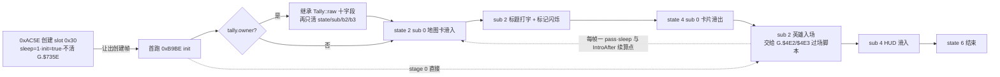

### 67.5 伪代码与 wof 侧

```
# dino：进一关的那几秒是一个带续算点的任务
on_stage_start():                          # 0xAC4E / 0xAC5E
    create(slot=0x30, task=0xB9BE)         # 不清 G.$735E，sleep=1，init=true
    run_palettes_and_area_start()          # 创建帧的 CPU 归 stage start

intro_init():                              # 首跑 0xB9BE
    if tally.owner:                        # §40 的归属判据
        intro = copy(tally.raw, fields=10) # state/sub/b2/b3/w4/w6/w8/src/dst
    tally.owner = False
    clear(intro.state, intro.sub, intro.b2, intro.b3)   # 只清这 4 个
    if stage == 0: (intro.state, intro.sub) = (4, 2)    # 无地图卡
    else: intro.after = State0

intro_each_frame():                        # 每帧一 pass
    if sleep > 1: sleep -= 1; return
    run_state_routine(intro.state, intro.sub)
    resume(intro.after)                    # IntroAfter：睡醒后从哪个子例程续
    # 2/0 卡滑入 → 2/2 打字闪烁 → 4/0 卡滑出 → 4/2 入场脚本 → 4/4 HUD → 6 结束

# wof（repo 呈现，按 §11.0 只登记）
entry_task():
    create_opening_dialogue_object()       # Cps1EventObjectRuntime.cs:188-192
slot15_event_queue_task():
    consume(ROM 0xD000 events)             # Cps1EventQueueTask.cs:5,55,63
```

wof 侧按 §11.0 只登记这一层：第一关入口任务直接分配开场对白对象（`Cps1EventObjectRuntime.cs:188-192`，`:192` 明说不经过关卡脚本 type1C），事件队列 `0xD000` 由调度器 slot15 消费（`Cps1EventQueueTask.cs:5`、`:55`、`:63`），关卡脚本另有 `0x10744` 表驱动生成（`Cps1Actor27Runtime.cs:16`）。**不臆断 wof 有没有等价的独立 intro 状态机、不臆断开场对白对象与事件队列的全部消费点、不评优劣**；§19 / §30 已记的 wof 关卡脚本 `0x106F4`、事件队列与收尾对白对象接力结论不改。`_无对应ASM` 的测试抑制开关按 §0 属宿主层，隔离不作设计对照。

### 67.6 对照表与组织结论

| 维度 | dino | wof（repo 呈现） |
|---|---|---|
| 载体 | slot 0x30 独立任务 `0xB9BE`，`Intro` 结构带 `state/sub/sleep/after` | 入口任务分配开场对白对象 + slot15 事件队列（`:188-192`、`:5`） |
| 节拍 | 每帧一 pass，`sleep` 与 `IntroAfter` 主动切演出 | 按 §11.0 保留，不臆断 |
| 共享结构 | 首跑从 `G.$735E` 继承上一任务十字段、局部清零 | 按 §11.0 保留，不臆断 |
| 交给谁 | 卡片演出末棒交给英雄过场脚本 `G.$4E2/$4E3`（§19） | 关卡脚本 `0x10744` 表驱动生成（`:16`） |
| 与开一局的关系 | 在 §64 的全量设定之后、第一个 level frame 旁 | 按 §11.0 保留，不臆断 |

1. **「进一关」被拆成两条时间线**：§64 讲的是状态写入（谁把全局状态设成什么样），本节讲的是演出推进（同一片状态之上，一个任务用帧节拍把玩家从「看地图卡」带到「能操作」）。二者不冲突——`flow_intro_start` 恰恰是在 stage start 之后才建任务，且刻意不让出创建帧。
2. **共享结构的第三种用法**：§40 记「不清干净重来」，§64 记「四条路径写同一片状态」，本节给出「继承上一任务的十字段、只清四个」。与 §66「双方对象头各写一份标志」一样，归属不是靠复制一份新状态，而是靠**当前谁在用 + 谁有权清哪几个字段**。
3. **`sleep / after` 从调度层下沉到演出层**：§20 的 `Scene` 是顶层任务的 sleep 模型，§60 是长任务被帧边界切断；本节显示同一机制被拿来当「打字机 / 滑入动画」的续算点，且 `IntroAfter` 把「睡醒后从哪个子例程继续」显式写成枚举。这是组织方式的并列，不是优劣判断。

### 67.7 与既有节的关系、未做与边界

- 上游：`§20`（5 任务 slot / `Scene` sleep）、`§40`（`G.$735E` 与 `tally.owner`）、`§19`（过场脚本覆写输入）、`§64`（开一局四种写法）、`§65`（配置解释时机）、`§60`（长任务跨帧）、`§34`（area 分段）；下游：`§42`（生成帧跨帧契约）。
- **既有结论不改写**：§20 调度骨架、§40 共享结构归属、§19 五套脚本、§64 四条开局路径、§30.7 / §41.7 / §60.6 保留边界全部维持原貌；本节只把 stage intro 从 slot 表的一格展开成一条链。
- **未做（保留，不扩张）**：§41.7 的其余 flow 子模块逐类展开（含 `movie.rs` / `slides.rs` / `name_entry.rs` / `cards.rs` 全状态机）；`cards.rs` 的 380 字 tile 表 / 13 调色板 / 标记表逐项与 `0xBC252` 逐字节（§11.0 只在必要时补 data）；`intro_state0` / `intro_title` / `intro_after_wait` 各子例程逐帧细节；`G.$4E2/$4E3` 脚本记录逐条（§19 已立全景，不重复展开）；wof 开场对白对象与 `0xD000` 事件队列全部消费点、是否另有独立 intro 状态机（§11.0 不主动追、不臆断）；两边开场演出逐项等价关系（不臆断）；音频按 §0 边界外。
- ROM 条件授权（§11.6）**未触发、0 次 ROM 取证**：全部结论来自两份 repo 的函数、结构定义与文件头注释；wof 侧片段自带 ROM 逐指令注释，不属「非常可疑」，按用户「不过度怀疑 rep 侧」不再另查 ROM。

**结论**：§67 把「进一关的那几秒」收成一条链，给出「dino 用 slot 0x30 的 state/sub + sleep + IntroAfter 把地图卡到 HUD 的演出串成一串、末棒交给过场脚本」「创建与首跑跨帧、首跑从 `G.$735E` 继承十字段而只清四个」「wof repo 侧按 §11.0 只登记入口对白对象与 slot15 事件队列，不臆断等价、不评优劣」三条结论；不扩张 §41.7 / §30.7 / §60.6 既有保留边界；`长时间自主推进` 仍是开放目标，本节不宣称终止。

**就地补层（换一个从没正面问过的横切面，倒推到设计意图，不是新机制）**：前面几格问的是「这一场架什么时候算完」「翻到下一页谁点头」。这里反过来问另一头——**玩家故意不配合，会怎样？** 站在街机前，不往前走、不挥拳、甚至往回跑，游戏拿你怎么办。

把已核过的三样东西合起来看，答案不是「催你」，也不是「把摇杆抢走」：

- **你走不出去**：普通战斗里镜头被钉在波次起点（`re/specs/semantics.json` 的 `camera_lock` 值 1；`notes/02-mid.md §28.4` 相机锁定、`:771` 的 `G.$7A9` 与 mode 4 逐帧钉 `camX`），而玩家自己每帧被夹在屏幕那一框里（`dino-rs/crates/dino-game/src/game/player.rs:1027-1044` 的 `0x4FCE`：X 夹在 `cam_x+0x10 .. +0x160`，纵深 `+0x10 .. +0x90`；`:955-956` 只有 `no_clamp` 为真才跳过）。往左跑、往右冲、站着不动，全都被这一框接住——**操作一个都没被没收，只是「离开这一架」这个选项不存在**。反过来，过场要特意把这道钳制关掉才能让英雄走出画面（`notes/06-method.md §94.10` 的 `no_clamp` 三方对账），恰恰说明战斗里「不许出框」是默认开着的。
- **你耗得起，但这一拍会自己走完**：波次不是等你往前走才翻页，它按自己的两个条件放行——活敌数降到按人数分档的阈值，或者 7200 帧预算耗尽（`dino-rs/crates/dino-game/src/game/prop.rs:551-580`: `if bt != 0 && alive > lim { return; }`）。赖着不打，活敌数不降，预算照样一帧一帧走；走到头就是上一格核过的超时清场：一处写、多个敌人各读一次、各自演完自己的死亡态，**而且不给玩家记分**（`who=0xFF`）。「不配合」没有被禁止，是被**计价**。
- **wof 侧只并列登记**：门闩把相机区间锁住、`notes/03-frame.md:415` 记的屏幕范围钳制把玩家 X 夹在 `camera+0x20 .. +0x160`，都是 repo 侧呈现的「这一段不许往前」；按 §11.0 不串等价、不评优劣、不推断原机缺机制。

**倒推（[I]）**：这正好是功夫武打里「编舞调度」那一层的意思——导演定的不是演员每一拳怎么出，是**机位在哪、走位区间多大、这一镜多长、群演几时进场**。老 Beat 'em up 把这一层做成了规则：先用镜头锁和屏幕钳制画一个走不出去的框，再给这一段配一段有长度的拍子，然后把「打不打、怎么打、往哪跑」整个留给玩家。玩家在框里是完全自由的，但**这一幕有自己的拍子，会自己走完**；所以不需要弹箭头催你，也不需要按着摇杆把你拖到下一个触发点。Beat 既是「打」也是「拍子」，这里的拍子不住在玩家的输入里，住在舞台的边框和预算里。

接回那条主线就更清楚：玩家不配合，世界既不装作没看见、也不跳出来教训你，它让**时间替它回嘴**，而且回得有节奏（一帧帧耗、耗完清场、清场还各自留着 120 帧的死亡演出，余韵不对齐）。这和「世界会不会回嘴、回嘴有没有节奏」，以及前两格「结束权分散 / 没有一次总广播」是同一条线：连「一段架该收场」都不是一次中央裁决，是镜头、钳制、预算、每个敌人自己的死亡态各管一摊叠出来的。当代同类游戏更容易把「不配合」当成一个要修掉的故障（强制前进、导航箭头、拖拽镜头），恰恰是把这一层编舞让给了 UI。

**主体与成色**：dino 侧 [O] 源码 + [I] 倒推，不放大成两款共同架构（§94.23）；wof 侧按 §11.0 只登记并列事实。载具 / 特殊关卡按用户既定边界换面停止（`car_mode` 时敌人改走 despawn，不写进通则）；过场 `no_clamp`、门闩、波次超时清场都是既有登记，这里只拿来接这条判断、不重讲。宿主补偿标记与逐帧对拍注释按 §0 剥掉，wt1 仓库只读未改，**0 次 ROM 取证**。不新增节号、不改总入口、不改 `GAMEPLAY_LEGACY.md` 九节、不碰产物层。

**〔后一格补层：这一镜多长，由地上还剩什么决定（换证据源，从玩家可见现象往下撞）〕**

前面几格的「余韵」「不配合」「留便条」都是从源码往上倒推的。这一格换一条独立证据：`plan/game/README.md` 开头把 `plan/game/` 整批资料定义为「The whole game, as a player sees it」，来源分 `[M]`（MAME 逐帧观察）、`[R]`（repo）、`[W]`（攻略）；`plan/game/mechanics-seen.md` 是玩家可见现象的清单。里面有一条从没进过设计笔记的：

- **打完一段之后镜头多久才放行，看地上还剩什么**（`plan/game/mechanics-seen.md:288` 的 T07，来源 `[M] e1a0, l_e1a0_k2`）：换区收尾脚本用自己的第一条 GO 记录解锁镜头，**地上没东西时 96 帧后就给，有道具或没开的箱子最多等到 440 帧**。不是固定倒计时，是「场上还有没有没收拾完的事」在给这一镜定时。
- **这段等待不是空等，是留给玩家弯腰捡东西的**（同文件 `:291` 的 T10，`[R] 0x1DE6C, 0x1DE86`）：脚本动作 `0x2A` / `0x38` 是 item waits，波次结束和 Boss 死后仍让摇杆管用 120–240 帧。`:287` 的 T06 还要求所有英雄站回正常地面状态才放行，与 `notes/02-mid.md §34.6` 那道逐帧身体状态门对得上。
- **最像「广播」的那个 GO，也只是一个会闪的箭头**（同文件 `:295` 的 T14，`[R] 0x7BB68; [M] go1, go2`）：亮 30 帧灭 5 帧、闪三下；镜头基本没动时 180 帧后才给第一次提示，之后每 600+105 帧再提一次。T14 自己还注明「no GO at the end of a wave」——普通波次结束根本不弹 GO，T07 那条是**换区脚本**里的第一条 GO 记录，别泛化成每次清场。

**倒推（[I]，说人话）**：所以「这一镜多长」不是导演按表掐的，是**开镜那一眼场上还有没有没被收拾完的事**说了算；演员还能在这一镜里弯腰捡起地上一把刀，这一镜却不会因为你捡完了就提前收。功夫武打换镜不喊「卡」，靠的是场上动作收没收干净、群演有没有退到位。老 Beat 'em up 把这一层做成了规则：GO 不是一次「过关」广播，是一张按遗留物伸缩的便条；玩家站着不动也只是被计价（时间照走、提示按时来），不会被拖走。接回前几格——「留便条，不喊话」连最像广播的箭头都只是闪三下；「玩家不配合」的拍子不住在输入里，**收尾这一拍也不按一根固定秒针**，而住在**地上那些还没被捡走的对象**身上；「结束权分散」又多一处：连这一镜的长度都归那些对象各自占着，没人替它们统一熄灯。当代常见做法把清场到切场之间压成一次事件，正好把这段「还能再弯腰捡一下」的余韵切掉了。

**证据边界（这批资料要用对）**：`mechanics-seen.md` 是移植规划清单，**只用 `Mechanic` 与 `Source` 两列**；`Port` 列（MISSING / DONE 等）是移植侧状态，按 §0 与 `notes/08` 的既定口径不进设计对照、不写成原机缺机制。`[M]` 是仓库里已有的 MAME 逐帧观察记录（定义见 `plan/game/README.md:14-21`），不是本格新做的取证、**0 次 ROM 取证**；它不是 [O] 源码事实，只是独立证据源对源码倒推的印证。96 / 440 / 120–240 / 180 / 600+105 都是**量**，按 §94.3 那一刀不转成「取值 → 抽象意义」的域，不进 `semantics.json`。I/J/K/L/M/N 组是标注 NOT verified 的线索、`:62` 的 P42 标 UNKNOWN，都不是结论也不是缺口。这批全是 dino 侧玩家观察，按 §11.0 不推断 wof 缺什么、不评优劣、不串成两款共同架构。不新增节号、不改总入口、不改 `GAMEPLAY_LEGACY.md` 九节、不碰缓存 / 脚本 / wt1 / 产物层。

**〔回源压力测试（后一格补）：改了一句会被继承的概括〕**

拿上面 §67 补层那句「拍子……住在舞台的边框和预算里」去撞这一格的「也不住在一根固定秒针上」，两句会读成互相否定。回源把三段时间的出处摊开，发现不是矛盾，是**上一格把「一根秒针」误写成了全场只有一根**：

- **打的时候，每一组各有自己的一根预算**：`dino-rs/crates/dino-game/src/game/spawn.rs:24` 把 `G.$50C` 注成波次组的时间预算（7200 帧），`dino-rs/crates/dino-game/src/game/prop.rs:516` 在波次控制器初始化时、`prop.rs:604` 在每一组生成记录走完回到阈值等待时，都把它重置成 7200；`prop.rs:551-580` 拿它和按人数分档的活敌阈值一起决定能不能推进下一组，耗到负数才在终组写 `kill_all=2` 清场、不给玩家记分。`GAMEPLAY_LEGACY.md:346` / `:363` 也把 7200 归在「下一波」那一格，不是收尾；续关还会给它补 600 帧（`dino-rs/crates/dino-game/src/game/flow/cont.rs:106`）。它连「一根」都不是，是**每组各自一根、会被事件改写的局部预算**。
- **收的时候，镜头多久放行按地上还剩什么**：`plan/game/mechanics-seen.md:288` T07 明写是「after the wave end」之后、换区收尾脚本自己的第一条 GO 记录；`:287` T06 明写 `Wave lock ends` 之后才起收尾脚本，`:295` T14 明写 `no GO at the end of a wave`。96 / 440 帧是余韵，不是那一波的预算。
- **界面另有一根只管提醒、不裁决的秒针，而且是另一个对象在数**：`dino-rs/crates/dino-game/src/game/prop/b20.rs:1` 的 pool B class 20 专门叫「GO burst and idle hint」，`spawn.rs:26` 把 `go_timer` 单独注成 `G.$4FE idle hint countdown`，与 `wave_timer` 是两个独立字段。`b20.rs:29-71` 里它只写自己的 `go_timer` / `go_camera_x`、调闪箭头与调色板，**不写 `G.$7A9`、不写 `wave_timer`、不写 `kill_all`**；`blocked` 里还读 `cam.s2.lock78`——镜头仍锁着时把提示压回 180 帧。T14 的箭头闪三下、闲置 180 帧后第一次提示、之后每 600+105 帧，数的就是它。它按时来，但不决定这一镜什么时候收。

**倒推（[I]，说人话）**：所以那句得收窄成「**收尾这一拍不按一根固定秒针**」——上面已就地改。整场架不是一只节拍器，是**好几层各自数着的拍子**：每一波自己数自己的预算、收尾那一镜自己数地上还剩几样东西、GO 箭头自己数该不该再提醒一次，谁也不替谁喊「卡」。功夫武打也是这样：演员的身段、群演的轮次、锣鼓点、镜头长度各走各的，合起来才是一口气，不是谁统一打拍子。「结束权分散」因此还能再推进一层：**连计时权都是分散的**，没有任何一根秒针有资格替全场宣布「这一场该收了」；前面说的「不被拖走、只是被计价」，计的也是各自那一份，不是被一只总表判掉。GO 箭头读镜头锁却不去解它，又正好是「留便条，不喊话」的一个实例——最像发令者的那个东西，其实只是个读者。

**主判断没被推翻**：「这一镜多长由地上还剩什么决定」「GO 是按遗留物伸缩的便条」「玩家站着不动只是被计价」三条都成立；收窄的只是把「没有固定秒针」误写成全称，并讲清「提示按时来」为什么不矛盾。证据边界沿用上一格：`[M]` 是仓库里已有的 MAME 逐帧观察记录、不是 [O] 源码事实、不是新做的取证（**0 次 ROM 取证**）；96 / 440 / 7200 / 180 / 600+105 都是量，按 §94.3 那一刀不转成「取值 → 抽象意义」的域、不进 `semantics.json`；全是 dino 侧，按 §11.0 不推断 wof、不评优劣、不串成两款共同架构。不新增节号、不改总入口、不改 `GAMEPLAY_LEGACY.md` 九节、不碰缓存 / 脚本 / wt1 / 产物层。

---

**〔本轮补层：唯一一段把拍子交还摇杆的，恰恰是被夺走控制权的那一段〕**

前面几格把「Beat 的拍子不住在玩家输入里」立得很稳：镜头锁加屏幕钳制画一个走不出去的框，打不打全留给玩家，赖着不打则超时清场、被计价；收尾那一镜开镜看一眼地上还剩什么定好长度，开拍后连玩家有没有把东西捡走都不读。这一格去撞一个从没当设计问题问过的玩法域——**挨打倒地、被击晕那一段**——发现它恰恰是个例外，而且例外得很有分寸。

回源（[O]）：`dino-rs/crates/dino-game/src/game/player.rs:2833-2844` 的 `player_lie_setup`，在被击倒那一帧用两次 rand 从表里**同时**预置两个数：`lie_t`（这一拍最长躺多久）和 `mash`（要按多少下才能挣起来）。这和换区收尾「开镜那一眼挑定 96 / 440 帧」是同一个形状——**上限仍是事先查表定死的，不是玩家边打边长出来的**。但倒地与眩晕两个分支从此多了一个出口：`player_kd_lie`（`player.rs:2960-2972`）与眩晕分支（`:3030-3045`）每帧跑 `player_mash`（`:465-488`），摇杆敲击按 `mash_weight` 扣、攻击键另算一次并带 6 帧冷却，`mash` 归零就提前 `player_getup_entry` 起身。玩家可见现象 `plan/game/mechanics-seen.md:343` P68 把这段摆得很直白：眩晕 40–180 帧、要按 15–125 下，**而且晕着还能继续挨打**——所以连打不是摆设，是有代价地抢回自己的下一拍。

最要紧的是那个边界：`:3036` 写 `if !timeout` 才去读摇杆。**表定上限一到就强制起身，连打既不能延长、也不能把已经走完的那一拍追回来**；摇杆的作用只有一个方向——**把这一拍缩短**。会不会进这一段也不归玩家：`player_dizzy_roll`（`:2803-2824`）按连段第几下、HP、免疫计时、慢动作状态几道门先掷一次，`notes/02-mid.md §29.4` 记的敌人眩晕五重门（含「同一时刻场上最多一个」）是同一套「稀缺、按处境给」的思路。

**倒推（[I]，说人话）**：所以「拍子不住在玩家输入里」不是全称，得补半句——**只有在玩家被夺走控制权、而且还在挨打的那一小段，游戏才把「提前收拍」这把钥匙塞回他手里；其余所有拍子都不追他的手**。这不是纵容，是补偿：被击晕的人动不了、还会继续被打，于是给他一条用连打把自己从地上捞起来的路；但这条路的长度上限依旧是开镜前查表定好的，摇杆只能往前赶、不能往后拖。功夫武打里挨了一记重击倒地，演员一个鲤鱼打挺提前起来接下一招，导演不喊卡、也不等他慢慢演满——**这一拍最长多久是排戏时定下的，能不能提前收，交给挨打的人自己挣**。当代同类常见的是两头都不给：要么一段不可跳的起身动画把所有人都按进同一个时长，要么一键挣脱把起落全交给输入；老游戏把两件事分开摆——「上限归表，提前归手」，谁也不用向谁对齐。

接回主线：这和「玩家不配合只是被计价」是同一枚硬币的两面。站着不配合，游戏不抢你的摇杆、只让时间照走；被击晕想配合，游戏才第一次真正读你的手，而且只准你用它把拍子缩短。「计时权分散」因此再多一层：**每一段拍子不止各有自己的上限，还各有自己的出口条件**——波次预算只有表定上限、收尾余韵按地上遗留物、GO 箭头只管提醒、倒地这一段多一个单向的玩家出口。没有一根总秒针，也没有一个统一的「玩家能不能插手」开关；插不插得了手，是每一段自己带的一个局部条件。

**边界**：主体 dino 侧源码；`[M]`（P68）是仓库已有的 MAME 逐帧观察、不是 [O] 源码事实、本格 **0 次 ROM 取证**；40–180 / 15–125 / 6 帧等全是量，按 §94.3 不转成域、不进 `semantics.json`；`player_lie_setup` 里 `level_band` 只读到 row 0（P67 标的表索引读法）是实现层细节、按 §0 不进设计对照；`notes/02-mid.md §29.4` 的敌人眩晕五重门、`notes/05-objects.md §79.1` 的 `player_mash` 只并列为读方之一，本格不重讲、不改写。wof 侧按 §11.0 只登记并列事实（两侧挣扎计时形状差异见 `notes/01-early.md:1773`、`:1784` 已收敛过），不串共同架构、不评优劣、不推断原机缺机制。不新增节号、不改总入口、不改 `GAMEPLAY_LEGACY.md` 九节、不碰缓存 / 脚本 / wt1 / 产物层。

---

