# 卷 05：对象身份与世界（§68–§81）

> 由 `DESIGN_DIFF_NOTES.md` 按 `^## ` 标题块原样拆出，块内逐行未改，卷内保持原文件出现顺序。
> 总入口、`§N → 卷` 反查表与阅读顺序见 `../DESIGN_DIFF_NOTES.md`。
> 本卷涵盖：§68–§81。附录 A 全部在 `07-appendix-a.md`。

---

## 68. 一张「上一帧的敌人表」被谁读：从命中去重到枪口瞄准

> 触发：查重先排掉脚本记录结构（§4.1 / §9.4 / §19 的五套表已展开）、死亡连锁（§25 / §28 / §29）、credit 投币（§20 / §41 / §25）、四层状态字节（§2）。随后在核 `player_aim_nearest` 时发现 `0x69BA` 的消费者远不止 §48 记的「命中去重」与 §61 记的「弹道目标」——至少有四五个系统各带一套过滤条件读同一份表，而笔记从没把**这张表本身**当主线。
> 归属：设计正文（§0–§68），按「轮次线性追加」接在 §67 / A.31 之后。纯 repo 侧，未新增 ROM 取证（§11.0）。
> 边界：§48（`combat_lists_reset` 一帧延迟 hurt list / `attack_serial` 去重）、§61（`partner → aim` 弹道链 / `BULLET_RECORDS`）、§13（census 一帧延迟）、§16（`BossAi` 只是表选择器）、§66（claim 候选表）、§65（三字节接口）全部维持原貌；§61.8 的「`BULLET_RECORDS` / `AIM_*` / `0x58CFC` 各表逐项字节、pool E 其余 11 class、wof 弓箭手关系」保留不扩张。wof 侧按 §11.0 只登记 §61 已核实的 repo 呈现，**不臆断它有没有等价的跨帧共享候选表、不评优劣**；音频按 §0 边界外。

### 68.1 一句话结论

`combat_lists_reset 0x105E8` 每帧把本帧的 `0x671E` 拷进 `0x69BA` 再清空 `0x671E`，于是 `0x69BA` 永远是**「上一帧被打到 / 参与过碰撞的对象表」**。dino 没有让每个想找目标的系统各自扫全场，而是让它们**读同一份表、各按自己的条件过滤**：枪按纵深 `|dz|` 挑面朝方向最近的敌人写 `+$EA`，武器按角色盒表判断「面前有没有敌人」，class 24 按 `|dx|+|dz|` 挑最近的同类，class 78/80 拿它当「玩家不在附近时的替补近身判据」。**共享的是表，不是「谁最近」的决策**——同一个「最近」在四个读方里有四种算法，连平局规则都各自复刻。wof 侧按 §11.0 只登记 §61 已核实的弹丸目标 / 速度表呈现，不臆断等价、不评优劣。

### 68.2 一个写入者：帧滚动怎么产生「上一帧」

`combat.rs:102-111` 的 `combat_lists_reset` 是整个契约的唯一写入点：`clear(0x6718)` / `clear(0x671A)` → `copy(0x671E, 0x69BA)` → `clear(0x671E)` → 再清 `0x671C` 与 `0x6B64 / 0x6AC2 / 0x6AFC / 0x6B30` 四张旁表。`trace.rs:1579-1589` 把 `0x69BA` 的 `hurt_count` 与逐 handle 重建登记进逐帧状态，说明它本身就是可逐帧对拍的显式字段。

§48 已把它记成「一帧延迟的 hurt list，用于 `attack_serial` 去重」；本节补的是**它同时是「候选目录」**：表里的 handle 来自上一帧的碰撞 / 伤害链，所以任何想找「附近有什么可打」的系统读它，成本是固定的一小段列表而不是全池扫描，且天然带一帧延迟。这与 §13「census 每帧统计、下一帧读」、§66「claim 列表每帧清空重建、倒地状态读上一帧」是同一条帧契约，只是这里的列表**由战斗结算顺带产生**，不为某个 AI 专门维护。

### 68.3 五个读方，五套过滤条件

| 读方 | 位置 | 过滤条件 | 结果 |
|---|---|---|---|
| 命中去重（§48） | `combat.rs:102-111` | 「被哪个 `attack_serial` 打过」 | 防止同一挥击重复命中 |
| 枪口瞄准 `0x64F6` | `player_weapon.rs:278-305` | `live&1`、`sub==0`、**面朝方向**、按 `abs(dz)` 纵深最近、上限 `0x100`、平局取后者 | 写 `players[i].aim`（`+$EA`，`player.rs:142-143`） |
| 武器近身判定 `0x6248` | `item.rs:292-311` | 按角色查 `0x62AE` 盒表（5 words/角色：dx / X offset / X size / Z offset / Z size），逐条做「面前盒内」 | 返回 bool，决定武器 / 玩家动作分支 |
| class 24 找同类 `0x491A4` | `enemy/class24.rs:461-498` | 跳过自己、跳过 `+$7D` 为负者、按 `abs(dx)+abs(dz)` 最近、平局取后者；空表则目标设为自己 | 写敌人 `TARGET` |
| class 78/80 近身门 `0x5F324` | `enemy/class78_80.rs:173-200` | 先查 3 个玩家（X 16px / Z 8px、非空中）；不满足才查表内敌人（地面、非 `act==2`、非 `reaction==0x30`） | 触发 4-bit RNG 查 `0x5F5C0` 决定是否进 state 4 |

`player_gun_entry 0x19AB0`（`player_weapon.rs:307-316`）是这套契约的调用点：**先 `aim = 0` 清零，再 `player_aim_nearest(i)`**，然后按 `held & 0xF` 分站射 / 走射——也就是「有没有目标」不是一个布尔，而是 `aim` 这个 handle 字段，后续 §61 记的 `partner → players[p].aim` 弹丸链直接继承它。`player_weapon.rs:1009` 与 `enemy/class24.rs:869-878` 的测试都在同一张表上造数据，说明它也是可独立验证的状态。

class 24 还有一处很「原机」的细节：`enemy_c24_hurt_list`（`class24.rs:488-498`）不是简单复制 `0x69BA`，而是把**当前 `0x671E` 的高位覆盖回 saved 列表的尾部**（注释解释：列表在向下增长的栈里，早跑的对象已经覆盖了高位条目）。所以「读上一帧的表」在个别读方那里还要补一次栈重叠修正——这是帧契约在使用侧的显式补偿，不是抽象层能藏掉的。

### 68.4 四种「最近」，没有统一函数

```
# 写入者：每帧一次，表永远是「上一帧」
combat_lists_reset():                       # 0x105E8, combat.rs:102-111
    clear(0x6718); clear(0x671A)
    copy(src=0x671E, dst=0x69BA)           # 本帧 → 上一帧
    clear(0x671E); clear(0x671C)
    clear(0x6B64, 0x6AC2, 0x6AFC, 0x6B30)

# 读方 A：枪，按纵深挑面朝方向最近
player_aim_nearest(p):                     # 0x64F6
    aim = 0; best = 0x100
    for e in list(0x69BA):
        if not e.live or e.sub != 0: continue
        if side_of(e) != facing: continue
        dz = abs(e.z - p.z)
        if best >= dz: best = dz; aim = e   # 平局取后者
    return aim

# 读方 B：武器，按角色盒表判断「面前有没有」
item_enemy_near(b):                        # 0x6248
    (dx, xoff, xw, zoff, zw) = box_table_0x62AE[b.id]
    for e in list(0x69BA):
        if inside_box(e, b.facing, dx, xoff, xw, zoff, zw): return True
    return False

# 读方 C：敌人，曼哈顿距离挑最近同类
c24_nearest_enemy(e):                      # 0x491A4
    if list.empty(): TARGET = e; return
    for a in list_0x69BA_with_stack_fix():
        if a == e or counted_byte(a) < 0: continue
        d = abs(a.x - e.x) + abs(a.z - e.z)
        if best >= d: best = d; TARGET = a   # 同样平局取后者

# 读方 D：敌人，固定近身盒 + 表里替补
c78_near(e):                               # 0x5F324
    if any_hero_within(16px, 8px): hit = True
    else: hit = any(enemy_in_list_0x69BA and grounded and act != 2 and reaction != 0x30)
    if hit: roll_4bit_against(0x5F5C0) -> maybe state 4
```

四个读方都自己写循环、自己定「距离」、自己定平局规则，没有 `find_nearest()` 之类的公共函数。这与 §16 的 `BossAi`「共享的是选表机制、不是统一 AI」、§13 的 census「共享统计值、各系统自己加权」是同一种组织习惯：**把共享压到一份数据上，把决策留给各读方**。差别在于 §65 的三字节接口还配了 `Settings` 命名位域集中解释，而这里连解释都分散——因为「最近」在枪 / 武器 / 两类敌人面前本就不是同一个概念。

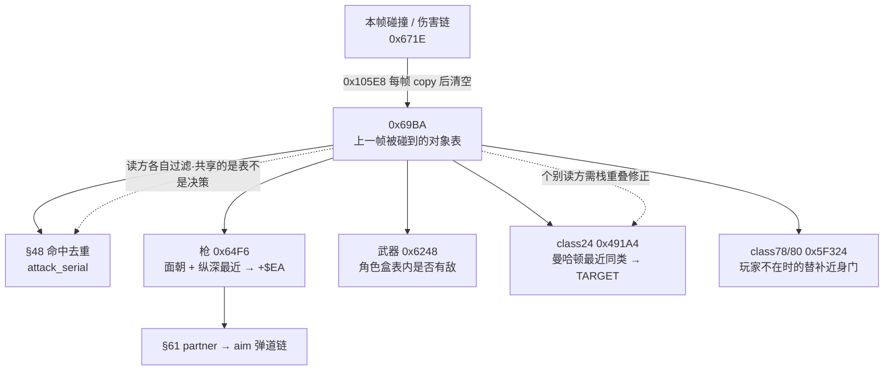

### 68.5 wof 侧与对照

按 §11.0 只登记 §61 已核实的 repo 呈现：wof 弹丸的速度表 `0x58CFC` 按目标 `OBJ+0x8E` 索引（`Cps1EventObjectRuntime.cs:6966`、`:6988-6989`），父槽地址写在 `+0x3A`（`:5932`）。**不臆断 wof 有没有等价的「上一帧共享候选表」、不臆断其目标选择路径、不评优劣**；§61 的 `投射物1C` 四态与隔帧相位门结论不改。`_无对应ASM` 的宿主诊断按 §0 隔离。

| 维度 | dino | wof（repo 呈现） |
|---|---|---|
| 共享载体 | `0x69BA` 上一帧对象表，一个写入者、多个读方 | 按 §11.0 保留，不臆断 |
| 谁定「最近」 | 四个读方四种算法，平局各取后者 | 按 §11.0 保留，不臆断 |
| 目标存哪 | 玩家 `+$EA` / 敌人 `TARGET` / 弹丸继承 `partner` | 弹丸 `+0x3A` 父槽、`+0x8E` 速度表索引（`:5932`、`:6966`） |
| 帧契约 | `combat_lists_reset` 滚动，读方读上一帧 | 按 §11.0 保留，不臆断 |

### 68.6 组织结论与边界

1. **第五条「单一状态被多方读」的线，但方向不同**：§14 输入字节、§51 RNG、§57 时间、§65 三字节配置都是「一份值被多方读」；本节是**一份每帧滚动的列表被多方读**，且读方各自过滤。与 §66「候选表 + 双方标志」并列成「共享数据」的两种形态：前者是长期状态，后者是每帧重生的目录。
2. **把「找目标」的成本转嫁给战斗结算**：表由 `combat_lists_reset` 顺带产生，不为 AI 单独维护，于是「附近有什么」不需要全池扫描；代价是所有读方接受的都是**上一帧**的画面，且个别读方还要补栈重叠修正（class 24）。这是与 §13 census 同一层的帧契约取舍，不是优劣判断。
3. **§48 / §61 既有结论的下半段**：§48 记这张表用于去重，§61 记弹丸继承 `aim`；本节给出 `aim` 怎么被选出来、以及这张表另外三个消费者。三节读的是同一份代码的不同语义面，按 A.27 / A.28 既有口径不改写、不合并。

- **既有结论不改写**：§48 去重、§61 弹道、§13 census、§16 BossAi、§66 claim、§65 配置全部维持原貌；§61.8 的各表逐项字节 / pool E 其余 11 class / wof 弓箭手关系保留不扩张。
- **未做（保留，不扩张）**：`0x62AE` 盒表逐角色数值、`0x5F5C0` 概率表逐项、`0x6718/0x671A/0x671C` 三张旁表全部消费者与写入点、`0x69BA` 在 trace 之外是否还有第六个读方（§11.0 只在必要时补 data，不主动做全量普查）；wof 是否有等价共享表、其目标选择路径（§11.0 不主动追、不臆断）；两边「最近」算法逐项等价关系（不臆断）；音频按 §0 边界外。
- ROM 条件授权（§11.6）**未触发、0 次 ROM 取证**：全部结论来自两份 repo 的函数、常量、文件头与单测；wof 片段自带 ROM 逐指令注释，不属「非常可疑」，按用户「不过度怀疑 rep 侧」不再另查 ROM。

**结论**：§68 把 `0x69BA` 从「§48 的命中去重快照」展开成一条链，给出「一个写入者每帧滚动出上一帧对象表、至少五个读方各带过滤条件读它」「同一个『最近』在枪 / 武器 / 两类敌人里有四种算法，共享的是表而不是决策」「与 §14 / §51 / §57 / §65 的共享值不同，这里共享的是每帧重生的目录，且与 §66 候选表并列」三条结论；wof 侧按 §11.0 只登记 §61 已核实的弹丸目标呈现，不臆断、不评优劣、不扩张 §61.8 保留边界；`长时间自主推进` 仍是开放目标，本节不宣称终止。

---

## 69. 持械时一个人被画成两层：上半身与腿各自推进的动画状态机

> 触发：查重先排掉 `find_pickup` / `+$B8` 拾取候选 / `+$F8` 40 帧冷却 / `+$10F` 没枪等待（§21.4 已完整展开：`find_pickup():`、`pickup_cd = 40`、`+$B8..+$F8` 字段表、`find_pickup` 读上一帧注册列表）。剩下的 `split body` 在 §21.4 只有一句注记（「又一处把一个状态拆成可独立推进的层」），§53 只在「多套帧序列」对比表里带过 `frame2`，§45 只把 `0x14136 draw_split` 登记成「同一条 draw list 上的画法分支」——**这条链本身从未当主线**。而 `player_weapon.rs:20-26` 的文件头、`+$30..+$3F` 的第二层字段、三个动作函数与单测都在，证据密度够。
> 归属：设计正文（§0–§69），按「轮次线性追加」接在 §68 / A.32 之后。纯 repo 侧，未新增 ROM 取证（§11.0）。
> 边界：§21（武器状态机 / 拾取双向迁移 / 空枪降级）、§53（frame record 自带 `duration/last/next`、`tick_anim` 返回播完事件、wof 主推进器 + 第二推进器）、§45（`(depth,handle)` 单键排序与 draw list 画法分支）、§2（四层状态字节）、§20（`Scene` 的 `state/sub/count`）、§36 / §40（跨帧残留即契约）、§27 / §39（输入改动画速度）全部维持原貌；§53 的 wof 侧「主推进器 `0x2470` + 第二推进器 `SUB_257E` / `SUB_24BE`」结论**不改写、不据此断言 wof 缺分体**。wof 侧按 §11.0 只登记 repo 呈现的 `AniStat` 写入，**不臆断等价、不评优劣**；音频按 §0 边界外。

### 69.1 一句话结论

dino 让**持械走 / 跑 / 射击的玩家同时跑两套帧序列**：上层 `+$28` 由武器 pose 表选出（上半身动作随手里拿的东西变），下层 `+$30` 是腿，由 `0x1506` 启动、`0x1564` 装载、`0x1542` 每帧递减自己的计时器并按帧记录链接换帧；两层靠 `+$38` 偏移表给出的 `dx3c / dy3e` 贴合，绘制时 `+$25` bit0 决定走 `draw_split 0x14136` 还是 `draw_plain 0x14230`。**没有统一的「第二推进器」在帧循环里推所有对象的第二层**：谁来 step 腿层由各个玩家状态自己调 `player_layer_tick`，走、跑、走射、跑中挥击、tag 换人各有一处。于是「一个人」在持械时被拆成两个可独立推进、又靠一张偏移表对齐的动画状态机——这正是 §21.4 那句注记所指的「把一个状态拆成可独立推进的层」，本节把它落到字段、调用点与帧契约上。

### 69.2 一个通用开关，不是「玩家专属分体位」

| `+$25` 位 | 含义 | 谁读 |
|---|---|---|
| bit0 | split body：对象有两层帧，`draw_object` 改走 `draw_split`，主体换帧时不覆盖第二层的 `extra` | `draw.rs:463`、`body.rs:208`、`effect.rs:243` |
| bit3 | hidden（blink） | `body.rs:56-58` |
| bit4 | no shadow | `draw.rs:515` |
| bit5 | no splash | `body.rs:56-58` |
| bit6 | raw list | `draw.rs:474`、`trace.rs:323` |
| bit7 | screen space | `body.rs:56-58` |

第二层自己占一整片对象头字段（`body.rs:76-83`）：

| 偏移 | 字段 | 写入 / 读取 |
|---|---|---|
| `+$30` | `frame2` 第二层帧 ID | `body.rs:77` / `draw.rs:499` |
| `+$34` | `w34` 帧字节 +4/+5，低字节 `+$35` 是偏移表索引 | `player_weapon.rs:666-672` |
| `+$36` | `w36` 帧字节 +6/+7，低字节 `+$37` 是这一层自己的计时器 | `player_weapon.rs:666` / `player_weapon.rs:686-687` |
| `+$38` | `offs_table` 偏移表的 ROM 地址 | `player_weapon.rs:581` / `player_weapon.rs:630` / `player_weapon.rs:721` |
| `+$3C` / `+$3E` | `dx3c` / `dy3e` 上层相对下层的位移 | `player_weapon.rs:675-676` / `draw.rs:491-494` |

这个 bit 不是玩家专属：`effect.rs:266-277` 的 `fx_start_obj` 在 `+$25 bit0` 置位时**不**把合成字节写进 `extra`，`item/shared.rs:149` 也按它分画法，`item/small.rs:73` / `item/small.rs:101` 的 `item_food` 用 `set_frame2(it.b.frame)` 把主体帧复制到第二层做复合帧。也就是说 `frame2` 与 bit0 是**全对象通用的「两层帧」设施**，玩家持械只是其中一种组装；本节只展开这一种，不把 `frame2` 说成玩家专属，也不扩张成全池普查（§11.0）。

### 69.3 三个动作：启动 / 装载 / 步进

```
0x1506  player_layer_start(i, anim, idx)
    f = player_set0_frame(i, anim, idx)      # set 0 的 anim 第 idx 帧，12 字节一帧
    if f 未被抽出: 打印告警并放弃           # 原机会读到那个地址上的任意字节
    player_layer_load(i, f)

0x1564  player_layer_load(i, f)
    fr = frame(f)
    b.extra = comp_extra[fr.w0 / 4]         # 合成字节由这一层自己给
    b.w34   = fr.param_a * 256 + fr.param_b
    b.w36   = fr.kind    * 256 + fr.duration    # 低字节 +$37 = 计时
    b.set_frame2(f)                          # frame2_loads 记一次
    at = b.offs_table + (i8)w34.lo * 4       # 有符号索引，4 字节一项
    b.dx3c = word(at); b.dy3e = word(at + 2) # 表指针陈旧或地址没抽出时读 0

0x1542  player_layer_tick(i) -> bool
    if b.draw_flags & 1 == 0: return false   # 层关着，调用是空操作
    t = (b.w36 & 0xFF) - 1
    b.w36 = (b.w36 & 0xFF00) + t
    if t != 0: return false
    (next, last) = (frame(b.frame2).next, frame(b.frame2).last)
    player_layer_load(i, next)
    return last                             # carry：这一层播完
```

三处分别落在 `player_weapon.rs:649-656` / `player_weapon.rs:662-677` / `player_weapon.rs:681-695`。`player_weapon.rs:1052-1081` 的单测把契约钉死：load 后 `(frame2, w34, w36)` 与 `extra` 的取值、`+$35 = 1` 取偏移表第 4 字节、`+$35 = 0xFF` 当 -1 取表前一项（`player_weapon.rs:1070`）、陈旧表指针读 0（`player_weapon.rs:1075-1081`）、`draw_flags=0` 时 tick 完全不动、计时 2 到 1 不换帧、归零按 `next` 换帧、末帧返回 carry。**索引是有符号字节**这一条尤其说明偏移表不是简单数组，是「按当前腿帧的编号反查上半身该往哪挪」。

### 69.4 谁每帧推腿层：状态机各自调用

| 玩家状态 | 地址 | 调用点 | 播完之后 |
|---|---|---|---|
| 持械走 | `0x193AE` | `player.rs:1285` | `player_walk_reenter 0x192C6` 重走 |
| 持械跑 | `0x1A0DE` | `player.rs:1992` | 留在跑状态继续 |
| 走射 state `0x1E` | `0x19C20` | `player_weapon.rs:417` | 无方向回站射 `0x19AB0` |
| 跑中挥击 state `0x202` | `0x1A18C` | `player_weapon.rs:764-776` | 挥完重起跑 `0x19FDE` |
| tag 换人 / 双人 | `0x1A486` | `player_tag.rs:302` / `player_tag.rs:350` | 同族，层继续 |

与 §53 的 `tick_anim` 一样，**推进器不自己跑，是状态机在每一帧的对应状态里显式调**；第二层尤其如此——没有一处「帧循环统一推所有 `frame2`」，反而 `player_layer_tick` 开头就检查 `draw_flags & 1`，层关着时调用是空操作。所以「共享的是字段与三个动作，各状态自己决定何时推、播完做什么」，与 §68「共享的是表不是决策」同构：这里共享的是对象头里的一层设施，不是一个集中调度器。`player_walk_anim` 还直接读 `+$34` 当腿层起点帧（`player_weapon.rs:588-589`），走射入口读 `w34 as u8 & 0xF`（`player_weapon.rs:380-381`）——**上一次留下的层状态就是这一次的初值**。

### 69.5 上半身怎么选、两层怎么贴到一起

| 动作 | 上层（set 5，`+$28`） | 下层（set 0，`+$30`） | 偏移表 | 开关 |
|---|---|---|---|---|
| 持械走 `0x5CA6` | `WALK_POSE 0x5D2C` 按 `item_type` 查 | anim `0x10`，起点帧取 `w34` | `WALK_OFFSETS 0x5D1C` | 置 1（`player_weapon.rs:587`） |
| 枪走 `0x5F76` | `GUN_WALK_POSE 0x5FF2`，仅 kind `0x206/0x207` | 由调用者启动的层 | 同 `WALK_OFFSETS` | 非枪 kind 清 0（`player_weapon.rs:626`） |
| 持械跑 `0x1A0F0` | `RUN_POSE 0x1A15C` 按角色与武器档 | anim `0xB`，run state 4 用 `0x18`；起点帧与计时取上层 `param_b` / `timer` | `RUN_OFFSETS 0x1A164` | 置 1（`player_weapon.rs:723`） |
| 跑中挥击 `0x1A174` | 上层跑 pose | anim `0xB`，同上 | 同 `RUN_OFFSETS` | 置 1（`player_weapon.rs:746`） |

常量表在 `player_weapon.rs:37-50`，`player_tag.rs:25` 另记 `0x1A164` / `0x1A228` 是跑姿态的 split-body 偏移表与挥摆表。绘制侧 `draw_object`（`draw.rs:440-467`）先取 `draw_flags`，`flags & 1` 走 `draw_split 0x14136`（`draw.rs:485-505`）：临时把 `x/y` 的整数部分加 `dx3c / dy3e`（`facing != 0` 时 `dx3c` 取负，等价于镜像），清 `wading` 免涉水裁剪，先画 `+$28`；恢复坐标后再画 `+$30`。抓取对（`draw.rs:447-462`）在前面就按伙伴 `+$62` 定顺序连画两个对象并 `return`，**绕过 split-body 检查**——与 §45 的遮挡局部覆盖结论一致，本节不改写。

`trace.rs:333-343` 的 `trace_split` 只在 `f.all()` / `f.loading()` / `draw_flags & 1` 时登记 `+$30..+$3F`，注释明确「停下的层的旧帧和字节是下次走路的起始值（`0x5CA6` 读 `+$34`）」：**层被关掉时不清空，残留被设计成下一次的起点**。这是 §36 跨帧 `prev`、§40 `Tally::raw` 继承、§67 `G.$735E` 不清空、§68 上一帧列表之外，同一族「残留即契约」的又一例，但发生在对象头内部，不是一条新的全局状态线。

### 69.6 一帧里的两层流程

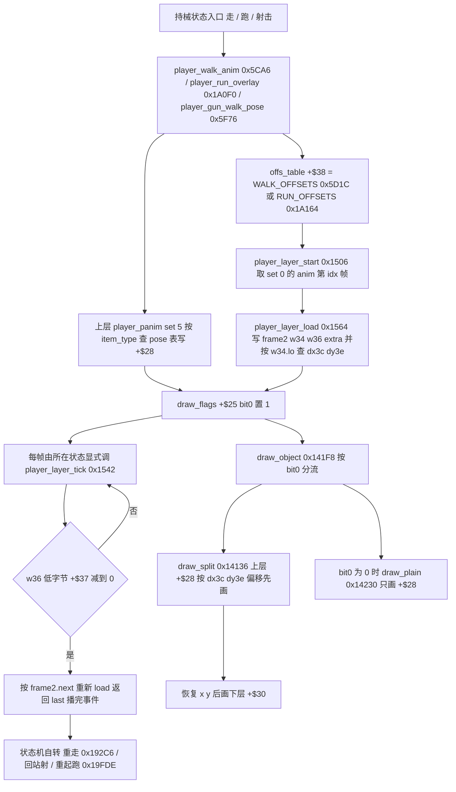

### 69.7 wof 侧与对照表

wof 侧按 §11.0 只登记 repo 呈现：`Cps1Actor20Runtime.cs:271-278` 记录 `+0x2A(ActStatC)` 与 `+0x30..33(AniStat32)` 由 `0x7B50/0x7B58` 写入、`+0x31(AniStatB)=0C` 由 `0x11D2E` 的 case 0 写入——这是「动画状态字节随状态写入对象头」，与 §53 已登记的 wof「`AniStatCD/AniStat32` 随帧写 `+0x30`」「主推进器 `0x2470` + 第二推进器 `SUB_257E` / `SUB_24BE`」一致。**repo 侧没有出现「由持有武器状态开启、上层查 pose 表 + 下层独立 step + 偏移表贴合」的开关**；按 §11.0 不臆断 wof 有没有等价分体、不评优劣、不新增 ROM 取证。这与 A.30「由保留边界反向约束选题且明确 wof 侧不对位」是同一处理，也不把 §53 的 wof 多推进器结论改写成「wof 缺分体」。

| 维度 | dino | wof（按 §11.0 登记） |
|---|---|---|
| 第二层帧 | `+$30` `frame2` 加 `+$34` / `+$36` / `+$37` / `+$38` / `+$3C` / `+$3E` 一整片字段 | `+0x30..33` 是 `AniStat32` 状态字节（`Cps1Actor20Runtime.cs:271`） |
| 谁推进 | 各玩家状态显式调 `0x1542`，带 `+$25 bit0` 门 | 主推进器 `0x2470` 加第二推进器 `SUB_257E` / `SUB_24BE`（§53） |
| 两层如何对齐 | `offs_table` 按 `+$35` 有符号索引给 `dx3c` / `dy3e`，`draw_split` 偏移上层 | 按 §11.0 保留，不臆断 |
| 画法分流 | `draw_object` 按 `+$25 bit0` 选 `draw_split` / `draw_plain` | 多队列分阶段消费（§45） |
| 逐帧可验 | `trace_split` 条件登记 `+$30..+$3F`，停下不清空 | 按 §11.0 保留，不臆断 |

### 69.8 组织结论与边界

1. **与四条共享状态线方向相反**：§14 输入字节、§51 RNG、§57 时间、§65 三字节配置是「一份全局值被多方读」，§68 是「一份每帧重生的表被多方读」；本节是**一个对象头内部被拆成两层**，没有任何跨对象共享，靠 `+$25 bit0` 把「有两层帧」这件事本身变成可逐帧开关的状态。与 §66「独占被做成状态」并列成「状态直接写进对象头」的两种形态。
2. **§21.4 注记的落地、§53 的不改写**：§21.4 说「又一处把一个状态拆成可独立推进的层，与 §2 四层状态字节、§20 `Scene` 的 `state/sub/count` 同构」，本节给出字段、三个动作、五处调用点与绘制分支；§53 讲通用 frame record 状态机与 wof 多推进器对照，本节讲**玩家持械这一处**怎么把第二层接进状态机。两节读同一处代码的不同语义面，按 A.27 / A.28 / A.32 既有口径**不改写、不合并**；特别不把「wof 侧没有登记这个开关」写成「wof 缺分体」。
3. **残留即契约下到对象头**：`trace_split` 明确停下层的旧帧与字节是下一次走路的起点，`player_walk_anim` 也确实读 `+$34` 当起点帧；`draw_flags=0` 时 `player_layer_tick` 直接返回、`load_frame` 不覆写 `extra`。这是与 §36 / §40 / §67 同族、但发生在对象头内的跨帧契约，不扩张成第五条全局状态线。

- **既有结论不改写**：§21 武器状态机 / 拾取 / 空枪降级、§53 动画帧状态机与 wof 多推进器、§45 渲染优先级与 draw list 画法分支、§2 / §20 / §27 / §39 / §36 / §40 / §66 / §68 全部维持原貌；§61.8 / §68.6 的保留清单不扩张。
- **未做（保留，不扩张）**：六张 pose / 偏移表（`0x5D2C` / `0x5D1C` / `0x5FF2` / `0x1A15C` / `0x1A164` / `0x1A228`）逐项字节与逐角色取值；`bit3..bit7` 其余 draw flag 的全部消费者；`effect.rs` / `item/small.rs` 里 `frame2` 作复合帧的完整语义（§11.0 只在必要时补 data、不主动做全量普查）；wof 是否有等价分体及其绘制路径（§11.0 不主动追、不臆断）；两边「双层动画」逐项等价关系（不臆断）；音频按 §0 边界外。
- ROM 条件授权（§11.6）**未触发、0 次 ROM 取证**：全部结论来自两份 repo 的文件头、字段定义、函数、常量与单测；wof 片段自带 ROM 逐指令注释，不属「非常可疑」，按用户「不过度怀疑 rep 侧」不再另查 ROM。

**结论**：§69 把 §21.4 那句「分体动画」注记展开成一条链，给出「`+$25 bit0` 是通用的两层帧开关而非玩家专属位，玩家持械用 `0x1506` / `0x1564` / `0x1542` 三个动作把腿层接进状态机」「谁来每帧推第二层没有统一推进器，走 / 跑 / 走射 / 跑中挥击 / tag 五处各自调用且各定播完去向」「上层按武器 pose 表选、下层按偏移表贴合、`draw_split` 把两层画到同一位置；层停下的旧值被设计成下一次走路的起点」三条结论；wof 侧按 §11.0 只登记 `AniStat` 写入与 §53 已核实的双推进器，不臆断、不评优劣、不扩张 §61.8 / §68.6 保留边界；`长时间自主推进` 仍是开放目标，本节不宣称终止。

---

## 70. 一个箱子被三种东西打碎：三条碰撞 pass 的伤害来源与记分归属

> 触发：查重先排掉双人 tie-up（§15 已完整展开 90 帧检测 / 两计数器 / 挂接）、`draw_object` 其余画法分支（§45.8 明列保留不扩张，且 §69 刚碰过 `draw_split`）、奖命姿势（仅 port 侧「Not ported here」，证据薄）。随后改从「`game/` 下从未被笔记以 `文件:行号` 取证过的模块」反查，发现 `item/hits.rs` 只有 §21.4 一句「`$6AFC` 可被打列表 → 三个 pass 消费」（L3067）、§61 一句「`hits.rs` 用玩家攻击记录伤容器」（L8378），而**三条 pass 的分工、三种伤害来源、记分归属从未展开**；§62 讲的是「打碎之后掉什么」并明说「它们都不自己决定掉什么」。本节补它的上一帧。
> 归属：设计正文（§0–§70），按「轮次线性追加」接在 §69 / A.33 之后。纯 repo 侧，未新增 ROM 取证（§11.0）。
> 边界：§21（pool E 生命周期 / 三张注册列表 / 拾取双向迁移）、§62（一次掉落 / `item_drop_roll` / `+$96` 行号）、§35（pool B 可破坏 prop 契约 / `pass_10cd0`）、§46（`AttackRecord` 8 字段）、§48（`attack_serial` 去重 / `combat_lists_reset`）、§50（六容器总表）、§58（火花坐标）、§61（弹丸 / 武器是攻击者）、§68（上一帧对象表）全部维持原貌。**§21.8 的「`item/` 下 `container.rs` / `blast.rs` / `small.rs` / `hits.rs` 逐类状态展开」保留边界不扩张**：本节取的是三条碰撞 pass 的**横切面**，不是逐类状态机，与 §63 取 `demo.rs`、§67 取 stage intro、§69 取 `player_weapon.rs` 同一先例；§35.5 的 `pass_10cd0` 全文与盒表数值、§62.8 的逐关掉落对照继续保留。wof 侧按 §11.0 只登记 repo 呈现的场景对象分派，**不臆断等价容器命中 pass、不评优劣**；音频按 §0 边界外。

### 70.1 一句话结论

dino 没有给「打碎箱子」写一个统一的伤害处理器，而是让**一个 pool E 容器同时住进三张每帧重建的列表**，再由 `collision 0x10546` 固定序列里**连续三个 pass** 各按自己的来源打它：被击倒 / 投掷 / 燃烧的人**撞**它（HP 减 8）、敌人的攻击帧**顺手碾碎**它（HP 直接归 0、无人记分）、玩家扔出去的容器或挥动的武器**按玩家攻击记录**伤它（伤害 / 命中停顿 / 得分来自 `player_attacks[ch][atk/2]`）。**「谁打」同时决定了伤害多少、分记给谁、箱子往哪边倒**；三条路都只把 HP 打到 0 或写 `live=2`，**真正破碎与掉落发生在容器自己下一帧的 `container_idle`**（§62 的上游）。wof 侧按 §11.0 只登记场景对象 A 表分派与可破坏场景物池，不臆断等价、不评优劣。

### 70.2 一个容器按变体住进哪几张列表

`item.rs:232-250` 给出三个登记入口：`item_register_pickup`（`$69EE`，仅 `live == 1`）、`item_register_hurtable`（`$6AFC`，仅 `live == 1`）、`item_register_attacker`（`$671A`，无条件）。`combat_lists_reset 0x105E8` 每帧清 `$6AFC` 并重来（§48 / §68 已登记），所以「能不能被打」是**每帧重新声明**的。

`item/container.rs:145-164` 的 `container_idle` 按变体 `+$26` 决定注册组合：

| 变体 `+$26` | 可被打 `$6AFC` | 攻击者 `$671A` | 可捡 `$69EE` | 障碍表 |
|---|---|---|---|---|
| 0、2、4、0xC | 是 | 是 | 是 | 是 |
| 6、8 | 是 | 是 | 是 | 否 |
| 0xA | 是 | 是 | 否 | 是 |
| 其它 | 否 | 否 | 否 | 否 |

最反直觉的一格：**同一个 handle 可以同时是「攻击者」和「可被打对象」**——被举起来扔出去的箱子既进 `$671A` 去撞别人，又留在 `$6AFC` 等着被别人打碎。变体 `0xA` 则连拾取列表都不进。这与 §50「更新分池·绘制全池」不同：这里的分派**不按池，按列表**，一个对象的语义由它这一帧登记进哪几张表决定；`§61` 的「弹丸是住在道具池的攻击者」是同一套登记规则的极端例子。

### 70.3 三条 pass，三种伤害来源

`combat.rs:69-84` 的 `collision 0x10546` 把三条容器 pass 排成连续的第 11、12、13 个命中 pass，夹在 `pass_11a9e` 与 `pass_11e56` 之间；car 的四条 pass 在其后且只在 `car_mode` 下插入（§15 / §32 已登记，不改写）。

| pass | 输入列表 A × B | 前置门 | 伤害 | 命中停顿 | 朝向 |
|---|---|---|---|---|---|
| `pass_11f86 0x11F86` | `$6AC2`（被击倒 / 投掷 / 燃烧的战斗者）× `$6AFC` | 容器 frame class `+$2E == 0`；两盒 `body_box` 都非 0 | HP 减 8，下限 0（`item/hits.rs:40-41`） | 不写 | 按撞人者 `vx < 0` 定箱子倒向（`:43`） |
| `pass_1201c 0x1201C` | `$671E`（本帧敌人攻击帧）× `$6AFC` | 攻击者 `hitstop == 0` 且 frame class 4；`attack_box` 非 0 | HP 直接写 0（`:79`） | 跳过已有 hitstop 的攻击者 | 按攻击者与箱子的 X 比较（`:82`） |
| `pass_120d2 0x120D2` | `$671A`（扔出的容器 / 挥动的武器，**不含徒手**）× `$6AFC` | frame class 4、`attack_box` 非 0、`serial` 不重复 | 玩家攻击记录的 `damage`（`:113-122`） | 双方各写 `r.hit_stop`（`:123-125`） | 攻击者 `facing` 取反（`:127`） |

三条都写同一组「被打了」字段：`live = 2`、`attacker = a2`、`hp_prev = 旧 HP`、清 `+$7A`，并调 `spawn_hit_spark(a2, a3, ha, hb, 0)`——**箱子和角色吃的是同一套火花几何**（§58：坐标由 `boxes_hit` 返回的两个盒算，本节不改写）。差别只在三件事：伤害从哪来、停顿给谁、分记给谁。

```
# 0x10546 collision 固定序列的容器段（combat.rs:81-83）
pass_11f86()   # 被撞飞的人 × 容器：HP -= 8，who 继承撞人者
pass_1201c()   # 敌人攻击帧 × 容器：HP = 0，who = 0xFF（无人记分）
pass_120d2()   # 玩家扔出/挥动的攻击者 × 容器：查 player_attacks 表

# pass_120d2 的两道去重（item/hits.rs:94-96）
if a2 == a3: continue                      # 扔出去的箱子不打自己
if ab.serial == it.b.serial: continue      # 同一次攻击不重复结算
命中后 it.b.serial = ab.serial             # 写回，供本帧后续 pass 识别
```

`serial` 这一道是 §48 `attack_serial` 全局去重在**容器侧**的落地：因为同一个 handle 可能同时挂在 `$671A` 和 `$6AFC` 两边，不比 `serial` 就会出现「箱子自己把自己打碎」。

### 70.4 分记给谁：三条路三种答案

| 来源 | `who` / 记分字段 | 含义 |
|---|---|---|
| 被撞飞的人砸 | `who = ab.who`（`item/hits.rs:36`） | 沿用撞人者的归属，等于「这次破坏算在那次击飞头上」 |
| 敌人攻击帧 | `who = 0xFF`（`item/hits.rs:75`；文件头记作 `+$02 = 0xFF`） | **无人记分**，敌人自己挥招顺手碾碎的箱子不给任何人加分 |
| 玩家武器 / 投掷容器 | `b9a = r.score`（`item/hits.rs:124`） | 分数来自玩家攻击记录，与伤害 / 命中停顿同一条记录 |

`item_hit_by_attacker`（`item/hits.rs:106-128`）先按 `ab.who` 是否为负选角色档 `ch`（负取 0，否则 `ab.id & 3`），再以 `ab.atk / 2` 查 `player_attacks[ch][...]` 一次取出 `damage / hit_stop / score` 三项——**一次查表同时决定打多少、停多久、给多少分**，与 §46「8 字段 `AttackRecord` 聚合、按 pass 约定读字节」是同一条数据主线的下游使用点，本节不改写 §46。对照 §38「友军伤害与记分归属」：那里记分归攻击者 `+$02`，这里把「敌人打碎箱子不记分」也写进同一个 `who` 字节，是同一套归属协议在**非角色目标**上的延伸。

### 70.5 破碎与掉落发生在下一帧

三条 pass 都**不负责把箱子变没**：它们只写 `live = 2`、`hp = 0`（或减到 0）、`attacker / hp_prev / hitstop / serial`。下一帧 `container_idle`（`item/container.rs:118-128`）自己看到 `hp == 0`：爆炸桶走 `container_explode 0x27DD8`（`item_explosion` → `item_drop_from_container` → `item_free`，`:110-116`），普通桶切 `mode = 4` 走破坏分支。**§62 的 `item_drop_roll` 就接在 `item_drop_from_container` 之后**。也就是说本节与 §62 是相邻两帧：本节讲「谁把它打碎、按什么规则记分」，§62 讲「碎了之后从表里的哪一格掉出什么」。按 §12「命中帧只结算、不处决」的同一节奏，容器也要晚一帧才处决自己。

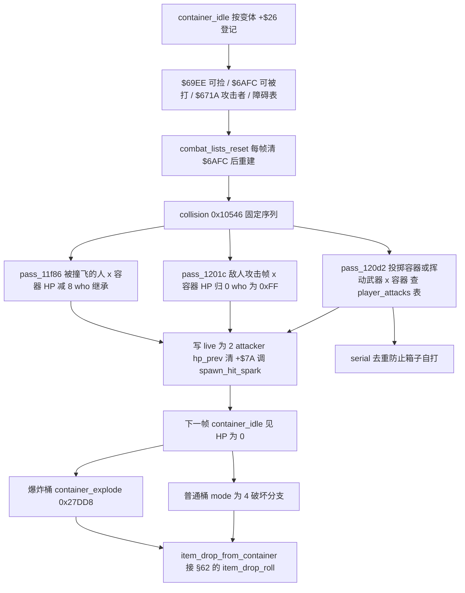

### 70.6 wof 侧与对照表

wof 侧按 §11.0 只登记 repo 呈现：`Cps1SceneObjRuntime.cs:188` 记 `4E550` 的 A 表分派（00 → 4E566、02 → 4E596、04 → 4E5FA、06 → 4E682），`Cps1SceneObjRuntime.cs:208` 记 `0x4E686..0x4E724` 是场景池 `ObjId = 1` 的**可破坏场景物**，`Cps1SceneObjRuntime.cs:334` 记 `4E740` 的 A 表里 `ObjId3` 的 `A04` 走 `4E8A8` 掉落计时。§62 已登记 wof 的 `Cps1Item.cs` 三条道具线、`0x4E9CE` / `0x4EABC` 两张随机表与 `1448` 空闲表分配器，本节不改写。**repo 侧没有出现「按伤害来源分三条 pass、各带记分规则」的容器命中链**；按 §11.0 不臆断 wof 有没有等价机制、不评优劣、不新增 ROM 取证，也不把 §62 的 wof 掉落链重列一遍。

| 维度 | dino | wof（按 §11.0 登记） |
|---|---|---|
| 可被打对象住哪 | pool E 容器，每帧登记进 `$6AFC` | 场景池 `ObjId = 1` 可破坏场景物（`Cps1SceneObjRuntime.cs:208`） |
| 谁打 | 三条 pass 按三张列表交叉 | 按 §11.0 保留，不臆断 |
| 伤害从哪来 | 固定减 8 / 直接归 0 / 玩家攻击记录三选一 | 按 §11.0 保留，不臆断 |
| 破碎与掉落 | 下一帧 `container_idle` 判 HP 为 0，接 §62 | A 表 `4E5FA` / `4E8A8` 掉落分支（`:188`、`:334`） |
| 记分 | `who` 继承 / `who = 0xFF` 无人记分 / `b9a = r.score` | 按 §11.0 保留，不臆断 |

### 70.7 组织结论与边界

1. **与 §68「一份表被多方读」并列，方向相反**：§68 是一个写入者造一张上一帧表、五个读方各自过滤；本节是**一个被动对象同时被三张列表交叉命中**，三条 pass 各带一套伤害与记分规则。共同点仍是「共享的是列表，不是决策」；差别是这里连「谁可以打它」都由对象自己每帧登记哪几张表决定。
2. **§62 的上一帧、§21.8 保留边界下取横切面的第四次复用**：§21.8 保留的是 `item/` 下四个文件的**逐类状态展开**，本节取三条 pass 的横切面，与 §63（§41.7 保留清单下取 `demo.rs`）、§67（同先例取 stage intro）、§69（同先例取 `player_weapon.rs`）一致；§62 讲碎后掉落，本节讲碎前结算，两节不改写、不合并。特别不把 §35 的 `pass_10cd0`（pool B prop）与本节三条 pass（pool E 容器）混成一套。
3. **「谁打」是一份完整契约**：伤害值、命中停顿给几方、分数归谁、箱子朝哪边倒、`serial` 要不要去重，全部由 pass 的来源决定，没有一处集中仲裁器；这是 §66「独占被做成状态」、§69「两层帧被做成开关」之后，第三条「把关系写进对象头与列表」的组织方式。四条共享状态线（§14 / §51 / §57 / §65）在此仍不新增。

- **既有结论不改写**：§21 pool E 生命周期 / 三张注册列表 / 拾取双向迁移、§62 掉落链与 `item_drop_roll`、§35 `pass_10cd0`、§46 `AttackRecord`、§48 `attack_serial` / `combat_lists_reset`、§50 六容器总表、§58 火花、§61 弹丸是攻击者、§68 上一帧对象表全部维持原貌；§21.8 / §35.5 / §62.8 / §68.6 的保留清单不扩张。
- **未做（保留，不扩张）**：`+$7A` 与 `b9a` 之外记分字段的全部消费者；`0xA26FC` 玩家攻击表逐项数值、`container.rs` 各变体完整状态机、`blast.rs` / `small.rs` 逐类展开、`$6AC2` 与 `$671E` 的其余写入点；wof 是否有等价容器命中链及其记分路径（§11.0 不主动追、不臆断）；两边「掉落物能否被攻击击飞 / 反弹」是否等价（§62.8 已保留，不扩张）；音频按 §0 边界外。
- ROM 条件授权（§11.6）**未触发、0 次 ROM 取证**：全部结论来自两份 repo 的文件头、函数、常量与调用序列；wof 片段自带 ROM 逐指令注释，不属「非常可疑」，按用户「不过度怀疑 rep 侧」不再另查 ROM。

**结论**：§70 把 §21.4 那句「`$6AFC` 可被打列表 → 三个 pass 消费」展开成一条链，给出「一个 pool E 容器按变体每帧登记进三张列表，同一 handle 可同时是攻击者与可被打对象」「`collision 0x10546` 里连续三条 pass 各按来源给伤害、停顿、朝向与记分，玩家那一路用 `player_attacks` 一次查表定三件事」「三条 pass 都只写 HP / `live` / `serial`，破碎与掉落留给下一帧 `container_idle`，是 §62 的上一帧」三条结论；wof 侧按 §11.0 只登记场景对象 A 表分派与可破坏场景物池，不臆断、不评优劣、不扩张 §21.8 / §35.5 / §62.8 / §68.6 保留边界；`长时间自主推进` 仍是开放目标，本节不宣称终止。

---

## 71. 开场那群人不是敌人：一个 master 怎么带一整场戏，以及他们为什么不进 census

> 触发：上一轮列 `game/` 下从未被笔记以 `文件:行号` 取证的模块时，`enemy/scenery.rs`（679 行）与 `prop/b74.rs` 同时露出；查重确认 `b74` / `class 54/55/56` / `master` / `0x57E0E` / `scenery` 在笔记里**零匹配**，`census` 的命中全是 §13 的 AI 人口普查，没有「谁被排除在 census 之外」这一面。§67 讲的是 slot 0x30 的 intro 任务（地图卡 / 入场 / HUD），没讲**同时存在的另一条演出线**；§19 讲的是 5 套脚本表，没讲「一个 pool B 对象只靠一个字节广播给一群 pool A 演员」。本节补这条横切面。
> 归属：设计正文（§0–§71），按「轮次线性追加」接在 §70 / A.34 之后。纯 repo 侧，未新增 ROM 取证（§11.0）。
> 边界：§13（census 一帧延迟 / `pick_target`）、§28（同屏预算 `g.alive` / 波次）、§19（5 套脚本全景）、§20（顶层任务机 / `Scene` sleep）、§50（六容器总表 / 容量即背压）、§54（对象间引用与归属）、§67（stage intro 独立任务）、§66（独占是状态）、§43（离场回收）全部维持原貌。§21.8 / §35.5 / §41.7 / §70.7 的保留清单不扩张。wof 侧按 §11.0 只登记 §67 已核实的两处 repo 呈现，**不臆断等价 master / cast、不评优劣**；音频按 §0 边界外。

### 71.1 一句话结论

dino 的开场 / 结局演出不是「脚本逐帧给每个角色发命令」，而是**一个 pool B master 对象带一群 pool A 演员**：master 由 stage script 创建，自己只有 9 个 `sub` 步和几个帧计数器，分两批把演员 `spawn_alloc` 出来；每个演员在对象头 `+$A4` 记住 master 的 handle，每帧读 master 的 `+$05`（sub）与自己缓存的 `MASTER_SUB`（`+$A2`）比对，变了就**按自己 class 的 act 表把同一个字节翻译成完全不同的动作**。更关键的是 `enemy/scenery.rs:17` 明说「除 class 54 外这些类都不碰 census（`+$7D = 0xFF`）」——`enemy_census 0x3242E` 的入口条件正是 `(ATTACKING as i8) < 0` 就跳过，于是**一整场戏的演员住在敌人池里、走共享敌人行为库、有的还能被玩家打，却不占同屏敌人预算、不参与目标选择**。wof 侧按 §11.0 只登记第一关入口对白对象与 slot15 事件队列，不臆断等价、不评优劣。

### 71.2 master 侧：一个对象、九个 sub、两批 cast

`prop/b74.rs:1-18` 的 pool B class 74（`+$20 = 0x128`，handler `0x89B48`）是 Episode 1 开场 master，由 stage script（spawn list 1、camera X `0x1C0`）创建。文件头的 sub 表就是整场戏的时间线：

| sub | 动作 | 计数器 `+$A0` |
|---|---|---|
| 0 → 2 | 初始化后立刻进 sub 2 | — |
| 2 → 4 | `0x89B90` 造**第一批 cast**，sub 4 | `0xF0 + 0x78 = 0x168`（360 帧） |
| 4 → 6 | 倒计时，归零进 sub 6 | 递减 |
| 6 → 8 | `0x89CAE` 造**第二批 cast**（3 个从右侧走入的暴徒），sub 8 | `0x5A`（90 帧） |
| 8 → 0xA → 0xC → 0xE → 0x10 | 递减 → `0x1E`（30 帧）→ 递减 → 空转 | `0x1E` |
| 0x10 | **什么都不做，永久**；演员自己 free，对象留到 area 结束 | — |
| mode 4 / 6 | `0x89DA0` free | — |

两批 cast 是**常量表**（`prop/b74.rs:35-58` 的 `Member { class, var, facing, x, y, z }`）：`FIRST` 5 人（class 54 旁观者、class 56 飞行演员、class 55 暴徒 variants 0/1/2），`SECOND` 3 人（class 55 variants 3/4/5，`+$24 = 1` 面朝右）。文件头特别注明「**顺序决定每个成员拿到哪个 pool A 槽**」，且 class 56 既不写 variant 也不写方向（原机只写位置与 master）。

```
prop_b74_cast(master, cast):                  # prop/b74.rs:114-133
    for m in cast:
        h = spawn_alloc(0)
        if h is None: continue               # 池满：跳过这个成员，不阻塞、不回滚
        b.live = 1
        b.k20  = 4 * m.class                 # pool A 的 class 分派键
        if m.var: b.var26 = m.var; b.dir = 0
        if m.facing: b.facing = 1
        (b.x, b.y, b.z) = (m.x, m.y, m.z)    # 精确出生点写进对象头
        b[+$A4] = 0xFFFF_0000 | master       # move.l a6,$a4(a0)，符号扩展地址
```

`prop/b74.rs:165-211` 的单测把整条时间线钉死：第 1 帧 sub 2 且 cast 空、第 2 帧出第一批 5 人及各自精确坐标、每个 live 演员的 `+$A4` 都等于 master、`0x168` 帧后 sub 6、再一帧出第二批共 8 人且第二批 `facing == 1`、`subs(5000) == 0x10`（永久空转）、以及「pool A 满时成员变少而 master 继续」。

### 71.3 演员侧：一个字节广播，各自解释

`enemy/scenery.rs:25-50` 给出演员专用的对象头偏移：`MASTER = +$A4`（long）、`MASTER_SUB = +$A2`（上次看到的 master `+$05`）、`ONCE = +$A3`（本段只启动一次）、`TIMER = +$A8`、`CHILD_MADE = +$A8`、`SPEED_X/Z`、`GRAVITY`、`SPEED_Y`。`enemy_scene_master_sub`（`enemy/scenery.rs:371-376`）从 `+$A4` 低字取 handle，**只有 `slot_of(h).is_some()` 才读 `body(h).sub`，否则当 0**——master 被释放 / 地址失效时演员优雅降级，不会读野指针。

三类演员各自把同一个 master sub 翻成不同动作：

| class | 同步方式 | 动作翻译 | 证据 |
|---|---|---|---|
| 54 旁观者 | `m != MASTER_SUB` → 清 `ONCE`、`e.b.sub += 2`、写回 | 按 `e.b.sub` 走 act 表 `0x57732`：sub 4 / 8 各启动一次动画，0xC 起 `TIMER = 0x3C` 倒计时 | `enemy/scenery.rs:349-411` |
| 56 飞行演员 | 同样的比对（共用 `0x577AA` / `0x57D5C` 跟随例程） | sub 0 / 2 不推进动画也不出画；sub 4 造 class 57 子对象；sub 6..0xC 只做出界检查；sub 0xE 下一帧 free | `enemy/scenery.rs:433-492` |
| 55 脚本暴徒 | `m != MASTER_SUB` → **`e.b.act = m`**、写回 | 按 `e.b.act` 走表 `0x5799E`：0/2/4 向右走、6/0xA 每帧重启站立、8 走到位、0xC 跑（`SPEED_X` 每帧、`SPEED_Z` 隔帧，用 `ONCE` 当 toggle）、0xE 被打飞（重力 -0x4000）、0x10 飞 | `enemy/scenery.rs:498-598` |

`ONCE` 的双重用法值得单记：class 54 / 56 里它是「这段动画只启动一次」的门，class 55 的 `sub 0xC` 里它被当**隔帧 toggle**（`e.m.b(ONCE).wrapping_add(1) & 1`，`enemy/scenery.rs:580-584`）控制 Z 方向每两帧才走一步——同一个字节在不同 class 里语义不同，与 §53「一个对象可挂多套帧序列」同族，但这里是**演出层**的用法，不改写 §53。

class 56 还有一条**两级 master 链**：它在 `sub 4` 且 `CHILD_MADE == 0` 时 `spawn_alloc` 出一个 class 57（`k20 = 0xE4`，表 `0x57E0E`、音效 `0xE7`）@`(0x4E5, 0x6C, 0x131)`，而这个子对象的 `+$A4` 反过来记 **class 56 自己**（`enemy/scenery.rs:466-481`）；原对象「只画一帧然后只等被 free」（`0x57D56`）。也就是 master 引用可以再被演员当 master 用一次。

### 71.4 一个字节把「演员」从 AI 预算里摘出去

这是本节最值得记的一条。`enemy.rs:168` 定义 `ATTACKING: usize = 0x7D; // 1 in attack state; negative = not counted`；`enemy_census 0x3242E`（object update 的**第一个调用**，`enemy.rs:769-806`）的入口是：

```
if e.b.live == 0 || (e.m.b(ATTACKING) as i8) < 0 || e.b.mode >= 4:
    continue                                   # enemy.rs:779
g.alive_run += 1                               # §28 同屏人头预算
... 按 TARGET 累加 census[p][0..3]             # §13 负载均衡 / 侧翼包抄
```

`enemy/scenery.rs:17` 的文件头把契约写破：**「None of these touches the census (`+$7D = 0xFF`) except class 54.」** 代码里三处确实写 `sb(ATTACKING, 0xFF)`：class 49 背景鸟（`:82`）、class 50 飞入的鸟（`:169`）、class 55 脚本暴徒（`:546`，init 先写 0 再在末尾写 `0xFF`）。class 54 是文件头点名的例外，不设这个字节。

于是形成一条很省事的设计：**演出演员照旧是 pool A 真对象**——照旧 `spawn_alloc`、照旧进 `enemies_update` 按 `k20` 分派、照旧 `enemy_anim` / `enemy_floor_collision` / `enemy_draw_check`、照旧走 `enemy_free_pool_a`（§43），class 55 甚至有 HP 1、`box_table 0x103C00`、stun 0xA / poise，注册进 `0x4BEA` 可被打列表，被打回退到**共享** `enemy_hit_reaction 0x2A606` 与 `enemy_grabbed 0x2B35A`（`enemy/scenery.rs:550-558`）——但一个 `0xFF` 就让它们**不进 `g.alive`、不进 `census`、不参与 `pick_target` 与波次预算**（§13 / §28）。「能不能被打」和「算不算敌人」被拆成两件事，中间没有第二套对象池、没有演出专用调度器。

按 §11.0 不臆断 class 54 / 56 的 `+$7D` 具体写入点（文件头已给契约、代码只在三处显式写 `0xFF`），这一项列入 §71.7 保留边界。

### 71.5 跨场景复用：不是 Episode 1 的特例

| 文件 | 场景 | 关系 |
|---|---|---|
| `prop/b74.rs:1-4` | Episode 1 开场 master（class 74，`0x89B48`） | 由 stage script 创建；cast = pool A 54 / 55 / 56 |
| `prop/b82_85.rs:1-6` | 结局 master（class 82，`0x8AA0A`）+ 碎片 / 震动 83 / 84 / 85 | 由 ending routine `0xA69B8` 创建 |
| `prop/b81.rs:1` | 结局沙漠场景 master（M3-25 / M3-26） | **由 master 82 创建** |
| `prop/b87.rs:1` | 结局职员表（M3-24 / M3-25） | **由 master 82 在 still 中创建** |

「master + cast + `+$A4` 引用 + `+$05` 广播」在开场与结局反复出现，且 master 自己还能再生 master（82 → 81 / 87）。所以本节不是「读了一个冷门 class」，而是补上一条贯穿流程层的**演出组织方式**：与 §67 的 slot 0x30 intro 任务（地图卡 / 标题 / 入场 / HUD）是同时存在的两条线，一个管屏幕 UI 节奏，一个管场上演员，彼此不改写、不合并。

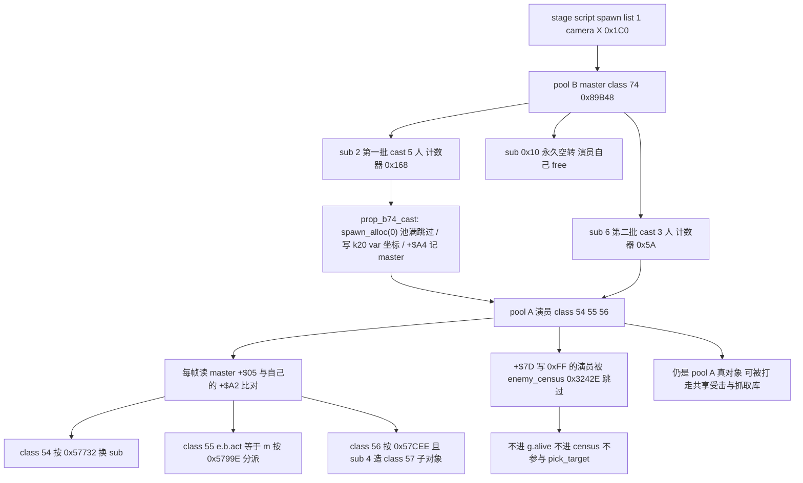

### 71.6 wof 侧与对照表

wof 侧按 §11.0 只登记 §67 已核实的 repo 呈现：`Cps1EventObjectRuntime.cs:188-192` 记「`000156A8..000156D0`：第一关入口任务创建开场对白对象」，并注明「该路径不经过关卡脚本 type1C」；`Cps1EventQueueTask.cs:5-18` 记 ROM `0xD000` 事件队列消费任务在调度器 slot15，队列空则等待、读指针推进、按事件类型跳表分发。**repo 侧没有出现「pool B master 带一群 pool A 演员、`+$A4` 引用 + `+$05` 广播」的组织**；按 §11.0 不臆断 wof 有没有等价机制、不评优劣、不新增 ROM 取证，也不把 §67 的入口对白 / 事件队列结论重列一遍。

| 维度 | dino | wof（按 §11.0 登记） |
|---|---|---|
| 演出节奏由谁推进 | pool B master 的 `sub` + 帧计数器 `+$A0` | 入口任务 `0x156A8` 分配对白对象；slot15 `0xD000` 队列消费（`Cps1EventObjectRuntime.cs:188`、`Cps1EventQueueTask.cs:5`） |
| 演员与 master 的引用 | 每个演员 `+$A4` 记 master，`+$A2` 缓存上次 sub | 按 §11.0 保留，不臆断 |
| 演员算不算敌人 | `+$7D = 0xFF` 被 `enemy_census` 跳过，但仍可被打 | 按 §11.0 保留，不臆断 |
| 生成背压 | `spawn_alloc(0)` 返回空就跳过成员、master 继续 | 按 §11.0 保留，不臆断 |
| 跨场景复用 | class 74 开场、class 82 / 81 / 87 结局同构 | 按 §11.0 保留，不臆断 |

### 71.7 组织结论与边界

1. **§13 / §28 的补面：谁被排除**。前两节讲 census 怎么统计、同屏预算怎么用；本节给出「一个字节主动退出统计」的路径，且退出者仍留在同一池、同一行为库。与 §66「独占被做成状态」、§69「两层帧被做成开关」、§70「语义由登记哪几张表决定」并列，是第四条「把关系写进对象头」的组织方式；与 §66 的独占方向相反（A.30 已有「共享状态线方向相反」的先例）。
2. **§19 / §20 / §67 之外的一条独立演出线，不并入 5 套脚本表**：master 由 stage script 创建（§19 生成脚本的下游），但演出推进**不靠脚本逐帧发命令**，而靠 master 一个 `sub` 字节广播 + 各 class 本地解释；与 §63 把 attract demo 预录输入「不并入 §19 的 5 套表」是同一种处理。§67 的 slot 0x30 intro 任务管屏幕 UI 节奏，本节管场上演员，两节不改写、不合并。
3. **背压的一种新形态**：§50 记「`alloc = None` 即同屏上限」是生成器被挡住；这里 `prop_b74_cast` 遇到池满是**跳过该成员、整场戏照常往下走**（单测 `a_full_pool_makes_fewer_members` 钉死）。同样的静态池，一个把上限变成硬阻塞，一个把上限变成「少几个群众演员」，是设计取舍不是优劣判断。
4. **引用字段再添一个语义**：`+$A4` 是「master」，与 §54 的 `who` / `attacker` / `partner` / `serial` 并列；class 56 再把子对象的 `+$A4` 指回自己形成两级链。§54 的结论不改写。

- **既有结论不改写**：§13 census / `pick_target`、§28 `g.alive` / 波次、§19 五套脚本、§20 `Scene` sleep、§43 离场回收、§50 六容器总表、§53 多套帧序列、§54 引用字段、§66 独占、§67 stage intro、§70 容器命中全部维持原貌；§21.8 / §35.5 / §41.7 / §70.7 保留清单不扩张。
- **未做（保留，不扩张）**：class 54 / 56 的 `+$7D` 具体写入点（文件头已给契约，不臆断）；`0x57732` / `0x5799E` / `0x57CEE` / `0x57E0E` 各 act 表逐项与逐角色数值；class 49 / 50 鸟类摆动的完整物理、`enemy/class57.rs` 完整状态机；`prop/b81.rs` / `b82_85.rs` / `b87.rs` 逐类状态展开（§11.0 只在必要时补 data，不主动做全量普查）；wof 是否有等价 master / cast 及其演出推进路径（§11.0 不主动追、不臆断）；两边演出对象是否等价（不臆断）；音频按 §0 边界外。
- ROM 条件授权（§11.6）**未触发、0 次 ROM 取证**：全部结论来自两份 repo 的文件头、偏移量、函数、常量表与单测；wof 片段自带 ROM 逐指令注释，不属「非常可疑」，按用户「不过度怀疑 rep 侧」不再另查 ROM。

**结论**：§71 把「开场 / 结局那群人怎么被组织」收成一条链，给出「一个 pool B master 用 9 个 sub 与帧计数器分两批造 cast，演员 `+$A4` 记 master、每帧比对 `+$05` 并各按自己 class 的 act 表解释同一个字节」「`+$7D = 0xFF` 让演出演员被 `enemy_census` 跳过、不占 `g.alive` 与 `pick_target`，却仍住 pool A、仍可被打、仍走共享受击与抓取库」「class 74 开场与 class 82 / 81 / 87 结局同构，master 还能再生 master」三条结论；wof 侧按 §11.0 只登记入口对白对象与 slot15 事件队列，不臆断、不评优劣、不扩张 §21.8 / §35.5 / §41.7 / §70.7 保留边界；`长时间自主推进` 仍是开放目标，本节不宣称终止。

---

## 72. 玩家自己的死亡：60 帧闪烁之后，一条命怎么被扣掉，又怎么把两条时间线补回来

> 触发：A.35 之后按开放目标找下一块，先查「玩家自己的死亡 / 一条命耗尽链」。Grep 确认 `flow_game_over`（§30）、续关倒计时（§55 / §57）、`+0xEC` 复活无敌（§29）、wof 死亡降难度（§25）都已有落点，但 `player_dead` / `player_dead_continue 0x1BFD0` / `+$A3` 扣减 / `rank_event_continue` / `rank_respawn_time` / 复活或推 game over 这条**玩家侧链**在笔记里零匹配；命中的三条只是「受击反应分发」（§12）、「BCD 奖命检查」（§26）与「一次命中三段」，都不是同一条链。本节把这条链补上。
> 归属：设计正文（§0–§72），按「轮次线性追加」接在 §71 / A.35 之后。纯 repo 侧，未新增 ROM 取证（§11.0 / §11.6 条件通道未触发）。
> 边界：§25（rank 跨整局时间驱动状态机 / `A5-0x5A`）、§26 / §40（HUD 奖命 / tally）、§29（受击恢复与无敌）、§30（flow.mode 8 态与 game over）、§41（join 四态）、§55（续关跨系统契约）、§57（时间三类计时器 / 全局时间门）、§64（一次开一局的四种写法）、§65（DIP cook）、§66 / §69 / §70 / §71（对象头契约）全部维持原貌、不改写不合并。§21.8 / §25.8 / §29.8 / §30.7 / §55.8 / §57.6 / §64.7 / §71.7 的保留清单不扩张。wof 侧按 §11.0 只登记 `Cps1PlayerLogic.cs` 已写明的死亡态与扣命分支，**不臆断等价、不评优劣**；音频按 §0 边界外。

### 72.1 一句话结论

dino 的「死一条命」不是一次字段写入，而是一段**状态机演出 + 一次读写时序契约 + 两条全局时间线补偿**：玩家进 mode 4 后先按 `+$80 = 0x3C` 走满 60 帧的闪烁（`draw_flags` 按奇偶开关隐藏位），过关时这整段被 `stage_clear` 短路成白复活、一命不扣；真到扣命那一刻，`player_dead_continue 0x1BFD0` 先把命数减 1、又**临时加回 1** 给 rank 事件读、事件返回后再减回 1，让「给难度系统看的值」与「真实剩余命数」在同一个函数里错序共存而不另立第二份字段；有命复活则 `rank_respawn_time 0x10482` 一次补上 600 帧波次预算与 +3:30 关卡时钟，无命则只把 `live` 清 0、重算活跃人数、再调 `rank_event_1842c` 降一档 rank 速度——**game over 的判定权不在这个函数里**，它归 §30 的顶层 flow 任务机。wof 侧按 §11.0 只登记 A=04 三分支与 `0x1BA6A` 扣命，不臆断等价。

### 72.2 死亡态是一段演出：60 帧闪烁走完才轮到命数

`player.rs:3874-3906` 的 `player_dead`（mode 4，原机 `0x1BF42`）用 `sub` 三段而不是一次判断：

| sub | 进入时做什么 | 何时离开 |
|---|---|---|
| 0 | `live = 2`（还在场但不是可操作态）、`+$80 = 0x3C` | 立即置 `sub = 2` |
| 2 | 每帧 `player_pstep`、`+$80 -= 1`；按 `t & 1` 写 `draw_flags = 0 / 8`（bit3 hidden） | `t == 0xFF` 时 `draw_flags = 0`、`sub = 4`、调 `player_dead_continue` |
| 4 / 其他 | 直接 `player_dead_continue` | 由后者接管 |

也就是说「扣命」这件事被**排在一整段可见演出之后**：死亡不是把人从场上抹掉，而是让他先以「半在场、`live=2`、隔帧隐身」的形态待满 60 帧。`0x3C = 60` 与闪烁同源——`t` 每帧减 1，奇数帧隐藏、偶数帧显示，计数到 `0xFF`（从 0 再借位）才收尾。这一段与 §29 的受击恢复链、§53 的帧记录 `last` 播完事件是同一取向：**节奏由状态字节的递减与回绕决定，不由外部计时器回调决定**。

**演出被关卡状态抢先短路**：sub 2 每帧第一件事是查 `w.stage_clear`。若过关流程已经置位，直接 `hp = 1`、`hp_prev = 1`、`live = 1` 并 `player_idle_entry`（`player.rs:1104`），整条扣命 / rank / 时间补偿链**一次都不走**。设计上的含义是「过关那一刻的死亡不算死」：死亡态没有自己的终局权，它得先看整体关卡状态机走到哪一步。这与 §30 的 `flow.mode` 原子迁移、§67 intro 与过场脚本的交接是同一条「上层状态机优先于对象状态机」的线。

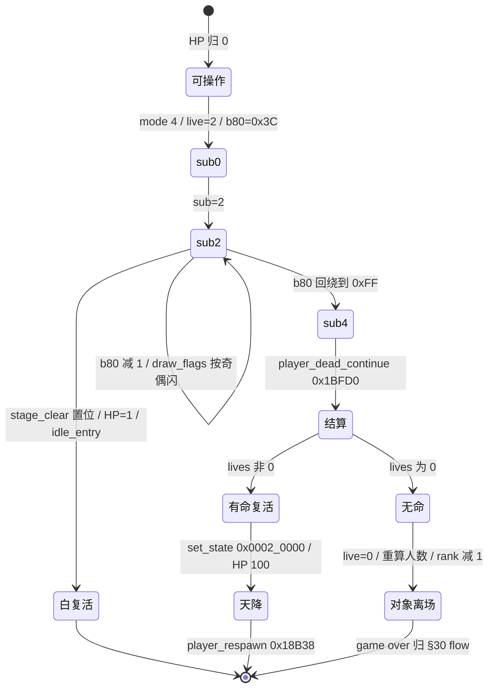

伪代码（按 `player.rs:3874-3906` 直译，只保留设计分支）：

```text
DEAD(i):
  switch sub:
    0:  live[i]=2; b80[i]=0x3C; sub=2; return          # 半在场，60 帧
    2:  if stage_clear:                                 # 过关优先于死亡
            hp=1; hp_prev=1; live=1; IDLE_ENTRY(); return
        PSTEP(); t = --b80[i]
        draw_flags = (t & 1) ? 0 : HIDDEN                # 隔帧隐身
        if t != 0xFF: return
        draw_flags = 0; sub = 4; CONTINUE(i); return
    _:  CONTINUE(i)
```

### 72.3 命数结算：一次「加回去再减回」的读写时序契约

`player_dead_continue 0x1BFD0`（`player.rs:3908-3941`）最反直觉的四行在 `lives != 0` 分支：

```text
p.lives -= 1                                  # 真扣一命
p.live = 1; p.set_state(0)
p.lives = p.lives.wrapping_add(1)             # 0x1BFEC：加回去
player_a3 = p.lives                           # rank 事件读的是「扣之前」的值
lives = hud_lives_sum()                       # 全体在场玩家 +$A3 之和
rank_event_continue(player_a3, lives, b4cf, b4e6)
p.lives = p.lives.wrapping_sub(1)             # 0x1BFF6：再减回
```

源码注释把理由写死了：`0x1BFEC: 0x184E2 reads +$A3, so the spent life is put back for that call`（`rank.rs:285-311` 的 `rank_event_continue` 在 `player_a3 != 0` 时按 `0x187F4 + (dip&7)*8` 表加一档 rank 速度）。于是同一个 `+$A3` 在一个函数里被写成**两个语义**：

| 时刻 | `+$A3` 的值 | 谁在读 | 读它做什么 |
|---|---|---|---|
| 扣命后 | 真实剩余命数 | 无 | — |
| `wrapping_add(1)` 之后 | 扣命前的值 | `rank_event_continue` / `rank_event_1843c` | `player_a3 != 0` 判定是否加 rank 速度；`lives` 总和查 `0x184C4` 表 |
| `wrapping_sub(1)` 之后 | 真实剩余命数 | HUD / 下一次死亡 | 显示与后续扣减 |

dino 没有为「难度系统该看哪份命数」另开字段或传一份快照，而是**把两份语义压进同一字段的先后两次写**，用调用顺序当契约。这与 §69「层停下不清空，旧值是下次起点」、§68「上一帧列表靠 copy 再清」、§66「独占写成双向标志」是同一族：关系与时序住在对象头与调用序列里，不另立第二套状态容器。区别是这里连「上一帧」都不用等，是**同一帧内**的错序。

**统一入口，不是每个场景各写一份**：`rank_event_continue` 名字就叫 continue，`rank.rs:287-311` 被三处共用——`player_dead_continue` 的复活分支与无命分支都调它、§55 续关调它、§41 join 也走同族；`rank_event_1843c`（`rank.rs:268-283`）又被 `hud_extend_check 0x6B98`（`hud.rs:526-554`）在奖命时直接调。于是「命数 / 人数 / 难度」之间只有一个入口、三个输入（`player_a3` / `lives` 总和 / `b4cf`、`b4e6`），奖命、续关、死亡、加入四种事件都经它重算 `w.rank`、`rank_compute_level()` 与 `calm = 0x4B0`。§25 讲的是 rank 随时间自动推进，本节补的是**rank 被玩家生命周期事件打断重算**的那一条线，两节不改写、不合并。

### 72.4 复活补的不是一条命，是两条全局时间线

有命分支把状态写成 `set_state(0x0002_0000)`（mode 0 / sub 2 的 respawn 态，`player_respawn 0x18B38` 在 `player.rs:708-734`：act 0 摆到相机上方、act 2 重置、act 4 等待、最后 drop in），`hp = hp_prev = hp_bar = 100`，`facing` 单独保留、`step = 2`。但真正把「一条命」接回整局的是最后一句 `rank_respawn_time()`（`rank.rs:378-384`，原机 `0x10482`）：

| 被补偿的全局资源 | 写在哪里 | 补多少 | 与哪节呼应 |
|---|---|---|---|
| 波次时间预算 `G.$50C` / `wave_timer` | `spawn.g.wave_timer += 0x258` | 600 帧 | §28 波次编排 / §55 续关 `wave_timer+600` |
| 关卡时钟 `time_min:time_sec`（BCD） | `rank_add_time(0x330)` | +3:30，封顶 04:00 | §57 时间三类计时器 / §25 rank 时间驱动 |
| TIME OVER 锁 `G.$4EB` / `time_lock` | `rank_add_time` 顺带清 | 结束字样飞入与全队 HP 归 0 的锁 | `rank.rs:354-376` `rank_time_over` |

也就是说：**一条命在 dino 里不是孤立的计数器，而是同时挂着「还剩多少人能上」与「还剩多少时间打」两条线**。死一次不只扣 `+$A3`，复活时还要把波次预算与关卡时钟往回拨，且 `rank_add_time`（`rank.rs:392-410`）用 BCD 加法、秒位 `>= 0x60` 借位、总时 `>= 0x400` 钉到 04:00。§55 续关补 600 帧、§64 开局把三条全局资源线收拢到一处初始化，本节是它们的**局内中途补偿点**：同一组资源在「开局 / 续关 / 中途复活」三个时机被三种写法改写，但读写的是同一片全局状态。

### 72.5 无命时只把对象摘掉：game over 的判定权不在死亡态

`lives == 0` 分支（`player.rs:3931-3940`）做的事比「复活」少得多：

```text
p.b.live = 0                                  # 从「在场」名单移除
player_count_players()                        # G.$4EF = 活跃人数 - 1（player.rs:702-705）
player_a3 = p.lives                           # 此时为 0
lives = hud_lives_sum()                       # 只统计仍 live != 0 的玩家
rank_event_continue(player_a3=0, lives, b4cf, b4e6)
rank_event_1842c()                            # rank speed - 1（rank.rs:262-266）
```

注意**这里没有 `flow_game_over`、没有切 `flow.mode`、没有弹续关倒计时**：死亡态只负责把玩家对象从 census 式的「在场」集合里摘掉、重算一次活跃人数、把难度降一档（作为「少一个人」的补偿），然后就结束。是否整局结束，由 §30 的顶层 `flow` 任务机在别处读到「没有活着的玩家」才决定；§55 的续关倒计时是那条下游链。设计上的分工是：**对象状态机管「这个人还能不能动」，顶层流程任务机管「这局还玩不玩」**，中间靠 `live` 位与 `players_minus_one` 一个字段交接。这与 §71 `+$7D = 0xFF` 让演出演员退出 census 却仍住 pool A 是同一思路的反向用例——那节是「还能动但不算数」，这节是「不能动了，让上层去数」。

`player_count_players 0x655E`（`player.rs:702-705`）的计数条件是 `live != 0 && mode != 0`，写 `G.$4EF = n - 1`；这个 `players_minus_one` 又回到 `rank_event_continue`（`rank.rs:303`）当 `i` 选 `0x187F4` 表的行。于是一次死亡把「人数 → 难度表行号 → rank 速度」串成一条闭合反馈，与 §13 census 的一帧延迟反馈闭环同族，但走的是玩家侧而非敌人侧。

### 72.6 wof 侧与对照表（按 §11.0 只登记，不臆断等价、不评优劣）

`Cps1PlayerLogic.cs:10671-10676` 的 A=04 死亡态同样分三段：`0x00` 初始化死亡退场 `0x1BA28`、`:10680-10688` 先调 `玩家死亡_降低动态难度_可能对应ASM_170E()` 再 `FlyLeft = 7` / `DispFlag = 1` / `ActStatB = 0x02` / 加入渲染；`:10718-10728` 的 `0x02` 闪烁用 `OBJC0 += 0x20` 溢出为 0 时翻转 `DispFlag` 并 `FlyLeft--`，归零后 `ActStatB = 0x04`；`:10748-10783` 的 `0x04` 扣命读 `A5-0x65 + playerIndex` 的命数减 1，非 0 则 `Flash = 0xB4` + `玩家_按角色重装资料_可能对应ASM_1D68` + `ActStateABCD = 0x00040000` + 重绘 HUD，为 0 则清 `A5-0x1C59` 活跃位图、写回 `A5-0x1C53`、把 `Hp / HpDisp / Exist / DispFlag / ActStateABCD` 清零。`:10690-10698` 的降难度是 `rng` 查 `0x1726` 表减 `A5-0x5A` 后钳位（§25 已登记）。`:10554-10577` 另记复活天降 `FlyLeft` **先减后判**，`0x1AD22 bra.w 0x1AB9C` 结束出场。以上全部只是 repo 侧已写明的事实登记；`Cps1PlayerLogic.cs` 自带 ROM 逐指令注释，按用户「不过度怀疑 rep 侧」不另查 ROM（§11.6 条件通道未触发）。

| 环节 | dino（设计契约） | wof（按 §11.0 只登记） |
|---|---|---|
| 死亡入口 | mode 4 `player_dead` 的 `sub` 0/2/4 | A=04 的 0x00 / 0x02 / 0x04 三分支 |
| 演出节奏 | `+$80 = 0x3C`，60 帧按奇偶写 hidden 位 | `FlyLeft = 7`，`OBJC0 += 0x20` 溢出翻转 `DispFlag` |
| 难度挂钩时机 | 扣命那刻调统一入口 `rank_event_continue` | 初始化退场 `0x1BA28` 先调 `0x170E` 降难度 |
| 扣命字段 | 对象头 `+$A3`，扣后临时 +1 给 rank 读再 -1 | `A5-0x65 + playerIndex`，减 1 后原地判断 |
| 有命复活 | `set_state(0x0002_0000)` + HP 100 + 天降状态机 | `Flash=0xB4` + 按角色重装 + `ActStateABCD=0x00040000` + 重绘 HUD |
| 时间补偿 | `rank_respawn_time`：600 帧波次 + 3:30 时钟（封顶 4:00） | 按 §11.0 不臆断 |
| 无命 | `live=0` + `player_count_players()` + `rank_event_1842c`；game over 归 §30 | 清 `A5-0x1C59` 活跃位图 + HP/Exist/Disp 清零 |
| 过关时死亡 | `stage_clear` 短路白复活，一命不扣 | 按 §11.0 不臆断 |

**不评优劣**：两边都把死亡拆成「演出 → 扣命 → 复活 / 离场」，但 dino 把命数变化接到一个跨事件共用的 rank 入口并同时补两条全局时间线，wof 把降难度放在死亡初始化里、把复活交给按角色重装资料；这是**组织位置不同**，不是「谁更完整」。§25 已登记的 wof 死亡降难度不改写，本节也不把「未登记」写成「缺失」。

### 72.7 组织结论与边界

1. **死亡态不是终局态**：60 帧闪烁、过关短路、天降复活、离场后交棒 flow，四段都说明对象状态机只管「这个人还能不能动」，终局判定在 §30。这是 §20 顶层任务机 / §30 `flow.mode` 在玩家侧的下半段。
2. **同一字段的两次写当契约**：`+$A3` 的 `-1 → +1 → rank 读 → -1` 把「真实值」与「给系统看的值」压进一帧内的调用顺序，不另立快照字段；与 §66 / §68 / §69 的「关系住在对象头」同族，是同一帧内错序的新实例。
3. **一条命连着两条全局时间线**：`rank_respawn_time` 把波次预算与关卡时钟一起回拨，与 §55 续关、§64 开局构成「开局 / 续关 / 中途复活」三个改写时机；§57 的时间三类计时器因此多了局内中途补偿点，不改写 §57。
4. **rank 是被生命周期事件打断重算的**：§25 讲随时间自动推进，本节补 `rank_event_continue` / `rank_event_1843c` / `rank_event_1842c` 被死亡、复活、奖命、续关、加入共用的入口；不合并进 §25。
5. **与 §71 互为反向用例**：`+$7D = 0xFF` 是「还能动但不算数」，`live = 0` 是「不能动了，让上层去数」；两者都靠一个字节切换集合身份，没有第二套池。

**保留边界（不扩张，非欠账）**：`rank_event_*` 全族逐事件数值、`0x184C4` / `0x187F4` / `0x187D8` 各表逐项、`bcd_add` / `bcd_sub` 全实现、`player_respawn_reset` / `player_respawn_wait` 逐帧、`hud_extend_check` 的 DIP 阈值表全量、wof `1BA28..1BAB2` 逐指令与 `0x1C59` 位图全部消费点，均按 §21.8 / §25.8 / §29.8 / §30.7 / §55.8 / §57.6 / §64.7 / §71.7 的既有口径**保留、不扩张**；本节只取「一条命怎么被扣掉、又怎么把两条时间线补回来」这一条横切面。两游戏发行先后仍未考证（§11.0）。

---


## 73. 背景不是一张画：约 60 个场景对象怎么写同一片三层环形 tilemap

> 触发：A.36 之后按开放目标找 §73，沿用 A.34「由覆盖盲区反查选题」——枚举 `game/` 下从未被笔记以 `文件:行号` 取证的模块，251 个 `.rs` 里 174 个零引用；排除 `flow/movie.rs`（§41.7 / §63.8 / §71 三次明列逐类展开保留、不扩张）与 `enemy/class*.rs` / `prop/b*.rs`（逐类，属 §21.8 / §35.5 保留），选中 `prop/tile_block.rs`（479 行）。Grep 确认 `TilePos` / `TileMode` / `BlockTable` / `prop_tile_block` / `PairsMerge` / `scroll2_at_world` / `tile_block.rs` 在笔记里**零匹配**；§35 只在 mode 4 一句注记里提过「tile_block 写砖」，§23 讲的是 tilemap 写后几帧显示、§45 讲的是精灵绘制队列、§44 讲的是地形格怎么被**读**，都没讲「谁在写、写到哪」。本节补这条通用设施线。
> 归属：设计正文（§0–§73），按「轮次线性追加」接在 §72 / A.36 之后。纯 repo 侧，未新增 ROM 取证（§11.0 / §11.6 条件通道未触发）。
> 边界：§23（显示延迟按通道分档 / tilemap 0 帧）、§26（HUD 写 scroll1 VRAM 绝对地址）、§35（pool B 统一契约 / `pass_10cd0` 四段 / `drivers.rs` 四类服务）、§44（地形碰撞查表 / `shape_handler`）、§45（渲染优先级与队列）、§50（对象池总表）、§53（动画帧状态机）、§62（掉落）、§70（容器破碎）、§71（master / cast）全部维持原貌、不改写不合并。§21.8 / §35.5 / §41.7 / §63.8 / §72.7 的保留清单不扩张。wof 侧按 §11.0 只登记 `Cps1EventObjectRuntime.cs` / `Cps1TerrainCollision.cs` / `Cps1SceneObjRuntime.cs` / `Cps1StageTileStreamer.cs` 已写明的 VRAM 地址事实，**不臆断等价三层环形 map / `TileMode` / `BlockTable`、不评优劣**；音频与 port 侧诊断按 §0 边界外。

### 73.1 一句话结论

dino 的关卡背景**不是一张静态图，而是一片被约 60 个 pool B 场景对象按 VRAM 绝对地址实时改写的三层环形 tilemap**：`tile_block.rs:1-30` 把 scroll1 / scroll2 / scroll3 三张各 `0x4000` 字节、64×64 环的 map 摊成同一个地址空间，一个格子 4 字节（code word + attribute word，属性位 0–4 调色板、5–6 翻转、7–8 优先级），对象用 `TilePos` 三种入口（原始 VRAM 地址 / 环坐标 / 世界坐标 `0x75208`）定位格子，再用三种写入循环（`Pairs` 整格换、`PairsMerge(keep)` 只换低位、`Codes` 只换 code）把 ROM 源表按「逐列、每列自上而下」刷进去。最反直觉的是**地址算术把 68000 的「跑过头」也当成契约**：`down(n)` 只是 `+4*n`，一个高于 16 行页的块第三格会落进下一列而不是下一行，单测 `a_block_runs_on_over_the_page_end` 把这一点钉死。动画不住在对象帧里，而是 `BlockTable` 每 `period` 帧把整块矩形换一张源表；破碎也不在命中帧写，而是 mode 4 才刷碎图。§26 已记 HUD 也往 `0x908000..0x90BFFF` 写，于是**HUD 与场景道具共享同一片显存地址空间**，没有第二套 HUD 专用层。

### 73.2 三张 map、一个格子四字节，以及被保留下来的「跑过头」

`tile_block.rs:89-124` 的 `Layer` 给出三层的基址与列步长（`:14-18` 文件头表格把 rows per page 也列齐）：

| 层 | 基址 | 列步长 | 每页行数 | 格宽 |
|---|---|---|---|---|
| scroll1（8×8） | `0x908000` | `+0x80` | 32 | 4 字节 |
| scroll2（16×16） | `0x90C000` | `+0x40` | 16 | 4 字节 |
| scroll3（32×32） | `0x910000` | `+0x20` | 8 | 4 字节 |

三张 map 首尾相接，各 `0x4000` 字节，`Layer::of`（`:116-123`）按地址区间反查层；超出三张 map 的地址 `prop_tile_cell` 返回 `None`（`:195-205`，注释明说原机会写到调色板等其它 VRAM，port 不建模）。一个格子是「code word + attribute word」，属性字低 5 位是调色板、5–6 位翻转、7–8 位优先级组——**这三位组正是后面只改属性位写入循环要动的地方**。

`TilePos`（`:126-180`）提供三种定位，且互相可换算：

- **原始地址**：`TilePos::at(addr)` 用 `addr & !3` 把「属性字地址」归一到同一格；单测 `coordinates_and_addresses_agree`（`:347-364`）断言 `at(0x90EA66) == at(0x90EA64)`，还断言 `new(Scroll2, 39, 41) == 0x90E9E4`、`new(Scroll2, 10, 50) == 0x90F288`、`new(Scroll3, 63, 48) == 0x9137E0`，以及 `col / row` 都按 64 回绕（`new(Scroll2, 64+39, 64+41)` 仍是 `0x90E9E4`）。
- **环坐标**：`new(layer, col, row)` 用 `& 63` 取模后经 `Vram::index1/2/3` 换算；`layer_col_row()` 是它的逆变换。
- **世界坐标**：`scroll2_at_world 0x75208`（`:149-156`）从世界 `x, y` 求 scroll2 格：列由 `x` 取，行是 `63 - y/16`（从 1024 像素地图顶往下数）；单测 `the_world_position_helper_of_class_0`（`:366-372`）断言 `(0x670, 0x3F0) → (39, 0)`、`(0x10, 0) → (1, 63)`。

**「跑过头」是契约不是 bug**：`right(n)` 按层加 col_step，`down(n)` 却只是 `+4*n`（`:158-167`，注释 "the address runs on over the end of a page as the original's loops do"）。于是从 scroll2 的 `(5,14)` 写 1 列 3 行时，第 3 个格子落在 `(6,0)` 而不是 `(5,16)`，`(5,16)` 保持原值——单测 `a_block_runs_on_over_the_page_end`（`:421-432`）逐格断言。文件头 `:9-12` 解释原因：68000 原码是 `movea.l #$90F288,a0` 后 `move.w (a1)+,(a0)+` 循环，地址只是「一路往前跑」，块比 16 行页高就溢进下一列。dino 没有把这段几何「修正」成二维矩形，而是把原机的地址行为照搬成服务契约。

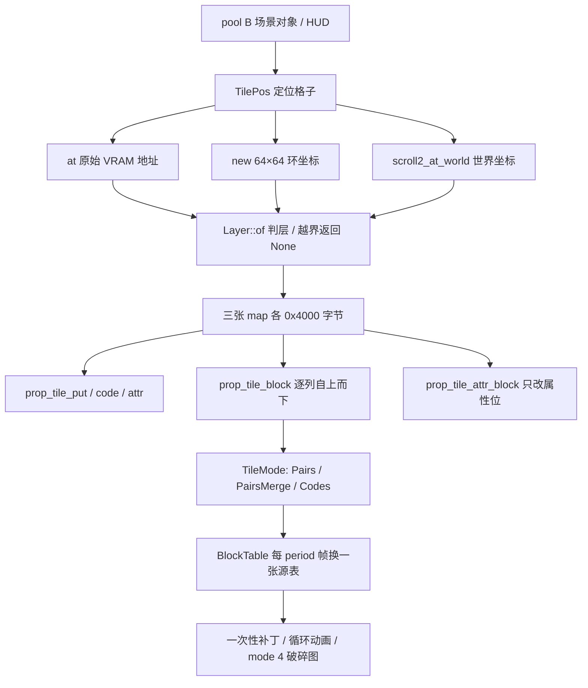

### 73.3 三种写入循环：整格换图、只改属性位、只换 code

`tile_block.rs:182-192` 的 `TileMode` 与 `:207-262` 的五个写入器，是「同一个服务按需求切三种循环」：

| 循环 | 对每格做什么 | 源表步进 | 用在哪 |
|---|---|---|---|
| `Pairs` | code 与 attr 两个词全替换 | 4 字节 | 整块换图（单测 `:404-407`） |
| `PairsMerge(keep)` | code 替换；attr 变成 `(old & keep) or source` | 4 字节 | 大厅门 `0x78BC4` 的 `keep = 0xFFC0`：保留高位优先级、替换调色板与翻转低 6 位 |
| `Codes` | 只替换 code，attr 原地不动 | 2 字节 | class 11 门破碎 3 列 7 行（`:43-45`） |

`prop_tile_attr`（`:221-226`）单独一格做 `and.w keep,attr` 再 `or.w or,attr`，`keep=0xFFFF` 且 `or=0` 即什么也不做；`prop_tile_attr_block`（`:255-262`）把同一操作铺满一个矩形而**不需要源表**——class 11 用 `0xFE7F / 0x80` 把 8 格的属性 bit7 打开、再用 `0xFE7F / 0x100` 把右侧 7 列 8 格的 bit8 打开（`:45-47`），单测 `single_cell_writers`（`:374-388`）断言 `(0x4321, 0x01C5)` 经 `0xFFC0 / 0x0012` 变成 `(0x4321, 0x0092)`。

`prop_tile_block`（`:228-253`）的循环顺序也是契约：**先列后行、每列自上而下**，源表按 `mode` 顺序往前走。单测 `blocks_follow_the_original_loops`（`:390-419`）断言 3 列 7 行从 `0x90E9E4` 写入后，第 7 个 code 落在 `+0x40`（下一列顶部）而非 `+4*7`，且 `Codes` 模式原有属性 `0x0777` 保持不变。也就是说「矩形」在这里不是二维抽象，而是「地址按步长跑 `cols × rows` 次」的展开结果；与 §53 的 `Frame` 记录、§45 的 `(depth,handle)` 排序一样，是把几何写进地址与循环顺序，不另立容器。

### 73.4 `BlockTable`：动画不住在对象帧里，而是整块矩形按帧换源表

`BlockTable`（`:265-319`）给「水波 / 开门 / 灯闪」这类背景动画一个与 §53 完全不同的时间模型：它不是让某个对象逐帧换 `Frame`，而是**每隔 `period` 帧把同一个矩形整体换成下一张源表**。字段就是设计契约本身——`table`（`count` 个 long，每个是一张块源表的 ROM 地址）、`at/cols/rows/mode`（写到哪、多大、按哪种循环）、`period`（帧间隔）、`looped`（是否循环）。状态不另开结构，直接借用 prop 对象头 `+$A0` 计时、`+$A2` 索引（`:265-271` 注释 "the original's tile animations keep them in +$A0 and +$A2"）。

```text
START(p, delay):  p.+$A0 = delay;  p.+$A2 = 0        # 第一块在 delay 次 update 后写
STEP(p, t):
  timer = --p.+$A0
  if timer != 0: return false                        # 本帧什么都不写
  src  = u32(t.table, p.+$A2) & 0xFF_FFFF            # 取一张块源表的地址
  PROP_TILE_BLOCK(t.at, t.cols, t.rows, src, t.mode) # 整块刷进同一格
  p.+$A0 = t.period
  next = p.+$A2 + 4
  done = (next == 4 * t.count)
  p.+$A2 = (done and t.looped) ? 0 : next
  return done and not t.looped                       # looped 表永不报播完
```

单测 `the_block_table_plays_one_block_every_period`（`:434-478`）用 3 张块、`period = 4` 钉死时间线：第 1 帧立即写第一块、第 5 帧换第二块、第 9 帧换第三块并在同一帧返回 `done`，`+$A2` 停在 12；`looped = true` 且 `period = 1` 时序列循环 `0x300 / 0x301 / 0x302 / 0x300 ...` 且**永不报 done**。与 §53「`tick_anim` 减 `timer`，归零加载 `next`，返回 `last` 作为播完事件」是同构的「帧计时器 + 链接 + 终止位」，但粒度不同：§53 换的是一个对象的一帧，这里换的是**一整块背景矩形的全部格子**，且「播完」由 `4 * count` 这个索引边界而不是帧记录里的 `last` 位决定。两节不改写、不合并。

### 73.5 三种组装形状：一次性补丁、循环动画、可破坏

文件头 `:32-76` 明说一个 prop 就是「一个 `prop/bNN.rs` + 一行 `pool_b_update` 分派 + 一个 `PORTED_CLASSES` 编号」，而差别只在**怎么调用同一个写入服务**：

| 形状 | 代表 | mode 0 | mode 2 | 结束 |
|---|---|---|---|---|
| 一次性补丁 | class 11 门破碎 `0x78A38` | 不需要 | 触发时一次 `prop_tile_block` + `prop_tile_attr_block` + 音效 + 尘土，直接进 mode 4 | `prop_free` |
| 循环动画 | class 12 var 0 大厅门 `0x78B86` | `HALL_DOOR.start(p, 1)`（3 块 9×9、`PairsMerge(0xFFC0)`、period 4） | 每帧 `prop_block_table_step`，返回 true 才 `mode += 2` | 播完进 end mode |
| 可破坏 | class 40 蒸汽管 `0x836A4` / class 0 墙 | `hit_init(0x8380A, 8)`：盒表 / HP / body box | 每帧 `prop_register_hit` 登记进命中列表 | 命中后 mode 4 才写碎图 + 音效 |

第三行正是 §35 已钉死的四段契约（`prop.rs:4-29` / `pass_10cd0 = 0x10CD0`：命中 pass 写 `+$04 = 0x04000000`、填 `+$59/$68/$6C/$6E`、**从不看 HP**），§73 只补上被 §35 压成一句的「tile_block 写砖」那一段的通用设施，不改写 §35、不扩张 `prop/b*.rs` 逐类展开（§21.8 / §35.5 保留）。文件头 `:78-80` 还点明这些 prop 由脚本 action 经 `spawn_prop` / `spawn_script_prop(action)` 生成——与 §19 的 5 套脚本表、§42 的生成帧只构成「谁来造对象」的上下游，不并入 §19。

### 73.6 HUD 与场景道具写同一片 scroll1 VRAM：共享的是地址空间

§26 已记 `hud.rs:1-18`：原机 HUD 直接往 **scroll1 VRAM 绝对地址** `0x908000..0x90BFFF` 写，一格 = code word + attr word，port 保留这些地址。§73 的 `Layer::of`（`tile_block.rs:116-123`）把**同一段** `0x908000..=0x90BFFF` 认作 `Layer::Scroll1`，`prop_tile_cell` 直接按 `(addr - base)/4` 索引 `vram.scroll1`。于是：

- HUD（分数 / 血条 / 道具消息，§26）与场景道具（门破碎 / 背景动画）**是同一片显存的两个写入者**，没有为 HUD 单开一层，也没有仲裁器；谁后写谁生效，靠的是帧内调用顺序（§47 的一帧调度链）。
- 这与 §68「一张每帧重生的表被五个读方共享」、§57「三条全局时间线」、§66「一份候选表被两个认领者共享」并列为第四条全局共享状态线，但共享物不同：前三者是**游戏状态**，这一条是**显示地址空间**。§23 的「tilemap 0 帧」说的是写后何时显示，本节说的是谁在写、写到哪，两节不冲突、不改写。
- `prop_tile_cell` 对越界地址返回 `None`（`:195-205`），把「原机会写到别的 VRAM」明确划为 port 未建模的边界，而不是悄悄改写到别处。

### 73.7 wof 侧与对照表（按 §11.0 只登记，不臆断等价、不评优劣）

wof repo 侧同样以 `0x90C000` 为 scroll2 的基址，并有「由行 / 列算 VRAM 地址」的公共例程：`Cps1EventObjectRuntime.cs:5025-5028` 的 `算VRAM地址_对应ASM_23E4` 注释写明「ROM 0x23E4：由 D0（行）/ D1（列）算 VRAM 地址，返回 A1 = 0x90C000 + D0」，并附逐指令 `not.w D1w` / `andi.w #0x3F0,D1w` / `add.w D1w,D0w` / `movea.l #0x90C000,A1` / `adda.w D0w,A1`；`Cps1TerrainCollision.cs:17-18` 的 `TERRAIN_MAP_BASE = 0x90C000` / `TERRAIN_JUMP_TABLE = 0x027A4` 是 §44 已核实的地形格读取侧；`Cps1SceneObjRuntime.cs:208-211` 的 `0x4E686..0x4E724` 场景池 ObjId=1（可破坏场景物）是 §70 已登记的；`Cps1StageTileStreamer.cs:52 / :1219` 另有 `0x90C000` 区写入的逐帧对拍注记。以上全部只是 repo 已写明的事实登记；这些文件自带 ROM 逐指令注释，按用户「不过度怀疑 rep 侧」不另查 ROM（§11.6 条件通道未触发）。

| 维度 | dino（设计契约） | wof（按 §11.0 只登记） |
|---|---|---|
| 定位格子 | `TilePos` 三入口：原始 VRAM 地址 / 64×64 环坐标 / 世界坐标 `0x75208` | `0x23E4` 由行 / 列算 `0x90C000 + D0`；地形格 `TERRAIN_MAP_BASE` + `0x027A4` 跳表（§44） |
| 三层组织 | scroll1/2/3 各 `0x4000`，列步长 `0x80 / 0x40 / 0x20` | 按 §11.0 不臆断 |
| 写入循环 | `Pairs` / `PairsMerge(keep)` / `Codes` + attr-only 矩形 | 按 §11.0 不臆断 |
| 动画 | `BlockTable` 每 `period` 帧换整块源表，`looped` 可循环 | 按 §11.0 不臆断 |
| 跨页行为 | `down` 只 `+4*n`，第三格落进下一列（单测钉死） | 按 §11.0 不臆断 |
| 可破坏 | mode 4 才写碎图，命中 pass 不看 HP（§35） | `0x4E686..0x4E724` 场景池 ObjId=1（§70） |
| 同一片显存的别的写入者 | HUD 也写 `0x908000..0x90BFFF`（§26） | `Cps1StageTileStreamer.cs:52 / :1219` 写 `0x90C000` 区 |

**不评优劣**：两边都按 VRAM 绝对地址 + 行 / 列算术定位背景格，dino 把它收成一个被约 60 个 class 共用的写入服务并显式保留跨页行为；这是**组织位置不同**，不是「谁更完整」。§44 / §70 已登记的 wof 侧结论不改写，本节也不把「未登记」写成「缺失」。

### 73.8 组织结论与边界

1. **「谁在写背景」是独立的一条线**：§23 讲写后几帧显示、§45 讲精灵队列排序、§44 讲地形格怎么被读，本节补上「约 60 个 pool B 对象共用一个按 VRAM 绝对地址写入的服务」，四节不改写不合并。
2. **地址算术本身是契约**：三张 map 的基址 / 列步长、64×64 回绕、`TilePos::at` 把属性字地址归一到同一格、`down` 跨页不换列——这些都不是「实现细节」，而是决定门破碎图案落在哪、动画换哪一格的设计事实，单测逐条钉死。
3. **动画有两套粒度**：§53 是「一个对象逐帧换 `Frame`」，本节是「一整块背景矩形每 `period` 帧换一张源表」，两者同构于「帧计时器 + 链接 + 终止位」但载体不同；不合并进 §53。
4. **共享物可以是显存**：§68 / §57 / §66 共享的是游戏状态，本节与 §26 合起来显示 HUD 与场景道具共享的是 `0x908000..0x90BFFF` 地址空间，靠帧内调用顺序而非仲裁器定谁后写。
5. **与 §35 是上下半段**：§35 钉死可破坏 prop 的 mode 0/2/4 契约与命中 pass，本节展开 mode 4 里「写砖」那一段的通用设施；两节合起来才是「一个箱子 / 一扇门怎么从可被打变成画面上的碎片」。

**保留边界（不扩张，非欠账）**：`prop/b*.rs` / `prop/class*.rs` 约 60 个 class 逐类状态机全文（§21.8 / §35.5 保留）、各 ROM 源表的逐项数值、三张 map 的完整初始化与每帧全量 tile 流送、`Vram::index1/2/3` 全部实现、wof `0x23E4` 全部消费点与 `Cps1StageTileStreamer.cs` 逐段，均按 §21.8 / §35.5 / §41.7 / §63.8 / §72.7 的既有口径**保留、不扩张**；本节只取「背景怎么被对象按地址改写」这一条横切面。两游戏发行先后仍未考证（§11.0）。

---


## 74. 敌人不是各自算一遍几何：0x32xxx 共享决策库怎么把「追谁」变成「往哪走」

> 触发：A.37 之后按开放目标找 §74，沿用「由覆盖盲区反查选题」——251 个 `.rs` 里 174 个零引用，排除 `flow/movie.rs` 等 13 个三次明列逐类保留的 flow 子模块、`enemy/class*.rs` / `prop/b*.rs` 逐类文件、`flow/mame_check.rs` 工程层后，选中 `enemy/lib32.rs`（230 行）。Grep 确认 `lib32.rs` / `0x32A58` / `lib_aim_at_target` / `lib_off_screen` / `lib_slot_mirror` / `SLOT_NO` / `enemy_angle_to` / `c10_target` 在笔记里**零匹配**；`lib_distance_class` 只以**黑盒调用名**在 §13 附近 L1039 与 §18 的 Tyrog 伪代码 L2557 / L2560 出现 3 次，从没展开被调用的那一层。§13 已把 census → `pick_target` → 6 接近槽位 → MAWARIKOMI / MAAI 的**策略层**讲透，本节只取**几何层**（方向怎么算、离屏怎么判、距离怎么分档、槽点坐标怎么写），不改写不合并 §13。
> 归属：设计正文（§0–§74），按「轮次线性追加」接在 §73 / A.37 之后。纯 repo 侧，未新增 ROM 取证（§11.0 / §11.6 条件通道未触发）。
> 边界：§5 / §11.1 / §13（怪物策略 / census 反馈闭环 / 目标选择 / 6 接近槽位 / 侧翼包抄）、§16（Boss 层：表地址选择器、每类自己的状态分派）、§18（Boss 专属行为表 / Tyrog 三维查表）、§25（rank / aggression）、§28（同屏预算）、§51（全局 RNG 单流）、§73（场景对象共用的显存写入器）全部维持原貌、不改写不合并。§21.8 / §25.8 / §35.5 / §41.7 / §63.8 / §72.7 / §73.8 的保留清单不扩张。wof 侧按 §11.0 只登记 `Cps1EnemyAI.cs` / `Cps1Actor1CRuntime.cs` / `Cps1Actor13Runtime.cs` / `Cps1Actor1BRuntime.cs` / `Cps1Actor19Runtime.cs` 已写明的 `0x3F0C` 侧向站位偏置链，**不臆断等价、不评优劣**；音频按 §0 边界外。

### 74.1 一句话结论

dino 的敌人不是每个 class 各自把「追谁、朝哪、离屏没、离多远、站哪个点」重算一遍，而是**共享一批 0x32xxx 公共例程**：`lib32.rs:1-7` 明说这是「many classes call」的 pool A 库，class 14 是首个使用者，class 3/4/6/7/8/13 与 Boss 调同一批函数；`boss_common.rs:113 / :265-266` 与 `enemy/class14_entry.rs` / `class14_states.rs` 的实际调用可查。这批例程把 `+$76` 里的目标玩家 handle 变成 `+$22` 方向、`+$24` 面向、`+$88/+$8A` 目的点、`+$BD` 槽号和一个 0..7 / 0..3 的**距离档**，中间统一用 `+0x400` 偏置把有符号比较化进无符号窗口。§13 讲的是「census 说往人少的一侧去」的**策略**，本节讲的是「那一侧具体是哪个坐标」的**几何**；`lib_slot6_new` 正是两层接缝：它既抽 1..6 槽、又直接读 census 计数，但把结果写成坐标并镜像。wof 侧按 §11.0 只登记 `0x3F0C`「按相对目标左右从 ROM 表写侧向站位偏置 OBJ+B0」被多兵种共用，不臆断等价。

### 74.2 一个库、七个几何例程，跨 class 与 Boss 共用

`lib32.rs:1-7` 的文件头就是组织声明：0x32xxx 是**共享库**（aim at the target / face it / slots round the target / screen test / distance class / target check）加带 pan 的音效 `0x9D44`；`a0` 恒为敌人追猎的对象 `+$76`（`enemy.rs:164` 的 `TARGET = 0x76`，注释 "target player"），「总是玩家」。调用面不是推断：`enemy/class14_entry.rs:23 / :43 / :389 / :397 / :399 / :438`、`class14_states.rs:104 / :123 / :295 / :479`、`boss_common.rs:113 / :132 / :179 / :265-266` 逐个调到 `lib_distance_class` / `lib_face_target` / `lib_aim_at_target` / `lib_slot3_new` / `lib_slot6_new` / `lib_off_screen` / `lib_slot_mirror`。

| 例程 | 原机地址 | 读什么 | 写到对象头哪里 |
|---|---|---|---|
| `lib_target` / `c10_target` | — | `+$76` 目标 handle | 非法 handle 落回玩家 1（`class10.rs:69-75`） |
| `lib_aim_at_target` | `0x32A58 / 0x32A70` | 目标 X / Z | `+$22` 方向（`enemy_angle_to 0x103A`，`enemy.rs:571-572`，32 方向 0..31） |
| `lib_aim_beside_target` | `0x32A88` | 目标 X / Z + 偏置 `d0` | `+$22` 方向，偏置按目标在左 / 右取负 |
| `lib_face_target` | `0x32B68` | 双方 X | `+$24` 面向，并顺手把 `目标X + 0x400` 存进 `frame_w1` |
| `lib_check_target` | `0x32F56` | 目标 `live` | 非 1 就 `enemy_pick_target` 重写 `+$76` |
| `lib_off_screen` | `0x3282A` | `cam_x` 与自身 X | 返回 bool（离屏） |
| `lib_distance_class` | `0x3293C` | 双方 X / Z + 4 张窗口表 | 返回 `(dx 0..7, dz 0..3)` |

**这不是「每类自带一份几何」**：§16 已确立 `BossAi` 只是表地址选择器、每类保留自己的状态分派；§74 补的是**分派之下还有一层被共同调用的无状态几何**。与 §73 的 `prop/tile_block.rs`（约 60 个场景对象共用的显存写入器）并列为「通用设施与特定组装分层」（A.33）在**敌人侧**的第一次；差别是 §73 的服务写显存，本节的服务写对象头与返回档位。

### 74.3 `+0x400` 偏置，以及两处「不是纯函数」

这批例程反复用同一个技巧：`lib_face_target`（`lib32.rs:43-49`）比较 `tx = 目标X + 0x400` 与 `x = 自身X + 0x400`，`lib_slot_mirror`（`:111-123`）也用 `目标X + 0x400 > 自身X + 0x400` 判左右，`lib_off_screen`（`:74-84`）用 `cam_x + 0x400 - 0x18` 与 `cam_x + 0x400 + 0x180` 夹 `自身X + 0x400`。**加同一个常数把可能为负的坐标抬进正数区，再用无符号比较做「左 / 右 / 窗口内」**，方向 `enemy_angle_to`（`enemy.rs:576-587`）则把 `+0x4000` 后的差值按 X / Z 符号累加 `oct` 得到 0..31 的 32 方向。这是「把几何做成整数运算」的共同约定，而不是各 class 自己挑一套。

两处例程还顺手给下游留值，说明它们**不是可随意重排的纯函数**：

- `lib_face_target` 除写 `+$24` 外，把 `目标X + 0x400` 存进 `frame_w1`，注释点名「Butcher 的决策 roll `0x5A1AC` 会读它的高字节」（`lib32.rs:48`）。一次「转向」同时是下一次「出招掷骰」的输入。
- `lib_aim_at_target` 的 `0x32A70` 变体先载 `+$88 / +$8A`，却跳进 `0x1032` 重新读目标 X / Z（`:25-26` 注释）。也就是**同一目标被读两次、以最后一次为准**；与 §72「同一字段一帧内两次写让两个系统看到不同值」方向相反，这里是「两次读、后者覆盖前者」，同属「调用顺序即契约」。

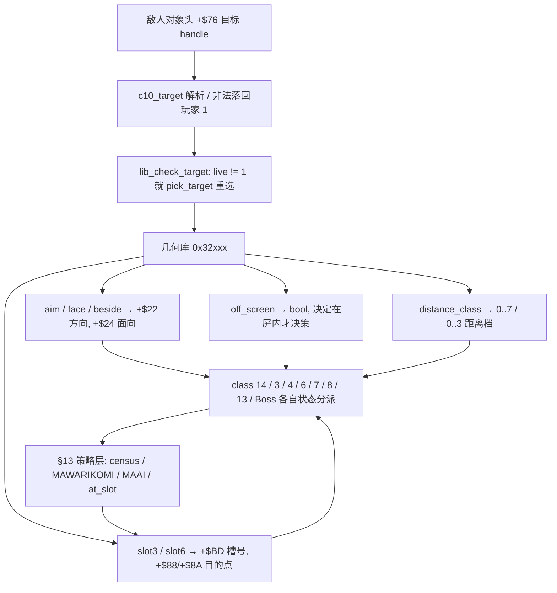

### 74.4 距离分档与离屏：把「远近」压成一个索引

`lib_distance_class`（`lib32.rs:86-109`）不做连续距离，而是**从最高档往最低档找第一个「目标落在窗口外」的索引**：X 用表 `0x32988`（偏置）与 `0x32998`（窗口上限）共 8 档，Z 用 `0x329A8 / 0x329B0` 共 4 档；判据是 `tx + T1[i] - x > T2[i]`（无符号比较），全在窗口内则返回 0。

```text
DISTANCE_CLASS(e):
  for i in 7 down to 0:
      d2 = (target.x + T1_x[i] - e.x) as u16
      if d2 > T2_x[i]: dx = i; break
  for i in 3 down to 0:
      d2 = (target.z + T1_z[i] - e.z) as u16
      if d2 > T2_z[i]: dz = i; break
  return (dx, dz)
```

笔记里这个返回值**早就在下游被消费**：§13 附近的 ROM 直译 L1035-1044 里，`0x4005C 决策` 调 `jsr $3293c` 后把结果 `move.b d0,$a5(a6)` 存进 `+$A5`，再用 `rng() & 0x1F` 与 `($26 variant) << 7` 一起组成三维索引去查 `0x72A94` 行为表；§18 的 Tyrog 伪代码 L2557 / L2560 也写 `XCLASS = lib_distance_class(e)`。也就是说**「距离档」是行为表的第三个维度**，而本节补的是这个维度怎么被算出来；两处既有伪代码保持原貌不改写。

`lib_off_screen`（`:74-84`）则把相机与自身 X 各加 `0x400`，用 `cam + 0x400 - 0x18` 和 `cam + 0x400 + 0x180` 夹出一个宽 `0x198` 的窗口，返回「在窗口外」。`enemy/class14_entry.rs:387-399` 的 `c14_41a96` 用它分叉：**在屏内才走决策 `c14_41be8`，离屏则设 `act = 0x36`（run off）、给三个计时器赋值、重抽 6 槽、再瞄准目标**。同一个几何结果既决定「要不要思考」，也顺手决定「往哪跑」，没有第二套离屏规则。

### 74.5 槽位点是几何，选槽是策略：两层的接缝

`lib32.rs:125-197` 把 §13 反复提到的「6 个接近槽位」落成坐标：

| 环节 | 谁决定 | 写进哪里 |
|---|---|---|
| 抽 1..3 槽 `lib_slot3_new 0x32D90` | `rand() & 3`，抽到 0 重抽 | `+$BD` 槽号 |
| 抽 1..6 槽 `lib_slot6_new 0x32C5E` | `rand() & 7`，抽到 0 / 7 重抽 | `+$BD` 槽号，并**返回 d4**：目标某侧已有 ≥3 敌人 |
| 取点 `lib_slot3_point 0x32D9E` / `lib_slot6_point 0x32C92` | 表 `0x32DF8` / `0x32CF0` / `0x32CFE` 给出 X / Z 偏置 | `+$88` DEST_X / `+$8A` DEST_Z |
| 镜像 `lib_slot_mirror` | 目标在右则把 X 偏置取负再加目标 X | 覆写 `+$88` |
| 保留 / 重抽 `lib_slot3_keep` / `lib_slot6_keep` | `+$BD` 为 0 才抽新的 | — |

`lib_slot6_new`（`:157-176`）是两层的接缝，也是最值得单看的一处：它在抽槽的循环里直接读 `self.spawn.g.census[p][2] / [3]`（目标玩家左 / 右两侧敌人数，`+E6 / +E7` 有符号比较），把「目标某一侧已有 3 个或以上敌人」作为 `d4` 返回给调用方。§13 已证明 census 的**上一帧**值驱动 `pick_target` / `retarget_and_slot` 的侧翼包抄；本节补的是**这个共享几何库自己也会读 census**，不必由每个 class 转发。`boss_common.rs:512` 甚至有单测直接构造期望值调 `lib_slot6_new`，把「抽槽 + census 判定」当一条可钉死的契约。

`put_hi`（`lib32.rs:227-230`）连写目的点都保留原机语义：`move.w src,dst` 只替换 16.16 位置的**整数部分**、小数部分留着。与 §73 的 `down` 跨页不换列同族——**地址 / 数值表示层面的行为被当作契约保留**，不是「实现细节」。

### 74.6 wof 侧与对照表（按 §11.0 只登记，不臆断等价、不评优劣）

wof repo 侧同样有一支**被多个兵种共用的站位几何例程**：`Cps1EnemyAI.cs:4368-4374` 的 `对象_写入侧向站位偏置B0_按目标X_可能对应ASM_3F0C` 注释写明「0x3F0C：写侧向站位偏置 OBJ+B0（多兵不同占位）」，并附 Listing：`lea 0x4036; dx = selfX - targetX; if dx < 0 A4 += 8; rng &= 7; D1 = (ObjId << 3) + (A4, rng); move.w (0x3F36 + D1), B0`；`:4385-4389` 强调 `dx` 必须先截断到 16 位再判符号。`Cps1EnemyAI.cs:4440-4454` 另有两个 internal 包装 `对象_写入侧向站位偏置B0_可能对应ASM_3F0C` 与「敌人收招公共尾部写侧向站位偏置_对应ASM_3F0C」。调用面可查：`Cps1Actor1CRuntime.cs:1966 / :2032`、`Cps1Actor13Runtime.cs:227-229`（`0x3DEE` 资料 + `0x3E04` 选玩家 + `0x3E4C` 的 `0x3F0C`，且 `0x3F1C jsr 0xF98` 消耗 1 次 RNG）、`Cps1Actor19Runtime.cs:25-27`（该槽整帧不推进则 `0x3F0C` 不执行、少消耗 1 次 RNG）、`Cps1Actor1BRuntime.cs:687`（`0x422E` 的 D0 符号由 `move.b $c3(a0),d0` / `btst` 决定，§13 已登记的 `OBJ+0xC3` 选择锁）。以上全部只是 repo 已写明的事实登记；这些文件自带 ROM 逐指令与逐帧对拍注释，按用户「不过度怀疑 rep 侧」不另查 ROM（§11.6 条件通道未触发）。

| 维度 | dino（设计契约） | wof（按 §11.0 只登记） |
|---|---|---|
| 共享几何的组织 | 一支 0x32xxx 库，class 14 / 3 / 4 / 6 / 7 / 8 / 13 / Boss 同调 | `0x3F0C` 侧向站位偏置被多个 Actor Runtime 调用 |
| 左右镜像 | `lib_slot_mirror` 按 `目标X + 0x400 > 自身X + 0x400` 把 X 偏置取负 | `dx = selfX - targetX`，判负后 `A4 += 8` 换另一组表 |
| 站位表索引 | `+$BD` 槽号 ×2 查 `0x32DF8 / 0x32CF0 / 0x32CFE` | `D1 = (ObjId << 3) + (A4, rng)` 查 `0x3F36` |
| 距离 / 离屏 | `lib_distance_class` 8×4 档 + `lib_off_screen` 窗口 | 按 §11.0 不臆断 |
| 目的点 | `+$88 / +$8A`，`put_hi` 保留小数 | `OBJ+B0` 侧向站位偏置 |
| 策略层入口 | `lib_check_target` 目标失效就 `enemy_pick_target`（§13） | `0x3E04` 选玩家（§13 已登记） |

**不评优劣**：两边都把「按目标左右取一个侧向站位」做成被多兵种共用的公共例程，dino 把方向 / 面向 / 距离档 / 离屏 / 槽点收进同一支库并用 `+0x400` 统一偏置，wof 用 `ObjId` 分表并把 RNG 消耗钉进逐帧对拍；这是**组织位置与验证路径不同**，不是「谁更完整」。§11.1 / §13 已登记的 wof 侧结论不改写，本节也不把「未登记」写成「缺失」。

### 74.7 组织结论与边界

1. **敌人侧也有通用设施层**：§16 讲每类自己的状态分派，§13 讲策略层的 census 闭环，本节补上分派之下被共同调用的无状态几何；与 §73 的场景显存写入器并列，是 A.33「通用设施与特定组装分层」在敌人侧的第一次。
2. **一句黑盒调用名展开成独立章节**：`lib_distance_class` 在 §13 附近与 §18 的 Tyrog 伪代码里只是被调用名，本节展开它的 8×4 窗口表与「行为表第三维」用途；与 A.33「把一句既有注记展开成独立章节」同族，且不改写那两处伪代码。
3. **几何层不是纯函数**：`lib_face_target` 顺手留 `frame_w1` 给 Butcher 决策 roll、`0x32A70` 两次读目标以后者为准、`lib_slot6_new` 直接读 census 计数——调用顺序与副作用都是契约，与 §72「一帧内两次写」形成读写两侧对照。
4. **`+0x400` 与 `put_hi` 把数值表示当契约**：有符号坐标抬进正数区再做无符号窗口比较；写 16.16 目的点只换整数部分。与 §73「跨页不换列」同族，说明 dino 在几何层也保留原机地址 / 数值行为。
5. **两层接缝在 `lib_slot6_new`**：抽槽与 census 判定属 §13 策略层，写 `+$88/+$8A` 与镜像属本节几何层，同一个函数同时做两件事；不改写不合并 §13。

**保留边界（不扩张，非欠账）**：`lib32.rs` 各表 `0x32988 / 0x32998 / 0x329A8 / 0x329B0 / 0x32DF8 / 0x32CF0 / 0x32CFE` 的逐项数值、`enemy_angle_to` 完整 octant 计算、`snd_9d44 / snd_9732 / snd_96ce` 三个音效例程（音频按 §0 边界外）、class 3/4/6/7/8/13 逐类状态机全文、wof `0x3F0C` 全部消费点与 RNG 逐帧诊断，均按 §21.8 / §25.8 / §35.5 / §41.7 / §63.8 / §72.7 / §73.8 的既有口径**保留、不扩张**；本节只取「追谁怎么变成往哪走」这一条横切面。两游戏发行先后仍未考证（§11.0）。

---


## 75. 时间到那一帧：不是 game over 分支，而是一把锁、两个会自己飞走的字、和三种把钟拨回去的路

> 触发：A.38 之后按开放目标找 §75。A.38.3 曾把 TIME OVER 链列为「主动排除」，理由是「与 §72 刚展开的 `rank_add_time` 太近」且「§28.7 已把波次超时玩家侧提示列为保留」。本轮重评两个条件：(1) 已隔 §73 / §74 两节，且本节从 `effect/fx_time_over.rs`（pool C class 28 零引用模块）与 `rank_time_over 0x103FE` 的**状态机**切入，不是 §72 表格里那句复活补偿旁支；(2) §28.7 保留的是**波次**超时 `wave_timer` 归零 → `kill_all = 2` 清敌人不记分，与**关卡 BCD 时钟**归零是两条不同时间线、两种后果，本节明列区分且不扩张 §28.7。Grep 确认 `0x103FE` 只在 §47 / §63 的一帧调度链里当**步骤名**出现、`fx_time_over.rs` / `0x96450` / `0x96488` 零匹配、`rank_time_over` 只有 §72.4 表格一句——「时间到那一帧发生了什么」从未成节。
> 归属：设计正文（§0–§75），按「轮次线性追加」接在 §74 / A.38 之后。纯 repo 侧，未新增 ROM 取证（§11.0 / §11.6 条件通道未触发）。
> 边界：§25（rank 时间驱动 / aggression）、§28（波次预算 7200 帧 / `kill_all = 2` 超时清场）、§30（flow.mode 8 态 / 整局终局归口）、§47（一帧调度链 8 步）、§55（续关跨系统契约）、§57（时间三类计时器 / 全局时间门）、§58（pool C 火花）、§63（attract demo 的 frame loop 少了 `rank_tick` 与 `0x103FE`）、§65（DIP cook）、§72（玩家死亡 / 复活补时）全部维持原貌、不改写不合并。§21.8 / §28.7 / §41.7 / §63.8 / §72.7 / §73.8 / §74.7 的保留清单不扩张。wof 侧按 §11.0 只登记 `Cps1EnemyAI.cs` / `Cps1Actor27Runtime.cs` / `Cps1HardResetRuntime.cs` / `Cps1SpecialObjRuntime.cs` 已写明的关卡结束出口与倒计时事实，**不臆断等价 TIME OVER 分支、不据此断言原机缺机制、不评优劣**；音频按 §0 边界外。

### 75.1 一句话结论

dino 的「关卡时间到」**不是一个直接切 game over 的分支**：`time_limit 0x1037E` 每帧先跑 `rank_time_over 0x103FE`，只有 BCD 分 / 秒 / 分频全 0、锁未置、且不在 scripted / car 特殊态时才触发；触发那一帧同时做两件事——把 `time_lock`（`G.$4EB`）置 1、把所有 `live != 0 && mode < 4` 的玩家 HP 归 0，并放两个 pool C class 28 的 raw sprite（TIME 与 OVER）飞进来。**没有切 `flow.mode`、没有弹续关倒计时**：玩家走 §72 的死亡态，整局终局归 §30。那两个字也不是一段动画播放，而是两个各有 mode 0/2/4/6 状态机的真对象，先判停后移动、停后 hold `0xB5` 帧、或等 `G.$4EB` 清掉就自我释放；池满只造得出 TIME，玩家照样死。解锁与补时是**同一件事**：`rank_add_time 0x104A8` 末尾清 `time_lock`，被复活（§72）、join、载具分支三处调用，没有单独的解锁器。

### 75.2 触发条件极窄，还有一条载具豁免

`rank.rs:322-326` 的 `time_limit` 每帧顺序是 `rank_time_over()` 再 `rank_time_tick()`；`rank_time_tick`（`:329-352`）把 BCD 秒按 `time_div = 0x32`（51 帧 1 秒）递减，且 `b4d5 != 0 || scripted != 0 || car_mode != 0` 时整段暂停。于是「时钟显示 00:00」之后还要再走完一个 51 帧分频，`rank_time_over`（`:354-376`）才会看到全部条件成立：

| 条件 | 写在 `rank_time_over` 里的门 | 不满足时 |
|---|---|---|
| 全局时间门未暂停 | `spawn.g.b4d5 == 0 && w.scripted == 0` | 直接 return（§57 的三类全局时间门） |
| 锁未置 | `rank.time_lock == 0` | 已经 TIME OVER 过，不重复触发 |
| BCD 分 / 秒 / 分频全 0 | `time_min / time_sec / time_div` 全 0 | 还没到点 |
| 载具关卡特殊态 | `car_mode != 0 && cam.s2.lock78 != 0` | **不杀人**：`car_mode = 2` + `rank_add_time(0x300)` 补 3:00 后 return |

最后一行是最反直觉的一处：在载具关卡且相机 `lock78` 置位时，时间到**不触发 TIME OVER，反而补 3 分钟并把 `car_mode` 推到 2**。也就是说「时间到」的后果由**上层场景状态**决定，不是时钟自己说了算；与 §72「过关时死亡被 `stage_clear` 短路」是同一条「上层状态机优先」的线。

### 75.3 同帧两件事：全队 HP 归 0 与一把锁，终局交给别人

`rank.rs:354-376` 触发帧的动作只有三步：

```text
RANK_TIME_OVER():
  if b4d5 or scripted or time_lock or (min/sec/div 任一非零): return
  if car_mode != 0 and cam.lock78 != 0:
      car_mode = 2; RANK_ADD_TIME(0x300); return        # 载具豁免
  time_lock = 1
  FX_SPAWN_TIME_OVER()                                   # 0x96450，两个 pool C 对象
  for i in 0..3:
      if players[i].live != 0 and players[i].mode < 4:
          players[i].hp = 0                              # 同帧全队归 0
```

注释点明「heroes of the scenes `m515_s12`, `m515_s21` have HP 0 in the frame the lock `G.$4EB` is set」，且 `fx_spawn_time_over` 那行附注「a full pool of effects makes fewer words, **the heroes die anyway**」——**演出对象分配失败不阻挡玩法后果**。三点收束：

- **不切终局**：没有 `flow_game_over`、没有 `flow.mode` 迁移、没有续关倒计时。玩家 HP 0 后走 §72 的 `player_dead`（60 帧闪烁 → 命数结算），整局是否结束由 §30 的顶层 flow 读到没人了才决定。§75 与 §72 因此是上下游两帧，不改写 §72。
- **锁是状态不是事件**：`time_lock = 1` 一直留着，直到某次 `rank_add_time` 清掉（`:412`）。它同时是「别重复触发 TIME OVER」的门和「两个字该不该消失」的读数——pool C 对象每帧直接读这个全局字节（§75.4）。
- **`mode < 4` 的限定**：已经在死亡 / 演出态（`mode >= 4`）的玩家不再被重复写 HP，与 §72 的 mode 4 死亡态、§71 的演出演员身份切换同属「用 mode 划分集合」。

### 75.4 两个会自己飞走的字：pool C class 28 的四态状态机

`effect/fx_time_over.rs:1-15` 把 TIME OVER 写成**两个真对象**：`fx_spawn_time_over 0x96450`（`:24-36`）循环 `var = 0, 1` 各 `fx_alloc()` 一次，class `0x70`，池按 slot 47（TIME）→ 46（OVER）发放；`fx_alloc()` 返回 `None` 时立即 return false，第二个词不造。单测 `the_spawn_makes_time_then_over`（`:157-171`）钉死 `(live, k20, var26) = (1, 0x70, 0)` 与 `(1, 0x70, 1)`，以及「池只剩 1 槽时只造出 TIME」。每个对象是一条 raw sprite list 单记录（`0x96546` TIME / `0x96550` OVER），`draw_flags = 0xD0` 画在屏幕空间、盖住一切。

| mode | 例程 | 做什么 |
|---|---|---|
| 0 init `0x9649C` | `:48-62` | 转 mode 2、visible、`+$60 = 0xB4`；TIME 从 X `0x188` 以 `-32 px/帧` 左飞，OVER 从 X `-8` 以 `+32 px/帧` 右飞；Y `0x80`、depth 0。**首帧不移动、不进绘制列表** |
| 2 move `0x964FC` | `:64-76` | **先判停后移动**：TIME `X <= 0xC0`、OVER `X >= 0x140` 即停；否则 `motion()` + 进 draw list。停下当帧转 mode 4 并继续跑 hold |
| 4 hold `0x9652A` | `:78-92` | `time_lock == 0` 就立刻 `fx_free`；否则 `+$60` 递减，借位（`0xB5` 次 update）后释放，期间继续进 draw list |
| 6 free `0x96540` | `:38-46` | `fx_free` 归还槽 |

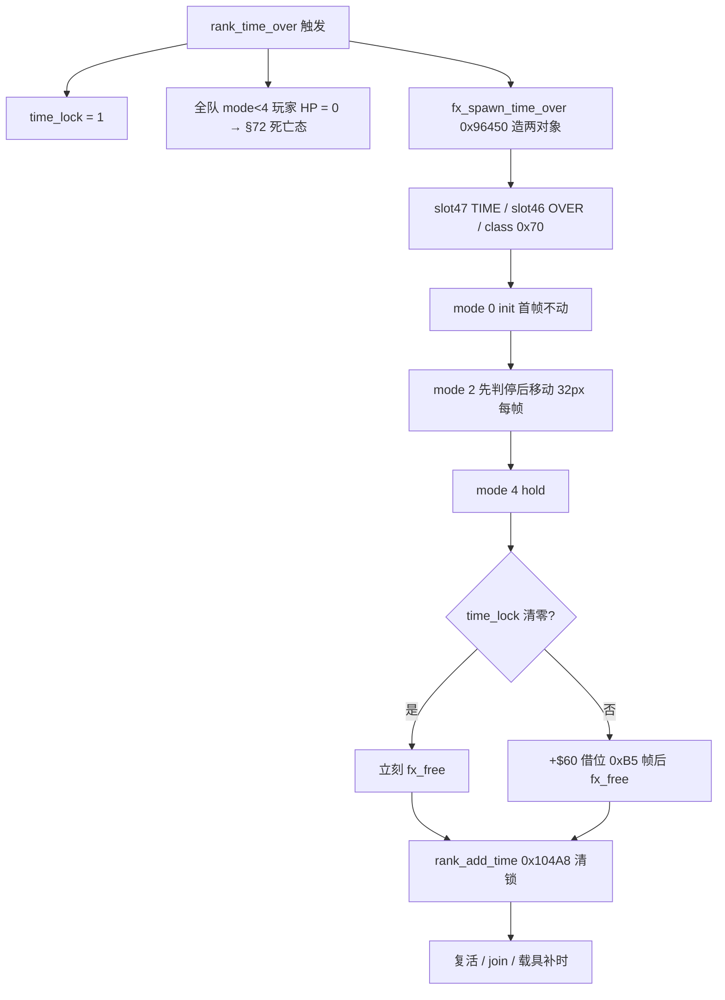

文件头 `:13-15` 还钉了一处**数据勘误**：按 32 px/帧算，TIME 停在 `0xA8`（7 次移动）、OVER 停在 `0x158`（11 次），两词**不会像 D3f 写的那样在 `0xC0` 相遇**，D3f 还把速度误写成 4 px/帧；单测 `the_real_records_are_extracted`（`:134-155`）用 `o.xi() - t.xi() == 0x158 - 0xA8` 与 `draw_list.len() == 2` 复验。这是 §11.0 意义上「repo 侧自带 MAME / listing 核对结论」的一例，按用户「不过度怀疑 rep 侧」不再另查 ROM（§11.6 条件通道未触发）。

### 75.5 三种把钟拨回去的路，共用一个「补时即解锁」

`rank_add_time 0x104A8`（`rank.rs:392-413`）做 BCD 加法：秒 ≥ `0x60` 借位、进位传分钟，总时 ≥ `0x400` 钉到 04:00，**最后一行 `rank.time_lock = 0`**。所以「补时间」和「解锁 TIME OVER」不是两个动作，而是同一个函数的两行；没有单独的解锁器，也没有「TIME OVER 结束」事件。调它的三处正好是三种把钟拨回去的路：

| 调用点 | 补多少 | 触发时机 | 与哪节呼应 |
|---|---|---|---|
| `rank_respawn_time 0x10482`（`:378-384`） | `wave_timer += 0x258`（600 帧）+ `rank_add_time(0x330)` 3:30 | 玩家有命复活（§72） | §72 / §55 / §57 |
| `rank_join_time 0x1049E`（`:386-390`） | 600 帧 + 3:30 | 中途加入 | §41 / §64 |
| car 特殊分支（`rank_time_over` 内 `:362-366`） | `rank_add_time(0x300)` 3:00 | 载具关卡相机锁时的时间到 | §32 / §15 |

外加 `rank_set_time`（`rank.rs:415-419`，spawn command 0xC / `0xFD9C`）与 `rank_time_area_start 0x1031A`（`:313-320`）在开局 / 换区时直接设 BCD 值。于是**TIME OVER 字样什么时候消失，取决于玩家有没有复活、有没有人加入、是不是载具关卡**，而不取决于它自己的动画播完——`mode 4` 每帧先读全局 `time_lock` 再决定要不要继续 hold（`:78-82`）。与 §68「一个写入者五个读方、共享的是表不是决策」同族：这里共享的是一个全局字节，读方是三个不同的系统，各自按自己的时机清它。

### 75.6 wof 侧（按 §11.0 只登记，不臆断、不评优劣）

wof repo 侧**未见于 dino `0x103FE` / pool C class 28 TIME OVER 字样直接对应的呈现**，按 §11.0 与用户「不过度怀疑 rep 侧」**不据此断言原机缺机制**，也不臆断等价。可登记的是两条不同语境的并列事实：`Cps1EnemyAI.cs:8542-8543` 的 `0x42C2` 被注释为「通用『BOSS 被击败 → 通知关卡结束』出口」，`Cps1Actor27Runtime.cs:28` 与 `Cps1EnemyAI.cs:8098-8106` 记有 `A=04 → jmp 0x42C2` 的关卡结束通知（§30 已登记为共享出口）；`Cps1HardResetRuntime.cs:4991 / :5229` 的「递减选人入口任务倒计时」与 §41 已核实的 10 秒兜底是「倒计时归零触发自动动作」在**选人画面**的形态，`Cps1SpecialObjRuntime.cs:4375` 的 `$20e` 倒计时归零转 `A=04` 是**场景对象**形态。以上只是 repo 侧已写明的事实登记，不把它们串成一条 TIME OVER 链、不评优劣；§30 的既有结论不改写。

| 维度 | dino（设计契约） | wof（按 §11.0 只登记） |
|---|---|---|
| 关卡时钟归零的后果 | `time_lock = 1` + 全队 `mode<4` HP 0 + 两个 pool C 字样对象 | 按 §11.0 不臆断 |
| 终局归口 | 不切 flow，玩家走 §72 死亡态，整局归 §30 | `0x42C2` 通用关卡结束出口（§30） |
| 解锁 | `rank_add_time` 清 `time_lock`，复活 / join / 载具三处调用 | 按 §11.0 不臆断 |
| 倒计时归零触发自动动作（不同语境） | `rank_time_tick` 51 帧 1 秒 BCD | 选人 10 秒兜底（§41）/ 场景对象 `$20e` 归零转 `A=04` |
| 与波次超时的区分 | 关卡 BCD 时钟 → 杀人；`wave_timer` 归零 → `kill_all = 2` 清敌人不记分（§28） | 按 §28.7 保留，不扩张 |

### 75.7 组织结论与边界

1. **「时间到」是一个复合事件，不是一个终局分支**：置锁、全队 HP 归 0、造两个演出对象，三件事同帧；不切 `flow.mode`，终局归 §30、玩家侧走 §72。与 §72「死亡态不管终局」闭合为上下游两帧。
2. **两条时间线必须分开**：§28 的 `wave_timer` 超时清敌人不记分，本节的是 BCD 关卡时钟归零杀人；§28.7 保留清单里「波次超时玩家侧提示」不是本链，本节明确区分且不扩张该保留项。
3. **演出是对象不是播放**：pool C class 28 两个 raw sprite 各有四态状态机、先判停后移动、停后 hold `0xB5` 帧或等全局锁清就释放，池满少一个字不影响玩法后果；与 §58 的火花对象、§40 的 tally 数字对象同族。
4. **补时即解锁**：`rank_add_time` 最后一行清 `time_lock`，复活 / join / 载具三条路共用；共享的是一个全局字节，不是「TIME OVER 结束」事件，与 §68 共享表、§73 共享显存并列为「共享物」的又一形态。
5. **上层状态优先**：载具关卡 `car_mode && lock78` 把时间到转成补 3:00，与 §72 的 `stage_clear` 短路白复活同属「对象 / 时钟不自己决定后果」。

**保留边界（不扩张，非欠账）**：`rank_tick 0x186CC` 全族、`bcd_add / bcd_sub` 全实现、`0x1033E` 各关各区时间表逐项、`time_over` 之后的续关倒计时与 `flow_game_over` 全链（§30 / §55 保留）、`fx_free 0x4964` 与 pool C 全类逐类展开、wof `0x42C2` 后续链全文与选人倒计时全部消费点，均按 §21.8 / §28.7 / §30.7 / §41.7 / §55.8 / §63.8 / §72.7 / §73.8 / §74.7 的既有口径**保留、不扩张**；本节只取「时间到那一帧发生了什么」这一条横切面。两游戏发行先后仍未考证（§11.0）。

---


## 76. 开场那辆车不是载具：一张按全局索引查乘客的表，和一串挂在计时器上的演出对象

> 触发：A.39 之后按开放目标找 §76，沿用「由覆盖盲区反查选题」——零引用非逐类模块里剩 `enemy/scene_actors.rs`（425 行）与 6 个已被 §41.7 / §63.8 三次明列逐类保留的 flow 子模块，前者未进过保留清单。Grep 确认 `RIDER_ROWS` / `scene_actors` / `class 16` / `class 27` / `class 43` / `rider` / `BANNER_CLASS` / `WHEEL_OWNER` 在笔记里**零匹配**；`乘员` 的命中全在 §32 的**可驾驶** `car.rs`（`+$A2..$A4` 座位 / `+$A8` 乘员位），不是本节对象。§71 讲 pool B master 广播一个 `sub` 字节，§67 讲 stage intro 把末棒交给 `G.$4E2/$4E3` 过场脚本，§63 讲 attract demo 预录输入，三者都没讲「一张按全局索引查乘客的 handle 表 + 每帧重算坐标」这条组织方式。
> 归属：设计正文（§0–§76），按「轮次线性追加」接在 §75 / A.39 之后。纯 repo 侧，未新增 ROM 取证（§11.0 / §11.6 条件通道未触发）。
> 边界：§19（5 套脚本全景）、§20（顶层任务机 / `Scene` sleep）、§32（**可驾驶** car：pool B class 88、4 态、座位 / 乘员字段）、§35（pool B 统一契约）、§50（六容器总表 / `slot_of` 地址即身份 / 池满背压）、§67（stage intro 与 `G.$4E2/$4E3`）、§71（master / cast / `+$7D` census 排除）、§73（场景显存写入器）、§74（敌人共享几何库）全部维持原貌、不改写不合并。§21.8 / §28.7 / §41.7 / §63.8 / §72.7 / §73.8 / §74.7 / §75.7 的保留清单不扩张。wof 侧按 §11.0 只登记 §71 / §32 已核实的三处 repo 呈现，**不臆断等价、不评优劣**；音频按 §0 边界外。

### 76.1 一句话结论

dino 的 Episode 2 / 4 开场车**不是 §32 那个可驾驶的 pool B class 88**，而是住在 **pool A 的 class 16 演出对象**：它写 `+$7D = 0xFF` 与 `who = 0xFF` 退出 census，却带一个真的 `atk = 0x3E` 与 `attack_serial`，并在过场期间登记进两张 hurt list。「谁在车上」不是父子挂载字段，而是 `car_place_riders 0x42308` 每帧读一张按 `G.$504` 选行的 **3-long 玩家 handle 表**（`RIDER_ROWS 0x42350`），只把 `live != 0` 的英雄按 `RIDER_OFFS 0x42374` 的下一组 `(dx, dy, dz)` 写到车坐标上——**表决定谁在，每帧重算决定在哪**。车轮是 class 17 子对象、用 `+$AC` 反指车主；class 43 头目把旗帜（pool B class 66）与 Episode 4 的车按 `+$80` 倒计时串成十个 sub，池满则下一帧重试。这是与 §71「广播 + 本地解释」、§63「预录输入流」、§67「intro 独立任务」并列的**又一条演出推进线：表驱动挂载 + 计时器串联**，且不并入 §19 的 5 套表。

### 76.2 不是可驾驶车：住在敌人池、不算敌人、却带真攻击记录

`scene_actors.rs:1-7` 把三个 pool A 开场类点名：class 16 蓝色 Cadillac（`0x420EA`，Episode 2 / 4）、class 27 Episode 4 三个蹲着的人（`0x4D900`）、class 43 橙发头目与旗帜（`0x55F2A`）；车轮 class 17 由车自己造。它们与被驾驶的 `car.rs`（§32，pool B class 88）**不是同一个对象**：

| 维度 | §32 可驾驶 car | §76 开场演出车 |
|---|---|---|
| 池 / class | pool B class 88 | **pool A class 16** |
| 主体状态 | `car_mode` 4 态 + 座位 `+$A2..$A4` / 乘员 `+$A8` | `mode 0/2/4/6` + `sub 0/2/4/6` |
| 乘客怎么挂 | 座位 / 乘员字段 | **全局 handle 表 + 每帧坐标重算** |
| 谁能开 | 玩家 | 过场脚本计时器 |

`car_init`（`:46-76`）在 `flow.b4e2 != 0` 时**整帧 return**——`b4e2` 正是 §67 记的过场脚本 `G.$4E2/$4E3` 交接点；脚本没放行，开场车就不初始化。放行后一口气写：`mode = 2`、`ATTACKING(0x7D) = 0xFF`、`b63 = 0xFF`、`who = 0xFF`、`visible = 1`、`anim_table = CAR_ANIM`、`box_table = BOX_TABLE`。前三个 `0xFF` 与 §71 的「`+$7D = 0xFF` 让演出演员被 `enemy_census 0x3242E` 跳过」是**同一份契约在另一组演出对象上的复用**：车也住敌人池、也不占 `g.alive` 与 `pick_target`。

但它不是纯背景：`car_start`（`:98-114`）写 `atk = 0x3E`、`knock = 0`、`hitstop = 0`、`serial = w.attack_serial` 并递增全局 `attack_serial`；`car_drive`（`:78-96`）在 `w.scripted != 0` 时把车 `push` 进 `$6B30` 与 `$6AC2` 两张列表。也就是**演出车同时是一个带攻击序列号的攻击者和一个可被打的对象**，走的是 §48 / §68 那套真实碰撞列表，没有演出专用通道。池满时更直接：`enemies.alloc()` 返回 `None` 就 `continue`，两个轮子少造一个也不影响车（`:62-74`）。

### 76.3 乘客表：谁在车上由一张按 `G.$504` 选行的表决定，位置每帧重算

`car_place_riders 0x42308`（`:150-169`）是本节最核心的一段，也是「表驱动挂载」的全部：

```text
CAR_PLACE_RIDERS(car):
  n = G.$504                                  # 行号，来自全局过场状态
  k = 0                                       # 0x42374 里下一组三字偏移
  for r in 0..3:
      hd = u32(RIDER_ROWS, 3*n + 4*r)         # 一行 3 个 long，每个是一个玩家 handle
      if not valid handle or body(hd).live == 0: continue   # 死人 / 不在场就不占位
      (dx, dy, dz) = (i16(RIDER_OFFS,k), i16(RIDER_OFFS,k+2), i16(RIDER_OFFS,k+4))
      k += 6                                   # 只给「实际在车上的人」推进偏移指针
      body_mut(hd).set_xi(car.x + dx)
      body_mut(hd).set_yi(car.y + dy)
      body_mut(hd).set_zi(car.z + dz)
```

三个设计点：

1. **「谁在车上」不写在对象头里**，而是 `RIDER_ROWS 0x42350` 这张由 `G.$504` 索引的 ROM 表；文件头 `:12-13` 注明每项是 `0x00FF0000 | handle` 形式的 24 位玩家指针，一行 3 个 long。`slot_of(hd)` 做身份校验（§50「地址即身份」），无效或 `live == 0` 就跳过。
2. **偏移指针 `k` 只在有人时前进**：三个英雄里死了一个，剩下两人自动占前两组 `(dx,dy,dz)`，不会因为表里有 3 个 handle 就留一个空座。这是把「紧凑排座」做成循环里的一个自增，而不是查一张按人数分档的表。
3. **每帧重算，不是挂载一次**：`car_init`（`:75`）、`car_approach`（`:132`）、`car_stop` 的 Episode 2 分支（`:145-147`）都调它。车在动，乘客坐标就跟着车动；没有 `parent` 指针、没有局部坐标字段、没有父子变换。与 §71 的 `+$A4` 记 master 是两条路：那边靠**引用 + 广播字节**，这边靠**全局表 + 每帧覆写世界坐标**。

Episode 差异也压在 `var26` 高字节上：`car_approach`（`:116-133`）里 `var26 >> 8 == 0` 是 Episode 2（到 `cam_x + 0xA0` 就刹车、`ax = -0x60`、动画 1、停下后 `b505 = 1`），`0x200` 是 Episode 4（**不刹车**，直接 `b505 = 1` 让英雄可以跳车，且 `car_stop` 里「places no riders」）。同一个 class 16 用一个变体字节分出两套开场戏，没有第二个类。

### 76.4 车轮、旗帜、蹲着的人：子对象靠反指与池满重试

三组附属对象各用一种挂接方式，都受 §50 的池容量背压：

| 附属 | 组织 | 池满时 |
|---|---|---|
| class 17 车轮 ×2 | `enemies.alloc()` 后写 `var26 = 0/1`，`+$AC`（`WHEEL_OWNER`）长字反指车主 handle（`:62-74`，注释说明 MAME 里是符号扩展的 `0xFFFFxxxx`） | 少造一个轮子，车照跑 |
| class 66 旗帜 ×3 | class 43 的 `spawn_prop(BANNER_CLASS, 0x38 / 0x39 / 0x3A, None)`，都是 **pool B** | `:314-315` 明说「a full pool retries next frame」——`spawn_prop` 成功才推进 sub，否则同一 sub 下一帧再试 |
| class 27 蹲着的人 | `MAN_VARIANTS 0x4D992` 变体表给 name id（`+$84`）与 anim table（`:213-215`），`enemy_class27` 自己按 `mode 0/2/4/6` 分派（`:173-184`） | 按 §50 常规背压 |

「池满重试」值得单看：旗帜生成失败**不是跳过这一步**，而是 `sub` 不变、下一帧再试（`:316-323` 的 `borrow && spawn_prop(...).is_some()` 才 `e.b.sub = 4`）。与 §76.2 的「车轮池满就少一个」形成两种背压策略并存在同一场演出里：**可降级的装饰少一个就算了，推进节奏的关键节点必须等到成功**。这与 §28 / §50 的 `alloc() == None` 即同屏上限是同一族的容量观，但这里是「重试」而不是「丢弃」。

### 76.5 十个 sub 串起一整场戏：`b4e2` 门、`+$80` 倒计时、以及 §67 的下游

class 43 头目（`0x55F2A`）把整段开场写成一条 `sub` 链，每一步由 `+$80`（`T80`）倒计时或一次 `spawn_prop` 成功推进：

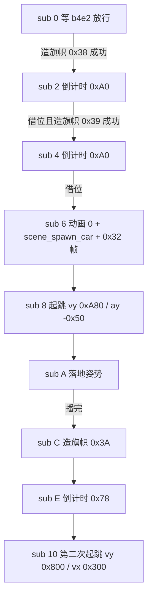

`leader_wait_gate`（`:303-312`）与 `car_init` 一样先等 `flow.b4e2 == 0`——**§67 的 stage intro 末棒（地图卡滑出 → 英雄入场交给 `G.$4E2/$4E3` 过场脚本）直接门控这一整串演出**，两个不同对象读同一个全局字节决定起跑。`leader_banner`（`:316-324`）、`leader_car`（`:327-337`）、`leader_banner_flag`（`:374-380`）都用 `overflowing_sub(1)` 的 borrow 判「倒计时到点」，与 §72 `player_dead` 的 `+$80` 递减到 `0xFF`、§75 `owner60` 借位释放是同一族的帧计时器。

**§19 脚本表与四条演出推进线并列、互不合并**：§19 的 5 套脚本表管波次 / Boss 攻击 / 英雄过场动作；§63 的 attract demo 是 30 条预录输入流（已明列不并入 §19）；§67 的 slot 0x30 intro 任务管屏幕 UI 节奏；§71 的 master 广播一个 `sub` 字节给一群演员本地解释（已明列不并入 §19）；§76 补的是**表驱动挂载 + 计时器串联**——没有一个 master 在广播，也没有输入流，每个对象自己数 `+$80`、自己造子对象、自己读 `b4e2`。本节同样**不并入 §19 的 5 套表**，与前三节不改写不合并。

### 76.6 wof 侧（按 §11.0 只登记，不臆断、不评优劣）

wof repo 侧**未见于 dino `RIDER_ROWS` 乘客表 / class 16 演出车 / class 43 旗帜链直接对应的呈现**，按 §11.0 与用户「不过度怀疑 rep 侧」不据此断言原机缺机制。只登记 §71 / §32 已核实的三处不同语境事实：`Cps1EventObjectRuntime.cs:188-192` 的 `000156A8` 第一关入口任务创建开场对白对象、`Cps1EventQueueTask.cs:5-18` 的 slot15 `0xD000` 事件队列消费任务（§71）、`Cps1EventObjectRuntime.cs:1580` 的许褚子对象与 §32 已记的 `Mount(+$63)` / `MountObj(+$3A)` 骑乘挂接（§32）。以上只是既有结论的复述，不把它们串成乘客表、不臆断等价、不评优劣；这些文件自带 ROM 逐指令注释，不另查 ROM（§11.6 条件通道未触发）。

| 维度 | dino（设计契约） | wof（按 §11.0 只登记） |
|---|---|---|
| 开场演出组织 | pool A class 16 / 27 / 43 + 全局 handle 表 + `+$80` 计时器 | 入口对白对象（`:188-192`）+ slot15 事件队列（§71） |
| 谁在车上 | `RIDER_ROWS` 按 `G.$504` 选行，每帧重算坐标 | 按 §11.0 不臆断 |
| 挂接载体 | 车轮 `+$AC` 反指、旗帜 pool B 生成成功才推进 sub | `Mount` / `MountObj` 父对象指针（§32，可驾驶语境） |
| 与 census 的关系 | `+$7D = 0xFF` 退出统计（同 §71） | 按 §11.0 不臆断 |

### 76.7 组织结论与边界

1. **同名不是同物**：§32 的可驾驶 car 是 pool B class 88，本节开场车是 pool A class 16；两节不改写不合并，差别正好显出「载具」与「演出对象」被放在不同池。
2. **乘客是表不是字段**：`RIDER_ROWS` 按 `G.$504` 选行、`RIDER_OFFS` 只给实际在车上的人推进、`car_place_riders` 每帧覆写世界坐标——没有 parent / 局部坐标 / 挂载字段，与 §71 的 `+$A4` 引用 + 广播字节是两条不同的挂接路。
3. **退出统计不等于退出战斗**：`+$7D = 0xFF` 与 `who = 0xFF` 让车不进 census，但它带 `atk = 0x3E` / `attack_serial` 并登记进 `$6B30` / `$6AC2`；§71「统计身份与碰撞身份分离」在这组对象上再次成立。
4. **容量背压有两种策略**：车轮池满少一个（可降级），旗帜池满下一帧重试（关键节点必须成功），同场并存。
5. **又一条演出推进线**：表驱动挂载 + 计时器串联，与 §19 脚本表 / §63 预录输入 / §67 intro 任务 / §71 广播并列，不并入 §19 的 5 套表；`b4e2` 是 §67 过场脚本交接点的下游门。

**保留边界（不扩张，非欠账）**：`RIDER_ROWS 0x42350` / `RIDER_OFFS 0x42374` / `CAR_ANIM 0x42386` / `MAN_VARIANTS 0x4D992` 各表逐项数值、`enemy_class16 / 17 / 27 / 43` 全部 sub 分支与单测、class 66 旗帜逐类状态机、`scene_spawn_car` 全文与 Episode 2 / 4 各自的过场脚本、wof 入口对白对象与 `0xD000` 队列全文，均按 §21.8 / §28.7 / §41.7 / §63.8 / §67.7 / §71.7 / §75.7 的既有口径**保留、不扩张**；本节只取「一张按全局索引查乘客的表」这一条横切面。两游戏发行先后仍未考证（§11.0）。

---

## 77. 手里的东西不是挂在对象头上的：一张随帧变的附着点表，和一组每帧重问一次的共享例程

> 触发：A.40 之后按开放目标找 §77。零引用非逐类模块里 `item/shared.rs`（290 行）从未进过任何保留清单——§21.8 保留的是 `container.rs` / `blast.rs` / `small.rs` / `hits.rs` **逐类状态**，不是这个共享服务层。Grep 确认 `item_follow_hand` / `0x24A9A` / `0x122230` / `0x120A20` / `item_lift_a` / `item_lift_b` / `item_lift_owner` / `item_ground_idle` / `0x249DC` / `item_land_check` / `0x24CE6` / `抓握` / `弯腰` / `attach index` 在笔记里**全零匹配**；`attach` 的 6 处命中全在 §53 / §54，只把它登记成「帧记录给的附着点字段 `+$60`」，没讲谁读它、读完之后做什么。§21.3 明说「玩家保留状态机、物品自己跑」，却只展开到帧内通信字段表，把 `sub = 4 / 8` 期间物品每帧干什么留白；本节补的正是这一层。
> 归属：设计正文（§0–§77），按「轮次线性追加」接在 §76 / A.40 之后。纯 repo 侧，未新增 ROM 取证（§11.0 / §11.6 条件通道未触发）。
> 边界：§19（5 套脚本全景）、§21（道具状态机 / 拾取双向迁移 / 帧内字段协议 / 一帧延迟列表）、§32（可驾驶 car 座位 / 乘员字段）、§50（六容器总表 / 池满背压）、§53（`Frame` 自带 `attach`）、§54（`attach` = 附着点引用）、§62（掉落行号 `+$96`）、§67（stage intro）、§69（持械分体动画 / `dx3c` / `dy3e`）、§70（容器三 pass）、§71（master 广播 + 本地解释）、§73（场景显存写入器）、§74（敌人共享几何库）、§76（开场车乘客表 / 每帧重算）全部维持原貌、不改写不合并。§21.8 / §28.7 / §41.7 / §63.8 / §72.7 / §73.8 / §74.7 / §75.7 的保留清单不扩张。wof 侧按 §11.0 只登记 §21 已核实的 repo 呈现，**不臆断等价、不评优劣**；音频按 §0 边界外。

### 77.1 一句话结论

dino 手里那件武器**不把自己挂在玩家对象头上**：`item_follow_hand 0x24A9A` 每帧拿玩家**当前动画帧**给的 `attach`（`+$60`，12 字节帧记录才有）当索引，先按 `o.k20` 在 `0x122230` 选一张「角色 × 附着点」的 `(dx, dy)` 表，再按 `o.facing` 镜像、按 `o.draw_flags & 1`（§69 分体）叠加 `dy3e` / `dx3c`，最后在 `0x120A20` 按角色 + 物品 `+$A2` 查出**这一帧该播哪个动画**——位置和动画都由**宿主那一帧**决定，物品头里没有「手部偏移」字段。维持「被持有」也不是一次写入的引用，而是 `item_lift_owner` 每帧重验四条门（是玩家 / `live != 0` / `who` 相同 / `state == 0x0200_0014`），任何一条不成立立刻 `sub = 0xC, act = 0` 掉落。这是与 §32 座位字段、§71 广播字节、§76 全局 handle 表并列的**又一条挂接路：被持有方主动读宿主帧记录**；这些共享例程都住在同一个 `item/shared.rs`，被武器 / 容器 / 食物 / 财宝四个 class 族共用。

### 77.2 共享服务层：一份文件，四个 class 族，一组共享例程

`item/shared.rs:1-3` 文件头直说这是「Routines shared by several pool E classes」：手部定位 `0x24A9A`、着地测试 `0x24CE6`、两个被举起态 `0x24780 / 0x24A2A`、躺地 `0x249DC`，加上道具音效。调用面可查（不是推断）：

| 共享例程 | 谁调 | 干什么 |
|---|---|---|
| `item_lift_a 0x24780` | `item/weapon.rs:76`、`item/container.rs:102` | 武器 / 容器 / 弹药箱的「被举起」`sub = 4` |
| `item_lift_b 0x24A2A` | `item/small.rs:111-117 / 183 / 245` | 食物 / 财宝的「被举起」，帧 1 还写 `LIFE = 0x258` |
| `item_follow_hand 0x24A9A` | `item/weapon.rs:547`、`item/container.rs:256`（手持态）、`item/shared.rs:223 / 240`（两个 lift 例程内） | 被举起 / 手持态每帧重算位置与动画 |
| `item_lift_owner` | 上面两个 lift 例程开头 | 每帧重验持有关系，返回 `(玩家 idx, 帧字节)` |
| `item_ground_idle 0x249DC` | `item/small.rs:84 / 182` | 躺地 `sub = 0`：寿命 / 动画 / 闪 / 两张注册表 |
| `item_land_check 0x24CE6` | `weapon.rs:211`、`container.rs:325`、`small.rs:104 / 175 / 237` | 着地瞬间判屏幕边缘，决定留还是弹 |

与 §73 的显存写入器、§74 的 `0x32xxx` 几何库并列，这是**又一条通用设施层**，但方向反了：前两条是「宿主 / 决策方调用服务去写别人」，这一条是**被持有方每帧去读宿主**。按 A.33「通用设施与特定组装分层」：设施是这六个例程，特定组装才是 `weapon.rs` / `container.rs` / `small.rs` 各自在哪个 `sub` 调哪一个——本节只展开设施层，不逐类展开那三个文件（§21.8 保留）。

### 77.3 手部定位：一次查表把「这一帧」翻译成位置 + 动画

`item_follow_hand`（`shared.rs:127-166`）是全部：

```text
FOLLOW_HAND(item, p):
  o = players[p].b
  attach = o.attach >> 8                       # +$60 高字节，12 字节帧记录才给
  if (attach as i8) < 0: return HIDE          # 帧没给附着点 → 这一帧不画，不兜默认位置
  pairs = u32(0x122230, o.k20)                # 按角色选一张 (dx,dy) 对表
  (dx, dy) = (i16(pairs, attach*4), i16(pairs, attach*4+2))
  item.z = o.z                                # put_hi 只换整数部分，保留小数（§74 put_hi 同族）
  if o.facing: dx = -dx                       # 朝向镜像
  x = o.x + dx ; y = o.y + dy
  if o.draw_flags & 1:                        # §69 持械分体
      y += o.dy3e ; x += (o.facing ? -o.dx3c : o.dx3c)
  item.x = x ; item.y = y ; item.facing = o.facing
  table = u32(0x120A20, o.k20)                # 按角色选动画 id 行
  row   = u32(table, item.+$A2)               # 再按物品的「手持位表偏移」选行
  id    = u8(row, attach)                     # 最后仍按当前帧的 attach 取一格
  if (id as i8) < 0: return HIDE
  item_anim(item, id)                         # 用物品自己的动画表 0x120E 装载
  return SHOW
```

三个设计点：

1. **两次按 `attach` 索引**：`(dx,dy)` 取表内第 `attach` 对、动画 `id` 取行内第 `attach` 格。也就是说「手在哪」和「这一帧物品摆什么姿势」共用**同一个帧阶段号**；动画不是按物品状态播，是跟着玩家抬手动画走的。§53 把 `Frame` 记成「自带 `duration / last / next / 盒 ID / attach`」，本节补上 `attach` 的下游：`§54` 说它是「武器 / 挂载物随帧定位」的引用，真正的定位链在这里。
2. **分体偏移的第二个消费者**：`o.draw_flags & 1` 时才叠 `dy3e` / `dx3c`。§69 讲这两个字段是持械时腿层与上层分离的偏移，本节说明**手里的东西也读同一份偏移**——否则上下半身错开时武器会飘在旧位置。两节不改写不合并：§69 管玩家自己的两层动画，§77 管被持有物怎么跟上。
3. **没有「找不到就兜底」**：`attach < 0` 或动画 `id < 0` 都返回 `HIDE`，调用方 `weapon.rs:547-549` 直接 `return` 不进绘制列表（物品在 `weapon_held` 开头已写 `visible = 0`）。「这一帧没有手部数据」被表达成**这一帧不显示**，而不是退回一个固定偏移，与 §73「`Layer::of` 越界返回 `None`、原机会写别的 VRAM port 不建模」同族的「缺席即缺席」。

### 77.4 维持持有关系：每帧重验，不是一次写入

`item_lift_owner`（`shared.rs:256-265`）四个条件合起来才算还拿着：

| 门 | 字段 / 判据 | 不成立时 |
|---|---|---|
| 引用形态 | `slot_of(item.partner)` 必须是玩家槽 | 返回 `None` |
| 宿主还活着 | `o.live != 0` | 返回 `None` |
| 归属未变 | `o.who == item.who` | 返回 `None` |
| 还在拾取态 | `o.state() == 0x0200_0014` | 返回 `None` |

任一条不成立，`item_lift_a` 走 `set_mode_sub(2, 0xC)` + `clear_act()` 掉落（`shared.rs:205-209`），`weapon_held` 同样写 `sub = 0xC, act = 0` 且**不画**（`weapon.rs:539-543`）。§21.3 讲的是**建立**时玩家与物品同帧各改自己状态、`item.+$70 = player` 双向写引用；本节讲的是**维持期**：那个引用每帧被重新验证一次，宿主一死 / 一换状态 / `who` 一变就作废。与 §76 的 `car_place_riders` 每帧重算是同一族「不缓存挂接结果」，但那边是**宿主方**每帧覆写乘客坐标，这边是**被持有方**每帧重问「我还算不算被拿着」。

同一份帧字节 `+$2C`（`param_a`）在 `item_lift_a` 里被读成三态（`:212-227`）：`0` = 还在弯腰（只画不动）、`1` = 抓取瞬间（`sub = 8` 转手持、清 `B81` 弹跳计数、弹药箱即时 `item_ammo_pickup`）、其它 = 调 `item_follow_hand` 跟手。§71 是「master 写 `sub` 字节、N 个演员各按自己 class 的 act 表解释同一个字节」；这里是**同一个对象把宿主的一个帧阶段字节读出三种语义**，且 `1` 那一帧会改变自己的状态层。两节不合并：广播方是状态机，这里广播方是动画帧。

`item_lift_b`（`:231-254`）则是「同族不同语义」的又一例：帧 1 额外把 `LIFE` 写成 `0x258`（600 帧），且**宿主离开拾取态时反而转成 `sub = 8` 手持**而不是掉落。与 §76 用 `var26` 高字节给同一个 class 16 分两套开场戏同族——设施共用，差异压在一个变体 / 分支里，不另起一套状态机。

### 77.5 躺地与着地：寿命、闪烁、两张表，以及「不许滚出屏幕」被写成弹跳

`item_ground_idle`（`:267-289`）一个函数同时做五件事：`LIFE`（`+$A4`，`0` = 永不消失）递减到 0 直接 `set_mode_sub(6, 0)` 回收；`item_anim_step` 走自己的帧链；`set_frame2(frame)` 复制一份帧给第二层（§69 的 `frame2` 复合帧设施，`item/small.rs:73` 也用）；`param_a != 0` 时 `palette_override = 0x8B` 做拾取闪烁；最后 `item_register_pickup` + `item_register_attacker` + `item_despawn_far` 把自己登记进 §21.7 那两张一帧延迟列表并做离屏回收。**躺地不是「什么都没发生」**：一个静止的道具每帧仍在跑帧链、维持注册表、数自己的寿命。

`item_land_check`（`:168-195`）最见原机脾气：着地时若 X 落在屏幕边缘带（`cam + 0x10` 左外 / `cam + 0x170` 右外），不是把坐标夹回屏内，而是**弹回去**——左边缘 `vx = 0x180`、右边缘 `vx = -0x100`，`airborne = 1`，`vy` 取反；只有第一次弹跳把 `vy` 减半；`B81`（`+$81`）记次数，到 5 次就拒绝再弹、老实停下（`:190-192`）。单测 `item/tests.rs:185-209` 把四个行为钉死：屏内不动、左边缘第一次 `(0x180, 0x180, airborne=1, B81=1)`、第二次只翻 `vy` 不减半、右边缘 `(-0x100, B81=5)`、第六次拒绝。也就是说「道具不许被扔出屏幕」被建模成**带次数上限的反弹序列 + 一个字节计数器**，不是一次坐标 clamp；且这个共享例程**不是纯函数**——它写 `vx / vy / airborne / B81`，与 §74「几何例程不是纯函数」同族，但这里写的是速度而非留给别人读的缓存字段。

音效段（`shared.rs:7-112`）按 §0 边界外不展开，只登记一处语汇：`item_snd_toggle` 用 `G.$43B` 的位翻转在两个音效码之间交替（`0x6E / 0xF5`、`0x6F / 0xF6`……），是 §57 全局共享状态线的又一个读方，不评优劣、不逐函数展开。

### 77.6 四条挂接路并列，互不合并

| 挂接路 | 谁写 / 谁读 | 关系存在哪里 | 出处 |
|---|---|---|---|
| 座位 / 乘员字段 | 宿主对象头字段 | 一次写入、持续有效 | §32 |
| master 广播 + 本地解释 | master 写 `sub` 字节，演员各按 class 解释 | 一个字节 + 每帧广播 | §71 |
| 全局 handle 表 + 每帧覆写 | 宿主每帧查表、写乘客世界坐标 | ROM 表按 `G.$504` 选行 | §76 |
| **宿主帧记录 + 每帧查表** | **被持有方读宿主当前帧的 `attach`** | **`0x122230` / `0x120A20` 两张表 + 每帧重验四条门** | **§77** |

四条都不并入 §19 的 5 套脚本表，也都不是「演出推进线」（§63 / §67 / §71 / §76 那条线是**时间怎么往前走**，这条线是**空间上谁跟着谁**）。§77 与 §76 尤其要分清：都是「每帧重算、不存局部坐标」，但 §76 是**宿主方**决定乘客在哪，§77 是**被持有方**决定自己该在哪；前者读一张按全局索引选行的表，后者读宿主**当前动画帧**。

### 77.7 wof 侧（按 §11.0 只登记，不臆断、不评优劣）

wof repo 侧**未见于 dino `item_follow_hand` 帧附着点表 / `item_lift_owner` 每帧重验 / `item_land_check` 边缘弹跳直接对应的呈现**，按 §11.0 与用户「不过度怀疑 rep 侧」**不据此断言原机缺机制**。只登记 §21 已核实的三处不同语境事实：`Cps1Item.cs` 的 `CheckItemPickup` 当帧扫槽（§21.3 / §21.7 对照表）、`Cps1Collision.cs:1945-1955` 与 §21.5 记的 `player + 0x8C` 指向「武器对象」且该对象带 `+0x70` hitbox / `+0x7A` AtkType（`0x91FA / 0x91FC` 链）、`Cps1PlayerLogic.cs:1-13` 的 `ActStatABCD` 状态分派。另登记一条**语义不同**的并列事实：`Cps1Actor12Runtime.cs:524-527` 与 `Cps1Actor17Runtime.cs:279-282` 的 `+0x86` 附着修正（`attach != 0` 时 `extw2a` 符号扩展取宿主）属于**敌人 Actor 的宿主桥接**语境，不是道具手部位置，不把它们串成与 dino `attach` 等价。以上只是既有结论的复述与语境区分，不臆断等价、不评优劣；这些文件自带 ROM 逐指令注释，不另查 ROM（§11.6 条件通道未触发）。

| 维度 | dino（设计契约） | wof（按 §11.0 只登记） |
|---|---|---|
| 手持物怎么定位 | 宿主当前帧 `attach` → 两张按角色选的表 → 每帧重算 | 按 §11.0 不臆断 |
| 持有关系怎么维持 | `item_lift_owner` 每帧重验四条门 | `+0x8C` 对象引用（§21，不同语境） |
| 着地越界 | `item_land_check` 带次数上限的反弹序列 | 按 §11.0 不臆断 |
| 「附着」一词的另一语境 | — | `+0x86` 敌人 Actor 宿主桥接（`:524-527` / `:279-282`） |

### 77.8 组织结论与边界

1. **`attach` 的下游终于闭合**：§53 记 `Frame` 自带 `attach`、§54 记它是 `+$60` 附着点引用、§69 记分体偏移 `dx3c / dy3e`，本节把三者接成一条链——帧号同时决定手的位置与物品的动画，分体偏移同时被手里的东西消费。三节不改写不合并。
2. **挂接关系的又一条路**：被持有方主动读宿主帧记录，与 §32 字段、§71 广播、§76 handle 表并列；四条都是「每帧重算或每帧重验」，没有哪条是一次挂载就不管。
3. **共享设施层在 pool E 侧第一次展开**：与 §73 / §74 并列为又一条通用设施层，且是唯一一条「被持有方读宿主」的；设施与特定组装分层按 A.33 口径，不逐类展开 `weapon.rs` / `container.rs` / `small.rs`（§21.8 保留）。
4. **缺席即缺席、越界即反弹**：没有手部数据就不画（不兜默认），扔到屏幕外就弹回来（不夹坐标）；两处都把「异常」写成一段有状态的过程，与 §73 跨页不换列、§74 `put_hi` 保留小数同族的原机脾气。
5. **不并入 §19 的 5 套表，也不算演出推进线**：本节的线是空间挂接，不是时间推进；与 §63 / §67 / §71 / §76 那条线并列但不同维度。

**保留边界（不扩张，非欠账）**：`0x122230` / `0x120A20` / `0x284A4` 各表逐项数值、`0x120E` 动画表族、15 种武器与容器 / 食物 / 财宝逐类状态机全文、`item_snd_*` 音效段全实现（音频按 §0 边界外）、wof `+0x86` 宿主桥接全部消费点与 `+0x8C` 武器对象全链，均按 §21.8 / §28.7 / §41.7 / §63.8 / §72.7 / §73.8 / §74.7 / §75.7 的既有口径**保留、不扩张**；本节只取「被持有方每帧读宿主帧」这一条横切面。两游戏发行先后仍未考证（§11.0）。

---

## 78. 被扔出去的人，在半空中还是攻击者：一张飞行身体表、两条 pass、和每条 pass 自带的准入门

> 触发：A.41 之后按开放目标找 §78。查重不是「零匹配」而是 A.33 情形 2 的又一例——`pass_1185a` 在 L309 的一帧调度链伪代码与 L751 的 `combat.rs:70-100` pass 顺序里**只作步骤名**出现，`0x6B30` 在 L3425（§24「step 2 飞行含 `0x6B30` 注册」）与 L6483 / L9845 / L9871（`combat_lists_reset` 清四张旁表）里**只作表名**出现；`enemy_body_hits_enemy` / `0x1189C` / `0x1185A` / `a_thrown_body_hits_another_enemy` 全零匹配。也就是说这条 pass 的名字、它读的表名、清表的时机都登记过，但**「谁往表里写、谁读表、读完之后打谁、按什么记录扣血」从未展开**。§70 展开了 `pass_11f86` 打容器这一路，§24 展开了投掷状态机本身，两条线中间那张 `0x6B30` 的下游一直留白；本节补的正是这一层，同时接上 §76 开场车「走真实碰撞列表无专用通道」的具体落点。

### 78.1 一张纯本帧的表，三处写入者，每帧重新登记

`combat_lists_reset 0x105E8`（`combat.rs:102-112`）每帧先 `copy(0x671E → 0x69BA)` 把本帧 hurt list 留成上一帧表（§48 / §68），再清 `0x6718 / 0x671A / 0x671C / 0x671E`，最后清 `0x6B64 / 0x6AC2 / 0x6AFC / 0x6B30` 四张旁表。**`0x6B30` 没有上一帧副本**：它不是历史，是「这一帧谁正飞着」的资格名单，能力每帧重新登记一次，与 §77「持有关系每帧重验四条门」同族，但那边重验的是引用、这边重登记的是攻击资格。

| 写入者 | 位置 | 登记范围 | 这一帧能撞什么 |
|---|---|---|---|
| `enemy_thrown_fly 0x2AAEA`（飞行 step 0 / 2） | `enemy_combat.rs:1068-1075` | `push(0x6B30, h)` + `push(0x6AC2, h)` | 敌人（经 `pass_1185a`）**和**容器（经 §70 `pass_11f86`） |
| `enemy_thrown` step 4（弹地） | `enemy_combat.rs:1038-1039` | 只 `push(0x6B30, h)` | 只撞敌人，**不再砸容器** |
| `car_drive`（§76 开场车，过场期间） | `enemy/scene_actors.rs:91-94` | `w.scripted != 0` 时两张都 push | 与飞行态同 |

还有一个反向的门：`enemy_thrown_fly` 开头 `if e.b.hitstop != 0 { e.b.hitstop -= 1; return; }`（`enemy_combat.rs:1069-1072`）——**身体停在这一帧时不登记任何一张表**，于是它这一帧既不是攻击者也不砸容器。综合起来，同一个被扔出去的对象在不同帧的「能打谁」是三种状态：飞行中双表、弹地中单表、hitstop 帧无表；不是一次挂载就一直有效。

### 78.2 同一帧两条 pass 各读一张表，中间隔着七条

`collision 0x10546`（`combat.rs:70-100`）是固定顺序。与本节有关的两条：

```text
collision():
    pass_10664 / 10dcc / 10f96 / 1132a / 107f8 / 10cd0 / 11962 / 11a9e
    pass_11f86()        # :81  0x6AC2 x 0x6AFC -> 容器 HP-8        （§70 已展开）
    pass_1201c / 120d2 / 11e56
    if car_mode && car_on: pass_121d8 / 122d8 / 12342 [+12454]
    if scripted == 0:   pass_115b0 / 11cec        # 敌人攻击 vs 玩家，被过场门挡住
    pass_1185a()        # :99  0x6B30 x 0x671E -> 敌人受击          （本节，整帧最后一条）
```

`pass_1185a`（`enemy_combat.rs:411-422`）是两层循环，外层读 `0x6B30`、内层读 `0x671E`，先排掉 `a3 == a2`（自撞）与 `live & 2 != 0`（已在受击反应中），再调 `enemy_body_hits_enemy`。**§70 讲的是 `0x6AC2 → pass_11f86 → 容器 HP 减 8`**，本节讲的是同一具飞行身体在**另一张表**里经 **另一条 pass** 打**另一类目标**并走完整受击状态；两条并列，不合并、不改写 §70 / §24。

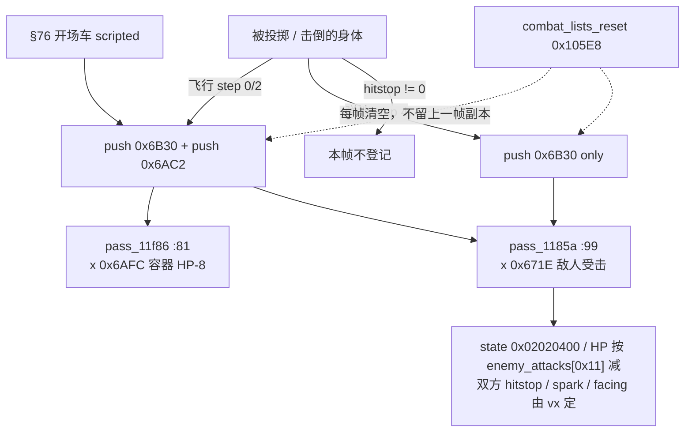

### 78.3 一条 8 字段记录，这一 pass 只挑四个字段读

`enemy_body_hits_enemy 0x1189C`（`enemy_combat.rs:428-463`）先做 `body_box` 对 `body_box` 的 `collide::boxes_hit`（`0x128F8`，§3），任一方 `body_box == 0` 或受害者 `kind` 不在 `0 / 2 / 4` 就返回。命中后取的记录是 **`self.assets.player.enemy_attacks[0x11]`**（`:434`）——用的是 §46 里「全体敌人共用一份」的 `enemy_attacks` 表，不是按角色索引的 `attacks[ch][...]`；文件头注释把它称作「damage only, stun 0, no HP bar」。

| `AttackRecord` 字段（§46 / `sprites.rs:149-158`） | `0x1189C` 是否读 | 落到哪 |
|---|---|---|
| `damage` | ✅ | `v.hp -= rec.damage`（`:448-449`），单测 `0x40 → 0x3B` |
| `hit_stop` | ✅ | 同时写受害者 `:453` 与飞行身体 `:455` |
| `spark` | ✅ | 写 `v.b9a`（`:454`）；**火花生成却传常数 0**（`:461`） |
| `sound` | ✅ | `rec.sound != 0` 时 `snd_hit`（`:456-459`） |
| `stun` | ❌ | 实现硬写 `v.stun = 0`（`:450`），表里的值被丢弃 |
| `reaction` | ❌ | 实现硬写 `v.act = 4; v.step = 0`（`:451-452`），表里的值被丢弃 |
| `score` | ❌ | 这一 pass 不调 `player_add_score`，无记分 |
| `b7` | ❌ | 未读 |

单测 `enemy_combat.rs:1690-1740` 把表项**故意**设成 `{ damage: 5, stun: 9, reaction: 9, hit_stop: 2, sound: 0, score: 0, spark: 3, b7: 0 }`，然后断言 `(live, hp, hp_prev, stun, hitstop) == (2, 0x3B, 0x40, 0, 2)` 与 `state() == 0x0202_0400`。也就是说 `stun: 9 / reaction: 9` 两个表值被明确丢掉、`damage: 5` 与 `hit_stop: 2` 被采用——§46「8 字段聚合、按 pass 约定读字节」与 §58「spark 一路」在这里得到一个**用反例钉死**的下游实证：记录是共享的数据，读哪些字段由这条 pass 自己决定。

状态层同样写得很具体：`v.live = 2`、`set_state(0x0202_0000)`（`:437-440`）、敌人侧 `WAIT` 计时清零（`:441-443`），再补 `act = 4`（故单测见 `0x0202_0400`）——与 §29 受击恢复链的入口同形，受害者下一帧才由自己的状态机决定起身或死亡，符合 §12「命中帧只结算、不处决」。

### 78.4 归属字段各有来源，hitstop 双方都吃

| 字段 | 写入值 | 来源与含义 |
|---|---|---|
| `who` | `ab.who`（`:439`） | 沿用**飞行身体**自己的归属；可能是玩家槽号，也可能是 §76 车的 `0xFF`，不回溯到 `+$68` thrower |
| `serial` | `ab.serial`（`:438`） | 沿用身体的 `attack_serial`（§48），受害者「被哪个号打过」记的是身体这一击 |
| `attacker` | `a2`（`:446`） | 攻击者是**身体本身**，不是投掷者；§24 的 `+$68` thrower 只用于初速表 |
| `facing` | `(ab.vx < 0)`（`:462`） | 由飞行速度方向定，不是攻击者位置；与 §70 `item_crushed` 按 `vx < 0` 定箱子倒向同一手法 |
| `hitstop` | `rec.hit_stop`（`:453` 与 `:455`） | **飞在半空的身体自己也停**；单测 `:1730` 断言 `thrown.hitstop == 2` |
| `b9a` | `rec.spark`（`:454`） | §58 的火花字段，但火花对象本身在 `:461` 用常数 `0` |

`spawn_hit_spark(a2, a3, ha, hb, 0)`（`:461`）的注释明说在受害者转身之前（`0x11950`）生成；单测 `:1731` 用 `effects.free_count() == 47` 钉住「确实造了一个」。§54 讲 dino 把 `who / attacker / partner / serial` 分成语义不同的字段，本节给出一次具体事件里四个字段**来自三个不同对象/数值**的实例（身体的 `who`、身体的 `serial`、身体自己作 `attacker`、`vx` 定朝向）。§37 讲命中停顿是攻击者与被击者两条独立反馈，本节是同一形态出现在「攻击者本身正在被投掷」的情形。

### 78.5 没有统一的「可被打」判定，每条 pass 自带一套门

| pass | 读的表 | 准入 / 排除条件 | 出处 |
|---|---|---|---|
| `pass_1185a`（本节） | `0x6B30 × 0x671E` | 自撞 `a3 == a2`；`live & 2`；受害者 `kind ∉ {0,2,4}`；任一 `body_box == 0` | `enemy_combat.rs:413-432` |
| `pass_10f96`（玩家攻击 vs 敌人） | `0x671A × 0x671E` | `live & 2`；`ab.serial == db.serial`；`kind` 8 / 0xA 免疫；`attack_box == 0` | `enemy_combat.rs:467-495` |
| `pass_11f86`（§70 砸容器） | `0x6AC2 × 0x6AFC` | 容器 `kind != 0`；两 `body_box == 0` | `item/hits.rs:18-33` |
| `pass_1201c`（§70 敌人攻击帧碾容器） | `0x671E × 0x6AFC` | 攻击者 `hitstop != 0` 跳过 | `item/hits.rs:47-50` |
| `pass_11962`（打攻击者列表里的容器） | `0x671A` | 容器 `kind` 8 / 0xA / 0xE 与玩家 frame class 非 4 / 6 | 单测 `:1743-1745` |

共享的是**列表**（§68 / §48）与**记录结构**（§46），不共享的是**准入条件**：每条 pass 自己决定谁能被打、用什么盒、按哪张记录扣血。这是 A.33「通用设施与特定组装分层」在碰撞层的落点，与 §47 固定 pass 顺序、§50 分池更新并列，不构成新的一套全局判定器。

### 78.6 §76 的下游：过场车登记的两张表，消费者恰好都不受过场门控

§76 记 `car_drive`（`enemy/scene_actors.rs:91-94`）在 `w.scripted != 0` 时 push `0x6B30 / 0x6AC2`，并把结论写成「演出车同时是真攻击者与可被打对象，走 §48 / §68 真实碰撞列表，无专用通道」。本节给出这两张表的**具体消费者**：`0x6AC2 → pass_11f86`（`combat.rs:81`）、`0x6B30 → pass_1185a`（`combat.rs:99`）；而 `collision()` 里被 `if scripted == 0` 包住的只有 `pass_10dcc`（`:72-74`）与 `pass_115b0 / 11cec`（`:95-98`）。**两条通道在过场期间都仍在跑**，且 `pass_1185a` 是整帧最后一条。这里只登记「通道及其门控位置存在」，**不臆断过场期间场上是否真有敌人或容器可撞**；§76 的 `+$7D = 0xFF` 退出 census、`who = 0xFF`、`atk = 0x3E`、`attack_serial` 等结论原样不动。与 §77「把附着点字段的下游消费链接上」同形态：都是把既有节里一个登记动作接到它的实际消费者上，而不是新造机制。

### 78.7 wof 侧（按 §11.0 只登记，不臆断、不评优劣）

wof repo 侧**未见于 dino `0x6B30 → pass_1185a` 这条「飞行途中再撞一个敌人」直接对应的呈现**，按 §11.0 与用户「不过度怀疑 rep 侧」**不据此断言原机缺机制**。只登记四处不同语境的已核实事实：

- `Cps1EnemyAI.cs:3982-4012`：`敌人_抓投弹飞反应_可能对应ASM_11D2E` 的 case 0x00 是**落地时** `Damage > Hp` 的死亡掉落 / 击杀加分（§24 已核实，L3463 同一函数）；`:4005` 还记着 `0x11D48` 末尾 `addq.b #2` 让 D 变 2，`.fs` 里 D==0 的帧要**下一帧**才真正进本支。
- `Cps1HitReaction124CA.cs:321-326`：`段11D48_对应ASM_11D48` 明注「同一段代码也被 `敌人_抓投弹飞反应` 的 case 0x00 内联」。
- `Cps1SceneObjRuntime.cs:1977-1981`：`0x43CA` 的 4 个调用者里 `0x11D60` 正是 `0x11D2E` case 0x00，标为「已接」。
- `Cps1PlayerLogic.cs:9781-9797`：`0x11D2E` 给的是击倒弹飞初速（`VelX=±5 / VelZ=0x680 / AccelZ=-0x70 / HitTimer=8`），`玩家_受击_击倒_部分对应ASM_11782` 的 case 0x02 转入它并接 `0x2698` 尾链。

四处都是**落地 / 死亡 / 初速 / 尾链**语境，不是「飞行中的身体作为攻击者撞另一个敌人」；不把它们串成与 dino `pass_1185a` 等价，也不评优劣。这些文件自带 ROM 逐指令注释，不另查 ROM（§11.6 条件通道未触发）。

| 维度 | dino（设计契约） | wof（按 §11.0 只登记） |
|---|---|---|
| 飞行身体的攻击资格 | `0x6B30` 每帧重登记，飞行双表 / 弹地单表 / hitstop 帧无表 | 按 §11.0 不臆断 |
| 撞另一个敌人 | `pass_1185a` → 完整受击状态 + `enemy_attacks[0x11]` | 落地伤害 / 死亡掉落见 `0x11D2E` case 0x00（不同语境） |
| 归属字段 | 身体自己的 `who / serial / attacker`，朝向由 `vx` 定 | 按 §11.0 不臆断 |

### 78.8 组织结论与边界

1. **首次把一张只被登记为「每帧清空」的旁表展开成完整链路**：`0x6B30` 的三处写入者、三态登记范围、唯一消费者、以及与 `0x671E → 0x69BA` 的「留 / 不留上一帧」对照，都是此前只出现表名的部分。
2. **首次把「同一飞行对象在不同阶段能撞的目标种类不同」写成契约**：不是一次挂载管全程，而是每帧由状态机重新决定登记哪几张表。
3. **首次把 §46「按 pass 约定读字节」用单测反例钉死**：`stun / reaction` 表项被故意设成 9 却硬写 0 / 4，`score / b7` 完全不读；共享记录 + 局部消费在碰撞层落地。
4. **§76 的下游闭合**：过场车 push 的两张表各有真实消费者，且都不受 `scripted` 门控；不改写 §76，也不臆断过场期间一定撞到目标。
5. **与 §70 是相邻两条 pass，不是同一条**：§70 打容器 HP 减 8 且不写受击状态，本节打敌人并走完整受击状态；与 §24 投掷状态机是「状态机写表 / pass 读表」的上下游两帧，本节不展开飞行内部。
6. **不并入 §19 的 5 套表，也不是演出推进线或空间挂接线**：这条线是「伤害来源的资格怎么每帧登记」，与 §63 / §67 / §71 / §76 的时间推进线、§32 / §71 / §76 / §77 的空间挂接线并列但不同维度。

**保留边界（不扩张，非欠账）**：`enemy_thrown_fly` 溅水 / 屏幕反弹逐段（§24.7 明列）、`THROW 0x2CB46` / `LAUNCH 0x2CBB0` 初速表逐项数值、`enemy_attacks` 与 `player_attacks` 全表内容、`0x671E` 全部注册者与 `0x6B64 / 0x6AFC` 全链、`car.rs` 四个 car pass 全文、wof `0x11D2E` 全链与 `0x799A` 附着链（§24.7）、两游戏投掷碰撞是否等价（不臆断）、音频与音效触发按 §0 边界外；均按 §21.8 / §24.7 / §28.7 / §41.7 / §70.7 / §72.7 / §73.8 / §74.7 / §75.7 / §76 / §77 的既有口径**保留、不扩张**。两游戏发行先后仍未考证（§11.0）。本节纯 repo 侧，0 次 ROM 取证。

---

## 79. 按下的键不是立刻用掉的：输入字节的四个读方，和一个跨状态缓冲

> 触发：A.42 之后按开放目标找 §79。§14 是笔记主线之一，把 `+$A0` 的**三层写入者**（真实输入 → 脚本 → input_lock）与 `script_pad_clear` 不清 `prev` 的怪癖展开得很完整，§27 讲搓招 FSM、§24 讲挣扎 `mash`、§31 讲角色差异表族、§44 讲跳跃六分量，但**「这字节之后被谁读、同一帧被读成几种语义」从未独立成节**。Grep 确认 `player_face_input` / `player_set_speed_class` / `player_walk_move` / `player_run_move` / `player_special_check` / `player_special_buffer` / `special_buf` / `speed_heavy` / `walk_dir` / `0x20A` 在笔记里**全零匹配**；`RKey1` / `mash` / `ActStatABCD` 的命中全在 §14 / §24 / §27，只作 wof 侧语境登记。本节补的是 §14 的下游消费链，与 §77 接 `attach`、§78 接 `0x6B30` 同形态，不改写 §14。

### 79.1 同一个字节，四种读法，没有统一解释器

| 读法 | 代码 | 从输入字节取什么 | 写成什么 |
|---|---|---|---|
| 朝向 | `player_face_input 0x192A2`（`player.rs:278-285`） | `held & 3` | `facing = d & 1`——**左右同时按住时右优先**；没有方向则保持上一帧 |
| 走路方向 | `player_walk_move 0x1BD94`（`:313-325`）、`player_face_input_nib`（`:327-332`） | `nib & 15` 查 `walk_dir[nib]` | `(off, dir)`：`off` 拿去选速度表项，`dir` 写进 `b.dir`，再取 `(vx, vz)` 移动 |
| 必杀组合 | `player_special_check 0x63AA`（`:443-453`） | `ATK` 按住 + `JMP` 按下，**或** `JMP` 按住 + `ATK` 按下，且 `HP > 1` | 立即 `player_special_entry` |
| 挣扎敲击 | `player_mash 0x6012`（`:465-484`） | `pressed & 0xF` 按 `mash_weight` 减 `mash`，攻击键走 `mash_cd` | §24 已登记的挣扎计量，本节只并列不展开 |

`player_run_move 0x1BDEC`（`:334-355`）还给出一个反例：**方向松手时并不停下来**，它取 `b.dir`（`+$22` 里上一次的方向）继续跑，`dir < 0` 才返回——方向字节本身就是跨帧状态。空中控制 `player_air_control 0x1BE3C`（`:357-368`）更不同：它对 `vx / vz` 是**累加** `air_control[(off/4)&7]`，不是覆写。结论不是「有一个输入解析函数」，而是**每个状态自己读同一个字节的不同位、不同表、不同写法**；§14 讲清了谁写，本节讲清了谁读。

### 79.2 速度是三维选出来的，举着重物换的是整张表

`player_set_speed_class 0x5036`（`player.rs:287-297`）按 `class × 4 + 角色 k20` 组成 16 项索引（`class` 取 0 / 4 / 8 / 12，对应站立 / 跑 / 蹬墙 / 重物，`player.rs:370` 的跳跃注释给出同一组档名），把**表地址**存进 `+$64`。`player_speed_entry`（`:299-311`）再从 `+$64` 的地址反查是哪一张表，取 8 项里的 `(vx, vz)`。关键是这一句：

```text
p.b.speed_table = if p.item_type == 0x20A { pd.speed_heavy_ptr[idx] } else { pd.speed_ptr[idx] };
```

`item_type == 0x20A`（举着的桶 / 重物）不是给速度乘一个系数，而是**换掉整套速度表指针**。同一套「档 × 角色」的两张表并存，选哪张由一个物件类型位决定。跳跃同理：`player_set_jump_velocity 0x5364`（`:370-384`）按 `jump[class + 角色][dir]` 取六分量 `vx/ax/vy/ay/vz/az`，重物空中跳从 `player_weapon.rs:799` 传 `class = 0xC`；`player_air_control` 在 `player_weapon.rs:825` 与 `player_tag.rs:416` 两处被复用。

调用面可以看出「档」是状态给的而不是输入给的：`idle` / 落地写 `class 0`（`player.rs:651` / `:1121`），跑写 `class 4`（`:1972` / `:2199`、`player_weapon.rs:756`），tag 写 `class 12`（`player_tag.rs:237`）。与 §31「dino 角色差异是数据维、四角色共用一套状态机」一致，但落到移动层；与 §69 的绘制分体、§77 的手部定位并列为「举着重物影响什么」的又一条线，三者不合并。

### 79.3 一个组合键，两个消费者；缓冲能跨过「被打断」那一帧

`player_special_check`（`:443-453`）与 `player_special_buffer 0x63E6`（`:455-463`）的判据**完全相同**：`HP > 1` 且 `ATK/JMP` 两键一按一松的两种先后都算。区别只在调用时机和后果：

| | 立即触发 `player_special_check` | 只缓冲 `player_special_buffer` |
|---|---|---|
| 调用点 | `player_idle :1161`；持械 / 重物四个状态入口 `player_weapon.rs:257 / 333 / 391 / 447` | **`player_hurt :2658`**（受击那一帧） |
| 后果 | 当帧 `player_special_entry` | 只写 `special_buf = 10`，不改变状态 |
| 消费 | — | 每帧递减 `player.rs:912-913`；回到 `player_idle :1158-1159` 时 `special_buf != 0` 就补触发 |

也就是说**受击瞬间按下的必杀不会被吞掉**：它先被记成一个 10 帧的倒计时，等玩家从受击 / 倒地恢复到 `idle` 才兑现。这是与 §27 搓招 FSM（方向序列 + 三态时间窗）和 §14 `cmd_flag`（这一帧确认、主状态机消费的结果位）**并列但不同**的一类输入契约：靠双键同按、靠跨状态字节存活，不靠方向序列，也不并入 §19 的 5 套表。

`player_special_entry 0x1968E`（`:1480-1500`）本身是一次完整的全局收拢：`special_budget = 0x14`、`hud_life_bar` 重绘（`G.$4D5 == 0` 时）、音效 `0x992C`、`action = 0x11`、Mustapha（`id == 1`）转 `player_air_special_entry 0x1AAE6`、其余角色 `set_state(0x0200_000E)` + `player_new_attack(0x12)`，并清 `combo / draw_flags / item / item_type / drop`。另登记一条并列事实：`script.rs:800` 也直接调 `player_special_entry`——过场脚本除 §14 记的「覆写 pad」外还有这一处直接入口，不改写 §14 结论。

### 79.4 举重物还给「能不能捡」加了一道输入门

`player_find_pickup 0x5AA2`（`player_weapon.rs:65-70`）走**上一帧**的物品列表（newest first），留 `kind` 最低、躺在地上、首个判定盒含玩家 X/Z、高度差 ≤16 的候选；然后：重物 `0x20A`（**除变体 6 与 8**）要求摇杆朝它推；武器（`kind` 高字节 2）在拾取后 40 帧内被 `+$F8` 跳过；空中或 `G.$506` 置位时一律找不到。单测 `player_weapon.rs:948-969` 钉死「变体 6 / 8 不需要摇杆」。`player_weapon.rs:118` 是这道门的实现位置。

这与 §21 拾取双向迁移、§62 掉落、§77 手持态是相邻几帧：本节只补「**候选筛选也读输入字节**」这一层，不改写 §21。加上 §79.2 的换速度表，举重物总共牵动绘制（§69）、手部（§77）、移动（本节）、拾取（本节）四处，都是同一个 `item_type == 0x20A` 被不同系统各读一次。

### 79.5 一帧内的流向

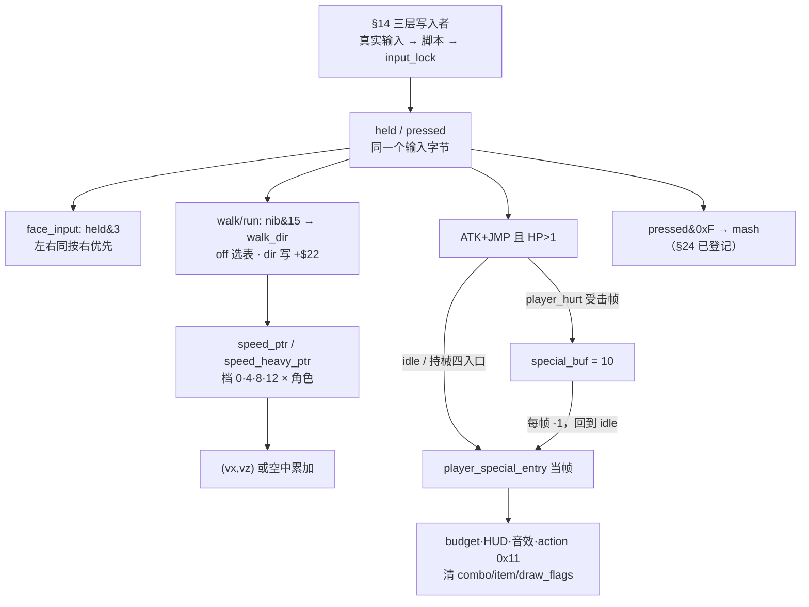

```text
FRAME(i):
    pad = 三层写入者后的 held/pressed          # §14
    if 状态 == idle:
        if special_buf != 0: player_special_entry(i); return   # 补兑现
        if special_check(pad): return                          # 当帧触发
    if 状态 == hurt:
        special_buffer(pad)                                   # 只写 10，不改状态
    if 状态 in {walk, run, air}:
        nib = held & 0xF
        facing = nib & 3 ? (nib & 1) : 保持
        (off, dir) = walk_dir[nib & 15]                       # run 松手沿用 +$22
        speed_table = item_type == 0x20A ? heavy : normal      # 换整张表
        (vx, vz) = speed_table[class*4 + char][off]
        写 vx/vz（air 为累加）→ player_pmove → 动画
```

### 79.6 wof 侧（按 §11.0 只登记，不臆断、不评优劣）

wof repo 侧**未见于 dino 上述「同一字节四读方 / 档 × 角色 × 重物三维速度表 / `special_buf` 跨状态缓冲 / 重物拾取摇杆门」直接对应的呈现**，按 §11.0 与用户「不过度怀疑 rep 侧」**不据此断言原机缺机制**。只登记 §14 / §24 / §27 已核实的不同语境事实：`Cps1PlayerLogic.cs:47` 读 `+0x28` 进 `ActStatABCD`（§14，L733）、`RKey1(+0xB0)` / `RKey1Left(+0xB1)` 用符号编码必杀三态（§27，L3814 / L3873-3883）、`+0xBE / +0xBF` 挣扎 mash 与冷却（§24，L4132）、`Cps1PlayerLogic.cs:1-13` 的 `ActStatABCD` 状态分派（§77 已登记）。这些都属于「输入边沿 + 状态字 + 计时器」与「必杀识别」语境，不串成与 dino `special_buf` / `speed_heavy_ptr` 等价，不评优劣；文件自带注释，不另查 ROM（§11.6 条件通道未触发）。

| 维度 | dino（设计契约） | wof（按 §11.0 只登记） |
|---|---|---|
| 输入字节之后 | 四个读方各取不同位 / 不同表，无统一解释器 | `+0x28` → `ActStatABCD`（不同语境） |
| 速度 / 跳跃选表 | 档 × 角色 × 是否举重物，重物换整张表 | 按 §11.0 不臆断 |
| 组合键的存活 | 立即触发与 10 帧跨状态缓冲两个消费者 | `RKey1` 符号三态倒计时（不同语境） |

### 79.7 组织结论与边界

1. **首次把 §14 输入字节的下游消费链当主线**：此前只讲谁写，本节讲谁读，并证明读方是分散在各状态里的四套规则，不是一个解释器。与 §77 接 `attach`、§78 接 `0x6B30` 同形态，都是把既有节里一个登记动作接到实际消费者上。
2. **首次把「档 × 角色 × 举重物」三维选表写成移动层契约**：`item_type == 0x20A` 换的是整张速度表指针，不是系数修正；`+$64` 存表地址、由 `player_speed_entry` 反查，是 §31「数据维差异」在移动层的落地。
3. **首次把「同一组合键立即触发 vs 10 帧跨状态缓冲」写成完整链路**：判据相同、调用时机不同，写入点在**受击那一帧**（`player_hurt :2658`）、递减在帧末计时器组（`:912-913`）、兑现点在回到 `idle`（`:1158-1159`）。与 §27 搓招 FSM、§14 `cmd_flag` 并列但不同，不并入 §19 的 5 套表。
4. **举重物的四条影响线并列**：§69 绘制分体、§77 手部定位、本节速度表与拾取摇杆门，都是同一个类型码被不同系统各读一次；不合并、不改写既有节。
5. **不是演出推进线，也不是空间挂接线**：这条线是「输入怎么被翻译成动作」，与 §63 / §67 / §71 / §76 的时间推进线、§32 / §71 / §76 / §77 的挂接线不同维度。

**保留边界（不扩张，非欠账）**：各角色主状态机全文与 `0x1CAEC` 跳表（§27.6）、`jump[16][9]` 与 5 个地形入口逐项（§44）、`player_grabbed_mash` 逐函数（§24.7）、`speed_ptr` / `speed_heavy_ptr` / `walk_dir` / `air_control` 各表逐项数值、`player_special_entry` 各角色分派全文、`find_pickup` 全部候选条件逐项、wof 速度表与必杀表全链、两游戏输入解释是否等价（不臆断）、音频与音效按 §0 边界外；均按 §21.8 / §24.7 / §27.6 / §28.7 / §41.7 / §69.8 / §70.7 / §72.7 / §73.8 / §74.7 / §75.7 / §76 / §77 / §78 的既有口径**保留、不扩张**。两游戏发行先后仍未考证（§11.0）。本节纯 repo 侧，0 次 ROM 取证。

---

## 80. 闪的不是数字，是它们共用的那两格调色板：结算画面里两个不会自己结束的对象

> 触发：§40 把过关结算展开成「任务 6 个 state / 9 个 sub step + 四项分数 + pool B class 25 数字对象按 sub step 对齐」，却只在 sub 0xA 那一行把「pool C class 34 火花」当步骤名登记；那两个 pool C 对象由谁生成、改了什么、什么时候结束，笔记里全零展开。Grep 确认 `fx_tally` / `0x95840` / `0x96DC4` / `0xB8612` / `0xB8632` / `FX_TALLY_FLASH` / `FX_TALLY_WINNER` 全零匹配，`class 22` 的命中全在笔记 §35 的 pool B 增援控制器，`class 34` 只命中 §40 那一格步骤名。这是 A.33 情形 2「名字命中但语义层零展开」的又一例，按 A.43.3 记到第七种的编号是**查重第八种形态**：一条已被完整展开的主线，它的**视觉修饰层**被整体留白。
> 归属：设计正文（§0–§80），按「轮次线性追加」接在 §79 之后。纯 repo 侧，未新增 ROM 取证（§11.0 / §11.6）。
> 分工：§40 讲分数怎么算出来、§26 讲游戏中加分怎么重绘、§56 讲淡入淡出、§73 讲背景 tile 被对象实时改写；本节讲**同一张结算画面上那层「闪」由谁负责，以及它为什么不自己停**。不改写 §40，不并入 §19 的 5 套表。

### 80.1 一句话对照

结论不是「过关画面会闪」，而是**赢家的标记不写在每个数字对象上，写在一格所有赢家数字共用的调色板里**；并且负责闪的两个 pool C 对象都没有结束状态，它们是被「下一关开始时重建整个特效池」顺手清掉的。§40 的 tally 任务有明确的 state 0xA 收尾，同一画面里「算分数的」会自己走完，「让画面闪的」不会——两种生命周期并排放在一帧里。

### 80.2 两个对象、两个生成时机

`effect/fx_tally.rs:1-8` 文件头把两者并列登记，`effect.rs:131-132` 给出 selector，`effect.rs:612-646` 的 `pool_c_update` 按 `+$20` 分派：

| pool C 对象 | selector / handler | 由谁生成 | 生成时机 |
|---|---|---|---|
| 数字调色板闪烁（文件头记作 class 22） | `+$20 = 0x58` / `0x95840`，`FX_TALLY_FLASH` | `fx_spawn_tally_flash 0x9582A`（`effect/fx_tally.rs:17-23`） | `flow/tally.rs:351-355` 的 `tally_sub_panel(0)`，四面板的第一个 VITALITY 一开始就造，覆盖整段结算 |
| WINNER! 标签火花（文件头记作 class 34） | `+$20 = 0x88` / `0x96DC4`，`FX_TALLY_WINNER` | `fx_spawn_tally_winner 0x96DAA`（`effect/fx_tally.rs:25-33`） | `flow/tally.rs:530-541`，仅当 `best && players_minus_one != 0`，即多人且该英雄是最佳总分，紧跟 `WINNER!` 标签一起造 |

一个是**全局常驻**，一个是**条件性点缀**；两个 spawn 都是 `let Some(i) = self.fx_alloc() else { return }`（`effect.rs:600-608`），池满就丢，不重试。A.40 把 §76 的「丢弃 vs 重试」写成同场并存的两种背压，这里落在修饰层的是丢弃侧：少一层闪不影响 §40 的分数链继续推进。

**同名不同物**：文件头记作 class 22 的是 pool C `0x95840`，笔记 §35 已登记（L5027 / L5050）的 `class 22` 是 pool B 增援控制器 `0x7BEF6`。两个池、两个对象、两套 handler，只是名字撞了。A.40 登记过这个形态，本节不改写 §35 的既有结论。

### 80.3 胜负标记写在共享调色板槽里，不是写在每个数字上

这是本节的核心链路，跨三个文件：

| 步 | 位置 | 做了什么 |
|---|---|---|
| 1 | `flow/tally.rs:541` | `prop_tally_number(k, if best { 0xB } else { 0xC }, Some(8))`，按「是不是最佳总分」只传一个颜色号 |
| 2 | `prop/b25.rs:66-74` | `p.b.palette_override = colour.wrapping_add(0x80)`，于是赢家的数字是 `0x8B`、其他人是 `0x8C`；`prop/b25.rs:3-4` 文件头明说 palette override `0x8B` for the best hero and `0x8C` for the others |
| 3 | `effect/fx_tally.rs:36-39` | `fx_tally_palette(rom, n)` 把 ROM 调色板的 16 个字读出、亮度 nibble 强制按位或 `0xF000`，再拷进 sprite palette `n`，`n` 就是 0xB 或 0xC |
| 4 | `effect/fx_tally.rs:43-50` | `fx_tally_flash` mode 0 把 `PALETTES[0] = 0xB8612` 同时拷进 **0xB 和 0xC** |
| 5 | `effect/fx_tally.rs:52-63` | mode 2 每 4 帧只在 **0xB** 与 `0xB8612 / 0xB8632` 之间切换，0xC 不动 |

于是「谁赢了」不是二十多个数字对象各自带一个闪标志，而是**赢家的那些数字恰好引用了那个会被切的槽**。一个对象改一处共享显示状态，所有引用该槽的对象一起被分了类；引用 `0x8C` 的数字保持不闪。两张 ROM 调色板只登记地址与「亮度半字节被覆盖成 F」，不抄表项数值（§11.6）。

与 §73「显存地址空间是共享物」、§57「全局共享时间」、§65「熟字节被多处直读」并列，但第一次落在**调色板 RAM 的槽**上：共享物不是一张表、一个计时器，而是一组颜色本身。也不与 §56 的 Fade 合并：§56 是全屏亮度按 (stage,area) 二维表渐变的顶层异步任务，本节是结算画面里两格精灵调色板被一个池 C 对象按帧切换。

### 80.4 另一个对象改的是标签的 tile 属性字

`fx_spawn_tally_winner(label)`（`effect/fx_tally.rs:25-33`）把 `label = a + 0x146`（`flow/tally.rs:539`）这个 24 位地址拆成 `owner_class`（高 16 位）与 `w5c`（低 16 位）；`fx_tally_winner_step`（`effect/fx_tally.rs:83-102`）每 5 帧把相位写进标签：

```text
phase = (phase + 2) & 3          # 0 → 2 → 0 → 2
a0 = (owner_class << 16) | w5c   # WINNER! 标签第一格的属性字
for 8 列:
    for 2 单元格:
        attr = hud_read(a0)
        hud_word(a0, (attr & 0xFFE0) | phase)   # 只改低 5 位 palette
        a0 += 4
    a0 += 0x78                                  # 换到下一列
```

`hud.rs:246-257` 的 `hud_word / hud_read` 明写目标是 `vram.scroll1` 的 `c.attr`，与 §73 的 `0x908000..0x90BFFF` 是同一块地址空间。所以这是 §73「显示被对象实时改写」的又一位写入者，只是目标从背景 tile 换成过关标签，且改的是**属性字的调色板位**而不是 tile code。

### 80.5 两个对象都不会自己结束

`fx_tally_flash`（`effect/fx_tally.rs:43-65`）与 `fx_tally_winner`（`effect/fx_tally.rs:69-79`）的 mode 链都只有 `0 → 2`，`_ => self.fx_free(i)` 只在遇到未定义的 mode 值时才回收；正常跑起来永远停在 mode 2 一直切。`effect/fx_tally.rs:6` 文件头把这写成契约：It never ends by itself: the effect pool is cleared at the next area start.

这不是只有注释：`flow.rs:656-661` 的 `flow_area_reset_b`（`0xAA0E` 之后）第一行就是 `self.effects = Pool::new(POOL_C)`（`0x4CA4`），与 `enemies = pool_a_init()`（`flow.rs:653`）、`spawn_area_reset_objects()`（`flow.rs:660`）一起在区域重置时重建；`flow/cont.rs:289` / `flow/ranking.rs:120` 也有同类重建。即**生命周期外包给池的重建**，不是对象状态机自己判定「我播完了」。

| 同一画面上的三种收尾 | 谁决定结束 | 落在哪一节 |
|---|---|---|
| tally 任务 `0xB97E` | 自己走到 state 0xA，写 `G.$4E2 = 0` | §40.1 |
| 两个 pool C 结算修饰对象 | 没有结束分支，靠 `flow_area_reset_b` 重建 pool C 一并清掉 | 本节 |
| 命中火花等普通 pool C 对象 | frame record 播完即 `fx_free` | §58 |

与 §71 `+$7D = 0xFF` 退出 census、§75 TIME OVER 对象靠 `rank.time_lock` 存活、§78 攻击资格每帧重新授予并列但都不同：那三条是「这一帧还算不算数」，本节是「根本没有一个算完的分支」。

### 80.6 同一字段的两半各当一个计数器，以及 wof 侧边界

`effect/fx_tally.rs:48` / `:54-61` / `:85-92` 里 `owner58` 的高字节存 toggle（或 phase）、低字节存帧计数：

```text
(toggle, count) = (owner58 >> 8, owner58 & 0xFF)
borrow = (count == 0)
owner58 = (toggle << 8) | (count - 1)
if not borrow: return                 # 这一帧只递减，不改显示
toggle = (toggle + 1) & 1            # flash：每 4 帧，count 重置为 3
owner58 = (toggle << 8) | 3
fx_tally_palette(PALETTES[toggle], 0xB)
```

winner 用 `(phase + 2) & 3`、count 重置为 4，所以是每 5 帧。与 §71 master 用一个 `sub` 字节广播给 N 个演员各自解释、§77 同一 `+$2C` 帧字节被读成三态同族；这里新在**同一个字段的两半被同一个对象当成两个独立计数器**，且 `borrow` 用的是 `subq.b` 的借位语义（`effect/fx_tally.rs:58` 注释），不是一次布尔判断。

**wof 侧按 §11.0 只登记不同语境的并列事实**：

| wof 位置 | 语境 |
|---|---|
| `Cps1EffectActorRuntime.cs:1449` / `:1485` / `:1497` / `:1510` / `:1551` / `:1583` / `:1621` / `:1653` / `:1715` / `:1845` | `效果对象_ObjId5_闪烁切换_对应ASM_4DA32(ref obj)`，逐效果对象自己切闪烁 |
| `Cps1EffectActorRuntime.cs:437` / `:457` / `:460` / `:1718` | `场景对象_加入闪烁队列_对应ASM_1608`，闪烁走队列入栈，注释明写门是奇偶 |
| `Cps1Actor25Runtime.cs:155-157` / `Cps1Actor26Runtime.cs:212-214` | 从 `ProfilePaletteTable` 按 `+0x17` 索引取 palette 写回对象 `+0x5F` / `+0x17`，是对象自带调色板索引 |

这些都是**逐对象 / 队列**语境，与本节「一个池 C 对象改共享调色板槽、让所有引用者一起变」不同语境并列；不串成等价、**不据此断言原机缺机制**、不臆断、不评优劣。本节纯 repo 侧，0 次 ROM 取证，§11.6 条件通道未触发。

### 80.7 状态图

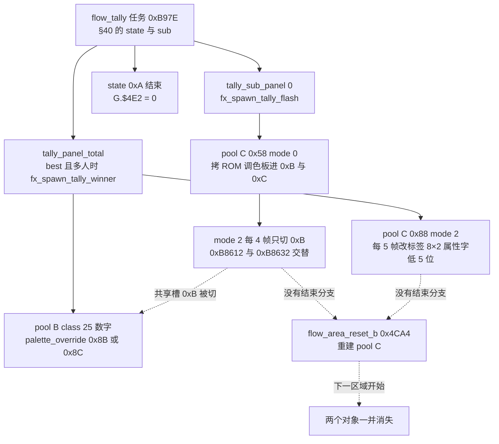

### 80.8 主线闭环与本轮边界

1. **共享显示状态可以是颜色本身**：§73 共享显存、§57 共享时间、§65 共享熟字节之外，本节补上一格精灵调色板槽被一个对象按帧切换、多个数字对象按自己引用哪个槽被动分成「闪 / 不闪」两类的设计。
2. **生命周期可以外包给池的重建**：§40 的任务会自己走到 state 0xA，同一画面上两个修饰对象不会；两者一帧里并存，终止条件的粒度不同。
3. **不是演出推进线，也不是空间挂接线**：这条线是「谁在改大家共用的显示状态」，与 §63 / §67 / §71 / §76 的时间推进线、§32 / §71 / §76 / §77 的挂接线不同维度；同样不并入 §19 的 5 套表。

**保留边界（不扩张，非欠账）**：两张 ROM 调色板 `0xB8612 / 0xB8632` 的 16 字逐项、`0x9584C / 0x96DD0` 跳表全项、pool C 48 槽分配策略全文、`effect/fx_tally.rs` 两个 handler 的逐分支 ROM 对照、`flow/tally.rs` 各 state routine 与 `0xB9A4` 状态表（§40.6 已保留）、`prop/b25.rs` 数字精灵表构造与 pool D 槽管理（§40.6 已保留）、wof 闪烁队列与 `0x4DA32` 逐项、`0xD860` anti-tamper roll（§40.6 已保留）、音频与音效按 §0 边界外、两游戏结算视觉是否等价（不臆断）；均按 §21.8 / §28.7 / §35.5 / §40.6 / §41.7 / §69.8 / §70.7 / §73.8 / §76 / §77 / §78 / §79 的既有口径**保留、不扩张**。两游戏发行先后仍未考证（§11.0）。本节纯 repo 侧，0 次 ROM 取证。

**结论**：§80 把 §40 留白的那层结算修饰补成「两个生成时机 + 一格共享调色板 + 一次池重建」的完整链路；`长时间自主推进` 仍是开放目标，本节不宣称终止。

---

## 81. 屏幕上的字不是字符：一份前端打印协议，和一个被做成 pool B 对象的打字机

> 触发：§59 在 `boss_caption_hook` 里把 `text_portrait` 登记成「写 scroll1 的公共例程」，§40 的 `tally_label` 与 §80 的 WINNER! 标签也写同一块显存，§50 的表格还把 pool D 注成「typewriter 文本的附属数据槽」——但**这些字怎么从一张 ROM 表变成 tile、打字为什么是一个对象、玩家按键为什么能跳过**，笔记里全零展开。Grep 确认 `text_bytes` / `text_words` / `text_big` / `text_tall` / `Typer` / `flow_typer` / `0x7EC20` / `0x7EC48` / `0x90A000` / `hud_put` 零匹配，`text_portrait` 只在 §59 作调用名，`typewriter` 只在 §50 表格与 §59.6 保留清单作名词。
> **保留边界的重评不扩张**：§59.6 / L8081 与 L8115 / L8128 明列保留的是 `flow/text.rs` **全部字符串与 typewriter 逐状态展开**。按 A.34 已登记的「保留边界下取横切面」路径，本节**不逐项展开任何例程或 state**，只取三件跨场景契约（串协议、打字机对象化、输入边沿跳过），并在 §81.8 把该边界原样交回。
> 归属：设计正文（§0–§81），按「轮次线性追加」接在 §80 之后。纯 repo 侧，未新增 ROM 取证（§11.0 / §11.6）。
> 分工：§19 讲 5 套脚本表、§14 讲输入字节的三层写入者、§73 讲背景 tilemap 写入服务、§80 讲结算画面共享调色板；本节讲**文字显示这一层的输入协议与载体**。不并入 §19 的 5 套表，不改写 §59 / §40 / §80。

### 81.1 一句话对照

结论不是「有一个打印函数」，而是**屏幕上的字并不是字符**：它们是一串 tile code，位置、颜色、换行、结束全都编在串里，由一组共享例程直接写进 scroll1 的单元格；而「逐字显示」不是某个循环里 sleep 几帧，是**一个占 pool B 槽、有 `mode/sub`、能被逐帧存档恢复的对象**。玩家按一下攻击键还能把它推到立刻打完——演出推进第一次被接到输入边沿上。

### 81.2 四种串协议：位置编在串里，字符不做解码

`flow/text.rs:1-26` 文件头是一张协议表，`:55-58` 的 `Rd::position` 把位置块算成地址：

```text
col = rd.u8() & 0x3F
row = rd.u8() & 0x3F
attr = rd.u16()                    # 属性字节与 0x180 按位或后使用
a1 = 0x90A000 + (col << 7) + (row << 2)   # 一列 +0x80，一行 +4
```

| 格式 | 例程 | 结束 / 换行 | 字符是什么 |
|---|---|---|---|
| byte string | `text_bytes`（`flow/text.rs:73`）、`hud_print`（`hud.rs:260-265`） | `@` 结束，`/` 开新位置块 | 单字节 tile code |
| word string | `text_words_at`（`flow/text.rs:101`）、`text_words`（`:128`） | `0x4040` 结束，`0x2F2F` 开新块，`//` 换行 | 双字节 tile code |
| big font | `text_big`（`flow/text.rs:152`）、`text_glyphs`（`:213`） | 每个字母 2×2 单元格 | tile code 加 `0x10` / 加 1 得到另外三格 |
| tall font | `text_tall`（`flow/text.rs:157`）、`text_tall_at`（`:164`）、`text_tall_a1`（`:192`） | 每字母 1 列 2 行 | tile code 加 `0x10` 得到下一行 |

文件头 `:21-23` 明说 **Characters are tile codes (no letter decode)**：没有 ASCII 表、没有字库映射，串里每一格就是显存要写的 tile 编号；大字体与高字体的第二格靠固定加数从同一个 code 推出来（`:181-182`、`:205-206`、`:240-246`）。位置也不是调用参数，而是串开头一段 `col, row, attribute` 字节。`BASE = 0x90A000` 是 scroll1 第 32 行，与 §73 的 `0x908000..0x90BFFF` 同一地址空间、与 §80 的 `hud_word` 同一个 `vram.scroll1`。

### 81.3 一组服务被多个流程共用，且先于使用者存在

所有例程最终都调 `hud_put`（`hud.rs:236-243`）写 `(code, attr)` 两个词。调用面横跨已经写过的几节：

| 调用点 | 落在哪一节 | 做什么 |
|---|---|---|
| `boss_common.rs:334` | §59 Boss 登场 | `text_portrait(0x90A29C, portrait, text)` 写头像块与高字体台词 |
| `flow/tally.rs:407` | §40 过关结算 | 同一个 `text_portrait` 写结算肖像 |
| `flow/tally.rs:536 / :538 / :545` | §40 / §80 | `tally_label` 写 TOTAL 与 WINNER! 标签 |
| `prop/b25.rs:318` | §40 数字对象 | 同一 `tally_label` 的又一位调用者 |

`flow/text.rs:25-26` 还明写「The services are used by the scenes of the next tasks; until they are, parts of them are unused」——**服务先于使用者存在**，是 A.33「通用设施与特定组装分层」在前端的第三处实例（前两处是 §73 的 tilemap 写入服务、§77 的 pool E 共享例程）。本节只登记这一分层与各调用面，不逐条展开九类例程（§59.6 保留）。

### 81.4 打字机是对象，不是延时循环

`flow/text.rs:323-342` 有两个 spawn，共用同一个 `Typer` 状态机：

| 载体 | 入口 | 谁来推进 |
|---|---|---|
| 关卡内 pool B 对象 | `flow_typer_spawn_pool_b`（`flow/text.rs:330-342`） | 取 `props.alloc()`，写 `k20 = 0x68`、`+$26 = 0`、`+$86 = period`、`+$80 = text`，由 `prop_class26` 的 pool B update 逐帧 step（`:349-359`） |
| 前端场景 | `flow_typer_spawn`（`flow/text.rs:323-327`） | 放进 `flow.typers`（`flow.rs:131`），由场景自己在原机跑 pool B update 的位置调 `flow_typers_step` |

`flow_typer_busy`（`:344-347`）让场景轮询「还有没有打字机活着」，即**演出是否播完是一个可查询的对象存在性**，不是函数返回。`flow_typer_spawn_pool_b` 的 `let Some(i) = self.props.alloc() else { return }` 与 `:331` 注释「A full pool makes none」是第三处容量背压：§80 的 `fx_alloc` 丢弃、§76 的旗帜重试之外，这里池满就没有打字演出，但流程继续。

### 81.5 对象头字节即协议：同一个 `+$80` 会换语义

`trace.rs:2024-2038` 从逐帧存档里扫 pool B 找 `k20 == 0x68`，再按 `sub` 决定怎么解释对象头：

| 对象头 | 还原成 `Typer` | 条件 |
|---|---|---|
| `mode` / `sub` | `state` / `sub` | 一律（`Typer::restore`，`flow/text.rs:508-509`） |
| `+$80` | `sub == 0` 时是**串指针**；`sub != 0` 时是**写地址 cursor** | `trace.rs:2032-2035` 两条分支 |
| `+$88` | `sub != 0` 时是串内读位置 | 同上 |
| `+$84` / `+$86` / `+$8C` | `delay` / `period` / `fast` | 同上 |

即**同一个 `+$80` 字段在 sub 0 到 sub 2 之间从「指向 ROM 串的指针」改写成「下一格要写的显存地址」**。`flow/text.rs:480-492` 把这些字段逐一注成原机偏移，`:501-503` 的 `Typer::wrap` 用 `(a & 0x909FFF) | 0x908000` 把地址夹回 scroll1 第一页——与 §73 `TilePos::down` 跨页溢进下一列是同一类「地址空间几何」契约，方向相反（那里是不拦，这里是夹回）。与 §71 master 写 `+$05` 让 N 个演员各自解释、§77 同一 `+$2C` 帧字节读成三态同族，新在**语义随自身状态推进而改变**。

### 81.6 按一下攻击键就打完，但按住不算；结束还多留一帧

`typer_run`（`flow/text.rs:394-413`）每帧递减 `delay`，到点才 `typer_item` 写一个字；跳过判据是：

```text
(now, before) = (w.input[0], flow.front.prev_input[0])
if now != before and now == 0x10:      # 攻击键，且这一帧刚按下
    t.fast = true                       # 之后循环内不再 return，一次打完
if not t.fast: return
```

`flow.front.prev_input` 是 §14 已登记的输入边沿字节，这是它在**演出层**的消费者，不是玩家状态机。单测 `typewriter_skip_with_attack`（`flow/text.rs:837-855`）钉死两条例外：**按住不跳**（`prev_input` 也已是 `0x10`）、**攻击带方向不跳**（`now` 不是恰好 `0x10`）。

另一条细节：`typer_step` `:383` 把串位置块里的 attribute 读出来**直接丢弃**，打字机一律写 `attr = 0`——同一份串协议被不同消费者挑着读，与 §46「按 pass 约定读字节」、§78「8 字段只读 4 个」同族。

结束也不是立刻消失：单测 `typewriter_timing_and_end`（`flow/text.rs:802-820`）给出逐帧序列「end marker 第 7 帧读到 → 第 8 帧置 state 4 → 第 9 帧 free」，`:475-476` 注释「The object lives one more frame after the end marker」。与 §12「命中帧只结算不处决」、§70「HP 归 0 后下一帧才破碎」同族；与 §80 那两个**根本没有结束分支**、靠重建池才消失的对象正好相反。

### 81.7 状态图

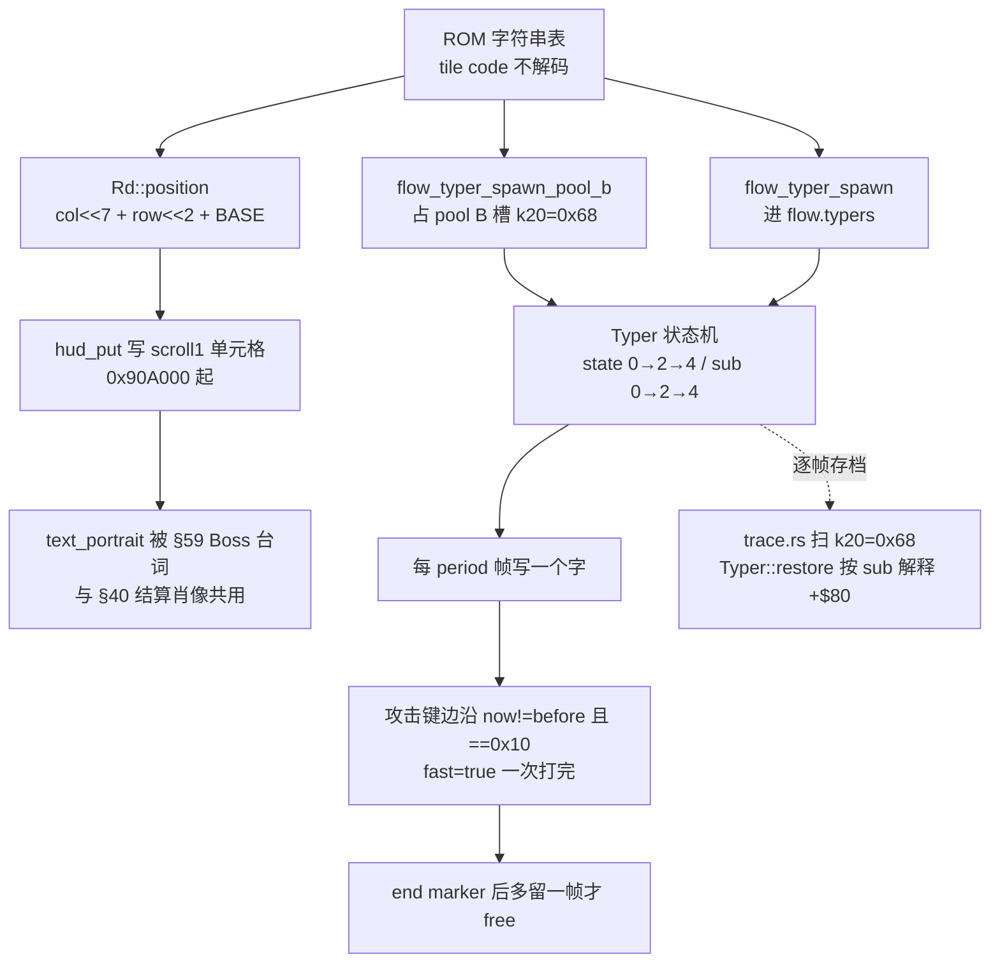

### 81.8 wof 侧登记、主线闭环与本轮边界

**wof 侧按 §11.0 只登记不同语境的并列事实**：

| wof 位置 | 语境 |
|---|---|
| `Cps1EventQueueTask.cs:196` / `:233` / `:355` | `0xD038` 的 `type 0x00 → 0x096E` 文字字形命令、`执行标题文字命令_部分对应ASM_096E_D22`、`推进标题系统消息_部分对应ASM_D00A_AFA`，文字走事件队列命令 |
| `Cps1EventObjectRuntime.cs:27` / `:29` / `:31` / `:34` | 对话消息表 `0x56B06`、注释明写「这两个表不是同一个消息砖块表」、对话对象附加表、对话续接指针表 |
| `Cps1EventObjectRuntime.cs:2897` | `对话框_主分发_可能对应ASM_56286`，对话由专门对象分派 |

这些都是**事件队列命令 / 对话对象砖块表**语境，与本节「前端打印服务直接写 scroll1 单元格 + 打字机是 pool B 对象」不同语境并列；不串成等价、**不据此断言原机缺机制**、不臆断、不评优劣。本节纯 repo 侧，0 次 ROM 取证，§11.6 条件通道未触发。

**主线闭环**：①共享显示层的输入可以是一份字节串协议而不是字符；②「逐字显示」被做成可查询、可存档恢复、可跨帧跳过的对象；③输入边沿第一次接到演出推进上，且结束仍按「下一帧再处决」多留一帧。这条线不是演出推进线（§63 / §67 / §71 / §76 那条时间怎么往前走），也不是空间挂接线（§32 / §71 / §76 / §77 那条谁跟着谁），是**文字怎么进显存**；不并入 §19 的 5 套表。

**保留边界（不扩张，非欠账）**：`flow/text.rs` 九类例程逐条 ROM 对照、typewriter 逐 `state` / `sub` 展开（`§59.6` / L8081 已保留，本节原样交回且不逐项展开）、各字体 tile 表全部数值、`Typer` 全部字段逐项、`hud_put` 逐行（§73 已覆盖写入服务）、wof 对话框 handler 全文、`Cps1EventQueueTask` 的 `0xD038` 跳表逐项（§26 已保留）、音频与音效按 §0 边界外、两游戏文本显示是否等价（不臆断）；均按 §21.8 / §26.7 / §28.7 / §35.5 / §40.6 / §41.7 / §59.6 / §73.8 / §76 / §77 / §78 / §79 / §80 的既有口径**保留、不扩张**。两游戏发行先后仍未考证（§11.0）。本节纯 repo 侧，0 次 ROM 取证。

**结论**：§81 把「屏幕上的字」从结果补成「一份串协议 + 一组共享打印服务 + 一个 pool B 演出对象」的可定位链路；`长时间自主推进` 仍是开放目标，本节不宣称终止。

---

**〔本轮补层：这一场架到底什么时候算完 —— 没有一次总广播〕**

这一格不找新表，是把散在几卷里、各自都核过的「收尾」事实合起来问一句从没正面问过的话：**玩家打完一段，游戏里是谁宣布「这一场算完了」？** 答案是没有一个人宣布。场上每样东西各自保管自己的结束条件，而且它们**故意不必对齐**。

按玩家真正经历的顺序摊开：

- **一波人算不算打完**，不是看怪清光没有。第一关谱里六条波次的收尾阈值同时并存：`[0,0,0]` 要清空才走、`[4,5,6]` / `[4,5,5]` 还剩几个就放行（残敌跟着玩家进下一屏）、`[99,99,99]` 几乎立刻走；而且要等**所有在场玩家都站回正常控制**才翻这一格——谁还在挨打、倒地或演出里，怪清光了也不放行。所以「这一段演完了」由表里那一格加上玩家自己的状态一起签字。
- **一个杂兵算不算打完**，也不在扣血那一帧。它先记分，再闪 120 帧，动画走完才由后续帧把槽位还回去；超时清场那一路同样让它走完死亡态，只是不把这一笔记给任何人。死亡是一段自己走完的拍子，不是一个开关。
- **倒地的人归谁、地上的东西归谁**，是双方对象头各记一笔，每帧重建候选名单，谁的状态一变就整段作废（`notes/04-state.md §66`）。连「这份独占结束了」都不是中央裁决宣布的，是两边各自复核时自己散的。
- **Boss 那一场算不算完**，是它自己挨打倒地、看到血掉过分界，才把帮手退场、分数归给打下它的人、整局记忆加一笔，然后放行换区；整关「过关」只有这一个入口。
- **到了结算画面，同一帧里两种生命周期还并排摆着**：算分数的那个任务有明确的收尾状态，自己走完；让数字和 WINNER 标签闪的那两个对象**根本不自己结束**，一直闪到下一关开始时「重建整个特效池」顺手把它们清掉（本卷 §80；`fx_tally.rs` 文件头原话 *It never ends by itself*）。

最后才是整关、整局那一层：一个 mode 字节一次迁移写慢动作、清场、记 killer、HUD、后续走向；连「清屏那一帧没有任务跑」都被记成一帧 lag。**这不是说游戏没有整局状态字**：`flow.mode` 确实会在 Boss 倒下时一次改写七个系统。但那一次改写只**发出**「过关开始了」，场上每个东西**各自走完**自己的收尾——敌人照样闪满 120 帧才交回槽位，闪光对象照样不自结束。全局状态字管的是「下一关要不要来」，不管「谁这一拍该熄灯」。

**倒推到设计意图**：这些尾巴没对齐，不是省事，也不是没收拾干净。**场子始终留着上一拍的余韵**——残敌跟着走进下一屏、结算面板还在闪、倒地的人还能被谁认领。玩家从来不是站在「上一场已彻底清空、下一场尚未开始」的真空里，而是从一个还在收尾的场面直接走进下一段。武打片的编舞不会在最后一拳落下的那一帧把灯全关了；收势、余光、还站着没倒的人，都是同一场戏的最后一拍。

这也把用户最初点名的**事件脚本**补上另一半：前面记的是「放不放行由表和玩家状态决定，不归脚本时钟」，这里补的是**连「结束」都没被交给一个统一事件去广播**。两者是同一件事：过关不是一次事件，是一串各自到点的收尾。外推文那句「玩家一直在线」因此还能再补半句——**不只玩家一直在线，场上的物件也各自在线到自己的最后一拍**，没有谁被一个总开关提前请下场。上一轮把「放行阈值写成表里可逐段挑的一列」收成一条动手建议，到这里才看出它底下的架构：可挑的不只是几个数字，是**结束权本身分散给各个当事对象**。

当代同类常见的是一次 `StageClear` / `LevelComplete` 广播：清场、锁输入、停 AI、弹结算、切场景全绑在同一个事件上，所有东西被强制对齐到一帧。于是打完最后一拳到看见结算之间没有过渡，场面被一刀切断；残敌、还在闪的余光、没演完的倒地，都得先被处理掉才能进下一屏。这是设计取向的描述，不是对某个产品的断言，也不是本 rep 的取证。

**主体与成色（别把推断读成事实）**：上面这些收尾事实主要是 **dino 侧**的；「没有总广播、故意不对齐」是把它们合起来读的 [I] 设计推断，不是 [O] 复刻要求。wof 侧按 §11.0 只登记不同语境的并列事实：超时只把波次脚本指针拨到下一条、不清场（时间是一段不带后果的节拍）；「过关」是各 Boss 自己决定何时跳进一个共享出口，再由信号和收尾对象接力。不串成两款共同架构、不评优劣、不推断 wof 原机缺什么。尤其别只拿 `[4,5,6]` 一行把「从不清场」写成通则——`[0,0,0]` 与 `[99,99,99]` 在同一张表里同样真实；也别把「闪的对象不结束」放大成「所有特效都不结束」，那只是结算画面这两个对象，且是被下一关清池顺手带走的。

回源（都是已核事实，不展开逐项表值）：`re/specs/enemy/SPEC.md:1068-1079`（第一关波次表与 [O] 残敌尾随）、`dino-rs/crates/dino-game/src/game/prop.rs:626-660`（玩家状态门与 `end & 0xE` 三选一）、`dino-rs/crates/dino-game/src/game/enemy.rs:978-1003`（死亡 120 帧后交回槽位）、`dino-rs/crates/dino-game/src/game/effect/fx_tally.rs:1-8`（闪光对象不自结束）、`notes/04-state.md §66`（认领的解除条件）、`notes/02-mid.md §28.3 / §30.7`（超时清场、两级放行与唯一过关入口）、`notes/03-frame.md §43`（退场与回收）、`notes/05-objects.md §80`（结算画面两种生命周期）、`GAMEPLAY_LEGACY.md` 第五节（Boss 自己放行换区）。本补层不新增节号、不改总入口、不回文档自洽循环，不填任何保留项，0 次 ROM 取证。

**〔回源压力测试：最像总广播的那一处，其实也不是广播〕** 上面那句「没有一次总广播」，最容易被拿来反驳的就是 `$50E` kill-all：一个全局字节、全场敌人都读，看上去正是「一次清场」。回源核过，它反而是这条判断最硬的一处证据。`dino-rs/crates/dino-game/src/game/enemy.rs:952-968` 的 `enemy_kill_all_check` **不擦除任何对象**：每个活着的敌人在自己那一帧的第一次调用各读一次这个标志，读到才把**自己**的 `hp` 置 0、切进死亡态、给 2 帧 hitstop，之后由它自己的死亡链走完 120 帧闪烁、再在后续帧归还槽位（同文件 `:978-1003`、`re/specs/enemy/SPEC.md:1191-1199`）。`re/specs/enemy/SPEC.md:977` 还写明原机波次超时把它开成 **5 帧窗口**（`$50E=2`，`b80` 从 `0x1E` 数到 `0x19`）——窗口里谁还活着、谁自己领，不是某一帧把全场抹平。值 1 / 2 只决定这一笔记给谁（`$4E0` 的 killer / `0xFF` 不记分），**不改变「各自走完收尾」这件事**；`debug.rs:5-6` 说的「只活一帧」是宿主 `--debug-keys` 的 F2 键，按 §0 剥掉，别当原机语义。

所以「清场」是**收尾走完之后的结果**，不是一个动作。这正好是「共享事实 ≠ 中央裁决」那条主线在收尾层的又一处：一个字节被很多对象读，但它不替任何对象做决定，只发出一张门票，领到的人自己把那一拍演完。判断因此更稳，不是被推翻。

**顺带修掉一处会带错方向的取值意义**：`re/specs/semantics.json` 的 `kill_all` 域原先把 label 写成「$50E 清场原因」、两个取值都写成「清场」，读者一眼会读成一次全场擦除，与这里的判断正好相反。已就地改成「一处写、多个敌人各读一次」的说法，补上 `note` 讲清三件要先分清的事（哪一侧 / 谁在读 / 是不是宿主层）、5 帧窗口与 120 帧各自收尾，并标 `context_dependent`；取值 1 / 2 的意义改成「每个活着的敌人自己转成死亡态」+ 记分归属。`re/specs/lookup.py kill_all 2` 现在会连「注意（上下文相关）」一起说。`lookup.py` 脚本本身未改，只在缓存里改一个域的语义，`--selftest` 仍 328/328。这不是新增一个域、也不是打磨已有输出，是把一个会让人读反的抽象意义按回源码。

**〔后一格补层：最像「喊话」的那一下，也只是把便条划掉〕**

上一处压力测试用 `$50E` 撞「没有一次总广播」，撞出的结论是「一处写、多个敌人各读一次」。这一格换另一侧、也最像广播的信号再撞一次：wof 翻页那一下。这回不靠概括，看 `bclr` 之后到底发生了什么。

- **置位与放行（[O]）**：`Cps1LevelScript.cs:1558-1571` 的倒计时归零只把 `A5+0x191` bit0 置 1 挂号；`Cps1SystemCoroutineRuntime.cs:8040-8114` 的逐指令写得很直白——`0x1139E bclr.b #0` 之后紧接着 `113A4 rts`，整段返回的是 68K 的 Z 标志（`:8042-8043`），**`0x1135C` 本身没有一处给场上对象发消息**。
- **放行之后谁动（[O]）**：调用方 `舞台过场_放行后转ObjId0A_对应ASM_11080`（同文件 `:8085-8092`）拿到放行，做的是 `addq.b #2,(0x28,A0)`、`move.w #0xA,(0x20,A0)`、`move.b key,(0x58,A0)`——**三下全写自己这个演出对象头**，让它自己往前走一格；四个同形槽只差 `+0x58` 那个 key（`:8080-8084`），key 随后被搬到 `-0x60` 那扇演出门，本格不展开它的读方。所以「翻页」在代码里是「某一个对象把自己的 subState 加 2」，不是「宣布下一幕开始」。
- **本卷另一处「广播」要分清**：`§71.3` 标题叫「一个字节广播，各自解释」，讲的是 master 每帧把 `+$05` 的 sub 摆在那儿，class 54 / 55 / 56 各自比对 `MASTER_SUB`、按自己的 act 表翻译，还带 `ONCE` 门（见本卷 §71.3 表格与 §71.4）。那是**每帧重写的共享事实 + 本地解释**，管的是演出推进；和「一次宣布结束、全场对齐到一帧」的 `StageClear` 式广播不是一件事。别拿这处标题去反驳 `:1691` 那句「没有一次总广播」——两个「广播」不是同一个词。

**倒推（[I]）**：三处合起来看，这个游戏里根本没有「喊一嗓子让全场对齐」这回事，只有**留便条**。dino 的 `G.$7A9` 是置起后一直留在场上的公开状态，谁读到谁松开；wof 的 `0x191` 是一张会被读的人自己划掉的待办，划掉之后只推它自己那一格；`§71.3` 的 master sub 是每帧重写的进度条，各人自己翻译。三种便条的差别只在**留多久、谁划掉、划掉之后谁受影响**，没有一种会替全场定拍子。所以「世界会不会回嘴」还能说得更准：**它回嘴靠留一张公开的便条，不靠喊话**。也正因为没人被强制对齐，玩家才会从一个还在收尾的场面直接走进下一段，而不是先被切进一段真空；一整段打下来，拍子没被一次事件切断。功夫武打里换镜不喊「卡」，靠的是机位和群演各自读到下一拍——这一层没被做成事件，被做成了状态。

**边界**：wof 两处按 §11.0 只登记并列事实、不串成两款共同架构、不评优劣；`0x191` / `0x1135C` / `A5-0x3E` 按既有纪律不进 `semantics.json`（移植侧条件分支，不是「取值 → 抽象意义」的表）。`notes/02-mid.md §34.6` 已写过「两边都不靠一次总广播」，这里补的是 **`bclr` 之后有没有通知动作**这条实证，以及本卷两个「广播」不是同一个词，不重讲放行字节的时间角色。`Cps1Actor18Runtime.cs:433` 周围的 FBA 逐帧补偿按 §0 剥掉。wt1 仓库只读未改，0 次 ROM 取证，不改总入口、不加节号、不外推到 `GAMEPLAY_LEGACY.md` 九节。

**〔本轮补层：连「无敌」都不是一块免死金牌，是一张只被部分读者认的门票〕**

这一格不找新表，是拿一条从没当设计问题问过的玩家可见现象，去撞「世界会不会回嘴、由谁说了算」这条主线：复活落地那几秒满身火花、敌人的拳头从身上穿过去，可关卡时间一到，同一个人照样当场倒下（`plan/game/mechanics-seen.md:340` P65、`:349` P74，仓库已有的 `[M]` 观察，不是新做 ROM 取证）。玩家直觉里「无敌」是一块挂在身上的牌子，谁碰都该免；这里钟偏偏不认。为什么？回源看，场上压根没有一个「当前是否无敌」的中央裁决。

- **免挨打不是被一条规则拦下的，是每条链自己写了「只认 1」（[O]）**：玩家对象头 `+$00` 取 2 只是把「在场」换了个取值（`dino-rs/crates/dino-game/src/game/body.rs:23`）。敌人打玩家的命中条件明写「player `+$00` bit1 clear」（`re/specs/player/SPEC.md:925` §5.1）；拾取候选与可击名单、拿武器、敌人各路目标选择、剧情出场名单、HUD 拾取消息一律要求 `== 1`（`dino-rs/crates/dino-game/src/game/item.rs:234/242`、`player_weapon.rs:89`、`flow/cards.rs:404/410/467/783`、`hud.rs:1312`、`re/specs/player/SPEC.md §5.9`）。看到 2 就跳过——于是挨不了打、捡不了东西、进不了剧情名单。**没有任何一处统一去关掉伤害**，是这几条链各带一把尺子。
- **关卡时钟根本不在这堆读者里（[O]）**：`rank_time_over` 只问 `live != 0 && mode < 4`（`dino-rs/crates/dino-game/src/game/rank.rs:357-376`，本卷 §75 同帧两步），2 照样满足 `!= 0`，HP 直接归 0。TIME OVER 从来没读过无敌，P74 那句 `also invulnerable ones` 就是这么来的。
- **还有读者反过来专等这个 2（[O]）**：复活火花不是 2 就自我释放（`dino-rs/crates/dino-game/src/game/effect.rs:529`），过场那道 barrier 见到 `live == 2` 就一直等、等它变回 1 才放行（`dino-rs/crates/dino-game/src/game/script.rs:516`）。同一个取值，有人躲、有人无视、有人专程来认。
- **更狠一层：同一个数字落在敌人身上意思反过来（[O]）**：敌人 `+$00 = 2` 是「受击反应中」（`re/specs/enemy/SPEC.md:132`、`:1097` §10），玩家打敌人的链写「skip if enemy `+$00` bit1」（`re/specs/player/SPEC.md:1181` §6.2）；玩家 `+$00 = 2` 却是「免挨打」。所以这个字节不是「无敌标志」，是**在场身份的一个档位**，各链按自己面对的是哪类对象、按自己那条判据去解释。
- **回源压测：连这一把尺子都不是唯一的一把（[O]，收窄上面第一条的全称）**：`+$00` 只管「在场身份」这一档。`re/specs/player/SPEC.md:925-927` §5.1 的完整命中条件，敌人能不能打中你还得同时看玩家自己的帧身份（6 / 8 / 0xA 那些必杀 / 受击 / 倒地帧直接 `immune`）、防守方身体盒 `+$48 != 0`、攻击盒 `+$49 != 0` 和盒重叠；`:1146` §5.9 最后一行把帧身份那一路单列为「per frame, immune to enemy attacks」，**根本不读 `+$00`**。缓存里 `frame_type`（`re/specs/anim/SPEC.md §4.4`）与 `body_box_zero`（`+$48` 取 0 = 这一帧自己不可被命中，`note` 明写「哪一帧无敌要逐帧看这个字节，不从帧类型推」）已经各登记了一路，措辞无误、不重写。所以「免挨打」从来不是 `+$00 = 2` 一个开关，是**好几个互不统属的字节各自只管一段**，彼此甚至不知道对方存在。上面第一条说的「每条链自己写了只认 1」，说的是「在场身份」这一档被谁认，不是「免伤只有这一条路」。

**倒推（[I]，说人话）**：这和前面立住的「结束权分散」「留便条，不喊话」「一场架不是一只节拍器」是同一件事，只是落在最贴身的一层——连「我此刻会不会受伤」都不是由一处中央规则宣布的。玩家眼里那块「免死金牌」其实是一张只在部分窗口前有效的门票：拳头和道具认它，钟不认它，火花反过来专等它。所谓「无敌」从来不是一个挂在角色身上的状态，是**一群读者各自读到的一句「这一下算不算」**。要是做成一条全局 `invulnerable` 由伤害系统统一检查，就得为「时间到该不该杀」「剧情该不该等」「火花该不该亮」逐条开特例；把决定权摊给每条链，谁都不用向中央申请豁免，以后加一条新的后果链也不用回头改那份总规则。这正是「世界会不会回嘴」在挨打这一层的答案：不是一条规则说了算，是一屋子当事对象各按自己那一拍回话。那条压测没有推翻它，反而把它推得更彻底：连「会不会受伤」都不止一处能拍板，`+$00` 这一档之外还有逐帧的身体盒、帧身份各管一段，等于「免伤」这件事自己也被拆散到好几个字段里。若真做成一条全局 `invulnerable`，这些本该各自收放的长短不一的时间，就会被压成同一个开关；游戏没这么做，于是复活有复活的长、必杀那一帧有那一帧的短、受击全程有受击全程的一整段，谁都不用向谁对齐。

**顺手修掉一处会被继承的全称误读**：`re/specs/semantics.json` 的 `presence` 域原先把值 2 写成「bit1 令**所有**命中测试跳过」，读者一眼会当成全局免死，与 TIME OVER 正好相反。已按源码改成「哪些读者要求 `== 1`、关卡时钟按 `live != 0 && mode < 4` 照常写 HP 0、敌人侧同值另解」，补 `context_dependent` 与 `note` 讲清查之前先分清哪类对象、哪条链；`lookup.py presence 2` 现在会连「注意（上下文相关）」一起说。这是「回源修判断时顺手核缓存同源误读」那条纪律的又一次：改 meaning 不新增域、不动 `coverage` / `themes` / `legacy`，`--selftest` 仍 328/328。**后一格又拿 `re/specs/player/SPEC.md §5.9` 的逐帧免疫压测这条补层，撞出上面第一条「全靠各链 == 1」把话说满了，已就地收窄成「在场身份这一档被谁认」并补一条 [O]（缓存 `frame_type` / `body_box_zero` 两域本就分路登记、措辞无误，这次不改缓存）——这也是「回源修错就地改、不算打磨局部」的一例。**

**边界**：主体 dino 侧；`[M]` 是仓库已有 MAME 观察、不是 [O] 源码事实、本格 0 次 ROM 取证；360 / 421 之类帧数是量，按 §94.3 不转域；「只被部分读者认」是 [O] 合取加 [I] 倒推，别写成 [O] 复刻要求，更别反过来说成「无敌没用」（它在攻击链里确实生效）。**也别把 `+$00` 读成无敌的唯一来源**：逐帧免伤另有 `frame_type`（帧身份 6/8/0xA）与 `body_box_zero`（`+$48` 身体盒）两路，各自只管一段，缓存已登记、这里不重写、不新增域。wof 侧按 §11.0 只登记并列事实、不串两款共同架构、不评优劣、不推断原机缺机制。本卷 §75 已把 TIME OVER 那把锁和两个会飞的字讲透，这里只补「无敌这个取值被谁认」，不重讲时钟链；不改总入口、不加节号、不回文档自洽循环、不外推到 `GAMEPLAY_LEGACY.md` 九节。

**〔本轮补层：连天上来帮忙的那一下，也是分五拍落地的编舞〕**

这一格不找新表，是拿一个从没当设计问题问过的玩家可见现象，去撞「没有一次总广播」这条立了很久的判断。人死了一次重新落地，天上会扫过一串炸弹：油桶、木箱当场碎掉还加分，TNT 桶先冒火花、过一阵才炸，而地上的武器、食物、宝物一点事没有（`plan/game/mechanics-seen.md:352` W39，仓库已有的 `[M]` 观察，不是新做 ROM 取证）。直觉里这该是「一次覆盖全屏的清场」——最像总广播的一下。回源看，它偏偏两样都不是。

- **援护不是一次判定，是一个按表逐拍往下落的对象（[O]）**：复活时只生成一个看不见的对象（`dino-rs/crates/dino-game/src/game/player.rs:756-769`）。它每隔 12 帧按一张五条记录的表丢一颗炸弹，落在第 0 / 12 / 24 / 36 / 48 帧，每条记录写的是「镜头往右多少、纵深差多少、哪种变体」，五颗丢完自己退场（`dino-rs/crates/dino-game/src/game/prop/b18.rs:1-14`、`:72-123`、`:181-213`）。爆炸、白光、震屏、声响全在**每一颗炸弹自己**身上（`dino-rs/crates/dino-game/src/game/item/blast.rs:1-8`）。落点从**镜头**起算排布（`dino-rs/crates/dino-game/src/game/prop/b18.rs:87-100`），不是围着刚复活的那个人转。池子满了、炸弹生不出来，控制器照样把五条记录走完再退场（`dino-rs/crates/dino-game/src/game/prop/b18.rs:225-236`）——**编舞照走完，只是没演员上台**。
- **容器不是「被空袭选中」的，是它自己每天站进「可被打」那张名单（[O]）**：只有状态正常的容器每帧把自己登记进一张公开名单（`dino-rs/crates/dino-game/src/game/item.rs:239-245`）。三条互不相通的命中链各来读它：被摔出去 / 被烧着的人撞上去扣 8 点，敌人挥拳直接打碎且不记给谁，玩家挥武器或扔容器则按自己那一招的招式表扣血、让双方一起顿帧；每条链还要各自看盒在不在、是不是同一串编号（`dino-rs/crates/dino-game/src/game/item/hits.rs:1-11`、`:17-128`）。反过来，武器 / 食物 / 宝物之所以「炸不到」，不是系统给它们开了豁免，是**它们从来不站进这张名单**；TNT 桶之所以先冒火花再炸，是它自己的血量与引信决定「挨这一下」该演成什么（W39 `[M]`）。缓存里 `container_variant` 的 note 早就写过「变体不是换贴图，是换一组能不能打、挡不挡路、能不能举起来的规则组合」，正是这条的底座。

**倒推（[I]，说人话）**：连「老天爷来救场」都不是一次范围查询，更不是一次广播，而是**一段有拍子的编舞**——五颗按镜头排好位置、每隔 12 帧落一颗，各炸各的。玩家刚站稳那一秒，世界不是「啪」地替你把场面清干净，是从头顶分五拍把这一幕演完；而且这一拍的长短写在它自己那五条记录里，不读玩家、不读场上还剩几个敌人。前面立住的「没有一次总广播」「一场架不是一只节拍器」，在这里撞上了最像全场事件的一处，还是没被推翻：**连援护都得排队，拍子还归自己保管**。这也正是功夫武打里「救兵赶到」的调度——不是画面一闪全场躺平，是几记落点错开、纵深错开、间隔错开的进场。

再往下一层更贴身：**「谁会被这一下波及」也不是攻击者算出来的，是被打的东西自己每天站队站出来的**。攻击者只管把攻击盒摆出来、进自己那张名单；会不会被碰到、碰到了扣多少、顿不顿帧，全看被打的东西今天站在哪张名单上、自己是哪一类、还剩多少血。所以「加一种新的东西会不会被炸到」不必回去改轰炸，只要决定它站不站进那张名单；「加一种新的打法」也不必改所有物件，只要新链自己去读名单。**两边都不向中央登记，各带各的判据**。于是「世界会不会回嘴」还能说得更准：回嘴的不只是「谁说了算」，连「谁算在场、谁算挨得着」都是物件自己报的名——这跟卷末那张「无敌票」是同一个道理，只是从「挨打的人怎么被认」翻到了「挨打的东西怎么被认」。

换成做游戏的人的话：别写一次 `ExplodeAll(半径)` 去遍历全场、逐个判断物件类型再开特例；写「一份按拍子落下的攻击」加「每类对象自己决定要不要进可被打名单、进了之后怎么响应」。前者每加一类东西都要回头改那次遍历，后者各管各的，谁也不必向谁申请豁免。

**边界**：主体全部是 **dino 侧**；wof 按 §11.0 只登记不同语境的并列事实，不串成两款共同架构、不评优劣、不推断 wof 原机缺什么。W39 是仓库已有的 `[M]` MAME 观察、不是 [O] 源码事实、本格 **0 次 ROM 取证**；`plan/game/` 资料只用 `Mechanic` + `Source` 两列，`Port` 列不进对照。12 帧间隔、五条记录、各 X / 纵深偏移、HP 50→20、约 110 帧后爆炸，以及 `+$00` / `+$48` / `+$49` / 名单登记条件，都是量或条件分支，按 §94.3 与既有纪律**不转成「取值 → 意义」的域**；`re/specs/semantics.json` 的 `pool_e_class`（值 8 是「池 B class 18 发出的弹道投射物」）、`container_variant.note`、`item_kind` 措辞都与本格一致，本格**不改缓存、不新增域**。别把「道具没被炸」写成「空袭特意跳过道具」（是没站队，不是豁免），别写成「所有全场事件都是编舞」（这里只核了复活援护这一条），也别写成「老游戏没有范围查询」（只说这一处不是）。`dino-rs/crates/dino-game/src/game/player.rs:748-750` 明写载具段没有这次援护，按「载具是特殊关卡」的边界不展开、不拿它当通则反例。本卷 `:1691`「没有一次总广播」、`§71.3` 的「广播」两义、`:1715` 的 kill-all 压力测试、卷末「无敌票」都不被推翻，本格只给「没有总广播」补一处最像全场事件的证据。不改总入口、不加节号、不回文档自洽循环、不外推到 `GAMEPLAY_LEGACY.md` 九节。

回源（都是已核事实，不展开逐项表值）：`dino-rs/crates/dino-game/src/game/player.rs:756-769`、`dino-rs/crates/dino-game/src/game/prop/b18.rs:1-14` / `:72-123` / `:181-213` / `:225-236`、`dino-rs/crates/dino-game/src/game/item/blast.rs:1-8`、`dino-rs/crates/dino-game/src/game/item.rs:239-245`、`dino-rs/crates/dino-game/src/game/item/hits.rs:1-11` / `:17-128`、`dino-rs/crates/dino-game/src/game/combat.rs:102-111`（这几张名单每帧清空重建，所以「站队」是逐帧报的名）、`plan/game/mechanics-seen.md:352`（W39 `[M]`），以及 `re/specs/semantics.json` 的 `pool_e_class` / `container_variant` / `item_kind` 三个已登记域。
