# 卷 06：后段对象与分析口径（§82–§94）

> 由 `DESIGN_DIFF_NOTES.md` 按 `^## ` 标题块原样拆出，块内逐行未改，卷内保持原文件出现顺序。
> 总入口、`§N → 卷` 反查表与阅读顺序见 `../DESIGN_DIFF_NOTES.md`。
> 本卷涵盖：§82–§94。附录 A 全部在 `07-appendix-a.md`。

---

## 82. 连发的时钟不是按键，是宿主那一帧的动画字节：一把枪这一帧凭什么开火

> 触发：§21 展开了武器状态机、15 种武器与空枪降级，§61 展开了弹丸发射之后的 `partner → aim` 链，§68 更是把 `player_aim_nearest` / `0x69BA` / `+$EA aim` 的选目标条件整表列出——但**一把自动武器凭什么在这一帧开火**，笔记里全零展开。Grep 确认 `weapon_auto_fire` / `weapon_auto_muzzle` / `weapon_arm` / `连发` / `自动开火` 零匹配；`item/weapon.rs` 只在 §21 作「class 0 有 15 种武器」的数据来源、`player_weapon.rs:278-305` 只在 §68 作瞄准读方出现。这是 A.33 情形 2 的又一例：两侧章节都登记了相邻层，中间那一层的时钟从未独立成节。
> 归属：设计正文（§0–§82），按「轮次线性追加」接在 §81 之后。纯 repo 侧，未新增 ROM 取证（§11.0 / §11.6）。
> 分工：§21 讲「玩家保持状态机、物品跑武器」的职责切分，§68 讲目标怎么选，§61 讲弹丸怎么飞，§14 / §81 讲按键边沿；本节讲**物品侧把宿主的哪一个字节当作开火节拍**，以及同一份判定在两种自动枪下如何分叉。不改写 §21 / §61 / §68 / §81，不并入 §19 的 5 套表。

### 82.1 一句话对照

结论不是「按住攻击键就每隔几帧开一枪」，而是**物品每帧去读玩家对象头 `+$2C`（挥击 / 投掷帧字节）的上升沿**：只有这个字节从旧值变成新值、且新值非零时，才把 `A9` 加一并发一发。连发节奏因此由**玩家的动画帧推进**决定，不是物品自己的计时器，也不是玩家按住了多久；目标则由 §68 的 `0x69BA` 另算一次。两侧在同一帧里各算各的，靠 `+$C4 weapon_atk` 与 `+$EA aim` 接起来。

### 82.2 上升沿来自帧字节，不是输入字节

`item/weapon.rs:714-725` 的 `weapon_auto_fire` 只有六行有效逻辑：

```text
old = it.m.b(B0)                  # 物品自己缓存的上一帧值
now = players[p].b.param_a        # 玩家对象头 +$2C：本帧的挥击 / 射击帧字节
it.m.sb(B0, now)                  # 每帧覆写缓存
if (old ^ now) & now == 0: return false   # 没有 0→非0 的上升沿
it.m.sb(A9, it.m.b(A9) + 1)      # 连发计数 +1
return true
```

`(old ^ now) & now` 是**只看新增位**的上升沿判定：不是「值变了」就开火，而是「新值里出现了旧值没有的位」。`player_weapon.rs:12-14` 把 `+$2C` 注成「the frame byte of the swing or throw frame (1 or 2, cleared by the item)」，`item/weapon.rs:23-26` 文件头明说「The held weapon reads the player each frame」并列出 `+$C4` / `+$2C` / `+$C5` / `+$B4` / `+$B6` 五个字段。

| 两个边沿 | 判据 | 读的是谁 | 落在哪一节 |
|---|---|---|---|
| 按键边沿 | `now != before` 且 `now == 0x10` | `w.input[0]` 与 `flow.front.prev_input` | §14 输入层、§81 打字机跳过 |
| 帧字节边沿 | `(old ^ now) & now != 0` | 玩家 `+$2C` 与物品自己的 `B0` 缓存 | 本节 |

两者都是上升沿，但一个来自输入字节、一个来自**宿主动画帧字节**；本节是 §77「被持有方每帧去读宿主帧」的又一位消费者，只是把帧字节读成了**节拍**而不是位置或三态。`weapon_atk == 0` 时两条 handler 都先清 `A9` 再只画不发射（`item/weapon.rs:732-735`、`:772-775`），即「有没有在开火」是玩家侧的一个字节，物品侧不自己判断长按。

### 82.3 同一份判定，两种自动枪各自分叉

`weapon_auto_fire` 被 type 3（Uzi，`0x2552A`）与 type 4（M-16，`0x25690`）共用（`item/weapon.rs:736`、`:776`），但通过之后每一步都不同：

| 维度 | type 3 Uzi（`:727-753`） | type 4 M-16（`:762-793`） |
|---|---|---|
| 打空后变成 | `KIND = 0x201` 可投掷物，并清 `players[p].weapon_atk` | `KIND = 0x203` 棍棒，另写 `A2 = 0x18` |
| 弹丸 variant 判据 | 扣掉这一发后 `hp & 2` 决定 6 / 4 | 扣掉这一发后 `hp & 1` 决定 0xA / 8 |
| 枪口偏移 | `weapon_shot_pos(it, -0x1D, 5)` | `weapon_shot_pos(it, -0x36, 7)` |
| 空形态行为 | 直接走 `weapon_gun_throw` | 变近战后走 `weapon_swing_frame` |

两条 handler 共同的部分只有一串：音效 `item_snd_9d9c` → `weapon_spawn_flash` → `weapon_wear` → `hp -= 1` → 打空检查 → `weapon_spawn_bullet` → `weapon_auto_muzzle` → `item_draw_check`。`weapon_auto_muzzle`（`:755-760`）把 `B80` 加一，用 `9 + (b & 1)` 让枪口烟在 9 / 10 两种 puff 间交替，spark 固定 `0x12`——**连发的视觉节奏也挂在同一个每帧递增的计数器上**，而不是每次开火随机挑。

值得注意的是 `hp & 2` / `hp & 1`：剩余弹药的低位被拿去当**弹丸 variant 的选择位**，不是纯计数。与 §51「这一帧取几次 RNG 就是帧契约」同族，新在把一个递减计数器的位复用成弹道参数。§21 已登记「空枪降级」这一事实，本节只补它发生在**哪一帧、与哪几处同步写一起**（`KIND` / `players[p].item_type` / `act` / `weapon_atk` / `A2`），不改写 §21。

### 82.4 同一个 `B0`，按武器 type 分派成两种东西

`item/weapon.rs:310-317` 的 `weapon_arm` 与上面的 `weapon_auto_fire` 读的是同一个对象头偏移：

| 场景 | `B0` 是什么 | 配套字段 |
|---|---|---|
| 炸弹 / 引爆类（`weapon_arm 0x24766`，被 `:127` / `:276` / `:374` / `:1135` 调用） | 写 `1` 作「已启动」标志 | 动画 id `0x12 + B2`，`B4 = 0xF` 即 15 帧步进 |
| 自动枪 type 3 / 4（`weapon_auto_fire`） | 上一帧 `+$2C` 的缓存字节 | `A9` 连发计数，`B80` 枪口烟交替 |

同一个字节在**不同武器 type 的 handler** 里一个是持久标志、一个是每帧覆写的边沿缓存，互不知道对方存在。与 §71 master 写 `+$05` 给 N 个演员各按 class 解释、§77 同一 `+$2C` 读出三态、§81 `+$80` 随 `sub` 从指针变成写地址同族；新在**分派维度是武器 type，而不是状态阶段或持有对象**。`item/weapon.rs:1-21` 的 15 类型表与 `+$26 = type * 2` 是这套分派的前提，§21 已登记，本节只补「同一偏移在两条分派下的语义差」。

### 82.5 两侧在同一帧内各算一次

`player_weapon.rs:5-18` 写明「players run before pool E」（`objects_update 0xE90E`）：

| 时刻 | 玩家侧（§68 已展开） | 物品侧（本节） |
|---|---|---|
| 帧内先跑 | `player_gun_entry`（`:307-316`）先 `aim = 0` 再 `player_aim_nearest` 读 `0x69BA`，按面向与 `abs(dz) <= 0x100` 写 `+$EA`；再按 `held & 0xF` 分站射 / 走射 | — |
| 帧内后跑 | 留下 `+$C4 weapon_atk`、`+$2C` 帧字节、`+$EA aim` | 读这三个字段，按上升沿决定是否 `weapon_spawn_bullet` |
| 再往后（§61） | — | 弹丸从 `partner → 射手 → players[p].aim` 继承目标，不自己找 |

即「选谁」和「这一发打不打出去」是**同帧两次独立决策**：前者是玩家侧对上一帧敌人表的扫描，后者是物品侧对宿主帧字节的边沿检测。§68 已把前者的过滤条件（`live&1`、`sub==0`、面向、纵深上限、平局取后者、单测 `player_weapon.rs:993-1020` 钉死「背后的不算 / 受击态不算 / 超距保留旧目标」）整表列出，本节不重复，只把它作为上游并列。

### 82.6 状态图

```mermaid
flowchart TD
    P[玩家侧先跑 player_gun_entry 0x19AB0] --> A[aim=0 后 player_aim_nearest 读 0x69BA<br/>§68 已展开]
    A --> F[写 +$EA aim / +$C4 weapon_atk / +$2C 帧字节]
    F --> I[物品侧后跑 held weapon]
    I --> G{weapon_atk == 0}
    G -->|是| Z[清 A9 只画不发射]
    G -->|否| E{weapon_auto_fire<br/>(old^now)&now}
    E -->|无上升沿| Z
    E -->|有上升沿| W[A9+1 扣 hp 磨损  flash]
    W --> C{hp == 0}
    C -->|是| D[换 KIND 0x201 或 0x203<br/>同步 item_type 与 act]
    C -->|否| B[按 hp 低位选 variant<br/>枪口烟 B80 交替 9/10]
    D --> B
    B --> S[weapon_spawn_bullet → §61 弹丸继承 aim]
```

### 82.7 wof 侧登记、主线闭环与本轮边界

**wof 侧按 §11.0 只登记不同语境的并列事实**：

| wof 位置 | 语境 |
|---|---|
| `Cps1SpecialObjRuntime.cs:1455` / `:1515` / `:1524-1536` / `:2762-2766` | `连发收尾_对应ASM_521EC`：表耗尽后 `ActStatA += 2` 推进状态，连发由一张表驱动、表尽才收尾 |
| `Cps1EventObjectRuntime.cs:9245` | 注释记 `连发收尾_对应ASM_521EC` 由 private 改 internal，属事件对象调用面 |
| `Cps1Item.cs:17` | `ITEM_WEAPON_SPEAR = 0x06` 武器类型常量 |
| `Cps1Actor21Runtime.cs:1477` / `:1494` | `过渡Obj21_自动转向_对应ASM_4268`，自动转向是对象朝向而非开火节拍 |

这些都是**表驱动收尾 / 对象自动转向 / 武器类型常量**语境，与本节「物品侧读宿主帧字节上升沿」不同语境并列；不串成等价、**不据此断言原机缺机制**、不臆断、不评优劣。本节纯 repo 侧，0 次 ROM 取证，§11.6 条件通道未触发。

**主线闭环**：①连发节拍可以来自宿主动画帧而不是输入计时器；②同一份上升沿判定被两种自动枪共用，差异全压在通过判定之后的分叉上；③同一对象头偏移按武器 type 分派成两种语义。这条线既不并入 §19 的 5 套表，也不是演出推进线（§63 / §67 / §71 / §76）或空间挂接线（§32 / §71 / §76 / §77）；它是**跨两侧对象的一帧内节拍契约**，与 §21 的职责切分、§68 的上一帧表、§61 的弹丸继承各接一段。

**保留边界（不扩张，非欠账）**：`item/weapon.rs` 15 种类型逐类 handler 全文与各自表数值（§21.8 已保留）、`KINDS` 三元组逐项、`weapon_shot_pos` 各枪偏移表全项、`BULLET_RECORDS` 逐项（§61 已展开链）、`player_weapon.rs` 各武器攻击态全文（§27.6 / §21.8 已保留）、wof `0x521EC` 连发表逐项与 `0x4268` 自动转向全文、`0x69BA` 各读方逐条（§68 已展开）、两游戏连发节奏是否等价（不臆断）、音频与音效按 §0 边界外；均按 §21.8 / §24.7 / §27.6 / §28.7 / §35.5 / §40.6 / §41.7 / §59.6 / §73.8 / §76 / §77 / §78 / §79 / §80 / §81 的既有口径**保留、不扩张**。两游戏发行先后仍未考证（§11.0）。本节纯 repo 侧，0 次 ROM 取证。

**结论**：§82 把「这一发打不打出去」从结果补成「按键边沿之外的第二种上升沿 + 同帧两次独立决策」的可定位链路；`长时间自主推进` 仍是开放目标，本节不宣称终止。

---

## 83. 屏幕角落那把枪不是每帧画出来的：HUD 的缓存、脏标志，和一格按武器类型换主人的显存

> 触发：§26 展开 `score_dirty` 帧末重绘，§21 展开 15 种武器与空枪降级，§82 展开物品侧 `hp -= 1` 和「剩余弹药低位被复用成弹道参数」，§73 展开 scroll1 地址空间，§80 展开 `hud_word` 写 attr——但**屏幕下方那把枪的图标 / 名字 / 弹匣条 / 两位数弹药从哪来**，笔记里全零展开。Grep 确认 `hud_weapon` / `hud_weapon_check` / `hud_weapon_reset` / `weapon_dirty` / `weapon_ammo` / `cartridge` / `hud_draw_gun_ammo` 全部零匹配；`hud.rs` 只在 §23 / §26 / §59 / §73 / §80 作调用名或写入接口出现。这是 A.33 情形 2 的又一例：相邻层都登记了，中间那一层显示状态的组织方式从未独立成节。
> 归属：设计正文（§0–§83），按「轮次线性追加」接在 §82 之后。纯 repo 侧，未新增 ROM 取证（§11.0 / §11.6）。
> 分工：§21 讲武器状态机与 `+$6C` 弹药，§82 讲这一发凭什么打出去，§26 讲分数脏标志，§73 讲显存地址空间，§80 讲共享调色板槽；本节讲**显示状态存在哪里、什么时候重画、以及同一格显存被谁占用**。不改写 §21 / §26 / §62 / §73 / §80 / §82，不并入 §19 的 5 套表。A.44 已把「既有主线的视觉修饰层」记为查重第八种形态，本节不重复该形态：本节的主语不是画面的装饰，而是**显示状态自己的缓存与重建协议**。

### 83.1 一句话对照

结论不是「HUD 每帧把玩家状态画一遍」，而是**HUD 每帧只问两个字节——玩家 `item_type` 与持有物对象的 `+$6C`（`hp`）——跟自己 slot 里的三份缓存比；相同就什么都不做，不同才置一个一次性的脏标志重画**。显示状态不住在玩家对象头上，而住在 HUD 自己的 `HudSlot` 里；玩家对象只提供被比较的输入。

### 83.2 三份缓存、一个全局脏标志、三条准入门

`hud.rs:50-76` 的 `HudSlot` 每个玩家一份，末尾三个字段是武器显示专用：`weapon_active`（G.-$7096 / -$7094 / -$7092）、`weapon_ammo`（G.-$709E..-$709A）、`weapon_gun`（G.-$70A6..-$70A2）。`hud.rs:97-122` 的 `Hud` 里却只有**一个全局** `weapon_dirty`（G.-$7098，`:109-110`）。`trace.rs:1927` 把 `weapon_dirty` 也写成逐帧存档字段，紧挨 `score_dirty`（`:1928`）——显示状态本身是验收字段，与 §81 把打字机接进 `Typer::restore` 并列，不是本节首次发现该做法。

`hud_init`（`hud.rs:344-352`）按 `hud_two_players()` 分档给 slot 写 `base`：2P 是 `0x90A014 / 0x90AD14`，其他是 `0x90A014 / 0x90A814 / 0x90B014`；单测 `three_player_hud_blocks`（`:1607-1632`）逐槽钉死三个基址与三份显示同时成立。`Hud` 只有 `slots: [HudSlot; 3]`（`:98`），所以第 4 位玩家根本没有武器 HUD。

`hud_weapon`（`hud.rs:1231-1249`）是每帧入口，三条门写在最前面：

```text
if vertical_scene != 0 或 i >= 3: return          # 垂直场景 / 第 4 位玩家没有武器 HUD
if players[i].item != 0:
    weapon_active = 1
    (ammo, gun) = slot 里的缓存副本
    hud_weapon_check(i, &mut ammo, &mut gun)      # 只在这里可能置 dirty
    hud_weapon_draw(i, ammo, gun)
    把 ammo / gun 写回 slot
elif weapon_active != 0:                          # 丢下武器那一帧
    weapon_active = 0
    weapon_ammo = 0
    hud_weapon_clear(i)
```

即「有没有东西可显示」由 `players[i].item` 决定，「上一次显示过没有」由 HUD 自己的 `weapon_active` 决定；两者不一致时才做擦除。单测 `weapon_clear_on_drop`（`:1635-1659`）钉死丢下武器后 `weapon_active = 0`、`weapon_ammo = 0`、图标区两格写成空格 `0x20`。`hud_weapon_reset`（`:1301-1307`）每帧先 `weapon_dirty = 0` 再调 `hud_weapon(i)`，所以这个脏标志是**「这一帧要不要重画」的一次性门**，不是常驻状态。

### 83.3 每帧只问两个字节；同一份 `+$6C` 有三种读法

`hud_weapon_check`（`hud.rs:1252-1277`）是整条链的判据：

| 步骤 | 判据 | 后果 |
|---|---|---|
| 类型门 | `item_type >> 8 == 0` | 不是武器类 → `hud_weapon_clear(i)` |
| 换枪 | `g = (item_type & 0xFF) - 4` 与缓存 `weapon_gun` 不同 | 写缓存 + `weapon_dirty = 1`，本帧不比弹药 |
| 弹药没变 | 读持有物 `hp`（`:1262`）与缓存 `weapon_ammo` 相等 | `:1264` 直接 `return`，注释明说 `no change, no type test`——连类型测试都不做 |
| 弹药变了且为 0 | `a == 0` | 写缓存后 `hud_weapon_clear(i)`，打空即把显示擦掉 |
| 弹药变了且非 0 | 其他 | 写缓存 + `weapon_dirty = 1` |
| 无显示类型 | `item_type & 0xFF > 9` | 强制 `weapon_dirty = 0` 并 clear（类型 10 以上没有武器显示） |

关键是 `:1262` 读的是 `self.body(self.players[i].item).hp`，也就是 §21 登记的持有物 `+$6C` 弹药、§82 里每发 `hp -= 1` 且低位被拿去选弹丸 variant 的**同一个字节**：

| 读方 | 拿这个字节做什么 | 落在哪一节 |
|---|---|---|
| 物品侧 `weapon_auto_fire` / 两条 handler | `hp -= 1`、`hp & 2` / `hp & 1` 选 variant、打空降级 | §82 |
| HUD `hud_weapon_check` | 与 `weapon_ammo` 缓存比，相等就整帧不画 | 本节 |
| HUD `hud_draw_cartridge_bar` / `hud_draw_gun_ammo` | 当成数值，量化成 12 格 / 转成 2 位 BCD | 本节 |

三者是**同一字节的三种读法**：递减计数、边沿式缓存比对、显示数值。与 §82「同一 `B0` 按武器 type 分派成两种语义」不同，这里不是同一字段被不同分派解释，而是同一字段被不同系统在同一帧各读一次、互不知道对方。

### 83.4 枪和近战的重画节拍不一样

`hud_weapon_draw`（`hud.rs:1280-1298`）按 `t = item_type & 0xFF` 分成两条完全不同的节拍：

| 维度 | `t >= 4`：枪（types 4..9） | `t < 4`：近战 / 空枪当投掷物 |
|---|---|---|
| 重画条件 | **只有 `weapon_dirty != 0`** 才画 | **每帧都画**，不看 dirty |
| 画哪几块 | `hud_draw_gun_icon`（2×3，表 `0x23AC6`）、`hud_draw_gun_name`（串表 `0x23C58`）、`hud_draw_cartridge_bar`、`hud_draw_gun_ammo` 四块一起 | `hud_draw_arm_icon`（表 `0x23B52`）、`hud_clear_cartridge_bar`、`hud_draw_weapon_name` 三块 |
| 名字怎么来 | 按 `gun = t - 4` 查枪名表 | 按持有物 `var26 & 0xFFFE` 再除以 2 查 `0x23CDE`（`:1362-1367`），与 §82 的 `+$26 = type * 2` 同一编码 |
| 弹匣条 | 按弹药量化 12 格 | 每帧主动清成 12 个空格 |

`hud_weapon_clear`（`:1310-1323`）反过来印证这个分工：它有一条早退——`p.item != 0` 且是武器类且 `live == 1` 且 `t < 4` 时**不擦**，因为近战武器每帧自己会把那块区域重画一遍；擦除宽度按 `hud_two_players()` 取 16 或 24 列 × 2 行，与 `hud_clear_msg_area`（`:991-998`）同宽。单测 `other_weapon_types_and_empty_guns`（`:1575-1605`）钉死近战与空枪形态下 ARM 图标 attr `0xC`、弹匣条为空格。

也就是说：`weapon_dirty` 只管枪这一类；近战那一类根本不用脏标志，靠**每帧无条件重写**保证显示跟得上。同一套 `item_type` 低字节既决定「画什么」也决定「多久画一次」。

### 83.5 一格显存两个主人，一片显存按时间换主人

第一层是同一格地址：`hud_draw_weapon_name`（`:1362-1367`，近战）把串写进 `base + 0x25C`；`hud_draw_gun_ammo`（`:1410-1425`，枪）把 2 位 BCD 弹药数写进**同一个 `base + 0x25C`**。同一格 scroll1 显存按 `item_type` 低字节分派语义——与 §82 `B0` 按武器 type 分派、§81 `+$80` 随 `sub` 从串指针变成写地址同族，新在**分派落在显存地址，而不是对象头偏移**。

第二层更外：消息区与武器区本来就是同一片 scroll1。`hud_clear_msg_area`（`:991-998`）擦的是 `base` 起 2 行 × 16/24 列，而武器显示占 `base + 0x5C`（图标）、`+0x1E0`（弹匣条）、`+0x25C`（名字或弹药）、`+0x35C`（枪名）——都在同一片区域里。`hud_update` 在消息结束、清完消息区之后，两处都**显式写 `weapon_dirty = 1` 再调 `hud_weapon(i)` / `hud_boss_bar(i)`**（`:845-852`、`:866-870`），而不是让武器显示自动恢复：

```text
消息环空 → hud_clear_msg_area(s.base)   # 把消息连同武器区一起擦成空格
        → slots[i].kind = 0 / timer = 0
        → weapon_dirty = 1              # 强行让这一帧重画
        → hud_weapon(i) → hud_boss_bar(i)
```

`hud_weapon_reset` 每帧把 dirty 清 0，消息结束这一路却绕过 reset 直接置 1，正是把「重建被消息占掉的武器区」写成一个显式重画请求。与 §73「显示背景被对象实时改写」、§80「胜负标记写在一格共享调色板槽」并列但不同：那两条是**一个共享物被多个消费者同时读**，本节是**同一片显存被两个显示状态按时间复用，切换靠一次性脏标志重建**。

### 83.6 弹匣条不是百分比，低弹药换色按每枪一张阈值表

`hud_draw_cartridge_bar`（`:1370-1397`）不是拿 `ammo / max_ammo` 算比例：`step = text.u16(0x23EB4, gun * 2)` 是**每把枪一张步长表**，`d0 = step * ammo`；`gun == 2` 或 `3` 时改成 `(1 + step * ammo) >> 1`。然后 12 个格子每格扣 2，写满格 `0xCF`、半格 `0xDF`、空格 `0x20`，attr 一律 `0xB`。即先把弹药数按每枪步长放大，再量化到固定 12 格；`+1` 与减半是 Uzi / M-16 这一对枪的怪癖——与 §82 里 Uzi / M-16 共用同一份上升沿判定、通过后才各自分叉，正好是同一对枪在显示层的对应。

`hud_draw_gun_ammo`（`:1410-1425`）另有一张每枪阈值表 `0x23BD0`：`ammo > thresh` 写 attr 0（白），`ammo <= thresh` 写 attr 2（红）；`ammo < 80` 查 `0x23BDC` 转 BCD，否则走 `to_bcd`；十位为 0 时写空格而不是 `0`。单测 `gun_hud_display_and_ammo_colors`（`:1515-1572`）逐枪给出并断言：

| 枪（gun index） | 满弹 | 变红阈值 | 单测钉死 |
|---|---|---|---|
| 0 GUN / 1 RIFLE / 4 SHOT GUN | 6 | 2 | 满弹 12 格全 `0xCF`，阈值与 1 发 attr 2 |
| 2 UZI / 3 M-16A1 | 48 | 12 | 同上，且这两把的弹匣条走 `+1` 与减半 |
| 5 BAZOOKA | 4 | 1 | 同上 |

显示层因此不保存「最大弹药」这个概念：满不满由步长表把满弹数放大到 12 格体现，红不红由另一张阈值表决定，两件事各自查表、互不相干。

### 83.7 状态图

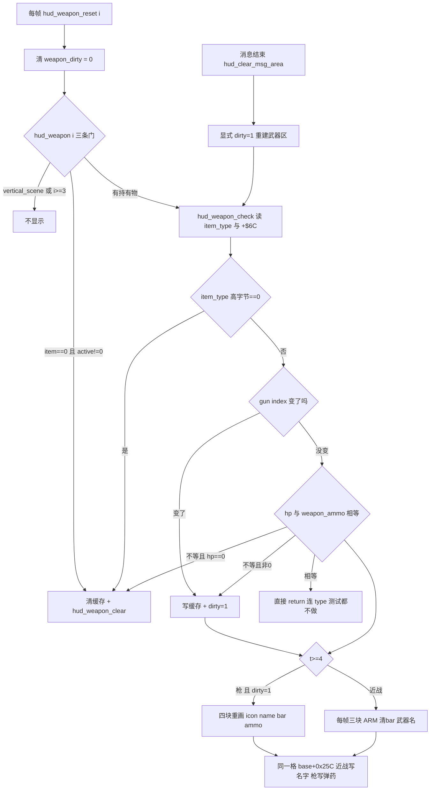

### 83.8 wof 侧登记、主线闭环与本轮边界

**wof 侧按 §11.0 只登记不同语境的并列事实**：

| wof 位置 | 语境 |
|---|---|
| `Cps1HudRuntime.cs:787` / `:807` / `:840` | `处理HUD重置门_部分对应ASM_2988`、`更新玩家血条_部分对应ASM_2E46`、`更新单个玩家敌方信息_可能对应ASM_2A1E`：HUD 重置门与血条 / 敌方信息更新 |
| `Cps1HudRuntime.cs:873` / `:907` / `:933` | `消费等待中的敌方信息事件_可能对应ASM_2B80`、`消费普通攻击事件_可能对应ASM_2C62`、`消费名称头像事件_可能对应ASM_2BBC`：HUD 走事件消费 |
| `Cps1HudRuntime.cs:428` / `:468` / `:1722` | `写BCD分数字符_可能对应ASM_EB2`、`重绘玩家余命_可能对应ASM_305A`、`绘制血条单元序列_对应ASM_2EF0`：BCD 字符与血条格序列的写入 |
| `Cps1Actor1CRuntime.cs:2007` / `:2322` | 注释记 `0x3836` 是「3 槽 HUD 的槽分配 + 首帧绘制」，`血条槽分配与首帧_对应ASM_3836`：槽分配语境 |

这些都是**HUD 重置门 / 事件消费 / BCD 分数字符 / 血条槽分配**语境，与本节「HUD 每帧拿两个字节跟自己缓存比、只在变化时重画武器区」不同语境并列；不串成等价、**不据此断言原机缺机制**、不臆断、不评优劣。本节纯 repo 侧，0 次 ROM 取证，§11.6 条件通道未触发。

**主线闭环**：①显示状态住在 HUD 自己的三份缓存与一个全局脏标志里，不住在玩家对象上；②同一份 `+$6C` 弹药字节被物品侧与 HUD 侧按三种目的各读一次；③同一格 `base + 0x25C` 按武器类型换语义、同一片消息区按时间换主人，切换靠一次性脏标志显式重建。这条线既不并入 §19 的 5 套表，也不是演出推进线（§63 / §67 / §71 / §76）或空间挂接线（§32 / §71 / §76 / §77）；它是**显示层的帧内重画契约**，与 §26 的 `score_dirty`、§73 的共享显存、§80 的共享调色板槽、§82 的弹药字节各接一段。

**保留边界（不扩张，非欠账）**：`hud_objects_tail` / `hud_update` 逐行展开（§26.7 已保留）、消息环 16 条逐项、血条段表逐项、`bcd_add32` 逐字节（§26.7）、15 种武器 `KINDS` 逐项与 `weapon_shot_pos` 全项（§21.8 / §82.7）、`0x23EB4` 步长表 / `0x23BD0` 阈值表 / `0x23BDC` BCD 表 / `0x23AC6` 图标表 / 两张名字串表逐项数值、`hud_redraw` / `hud_final_draw` / `hud_player_block` 全文、wof `0x2988` 重置门 / `0x2A1E` 敌方信息 / `0x2EF0` 血条序列全文、两游戏武器 HUD 是否等价（不臆断）、音频与音效按 §0 边界外；均按 §21.8 / §24.7 / §26.7 / §27.6 / §28.7 / §35.5 / §40.6 / §41.7 / §59.6 / §73.8 / §76 / §77 / §78 / §79 / §80 / §81 / §82 的既有口径**保留、不扩张**。两游戏发行先后仍未考证（§11.0）。本节纯 repo 侧，0 次 ROM 取证。

**结论**：§83 把「屏幕角落那把枪」从结果补成「显示状态自己有缓存、只在两个字节变了才重画、且同一片显存按类型与时间换主人」的可定位链路；`长时间自主推进` 仍是开放目标，本节不宣称终止。

---

## 84. 背景不是一次装进显存的：摄像机记住上次补到哪一格，只补新露出来的一行或一列

> 一句话结论：关卡地图比一屏大得多，但显存里只留 64×64 格的一块环。游戏不每帧重画整张背景，而是**把「这一帧镜头在哪」和「上次补到哪一格」记成两份坐标**；镜头跨过 32 像素格时才把世界新露出的那一列（18 块）或一行（26 块）写进环里覆盖最旧的一列/行，其余格子靠取模回绕原地复用。补边、换区整屏重建、动画相位切换、画面震动是四条各改各的线，互不触发重画。

### 84.1 本节定位与查重

- **查重**：`stream2` / `stream3` / `ge32` / `round32` / `write_block2` / `write_cell3` / `reinit_map` / `predraw_screen2` / `tile_anim_tick` / `sx46` / `sy48` 这一整套流送术语在 `DESIGN_DIFF_NOTES.md` 里 Grep **零匹配**。`camera.rs` 此前只在 §23（卷轴显示延迟）、§52（`Scroll2` 控制器 / 跟随包围盒 / `lock78`）、§73（三层环形 tilemap 写入服务）、§37（`step_shake`）等节以控制器字段或写入接口出现，从未把「谁决定这一帧该补哪一格」独立成节。这是 A.33 情形 2 的又一例：相邻两层都登记了，中间的驱动层留白。
- **与 §73 的分工**：§73 讲的是「对象怎么往三层环形 tilemap 里摆格子」（`TilePos` / `TileMode` / `BlockTable` 的写入服务）；本节讲的是**这套写入服务的上游调度者**——每帧是谁算出该摆哪一列、摆多少、什么时候改取整屏重建。两者是同一片显存的「服务」与「调度」两层，不合并、不改写 §73。
- **与 §19 / §63 / §67 / §71 / §76 / §77 / §78 / §79 / §80 / §81 / §82 / §83 的关系**：本节没有脚本表、没有预录输入、没有演出任务、没有广播字节、没有附着点表、没有每帧重验的持有关系、没有攻击资格列表、没有输入字节读方、没有修饰层对象、没有打印协议、没有开火节拍、没有 HUD 缓存；它是**背景流送**这一条独立主线，不并入 §19 的 5 套脚本表，也不与上述任何一节共用「第几条推进线」的绝对编号。
- **口径**：按刚落盘的「口径澄清：『保留、不扩张』不是用户规则」，§23.6 (L3340) 与 §52.8 (L6993–L6996) 清单里记的是**当时未做的范围**——wof 卷轴寄存器时序全量普查、`Cps1StageTileStreamer` 列初始化 / 环形区逐段展开、dino `RowScroll`（stage 2 行卷轴任务）逐状态展开、`camera.rs:1148-1236` 的 mode 分派逐分支。那是取材范围声明，不是闸门；且本节的 `stream2` / `stream3` 增量流送本就不在那些清单里。本节按当前目标取这条跨层契约，不把任何 §N 曾被列过与否当作能不能写的依据。
- wof 侧按 §11.0 只登记不同语境的并列事实，不串成等价、不评优劣、不把未登记写成缺失；不臆断，纯 repo 侧，0 次 ROM 取证，§11.6 未触发。

### 84.2 两份坐标：镜头在哪，和已经补到哪一格

`Scroll2` / `Scroll3` 控制器各带一对同名状态（`camera.rs:37-38` 与 `:118-119`）：

| 坐标 | 语义 | 谁写 | 粒度 |
|---|---|---|---|
| `cam_x` / `cam_y` | 这一帧镜头的真实位置（连续值） | `follow_x` / `follow_y` / `mode_*` 等每帧跟随玩家包围盒（`camera.rs:861` `player_extents`） | 像素连续 |
| `sx46` / `sy48` | **上一次真正补完格子流送到哪一格** | 只在跨格判定通过后由 `round32` 回写（`camera.rs:464-469`、`:564-569`）；换区时由地图 `init_x/init_y` 整体归位（`:794-797`、`:1659-1660`） | 32 的倍数 |

关键在于 `sx46/sy48` 不是镜头的另一份拷贝，而是一份**「已兑现到哪一格」的游标**：镜头每帧都可能动，但游标只在真的补过一条边之后才追上去。`ge32(d)`（`camera.rs:303-305`）用 `(d - 0x20) as i16 >= 0` 判「至少跨过一个 32 格」；`abs16`（`:307-309`）把反向移动取绝对值后仍走同一个判据；`round32`（`:311-313`）把追平后的坐标量化回 32 的倍数。三个纯函数把「连续镜头」和「离散格子」接起来，是这一层的核心契约。

### 84.3 只补一条边：跨格才补，补的是世界新露出的那条

`stream2`（`camera.rs:438-470`）与 `stream3`（`:533-570`）同构，各自读自己那一层的 `(cam_x, cam_y, sx46, sy48)`：

- X 方向：`sx < cx` 且 `ge32(cx - sx)` 为真 ⇒ 在右侧 `sx + 0x200` 处补**一列**；反之 `ge32(sx - cx)` 且 `sx != 0` ⇒ 在左侧 `sx - 0x40` 处补一列。列由 `draw_column2`（`:390-413`，`0x11` → 18 个 block）/ `draw_column3`（`:485-508`）向下连写。
- Y 方向：`sy < cy` 且 `ge32(cy - sy)` ⇒ 在 `sy + 0x160` 补**一行**；反而在 `sy - 0x80` 补一行（要求结果非负）。行由 `draw_row2`（`:415-436`，`0x19` → 26 个 block）/ `draw_row3`（`:510-531`）向右连写，起点 X 取 `sx - 0x120` 并钳到 0。
- 补完之后才 `if ge32(abs16(cam_x - sx46)) { sx46 = round32(cam_x) }`，Y 同理（`:464-469`）。也就是**判定用旧游标、回写用新游标**，一帧之内不会因镜头大幅移动连补好几列——多出来的部分留到下一帧继续追。

伪代码（`stream2` 的每帧判定，浓缩 `camera.rs:439-470`）：

```
每帧（对象更新末尾 background_update 0x2042E 之后）:
  cx, cy = 这一帧镜头坐标;  sx, sy = 上次补完的格坐标（32 的倍数）
  if sx < cx  and ge32(cx - sx):      补右一列 18 块 于 sx+0x200
  elif sx > cx and ge32(sx - cx) and sx != 0:  补左一列 18 块 于 sx-0x40
  if sy < cy  and ge32(cy - sy):      补下一行 26 块 于 sy+0x160
  elif sy > cy and ge32(sy - cy):     补上一行 26 块 于 sy-0x80（结果须非负）
  if ge32(abs16(cx - sx)): sx = round32(cx)   # 游标才追上来
  if ge32(abs16(cy - sy)): sy = round32(cy)
```

### 84.4 世界无限、显存一屏：取模回绕的两层环形写入

`vram2`（`camera.rs:315-320`）与 `vram3`（`:322-326`）把世界 `(x, y)` 折成 64×64 格环的索引（Y 用 `0x3E0 - (y & 0x3E0)` / `0x7E0 - (y & 0x7E0)` 反向算）；`screen_lookup`（`:328-338`）按 `(col * map.h + row)` 查这张地图该用哪一屏的数据；`block_ptr2`（`:373-376`）/ `block_ptr3`（`:472-474`）再落到屏内第几个 block。真正的写入只有一处：

| 维度 | scroll2（近景） | scroll3（远景） |
|---|---|---|
| 一次写几个显存格 | 4（`write_block2` `:378-388` 的 `i`、`i+1`、`i+16`、`i+17`，即 2×2 block） | 1（`write_cell3` `:480-483` 的单个 cell） |
| 环形回绕 | `i % 4096`、`(i+1) % 4096`… | `i % 4096` |
| 补一列 / 一行 | 18 / 26 个 block（`0x11` / `0x19` 各加一） | 18 / 26 个 cell（同两个常量） |
| 世界→索引 | `vram2 :315-320` | `vram3 :322-326` |
| 送进流送判定的镜头坐标 | 直接用 `cam_x/cam_y` | 按 `shift5f` 右移缩放后再用（`camera.rs:1711-1712`），远景补得更慢 |
| 判定与游标 | 共用 `ge32` / `round32` / `abs16` + 各自的 `sx46/sy48` | 同左，独立一套状态 |

这正是 §73 那句「三层环形 tilemap」的上游答案：**世界可以无限长，显存只用一块 64×64 的环，靠 `i % 4096` 让最旧的一列被新补的一列原地覆盖**。写错页也不另做保护——`predraw_screen2`（`camera.rs:820-844`）的注释明说 X=0 起始时那份额外一屏「写入不回绕，越过 scroll2 末尾的格子落进 scroll3」，并且「用途未知」。按「不过度怀疑 rep 侧」，这里只登记这个地址空间几何行为存在，不臆断它为什么存在、不作优劣判断。

### 84.5 补边与重建是两种节拍，不是同一函数的参数差异

换区 / 进关走的是另一条显式入口：`scroll2_init`（`camera.rs:593-622`）在 `mode` 为 `0x0E/0x0F` 时调 `reinit_map`（`:781-785`），后者拆成两步——`reinit_map_header`（`:787-798`）把 `sx46/sy48/cam_x/cam_y` **四份坐标同时归位**到该地图的 `init_x/init_y`，`reinit_map_draw`（`:800-818`）先 `clear2()`/`clear3()` 清空两层，再从起点连画整屏：起始 X 不为 0 时先 `x -= 0x20` 再画 19 列；X 为 0 时先 `predraw_screen2(y)` 再画 17 列。`scroll3_init`（`:1652-1682`）同构，17 或 19 列之外另按 `scroll3_yfollow` 决定远景 Y 是否跟随。

伪代码（换区整屏重建，浓缩 `camera.rs:782-818`）：

```
换区 / 进关（不是每帧）:
  sx, sy, cx, cy = 该地图的 init_x, init_y      # 四份坐标一次归位
  clear2(); clear3()                            # 两层显存整屏清空
  if 起始 X != 0: 从 X-0x20 起连画 19 列整屏
  else:            predraw_screen2() 多画一屏, 再连画 17 列
  # 之后才回到「每帧只补一条边」的节拍，游标从这里重新起算
```

也就是说「平时只补新露出的一条边」与「换区整屏重画」是**两种分开的写入节拍**：前者每帧、只动一列/行、游标递增；后者一次性、动整屏、四份坐标归零重来。`flow_demo_camera_start`（`camera.rs:633-639`）与 `flow_demo_camera_draw`（`:642-644`）把 demo 的重建拆到两个 video frame 之间（文件头注释 M10-03），是这条重建线上的跨帧变体，按 §60 的长任务边界不在此展开。

### 84.6 动画相位不动地图，震动也不动流送坐标

`tile_anim_tick`（`camera.rs:938-962`）每帧被 `scroll2_run`（`:848`）先调一次：stage 4 每 8 帧、stage 7 每 24 帧把 `phase72` 加 4（`& 0xF`）换一组块表相位并把 `prev73` 记成上一相位；其余 stage 直接返回。**它只改这两个字节，不碰 `sx46/sy48`、不重画任何格子**：「背景图案随时间变」和「背景哪些格要重画」是两条独立状态线。而且 `phase72`/`prev73` 不只被这个计时器写——`prop/b36_38.rs:231`、`prop/b13.rs:294`、`prop/b5.rs:238`、`prop/b10.rs:172` 等场景对象也直接写它们；`trace.rs:1692-1693` 把两者登记成逐帧存档字段。这是一份被对象与计时器共享、但不参与流送判定的状态。

`screen_shake`（`camera.rs:1725-1729`）的文件头注释更直接：「Only the vblank Y shadow moves. Sprites, collision and camera streaming keep their coordinates.」画面震动是最后一刻的显示偏移，不进入「哪些格子该补」的判定——与 §37 两条独立反馈状态机同族。

### 84.7 帧末才补：这一帧用的是定下来的镜头坐标

`background_update`（`camera.rs:572-582`）在对象更新末尾调用 `scroll2_task` / `scroll3_task`（stage 2 还先跑 `rowscroll_task` 0x2335A 与 stage2 自己的控制器 0x22398）；`scroll2_run`（`:846-936`）先 `tile_anim_tick`、再处理事件命中和 `player_extents`，**最后**才在 `mode 0x00` 里 `follow_x` / `follow_y` 然后 `stream2()`（`:862-867`）；`scroll3_run`（`:1684-1723`）同样把 `stream3()`（`:1722`）放在最后。也就是补边发生在这一帧所有对象移动完之后，用的是这一帧已经定下来的镜头坐标，不是上一帧的——与 §47 一帧调度链、§23 显示延迟的固定顺序同一族，但主语是背景流送而非对象或碰撞。

### 84.8 wof 侧按 §11.0 只登记不同语境的并列事实

wof 侧 `Cps1StageTileStreamer` 里存在一组与「跨列 / 跨行 / 初始化 / 退场重画」相关的调用名，调用面散在 `Cps1CameraRuntime.cs`、`Cps1SystemCoroutineRuntime.cs`、`Cps1LidianFinaleRuntime.cs`。按 §11.0 只把 repo 已有的名字与语境并列登记，不串成与 dino §84 等价、不评优劣、不据此断言原机缺机制：

| dino 侧机制（本节） | wof 侧既有调用名（repo 注释原文） | 语境 |
|---|---|---|
| 镜头跨列补一列 `stream2` | `相机跨列时更新Scroll2_可能对应ASM_19784_19B20`（`Cps1StageTileStreamer.cs:988`；调用面 `Cps1CameraRuntime.cs:702`） | 跨列更新 |
| 镜头跨行补一行 | `相机跨行时更新Scroll2_可能对应ASM_1985E_19A82`（`Cps1StageTileStreamer.cs:1062`；`Cps1CameraRuntime.cs:725`） | 跨行更新 |
| 换区整屏重建 `reinit_map` | `初始化Scroll2列_可能对应ASM_19A44`（`Cps1StageTileStreamer.cs:216`、`:222`）、`初始化Scroll3列_可能对应ASM_1A1AA_1A34C`（`:357`） | 列初始化 |
| 游标允许重新从初始列起算 | `允许重新流送初始列_无对应ASM`（`Cps1StageTileStreamer.cs:91`；`Cps1CameraRuntime.cs:123`、`:127`、`:152`） | 跨帧守卫 / 初始列 |
| scroll3 控制器跨帧状态 | `更新Scroll3控制器状态02_部分对应ASM_19DAC_19DF4`（`Cps1StageTileStreamer.cs:535`；`Cps1CameraRuntime.cs:200`、`Cps1SystemCoroutineRuntime.cs:9744`） | 控制器状态 02 |
| 退场时重画 | `关卡退场重画两张tilemap_对应ASM_19A3C_1A1A0`（`Cps1StageTileStreamer.cs:131`；`Cps1SystemCoroutineRuntime.cs:10490`、`:11047`；`Cps1LidianFinaleRuntime.cs:17166`） | 关卡退场重画 |

`Cps1StageTileStreamer.cs:1773` 与 `:2363` 的注释分别提到「帧首调用点 + 初始化列里置 `scroll2InitPending`」与「只能在退场重画调用期间为 true」，是这套调用面的跨帧守卫语境；按 §11.0 只记其存在与语境，不逐条展开、不推断它与 dino 的 `sx46/sy48` 是否同义。两款游戏发行先后未考证，按 §11.0 不主动追。

### 84.9 与既有章节边界（不扩张、不合并）

- 本节不展开 `camera.rs:1148-1236` 的 `mode` 分派逐分支（§52.8 当时登记过这一范围，按新口径它不是闸门，只是本节不取它作主线）；不展开 stage 2 `RowScroll` 逐状态（§23.6 同）；不展开 wof 卷轴寄存器时序全量普查。这是**本节取材范围的声明**，不是对后续章节的约束。
- 与 §73 共享显存地址空间（`0x908000..` 系三层），但本节主语是「每帧补哪一格」的调度，不改 §73 的写入服务结论；与 §80 的共享调色板槽、§83 的共享 scroll1 显存都是「一份显示状态被多方读写」的同族，但那些是同一格被不同显示状态按时间复用，本节是一整块环被按空间回绕复用，方向不同。
- 1 图 / 2 伪代码 / 4 表；不并入 §19 的 5 套脚本表；不新增 ROM 取证。

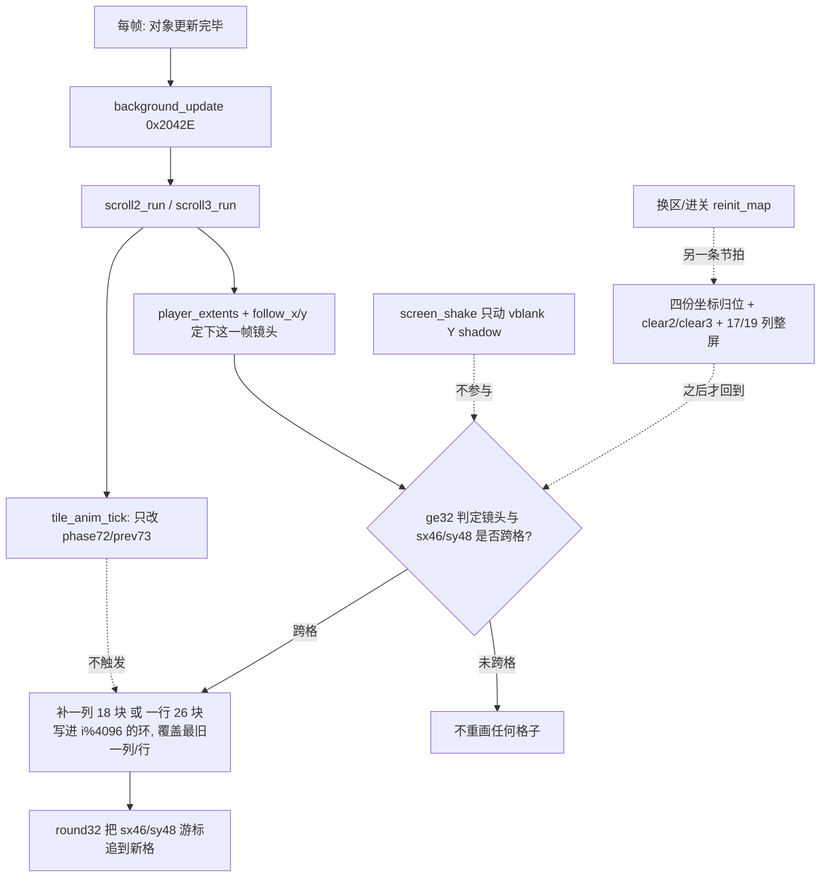

| 四种「背景变化」 | 触发 | 改什么 | 明确不改什么 |
|---|---|---|---|
| 补一条边 | 每帧镜头跨过 32 格 | 环里那一列/行 + `sx46/sy48` 游标 | 整屏其余格子、动画相位 |
| 整屏重建 | 换区 / 进关 | 清两层 + 17/19 列 + 四份坐标归位 | 平时补边的游标递增节拍（这里直接重来） |
| 相位切换 | stage 4 每 8 帧 / stage 7 每 24 帧 | 一个字节 `phase72` / `prev73` | 流送坐标、任何格子 |
| 画面震动 | 命中反馈 | vblank Y shadow | sprites / collision / 流送坐标 |
---

## 85. 车开起来那一帧：没有驾驶员，只有每帧重建的乘员、一份合成出来的目标速度，和一条不归输入管的高度线

> 一句话结论：§32 说清了 Cadillac 是「有入场 / 驾驶 / 退场演出的复合主体」，但没说**驾驶那一帧到底在算什么**。答案是：驾驶态里没有一个「驾驶员」状态，也没有一份持续存在的座位表——每帧先把乘员位图和三份座位清零重建，再把 N 个还在控方向的人的输入按人数分档**合成一份目标速度**，让真实速度每帧只逼近它一小步，最后把车的位置拉回一个相对镜头的窗口；车身高度、烟、轮子的相位是三条各走各的线，完全不读输入。连「开到终点」都不是车自己的位置说了算，而是镜头 `cam_x` 过 `0xA000` 或全局 `car_mode == 2`。

### 85.1 本节定位与查重

- **查重**：`prop_car_drive` / `prop_car_riders` / `prop_car_seats` / `prop_car_steer` / `prop_car_stick` / `prop_car_speed` / `prop_car_band` / `prop_car_bump` / `prop_car_smoke` / `prop_car_carry` / `STICK` / `PAIRS_B` / `BUMPS` / `WHEEL_ANIM` / `TVX` / `TVZ` / `NEW_SEAT` / `BUMP_T` / `b119` / `bc0` 在 `DESIGN_DIFF_NOTES.md` 里 Grep **零匹配**。历史命中只有三类：`prop_car_wheel` 在 L4654 作 §32 伪代码的一行调用名；`car_on` / `car_mode` 在 §15、§47 作碰撞门控与帧调度门；`0x8C886` / `0x8C404` 在 L2025、L4706 只作地址与「当时未做」的范围声明出现。这是 A.33 情形 2 的又一例：载具的**挂接层**（§15）、**生命周期层**（§32）、**攻击去重层**（§48）都登记了，中间的**驾驶态每帧驱动层**整片留白。
- **与 §32 的分工（关键）**：§32.2 写的是 4 态 `mode` 骨架 + `car.rs:16-23` 字段协议 + wof 马池对照；§32.5 把「`car.rs` 各 `sub` 步逐段、`0x8C886` 转向表 / `0x8C404` bump 表数值」列为**当时未做的取材范围声明**。按 `9d8145f` 落盘的口径澄清，那不是用户规则、不是闸门；本节按当前目标取用 `mode 2` 内部的每帧数据流，**不重做 4 态骨架、不回改 §32 任何结论**。
- **与 §15 / §48 / §50 / §51 / §52 / §84 的关系**：§15 是 `car_mode` 怎么让各系统改道、§48 是 `attack_serial` 去重（含 `car.rs:126-127` 与 `:408` HP 变化重武装）、§50 是对象池容量、§51 是全局 RNG 单流（`car.rs:612,614/655` 已在 §51 表中）、§52 是摄像机跟随玩家包围盒、§84 是背景流送的两份坐标。本节不重复这些，只在需要处作**上游并列**：这些节讲的是「谁被允许跑」，本节讲「允许跑之后这一帧算了什么」。
- **与 §19 / §63 / §67 / §71 / §76 / §77 / §78 / §79 / §80 / §81 / §82 / §83 / §84 的关系**：本节没有脚本表、没有预录输入、没有演出任务、没有广播字节、没有附着点表、没有每帧重验的持有关系、没有攻击资格列表、没有输入字节的四个读方、没有修饰层对象、没有打印协议、没有开火节拍、没有 HUD 脏标志、没有流送游标；它是**载具驾驶态**这一条独立主线，不并入 §19 的 5 套脚本表，也不与上述任何一节共用「第几条推进线」的绝对编号。
- wof 侧按 §11.0 只登记不同语境的并列事实，不串成等价、不评优劣、不把未登记写成缺失；不臆断，纯 repo 侧，0 次 ROM 取证，§11.6 未触发。

### 85.2 一帧的固定顺序：驾驶态不是一份状态，是一条重建流水线

`prop_car`（`car.rs:92-107`）在 `mode == 2` 按 `var26` 分派：`0` 是车本体走 `prop_car_drive`（`:412-480`），非 0 是前后轮走 `prop_car_wheel`（`:638-690`），两者最后都汇到 `prop_car_draw`（`:110-114`）按 `visible` 进绘制表。车本体这一帧的调用序列是**固定顺序**，不是按事件分派：

| 序 | 调用（`car.rs`） | 这一帧读什么 / 写什么 |
|---|---|---|
| 1 | `:413-417` HP 变化重武装 | `sub == 0 && hp != hp_prev` ⇒ 更新 `hp_prev` + `prop_car_arm`（`:122-128`，新 `attack_serial`，§48 已登记） |
| 2 | `:418-419` 广播 + motion | `G.$517 = RIDERS`；`p.b.motion()` 用上一帧留下的 `vx/vz` 先走一步 |
| 3 | `:420` `prop_car_riders` | 清零 `RIDERS` 后按玩家槽重算（`:483-492`），顺手写每人 `bc0 = 1` |
| 4 | `:421-427` 座位三连 | `NEW_SEAT` 三字节清 `0xFF` → `prop_car_seats` 重建 → 拷回 `SEAT` 三字节 |
| 5 | `:428-430` 转向 / 逼近 / 窗口 | `prop_car_steer` → `prop_car_speed` → `prop_car_band` |
| 6 | `:431-433` 载人 + 按速度换动画 | `prop_car_carry` 覆写三位英雄坐标；`(TVX + 0x80) >= vx` 选动画 `0/1`（`:432-433`） |
| 7 | `:434-435` 高度 / 烟 | `prop_car_bump` → `prop_car_smoke`，都不读输入 |
| 8 | `:436-437` 全局登记 | `G.$77A2 = car_obj`（车 handle）、`G.$77A0 = car_on = 1`（`combat.rs:87` 的 4 个 pass 门） |
| 9 | `:438-479` 帧尾 | `sub != 0` 走 hit flash；`sub == 0` 才跑终局测试 |

伪代码（`prop_car_drive` 每帧前半，浓缩 `car.rs:412-437`）：

```
每帧（pool B 更新里，mode==2 / var26==0 的车本体）:
    if sub == 0 and hp != hp_prev: 重武装一次新攻击号
    G.$517 = RIDERS;  motion()                 # 先用上一帧的速度走一步
    RIDERS = 0;  for k in 0..3: if live && mode != 0: RIDERS |= 1<<k; players[k].bc0 = 1
    NEW_SEAT[0..3] = 0xFF
    prop_car_seats()                          # 按 in-play 玩家重建三份座位
    SEAT[0..3] = NEW_SEAT[0..3]              # 双缓冲回拷
    prop_car_steer()                          # N 人输入 → 一份 (TVX, TVZ)
    prop_car_speed()                          # 目标 → 真实 (vx, vz)
    prop_car_band()                           # 位置 → 相对镜头窗口
    prop_car_carry()                          # 三位英雄整数坐标 := 车的坐标
    enemy_anim( (TVX + 0x80) >= vx ? 0 : 1 )
    prop_car_bump();  prop_car_smoke()
    G.$77A2 = 车的 handle;  G.$77A0 = 1
    if sub != 0: hit flash 分支; return
    终局测试（见 85.7）
```

注意第 2 步 `motion()` 用的是**上一帧** `prop_car_speed` 留下的速度，而第 5 步算出的 `vx/vz` 要等下一帧才生效——和 §13 的 census 一帧延迟、§48 的上一帧 hurt list 一样，这里也是「先动后算」而不是「算完再动」，不写成缺陷，只记帧序。

### 85.3 乘员与座位：每帧清零重建的投影，不是持久状态

`car.rs:14-31` 的字段协议里，`+$A8` / `+$A5..$A7` / `+$A2..$A4` / `+$C0` 经常被读成「座位表」，但驾驶态每帧都把它们推倒重来：

| 字段 | 每帧写入者 | 位 / 值的来源 | 下游读方 |
|---|---|---|---|
| `+$A8` `RIDERS` | `prop_car_riders`（`:483-492`）：先清 0，再按玩家**槽号 k** 置 `1<<k`；随后 `prop_car_seats`（`:358`）再按车所有者 `who & 7` OR 一次 | 槽号位 + owner 的 `who` 位，两种编号写进同一字节 | `prop_car_steer`（`:498` 按 `1<<k` 挑 rider）；`G.$517`（`:418`，`trace.rs:1439`） |
| `+$A5..$A7` `NEW_SEAT` | `drive` 每帧清 `0xFF`（`:421-423`），再由 `prop_car_seats`（`:356-371`）写 `p.b.id` 与其余 in-play 英雄的 `id` | 角色号，`0xFF` = 空 | 当帧末拷回 `SEAT`（`:425-427`）；`prop_car_board`（`:378`）在入场演出里读 `NEW_SEAT+2` |
| `+$A2..$A4` `SEAT` | 每帧从 `NEW_SEAT` 回拷；`prop_car_init`（`:256-257`）初值全 `0xFF`，`prop_car_end`（`:712-714`）退场再清 | 角色号 | 座位绘制对象（`:289-296`，pool C class 36）、`prop_car_mate`（`:299-308`）、`prop_car_caption`（`:311-317`） |
| 玩家 `+$C0` `bc0` | `prop_car_riders` 置 1（`:489`）；终局 / 退场清 0（`:454-455`、`:474-476`） | 「这一帧我在车上」的玩家侧副本 | `script.rs:305`（过场脚本扫 `bc0`）、`:386`（`bc0 != 0` 才给 `ATK` 输入）、`boss_common.rs:570-575` 单测断言全 1；`trace.rs:1143` 逐帧存档 |

两点值得单独记：① **`SEAT` 不是「谁坐在哪」的长期状态，而是「这一帧谁在车上」的投影**——`drive` 每帧先清 `NEW_SEAT` 再重建再回拷，所以有人中途死亡 / 跳车，座位表下一帧自己就变了，不需要任何「下座」事件。② 同一份「在车上」判定被写成三份：车对象里的位图 `RIDERS`、全局 `G.$517`（`spawn.rs:35` / `trace.rs:1439`）、以及每个玩家自己的 `bc0`；`bc0` 还被过场脚本层当输入门读（`script.rs:386`），与 §79 的同一输入字节四个读方、§83 的同一 `+$6C` 三种读法同族，本节不宣称首次，只把它登记为「一份判定、三个消费者」的又一实例。

### 85.4 N 个人的方向合成一份目标速度

`prop_car_steer`（`:495-519`）不挑驾驶员，而是遍历 `RIDERS` 里置位的每个玩家，让 `prop_car_stick`（`:524-549`）各自往 `TVX/TVZ` 累加，最后按**有效摇杆人数 `d6`** 整体缩放：

| `d6`（这一帧有方向输入的人数） | 对 `(TVX, TVZ)` 的处理 | 基础前进量（各人方向偏移为 0 时） |
|---|---|---|
| 0（无人 / 全部松杆） | 直接写 `TVX = 0x800`、`TVZ = 0`（`:503-506`） | `0x800`（默认巡航） |
| 1 | 不缩放（`:507`） | `0x800` |
| 2 | 各 `>> 1`（算术右移，`:508-511`） | `0x800` |
| 3 | 各 `* 6 >> 4`（即 6/16，`:512-516`） | `0x900` |

关键在于每个 rider 都加的是 `(dx + 0x800, dz)`（`:546-547`），**基础前进量每人加一份，之后再整体缩放**：于是 0 / 1 / 2 人的巡航分量都恰好是 `0x800`，3 人变成 `3 × 0x800 × 6/16 = 0x900`；被人数稀释的其实只是各人方向偏移 `dx`（1 / 0.5 / 0.375 倍）。这不是投票、不是优先级、也不是「主驾 + 副驾」，而是**把多人输入压成单一目标向量的一次加权求和**，人数只作为分档索引。

每人的方向来自三张表与一个按键窗口（`car.rs:33-37`、`:524-549`）：

```
prop_car_stick(玩家 k):
    if pressed & 0xF != 0:  players[k].b119 = 0x3D      # 新按下 → 61 帧窗口
    d = held & 0xF;  if d == 0: return                  # 松杆者不计入 d6
    off = u8(0x8C886, d)                                # STICK：方向低 4 位 → 表内偏移
    table = (b119 != 0) ? 0x8C896 : 0x8C8B6              # PAIRS_B（等价副本）/ PAIRS
    if b119 != 0: b119 -= 1
    if d6 == 0: TVX = TVZ = 0                           # 第一个有效 rider 清累加器
    TVX += u16(table, off)   + 0x800
    TVZ += u16(table, off+2)
    d6 += 1
```

`b119 = 0x3D` 是「刚按下方向」的临时窗口：窗口内用 `0x8C896`（文件头 `:521-523` 记为 `PAIRS` 的 equal copy），窗口过了换回 `0x8C8B6`。也就是说**同一份按住的方向，在按下后的几十帧里走另一张表**——输入的历史被折进了表选择，而不是折进车的状态字节。这与 §27 的 `player_command_fsm` 三态时间窗不同：那边是搓招状态机，这边只是一个倒计时字节决定查哪张表，不构成新状态机。

### 85.5 目标 ≠ 速度 ≠ 位置：逼近器、镜头窗口，和被覆写的英雄坐标

`prop_car_speed`（`:553-564`）与 `prop_car_band`（`:567-585`）把「玩家想要多快」和「车这一帧在哪」分成三段互不相同的量：

| 段 | 规则（`car.rs`） | 设计含义 |
|---|---|---|
| 目标 → 纵深速度 | `vz = TVZ`（`:554`）**立即等于目标** | 上下变道不缓冲，输入当帧生效 |
| 目标 → 横向速度 | `d0 = (TVX - vx) + 0x20`；`d0 < 0x40` 才一次取到 `TVX`，否则 `vx ±= 0x30`（`:555-563`），方向用无符号比较 | 差在 `-0x20..0x1F` 视为到位；否则**每帧只挪 0x30**，加减速是一段有惯性的过程 |
| 位置 → 镜头窗口 | X 允许 `cam_x + 0x30 .. +0x140`（宽 `0x110`），Z 允许 `cam_y + 0x10 .. +0x50`（宽 `0x40`）；越界把差值直接 `pos -= d0` 回推（`:569-584`），`put`（`:117-119`）只改整数词、保留小数 | 车**不会因为一直加速就冲出画面**，位置每帧被拉回一个相对镜头的框；这是与 §52 摄像机跟随、§84 流送游标都不同的第三条「相对镜头」契约 |
| 英雄坐标 | `prop_car_carry`（`:397-404`）每帧把三位英雄的 X/Y/Z 整数词直接写成车的坐标 | 英雄没有「坐在第几排」的局部坐标；座位只服务于绘制对象（`:289-296`）与队友演出，物理上人就是被钉在车心 |

`prop_car_band` 的 `pull` 用两次减法判窗口（先减下界，为负则回推；再减宽度，为负则在框内），所以越界多少就推回多少，不做钳到边界的取整——这跟 §44 的 `enemy_clamp_to_playfield` 夹回是两种写法，本节只登记驾驶态这一条，不评优劣。

### 85.6 两条不归输入管的线：车身高度、烟，以及自己算相位的轮子

| 线 | 驱动 | 触发 / 节拍（`car.rs`） |
|---|---|---|
| 车身高度 `bump` | `+$AE` 步倒计时 + `BUMPS`（`0x8C404`）表 | 每帧先 `y = 5`（`:591`）；有步在跑就 `y += BUMPS[step]` 且 `step -= 1`（`:592-598`）；无步时五种条件可起一段 15 步：`mode >= 4`、`(mode,sub) == (2,2)` 受击闪、`hp < 0x14`、`screen_id2` 落在 4/5 号屏、或 `BUMP_T` 递减到 0 后 `rand() & 0xF` 重设计时且 `rand() & 1 == 0`（`:600-619`） |
| 烟 `smoke` | HP 门槛 + 全局帧号 | 每 8 帧（`w.frame & 7 == 0`）且 `hp < 0x3C` 在 `x+0x40, y+0x20` 冒一口；`hp < 0x1E` 再在 `x-0x20, y+0x10` 加第二口（`:623-632`），都由 `prop_car_puff`（`:320-331`）造 pool C class 41 |
| 轮子 | 独立对象读车主体 | `prop_car_wheel`（`:638-690`）每帧把自己摆到车 `X ± 0x4B/0x4C`、`Z+1`、`y=0`；`car.vx != 0` 才 `enemy_step` + 扬尘 + `rand()&1` 的小跳（`:652-657`）；前轮另按 `car.vz` 符号与 `T80` 计时把 `+$A0` 相位推到 `0..4`（或 `vz==0` 时回中到 2），查 `WHEEL_ANIM`（`0x8C5CC`）换动画并把 `T80` 重置为 `0xC`（`:661-689`）；`prop_car_dust`（`:693-702`）要求 `car.vx >= 0x300`，`>= 0x800` 每 8 帧否则每 16 帧 |

这三条线**都不读 `held` / `pressed`**：高度由倒计时表与 HP / 屏幕号 / RNG 决定，烟由 HP 与全局帧决定，轮子由车主体上一帧的 `vx/vz` 决定。轮子尤其能说明对象划分：车对象只负责算出自己的速度与高度，前后轮是两个独立 pool B 对象（`:50-86` 造三个对象、`:76` `+$76` 指回车），靠**读同一份车主体速度**自己推导动画相位与扬尘，车不主动去改轮子的动画状态。这与 §54 的对象引用、§69 的持械分体动画同属「一个主体 + 若干跟随对象」的组织方式，但这里是**跟随对象自己反查主体**，不串成等价、不宣称首次。

### 85.7 帧尾：hit flash 与「终点挂在镜头上」

`prop_car_drive` 最后按 `sub` 分两支（`:438-479`）：

| 分支 | 条件 | 这一帧做什么 |
|---|---|---|
| hit flash | `sub != 0` | `palette_override = 0x84`；`hitstop -= 1`，到 0 才清调色板、回 `mode = 2 / sub = 0 / live = 1` 并 `return`（`:438-449`）。受击期间**不跑**后面所有终局测试 |
| 终局测试 | `sub == 0` | ① `cam_x >= 0xA000` **或** `car_mode == 2` ⇒ `hp = 0` 且全员 `bc0 = 0`（`:450-456`）；② `w.scripted != 0` ⇒ 直接置死亡态（`:457-459`）；③ `act == 0 && hp < 0x1E` ⇒ `act += 2` 进入低血闪红（`:460-464`）；④ `act != 0` 时 `T80 = (T80+1) & 0x1F`，`t < 2` 的 2/32 帧闪红，`hp == 0` 才清 `bc0` 并置死亡态（`:465-479`） |

最值得注意的是 ①：**「这一关开完了」不由车自己的 X 判定，而由镜头 `cam_x >= 0xA000` 或全局 `car_mode == 2`（Boss 死亡脚本）判定**。车的位置每帧被 `prop_car_band` 锁在 `cam_x + 0x30 .. +0x140` 的窗口里，本来就不可能靠自己走到某个世界坐标；于是进度被记在镜头上，车只是跟着镜头走。这与 §32 的退场判定（:741 `camera X + 0x200` 后转 `mode 6`）、§84 的 `cam_x` 作为「这一帧镜头」是同一个坐标的三种用法，但三者互不触发，不合并成一条线。另外 `act` 这个在 §2 里属于对象四层状态字节的字段，在驾驶态被借作「低血闪红相位」的状态位——同一字节随 `mode` 换语义，与 §81 的 `+$80` 随 `sub` 换语义同族，本节只登记不扩张。

### 85.8 wof 侧不同语境的并列事实（§11.0）

| wof 侧位置 | 既有注释 / 调用面记了什么 | 与本节的语境区别 |
|---|---|---|
| `Cps1HorseRuntime.cs:40-70` | `更新马对象池_对应ASM_21372` 每帧按 `ActStatA` 四态分派（`0x00 / 0x02 / 0x04 / 0x06`） | 这是马对象池自身的生命周期分派（§32 已登记 4 态表），不是驾驶态每帧的输入→速度流水线 |
| `Cps1HorseRuntime.cs:234-249` | 上马门控检查玩家 `Exist` / `OBJA8` / `Mount` 等条件后写 `Mount = 1`、`MountObj = 马槽地址` | 这是玩家侧**一次性**挂载字段写入，不是每帧重建乘员位图与合成目标速度 |
| `Cps1HorseRuntime.cs:263-304` | `A=04` 离场判定用 `X - 相机X + 0x38 > 0x1F0` 回收；`B != 0` 时 `X += VelX(±6)` 再判 `X - 相机X + 0x40 > 0x200` | 同样出现「相对镜头的窗口」，但用在**退场回收判定**，不是每帧把位置钳回驾驶窗口 |
| `Cps1EnemyAI.cs:4812` | `解析Mount目标或玩家_无对应ASM` 把 `MountObj` 当目标对象指针解析，另有 `:4834 / :5505 / :5710` 等调用点 | `MountObj` 在敌人侧是目标引用，与 dino `G.$77A2 car_obj`（`car.rs:436`、`:798` 起 4 个 pass 的车 handle）不是同一层用途 |

四格都是两份 repo 源码里既有注释与调用面的复述和语境区分：**不串成等价、不评优劣、不把未登记写成缺失、不据此断言原机缺机制**；本节纯 repo 侧，0 次 ROM 取证，§11.6 未触发。

### 85.9 流程图（一帧驾驶态）

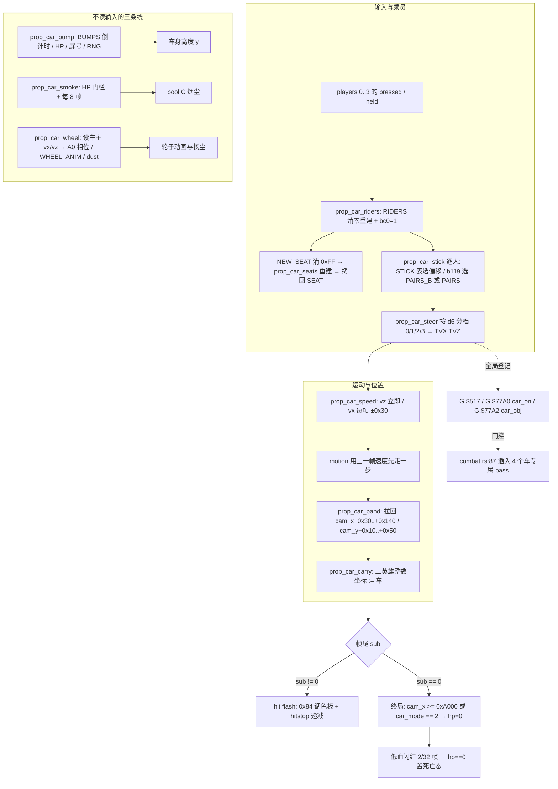

### 85.10 主线闭环与本轮边界

| 出处 | 本节对应 |
|---|---|
| §15 附加玩法挂接 | 补上「挂上去之后这一帧算了什么」：`car_mode` / `car_on` 门之后的驾驶态流水线 |
| §32 载具 4 态骨架 | 取 `mode 2` 内部逐帧驱动，不重做入场 / 退场演出；§32.5 的范围声明按 `9d8145f` 口径不作闸门 |
| §36 / §47 跨帧时序与一帧调度 | 又一处「先 motion 后算新速度」的一帧延迟；`trace.rs:1439-1442` 把三个车全局量写成逐帧存档字段 |
| §48 攻击去重 | `car.rs:413-417` HP 变化重武装是上游并列，本节不重复 `attack_serial` 机制 |
| §51 全局 RNG | `bump` 的 `rand() & 0xF` / `& 1` 与轮子 hop 是同一单流的又两个消费者（§51 已列 `car.rs:612`） |
| §52 / §84 摄像机 | `band` 的镜头窗口与终局 `cam_x >= 0xA000`，是 `cam_x` 的另两种用法，不与跟随 / 流送合并 |
| §54 / §69 对象引用与分体 | 轮子靠 `+$76` 反查车主体速度，是「主体 + 跟随对象」的又一形态 |

- **本轮未展开（取材范围声明，非闸门）**：`STICK` / `PAIRS` / `PAIRS_B` / `BUMPS` / `WHEEL_ANIM` 五张表的逐项数值（本节只登记「按什么索引、起什么作用」）；`car.rs:797-967` 四个专属碰撞 pass 的逐行几何（§48 / §70 已有同族登记）；`mode 0` 入场 8 步与 `mode 4` 退场逐帧（§32 已记时长与顺序）；wof 马 4 态 handler 全文与 `1F3BE` 下马链；两游戏载具状态是否可类比（不臆断）。
- 本节 1 图 / 2 伪代码 / 8 表；**0 次 ROM 取证**，全部以两份 repo 源码为准（§11.0）；**未考证发行先后**，沿用用户给定前提；按 §0 边界，wof 侧 `Cps1HorseRuntime.cs` 里的 FBA 逐帧对拍修正与 `_无对应ASM` 开关未纳入设计对照，不据此评价 rep 侧实现。
- **本节不宣称 `长时间自主推进` 终止**，也不把「查重零匹配」当成分析完成；继续按「repo 侧为主、ROM 主要为 data 且仅在 `wof_cs` 非常可疑时才查 ROM、不过度怀疑 rep 侧、每块一提交」推进。

---

## 86. 开场影片不是一段录像：一个计数器、两张表，和「等待期间计数器不走」的 1745 帧

> 一句话结论：attract loop 的开场影片不是按帧号播放的一段画面，而是一个**跑在顶层任务里的计数器时间线**。状态只有三份——任务当前脚本位置、一个计数、一个指向两张表的字节索引；每帧固定跑一遍「常驻卷轴 / 抖动 helper + 对象池 + 精灵表 + 计数 +1」，计数撞上时间表里的某一项时才**只跑一个**定点 handler。淡出、清层、淡入、sleep 全部发生在 handler 内部，期间计数器被按住不动，于是 1480 个计数实际跨了 1745 帧。

### 86.1 本节定位与查重

- **查重**：`flow_movie_start` / `flow_movie_script` / `flow_movie_loop_top` / `flow_movie_count` / `flow_movie_handler` / `flow_movie_helpers` / `flow_movie_clear` / `flow_movie_fade_step` / `0x9BF50` / `0x9C002` / `0x9C026` / `0x9C7C4` / `0x9C7F8` / `1480` / `1745` / `mst::PASS` / `Movie` 结构在 `DESIGN_DIFF_NOTES.md` 里 Grep **零匹配**。`flow/` 子模块此前只在 L565 一句「8 关剧情 / 开场影片 / 结局」、§41（Front 多 Scene / 选人）、§63（attract demo 预录输入流）、§60（`CUTS` 长任务跨帧）、§67（stage intro 演出推进）里以模块名或相邻机制出现，从未把「开场影片自己怎么推进」独立成节。
- **§41.7 的保留清单按 `9d8145f` 口径处理**：L5801 明列 `attract.rs / demo.rs / movie.rs / …` 13 个子模块「逐类展开」是当时的**取材范围声明**，不是用户规则、不是闸门；本节按当前目标取 `movie.rs` 的时间线引擎，不重做 §41 的 Front Scene 骨架、不回改 §41 任何结论。
- **与 §19 / §41 / §60 / §63 / §67 / §84 的分工**：§19 的 5 套脚本表是英雄过场 / 生成 / Boss 等**游戏内**脚本，开场影片不属于其中任何一套，也不并入那 5 套表；§41 讲「进战斗之前」的 Scene 组织与选人；§60 讲 CPU 时间超过一帧时任务怎么让出帧与 `CUTS` 常量；§63 讲 demo 的预录输入流；§67 讲进一关那几秒的演出推进；§84 讲背景流送的两份坐标。本节讲的是**前端一个纯演出任务内部的时间线驱动**：它不操作玩家、不生成敌人、不读取战斗输入，与上述各节不共用「第几条推进线」的绝对编号。
- **口径**：按 §0 边界，`movie.rs:40-42` 的「棕色恐龙震动任务未移植 / `screen_shake` 是 stub」是端口残差与宿主补偿，**剥掉，不写成游戏设计差异、不据此评价 rep 侧实现**；`attract3.mame.trc` 的记录号只用作帧数来源的出处，不抄录 ROM 字节或表内容（§11.0）。
- wof 侧按 §11.0 只登记不同语境的并列事实，不串成等价、不评优劣、不把未登记写成缺失；不臆断，纯 repo 侧，0 次 ROM 取证，§11.6 未触发。

### 86.2 状态只有三份：脚本位置、计数、表索引

`movie.rs:5-12` 与 `:124-140` 把整条影片的状态说得很省：它跑在 attract 任务里（和 profile cards 一样），`front.task` 的脚本位置取 `mst` 常量之一，计数是 `task.count`（`G.-$7004`），两张表的索引是 `task.sub`（`G.-$7002`，**字节偏移、步长 2**）。此外只有一份 `Movie` 结构保存「当前正在跑的 handler 地址」和两个 helper 标志。

| 状态 | 位置（`movie.rs`） | 语义 |
|---|---|---|
| `mst` 8 个脚本位置 | `:48-70`（`PALETTES=160` … `AFTER_SLEEP=167`） | 不是「影片第几秒」，而是**这个任务下一次被调度时从哪条续算点接着跑**；`owns()` 用区间判定这段脚本归谁 |
| `task.count` | `:167-174` 置 0、`:205-207` 每 pass +1 | 唯一的「进度」计数，到 `LAST_COUNT = 0x5C8`（1480，`:77`）后返回 |
| `task.sub` | `:7-8`、`:172` 步长 2 | 同时索引 `TIMELINE 0x9C002`（计数值表）与 `HANDLERS 0x9C026`（handler 表，`:72-75`） |
| `Movie.handler / scroll / shake / base_y / after` | `:124-140` | 当前 handler 地址、两个 helper 标志、抖动基准 Y、清层后要回到的 `mst` |

关键在于**没有「当前帧号」这份状态**：影片不知道自己播到第几帧，只知道计数走到哪、脚本位置停在哪。§41 已记「boot → attract → title 是同一个 Scene 的脚本位置」，本节是这一习惯在一个具体演出任务里的完整展开：`mst::PASS / FADE_OUT / FADE_IN / CLEAR / DRAW / LATE / AFTER_SLEEP` 七个位置（`:164-197`）把「一次清层要占两帧」「淡入淡出各 16 步」「handler 内 sleep 完再回循环顶」都写成可续算的位置，而不是一串回调。

### 86.3 一 pass 的固定顺序：常驻效果与定点事件是两条线

`flow_movie_script` 的 `mst::PASS` 分支（`:176-183`）是每帧的固定序列，`flow_movie_loop_top`（`:199-202`）在循环顶先 `wait(1, mst::PASS)` 让出一帧：

| 序 | 调用 | 作用 |
|---|---|---|
| 1 | `flow_movie_helpers`（`:478-496`） | 两个**常驻** helper：`scroll != 0` 时 scroll2 X +8（标志为 2 时只 +4）、scroll3 X +4 且超过 `0x100` 归 0；`shake != 0` 时 `scroll2 Y = base_y + (rand() & 3) - 1` |
| 2 | `screen_shake 0x222D6` | 全局震动任务（`:178`） |
| 3 | `pool_b_update 0x23604` / `enemies_update 0x23420` / `build_sprite_list 0x13FA6` | 每帧照常更新对象池与精灵表（`:179-181`） |
| 4 | `flow_movie_count`（`:204-225`） | `count += 1`，到 `LAST_COUNT` 返回；否则若 `count` 撞上 `TIMELINE[sub]`，跑 `HANDLERS[sub]` 的**一个** handler 并把 `sub` 推进 2 |

伪代码（浓缩 `movie.rs:176-207`、`:478-496`）：

```
每帧（attract 任务被调度，state == PASS）:
    if scroll != 0:  s2.cam_x += (scroll==2 ? 4 : 8); s3.cam_x += 4; if s3.cam_x > 0x100: s3.cam_x = 0
    if shake  != 0:  s2.cam_y = base_y + (rand() & 3) - 1
    screen_shake(); pool_b_update(); enemies_update(); build_sprite_list()
    count += 1
    if count >= 1480: return
    if count == TIMELINE[sub]: run HANDLERS[sub]; sub += 2      # 每 pass 最多一个
    wait(1, PASS)                                              # 循环顶让出一帧
```

两条线由此分开：**持续卷轴 / 随机抖动由两个全局标志驱动，每帧无条件跑**（`:479-495`），它们只在计数 850 / 895 / 1120 / 1140 / 1150 的 handler 里被打开或关掉（`movie.rs:20-24`、`:89-107`）；**字幕、Capcom 标志、丛林、恐龙、logo 这些一次性画面由计数表触发，每 pass 只跑一个**。这与 §84「补边 / 换区 / 动画相位 / 画面震动四条线互不触发重画」是同一种组织取向，但一个在背景流送、一个在前端演出，不合并。

### 86.4 计数 ≠ 帧：handler 里的等待把计数器按住

`movie.rs:29-30` 直接给出结果：**1480 个计数跨了 1745 帧**。原因不是帧率变化，而是淡出（16 步、每步隔一帧）、清层（约 1.3 帧、代码在两帧后才跑）、淡入、以及 logo handler 里的 `sleep 120`（`:26`）全部写在 handler 内部；这些等待期间任务停在 `mst::FADE_OUT / CLEAR / FADE_IN / LATE / AFTER_SLEEP` 等脚本位置（`:184-195`），**根本不会走到 `mst::PASS`，`flow_movie_count` 也就不会 +1**。

| 层次 | 谁在推进 | 停在哪 |
|---|---|---|
| 计数 | 只有 `mst::PASS` 里的 `flow_movie_count`（`:182`、`:205-207`） | 每个 handler 的等待期间**不推进** |
| 帧 | 顶层任务每帧照常调度（§20），`wait(1, …)` 逐帧让出 | 不因计数停而停 |
| 续算点 | `mst` 脚本位置 + `Movie.after`（`:138-139`、`:157-161`） | 清层 / 淡入淡出结束后回到指定位置 |

所以「影片长度」不能被读成计数表最后一项：计数 1450 的 handler 是淡出清层（`:27`），计数 1480 的 pass 之后才返回（`:30`、`:77`）。这是 §60「长任务跨帧 / `Scene` sleep 续算点」的又一实例，但方向不同：§60 处理的是**CPU 时间超过一帧被切断**，这里是有意让 handler 阻塞自己的计数，把「演出耗时」从时间线里挖出去，与 §41.6「逐 video frame 对齐：把长动作显式写成 sleep」是同一习惯在影片里的落实，不改写 §60 / §41 结论。

### 86.5 两张表 + 一个索引：时间线是数据，handler 是代码

`TIMELINE 0x9C002` 存计数值、`HANDLERS 0x9C026` 存 handler 地址，`task.sub` 以字节为单位、步长 2 同时索引两者（`:72-75`、`:7-8`）；常量表 `:86-110` 把已移植的 handler 按原机地址命名，`:14-27` 的注释表把计数点列全：

| 计数 | handler / 内容（`movie.rs:14-27`） | 类型 |
|---|---|---|
| 10 | `0x9C04A` 相机归零、淡出、清层、第一条高字字幕、淡入 | 定点画面 |
| 200 | `0x9C088` 淡出、清层、crawl 字幕、淡入 | 定点画面 |
| 500 | `0x9C21C` scroll2 X = -12、两块 tile、Capcom 标志 | 定点画面 |
| 600 | `0x9C29C` 丛林（pool B 32 条栅栏 / 两名猎人 pool A 11 / 音效） | 定点画面 |
| 850 / 895 | `0x9C3D4` / `0x9C3DC` 打开卷轴 / 抖动两个 helper 标志 | **开常驻线** |
| 890 / 900 / 930 | 猎人第二行字幕、跑动与站立的迅猛龙（pool A 12） | 定点内容 |
| 1100 | `0x9C426` 棕色恐龙（pool A 30，三次地面震动与吼叫） | 定点内容 |
| 1120 / 1140 / 1150 | 关抖动、快卷、第三条字幕与关卷轴 | **关常驻线** |
| 1250 / 1350 | 大头与字幕、logo 两块 + logo 调色板 + `sleep 120` | 定点内容 + 等待 |
| 1450 | `0x9C788` 淡出、清层 | 收尾 |

也就是说「什么时候出现什么」是**表数据**，「出现时怎么淡出 / 清层 / 画 / 淡入」是 `flow_movie_handler`（`:226-314`）、`flow_movie_draw`（`:315-351`）、`flow_movie_text` / `flow_movie_block` / `flow_movie_fade_step`（`:434-477`）这些**代码**。§19 把「脚本表 + 解释器」作为 dino 的脚本组织方式记过一次，本节是同一取向在前端的独立一例：两处都把节奏留在数据里、把动作留在代码里，但表结构（6 字节记录 vs 计数值 / handler 地址两表）、驱动者（玩家 update vs attract 任务）、消费者完全不同，不并入 §19 的 5 套表。

### 86.6 清层与淡入淡出：CPU 时间被写进脚本位置

`flow_movie_clear`（`:153-161`）不是一次调用就完：清层要 1.3 帧，之后的代码两帧后才跑，且**影片里 system task 丢掉的是两帧中的第二帧**（其他 scene 是第一帧，`:35-38`、`:186-194` 的 `mst::LATE` 置 `sys_skip = 1`）。实现上靠 `Movie.after` 记住清层结束后该回哪个 `mst`，`mst::LATE` 再 `wait(1, after)`；淡入淡出则由 `mst::FADE_OUT / FADE_IN` 每帧走一步（`flow_movie_fade_step`，`:458-477`），`mst::AFTER_SLEEP` 把 handler 内 sleep 结束的位置接回 `flow_movie_loop_top`（`:190`）。

这些不是「为了对齐录像打的补丁」，而是把 CPU 耗时显式变成脚本续算点的设计：`attract3.mame.trc` 两次 run 在同一帧观测到该清层调用（`:37-38` 记的记录号 11664 / 24769），说明节拍是**可复现的确定性契约**。按 §0，这里只取「节拍被写成续算点」这一层；`movie.rs:40-42` 的 stub 残差、`:499-627` 的单测对拍数值不纳入设计对照，不评 rep 侧优劣。

### 86.7 wof 侧不同语境的并列事实（§11.0）

| wof 侧位置 | 既有注释 / 调用面记了什么 | 与本节的语境区别 |
|---|---|---|
| `Cps1EventObjectRuntime.cs:5510-5599` | `更新开场剧情1C对象父循环` 按 `ObjId` 分发到 `推进开场玩家1C对象` / `开场静态对象04` / `开场特效对象06` 等子例程 | wof 的开场内容是**对象池 + `ObjId` 分派**（§35 已登记该组织方式），本节是前端任务里的一张计数时间线 |
| `Cps1EventObjectRuntime.cs:5655-5673` | `推进开场对象0B_对应ASM_5CB80` 按对象状态分支推进 | 单对象状态推进，不是「计数撞表就跑一个 handler」 |
| `Cps1EventObjectRuntime.cs:5765-5769` | `开场特效对象06_主分发_对应ASM_5D31E` 的 `case 0x00` 进初始化 | 特效对象自己的初始化分派，与淡出 / 清层 / 淡入的续算点不同层 |
| `Cps1CameraRuntime.cs:1227` | 注释记「开场续点由 `0x13D3E` / `0x13DD6` 写入 `0100`」 | 这是卷屏寄存器的开场续点写入，不是影片计数器的续算点 |

四格都是两份 repo 源码里既有注释与调用面的复述和语境区分：**不串成等价、不评优劣、不把未登记写成缺失、不据此断言原机缺机制**；本节纯 repo 侧，0 次 ROM 取证，§11.6 未触发。

### 86.8 流程图（一帧与一条时间线）

```mermaid
flowchart TB
    subgraph 顶层任务的一次调度
        W[wait 1 · mst::PASS] --> H[flow_movie_helpers<br/>scroll / shake 两个标志]
        H --> S[screen_shake 0x222D6]
        S --> P[pool B 0x23604 · pool A 0x23420<br/>build_sprite_list 0x13FA6]
        P --> C[flow_movie_count: count += 1]
        C -->|count >= 1480| R[返回 attract]
        C -->|count == TIMELINE sub| F[跑 HANDLERS sub 一个 handler<br/>sub += 2]
    end
    subgraph handler 内部（计数不走）
        F --> FO[mst::FADE_OUT 16 步]
        FO --> CL[flow_movie_clear 两帧<br/>mst::LATE 置 sys_skip]
        CL --> DR[mst::DRAW 画字幕 / tile / pool 对象]
        DR --> FI[mst::FADE_IN 16 步]
        FI --> AS[mst::AFTER_SLEEP 或 sleep 120]
        AS -. 回到 .-> W
    end
    F -. 850/895 置位 · 1120/1150 清位 .-> H
    H -. 常驻线每帧跑 .-> W
```

### 86.9 主线闭环与本轮边界

| 出处 | 本节对应 |
|---|---|
| §20 顶层任务机 / §41 Front Scene | 影片跑在 attract 任务里，`mst` 是 `Scene` 脚本位置的一次具体展开 |
| §41.6 逐 video frame 对齐 | 清层两帧、淡入淡出 16 步、`sleep 120` 都被写成续算点而非回调 |
| §60 长任务跨帧 / `CUTS` | 同为「任务让出帧」，但这里是 handler 主动按住自己的计数，不是 CPU 超时被切断 |
| §63 attract demo | demo 是预录输入流，影片是不读输入的纯演出时间线，两条不同的前端机制 |
| §19 脚本系统全景 | 同样「数据在表、动作在代码」，但表结构与驱动者不同，不并入 5 套表 |
| §84 背景流送 | 同样把「常驻效果」与「定点事件」分两条线，一层在显存调度、一层在前端演出，不合并 |
| §51 全局 RNG | helper 的 `rand() & 3` 是同一单流在前端的一个消费者；影片在丛林之前不取 RNG（`movie.rs:30-31`） |

- **本轮未展开（取材范围声明，非闸门）**：`0x9C002` / `0x9C026` 两张表的逐项数值与全部 16 个 handler 内部逐指令；`flow_movie_draw` 的 tile / 调色板写入细节；丛林 4 页 scroll2 与 3 页 scroll3 的逐页内容；`flow/profiles.rs` / `slides.rs` / `demo.rs` 等其余前端子模块；wof 开场对象链全文。**只记「按什么索引、起什么作用」，不抄表内容**（§11.0）。
- 本节 1 图 / 2 伪代码 / 7 表；**0 次 ROM 取证**，全部以两份 repo 源码为准；**未考证发行先后**，沿用用户给定前提；按 §0 边界，`movie.rs:40-42` 的 stub 残差与 `:499-627` 的单测对拍已剥掉，不据此评价 rep 侧实现。
- **本节不宣称 `长时间自主推进` 终止**，也不把「查重零匹配」当成分析完成；继续按「repo 侧为主、ROM 主要为 data 且仅在 `wof_cs` 非常可疑时才查 ROM、不过度怀疑 rep 侧、每块一提交」推进。

---

## 87. 池 E 里的「攻击者」不是一类对象：一次爆炸、一发弹丸、一个只活一帧的攻击盒，各自把一生过成不同形状

> 一句话结论：§61 已经说破「爆炸和弹丸是攻击者」——它们进 `$671A`、自带 attack id、走玩家 `AttackRecord` 命中链。但那只是**共性**。同一顶「攻击者」帽子底下其实住着六类完全不同的对象：有的把一生过成一段动画（爆炸），有的过成一条弹道（枪弹 / 火箭 / 投掷物 / 霰弹），有的**只有一帧**（隐形攻击盒），有的则跟着另一个对象活到它消失（火把火光）。身份由「这一帧有没有被登记进攻击者列表」决定，而**这一生有几帧、第几帧登记、什么时候结束、结束后变成什么，全由每类对象自己写**。

### 87.1 本节定位与查重

- **查重**：`blast_setup` / `blast_run` / `blast_kind0` / `blast_kind1` / `blast_kind2` / `blast_kind3` / `blast_small` / `blast_attack` / `bullet_init` / `bullet_run` / `shell_run` / `shell_end` / `projectile_run` / `pellet_run` / `item_attack_box` / `item_overlay` / `item_d7` / `EXPLOSION_TABLE` / `0x27E16` / `0x29D1E` / `0x2A534` 在 `DESIGN_DIFF_NOTES.md` 里 Grep **零匹配**。历史命中只有 L8378 引 `blast.rs:6-8` 的文件头语义、L8388 引 `item_register_attacker`、L8444 与 L10244 登记三张注册列表、L12577 提 `BULLET_RECORDS` 只记地址不抄数值。
- **与 §61 的分工（关键）**：§61 写的是「一次射击」这条**生成链**——从开火到跨 pool E / pool C 生成弹丸、到 `partner → aim` 追踪、到隔帧相位门；并顺带记下 `item_register_attacker`（`item.rs:248`）**每帧**把 handle 登记进 `$671A`。本节不重写这条共性，只补**生成之后这个对象自己怎么跑完一生**：`item_blast` 的五个 kind 分支、四族弹道、只活一帧的攻击盒、跟随火把的 overlay。两者是同一批对象的「为什么算攻击者」与「成为攻击者之后怎么活」，不合并、不改写 §61。
- **与其他节的关系**：§70 / L10265 讲 `$671A × $6AFC` 的命中 pass 是**下游**；§48 讲 `attack_serial` 全局去重、§46 讲 `AttackRecord` 八字段、§49 讲判定盒数据与开关——本节的 `blast_attack`（`blast.rs:161-168`）取一次号只是这些机制的**上游一个调用点**，不重做判定链；§21 / §62 讲道具池生命周期与掉落链、§43 讲离场回收、§50 讲对象池总表、§51 讲 RNG 单流、§45 讲 `(depth,handle)` 绘制排序，本节只在需要处作并列。本节没有脚本表、没有输入字节读方、没有 HUD 缓存、没有流送游标、没有载具驾驶态、没有影片计数时间线，**不并入 §19 的 5 套脚本表**，也不与 §84 / §85 / §86 共用「第几条推进线」的绝对编号。
- **本轮排除链**：按 A.50.3 的硬约束先核语义再定题。`item/weapon.rs`（63 函数 50 零匹配）被排除——§21 已记 `KINDS` 三元组与 15 类型、L11614 已明写「设施共用，差异压在一个变体 / 分支里，不另起一套状态机」、L11564 `item_land_check`、L11560 `LIFE = 0x258`、§82 / §83 的 15 类型保留清单都已登记；`script.rs`（89 函数 77 零匹配）在上一轮已排除（§19 用 ROM 地址完整展开）。这是「函数名零匹配 ≠ 机制未展开」的第二次、第三次印证：**扫描结果只是线索，定题必须回到语义查重**。
- wof 侧按 §11.0 只登记不同语境的并列事实，不串成等价、不评优劣、不把未登记写成缺失；不臆断，纯 repo 侧，0 次 ROM 取证，§11.6 未触发。

### 87.2 共同的契约：三态 mode 与「每帧登记一次」

`item_blast`（`blast.rs:67-77`）按 `var26` 分派到五个 kind handler，但每个 handler 都是同一副骨架：`mode 0` 初始化（**当帧就落进 `mode 2` 跑一次**，`:119`、`:142`、`:182`）、`mode 2` 每帧跑、`mode 4/6` 回收（`_ => self.item_free(...)`，`:127`、`:146`）。初始化先由 `blast_setup`（`:60-65`）写 `+$A0 = 0`、`+$25 = 0x30`、`anim_table = EXPLOSION_TABLE 0x28102`，并明确**没有自己的 box table**。

| 环节 | 位置（`blast.rs`） | 每帧做什么 |
|---|---|---|
| 动画步 | `blast_run` `:81-87` | `item_anim_step(it)` 返回「播完」就 `item_free`——**动画长度就是寿命** |
| 攻击者资格 | `blast_run` `:85` | `item_register_attacker(h)` 把 handle 登记进 `$671A`（`item.rs:248`，§61 已登记；不是一次挂载，是每帧声明） |
| 绘制 | `draw_list_add_visible_item` `:89-94` | 仅 `visible != 0` 时按 `(zi << 16)` 与 handle 拼成的键进绘制表（§45 同一排序键；拼法见 87.2 伪代码） |
| 攻击号 | `blast_attack` `:161-168` | 只在 init 取一次 `w.attack_serial` 并 `wrapping_add(1)`，清 `knock` / `hitstop` |
| 创建 | `item_explosion_body` `:28-44` | 复制源的 `who` / `id` / X/Y/Z / `airborne`，`+$70` = 源 handle；**池满就丢**（`alloc` 返回 `None` 直接 return） |

伪代码（`blast_run` 的每帧契约，浓缩 `blast.rs:81-94`）：

```
每帧（mode 2 的爆炸 / 弹丸）:
    if item_anim_step(it) 播完:  item_free(it); return      # 寿命由动画帧数决定
    item_register_attacker(h)                              # $671A 每帧重建，本帧重新声明一次
    if it.visible != 0: draw_list.push((zi << 16) | h)
```

注意「攻击者」在这里**不是对象的固有类型，而是一次每帧声明**：`combat_lists_reset`（§48 / §68 已登记）每帧清表，所以谁这一帧算攻击者，取决于谁这一帧还活着并且跑到了 `item_register_attacker`。§70 的下游 pass 只看这张当帧列表，不认识对象的 class。

### 87.3 爆炸的五个 kind：差异全压在 init 的一次性写入

`item_blast` 的五个分支共用 87.2 的骨架，差别几乎全在 `mode 0` 那一次写了什么（`blast.rs:96-247`）：

| kind / 地址 | init 的一次性写入 | run 阶段额外行为 |
|---|---|---|
| 0 `0x27E34` 大爆炸 | 按 `airborne` 选动画 `1/0` 与 attack `0x54/0x56`（`:105-110`）；落地爆炸才 `cam.shake_req = 3`（`:108`）；取 serial、放音效、在 `Y+0x20, Z-1` 生成火花（`:113-118`） | 每帧 `hitstop = 0`（`:124`）后 `blast_run` |
| 1 `0x27EDE` 滚动爆炸 | `blast_attack(0x54)` + `blast_setup` + 动画 1（`:139-141`） | `sub == 0` 时 `item_terrain` + `motion`；**撞到第一面墙才 `sub += 2` 停住**（`:150-158`） |
| 2 `0x27F70` | `blast_attack(0x6E)` + 动画 2 + 音效 + `cam.shake_req = 3`（`:171-183`） | 纯 `blast_run` |
| 3 `0x27FEE` 敌人扔的炸弹 | `+$02 = 0xFF`（**不记分归属**）、attack `0x6A`、带火花，init 帧不播动画（`:190-221`） | 纯 `blast_run` |
| 4+ `0x28098` 小火焰 | 动画 2（或 `+$5C` 置位时 1）（`:222-247`） | **没有自己的攻击**，按 `(frame + item_d7(i))` 的奇偶闪烁 |

也就是说「是不是攻击者」在同一类爆炸里都不是统一答案：kind 0/1/2/3 各自带一个 attack id，kind 4+ 只是火焰画面。`item_d7`（`:55-58`）把 `23 - slot` 这个**池槽号**折进闪烁相位——同一批小火焰不会齐刷刷一起亮，靠的是「你是池里第几号」而不是额外计时器。这与 §45 用 `(depth, handle)` 作绘制排序键、§50 用 slot 地址当对象身份是同一种取向的又一次：池的位置信息被当成玩法 / 显示参数，本节不宣称首次。

### 87.4 四族弹道：同一顶帽子，四种「一生」

`blast.rs:1-4` 列出池 E 的六个 class，其中四族是会飞的攻击者，各自把生命史写成不同形状（`:248-633`）：

| 族 / 地址 | 起手（init） | 每帧（run） | 终点 |
|---|---|---|---|
| 枪弹 `item_bullet 0x2860A` | `bullet_init` `:269-337` 按 variant 查 `BULLET_RECORDS 0x28814` 的 8 字节记录（`vx / 动画 / attack id / aim`）；玩家枪按 `+$EA` 锁定的目标转向，其余随机取 `vz` | `bullet_run` `:338-376` **按槽号奇偶隔帧做碰撞**（`:338` 注释），命中 / 撞地 / 撞墙 / 入水 | 转成 hit spark 动画（`mode 4`，`:251`） |
| 火箭 `item_shell 0x29D1E` | 记起始高度 `+$A0` | `shell_run` `:467-497` 上下弧线飞行、留尘土（`item_spawn_dust` `:498-503`） | `shell_end` `:504-526` 生成 **class 1 kind 1 小爆炸**并下一帧回收 |
| 投掷物 `item_projectile 0x29EC4` | 水平速度由距离做 **32 位除以 `0x39`**（`:527-530`），`vy = -0x500` 起步，目标 X / 目标高度在 `+$A0 / +$A2` | `projectile_run` `:554-585` 走弧线 | 掉到 `+$A2` 以下就爆成 class 1；**非零 variant 还额外留一个 class 11 攻击盒**（`:530`） |
| 霰弹 `item_gun_shot 0x2A39A` | `PELLET_RECORDS 0x2A484` 按 variant 给 `(vx, vy)` | `pellet_run` `:616-633` | 飞出起始点 `0xC0` 像素以内，命中即 free（`:586-587`） |

伪代码（两种「一生」的收尾，浓缩 `blast.rs:338-376`、`:554-585`）：

```
# 枪弹：碰撞按槽号奇偶隔帧做，撞上就变成一段火花动画
bullet_run(it, i):
    item_anim_step(it); motion()
    if (slot 奇偶 命中本帧): 检查地 / 墙 / 水 / 命中盒
        if 撞上: it.set_mode(4); 换成 hit spark 动画     # 不再登记攻击者
    else: item_register_attacker(h)

# 投掷物：终点不是撞到什么，而是「掉到指定高度以下」
projectile_init(it):
    vx = (target_x - x) / 0x39        # 32 位除法定水平速度，不是查表
    vy = -0x500
projectile_run(it):
    motion()
    if y < +$A2: 生成 class 1 爆炸（variant != 0 时另造 class 11 攻击盒）; free
```

四族的差别不在「伤害怎么算」（那是 §46 / §70 的下游），而在**这一生靠什么结束**：动画播完、撞到几何、掉到目标高度、飞出固定距离，四种终止条件各写各的。尤其 `item_shell` / `item_projectile` 的终点是**再生成另一个池 E 对象**（爆炸 / 攻击盒），所以一次攻击可以在池里接力两三棒，而不是一个对象从生到死。

### 87.5 两个极端：只活一帧的攻击盒，和跟着别人活的火光

| 对象 | 生命史（`blast.rs`） | 设计含义 |
|---|---|---|
| `item_attack_box`（class 11，`0x2A534`） | `item_attack_box_spawn` `:634-649` 在源处造一个不可见对象；`item_attack_box` `:650-680` 只活**一帧**：attack frame class 4、attack box `0xC9`（attack `0x6E`）或 `0xCA`（`0x6C`），下一帧即回收 | 把「一次攻击」做成**池里的一个真对象**，而不是玩家状态机里的一个 flag 或对象头的一个盒索引。与 §49「`+$44` 表基址 + `+$49` 索引」并列但不同：那边是字段，这边是对象 |
| `item_overlay`（class 6，火把火光，`0x29B06`） | `:377-437`：由 `weapon_spawn_overlay`（`item/weapon.rs:151-168`）造出，`+$58` 记火把的 kind 字、`+$5A` 记火把 handle；每帧按火把的**帧字节 `+$2D`** 查 `0x29C26` 的 `(dx, dy)` 贴合（facing 左时 dx 取负），Z `+2` 或 `-1` 由帧奇偶决定在头前还是头后；宿主挥击（`+$06 == 2`）时装载 swing flame 列表，否则回 idle；火把消失或不再是同一把武器就结束 | 一生不由自己的动画决定，而由**另一个对象的存在与帧相位**决定。与 §69 持械分体动画、§85 轮子反查车主体 `vx/vz` 同属「跟随对象读宿主」一族，本节不串成等价、不宣称首次 |

加上 87.3 的小火焰，六类对象给出了四种寿命来源：**自己的动画帧数**（爆炸 / 枪弹终点火花）、**几何或距离条件**（四族弹道）、**固定一帧**（攻击盒）、**宿主是否还在**（火光）。§43 记的 `mode = 6` free next frame 与 `enemy_free_pool_a` 是通用回收机制，本节补的是「谁决定什么时候走到那一步」。

### 87.6 生命史的终点：六种「不再登记」的方式

| 终点 | 触发点 | 之后 |
|---|---|---|
| 动画播完 | `blast_run` `:82-84` | `item_free`，本帧就不再进 `$671A` |
| 撞墙 / 撞地 / 入水 | `bullet_run` `:338-376` | 转 `mode 4` 的 hit spark 动画，身份从攻击者变画面 |
| 滚到墙 | `blast_kind1_run` `:150-158` | `sub += 2` 停止移动，但**继续**每帧登记攻击者 |
| 掉到目标高度 | `projectile_run` `:554-585` | 生成 class 1 爆炸（+ 可选 class 11 攻击盒），自己退场 |
| 一帧到期 | `item_attack_box` `:650-680` | 直接回收 |
| 宿主没了 | `item_overlay` `:377-437` | 火光结束 |

「停止移动」和「停止当攻击者」在这里是两件事：滚动爆炸撞墙后不动了，却仍在每帧登记；枪弹撞墙后转成火花动画，就不再是攻击者。**能不能打人不是看对象还在不在、动不动，而是看这一帧有没有跑 `item_register_attacker`**——这正是 §48 / §70 那套「每帧重建的表」在上游的写法。

### 87.7 wof 侧不同语境的并列事实（§11.0）

| wof 侧位置 | 既有注释 / 调用面记了什么 | 与本节的语境区别 |
|---|---|---|
| `Cps1EffectActorRuntime.cs:363` | `效果对象_爆炸特效环_对应ASM_630E`，`:531` 由 `4C694 jmp 0x630E` 进入 | wof 侧爆炸登记在**效果对象**的分派里，本节是池 E 里带 attack id 的攻击者对象 |
| `Cps1EffectActorRuntime.cs:4007` | 注释记 `ObjId 9（落地爆炸体：0x6E0 动画 + 受击帧翻转）` | `ObjId` 分派下的一个效果类型（§35 已登记该组织方式），不是按 kind 分五支的池 E 状态机 |
| `Cps1EffectActorRuntime.cs:4315` | `4E390..4E3B4：落地爆炸` 的代码段注释 | 落地爆炸的 ROM 段标注，与「撞地转 hit spark 动画」不同层 |
| `Cps1PlayerLogic.cs:5417` | `1C09E move.w #$A,(0x94,A0) ; 攻击盒 ID` | 攻击盒在 wof 侧是**玩家对象的一个字段**，与 dino 一帧池对象（class 11）不同语境 |

四格都是两份 repo 源码里既有注释与调用面的复述和语境区分：**不串成等价、不评优劣、不把未登记写成缺失、不据此断言原机缺机制**；本节纯 repo 侧，0 次 ROM 取证，§11.6 未触发。wof 侧 FBA 逐帧对拍修正与 `_无对应ASM` 开关按 §0 剥掉，不纳入设计对照。

### 87.8 流程图（同一顶帽子下的六种一生）

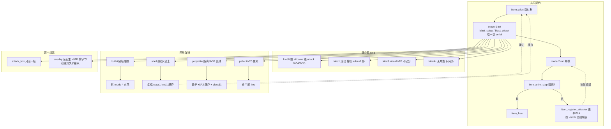

### 87.9 主线闭环与本轮边界

| 出处 | 本节对应 |
|---|---|
| §61 一次射击 | 上游生成链与「弹丸是攻击者」共性；本节补生成之后的自身生命史，不改写 §61 |
| §70 / L10265 命中 pass | 下游消费 `$671A`；本节讲谁每帧把自己写进这张表 |
| §48 / §46 / §49 判定链 | `blast_attack` 取一次 `attack_serial` 是上游调用点；判定盒与伤害不重做 |
| §43 离场回收 | 通用 `mode 6` free；本节补「谁决定什么时候走到回收」 |
| §45 / §50 绘制与对象池 | `(zi << 16)` 拼 handle 的同一排序键、`item_d7 = 23 - slot` 槽号参与相位 |
| §69 / §85 跟随对象 | 火光读宿主帧字节、轮子读车主体速度，同属「跟随者反查宿主」，不合并 |
| §21 / §62 道具池 | 同一 `items.alloc` / `item_free` 与三张注册表；本节是攻击者一面，不重做拾取面 |

- **本轮未展开（取材范围声明，非闸门）**：`EXPLOSION_TABLE 0x28102` / `BULLET_RECORDS 0x28814` / `SHELL_TABLE 0x29EB4` / `PROJECTILE_TABLE 0x2A00A` / `PELLET_RECORDS 0x2A484` 五张表的逐项数值；`bullet_init` 的 aim 表与 `+$EA` 锁定目标全文（§68 已登记 `0x69BA` 各读方）；`item_overlay` 的 `0x29C26` 逐帧偏移与 torch 帧列表内容；`hits.rs` 各 pass 逐行几何；wof 爆炸效果对象链全文。本节只记「按什么索引、起什么作用、何时结束」，**不抄表内容**（§11.0）。
- 本节 1 图 / 2 伪代码 / 7 表；**0 次 ROM 取证**，全部以两份 repo 源码为准；**未考证发行先后**，沿用用户给定前提；按 §0 边界，wof 侧 FBA 逐帧对拍修正与宿主补偿已剥掉，不据此评价 rep 侧实现。
- **本节不宣称 `长时间自主推进` 终止**，也不把「查重零匹配」当成分析完成；继续按「repo 侧为主、ROM 主要为 data 且仅在 `wof_cs` 非常可疑时才查 ROM、不过度怀疑 rep 侧、每块一提交」推进。

---

## 88. 一条脚本记录造出三个敌人：谁是真身，由池里三个地址排一次序决定

> 一句话结论：BLADE / RAZOR 不是「一个敌人带两把刀的挂件」，而是**生成那一帧先占三个 pool A 槽，把三个 handle 按地址排一次序，中间那个才被写成会思考、会挨打、会被瞄准的本体，两端只留一个反查主体的句柄**。真身身份不是脚本指定的，是池分配结果决定的；三者的生命周期从此分叉——parts 每帧读主体的 mode 与「手里还剩几把刀」决定自己是否还活着、是否显示，主体一死 parts 当帧自毁。共性（rng × variant × 距离查表选 AI 决策）已在 §6 登记，本节只补**生成之后这一组对象怎么各自活完一生**这一差异面，不重写共性。

### 88.1 本节定位与查重

- **查重**：`c14_init` / `c14_init2` / `c14_41be8` / `c14_41cd0` / `c14_41c46` / `c14_state` / `c14_tick_timer` / `c60_init` / `c60_alive` / `enemy_class60` / `0x40224` / `0x402E4` / `0x407F8` / `0x41BE8` / `0x41CD0` / `0x73214` / `0x73514` / `0x73714` / `0x73914` / `0x580C6` / `0x41D6E` / `BLADE` / `RAZOR` / `class 60` / `0x6FB6A` 在 `DESIGN_DIFF_NOTES.md` 里 Grep **零匹配**。历史命中只有 §6 / L688 / L1112 / L1113 的通用 class 10 决策（`0x4005C / 0x40118 / 0x40156`，`rng&0x1F` × variant × 距离 × aggression 查 32 行表）——那是**跨类共性**，与本节的具体机制不同层。
- **开工前六轮语义排除**（A.50.3 / A.51.3「零匹配 ≠ 机制未展开」）：`player_weapon.rs`（§21 拾取 / 空枪降级 / 分体动画）、`effect.rs` raw / pool D（§50 L6631 / L6656 / L6703、L6540、§53、§81）、`effect/fxNN.rs` 逐类（`fx_tally` §80 / `fx_time_over` §75·§76 / `fx_cloud` §56 / `fx33` §61 / `fx19` §53）、hit spark 五入口（§58 L7816–L7925）、`enemy/claim.rs`（§66 跨帧认领）、`flow/demo.rs`（§63 RAM clear / 1201 帧 / 30 条流 / pad 顶替）——全部已展开。`enemy/` 目录 72 个零提及文件绝大多数是逐类敌人实现（§41.7 / A.13 历史取材范围声明，非闸门），逐类抄表不是新横切面；只有 `class14` 家族带「跨三对象协同」的组织契约。这是「扫描结果只是线索，定题必须回到语义查重」的又一次。
- **与既有节的分工**：§50 讲「地址即身份 / handle 是槽地址」的池总表，本节是**连谁当本体都由地址定**的一个具体正面例子；§42「生成帧不跑 AI」、§43「`enemy_free_pool_a` 只清部分字段」、§59「中间态是数据不是副作用」是两阶段 init 的同族背景；§76「池满丢弃 vs 下一帧重试」、§71「装饰少一个就算了」是背压形态，本节补**原子三槽**这一种；§69 / §85 / §87 的「跟随对象反查宿主」是同族语汇，但那些读的是帧字节 / 速度 / 存在与否，这里 parts 读的是**主体的 mode 边界与剩余刀数**，不合并、不串成等价。本节没有流送游标、没有载具驾驶态、没有影片计数时间线、不并入 §19 的 5 套脚本表，也不与 §84–§87 共用「第几条推进线」的绝对编号。
- wof 侧按 §11.0 只登记不同语境的并列事实，不串成等价、不评优劣、不把未登记写成缺失；纯 repo 侧，**0 次 ROM 取证**，§11.6 未触发。

### 88.2 生成：一条记录、三个槽、一次排序

`class14.rs:1-13` 的文件头把整件事写在一句里：pool A class 14（`+$20 = 0x38`，handler `0x4020E`）是 BLADE（name 6 / variant 0）与 RAZOR（name 0x14 / variant 2）；**一条脚本记录对应三个对象**——init `0x40224` 再取两个 pool A 槽，把三个 handle 排序，中间那个转正成真身，其余两个变成 class 60 跟随 parts。

`c14_init`（`class14.rs:62-116`）分两阶段，且第一步就是一道容量门：

| 阶段 | 位置（`class14.rs`） | 这一帧做什么 |
|---|---|---|
| 容量门 | `:68-72` | `free_count() < 2` 或两次 `enemies.alloc()` 任一失败 → `enemy_free_pool_a` **整组放弃**，不是「能造几个造几个」 |
| 放回槽 | `:73-74` | 把正在更新的对象 `std::mem::take` 先放回自己的槽，三个对象随后统一设置 |
| 排序 | `:75-86` | 三个 handle `(h, j1, j2)` 三次比较冒泡；注释 `:76-77` 说明原机是符号扩展 word、池都在 0x8000 以上，故有符号 long 比较等价于无符号 word 序 |
| 转正中位数 | `:87-104` | `a1` 写成真身：`live=1`、`k20=0x38`、继承 `var26 / dir / palette_override / X Y Z`、`PART_A=a0`、`PART_B=a2`、`sub=2` |
| 两端降级 | `:105-114` | `a0` / `a2` 写成 class 60 parts：`k20=0xF0`、`var26` = 0 或 0x200、`anim_table=0x6FB6A`、`+$A0 = 0xFFFF0000 \| a1` 指回真身 |

注意 `+$A0 = 0xFFFF0000 | a1` 里的 `|` 是**位或拼句柄**（精确写法见下文伪代码），不是两列；parts 的 `+$A0` 低 16 位就是真身 handle。三向互指：真身存 `PART_A / PART_B`，两个 parts 各存真身。

伪代码（生成帧，浓缩 `class14.rs:62-116`）：

```
c14_init(e, h):                         # sub 0：只做拆分，不做真身初始化
    if e.sub != 0: return c14_init2(e, h)
    if pool.free_count() < 2: return free_all(e)     # 原子三槽，缺一即整组放弃
    j1, j2 = pool.alloc(), pool.alloc()
    if j1 == None or j2 == None: return free_all(e)
    slot[e] = e                                      # 先放回自己槽
    a0, a1, a2 = sort3(h, handle(j1), handle(j2))   # 按地址排一次序
    master = slot_of(a1)                             # 中位数才是真身
    master.live=1; master.k20=0x38; master.sub=2
    master.PART_A = a0; master.PART_B = a2
    for (p, var) in [(a0,0), (a2,0x200)]:
        slot_of(p).k20=0xF0; slot_of(p).var26=var
        slot_of(p).anim_table=0x6FB6A
        slot_of(p).master = a1                       # 反查真身
```

「真身」不是脚本里的一个编号，也不是第一个 alloc 出来的槽，而是**三个地址排序后的中位数**。§50 说「地址即身份」，这里把地址用到更前一步：连「这一组里谁负责思考、谁负责挨打、谁被 `enemy_pick_target` 选中」都由地址决定。

### 88.3 两阶段 init：生成帧不装真身的状态

`sub 0` 只把 `sub` 写成 2 就结束，真身真正的初始化要到下一次进入 `c14_init`（`class14.rs:118-135` 的 `c14_init2 0x402E4`）才做：

| 项 | BLADE（variant 0） | RAZOR（variant 2） |
|---|---|---|
| `id` / `+$84` / `anim_table` | 6 / `0x18` / `0x6DA40` | `0x14` / `0x50` / `0x6DF2A` |
| 共同 | `box_table=0x103C00`、`multi_box=false`、`param_b=1`、anim 1、speed 7、`dir=0x18`、`enemy_set_hp`、`enemy_pick_target` | 同左 |

也就是说「生成」与「成为一个可战斗的敌人」被拆到两帧：`sub 0` 是**结构**（谁是真身、谁是 parts、三条互指），`sub 2` 是**属性**（HP、判定盒、动画表、速度、目标）。与 §42「生成帧不跑 AI、离场帧不释放槽位」、§59「中间态是数据不是立即副作用」是同一种跨帧约定，本节不宣称首次。

`entrance`（`var26` 低字节，`class14.rs:8-9`）另有 8 档入口——walk in、stand and wait（`0x4B0` / `0x1E0` 帧）、从上方跳入、跳到目标、带两把刀跳入（`0x403E8`）——这是同一批三对象以什么姿态进场的参数，不改变「谁是真身」的判定。

### 88.4 三条生命周期：主体跑状态机，parts 每帧看主体的脸色

生成之后三者不再同步，各自把一生过成不同形状：

| 对象 | 每帧（`class14*.rs`） | 终止 |
|---|---|---|
| 真身（class 14） | `c14_state 0x407A2`（`class14_states.rs:10-42`）按 `+$06`（`act`）走 `0x407F8` 的 30 态跳表，每个 handler 是状态的一帧；`c14_tick_timer`（`:44-49`）把 `TIMER` 减到 0 就回 `c14_41be8` 重新决策；`:51-56` 状态 0 / 0x16 是「走到目标旁 0x38 处、到点暂停」 | `mode>=4` 的通用回收（§43）；parts 随之当帧自毁 |
| class 60 parts（两把刀） | `c60_alive`（`class14_parts.rs:43-66`）读 `+$A0` 低 16 位解 `slot_of` 拿主体；主体槽已不是 Enemy、或主体 `mode>=4` → 当帧 `enemy_free_pool_a`；`knives == 0` → return（不自毁、不显示）；第二把 part（`var26` 高字节非 0）在主体只剩 1 把刀时也 return；否则 `enemy_step` + `enemy_draw_check` | 主体死 / 不再是 Enemy 对象；刀数条件只决定「这一帧显不显示」，不结束生命 |
| 掉落的刀（class 34 `0x5129E`）/ 投掷刀（class 41 `0x55866`） | `class14_parts.rs:1-3` 文件头登记：被击且腾空时掉一把、落地另算；投掷刀另成对象 | 各自类自己的状态机，本节不展开 |

`class14.rs:174` 给出真身每帧的固定序列：`0x2B35A` → 掉刀 `0x40428` → parts 摆放 `0x41D6E` → 场地钳制 `0x193E`。也就是说 parts 的位置**由主体在自己的每帧里摆**，parts 自己只决定「要不要显示、要不要跟着走」——这与 §85 的「轮子不读输入、由车主体每帧覆写三英雄坐标」、§87 的「火光读宿主帧字节」同属「跟随者把决策权交给宿主」一族，但这里多了一条**按剩余资源（刀数）分级显示**的门：一把刀时只显示第一把 part，两把时才两把都显示。

伪代码（跟随者的一生，浓缩 `class14_parts.rs:43-66`）：

```
c60_alive(part):
    m = part.master                            # +$A0 低 16 位
    if slot_of(m) is not Enemy: free(part); return
    if master.mode >= 4: free(part); return   # 主体一死，当帧自毁
    if master.knives == 0: return             # 不自毁，只是这一帧不显示
    if part.is_second and master.knives == 1: return
    step(part); draw_check(part)              # 位置仍由主体的 0x41D6E 摆放
```

「停止显示」和「结束生命」在这里是两件事：刀用完 parts 还占着槽、每帧回来再看一眼；主体一走才真的回收。与 §87.6「停止移动 ≠ 停止当攻击者」是同一种把状态拆成两个独立判据的写法，本节不串成等价。

### 88.5 决策：两张表、一个距离档、手里还剩几把刀

真身的 `+$06` 状态机每跑完一帧计时，就回到两个 decision 之一重新选状态（`class14_entry.rs:1-3`、`:18-69`）：

| 决策 | 随机 | 索引 | 表 | 出口 |
|---|---|---|---|---|
| decision 1 `0x41BE8`（`:18-35`） | `rand() & 0x1F` | `(r<<3) + DIST + (variant<<7)` | `0x73214` | 5 个状态入口（值 1..5） |
| decision 2 `0x41CD0`（`:37-69`） | `rand() & 0xE8` | `r + DIST + (variant<<7)` | 按 `KNIVES` 选：0 把 `0x73514` / 1 把 `0x73714` / 2 把 `0x73914` | 11 个入口（含 5 个 `c14_attack_start(0..4)`） |

两个 decision 都先 `speed=5`、清 `BUSY` / `BLOCK`、调 `lib_distance_class`（`0x3293C`）把目标 X 距离写进 `DIST +$A5`；`variant << 7` 把 BLADE 与 RAZOR 塞进同一张表的两半。decision 2 先看 `c14_41c46`（`:71-76`）——目标与主体同 facing 且随机命中 `0x73494` 就**跳回 decision 1**，否则才按刀数选表。另有一张 `0x73414` 在文件头登记，本节只记「有」，不抄表内容（§11.0）。

共性（随机 × 距离 × variant 查 ROM 表）已由 §6 / L688 / L1112 登记，本节补两点差异：**手里剩余刀数参与选表**，以及**两个 decision 互为跳转、不是各自独立**。`BUSY +$A0` 是显式门：状态入口置位表示「已承诺本状态，不做新决策、不转身」，decision 清位重新开放——与 §2 四层状态字节、§20 `Scene{state,sub}`、§39 连击锁同族，本节只登记 class 14 自己的用法。

### 88.6 wof 侧不同语境的并列事实（§11.0）

| wof 侧位置 | 既有注释 / 调用面记了什么 | 与本节的语境区别 |
|---|---|---|
| `Cps1EnemySpawn.cs:1671-1676` | 一次生成三个对象 `FFCCFC / FFCDDC / FFD07C`、ObjId `0x14 / 0x1E / 0x14`，FBA 与 CS 在这三个对象的 A / B / 0x27 / 0x32 上逐字节一致 | 这是**录像对拍**的入队时机旁证，三对象是既成事实；本节讲的是生成阶段按地址排序决定谁是本体 |
| `Cps1EnemyAI.cs:2973` | `0x11884` 的 DmgReaction `0x08 / 0x10` → `0x11796`「分身替换族」入口 | 受击反应分派里的一个族入口，不是生成期拆分 |
| `Cps1EnemyAI.cs:3485-3503` | `0x121F4..0x12328` 受击「分身替换」主体，`0x1222C` 硬直递减 / 分身复制 | wof 的「分身」发生在**受击时复制**；dino class 14 的拆分发生在**生成时**，不同语境 |
| `Cps1Actor2DRuntime.cs:26-28` | f=24 三个对象都进 state 0、`jsr 0xF98` 各 1 次，f=25 被 `0x158C` 清 | 前端演出里三个对象的初始化 / 清理记录，不是敌人池的归属判定 |

四格都是两份 repo 源码里既有注释与调用面的复述和语境区分：**不串成等价、不评优劣、不把未登记写成缺失、不据此断言原机缺机制**；本节纯 repo 侧，0 次 ROM 取证，§11.6 未触发。wof 侧 FBA 逐帧对拍修正与 `_无对应ASM` 开关按 §0 剥掉，不纳入设计对照。

### 88.7 流程图（一条记录，三条一生）

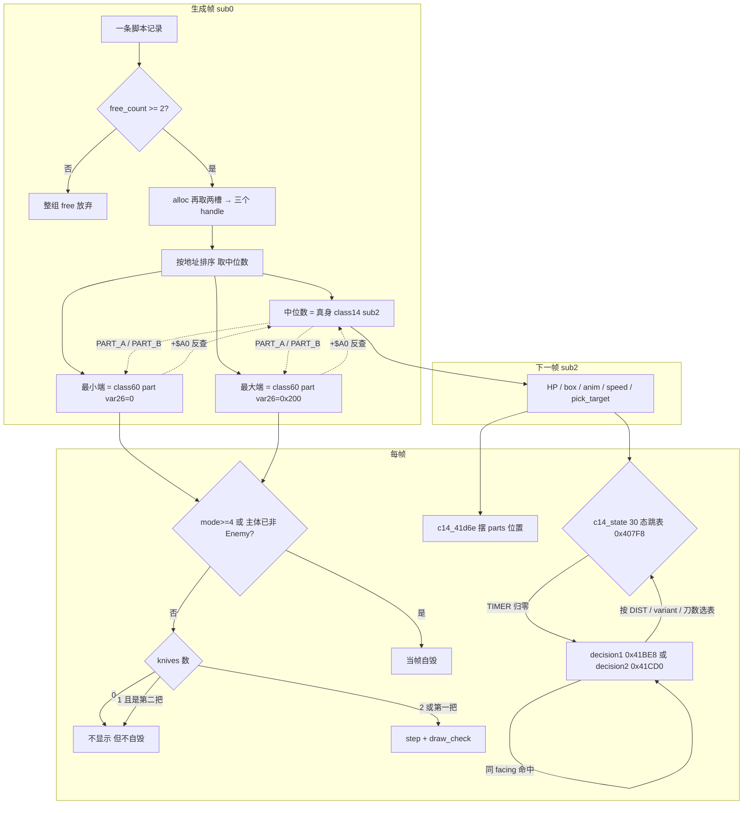

### 88.8 主线闭环与本轮边界

| 出处 | 本节对应 |
|---|---|
| §50 地址即身份 / pool A 总表 | 连「谁是真身」都由三个 handle 的地址排序决定，是正面例子，不改写总表 |
| §6 / L688 / L1112 表驱动 AI 决策共性 | rng × variant × 距离查表是共性；本节补「刀数选表 + 两 decision 互跳」 |
| §42 / §59 生成帧不跑 AI、中间态是数据 | `sub 0` 只写结构、`sub 2` 才装属性，是同一跨帧约定的一例 |
| §76 / §71 池满背压形态 | 「`free_count()<2` 整组放弃」是原子三槽，补齐背压形态的一种 |
| §43 通用回收 | parts 在主体 `mode>=4` 当帧自毁，通用 free 的上游触发点 |
| §69 / §85 / §87 跟随对象反查宿主 | parts 读主体 mode 与剩余刀数；与轮子读车速、火光读帧字节同族，不合并 |
| §66 独占写进双方对象头 | 同是「多处互指」，但那是抢资源、这是定归属，不串成等价 |

- **本轮未展开（取材范围声明，非闸门）**：`0x73214 / 0x73414 / 0x73494 / 0x73514 / 0x73714 / 0x73914` 与 `0x407F8` 六张表的逐项数值；`class14_states.rs` 30 个状态 handler 各自的逐行动作（只记「每态一帧、计时归零回 decision」）；class 34 掉落刀与 class 41 投掷刀的完整状态机；`c14_attack_start(0..4)` 五种起手；wof「分身替换族」全文。本节只记「按什么索引、起什么作用、谁决定什么时候结束」，**不抄表内容**（§11.0）。
- 本节 1 图 / 2 伪代码 / 7 表；**0 次 ROM 取证**，全部以两份 repo 源码为准；**未考证发行先后**，沿用用户给定前提；按 §0 边界，wof 侧 FBA 逐帧对拍修正与宿主补偿已剥掉，不据此评价 rep 侧实现。
- **本节不宣称 `长时间自主推进` 终止**，也不把「查重零匹配」当成分析完成；继续按「repo 侧为主、ROM 主要为 data 且仅在 `wof_cs` 非常可疑时才查 ROM、不过度怀疑 rep 侧、每块一提交」推进。

---

## 89. 舌头不是主体的一段动画：一个独立对象，靠主体广播的一个字节决定自己这一帧伸多长

> 一句话结论：Bludge 的长舌**不是主体身上一段会伸缩的帧动画，而是另一个独立的 pool A 对象**（class 0 Part 0）。主体不画它，只往自己的 `+$C3` 写一个状态码；舌头每帧读这一个字节，按码决定「伸出去 / 抓住 / 收回来 / 收好」，并且**按当前距离每 16 像素一段地现场拼一条 raw sprite list**——列表长度本身就是「舌头伸了多远」。抓住英雄后是舌头把 `+$C2` 写回主体、在送回嘴边时再写 `+$C4`，主体据此推进自己的 step、每 `0x1E` 帧扣 1 HP。这是「把一个会变长的身体部件做成一个没有 AI 的从属对象」的组织方式，与 §88 的「三槽排序定真身」、§24 的通用投技、§50 的 pool D 借用、§81 的定长 raw sprite 都不同层，本节只补这一差异面，不重写那些共性。

### 89.1 本节定位与查重

- **查重**：`enemy_class0_part` / `enemy_part0_init` / `enemy_part0_free` / `enemy_c6_alloc_pair` / `part0_out` / `part0_hold` / `part0_back` / `part0_limit` / `part0_count` / `part0_arrive` / `part0_list_held` / `c6_grab_body` / `0x33334` / `0x337DA` / `0x337E2` / `0x337EA` / `0x39CAC` / `0x3A0B4` / `0x3A0EC` / `class6_tongue.rs` / `class6_attack.rs` 在 `DESIGN_DIFF_NOTES.md` 里 Grep **零匹配**。
- **本轮最重要的一次「零匹配 ≠ 机制未展开」**：`class6_eat.rs` 的「按类别认领地上道具 / 8 格胃环 / 被打或死亡吐回」**已在 §66.4（L9439–L9498）作为「认领的第二个实例」完整展开**，`0x3AFFA` / `0x69EE` / 类别最低 / `+$AF` / `+$D0` / `0x3B086` 全有明写。所以同一个 `class6` 家族里，本节**只写舌头，不写吃道具**。这与 A.50.3 首登记、A.51.3 / A.52.3 反复印证的是同一条硬约束：**扫描结果只是线索，定题必须回到语义查重**。
- **与四条既有主线的边界**：§24 讲通用投技的「两个活对象双向互检状态字节 / 挣扎计时 / 投掷多步」，本节不重写那套协议，也不把舌头写成投技变体（这里是**一个显示 + 判定对象由主体广播状态码驱动**）；§88 讲 `class14` 一次造三槽、按 handle 排序取中位数当真身，本节是**两槽按大小分工**（`min → 舌头` / `max → 主体`），且主体是先被脚本造出来、再自己 `alloc` 出第二槽，形态不同，不合并；§50 讲 pool D「无独立 pass、被 pool B 借用」的总表结论、§81 讲 pool C class 28 的定长四态 raw sprite，本节舌头虽也借 pool D special slot，但用它是**每帧改写一条可变长度的精灵表**，只作并列、不串等价。
- **与「跟随对象反查宿主」一族**：§69 持械分体动画、§85 轮子读车主体速度、§87 火光读宿主帧字节、§88 parts 读主体 mode 与刀数，都是「跟随者读宿主」；本节多一层——**舌头不只读，还往回写** `+$C2` / `+$C4`，形成双向状态通道。沿用同一语汇，不宣称首次、不串成等价。
- wof 侧按 §11.0 只登记不同语境的并列事实，不串成等价、不评优劣、不把未登记写成缺失；纯 repo 侧，**0 次 ROM 取证**，§11.6 未触发。

### 89.2 生成：两槽按 handle 大小分工，且互相写对方的句柄

`class6.rs:1-6` 文件头把 Bludge（pool A class 6，`0x39272`）与 Part 0（class 0，`0x33334`）登记为配对的一对，后者是「舌头控制器」。`enemy_c6_alloc_pair`（`class6.rs:129-189`）是分工的落点：

| 环节 | 位置（`class6.rs`） | 这一帧做什么 |
|---|---|---|
| 取第二槽 | `:131-136` | 主体 mode 0 / sub 0 时 `enemies.alloc()` 再取一槽；失败即 `enemy_free_pool_a` 放弃 |
| 定大小 | `:138-144` | 注释明写「a0 恒为 `max(h,new_h)`、a1 恒为 `min`」——两个 handle 按地址排一次序 |
| 小者是舌头 | `:146-156` / `:181-187` | `class 0 / sub 0 / +$A0 = 主体 handle`，坐标 / variant / dir / drop 交给主体那侧继承 |
| 大者是主体 | `:158-171` / `:173-180` | `class 0x18 / sub 2 / +$C0 = 舌头 handle`，`+$C3 = 0` |
| 两向互指 | 两分支 | 舌头 `+$A0` → 主体；主体 `+$C0` → 舌头 |

与 §88 的差别要紧：**§88 是「一次造三槽、取中位数」，这里是「主体先存在、再取一槽，两个 handle 比大小」**；§88 的两端是被动 parts，这里的小者是**会自己跑 `mode 2`、会进 draw list、会进 hurtable 列表的活跃对象**。

舌头自己的 init（`enemy_part0_init`，`class6.rs:26-73`）还有两道耦合门：先读 `+$A0` 父 handle、查父 `k20 >> 8 == 0x18` 才继续（`:30-35`）；然后 `draw_special_alloc 0x48A8` 借一个 pool D special slot，**失败就把父对象 `mode = 6` 连带 free**（`:41-47`）。也就是「舌头借不到数据槽 ⇒ 这一对都不成立」，与 §88 `free_count()<2` 整组放弃是同族但不同的资源门。

### 89.3 状态码：主体写 1，舌头自己写 2 / 3 / 0 回报

`class6_tongue.rs:1-4` 文件头给出整条通道：主体 `+$C3` = 0 在内 / 1 伸出 / 2 抓住英雄 / 3 收回；`+$C2` = 1 有英雄被抓；`+$C4` = 1 已送到嘴边。关键是**这些字节不都属于主体**：主体写 1 启动，舌头在 `part0_out` / `part0_arrive` 里把 2 / 3 / 0 写回父对象。

| 字节 | 谁写 | 值 | 读它的地方 |
|---|---|---|---|
| `+$C3` | 主体 `c6_grab_body`（`class6_attack.rs:513`）写 1；舌头 `part0_out :89-94`、`part0_limit :149`、`part0_hold :108`、`part0_arrive :160/:168` 写 2/3/0 | 0 内 / 1 伸 / 2 抓 / 3 收 | `enemy_part0_run :35-49` 按码分派；`c6_grab_body :523/:532` 按码推进 step |
| `+$C2` | 舌头 `part0_out :93` 写 1 | 1 = 抓住了一个英雄 | `c6_grab_body :495`（开始扣血）、`:520`（转 step 4）；`part0_back :126`、`part0_arrive :157` |
| `+$C4` | 舌头 `part0_arrive :160` 写 1 | 1 = 已拖到嘴边 | 主体后续抓取 step |
| `+$A6` | 舌头本地 | 上一帧的 `+$C3` | `enemy_part0_run :40-43`：码变了就 `act = 0` 重开本阶段 |

`enemy_part0_run`（`class6_tongue.rs:16-54`）是舌头一生的每帧骨架：先解父 handle，父 `hp == 0` 或 `mode >= 4` 就自毁；父处于 `kind == 0xE` 或 `(mode,sub) == (2,2)` 时把 `+$C3` 清 0；再按 `c3` 分派 `1 part0_out / 2 part0_hold / 3 part0_back`；可见就进 draw list、进 hurtable 列表。**舌头自己不决定要不要攻击**——那一步由主体的攻击脚本给出。

主体侧 `c6_grab_body`（`class6_attack.rs:493-537`）是另一半：`+$C2 != 0` 时 `+$C5` 每帧减 1，借位就重装 `0x1E`、给目标玩家 `hp -= 1` 并刷血条；`step 0` 走完写 `+$C3 = 1` 启动舌头；`step 2` 见 `+$C2` 置位转 step 4，见 `+$C3 == 3` 走回收；`step 6` 要等 `+$C3` 回 0 才推进。**两条状态机各跑各的帧，靠四个字节对齐**。

伪代码（双向状态通道，浓缩 `class6_tongue.rs:16-54`、`class6_attack.rs:493-537`）：

```
# 主体：sub 4 抓取态
c6_grab_body(master):
    if master.C2 != 0:                       # 舌头已经抓住人
        master.C5 -= 1
        if borrow: master.C5 = 0x1E; hero.hp -= 1; refresh_lifebar()
    if master.step == 0 and step_done():
        master.C3 = 1                        # 命令：伸出去
    if master.step == 2:
        if master.C2: master.step = 4        # 舌头回报：抓住了
        elif master.C3 == 3: grab_back()     # 舌头回报：空手收回
    if master.step == 6 and master.C3 == 0: master.step = 8

# 舌头：独立 pool A 对象，每帧只读/写父对象的几个字节
part0_run(tongue):
    master = slot_of(tongue.A0)
    if master.hp == 0 or master.mode >= 4: free_special(); free(tongue); return
    c3 = master.C3
    if c3 != tongue.A6: tongue.act = 0       # 码变了就重开阶段
    tongue.A6 = c3
    if   c3 == 1: part0_out()
    elif c3 == 2: part0_hold()
    elif c3 == 3: part0_back()
    if tongue.visible: draw_list.push((zi << 16) | handle)
    push_hurtable(handle)
```

### 89.4 会变长的身体部件：每 16 像素一段，长度就是状态

舌头最特别的一处不是「抓取」，而是**它怎么被画出来**。`class6_tongue.rs:1-4` 明写：舌头是 pool D block（`+$98`）里的一条 raw sprite list，`+$A4` 指向这张表的 count word，**每 16 像素一段**。

| 项 | 位置（`class6_tongue.rs`） | 值 / 做法 |
|---|---|---|
| 数据槽 | `:41-63`（在 `class6.rs`） | `draw_special_alloc 0x48A8` 借 pool D slot，清 128 字节，把 `0x3375C` 模板拷进去 |
| 段数 | `part0_count :172-176` | `count = abs(锚点 - 当前 X) >> 4 + 2`——**距离除以 16 直接决定列表长度** |
| 首段 | `part0_list_reset :178-182` / `part0_list_held :184-187` | 普通态拷 `TIP 0x337DA` 8 字节；抓住英雄后首段覆写成 `HELD 0x337E2` 8 字节 |
| 长度上限 | `part0_limit :145-151` | `abs(距离) >= 0xC8` 就写父 `+$C3 = 3` 收回 |
| 速度 | `part0_out :76` / `part0_back :122` | 伸出 ±`0x600`，收回 ±`0xA00`（回来更快） |
| 判定盒 | `class6.rs:66` + 文件头 | `box_table 0x337EA` 的 box 1 是舌头本体，碰到英雄才进入抓取判定 |

伪代码（一条长度随距离变化的精灵表，浓缩 `class6_tongue.rs:60-97`、`:145-187`）：

```
part0_out(tongue):
    if tongue.act == 0:
        anchor = master.x + (facing ? 0x50 : -0x50)
        tongue.x, tongue.y = anchor, master.y + 0x30
        tongue.vx = facing ? 0x600 : -0x600
        special.count = 1                    # 只有一段舌尖
        special[0] = TIP(0x337DA)
        return
    motion(tongue)
    d = |anchor - tongue.x|
    if d >= 0xC8: master.C3 = 3; return     # 够不着，收回
    special.count = (d >> 4) + 2            # 每 16 像素一段
    if box1(0x337EA).touches(hero) and can_grab(hero):
        part0_grab(hero)
        master.C2 = 1; master.C3 = 2        # 回报：抓住了
        tongue.timer = 100
        special[0] = HELD(0x337E2)          # 首段换成「带着英雄」的图
    else:
        master.C3 = 3                       # 碰到但不能抓，收回
```

也就是说「舌头伸了多远」没有专门的变量，**它就写在列表的段数里**；`+$C2` 是否置位则写在首段那 8 个字节用的是 `TIP` 还是 `HELD`。与 §45「一条全池 draw list + 固定排序键」、§81「pool C class 28 两个定长 raw sprite 各四态」不同：这里**列表内容与长度每帧被玩法状态改写**。按 §11.0 只登记「按什么索引、起什么作用、何时结束」，不抄 `0x3375C` 模板与两张 8 字节表的数值。

### 89.5 抓住之后：两段独立计时、一个位置里程碑

抓住英雄不是一次命中事件，而是一段被两边各自计着的托管：

| 侧 | 计时 / 判据 | 位置 |  release 条件 |
|---|---|---|---|
| 舌头 | `+$80 = 0x64`（100 帧），到 0 写父 `+$C3 = 3` | `part0_out :95` / `part0_hold :99-110` | 英雄 `action != 0x40` 就 `part0_release` |
| 主体 | `+$C5` 每帧减 1、借位重装 `0x1E` 并扣 1 HP | `c6_grab_body :495-507` | `+$C3 == 3` 走 `c6_grab_back`、`+$C3 == 0` 才推进 step |
| 回收 | 带英雄到距锚点 `0x60` 像素 → 写 `+$C4 = 1` 并释放；空手回锚点 → 写 `+$C3 = 0` | `part0_arrive :153-170` | 英雄 `action != 0x40` 同样提前释放 |

两条「英雄已不在被抓态」的检查分别在 `part0_hold :102` 与 `part0_back :128`，且都通过 `part0_action`（`:137-143`）从 target handle 解 `Slot::Player` 读 `players[p].action`。与 §24 通用投技的「任一方离开约定状态就自动解散」是同一取向，但本节多一层：**显示对象（舌头）也独立持有 release 判据**，而且「送回嘴边」不是靠计时、是靠 `0x60` 像素的位置阈值触发 `+$C4`。

主体的攻击脚本（`class6_attack.rs:1-6`）给出这条通道的上游：`SCRIPTS 0x39CAC` 是 `+$B4` 索引的字节串，命令 0 走到英雄旁 / 2 跳 / 4 扑 / 6 冲 / 8 长舌跳 / 0xA 吐酸球 / 0xC 用舌头抓，`>= 0x80` 结束；`c6_script_next :49-61` 读到 0xC 就写 `state 0x0204_0000` 转 sub 4，才由 `c6_grab_body` 写 `+$C3 = 1`。**舌头从不被脚本直接点名，脚本只把主体推进到「该伸舌头」的状态**。

### 89.6 生命周期耦合：父死子立即归还两个槽

| 事件 | 舌头这一帧 | 位置 |
|---|---|---|
| 父 `hp == 0` 或 `mode >= 4` | `enemy_part0_free` → 先 `draw_special_free 0x498C` 归还 pool D，再 `enemy_free_pool_a 0x48FC` | `class6_tongue.rs:19-28`、`class6.rs:87-91` |
| `+$A0` 解出的槽已不是 Enemy | 同样自毁 | `class6_tongue.rs:19-21` |
| `draw_special_alloc` 失败（init 时） | 父 `mode = 6` 连带放弃，舌头自毁 | `class6.rs:41-47` |
| 父 `kind == 0xE` 或 `(mode,sub) == (2,2)` | 清 `+$C3 = 0`；若 `+$C2` 还置位则 `sub = 0` | `class6_tongue.rs:29-34` |

与 §87 parts 读宿主、§88 parts 读主体 mode 同族，但舌头**自己占着一个 pool D 数据槽**，所以自毁要多一步「先还数据槽再还对象槽」；`enemy_part0_free` 把这两步写成一个不可拆的顺序。§43 的通用 `mode 6` 回收、§50 的 pool D 借用在这里是上游背景，不重做。

### 89.7 wof 侧不同语境的并列事实（§11.0）

| wof 侧位置 | 既有注释 / 调用面记了什么 | 与本节的语境区别 |
|---|---|---|
| `Cps1PlayerLogic.cs:3989` | `1C1F8 cmpa.w $6a(a1),a0`：被抓者 `+$6A` 反查持有者 | §24 通用投技里「双向互认」的一处指令，属**两个活对象**；本节是主体与一个显示对象之间的状态字节通道 |
| `Cps1PlayerLogic.cs:4755` | `1C81A tst.w $82(a1)`：抓取段读被抓者 HP | 抓取段对 HP 的一次检查；本节是主体按 `0x1E` 帧计时扣血，且由 `+$C2` 门控 |
| `Cps1EnemyAI.cs:3485-3503` | `0x121F4..0x12328` 受击「分身替换」主体、`0x1222C` 硬直递减 / 分身复制 | 受击时复制对象；本节是生成时把两槽按 handle 分工，不同语境 |
| `Cps1EnemySpawn.cs:1671-1676` | 三对象 `FFCCFC / FFCDDC / FFD07C`、`ObjId 0x14/0x1E/0x14` 逐字节一致 | 录像对拍的入队时机旁证；本节是「谁当舌头」由地址大小决定 |

四格都是两份 repo 源码里既有注释与调用面的复述和语境区分：wof 侧没有舌头机制的直接注释，**不臆断其有无、不串成等价、不评优劣、不把未登记写成缺失、不据此断言原机缺机制**；本节纯 repo 侧，0 次 ROM 取证，§11.6 未触发。wof 侧 FBA 逐帧对拍修正与 `_无对应ASM` 开关按 §0 剥掉，不纳入设计对照。

### 89.8 流程图（一条字节通道，两条状态机）

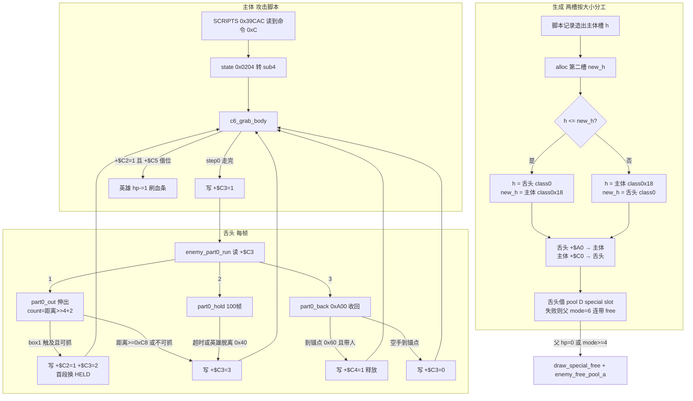

### 89.9 主线闭环与本轮边界

| 出处 | 本节对应 |
|---|---|
| §24 通用投技 | 双向互检 / 挣扎计时是背景；本节补「显示对象也独立持有 release 判据」「位置阈值 0x60 触发 `+$C4`」 |
| §88 三槽转正 | 同是「地址决定身份」，但两槽按大小分工、小者是活跃对象，不合并 |
| §50 pool D 借用 | 舌头借 special slot 存**可变长度**精灵表；总表结论不改写 |
| §81 pool C raw sprite 四态 | 定长四态 vs 每帧按距离改段数，不同层、不串等价 |
| §45 / §69 / §85 / §87 跟随对象 | 舌头不只读宿主，还回写 `+$C2` / `+$C4`；同族不合并 |
| §66.4 认领地上道具 | 同属 `class6` 家族但已完整展开，本节不重复 |
| §43 / §50 回收与借槽 | `enemy_part0_free` 先还数据槽再还对象槽，是不可拆顺序 |

- **本轮未展开（取材范围声明，非闸门）**：`SCRIPTS 0x39CAC` 各脚本字节、`0x3375C` 模板与 `TIP` / `HELD` 两张 8 字节表的数值、`SLOTS 0x3AA9E` 六个攻击槽位 `(dx,dz)`、`part0_touch` / `part0_can_grab` / `part0_grab` / `part0_release` 逐行几何、hop AI 与四入口逐帧、`class6_eat.rs` 吃道具全文（§66.4 已登记）、wof 抓取段全文。本节只记「按什么索引、起什么作用、谁写哪个字节、何时结束」，**不抄表内容**（§11.0）。
- 本节 1 图 / 2 伪代码 / 7 表；**0 次 ROM 取证**，全部以两份 repo 源码为准；**未考证发行先后**，沿用用户给定前提；按 §0 边界，wof 侧 FBA 逐帧对拍修正与宿主补偿已剥掉，不据此评价 rep 侧实现。
- **本节不宣称 `长时间自主推进` 终止**，也不把「查重零匹配」当成分析完成；继续按「repo 侧为主、ROM 主要为 data 且仅在 `wof_cs` 非常可疑时才查 ROM、不过度怀疑 rep 侧、每块一提交」推进。

---

## 90. 破墙不是每个机关各写一遍：等几帧、换一片格子、造一个火花、响一声，被拆给一个公共节拍和类自己的表

> 一句话结论：pool B 机关的「破」不是一段会播放的动画，而是**一条四步流水线 + 一份类自带的表**；**什么时候做**由驱动器管（一个 countdown、两个全局字节、一条 mode 链），**做什么**由类自带的表管（哪几片格子、几号特效、哪一声响）。连「第一个运行帧就换一套颜色」都不是显式判断，而是 `subq.b` 把一个 0 减成借位长出来的。共享服务层的存在在 §35 / §36 已登记，本节只展开这三条节拍内部怎么组织、差异压在哪。

### 90.1 本节定位与查重

- **查重**：`PaletteCycler` / `prop_palette_copy` / `prop_palette_cycle` / `prop_burst_fire` / `prop_burst_step` / `prop_burst_arm` / `prop_burst_wait` / `BurstWait` / `BurstAction` / `BurstSpec` / `B60` / `B61` / `B63` / `0x94640` / `class 21` / `prop_c21_spawn` 在 `DESIGN_DIFF_NOTES.md` 里 Grep **零匹配**。
- **但「共享服务层」不是新发现**：`§35` 的 L5048 已明写「共享层 = 契约（hit_init / register_hit / break）+ 服务（`drivers.rs` 四类）」，`§36` 实例表第 7 项（L5118）已登记 `prop_tile_clock` 的「当前相位与上一帧相位不等才重画」，`prop.rs:1-29` 的可破坏物四段契约也在 §35（L4998–L5027）完整展开。本节**不重写契约、不重写 tile clock**，只写「三条节拍各自的时间从哪来、内容从哪来、差异压在哪」。这是「零匹配 ≠ 机制未展开」的又一次成组应用（A.50.3）。
- **与既有主线的边界**：§73 是三层环形 tilemap 的写入服务（写哪里），本节是「谁决定这一帧要不要写」（什么时候写）；§80 是 flow/tally 驱动两格 sprite palette 0xB / 0xC 的结算闪烁，本节是场景机关共用一条 lane 链并保留亮度 nibble；§84 是摄像机跨格补边，本节是机关自己的节拍；§70 三 pass 打箱子、§87 池 E 生命史、§88 三槽、§89 舌头都不合并、不串等价。
- **未接线边界（本节最重要的一条自律）**：`prop/drivers.rs:27-28` 是 `#![allow(dead_code)]`，注释明写「A service for the scenery prop tasks of M3: nothing calls it before the first of them is ported」；`prop.rs:29` 说这三类服务「shared by the later classes」，`:45-47` 才把 `drivers` 声明为模块。**repo 侧当前没有类调用链**。本节只登记源码注释钉死的原机节拍（按 §11.0 记按什么索引、起什么作用、何时结束），**不据此断言 rep 侧已生效、不写成「dino 有统一机关驱动」、不评价 rep 侧完成度**；按「不过度怀疑 rep 侧」也不反向怀疑这些注释。
- wof 侧按 §11.0 只登记不同语境的并列事实，不串成等价、不评优劣、不把未登记写成缺失；纯 repo 侧，**0 次 ROM 取证**，§11.6 未触发。

### 90.2 三条共享节拍总表

`prop/drivers.rs:1-3` 把自己定位成「pool B tile 与 palette props 的共享服务」，并且「类自带表，服务层不抽取表内容」（nothing is extracted here）。三条节拍都遵循同一条分工：

| 节拍 | 时间由谁决定 | 内容由谁决定 | 谁先做退出检查 | 出处（`drivers.rs`） |
|---|---|---|---|---|
| 调色板循环器 | 对象头 `+$A4` 一个 byte countdown，借位才步进；重装 `+$A5` | 类给 `PaletteLane{dest,count,list}` 链，驱动器按 step 取 long 当颜色集 | 类：stage / area 门不满足就 free | `:5-10`、`:51-87`、`:192-212` |
| tile clock | 两个全局字节 `G.$7AE`（这一帧）与 `G.$7AF`（上一帧）不相等 | 0 / 4 / 8 / 12 是图片表 `0x78646` 的字节索引 | 读者自己：`beq` 跳过重写 | `:11-15`、`:34-49`、`:167-172` |
| burst | 对象 mode 链 `0 → 2 → 4 → 6`，加一个 word 或 byte 等待计数 | 类给 `BurstAction{tiles,attrs,effect,sound}`，驱动器只按序执行 | 驱动器：mode ≥ 6 当帧 free | `:16-21`、`:89-165`、`:214-336` |

一句话：**驱动器不认识任何一张表的内容，只认识「这一帧该不该走一步、走第几步」**；类也不自己数帧，只把自己的表交给驱动器、并在进入节拍前做一次场地检查。§87 把「差异压在 init 一次写入」、§88 把「谁是真身压在地址序」、§89 把「伸多长压在列表段数」——本节是同一取向的第四种写法：**把「什么时候」和「做什么」拆到两个地方**。

### 90.3 调色板循环器：把「借位」当步进信号

`prop_palette_cycle`（`drivers.rs:192-212`）一帧只做一件事：把 `+$A4` 减 1。**只有当减出来的值是 `0xFF`（即从 0 借位）才走一步**；否则这一帧什么都不写。走一步时重装 `reload`（`+$A5`），把步字 `+$B0` 加 1、到 `steps` 就归零，然后逐条 lane 从 `lane.list` 取第 `step` 个 long 当颜色集去 copy。

| 项 | 值 / 做法 | 出处 |
|---|---|---|
| 步进判据 | `subq.b #1,+$A4` 后 `bcs`，即 0 减成 `0xFF` 才步进 | `:196-201`、`:5-6` |
| 重装值 | `+$A5` = 8 → 每 9 帧一步（B60 四套共 36 帧）；16 → 每 17 帧一步（B61 / B63） | `:6-7`、`:63-66` |
| 起始帧 | `PaletteCycler::start` 把 `+$A4` 与步字清 0，**第一个运行帧必然借位、必然写一套颜色** | `:81-86` |
| 写入原语 | `prop_palette_copy`：`(old & 0xF000) 或 source`，逐色写 `pal.dirty = true`，带 palette RAM 边界断言 | `:174-190`、`:8-9` |
| 两级共用 | B60 / B61 / B63 共用 countdown；B71 `0x89746` 与闪电 `0x77FF6` / `0x78170` 各用自己的计时器，**只共用这一条 copy** | `:5-10` |
| 退出 | 类自己先做 stage / area 门，门不满足就 free；驱动器不判断场地 | `:193-194` |

伪代码（浓缩 `drivers.rs:81-86`、`:192-212`）：

```
# 类：每次 update 前
if not stage_area_ok(p): free(p); return
prop_palette_cycle(p, c)

prop_palette_cycle(p, c):
    n = p.A4 - 1                      # subq.b，byte 回绕
    p.A4 = n
    if n != 0xFF: return false        # 没借位，这一帧不写
    p.A4 = c.reload                   # 重装 +$A5
    step = p.B0
    p.B0 = 0 if step + 1 >= c.steps else step + 1
    for lane in c.lanes:
        set = table_long(lane.list, step)
        prop_palette_copy(lane.dest, set, lane.count)
    return true                       # 这一帧写了

prop_palette_copy(dest, set, count):
    for k in 0..count:
        pal[dest + k] = (pal[dest + k] & 0xF000) or table_word(set, k)
    pal.dirty = true
```

与 §80 的差别要紧：那里是 flow/tally 按 `(best)` 把 0xB / 0xC 两格 sprite palette 隔 4 帧切一次、由 `flow.rs:658` 重建 pool C 才结束；这里**没有顶层任务、没有结束条件**，一个 byte countdown 一直循环，直到类自己的场地门把它 free 掉。同是「改调色板」，一个是结算演出的一次性状态机，一个是场景机关的常驻心跳，不串成等价。

### 90.4 tile clock：两个全局字节差一帧就是「该重画了」

`prop_tile_clock(gf)`（`drivers.rs:34-38`）是 Episode 8 area 1 实测窗口的闭式：`((gf + 60) / 24 mod 4) * 4`，得 0 / 4 / 8 / 12 四个相位；`_prev(gf)` 是上一帧的相位，`_edge(gf)` 就是「两者不等」。读者 `0x7862A` 拿 `G.$7AE` 与 `G.$7AF` 比，相等就 `beq` 跳过重写。这两个字节同时是 scroll2 的 `+$72` / `+$73`，由 `tile_anim_tick`（stage 4 每 8 帧 `0x20956`、stage 7 每 24 帧 `0x2097C`）推进；`prop_tile_phase`（`:167-172`）在运行时直接读 `cam.s2.phase72` / `prev73`，闭式留作测试用。

**§36 实例表第 7 项（L5118）已把「相位不等才重画 / 重画比相位变化晚一帧」登记完**，本节只把它放回三条节拍的并列位置：它和调色板循环器一样，把「要不要动」编码成两个字节的关系，而不是给每个机关各挂一个计时器。按 §11.0 不展开各关相位表。

### 90.5 burst：一条四步流水线，五类机关共用

`prop_burst_step`（`drivers.rs:270-287`）是整条节拍的骨架：

| mode | 这一帧做什么 | 下一 mode | 出处 |
|---|---|---|---|
| 0 arm | 按 `BurstWait` 写等待计数并进 mode 2；`Now` 当帧 fire 后置 6 | 2 或 6 | `:289-309` |
| 2 wait | word `+$A0` 或 byte `+$80` 减 1；归零进 mode 4，`Open` 立刻 fire 并置 6 | 4 或 6 | `:311-336` |
| 4 fire | `prop_burst_fire` 按序写 tiles、attrs、effect、sound，然后 `mode = 6` | 6 | `:277-280`、`:214-233` |
| 6 及以上 | 当帧 `prop_free`（`0x4938`，各跳表最后一项） | 回收 | `:270-272`、`:282-285` |

`prop_burst_fire`（`:214-233`）的顺序是**固定的**：先逐块 `prop_tile_block`（`BurstBlock{at,cols,rows,src,mode}`），再逐块 `prop_tile_attr_block`（`BurstAttr{at,cols,rows,keep,or_bits}`），然后可选的 pool C class 21 特效，最后音声（`BurstSound::Break` → `snd_break(x)`；`Request{code,d1,d2}` → `snd_request`；`Quiet` 无声）。注释点名两处细节：B11 的 `0x78A38` 与 B42 把 break 音放在 tiles **之前**，驱动器放在**之后**；两条路径都不取 `rand`，所以排队的请求是同一条。池 C 满时 `0x94646 bcs` 让 `prop_c21_spawn` 静默返回，但 mode 照常推进——与 §76「池满少一个就算了」同族。

`prop_c21_spawn`（`:235-248`）造的是 class word `0x54`（class 21）的 pool C 对象，坐标取 prop 自身 XYZ，`var` / `facing` 由类给；`prop_burst_effect`（`:265-268`）只是把这几项从 prop 拷过去。也就是说**破墙的火花不是机关画出来的，是机关在 fire 那一帧临时造的另一个池对象**。

### 90.6 四种等待形状：「什么时候触发」被压成一个枚举

`BurstWait`（`drivers.rs:89-105`）把五个机关原本不一样的分支压成四个变体；`prop_burst_arm` / `prop_burst_wait`（`:289-336`）只有一份实现。

| 形状 | 机关 | 计数器 | 触发时机 | 为什么 |
|---|---|---|---|---|
| `Open(w)` | B4 `0x767EC` / B52 `0x8518C` | word `+$A0` | `w=1` 时第一次 update 就开门 | arm 里 `subq.w` 的 fall-through 把 1 吃掉了（`:93-96`、`:298-301`、`:330-333`） |
| `Hold(w)` | B14 var 0 `0x7B0E2` | word `+$A0` | `w=8` 在第 9 次调用才写 | 零计数只把 mode 推到 4，swap 是**下一次**调用（`:97-98`、`:329-335`） |
| `Armed(w)` | B11 `0x78A20` | byte `+$80` | `w=3` 在第 5 次调用 swap | arm 写完 byte 直接 `rts`，不 fall-through（`:100-102`、`:303-307`、`:314-317`） |
| `Now` | B42 `0x83A1E` | 无 | mode 0 当帧完成 | mode 0 直接落进 swap（`:103-104`、`:292-297`） |

最容易误读的是 `Open(1)`：`prop_burst_arm` 写 `w=1` 后立刻 fall-through 到 `prop_burst_wait`，wait 再减 1 得 0，于是**第一次 update 就 fire**。源码注释把「生成后那一帧没有被 update」本身写成设计里的「等 1 帧」（`:94-96`）。也就是说等待长度不是从某个「开始时间」算的，而是**由 mode 链有没有多走一次调用**决定的。与 §86 影片时间线「计数撞表只跑一个 handler、淡入淡出期间计数不走」是同一类「帧数由控制流形状决定」的写法，不合并。

### 90.7 类自带表、两条例外、以及边界

`BurstSpec{wait, action}`（`:155-160`）里的 `BurstAction{tiles, attrs, effect, sound}`（`:146-153`）注释只有一句：**「The class owns the tables」**。驱动器拿到的已经是一组矩形、一个可选特效、一个音声枚举；它不查 ROM 表、不决定形状，只按 `BurstWait` 数帧、按固定顺序执行。这与 §19 五套表、§87「差异压在 init 一次写入」是同一取向，但粒度不同：这里连「等几帧」也被抽成了一个枚举值，类连计时器都不用自己写。

两条例外必须一起记，否则会把服务层写成全覆盖：

| 例外 | 做法 | 出处 |
|---|---|---|
| B12 var 0 `0x78B86` | 是一张 **block table**（`tile_block.rs`），根本不是 burst | `:18` |
| B12 var 4 `0x7900E` | 自己写 tiles 与六个属性格，造 pool C class 0x28 碎片 `0x93362`、放音 0x37，**不调驱动器** | `:18-20` |

再加 §11.0 的取材边界：本节不抄 `0x78646` 图片表、`0x78B86` block table 与任何 `PaletteLane.list` 的数值，只记「按什么索引、起什么作用、何时结束」。**`drivers.rs` 当前 `dead_code`、repo 侧无类调用链**（`:27-28`、`prop.rs:29`）——这是本节的硬边界：三条节拍是源码注释对原机行为的记录，不据此断言 rep 侧已把它们接上，也不评价移植完成度。按 §0，wof 侧宿主补偿与 `_无对应ASM` 开关不纳入设计对照。

### 90.8 wof 侧不同语境的并列事实（§11.0）

| wof 侧位置 | 既有注释 / 调用面记了什么 | 与本节的语境区别 |
|---|---|---|
| `Cps1CameraRuntime.cs:702` / `:725` | 相机跨列 / 跨行时更新 Scroll2（`Cps1StageTileStreamer`） | §84 已用作并列事实；语境是卷屏补边，不是机关自己的节拍 |
| `Cps1CoroutineScheduler.cs:1113-1117` | `includePaletteStep: false`，FBA 实测 f=9918 的任务体 | 协程让出帧时是否附带一个 palette 步；本节是对象头 countdown 借位步进 |
| `Cps1Actor20Runtime.cs:229-231` / `Cps1Actor25Runtime.cs:155-157` | `ProfilePaletteTable + +0x17` 逐对象查表写 `+0x5F` 等字段 | 对象级 palette profile；本节是场景机关共用一条 lane 链写 palette RAM |
| `Cps1Actor21Runtime.cs:37` | palette 表读出后写对象头 `+0x9A` / `+0x9C` | 对象头 palette 字段；本节不碰对象头、只改 palette RAM 与 `pal.dirty` |

四格都是两份 repo 源码里既有注释与调用面的复述和语境区分：wof 侧没有「机关破墙共享节拍」的直接注释，**不臆断其有无、不串成等价、不评优劣、不把未登记写成缺失、不据此断言原机缺机制**；本节纯 repo 侧，0 次 ROM 取证，§11.6 未触发。wof 侧 FBA 逐帧对拍修正与 `_无对应ASM` 开关按 §0 剥掉，不纳入设计对照。

### 90.9 流程图（时间归驱动器，内容归类）

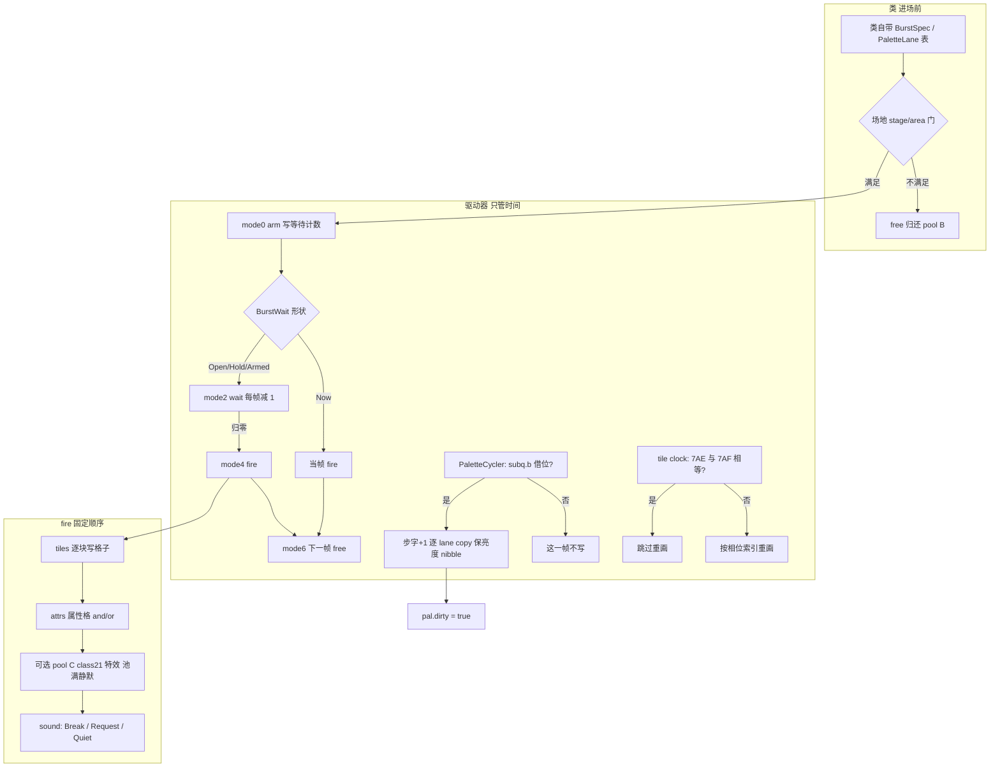

### 90.10 主线闭环与本轮边界

| 出处 | 本节对应 |
|---|---|
| §35 可破坏物契约 / L5048 共享层 | 共享层的存在已登记；本节补三条节拍内部的时间 / 内容分工 |
| §36 实例表第 7 项 tile clock | 已登记「差一帧重画」，本节只作并列，不重写 |
| §73 三层 tilemap 写入服务 | 写哪里 vs 本节「谁决定这一帧要不要写」 |
| §80 结算两格 palette 闪烁 | 一次性演出状态机 vs 场景机关常驻心跳，不串等价 |
| §84 摄像机补边 | 卷屏驱动 vs 机关自己的 countdown，不同触发源 |
| §87 / §88 / §89 差异面切分 | 同一取向的第四种写法：把「什么时候」与「做什么」拆到两处 |
| §51 RNG 单流 | burst 全程不取 RNG，是另一种帧契约，不并入 RNG 主线 |

- **本轮未展开（取材范围声明，非闸门）**：各机关自带表的数值、Episode 8 以外各关相位表、`prop_tile_block` / `prop_tile_attr_block` 内部写法、`snd_break` / `snd_request` 的音声表、`prop.rs` 可破坏物四段契约全文（§35 已展开）、`drivers.rs` 测试模块；wof 侧 `Cps1StageTileStreamer` 全文。本节只记「按什么索引、起什么作用、何时结束」，**不抄表内容**（§11.0）。
- 本节 1 图 / 2 伪代码 / 9 表；**0 次 ROM 取证**，全部以两份 repo 源码为准；**未考证发行先后**，沿用用户给定前提；**明写 repo 侧调用链尚未接线**，不据此断言 rep 侧已生效、不评价移植完成度。
- **本节不宣称 `长时间自主推进` 终止**，也不把「查重零匹配」当成分析完成；继续按「repo 侧为主、ROM 主要为 data 且仅在 `wof_cs` 非常可疑时才查 ROM、不过度怀疑 rep 侧、每块一提交」推进。

---

## 91. 刀掉在地上不是丢了一件东西：Butcher 的四份句柄把一把刀换过三次对象

> 一句话结论：两把刀不是主体身上的贴图，而是两个独立 pool A 对象（class 52）；主体对象头用**四个 handle 字段**同时记「现在持有」与「掉在地上要追的那一个」。掉落不销毁也不生成，只是把同一个对象的 `sub` 写成 8；落地那一刻刀**自己**变成 pool E 道具并把新句柄**回写主体**；捡回来也不是复用旧物，而是造一把全新的刀。于是「同一把刀」在四段里是三个对象实例，**身份从未连续，连续的是主体那几个句柄字段**。

### 91.1 本节定位与查重

- **本节只写一件事**：`enemy/class61.rs` / `class61_states.rs` / `class52.rs` 里「Boss 掉了武器以后怎么还认得它、怎么拿回来」这一条跨帧契约。Butcher 是 Episode 2 Boss（class 61，handler `0x58498..0x5A47C`），`class5.rs` 改写 class 字并清 state，init 在下一帧跑；原机是一整段例程带「跳进别的状态中间」的分支，repo 侧保留地址当块名（`class61.rs:1-6`）。这些是源码自己的组织，不是移植完成度判断。
- **语义查重（A.50.3 双向化：零匹配不等于未展开，有匹配不等于已展开）**：
  - §88 的 class14 掉刀是**新造 class34 对象**，落地 `c34_make_knife_item` 造 pool E variant 4 道具，主体**不留 handle 副本、不追刀**（`class14_parts.rs:68-140`）；L13798 已明写「各自类自己的状态机，本节不展开」。同为「敌人武器落地变可拾取道具」，机制不同，**只作并列、不串等价、不评优劣**。
  - §62 的 `item_drop_roll`（L8541–L8657）是死亡链把「位置 + 行号」交给 roll 表、进 `$69EE` 拾取列表；Butcher 的刀**不 roll、不进 `$69EE`**，是主体已有对象的状态迁移加定向回写。§21 道具双向迁移是玩家侧那条链，不同语境。
  - §66.4 是 Bludge 按类别认领地上道具（`class6_eat.rs`），§77 是 pool E `item_follow_hand` 读宿主 `+$60` attach 索引；本节是 pool A 刀对象由主体每帧查偏移表写坐标（`class61.rs:650-690`），同族不同池。
  - §89 舌头、§88 parts、§87 火光、§69 持械分体都是「跟随者读宿主」；本节多一层「跟随者落地后替宿主改字段」，是双向但不同形态。
  - §88 L13823 的「刀数参与 decision 表」是 class14 的两张表；Butcher 的 `c61_5a1ea` 是另三张表（`0x73ED4` / `0x73FD4` / `0x740D4`，按 0 / 1 / 2 把选），不重写、不合并。
- **主文件零匹配面**：`A52` / `c61_` / `class52.rs` / `0x57298` / `0x5A280` / `0x586D6` / `0x58752` / `KNIFE_A2` / `variant 0x12` 在既有 §0–§90 全部零匹配；只有 L11036 / L11110 提过 `lib_face_target` 给 Butcher 决策 roll 留 `frame_w1`，不是本节机制。**但零匹配只作线索**，上面五条排除链才是定题依据。
- wof 侧按 §11.0 只登记不同语境的并列事实，纯 repo 侧，**0 次 ROM 取证**，§11.6 未触发；`_无对应ASM` 开关与 FBA 逐帧对拍按 §0 剥掉。

### 91.2 四个句柄字段：同一把刀为什么要两份

`class61.rs:15-53` 的 `o::` 常量里，两把刀各占两个 word：

| 字段 | 偏移 | 造刀时指向 | 谁写 | 谁读 | 语义 |
|---|---|---|---|---|---|
| `KNIFE_A` / `KNIFE_B` | `+$A6` / `+$A8` | A52 刀对象（variant 0 / 0x100） | `c61_make_knives`、`c61_s10` | `c61_tail_knives` 每帧跟手 | 现在**持有**的那两把 |
| `KNIFE_A2` / `KNIFE_B2` | `+$B4` / `+$B6` | 同一个刀对象（初始就是副本） | `c61_knife_drop`、`c52_falling`、`c61_s10` | `c61_knife_pickup`、`c61_s12` | 掉在地上**要追**的那一个 |
| `KNIVES` | `+$BE` | 0 起，造两把后 2 | 造刀 / 掉落 / 捡回 | 决策表、跟手循环、拾取门 | 持有数量，不是字段数量 |
| `FLAG_AC` | `+$AC` | 0 | `c61_knife_drop` | 同一次受击的重复门 | 一次击倒只掉一把 |

- `c61_make_knives`（`class61.rs:132-153`）循环两次 `enemies.alloc()` 造 `k20=0xD0` 的 class 52，`var26` 给 0 / 0x100，`+$A0` 写 owner；**每把刀的 handle 同时写进持有字段和副本字段**，`KNIVES=n+1`。所以初始四个字段里，A 与 A2 指向同一个对象，B 与 B2 同理——「副本」从第一帧就存在，不是掉落时才建。
- 池满时 `alloc()` 返回 `None` 就 `return`，`KNIVES` 停在 0 或 1；这是资源门，不是错误分支（`class61.rs:132-153`）。
- 与 §88「三个 handle 按地址排序取中位数定真身」、§89「两槽按大小分工」同族（地址即身份），但这里是**一个主体加两件武器加两份副本字段**，不是造槽定身份；不合并。

### 91.3 一把刀的四段生命史：三个对象实例

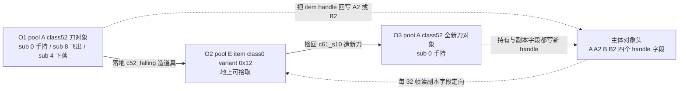

- **O1**：`c61_make_knives` 造出的 class 52 对象。手持时 `sub 0`，主体每帧写它的坐标与 picture（`class61.rs:650-690`）；击倒时 `sub=8`，它自己跑 `8 → 4` 的抛物线（`class52.rs:125-138`、`class52.rs:79-105`）。
- **O2**：落地时 `c52_falling` 用 `items.alloc()` 造的 pool E 道具（class 0，variant `0x12`，英雄可捡的 Butcher 刀）。O1 随即 `mode=4` 自毁（`class52.rs:79-105`）。**这一刻身份从 pool A 换到 pool E**。
- **O3**：`c61_s10` 捡回时 `enemies.alloc()` 造的**全新** class 52，旧的 O2 被 `mode=4` 移走（`class61_states.rs:521-560`）。
- 所以「同一把刀被捡回来」在对象层面不成立：**三个对象实例、两次换身份**；主体从头到尾只靠「写哪个字段、回写哪个字段」维持追踪。

### 91.4 掉落：不销毁、不生成，只改一个 sub

```text
c61_knife_drop (0x586D6, class61.rs:592-625)
  if KNIVES <= 0: return
  if (mode, sub) != (2, 2): FLAG_AC = 0; return     # 不是击倒受击态
  if act != 4 and act != 6: return                   # 只认击倒类受击
  if (rand() and 0xF) >= 8 or FLAG_AC != 0: return  # 半率 + 一次受击只掉一把
  KNIVES -= 1
  knife = (left == 0) ? KNIFE_A : KNIFE_B            # 第二把先掉
  copy  = (left == 0) ? KNIFE_A2 : KNIFE_B2
  write(copy, read(knife))                           # 复制到副本字段
  FLAG_AC = 1
  if slot_of(knife) is Enemy(i): enemies[i].b.sub = 8
```

- 关键：**持有字段不清零**。`KNIFE_A` / `KNIFE_B` 仍指向那把已经飞出去的旧对象；让它「不再算持有」的是 `KNIVES` 减 1——`c61_tail_knives` 只按 `KNIVES` 逐把跟手（`class61.rs:650-660`），旧对象从此不再被主体每帧写坐标。这一层「计数即身份边界」是 repo 侧如实写法，不臆断原机另有清空。
- `slot_of(knife)` 只解 `Slot::Enemy`：掉落时刀一定还在 pool A。落地后才可能变 `Slot::Item`，那条路在 91.5。
- 与 §87「攻击者身份是每帧声明」同族（状态字改身份），不串等价：这里改的是同一个对象的 `sub`，身份没换，只是进入下一段。

### 91.5 落地：刀自己换池，并把新句柄回写主体

```text
c52_falling (0x57368, class52.rs:79-105)
  motion()
  if yi() < 0 or airborne == 0:                    # 落地
      if items.alloc() is Some(a):
          item = pool E slot a; k20 = 0; var26 = 0x12; 坐标取刀
          owner = read(knife.+$A2)                 # 主体 handle
          field = (knife.var26 >> 8 == 0) ? 0xB4 : 0xB6
          write(owner.field, items.handle(a))      # 回写主体副本字段
      knife.mode = 4                               # 刀自毁
      return
  enemy_step(); draw_check()
```

| 时刻 | 副本字段 `+$B4` / `+$B6` 指向 | 主体能否定位到刀 |
|---|---|---|
| 造刀后 | 同一个 pool A 刀对象 | 能，但 `KNIVES=2` 时不用它追 |
| 掉落瞬间 | 同一个 pool A 刀对象（`sub=8`） | 能，`slot_of` 解出 `Slot::Enemy` |
| 落地回写后 | 新的 pool E item 对象 | 能，`slot_of` 解出 `Slot::Item` |
| `items.alloc()` 失败 | 仍是旧的 pool A 句柄（刀已 `mode=4`） | 按 repo 侧如实登记，不臆断后续 |

- **这就是拾取与 dash 里 `slot_of` 同时接受 `Slot::Item` 与 `Slot::Enemy` 的原因**（`class61.rs:627-648`、`class61_states.rs:562-599`）：主体不关心刀现在属于哪个池，只认「句柄解出来的那一槽」和它的 `(mode,sub)`。
- 按刀 `var26 >> 8` 选 `0xB4` / `0xB6`，与造刀时 variant 0 / 0x100 的配对一致——**身份的连续性由 variant 高字节和句柄字段一起维持**，不是由对象自己维持。
- `items.alloc()` 失败时刀只把自己 `mode=4`，副本字段没被改写；这是资源门，按 repo 侧如实登记，不臆断后续有没有兜底，也不评优劣。

### 91.6 拾取：不扫列表，只查一个已知句柄

```text
c61_knife_pickup (0x58752, class61.rs:627-648)
  if KNIVES >= 2 or act != 0x12: return          # 只在 dash 中、且手不满
  knife = (KNIVES == 0) ? read(+$B4) : read(+$B6)
  b = slot_of(knife) 的槽                         # Item 或 Enemy 都接受
  if b is None: return
  if (b.mode, b.sub) != (2, 0): return           # 地上物件 idle
  if above(b.x, 0x20, self.x, 0x40): return      # X 窗口
  if above(b.z, 0x10, self.z, 0x20): return      # Z 窗口
  if b.y != self.y: return                        # 同高度
  write(+$A0, 1); act = 0x10; enemy_anim(5)
```

- `above(target, add, mine, limit)` 是 `class61.rs:56-59` 对原机 `addi / sub / cmpi / bhi` 的复刻：`(target + add - mine)` 当无符号 word 大于 `limit` 才为真；两轴窗口加 Y 相等，是**位置判据而不是类别判据**。
- 与 §66 认领（每帧重建候选表、读上一帧 `0x69BA`）不同路：**这里不扫任何列表，只查一个已知句柄**。这是「对象间引用用 handle 直连」的一个极端例子。
- 命中后只是转 `act 0x10`，真正的换对象在下一步（`class61_states.rs:521-560`）。

### 91.7 捡回：造新刀加移除旧物，与掉落不对称

```text
c61_s10 (0x5959E, class61_states.rs:521-560)
  if not enemy_step(): return                    # 等抓刀动画播完
  if KNIVES < 2:
      second = (KNIVES != 0)
      a = enemies.alloc()                        # 全新的 class 52
      new.var26 = second ? 0x100 : 0
      new.+$A0 = owner; new.anim_table = 0x6F8A6
      (copy, knife) = second ? (B2, B) : (A2, A)
      old = read(copy)
      if slot_of(old) is Item(i):  items[i].var26 = 0; items[i].mode = 4
      if slot_of(old) is Enemy(i): enemies[i].var26 = 0; enemies[i].mode = 4
      write(knife, handle(new)); write(copy, handle(new))
      KNIVES += 1
  c61_tail_knives(); c61_59e08()
```

- 掉落是「改 `sub`、保留对象」，捡回是「造新对象、移除旧对象」，**两边不对称**；持有字段与副本字段在捡回后**都写新 handle**，又回到 91.2 的初始形态。
- 旧物移除同样同时处理 `Slot::Item` 与 `Slot::Enemy`（`class61_states.rs:547-553`）：因为拾取可能发生在刀还在飞（pool A）或已经变道具之后，主体不预先假设池类属。
- 因此「三次对象」的最后一换发生在这一帧：O2 被 `mode=4`，O3 被造出来，四个句柄字段里两个被覆写。

### 91.8 dash 是「追刀」：装备状态同时改两条线

| 线 | 谁读 `KNIVES` | 效果 | 出处 |
|---|---|---|---|
| 出招分布 | `c61_5a1ea` 按 0 / 1 / 2 把选 `0x73ED4` / `0x73FD4` / `0x740D4` | 32 行乘 8 的随机行加 X 距离类查出 1..9 号动作（连击 / 旋 / 跳 / dash） | `class61.rs:490-513` |
| 导航目标 | `c61_s12` 每 32 帧读副本句柄坐标 | `enemy_angle_to` 朝**刀**定向，而不是朝英雄 | `class61_states.rs:562-599` |
| 每帧跟手 | `c61_tail_knives` 按 `KNIVES` 循环 | 只给「还持有」的刀写坐标与 picture | `class61.rs:650-690` |
| 拾取门 | `c61_knife_pickup` | 手不满才在 dash 路上查一个句柄 | `class61.rs:627-648` |

```text
c61_s12 (0x59678, class61_states.rs:562-599)
  TIMER -= 1; if TIMER == 0: c61_5a186()
  A3 -= 1
  if A3 == 0:
      A3 = 0x20                                  # 每 32 帧重定向一次
      OLD_DIR = dir
      if KNIVES < 2:
          who = (KNIVES == 1) ? +$B6 : +$B4
          (sub, kx, kz) = slot_of(read(who))      # Item 或 Enemy 都接受
          if sub == 8: c61_5a186()                # 刀还在飞，放弃这次 dash
          dir = enemy_angle_to(kx, kz)            # 朝刀
  lib_face_target(); enemy_move_dir(); c61_knife_pickup(); enemy_step()
```

- 「朝刀定向」之后仍 `lib_face_target()` 面向英雄：方向与面向是两件事，前者给位移，后者给绘制与判定。
- `sub == 8` 就放弃这次 dash，说明主体**知道刀还在空中**，宁可等它落地变成 idle 的 `(2,0)` 再追；这是把「目标是否可用」压在目标对象的 `sub` 上，而不是压在自己的计时器上。
- `slot_of` 解不出时拿到 `(0, 0, 0)` 仍会算一次方向（`class61_states.rs:578-592`）；按 repo 侧如实登记，不臆断原机另有兜底。
- 与 §88 L13823 的 class14「刀数参与 decision 表」只作并列：那边是 parts 显示与决策表，这边是**同一字节同时改出招分布和导航目标**，不重写、不合并。

### 91.9 生命周期耦合与资源门

| 情形 | 谁发现 | 动作 | 出处 |
|---|---|---|---|
| 主体死亡 | **刀每帧反查** `+$A2` owner，`mode >= 4` | 当帧 `enemy_free_pool_a` | `class52.rs:41-48` |
| 主体死亡路径本身 | `c61_dying` | 音乐淡出 / `flow.speed=1` / 120 帧 / 记分 / 交 leader，**不碰任何刀字段** | `class61.rs:551-571` |
| 造刀池满 | `c61_make_knives` 的 `alloc()` 返回 `None` | 提前 `return`，`KNIVES` 停在 0 或 1 | `class61.rs:132-153` |
| 落地道具池满 | `c52_falling` 的 `items.alloc()` 返回 `None` | 不回写，刀只 `mode=4`，副本字段仍指旧句柄 | `class52.rs:79-105` |
| 捡回池满 | `c61_s10` 的 `alloc()` 返回 `None` | `c61_5a186` 放弃这次抓刀，旧物不动 | `class61_states.rs:521-560` |

- **生命周期是单向反查**：主体不负责清理刀，刀每帧自己读 owner 的 `mode`；`c61_dying` 里一个刀字段都没有。这与 §89「父死立即由子对象先还 pool D 数据槽」同族（子对象自己收尾），但这里没有额外的数据槽，不串等价。
- 跟手是主体读自己帧字节 `+$2D`（0x63 / 0x5A 归一成 0x15）当行号，按刀 `var26 >> 8` 选 `0x57480` / `0x57558`，每行 8 字节给 `dx/dy/dz/pic`；facing 镜像 dx，`pic == 0x5A` 隐藏这一帧，帧字节变化才 `start_anim`（`class61.rs:650-690`）。与 §77 pool E 跟手「读宿主 `+$60` attach 索引查表」同族不同池，不合并。

### 91.10 wof 侧并列事实、边界与未展开

| 出处 | 既有注释 / 调用面 | 语境（按 §11.0 只记不同语境） |
|---|---|---|
| `Cps1EnemyAI.cs:29724` | `弓箭手_取武器槽_部分对应ASM_13EE(out uint weapon)`，随后写 `weapon+0x00` / `+0x20` / `+0x22` | Actor 从武器槽取一件武器并初始化其字段 |
| `Cps1PlayerLogic.cs:6323-6326` | `关羽_站立拾取近接_可能对应ASM_1E9D8`：地面物近接扫描，池 1 命中进公共拾取，池 2 命中先释放旧武器再把新地面物挂到 `OBJ+8C` | 玩家按键触发的拾取扫描 |
| `Cps1PlayerLogic.cs:6555` | 拾取后玩家 `+0x8C = BC9C` 记武器对象（注释记 FBA 实测） | 玩家对象头单个武器指针 |
| `Cps1MiscObjRuntime.cs:36-44` | `A5+0x32C` / `A5+0x320` 拾取缓冲队列指针与数量 | 宿主侧缓冲队列 |

- 四格都是两份 repo 既有注释 / 调用面复述，**不串成等价、不评优劣、不把未登记写成缺失**；wof 侧未见「Boss 掉刀后留句柄追回」的直接注释，按 §11.0 不臆断、不据此断言原机缺机制。
- **未展开清单（取材范围声明，非闸门）**：`class61_moves.rs` 的逐 move block、`class61_states.rs` 剩余 30 态 handler、`TURN_TABLE 0x5986C` / `SLOT_DX 0x32EA4` / `SLOT_DZ 0x32EB2` 逐项、`c61_decide` 三张 decision 表逐行数值、boss controller 的 group 链、以及 `0x5A33A` 受击 / `0x5A3CA` 尸体段。本节只写「四份句柄加换对象」这一条契约，不抄表、不并入 §19 五套表、不改写 A.13 / A.15–A.54 任何历史回执。
- 与 §88 / §89 的三槽、两槽并列：三者都是「地址即身份」，但分别解决「谁是真身」「谁是舌头」「掉了以后怎么还认得」，不合并成一个「多对象模式」。
- 本节不宣称 `长时间自主推进` 终止；继续按「repo 侧为主、ROM 主要为 data 且仅在 `wof_cs` 非常可疑时才查 ROM、不过度怀疑 rep 侧、每块一提交」推进。

---

## 92. 按住攻击或跳，过场快进三倍：快进的不是帧率，是「一轮任务」在一个 vblank 里跑几遍

> 一句话结论：玩家按住攻击或跳时，脚本化的过场约三倍速走完，但**没有任何动画被调快、没有任何计时常数被改**；变的是「一个 vblank 里把一整轮任务跑几遍」。所有按轮计数的 `sleep(n)` 因此约 n 轮就结束，而投币中断、输入 cooking 与 `prev` 快照、显示锁存仍每个 vblank 只做一次。§47 / §64 只把 `skip_wait_rounds()` 登记为 `tick` 调度链的一格，本节展开它内部「什么按轮算、什么按 vblank 算」的契约。

### 92.1 本节定位与查重

- **本节只写一件事**：`flow/skip.rs` 的 skip wait task `0x9E38C` 与 `game/mod.rs:328-346` 的 `tick()` 全序，怎么把一个按键变成「整条任务轮重复三遍」。这是玩家可感知的节奏控制（过场能不能催、催了以后输入还准不准），不是移植完成度判断。
- **语义查重（A.50.3 / A.54.2 双向化）**：
  - §47 / §64 的调度链里 `skip_wait_rounds` / `0x9E38C` / `skip_tick` / `flow_round_start` **有匹配**（L146、L163、L2740、L2806、L2812、L2842、L2845、L6359、L6380），但都是「`tick` 第 7 步」「lag 字段表」「跨 vblank 续算点」这类**步骤名与字段清单**，没有写「按住键为什么能三倍、哪些工作不跟着快进」。这是「**有匹配 ≠ 已展开**」的再一次成组应用，与 §90 `drivers.rs`、§35 共享层同构。本节不重写调度链、不重列 14 调用。
  - §57 三类计时器里的 `scripted != 0` 是「挡住续关倒计时 / HUD / waveTimer」的**全局暂停门**；本节 `script.b4d8 & 1` 是「允许快进」的**准入位**，由脚本动作 `0x28`（`0x1DEA0`）置、脚本结束（`0x1E2BE`）清。同一字节在两条线上生效，不合并、不串等价。
  - §60 长任务跨帧写的是 2000 格写入被 video frame 边界**切断**、`CUTS` / `ranking_cut` / `task.wait` 续算点；本节是「一个 vblank **塞进**几轮」的输入快进，方向相反，不重写 `CUTS`。`record.lua` / game clock 记录合并按 §0 剥掉。
  - §86 影片时间线是 attract 任务「计数撞表只跑一个 handler、淡入淡出期间计数不走」（1480 计数跨 1745 帧）；本节是 **in-game scripted 场景**按住键，计数照走三遍。不同阶段、不同机制；`profiles.rs` 的 1200 计数跨 1398 帧与 §86 同构，只作并列。
  - §81 打字机 fast 是攻击键**边沿**「`now != before` 且 `== 0x10` 才一次打完，按住或带方向不跳」；§55 续关是 `press & 0x30` 每按一次 `frames = 60; seconds--`（按键一次换一秒）。本节读的是 **cooked pad 电平**、持续生效。三条都是「按键加速一段演出」，判据与作用域各不相同，只作并列、不合并。
  - §14 输入边沿 / §45 渲染延迟 / §56 `pal.latch` 一帧延迟：本节只借「哪些工作每 vblank 一次」这一层，不重写输入层与渲染优先级主线。
  - 附录 A 的两套循环 / lag / FBA vs MAME 是阶段 A 工程路线存档，按 §0 隔离，本节不重提工程结论。
- **主文件零匹配面**：`SKIP_ROUNDS` / `skip_wait_active` / `skip_join_more` / `0x4CC` / `0x4D8 bit 0` / `2.2 轮` 全部零匹配；但定题依据不是零匹配，是上面七条语义查重。
- wof 侧按 §11.0 只登记不同语境的并列事实，纯 repo 侧，**0 次 ROM 取证**，§11.6 未触发；`_无对应ASM` 开关与 FBA 逐帧对拍按 §0 剥掉。

### 92.2 两层时间：一轮任务，一个 vblank

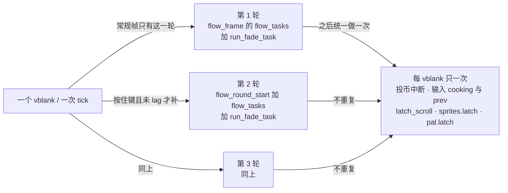

- **一轮** = 一次 `flow_tasks()`（system / join / game / intro / tally 按槽序）加一次 `run_fade_task()`；`game_frame()` 内部仍是 §47 已展开的 `rank_tick / objects_update / collision / hud_update / build_sprite_list`（`game/mod.rs:348-355`），本节不重写。
- **一个 vblank** = 一次 `tick()`，尾部还有投币中断、输入 cooking 与 `prev` 字节、三个 display latch（`flow/skip.rs:18-20`、`game/mod.rs:328-346`）。
- 常规帧两层是 1:1；按住键时变成 3:1。**「快进」只是这个比值变了**，两层内部各干什么一个字都没改。

### 92.3 准入四门：电平，不是边沿

`flow/skip.rs:33-41` 的 `skip_wait_active()` 把四个条件压在一个表达式里：

| 门 | 判据 | 出处 | 不成立时 |
|---|---|---|---|
| 在一局里 | `flow.in_game != 0`（原机 `G.$4CC`） | `flow/skip.rs:37` | 标题 / attract / boot 一律不快进 |
| 脚本控制中 | `flow.script.b4d8 & 1 != 0`（动作 `0x28` 置、`0x1E2BE` 清） | `flow/skip.rs:37`、`flow/skip.rs:5-6` | 玩家自由行动时不快进 |
| 按住攻击或跳 | `w.input[i] & 0x30 != 0`，cooked pad **电平** | `flow/skip.rs:40` | 纯方向 `0x0F` 不算 |
| 英雄在场 | `players[i].b.live != 0`，`(0..3).any` | `flow/skip.rs:40` | 缺席英雄的按键不算 |

```text
skip_wait_active (flow/skip.rs:36-41)
  if in_game == 0 or (script.b4d8 and 1) == 0: return false
  return any(i in 0..3: players[i].live != 0 and (input[i] and 0x30) != 0)
```

- **电平而非边沿**是最要紧的一格：它每轮都重查，所以「按住」期间三轮都成立；松手那一帧条件立刻失效，节奏回到 1:1（`flow/skip.rs:102-123` 单测钉死）。与 §81 打字机 fast 的「边沿一次打完」正好相反，两者不合并。
- `0x30` 同时认攻击与跳跃；单测 `the_condition_needs_a_game_the_script_flag_and_a_held_button_of_a_present_hero` 逐门验证：不在局里 false、`b4d8=0` false、`0x20` true、`0x0F` false、英雄缺席 false、3P 在场 true（`flow/skip.rs:80-100`）。
- `G.$4AA` 的 debug 分支在 repo 侧未移植（`flow/skip.rs:34-35`）；按 repo 侧如实登记，不臆断其原机行为、不评优劣。

### 92.4 tick 全序：第一轮、额外两轮、每 vblank 一次

```text
tick (game/mod.rs:331-346)
  cam.display_y2 = cam.s2.cam_y; cam.display_y1 = cam.cam1_y   # 帧首快照
  w.sounds.clear(); w.snd_reqs.clear()
  flow_frame()            # 第 1 轮：flow_tasks
  run_fade_task()         # 第 1 轮的 fade 一步
  skip_wait_rounds()      # 可能再补 2 轮
  cam.latch_scroll(regs); sprites.latch(); pal.latch()          # 每 vblank 一次

skip_wait_rounds (flow/skip.rs:45-55)
  flow.skip_tick = skip_wait_active()
  for _ in 1..SKIP_ROUNDS:            # SKIP_ROUNDS=3，最多 2 次迭代
      if not skip_wait_active() or flow.lag > 0: break
      flow_round_start()              # 补跑跨 vblank 续算点（§47）
      flow_tasks()
      run_fade_task()
```

| 位置 | 做什么 | 按轮还是按 vblank | 出处 |
|---|---|---|---|
| `flow_frame()` | 第一轮任务（system / join / game / intro / tally） | 按轮 | `game/mod.rs:337` |
| `run_fade_task()`（tick 内） | 第一轮的 fade 一步 | 按轮 | `game/mod.rs:338` |
| `skip_wait_rounds()` | 最多两轮 `flow_round_start + flow_tasks + run_fade_task` | 按轮 | `flow/skip.rs:45-55` |
| `cam.latch_scroll` / `sprites.latch` / `pal.latch` | 显示锁存，注释明写显示的是两帧前 scroll X / sprite list、一帧前 scroll Y 与 layer regs | 按 vblank | `game/mod.rs:340-345` |
| 投币中断 / 输入 cooking / `prev` 字节 | 中断工作 | 按 vblank | `flow/skip.rs:18-20` |

- **额外轮排在中断工作之前**：三个 latch 在 `skip_wait_rounds()` 之后才做，且只做一次。所以按住键期间新按下的边沿仍按 vblank 采样，不会因为在第三轮里被读三次而变成三次按下；§45 / §56 的一帧 / 两帧显示延迟也不被压缩。
- `flow_round_start()` 在每一轮开头补跑跨 vblank 的续算点（`SlideOutEnd` 那两条指令，§47 L2740 / L2842）；额外轮同样先走它，因此「跨帧续算点」在快进时也是按轮推进的，本节不重写 §47 的续算点机制。
- skip wait task 本身是**最后一个任务槽 0xF0**，每 pass yield（`flow/skip.rs:1-9`）。它不改任务槽顺序，只在自己这一轮里请求「再跑一轮」；没有任何子系统被单独加速。

### 92.5 按轮算与按 vblank 算：一次快进到底改了什么

| 现象 | 常规帧 | 按住键 | 为什么 |
|---|---|---|---|
| `sleep(n)` 的任务 | 约 n 个 vblank 后醒 | 约 n 轮后醒，即约 n/3 个 vblank | 计数器每轮减一次，中断每 vblank 才减一次；skip 让所有任务的计数按轮走 |
| 16 步 fade | 16 个 tick | 6 个 tick | 单测 `16-3 / 16-6 / 松手 16-7`（`flow/skip.rs:102-123`） |
| game task `sleep(G.$4D6 & 15)` | 每 vblank 一个 game frame | 每轮一个 game frame | `flow/skip.rs:8-9` |
| 脚本化行走 / 换区 / 登场 | 正常速度 | 约三倍 | 同一条 `flow_tasks` 被跑了三遍 |
| 投币 / 输入边沿 / 显示锁存 | 每 vblank 一次 | **仍每 vblank 一次** | `tick` 尾部，不进 `flow_tasks` |
| `G.$0000` | 由 game task 与 demo 计数 | 随 game task 按轮计数 | `game/mod.rs:328-330`；boot / title 保持 0 |

- 一句话：**能被快进的是「任务自己数了几轮」，不能被快进的是「硬件这一帧发生了什么」**。这解释了为什么按住键催过场不会把「新按下」这个判据也催成三次——`prev` 字节仍按 vblank 更新。
- 与 §86 的对照最清楚：那里「计数撞表只跑一个 handler、淡入淡出期间计数不走」，计数**不走**；这里计数**照走三遍**。同为「一个计数器 × 一个 handler 表」的形状，不同阶段不同用法，不串等价。

**〔本轮回源补层：玩家问「画面为什么突然慢下来」，答案是顶层抽逻辑帧〕** §92.5 那张表的 `sleep(G.$4D6 & 15)` 只讲了「按住键快进」这一头；反方向「游戏自己让逻辑帧少跑几拍」一直散记没归拢：`speed=3` 在 §16.2、`speed=4` 与 `rank_speed_add(1)` 并排挤在 §30.5 对照表「慢动作」一格且标「本轮未展开，不臆断」、`flow.speed=1` 在 §61 死亡路径。玩家真正看到的是：打掉 Boss 一个中间形态、或把关卡 Boss 击破那一瞬，画面忽然变慢，过一会儿自己恢复。按 §94.11 不动历史表格，在这里把机制与触发点收齐。

- **机制不是「每个计时器乘个系数」**：`flow_game_task`（`flow.rs:472-508`）每个 vblank 被调一次，但 `wait > 1` 就自减 `return`，**这一拍整个 `game_frame()` 不跑**；`wait = flow.speed & 0xF`（`:481`），字段注释明写 `G.$4D6 game task period in frames (1 normal, 4 = slow motion after a boss)`（`:146`）。帧号只在真正跑 mode 时才 +1（`:483-489`），所以慢动作是「一整个游戏帧被跳过」，`game_frame()` 内 8 步固定序、census 帧首封账、隔帧相位门这些**帧内**约定一个都不改，只是好几个 vblank 才轮到跑一次；也**不需要任何子系统为慢动作改代码**——它们数的都是 game frame，帧号走得慢，全体自动一起慢。
- **接续契约 `0xA92A`**（`:503-506`）：sleep 在 mode 跑完之后才读 `G.$4D6`，所以 mode 里刚设的 speed 从**当前这个 game frame** 就生效，不会晚一轮；`resume` 或 mode 自设 wait 的则保留原值。⇒ 击破 Boss 当场 `flow.speed=4` 立刻慢，等 Boss 进死亡态（`0xAB44`，`:778-781`）设回 1 才恢复。
- **触发点全集（§94.17 回源数写入点，限 repo 侧）**：`flow.speed` 的赋值只有 **1 / 3 / 4** 三档——`4` = 击破关卡 Boss `flow_boss_defeated 0xACEE`（`flow.rs:824`）；`3` = 中间形态命中、**不结束战斗**（`boss_common.rs:292`、`enemy/class4.rs:227`、`class94.rs:785`，§16.2 已登记）；`1` = 恢复正常。在 repo 全域 `flow.speed` 的写入点里，恢复都靠各处显式写回 1、没有「某帧计数器到阈值自动清除」这一路（`0xA92A` 只改 `flow.wait`）——开局 / 续关 / demo 入口（`flow.rs:388`、`cont.rs:167`、`demo.rs:440`）、`0xAB44` 收尾主线（`flow.rs:781`）、以及各 Boss / 主体自己的 dying 分支（`class4:242/248`、`class94:804`、`class36:723`、`class72:365`、`class61:557`）。`select.rs:613`、`demo.rs:384/511` 都是**读** `speed & 0xF` 去设各自的 wait（分别给 `flow.wait` 与 front task 的 task wait），不是写 speed。
- **两套 `speed` 别混**（本段最该防的误读）：`flow.speed` = `G.$4D6`，game task 周期、1/3/4 帧、管画面与逻辑推进；`rank.speed` = 动态难度档位 0..15（`mame_check.rs:1575` 记作 `G.$5F6 speed`），`rank_speed_add`（`rank.rs:224`）带 `freeze`、clamp、按 `2*speed` 索引 `RANK_PERIOD` 重装 rank 计时器（`:169`），§25 已登记。`flow_boss_defeated 0xACEE`（`flow.rs:821-829`）是**同一事件各写两套系统**：`:824` 写 `flow.speed=4`、`:829` 调 `rank_speed_add(1)`——不是「慢动作顺带把难度调了」。§30.5 对照表把两者并排写进「慢动作」一格，读时按这里拆开，别串因果。

**倒推（说人话）**：dino 把「快 / 慢」收在**最顶层一个节拍器**上——不是每个动画、每个计时器、每个敌人各乘一个慢放系数，而是「这一拍要不要跑一整个游戏帧」。因为整局玩法都规规矩矩挂在同一个帧号上、帧内顺序固定，只要帧号走得慢，所有东西自动一起慢，且慢的时候谁先谁后、上一帧的账、隔帧错开这些约定全不破。§92.5 的「按住键快进」是同一根发条往另一头拧：快进是一拍里把 flow tasks 多跑几遍，慢动作是一拍里干脆不跑 game frame。这是一页意图里 dino「把这一帧做什么、下一帧读什么写成显式结构」的又一实例——**正因为一帧是原子的、可整体跳过的，快慢才能只动一处**。按 §11.0 不推断 wof 对应机制（§30.5 wof 侧那格「未展开，不臆断」保留）；按 §94.17 只限定到 repo 源码检索面，不写「原机所有版本都只有 1/3/4」；按 §94.23 不重述 §16.2 / §25 / §30 / §61 已登记内容；按 §0 剥掉 `trace.rs` 的 `slow`（逐帧对拍设施）与单测断言里的 `rank.speed` 赋值。ROM 本轮 0 次，条件通道未触发。

### 92.6 三不是常数：CPU 时间与 lag 门

| 场景（repo 侧注释给的录制） | 一个 vblank 塞几轮 | 备注 |
|---|---|---|
| 换区淡出 `m517_ep1_jack` | 2.2 | fade-out 11 步跨 5 个 video frame |
| 整段 lag 记录 | 3.1 | 43 game frames 在 14 vblanks，含 area setup |
| `ep6_jack` | 4 | 139 在 35 |
| `ep7_3p`（重场景） | 1.7 | 15 在 9 |
| 端口取值 | **固定 3** | `SKIP_ROUNDS`（`flow/skip.rs:31`），上面实测的中值 |

- 原机「一个 vblank 能塞几轮」**不是代码里的数**，由一轮的 CPU 时间决定（一个 game frame 占三分之一到半个 vblank，重场景 / 换区 setup 更多）；端口取固定 `SKIP_ROUNDS=3`，注释明写「frames are not record exact」（`flow/skip.rs:11-16`）。按 repo 侧如实登记，**不评价移植完成度、不把这些实测数值当 ROM 表抄进正文、不据此断言原机有某个固定档位**。
- `flow.lag > 0` 时额外轮立即 `break`（`flow/skip.rs:48`）：一轮自己都超过一个 vblank 了，就塞不进第二轮。这是资源门，不是错误分支。
- `skip_join_more()`（`flow/skip.rs:57-61`）在 area change 期间（fade task 在跑，或相机 `mode==1` 且 `sub` 为 4 / 6 / 8）把多个 tick 并成一条 game clock 记录；这是**宿主侧记录口径**，按 §0 剥掉，只登记其存在，不写成设计差异、不评价 rep 侧实现。

### 92.7 单测钉死的三条行为

| 单测 | 断言 | 出处 |
|---|---|---|
| 准入四门 | 不在局里 / `b4d8=0` / 纯方向 / 英雄缺席都不成立；`0x20` 跳与 3P 成立 | `flow/skip.rs:80-100` |
| fade 三倍 | 第一个 tick `16-3`、第二个 `16-6`、松手后 `16-7`，`skip_tick` 随松手变 false | `flow/skip.rs:102-123` |
| 记录合并 | 无 fade / 无换区 false；相机 `mode=1,sub=4` 或 fade task 在跑 true；`skip_tick=false` 时 false | `flow/skip.rs:125-140` |

- 第二条是「快进 = 轮数 ×3」最硬的行为证据：它不测任何计时常数，只测「一个 tick 里 fade 少了几步」和「松手后立刻回到一步」。按 repo 侧如实登记，不外推到未测场景。

### 92.8 与既有主线的并列边界

- **§57 全局时间门**：`scripted != 0` 在那里是「挡住续关倒计时 / HUD / waveTimer」；在这里是「允许快进」的准入位。同一字节两条线，不合并。
- **§81 / §55 / §14**：打字机 fast 用边沿一次打完、续关用「按一次换一秒」、输入层用 `prev_input` 快照；本节用电平持续生效，且 `prev` 快照按 vblank 更新这一层恰好解释了「为什么持续按住不会把边沿判据催坏」。
- **§86 / §63 / §60**：attract 计数不走、长任务被边界切断、demo 预录输入，都是「一个计数器怎么跨帧」的不同写法；本节是「一个按键让整条任务轮重复」，只作并列、不串成一个「时间系统」。
- **§47 / §64**：调度链第 7 步的展开，不重写 14 调用与 lag 字段表。

### 92.9 wof 侧并列事实、边界与未展开

| 出处 | 既有注释 / 调用面 | 语境（按 §11.0 只记不同语境） |
|---|---|---|
| `Cps1EventObjectRuntime.cs:5088-5090` | `对话框_B00_展开_可能对应ASM_56314`：上一个对白协程仍在等待且 F2 非零时，本次展开以四倍步长推进，并把 E1 置为 3 | 对话框**展开的几何步长** |
| `Cps1EventObjectRuntime.cs:5271-5274` | `对话框_B06_收起_可能对应ASM_564D0`：D0/D1/D2 由 B00 算出后传入，不是硬编码 | 对话框**收起的 delta 步长** |
| `Cps1EventObjectRuntime.cs:8490-8491` | `0x563F8` 对白快进 `OBJ24-8` 写 `0xFF7F1F`；剧本 `cnt`（`0xFF7F10`）拿不到快进追加 | **剧本计数器** |
| `Cps1EventQueueTask.cs:61-66` | `0xD000` 每处理一个事件 `trap#4` 让出，下一轮 `0x0700` 再取；一帧内消费几项取决于本帧扫了几轮 `0x0700` | **事件队列每帧消费量** |

- 四格都是两份 repo 既有注释 / 调用面复述，**不串成等价、不评优劣、不把未登记写成缺失**；注释里的 FBA 实测值、CS 卡值、逐帧对读与置信度属宿主对拍层，按 §0 剥掉，只留游戏逻辑语境。wof 侧未见「按住攻击或跳让整条任务轮跑三遍」的直接注释，按 §11.0 不臆断、不据此断言原机缺机制。
- **未展开清单（取材范围声明，非闸门）**：`flow.rs` 的 `flow_tasks` 逐槽位 handler、`flow_round_start` 的 `SlideOutEnd` 续算点、`0x83C` 任务内核与 `0x5E2` 睡眠态全文、`mame_check.rs` 的实测报告、`record.lua` / game clock 记录合并、`G.$4AA` debug 分支、以及 §41.7 保留的其余 flow 子模块。本节只写「一个按键改轮数」这一条契约，不抄表、不并入 §19 五套表、不改写 A.13 / A.15–A.55 任何历史回执。
- 本节不写成「dino 有三倍速系统」这类完成度判断；`SKIP_ROUNDS=3` 是 repo 侧注释明写的端口取值，按 §11.0 只登记按什么条件触发、起什么作用、何时退出，不据此断言 rep 侧已生效或已完整复现。
- 本节不宣称 `长时间自主推进` 终止；继续按「repo 侧为主、ROM 主要为 data 且仅在 `wof_cs` 非常可疑时才查 ROM、不过度怀疑 rep 侧、每块一提交」推进。

---

## 93. 三个玩家各有一份 32 字节块，却共用一个帧戳：高分名字输入把四套计时、两套按键判据和一次结算演出压进同一个状态通道

> 一句话结论：`name_frame(i)` 对三个玩家各调用一次，但「这一帧是不是同一帧」由一个全局 word 帧戳判定；全局的排名文字闪烁只在第一次调用里减一次，其余两次只读不减。每个玩家私有块里同时跑着 20 秒表、420 空闲帧、方向重复、按键锁、光标与完成闪烁，**三条结束路径都汇到同一个 `done` 字节**，之后才做脏话过滤 / 插入 / 排序 / 4 次闪烁——**结算先于演出，写完表与演完是两个阶段**。

### 93.1 本节定位与查重

- **本节只写一件事**：`flow/name_entry.rs` 里「一局结束、拿到高分以后，三个玩家的名字输入怎么共享一帧、怎么结束、怎么把名字写进表」。这是玩家可感知的整局收尾节奏，不是移植完成度判断。
- **语义查重（A.50.3 / A.54.2 / A.56.2 双向化）**：
  - §41.7 / §60.6 / A.24 把 `name_entry` 与其余 12 个 flow 子模块一起列为「逐类展开」保留（L5801、L8285、L8298、L9573、L9586、L9638、L9772），`name_qualify` 只在 §55 L7372 / L7415 / L7433 作为续关交接被提过一句。按 `9d8145f` 口径，**保留是取材范围声明不是闸门**；本节按 A.26「紧邻保留边界取横切面」先例只取一条跨帧契约，不逐状态抄 679 行，也不把「主文件零匹配」当定题依据。
  - §55 续关 / §30 整局流程：`seconds < 0 → name_qualify` 是交接点，`flow_continue_*` 四态 sub 层与 `flow.mode` 8 态已展开；本节从 `name_qualify` 之后开始，不重写。
  - §57 三类计时器：全局时间门 / 事件补偿 / 每帧递减；本节是**每玩家私有块加一个全局帧戳**，没有全局暂停门，只有「同帧共享」一层。同族不同层，不合并。
  - §14 输入边沿 / §81 打字机 fast / §92 快进：三种按键判据（边沿一次打完 / 电平持续三倍 / 边沿加锁加方向电平）；本节同一屏里两种并存，只作并列、不串等价。
  - §40 结算 / §26 HUD 分数 / §60 `ranking_cut`：名次与分数归属、2000 格写入被边界切断已展开；本节只写「按 rank 插入再按分数排序」两步契约与 `done` 之后的结算序，不重写结算与 `CUTS`。
  - §86 影片时间线 / §60 长任务跨帧：计数撞表只跑一个 handler / 长任务被切断；本节是「`done` 之后先结算再演出」，不合并。
  - 按 §0 边界，单测 `name_entry_a17_matches_mame`（`name_entry.rs:584-654`）逐帧对拍 trace、sound queue 与 GFXRAM 属宿主 / 工程层，只登记存在不展开；`_无对应ASM` 开关与 FBA 逐帧对拍剥掉。
- wof 侧按 §11.0 只登记不同语境的并列事实，纯 repo 侧，**0 次 ROM 取证**，§11.6 未触发。

### 93.2 三个私有块，三个全局字节

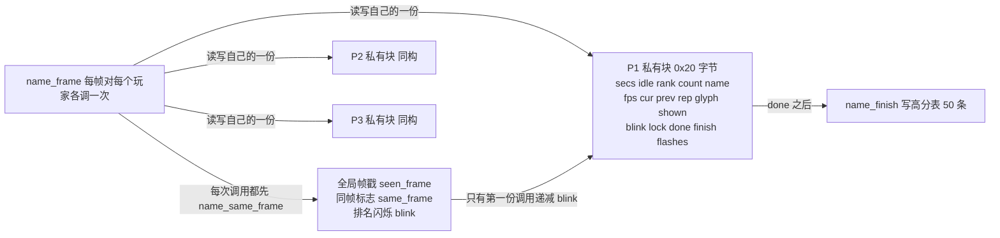

| 层 | 字段 | 谁改 | 出处 |
|---|---|---|---|
| 每玩家私有 | `blocks[3]` 各 0x20 字节（`peek` / `poke` 按原机偏移读写） | `name_frame(i)` / `name_keys(i)` | `name_entry.rs:25-59`、`:62-115` |
| 全局 | `seen_frame`（`G.$701A` 帧戳）、`same_frame`（`G.$7013`）、`blink`（`G.$7017` 排名文字闪烁） | `name_same_frame` / `name_blink` | `name_entry.rs:117-127`、`:181-190` |
| 交接 | `flow.join[i].state`、`b5e4`（`G.$5E4`）、`flow.started` 位图 | `name_qualify` / `name_state` | `name_entry.rs:129-144`、`:164-179` |

- **私有的是输入与字母，共享的是「这一帧」和「排名文字闪到哪一格」**。这与 §92「按轮 / 按 vblank」分层同族但不同层：那里是同一 tick 里轮数变三倍，这里是同一帧里调用次数变三份，**全局状态只推进一次**；不合并。
- `NameEntry` 只有三个全局字节，连「当前是哪个玩家在输入」都不存——`name_frame(i)` 的 `i` 由 join 任务槽给（§41 / §47），本节不重写槽位调度。

### 93.3 帧戳与同帧共享：全局闪烁只减一次

```text
name_same_frame (0x15C7A, name_entry.rs:181-190)
  same_frame = false
  if w.frame == seen_frame: same_frame = true
  else: seen_frame = w.frame

name_blink (0x15D1A, name_entry.rs:263-278)
  if not same_frame:
      blink -= 1; 借位则重装 0x14
  if blink > 5: name_rank_text(i)      # 显示 1ST..10TH
  else:         name_blank_rows(i, 6)  # 最后 5 帧留白
```

| 同一帧的三次调用 | `same_frame` | 全局 `blink` | 各自画什么 |
|---|---|---|---|
| 第一个玩家 | false | 减 1（或借位重装 20） | 按新 `blink` 画 rank 文字或空行 |
| 第二个玩家 | true | **不减** | 按上一份算好的 `blink` 画 |
| 第三个玩家 | true | **不减** | 同上 |

- 「这一帧是否已经被别的玩家跑过」不是每玩家一个计时器，而是 `w.frame == seen_frame` 一个 word 比较。于是**三个玩家的排名文字闪烁严格同相**，不会因为调用三次就快三倍。这是把「按帧算」与「按调用算」拆开，与 §92 把「按 vblank 算」与「按轮算」拆开是同一取向的另一种写法。
- `blink` 是 20 帧周期、最后 5 帧留白（`blink > 5` 才画文字），借位重装 `0x14`；这三个数都在 `name_blink` 里，不在私有块里。

### 93.4 一个块里的四套计时与三条状态通道

| 计时 / 通道 | 初值 | 怎么走 | 谁重置 | 出处 |
|---|---|---|---|---|
| 秒表 `secs` 加 `fps` | 20 秒 / 60 帧 | `fps--`，到 0 重装 60 并 `secs--` | 无 | `name_entry.rs:207-217` |
| 空闲 `idle` | 420 帧 | 每帧 `idle--`，小于 0 写 `done=1` | **任何有效方向或攻击输入** | `name_entry.rs:222-227`、`:292`、`:305`、`:324` |
| 方向重复 `rep` | 24 帧（新方向） | `rep--`，到 0 重装 4 再给一次方向 | 方向低 4 位变化或松开 | `name_entry.rs:329-344` |
| 攻击锁 `lock` | 4 帧 | 每帧饱和减 1 | 攻击边沿命中 | `name_entry.rs:281-285`、`:321-326` |
| `blink`（私有） | `w.frame` | 输入阶段当光标帧戳，结束阶段当 30 帧倒计时 | 光标翻转 / `name_finish` 重装 | `name_entry.rs:386-397`、`:239` |
| `done` / `finish` / `flashes` | 0 / 0 / 4 | `done` 汇聚结束；`finish` 是一次性门；`flashes` 借位才减 | 结算流程 | `name_entry.rs:231-261` |

- 与 §57 三类计时器同族（每帧递减 / 事件重置 / 借位重装），但**没有全局暂停门**：这里唯一的跨玩家协调是 93.3 的同帧标志。不抄 32 字节字段表，只写它们怎么互相借用。
- 最值得单列的是 `idle`：**20 秒的硬上限与 420 帧的无操作上限并存**，且只要玩家还在拨方向或按攻击就不断重装——玩家「还在玩」这件事由输入直接续命，不需要额外的活跃标志。

### 93.5 两套按键判据并存

```text
name_dirs (0x15F86, name_entry.rs:329-344)    # 方向：电平变化 + 私有重复
  if (cur & 0xF) == 0 or ((cur & 0xF) xor b.prev) != 0:
      b.rep = 0x18                            # 24 帧
      return cur                              # 新方向立即生效
  b.rep -= 1
  if b.rep != 0: return 0
  b.rep = 4                                  # 之后每 4 帧一次
  return cur

name_keys (0x15E3A, name_entry.rs:280-327)    # 攻击：边沿 + 4 帧锁
  b.lock = saturating_sub(b.lock, 1)
  dirs = name_dirs(i) -> 改 glyph，并 idle = 420
  if b.lock == 0 and ((b.cur and not b.prev) and 0x10) != 0:
      b.lock = 4; b.idle = 420; name_enter(i)
```

| 输入 | 判据 | 首次 | 重复 | 与既有主线 |
|---|---|---|---|---|
| 左右拨方向 | 低 4 位**电平是否变化**，`b.prev` 是上一帧输入字节 | 立即 | 先等 24 帧，之后每 4 帧 | 与 §92 电平持续快进同族，但这里有私有重复计数 |
| 攻击选字 | `(cur & !prev) & 0x10` **边沿**，且 `lock == 0` | 立即 | 4 帧锁内不再响应 | 与 §81 边沿一次打完、§14 `prev_input` 快照同族 |
| 选中 `END` | `glyph == 0x1D` 时攻击 | 写 `done=1` | — | 三条结束路径之一 |
| 选中 `RUB` | `glyph == 0x1C` 时攻击 | 擦末位并回退 `glyph` | — | `name_entry.rs:354-363` |

- **同一屏里两种判据并存**：方向读电平变化（松开也算变化，立即给一次方向），攻击读「本次按下且上次没按」的边沿，再用 4 帧锁防手抖。与 §92（电平持续）、§81（边沿一次）、§14（输入快照）只作并列，不合并成一个「输入层」。
- `b.prev` 存的是**整字节上一帧输入**，所以方向判据用 `(cur & 0xF) ^ b.prev`，攻击判据用 `cur & !b.prev`——同一个字节被两种读法复用，不另起边沿表。

### 93.6 同一字段跨阶段复用，借位当步进

```text
输入阶段  name_draw_cursor (0x160FC, name_entry.rs:386-397)
  if (frame - b.blink) < 6: 画光标字形
  else:                     画空，并把 b.blink = frame     # blink 是「上次翻转的帧戳」

结束阶段  name_finish (0x15C32, name_entry.rs:231-261)
  if finish == 0:
      finish += 2                      # 一次性门
      name_profanity(); name_insert()  # 先结算
      blink = 0x1E; flashes = 4       # 同一字段重装成 30 帧倒计时
  old = blink; blink -= 1
  if old == 0:                        # 借位才减 flashes
      flashes -= 1; 若再借位 return true
      blink = 0x1E
  if blink < 5: 画 16 列空行 else: 画 rank 文字 + 字母
```

- `blink` 在输入阶段是**帧戳**（与 `w.frame` 相减判 6 帧），在结束阶段被重装成**倒计时**（`0x1E`，每轮 30 帧）；`finish` 从 0 加 2 当「表已写过」的一次性门，`flashes` 只在 `old == 0` 的借位上减一次。**借位当步进**与 §90 `prop_palette_cycle` 的 `subq.b` 借位同族，但那是一条调色板 lane 链，这里是一个块内字段的两阶段复用，不串等价。
- 显示层也跟着切换：输入阶段光标每 6 帧闪一次、rank 文字按全局 `blink` 闪；结束阶段改成 4 次 ×30 帧的整行闪烁（前 25 帧有字、后 5 帧空白）。**同一批 2x2 字形绘制例程被两个阶段共用**（`name_glyph` / `name_blank_rows`），不另起一套。

### 93.7 三条结束路径汇到 `done`，结算先于演出

```text
name_frame (0x15BE4, name_entry.rs:192-229)
  name_same_frame(); cur = input[i]; prev = front.prev_input[i]
  if done != 0: return name_finish(i)        # 之后每帧都走结算 / 演出
  fps-- -> secs--; 若 secs == 0: done = 1    # 路径一：20 秒
  name_blink(); name_keys(); 画字母; 画光标
  idle--; 若 idle < 0: done = 1              # 路径二：420 帧无操作

name_enter (0x15EE8) 选中 END: done = 1      # 路径三：玩家按 END
```

| 阶段 | 触发 | 做什么 | 是否可重入 |
|---|---|---|---|
| 输入 | 三条路径都未到 | 拨方向 / 选字 / 擦除 / 闪烁 | 每帧 |
| 结算 | `done=1` 后第一次 `name_finish` | `finish+=2` → 脏话过滤 → 按 rank 插入 → 50 条排序 → 装 `blink=0x1E, flashes=4` | `finish` 门保证只做一次 |
| 演出 | 结算之后每帧 | 名次行 4 次 ×30 帧闪烁，`blink<5` 留白 | 借位减 `flashes`，再借位才返回 true |

- **「结束」不是立刻退出**：写 `done=1` 只是换了一条分支，玩家看到的最后一段是结算结果的闪烁演出，等 4 次闪完 `name_finish` 才返回 true，`name_state` 这才把 `state` 改 0xC、清 `b5e4` 与 `started` 位图、调 `flow_join_clear`（`name_entry.rs:164-179`）。与 §86「计数撞表只跑一个 handler、淡入淡出期间计数不走」不同路：那里计数**不走**，这里 `done` 之后计数**照走**并驱动演出，不合并。
- 脏话过滤（`0x1616C`，`name_entry.rs:465-481`）是五条三字母名字的整串替换，命中后第 4 字节置空格；按 repo 侧如实登记为「写表前的一次文本规整」，不评优劣、不抄五条词表内容。

### 93.8 资格门、parked 交接与「先插入再排序」

```text
name_qualify (0x154EE, name_entry.rs:129-144)
  if p.b10a <= 10 and hiscores[9].score < p.score:
      join[i].state = 0xA; b5e4 = 1; name_setup(i)
  else:
      join[i].state = 0xC; b5e4 = 0

name_state (0x74A4, name_entry.rs:164-179)
  if flow.mode == 0x1C and b507 != 0: return    # 结局在跑，整段 parked
  if name_frame(i): state = 0xC; b5e4 = 0 ...

name_insert (0x161DA / 0x16230, name_entry.rs:483-513)
  idx = rank - 1
  从 idx+1..49 倒序把每条下移一格         # 第 50 条丢失
  写 score / name / chr / stage+1           # +$A 保留旧值
  name_sort()                                # 50 条选择排序，有符号，平局早者在前
```

| 门 / 步骤 | 判据或动作 | 出处 |
|---|---|---|
| 资格 | `rank <= 10` 且第十名分数 **小于** 本次分数（无符号 long） | `name_entry.rs:130-143` |
| parked | 结局在跑（`flow.mode == 0x1C` 且 `b507 != 0`）时输入**整段不推进** | `name_entry.rs:164-168` |
| setup | `secs=20 / idle=420 / fps=60 / rank / name=四个空格`；**不清 `count` 与键字节**（注释明写原机不清） | `name_entry.rs:146-162` |
| 写表 | 先按 rank 插入（表下移一格、第 50 条丢失），再按分数排序 | `name_entry.rs:483-528` |

- **名次是插入位置，不是最终位置**：`rank` 只决定从哪一格往下挪，随后 50 条选择排序才定最终顺序；「平局早者在前」由 `<` 严格比较加 `swap` 得到。与 §40 分数结算、§26 HUD 归属只作并列，不重写。
- `name_state` 的 parked 与 §55 `seconds < 0 → name_qualify` 是同一条交接的两端：续关倒计时归零把玩家送进资格判定，资格判定把 `state` 设成 0xA，但**结局演出没放完之前一个输入帧都不跑**。这是「整局流程状态」直接按住「输入状态机」的一处，不串成等价。

### 93.9 块即内存：边界按 repo 侧如实登记

| 情形 | 源码行为 | 边界 |
|---|---|---|
| 第 4 个及以后字母 | 继续 `poke` 到 `+6+count` 与 `+$10+count`，会写进 `fps` 高字节 / `shown` 之后的块内字段 | 注释与单测 `letters_past_the_third_are_stored_on_into_the_block` 明写（`name_entry.rs:368-373`、`:656-678`） |
| `peek` 越界 | `+$19` 之外返回 0，不建模 | `name_entry.rs:62-87` |
| 绘制 | 2x2 字形只读 `0x15FF4` 表，不读 ROM 之外 | `name_entry.rs:400-421` |
| `name_setup` | 不清 `count` / 键字节 | `name_entry.rs:146-147` |

- 这些是**块布局的副作用**，按 repo 侧如实登记：不评优劣、不臆断原机另有保护、不写成缺陷、不据此断言 rep 侧完成度。与 §91「持有字段不清零靠计数退出」、§92「实测中值取固定 3」同属「按 repo 侧写法如实登记」一类，不合并。

### 93.10 wof 侧并列事实、边界与未展开

| 出处 | 既有注释 / 调用面 | 语境（按 §11.0 只记不同语境） |
|---|---|---|
| `Cps1ObjectRuntime.cs:3718-3725` | ROM `0x113A6` 高分榜重绘协程的跨帧推进，让出点 `0x11400 jsr 0x866`，须放在 `0xD000` 消费者之前 | **逐行重绘的协程位置** |
| `Cps1StaticInitialSnapshot_无对应ASM.cs:91` | `Cps1HudRuntime` 的「高分榜重绘进度」 | **宿主静态快照的进度字段** |
| `Cps1Collision.cs:184-190` | `0x0DE8` 刷新最高分并挪动最高分标记 | **分数结算时的最高分标记刷新** |
| `Cps1Memory.cs:580` | `C22C` 排名文字 / 字形写 `0x90A08C` | **排名字形的 GFXRAM 写入** |

- 四格都是两份 repo 既有注释 / 调用面复述，**不串成等价、不评优劣、不把未登记写成缺失**；注释里的 FBA 实测值、CS 卡值、逐帧对读与置信度标记属宿主对拍层，按 §0 剥掉，只留游戏逻辑语境。wof 侧未见「三玩家私有块 + 全局帧戳」的直接注释，按 §11.0 不臆断、不据此断言原机缺机制。
- **未展开清单（取材范围声明，非闸门）**：`flow/join.rs` 逐槽任务、`flow.rs` 的 `flow_join_clear` 全文、`flow/ranking.rs` 的 2000 格写入与 `CUTS`、`flow/select.rs` / `front.rs` 记录状态机、五条脏话词表内容、2x2 字形表逐项、`name_entry_a17_matches_mame` 逐帧对拍。本节只写「一个全局帧戳加三份私有块」这一条契约，不抄表、不并入 §19 五套表、不改写 A.13 / A.15–A.56 任何历史回执。
- 本节不写成「dino 有完整高分输入」这类完成度判断；`SKIP_ROUNDS` / 逐帧 trace 等宿主层按 §0 边界处理，只登记按什么条件触发、起什么作用、何时退出。
- 本节不宣称 `长时间自主推进` 终止；继续按「repo 侧为主、ROM 主要为 data 且仅在 `wof_cs` 非常可疑时才查 ROM、不过度怀疑 rep 侧、每块一提交」推进。

---

## 94. 细节停在哪一层，以及怎么从细节倒推回设计意图

> 用户 11-07 原话：`打击感我只是举例,而且我以为你讲完了.然后,问题是整个rep的分析,细节要到多细?太细可能无意义浪费时间,得到细节后还得倒推设计架构和意图`
> 本节不是新的机制观察，是**这份笔记该怎么读、后面该怎么推进**的口径。前面 §0–§93 的机制结论一条不改；这里只回答「还要不要再往下挖」和「挖到的东西怎么变成架构」。

### 94.1 一条判据：细节值不值，看它改不改你对架构的判断

前面写过上百条机制，它们看起来一样细，其实分两类。

- **能改变判断的**：告诉你「这件事记在谁身上、谁能改它、它能活几帧、有几个系统在同时读它」。例如「被打中的那一刻，玩家和敌人一起被写进停顿；下一拳能不能接上，取决于这一拳是不是真的碰到了人」——这一条就够把连招归类成「被命中确认驱动」，而不是「被动画播完驱动」。它决定你以后怎么读整套玩家状态机，所以值得查。
- **不再改变判断的**：停顿到底是 3 帧还是 4 帧、随机表第 7 项是几、同一个字节换个兵种写 1 还是 2。除非它推翻上面那句话，否则只是给同一张图补像素。

刚才关羽 / 穆斯塔法那道题，讲到「一边把停顿、免打、再命中门压成同一个字节，一边把停顿、韧性、免打、屏幕抖动拆成四样东西」就已经到顶了：那是两种组织法的分岔，不是手感参数的多寡。再往下抠表项，答案不会变，所以停。用户说「以为你讲完了」，指的就是这个顶。

**一句话**：细节的终点不是「查不动了」，是「再查下去，结论一个字都不用改」。

### 94.2 三个停止信号

1. 新查到的东西只能给已有结论**再举一个例子**，写不出「所以之前那句要改」。
2. 一段结论得靠内部编号才能讲清楚它在讲什么——说明它还没被倒推成设计，只是观察。
3. 想继续挖的理由是「这个文件还有几行没看」，而不是「有个设计问题还答不上来」。

三条里中一条就停手，把这一段收成结论；三条全不中才继续往下查。这不是偷懒，是把时间从「横向铺机制」挪到「纵向收架构」。

```text
读一条细节 d:
    if 换掉 d 之后，架构判断一个字都不用改:
        记为手感参数，收进数据层，停止下挖
    else:
        问 记在谁身上 / 谁能打断 / 谁在读 / 换数值变不变玩法
        把答案归到重复出现的答法
        if 已经有对应的设计意图:
            补一个反例即可，不再开新节
        else:
            写一条新意图，配一张图，回去重读已有结论
```

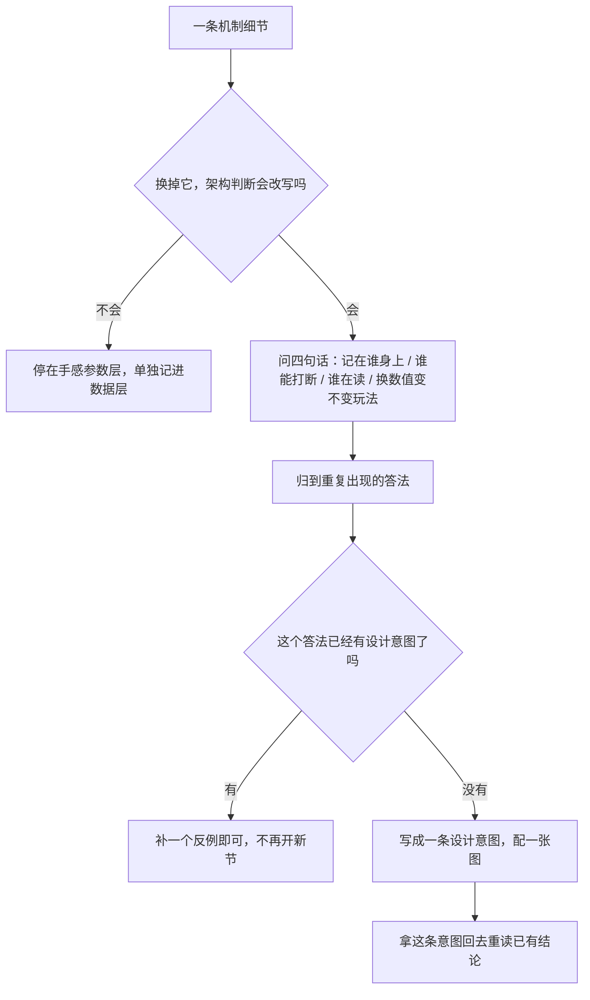

### 94.3 倒推的四句话：问完得到的不是细节，是设计意图

| 问这句 | 答案落在哪一层 | 在这份笔记里长什么样 |
|---|---|---|
| 这件事记在谁身上 | 自己记、全局记、还是另一个对象替它记 | 状态记在自己身上跨帧被读，还是散在一次调用里 |
| 谁能打断它 | 输入、命中、时间、还是谁都打断不了 | 续拳的门票是「打中」还是「动画播完」 |
| 它被几个系统同时读 | 只读一次是局部效果，多处读是架构决策 | 一份上一帧的敌人表被五个读方共用，就不是某个敌人的私事 |
| 换掉这个数值，玩法会不会变 | 不会变的是手感参数，该单独成数据层；会变的是规则，属于架构 | 逐招可变的停顿长度是数据，谁有权续拳是规则 |

四句问完，把答案按「重复出现的答法」归堆。归出来的堆才是架构：它不是第 94 条观察，是把前面几十条观察压成几句话。

### 94.4 示范：把散落的机制收成四条设计意图

下面四条**不新增任何源码取证**，只是把已有结论换一种问法。每条都用玩家能感觉到的话说，不评两边好坏，也不把没登记的东西写成缺失。

**一、把「一段时间」换成「一份能被很多系统同时读、能被打断、能换载体但关系不断的状态」。**
最直观的是连拳：能不能接下一拳，由「这一拳真碰到了人」决定，不靠动作播完；定格的几帧里按键先攒着，等状态放行再兑现。同一套写法在别处又出现几次——演出任务把最后一棒交给过场脚本、三个玩家各填各的名字却共用一个帧戳来判断「是不是同一帧」、屠夫的两把刀掉了以后主体自己还记着要追的那一个编号。载体换了好几次（玩家、任务、排行榜、道具），连续的都是那份被很多地方读的状态。所以这不是「某系统写得巧」，是这套游戏组织时间的基本办法。

**二、把「一次判定」换成「每招一列可替换的数据」。**
一次打中以后要定伤害、硬直、反应、停顿、音效、得分、火花、后续标记，这些不是写死在打人那段流程里，而是每一招自带一小条记录；停顿长短逐招可变，韧性单独累积到零才倒，伤害还要看是不是趁对方出招、克不克、剩多少血。换句话说，「打」这件事的规则和「这一拳打起来什么感觉」是分开两层的。想换手感，换的是那层数据，不是整条判定链。

**三、把「一个对象」换成「若干对象加自己身上记着的编号」。**
刀不是主体身上的一段动画，是自己有生命的对象；舌头、一次爆炸里谁算攻击者、三把刀里哪一把转正当真身，都是同一招：主体记着几个编号，零件各自跑自己的状态，主体读它们、它们也回写主体。身份在几段里换过好几次对象，玩家看到的「还是那把刀」靠的是那个编号没断，不是对象没换。

**四、把「全局写死」换成「先换算成一小撮稳定开关，再让各系统去读」。**
机器设置不是被各处直接翻，而是先换算成几个稳定的玩法开关，开局、投币、演示各重跑一次；一个全局随机种子被所有系统共用，取几次、什么时候取都成了跨系统的约定；上一帧的敌人表只有一个写入者、却有五个读方。共同点是：共享的东西被收成一个明确的小入口，谁都能读，但不各写各的。

四条摆在一起，回答的是同一个问题：**这套游戏把什么做成了「可以被很多地方同时读、又只在一个地方被改」的东西**。这比再列十条机制更接近「设计架构和意图」。

> **回读订正（本轮，纵向收敛）**：上面这句只概括了「共享」那一面。§66 后来补的是**相反方向**——一份可被独占的资源（倒地的人、地上的东西）不设中心仲裁器，靠双方对象头各写一个标志、每帧重建且读上一帧的候选表、退出时解绑来定归属；§66 结论 1 已明写「本节补的是相反方向」，06 卷此前只把它当作「不串成等价」的排除项登记过一次（§88 对照表「§66 独占写进双方对象头」那一行）。两面不矛盾：共享的是**事实**（多方读同一份），独占的是**资源**（多方写同一对标志），共同点仍是「关系落在当事对象身上，不落在中央逻辑里」。四条编号不增、原文不改；总入口「一页设计意图」已按此收口，别再从这句概括推出「dino 只有共享、没有独占」。

### 94.5 从现在起怎么推进（口径变更，不是新规则）

| 项目 | 以前的做法 | 本节之后 |
|---|---|---|
| 取题 | 按源码文件顺序，一个文件 / 一个机制开一节 | 按 94.3 的四句话筛，只补「哪条意图还缺反例」「哪条并列事实还没归类」 |
| 停止 | 查到没有新行号为止 | 中了 94.2 任一条就收成结论 |
| 回执 | 每节配一份合规审计与规模进度回执（A.13–A.57） | **到此为止**，不再逐节新增；口径直接写在正文里 |
| 举例 | 用户举一个场景就落盘成一整节 | 举例和考问不落盘；口头答完就答完了 |
| 导航 | 历史 DRAFT 写过「12 处必须同步新章号」 | 那是逐节铺细节时的自造工艺，不是用户规则；本节只同步规模、章节表、附录说明、A 清单四处，主题索引不铺开 |

需要说清两处历史措辞，避免以后又把它们当闸门：
- A.57.6 里「后续每追加一批设计节照例新开回执」是当时的工艺声明，不是用户下的律法；据用户 11-07「太细可能无意义浪费时间」的纠偏，该声明自本节起作废，历史回执正文保留原貌不回改（沿用笔记既有做法）。
- 「保留、不扩张」以及「导航 12 处」这类带编号的口径，都先问出自哪个文件、是否仍现行；它们曾经只是当时取材范围 / 写盘工艺的说明，不构成继续往下挖的义务。

**用户约束不变**：只谈游戏逻辑怎么组织，不谈 Rust / C#、typed / WRAM、端序这些实现表相；wof 侧按 §11.0 只登记不同语境并列事实，不串成等价、不评优劣、不把未登记写成缺失；ROM 主要用于补 data，仅在 `wof_cs` 写得非常可疑时才拿它核实（§11.6，本轮未触发，0 次 ROM）；宿主对拍 / FBA 实测 / 置信度标记按 §0 剥掉。

**开放目标仍继续**：`长时间自主推进` 没有收口，本节不宣称完成。推进方向从「横向加细节」改成「纵向收敛」——下一轮按 94.3 去筛已有结论，把 wof 侧的并列事实也归到「记在谁身上 / 谁能打断 / 谁在读 / 换数值变不变玩法」四种答法里；筛不出需要改写架构判断的缺口，就停在这一层整理意图地图，不再靠新增节号制造进度。

### 94.6 把 wof 侧的并列事实也过一遍四句话：能推出什么，必须停在哪

> 本节只读这份笔记里**已经登记**的 wof 侧并列事实，不查新源码、不查 ROM，0 次取证。
> 按 §11.0：笔记没登记不等于原机没有；不串成等价、不评优劣、不把未登记写成缺失。

§94.4 那四条意图是从 dino 侧的结论里倒推出来的。只推半边，很容易被读成「这套游戏就该这么组织」。所以拿 §94.3 的四句话，把 wof 侧那半边也过一遍。过完发现一件更要紧的事：**倒推出来的不只是「另一套架构」，还有「哪些地方根本不该再推」**。

#### 94.6.1 手上的材料长什么样，先决定了能问出什么

wof 侧在笔记里几乎都是同一种写法：一张三列表格，列「出处 / 既有注释或调用面 / 语境」，末尾跟一句「不串成等价、不评优劣、不把未登记写成缺失」。表格里装的是——拾取后玩家身上记着一个武器对象、被击者身上一个硬直计数兼作免打窗口、通用关卡结束出口、事件队列每帧消费几项、对白协程在哪让出、初始列重流送的守卫、场景对象按 A 表分派、一张全局判定盒表按编号查、攻击力表按连击等级取、全局难度字节被几处直读。

也就是说，**登记的是「某个入口、某张表、某个让出点，在什么语境被用」，不是「一份状态跨帧被谁读」**。材料是入口级的，不是状态级的。四句话问下去，前两句只能得到局部答案，第三句反而能归出成片的东西——这不是 wof 少点什么，是这份笔记按用户约束只登记到这一层。

#### 94.6.2 四句话逐句归

| 问这句 | wof 侧已登记的并列事实 | 归成的答法 | 到不到架构判断 |
|---|---|---|---|
| 记在谁身上 | 拾取后玩家记武器对象；被击者身上一个硬直计数兼作免打窗口；Actor 从武器槽取武器并初始化其字段 | 状态贴在被处理的那个对象身上，由当帧那条例程读写 | **只到局部**。笔记没登记「这份状态后来被别的系统读」的成组事实，按 §11.0 不补 |
| 谁能打断 | 续拳的门票是动画播完加窗口内新按键沿；对白协程的让出点；事件队列每帧扫几轮就消费几项；对话框展开与收起的步长；初始列重流送守卫 | 推进权交给动画计时器、协程让出点与每帧扫描轮数 | **只到局部**。能说「节奏由例程的推进节拍管」，不能说「命中不能打断」——后者没登记 |
| 谁在读 | 一张全局判定盒表按编号查；受击反应跳表；攻击力表按连击等级；通用关卡结束出口、公共回收、共享抢占函数；事件队列的消费者与协程让出点位置 | 共享的是**一张表或一个入口**，读者多，写入者分散在各条链里 | **能归成一条意图**：把公共动作收成单一入口，谁都能来用，不各写各的 |
| 换数值变不变玩法 | 攻击力表按连击等级递增；伤害按剩余血量分档衰减；击飞硬直带随机累加；全局难度字节被多处直读 | 数值层确实单独存在（表），但有的字节兼着规则：`0x62` 非零就挡再命中、同时管抖动 / 硬直（`Cps1Collision.cs:2317 / 2327`），值按场景写 1 / 2 / 3 或从攻击参数表取 shake（`:2109 / 2408 / 3469 / 3866`）；「固定 3 帧」只是群体连击那一条（§37 / `03-frame.md:772`），不是全部硬直 | **能给出判据**：哪一层可以整表替换，哪一层不能只换数字 |

第三行是四句里唯一稳定成片的，第四行给出的判据正好接上用户真正想做的事——**未来互相移植角色时，能搬的是招式表和数值，搬不动的是「哪一层算手感、哪一层算规则」这个分界**；分界没跟着搬，移植到的就只是「能打」，不是「打起来像」。

#### 94.6.3 归完，改写了哪一句判断

按 §94.1 的判据，细节值不值看它改不改架构判断。这一遍确实改了一句，而且不是补一条新观察：

- §94.4 的四条意图要**降级成「dino 侧的组织法」**，不能再读成「这类游戏共同的架构」。原来那句「这套游戏把什么做成了可以被很多地方同时读、又只在一个地方被改的东西」，主语得收回到 dino 侧。
- wof 侧在笔记里能支撑的是**另一条更窄的判断**：把公共动作收成单一入口（表、出口、队列、让出点），而不是「状态被多处复用」。两条并排放着，不串等价、不评优劣。
- 更要紧的是第三类结果：**前两句问下去，材料只到局部，按 §11.0 就该停**。倒推必须带着边界一起推；把「笔记没登记」硬推成「原机没有」，是这份笔记从头到尾在防的那个错。

所以「得到细节后还得倒推设计架构和意图」这半件事，落点不是又多四条结论，而是三样东西：一条能成立的窄判断、一条被收回的过宽主语、以及一处明确的停手线。

#### 94.6.4 意图地图与停止条件

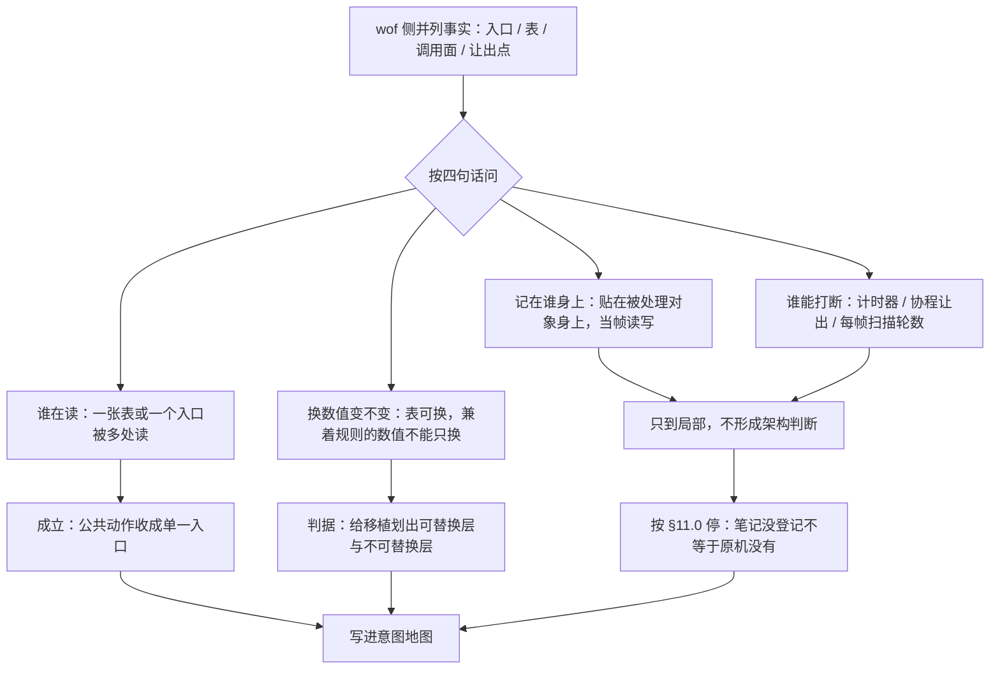

按 §94.2 逐条对：这一遍之后，再往下查 wof 的细节只会**给已有三条各再举一个例子**，写不出「所以之前那句要改」；继续挖的理由会变成「那些表格还有几行没抄」，而不是「有个设计问题答不上来」。三条停止信号里已经中了第一条。因此**停在意图地图这一层**：不再为 wof 补细节、不新开章号、不配回执；用户再出新题时按题走，不拿这份清单当待办。

按 §94.5 的落盘口径，本节是 §94 的子节，不新增章号；总入口的卷清单与 `§N → 卷` 反查表都不用动。

### 94.7 把预算写进玩法规则：这套组织法为什么天然适合资源有限的机器

> 用户早先定过取向：「复刻成通用平台游戏和全世界所有游戏竞争，其实市场价值比较低，能在复古平台运行是稀有溢价价值」。那次讨论落在工程路线（附录 A 存档），没从游戏设计层回答「凭什么搬得过去」。
> 本节初稿只读已有结论做一次综合；后回源码 / 回笔记抽核，订正（一）（二）两处口径与（五）一处措辞，见文末「回源复核」。ROM 取证 0 次。

§94.4 的四条意图回答的是「这套游戏怎么组织状态」。换个角度问：**如果机器很慢、内存很小，这些组织法还成立吗？** 逐条看下来，答案不是「要砍内容才能跑」，而是**预算本来就被写进玩法规则里了**。

**（一）一帧做多少事，是定死的。** 顶层一条固定 8 步的帧链、内层一次对象更新固定 14 个调用加一次清零赋值（旧记「13 步」只是当时的计数口径，见 §47）、碰撞 pass 顺序固定；长演出不当帧算完，而是任务里睡若干帧、留一个续算点下一帧接着走。场上再热闹，每帧要走的步骤不增加；多出来的活被摊到后面几帧。这不是优化技巧，是玩法时间本身就按「每帧一格」组织的（§20 / §47 / §60）。

**（二）同屏能有几个东西，有硬上限，满了就把这一帧剩下的生成整批让位。** 玩家加五个对象池，槽位就是身份；生成脚本按表逐条读，只要哪条分配不到槽，指针照样跳过它，随即停掉**这张表**本帧余下的记录，下一帧从下一条接着来（`spawn.rs:186-222`）；两张表各自独立，List 1 停了不影响 List 2，但 List 2 池满时同样停（`spawn.rs:268`）。成组生成还有「任一槽失败就整组放弃」的容量门（§88）。也就是说，拥挤时让位的不是「一个对象」，是**这一帧整批生成请求**——正好与（一）「多出来的活摊到后面几帧」是同一套时间观。波次按人头或权重给预算，超时清场，相机还有门闩。拥挤时游戏自己降载，不指望机器突然变快（§28 / §50 / §42）。

**（三）背景不是一整张画，是一小块环形区反复回绕。** 三层背景各是一块 64×64 的环，镜头跨过一格才补新露出来的一行或一列；补的是「这一帧新看见的」，不是「整张地图」。每帧要写的东西跟屏幕大小、关卡长度都无关（§73 / §84）。

**（四）共享的东西只留一份，用「上一帧」当接口。** 全场共用一个随机种子，取几次都算契约；一张上一帧的敌人表只有一个写入者、五个读方；敌人数量的统计故意慢一帧才影响选目标；三个玩家各填各的名字，却共用一个帧戳判「是不是同一帧」。不靠多存几份数据，靠时间差把系统协调起来（§51 / §68 / §13 / §93）。

**（五）招式之间的差异是数据，不是代码。** 一次攻击的伤害、硬直、反应、停顿、音效、得分、火花、后续标记压成一条 8 字段记录；四个角色共用一套骨架，差异按编号查表；**这一帧开哪个判定盒是另一份数据**——动画帧记录带一个盒 ID，换帧重载，再拿去查共享盒表，不在那条攻击记录里（§46 / §49）；机器设置先煮熟成几个稳定开关再被各处读。参数与几何分成两份数据、但都由表驱动，内容越做越多，每帧要走的分支并不跟着变多（§46 / §31 / §49 / §65）。

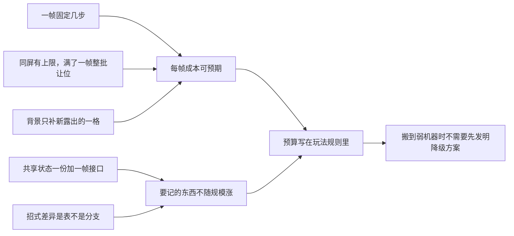

五条合起来是同一件事：**这份设计没有把「机器够快」当前提**。在通用平台上，固定上限、一帧延迟、池满丢弃看起来像约束；在复古平台上，它们恰恰是能整段搬过去的理由——不用先设计一套「低配版玩法」，规则本身已经是低配的。这是对用户那个市场取向在设计层的回答：稀有溢价不来自把画面搬到老机器，来自**玩法的时间与数量预算从第一天就写死了**。

**边界**：本节只讲 repo 侧呈现出来的组织法具有什么性质，不推断原机硬件参数、不评价任何一边的移植完成度、不把 wof 侧未登记的事实写成缺失；wof 侧仍按 §11.0 只登记不同语境的并列事实，本节不新登记 wof 事实。也不作两款游戏之间的优劣判断——§94.6 已把四条意图的主语收回 dino 侧，这里同理。

按 §94.1 的判据，这一节值得写是因为它**改了一句判断**：此前「dino 更成熟」在笔记里主要指玩法层更丰富（§6 / §6.1）；补上这一层后还多一个维度——组织法自带预算。写完仍停在意图层，不新增章号、不配回执、不为此去查新细节。

**回源复核（补记，只修口径不改结论）**：初稿标「0 次源码取证」，五条是照已有结论概括的；后按 §94.8 的经验回源码 / 回笔记抽核，发现两处概括比源码弱、一处措辞会同既有分界打架：

- 「对象更新固定 13 步」用的是 §7 当时的计数口径。当前 `mod.rs:348-377` 是顶层 8 步、`objects_update` 14 次调用 + 1 次 `car_on=0` 赋值；§47 已说明差别只在首行赋值与末尾两步计不计入。按 A.13 保留工作记录原貌，§7 / §47 都不回改，本节改用当前口径。
- 「池子满了就丢掉这一条」写轻了。`spawn.rs:195-199` 分配不到槽时是 `l1 += 1` 后 `break`：当前这条跳过，且本帧这张表余下记录全部停读；§88 的容量门（任一槽失败整组放弃）本就是同一条规则的另一处写法，笔记别处已有精确记录，是这里概括时压扁了。
- （五）「判定盒随动画帧从记录里带出」紧接「压成一条 8 字段记录」，会被读成同一条记录。但 §46 的 `AttackRecord` 八字段里没有判定盒，§49 明写盒 ID 住在**动画帧记录**、换帧重载再查共享盒表。改成「参数与几何两份数据、都由表驱动」，消歧，不改结论。

前两处订正只让「预算写死」这条判断更硬，没有推翻它：降载的单位从「一个对象」变成「一帧整批生成」，反而与（一）的摊帧时间观对上了。第三处是消歧。另核对（四）「一个写入者、五个读方」与 §68.2 / §68.3 表格逐项相符，（五）「8 字段」与 §46.2 逐项相符，均不动。按 §94.2 第一条，再往下核只会给已有结论各再举一个例子，到此停。

### 94.8 差异为什么一边是数值、一边是结构：输入翻译只发生一次，还是有五次

> 本轮回两份 repo 源码核证，0 次 ROM（§11.6 未触发）。用户早先问过「dino 四个角色写成一套代码、用 ID 小分支，wof 看起来各写一种」；§31 只记了「数据维 vs 结构维」这个现象，没记因果。本节补因果，不评优劣。

**先纠正一个容易有的印象**：wof 侧不是没有公共能力。「检测下上搓招」本身就是一个共享函数，碰撞、伤害、特效也各有公共入口。问题不在有没有，在**挂在哪儿**。

**dino：输入到状态的翻译只有一处。** 走还是跑的前置判定在共享函数里做完——摇杆八向差、连按次数、冷却，判完才决定进哪个状态（`player.rs:1191-1207`）。角色编号的用途几乎全是查表下标：无敌帧按「场合 + 角色」取，跳跃攻击高度、下蹲、击倒、起身、每一招的攻击记录都按角色取表（`dino-assets/src/player.rs:41-48`；`player.rs:493 / 2110 / 2289`）。偶尔有按角色编号的小分支，但只改收招那一帧的姿势（`player.rs:1457`），不改状态机骨架。于是角色差异**没有别的地方可放**，只能落进数据槽位。

**wof：公共函数有，但要在五个头里各挂一次。** 顶层按角色编号分派到五个各自的主状态分发（`Cps1PlayerLogic.cs:14637-14640`）；每个角色还有自己的「在场分发头」（同文件 `:6151 / :3883 / :3717 / :3762`）。同一个公共的搓招检测函数，在这些头里各调用一次（`:3607 / :3721 / :3765 / :6154`），多人入口另有三处（`Cps1PlayerMulti.cs:338 / :364 / :382`）。源码注释还明写某个角色的头「不能复用」另一个角色的主状态分发（`:3664`）。所以公共能力不缺，缺的是**唯一挂载点**：角色状态机本身就是分派单位，任何跨角色一致的行为都得在每个头里重复一遍，差异自然长成结构。

**这是位置关系，不是水平高下。** 只有当「输入 → 状态迁移」只翻译一次，角色差异才有唯一可放的位置（数据槽位）；翻译发生在五个头里，差异就只能长在头上。这也解释了 §94.6 那句「分界比数据贵」：把 wof 角色搬进 dino 骨架，要搬的是它自己那套输入解释与状态分层，不是招式表；反过来让 dino 角色在 wof 里落户，得先给它造一个头。

所以「优化 wof 先抽输入 → 状态迁移共享层」不是风格建议，是**让差异有地方可放**的前置条件：把搓招检测这类公共解释从五个头收成一处，角色差异才有机会从结构退化成数值；不收，新增角色就还是得再写一套头。

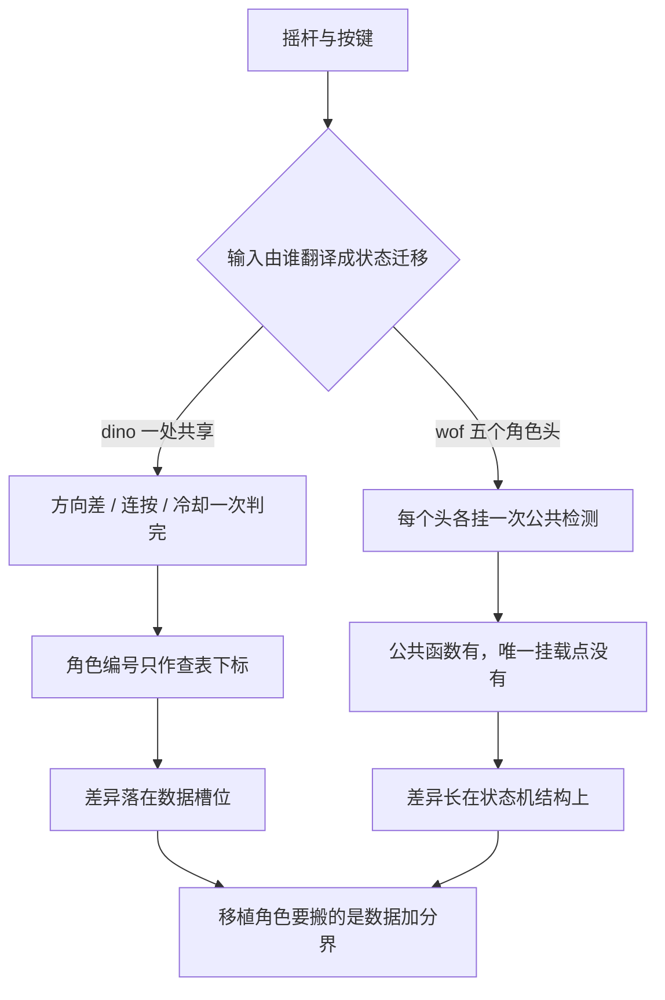

**边界**：只讲两份 repo 呈现出来的位置关系，不臆断「多开发者并行开发、各写一套」的历史成因（用户提过这个印象，本笔记不作断言）；不评优劣、不把 wof 未登记的事实写成缺失、不评价移植完成度；wof 侧仍按 §11.0 只登记不同语境的并列事实。按 §94.1 的判据，本节改写的判断是：wof 侧不是「没有公共能力」，而是「公共能力没有唯一挂载点」——§31 只写到「各自主状态机入口」，容易被读成前者。

### 94.9 图形层为什么可以留到以后加：一份逐帧定义拆成状态与画面，绘制末端只借一个状态位

> 用户取向还有后半句：「复刻早期根本不需要超强图形功能扩展，继续用模拟器一样的砖块渲染就行，以后可以加 hacky 劫持来扩展」。§94.7 从设计层答了「凭什么搬得过去」（预算写进玩法规则），没答「凭什么图形层能后加而不动玩法」。本轮核两份 repo 的已登记结论与 dino 源码，0 次 ROM（§11.6 未触发）。

**先收掉两种都不准的说法。** 一是「画面只是玩法状态的只读投影」——§45 已记绘制不是只读的，涉水裁剪会碰 `+$53`（写成什么、这一位归谁，下面回源核过再说）。二是「玩法不读画面数据」——§53.2 明写 frame record 里除了「画哪个 sprite」，还同时装着这一帧的时长、后继帧、判定盒、状态参数与附着点；wof 序列表项同样是 sprite 指针与 stat long / dur 同项。**一份逐帧定义同时规定了「这一帧怎么算」和「这一帧怎么画」**，不是两份数据。

但「玩法与画面读同一份记录」也要收窄：换帧时 `load_frame` 把记录的语义字段**拷进对象头**，玩法读的是对象头（`body.rs:195-211`；判定盒在 `+$48/+$49`，见 §49.3），绘制则是拿帧记录去展开合成 / 精灵、同时读对象头上的位置与标志（`draw.rs:170-198 / 440-446`）。所以准确说法是**同一份定义在换帧处分成「对象头上的状态」与「绘制用的帧描述」两条消费路径**，不是两边各捧着一张表。

**真正的接口是「共用记录 + 末端一条绘制链」。** 状态机只管选一段动画开始、读推进器返回的「播完了」；这一帧打不打得中、还剩几帧、下一帧接哪，全由记录给出（§53.3）。绘制排在碰撞之后、是帧固定序列里的一步（§47），把全池对象按 `(depth, handle)` 排一次序、逐个展开成绘制项，屏幕显示的是两帧前的那份（§45 / §23）。也就是说，「怎么画」在时序上被放到了所有玩法判定之后的一个末端位置。

**末端不是零耦合，但耦合落在一个本来归玩法所有的字节上。** `obj+$53` 的高位由地形段数据给出：只要走到地形查表，`floor_lookup` 就把段值整个写进 `b.wading`（`terrain.rs:135-157`），段值本身就可以是 `0x80`（`:856-859`）。玩家的水波、入水判定与落地静音把这个字节当有符号数读，高位即「涉水且低于某高度」（`player.rs:399 / 414`；`snd.rs:182`）。绘制侧做的事只是**追加**：涉水裁剪命中时 `b.wading |= 0x80`（`draw.rs:206-208`），同帧紧随的影子 pass 读到这一位就跳过画影子（`draw.rs:510-521`）。`draw_split` 对 `+$53` 与坐标的改写是暂存后恢复、不留痕（同文件 `:489-497`）。

时序也不支持「回写给玩法读」：`game_frame` 里 `players_update` 排在 `build_sprite_list` 之前（`mod.rs:350-357`），玩家与音效的判据发生在**同一帧里更早**的更新阶段，读到的是地形查表给出的值；绘制追加的那一位，主要消费者是紧随其后的**同帧**影子 pass。所以这一位不是绘制发明、也不是绘制回写给玩法的信号，而是绘制借用了玩法侧已有的一个状态位来协调「这一帧的影子和裁剪」。

于是「换掉绘制」要守的契约比原先想的还轻：别动那份逐帧定义、别动对象头上的状态字节；绘制末端对玩法状态的净写入几乎为零，它只是在同帧读同一份状态、偶尔顺手置一个已经属于这套语义的位。

**倒推出来的设计依据**：砖块渲染不是先把标准降低、以后再补，而是这套组织法本来就把「画成什么样」放在一个可整体替换的末端；绘制链不提供判定与状态迁移的依据，玩法规则全部写在逐帧定义与对象头状态里。所以早期用最朴素的画法照样能逐帧验玩法，以后要加图层、改调色板、劫持原渲染例程，动的是那条末端链，不是玩法。这正回答了「先够用、以后 hacky 劫持扩展」为什么在这类游戏上成立——**可替换的不是画面质量，是画面所在的那一层位置**。

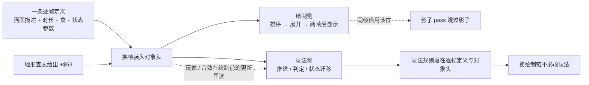

**边界**：这是两边共有的组织法（§53.2 已登记 wof 序列表项同样一帧多项），不是「dino 更成熟」的又一条证据；按 §11.0 不评优劣、不把 wof 未登记的事实写成缺失。不推断原机硬件参数、不评价任何一边的移植完成度、不讨论具体劫持手法（那属工程路线，附录 A 存档）。按 §94.5 不新增章号、不配回执、不动总入口；本节也不是横向补细节——取题来自用户长期取向，且回源后改写了判断。

**回源复核（补记，只修口径不改结论）**：初稿把绘制写 `+$53` 概括成「绘制回写一个位给玩法读」，回源码抽核发现三处都不准：

- **这一位不是绘制发明的**。走到地形查表时，`floor_lookup` 就把段值整个写进 `b.wading`（`terrain.rs:135-157`），段值本身就能是 `0x80`（`:856-859` 的测试断言）；绘制只是 `|= 0x80` 追加。
- **读方分两种时序，不能并成一句「随后读」**。影子 pass 在 `build_sprite_list` 内同帧读它跳过影子（`draw.rs:510-521`）；玩家水波 / 入水 / 落地静音在 `players_update` 里把该字节当有符号数读（`player.rs:399 / 414`、`snd.rs:182`），而 `players_update` 排在 `build_sprite_list` 之前（`mod.rs:350-357`），读到的是同一帧里地形查表给出的值。
- **「玩法与画面读同一份帧记录」也偏了**。`load_frame` 换帧时把语义拷进对象头（`body.rs:195-211`），玩法读对象头、绘制读帧描述的合成 / 精灵部分，是同一份定义拆成两条消费路径。

另核一处容易误算的：`draw.rs:407-420` 的 pool D 分配器也会写 `live`，但调用点在对象 init / free（`prop/b25.rs:113`、`prop/b31.rs:66`、`enemy/class6.rs:41`），不在 `build_sprite_list` 路径上，属对象生命周期而非绘制链，不计入这处耦合。

三处订正都**让结论更硬**：绘制末端对玩法状态的净写入从「回写一个位」降为「同帧借用一个本来归玩法所有的位」，可替换的边界因此更干净。按 A.13 保留工作记录原貌，§45 / §53 历史原文不回改；按 §94.5 不新增章号、不配回执、不动总入口。这里还有一条口径教训：初稿写「按 §94.2 第一条到此停」时并没回过源码，停早了——**纯综合出来的节在宣布停止前必须先回源核一遍**，否则「再查也只是一个例子」这个判断本身没有依据。按 §94.2 第一条，这轮核完，再往下只会给这条接口各再举一个例子，到此停。

按 §94.1 的判据，本节值得写是因为它**改了一句判断**：把「画面是只读投影 / 玩法不读画面数据」两种顺手说法收掉，换成「一份逐帧定义拆成对象头状态与画面描述，绘制末端只同帧借用状态」。

---

### 94.10 上一轮把 wof 的「事件脚本」漏了：脚本层同构，不同的只是这一段的编排

**改了哪句判断。** 用户拿「wof 第一关见李典前，玩家自动前进 + 等剧情」问两边在脚本层相同还是不同，上一轮答「不同」，理由是 wof 侧只有阶段进度机、量子链、强制输入槽，没有 dino 那种过场脚本表。用户当场指出「你没看到 wof 的事件脚本」。回源核完，这个理由错了：**wof 有自己的事件脚本层，而且不止一套**；上一轮把「调度层」当成了「脚本层」的替代品。

**漏掉的是什么。** wof 侧至少三条脚本轨道，而 §19.1「五套脚本一览」的全景表里 wof 侧只列了两条：

- **1C 剧情对象池**（`Cps1EventObjectRuntime.cs`）：两张按 ObjId 分派的跳表 —— 开场 / 演出路径 `0x5C5D8` → 表 `0x5C600`（15 项），通用 `0x55D8E` → 表 `0x55DB2`（27 项）。第一关开场对白对象由 `0x156A8` 直接分配（ObjId=3，消息 0004），收尾对白由 `0x1552C` 分配；对话框对象 `0x56286` 按消息 ID 展开消息砖块流，并用 `A5+0x1AA` 一把「对白锁」撑住整段时长；同池还有开场人物、特效、静态对象等十余类，各自带「初始化 → 逐帧推进 → 压回空闲表」的状态机。这就是一套完整的「数据 → 分派 → 对象状态机 → 等待 → 交棒」，不是调度器。§19.1 的引言自己说事件脚本散落在 §4.1 / §4.2 / §9.4 / §12.4 / §14 / §18.2，但收拢后的全景表里这一池没有单独成行。
- **关卡脚本**（`Cps1LevelScript.cs`）：记录是 `trigger:word + type:byte + payload`，按相机 X 越过 trigger 逐条消费，约 25 种 type，负责生成对象、滚动区间、关卡掩码、难度、色板。
- **事件队列**（`Cps1EventQueueTask.cs`，调度器 slot15）：9 种 type，文字 / 字形、填对白背景、清三个滚动层、BCD 加分、贴图脚本、玩家血条。

按 §11.0 只登记不同语境的并列事实，不串等价、不评优劣、不把未登记写成缺失；按 A.13 不回改 §19.1 历史原文，订正记在此处。

**补回来以后，这个场景两边各怎么编排。** dino 把「走进场 → 站定 → 等剧情 → 放行相机 → 交棒」写成**同一张过场脚本表里的连续几条记录**（26 scripts × 6 字节，41 个 action）。一个 scripted mask 决定哪几个英雄被接管；走位动作不另写走路，只是覆写摇杆字节，让英雄走自己那套完整玩家状态机（§4.1 / §14）；「等剧情」是表里的一条 wait 动作，条件没达就把本条记录的计时器写成 `0xFFFF`、下一帧原地重跑（`script.rs:365-368`），等到了读下一条；最后的动作清 mask、放相机、把控制权交回。整段演出**挂在英雄自己的状态字上**，受击、死亡、复活都会让它挂起 —— 表演轨道和玩法轨道是同一个状态机；脚本换的不只是输入源，还按记录逐条改写一组全局规则档位（前一轮回源补层，见下）。

wof 把同一件事拆成几条互不隶属的轨道：关卡脚本按相机位置触发，负责「这一带该出现什么」；对白由 1C 池里一个独立对象展开消息砖块，用对白锁撑住时长，演完自己压回空闲表；「玩家自动前进」由第一关收尾阶段机的「自动带位」相位（`0x15560..155B6`）往三个强制输入槽写方向位，让玩家自己的主分发去走；什么时候走、走几步、何时停，由阶段档位、一帧跑几个量子、VBlank 截断共同决定。**表演是独立的对象轨道，玩家这边只被喂了一个输入**，几件事靠全局档位 / 锁 / 队列对齐，而不是一条记录串下来。

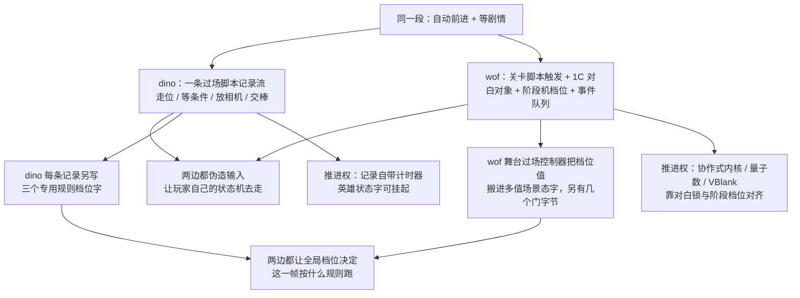

**有一手是完全相同的**：让玩家自动往前走，两边都没有另写一套表演用的走路，都是**伪造输入喂给玩家本体的状态机**（dino 覆写 pad `+$A0/$A8`，wof 写强制输入槽 `-0x44/-0x42/-0x40`；`Cps1SystemCoroutineRuntime.cs:154` 直写「强制输入决定玩家是否走路」）。上一轮把这一手算成 wof 独有的「调度」，是双重误读。另要区分清楚：wof 的开场玩家 1C 对象（ObjId=2，`0x5C966`）确实是**独立演出对象**，直接加坐标、走无碰撞盒动画，但那是开场亮相里的小人，不是「玩家自动前进」那段；拿它当「wof 另写一套表演走路」的证据会串错场景。

**所以答案是分层的**：问「有没有事件脚本」—— 两边都有，而且形态同构（数据表 + 分派器 + 逐条推进 + 等待条件 + 交棒），上一轮说「不同」是漏看；问「这一段的编排」—— dino 串成一条挂在英雄状态字上的记录流，wof 拆成关卡脚本、对白对象、阶段机、输入槽、事件队列几条轨道靠全局锁对齐，推进权在协作式内核而不在记录里。这和 §19.2「推进时钟写在哪里」是同一条差异，只是这次落到了一个具体场景上。

**补一层（前一轮回源，不新增节号）：过场记录同时是一张逐条生效的「世界规则档位表」**。本节原来把 dino 那一手收成「脚本只换了输入源」，按 §94.17 回源数调用点后要说窄了。`World` 里 `scripted / floor_only / no_clamp` 三个全局字不是过场专用变量，而是被玩法各层共读的一组档位；`script.rs:230-243` 每读一条 6 字节记录就把 `r.floor_only → G.$4F0`、`r.control → G.$506`、`r.argument → G.$4FD` 写进全局，且 `script.rs:36` 与 `00-overview.md:476`（00 卷 §4 的脚本怪癖清单）都记明**这两个字节保留上一条记录的值（含 END 记录）直到下一个脚本首记录**，不是每条都重设、也不是只在演出开头设一次。

**三方对账（§94.11 第三道闸）**：

| 档位 | 数据定义 | 谁读 | 玩家看得见什么 |
|---|---|---|---|
| `G.$4DD scripted`（哪几个英雄被接管，位图） | `script.rs:139/151/172/185` 由 `flow.chosen` 置，`0x0A / 0x26` 清 | `combat.rs:72 / 95` 碰撞总入口、`car.rs:457`、`script.rs` 位门与动作分派 | 演出期间**敌人打不到玩家**：`pass_115b0`（敌攻玩家）与 `pass_11cec` 整组跳过（05 卷 §78.2 已登记），`pass_10dcc`（攻击对象 vs 英雄）也带同一道门（`combat.rs:72`），而玩家打敌人那几条 pass 照跑，**不是全场停战**。05 卷 §78.2 伪代码把 `10dcc` 列成无条件，按 A.13 不回改历史原文，收窄记此 |
| `G.$4F0 floor_only` | 脚本记录第二字节；`flow.rs:429` 每关开始清零；`prop/b47.rs:87` 等场景对象也会写 | `player.rs:950-953` 选 `0x12CAC`（地面+墙）还是 `0x12D4E`（只看地面）；`terrain.rs:13`、`prop/b47.rs:32` | 演出走位时**墙不再挡人**，角色按镜头指定的路线穿过去，不会卡在场景边界 |
| `G.$506 no_clamp` | 脚本记录第五字节（`r.control`）；`flow.rs:429` 清零；`player_weapon.rs:918/921`、`prop/b12.rs:291/297` 也会写 | `player.rs:955-957` 跳过 `0x4FCE` 屏幕钳制、`:1174 / :1263` 复用同一判断；`player_weapon.rs:77` 跳过拾取候选；`prop/b12.rs:90` | 演出里角色**可以走出平时被镜头锁住的屏幕范围**，也不在演出途中顺手捡东西 |

**改了哪句判断**：本节「脚本只换了输入源」把过场说成只动玩家的输入字节。实际上输入只是其中之一：**同一条记录还决定这一帧世界按哪套地形、哪套边界、哪几组碰撞跑**。所以「演到哪儿」和「这一帧按什么规则跑」不是两件事，是同一张记录流管的；表演轨道和玩法轨道共用的不只是玩家状态机，还有这几个全局档位字。按 §94.23，这句是 **dino 侧**倒推，不放大成两款游戏共同架构。

**wof 侧：按 §94.11 第二道闸倒着查，上一轮「不推断有无」可以收窄成并列的另一层**（本轮回源补层，不新增节号）。上一轮写的是「按 `自动前进|剧情演出|强制输入槽|cutscene|scripted` 正着搜，没找到同一组全局规则档位被脚本记录逐条改写、并被碰撞 / 地形 / 边界共读的登记；这是关键词检索面、不是消费端穷举，按 §11.0 不据此断言 wof 原机没有对应做法」。本轮改从「谁在读写全局状态字节」倒着查 `A5_BASE ± 0x..`，命中一族**确实被玩法各层共读、决定这一帧按什么规则跑**的全局字，但**装法和 dino 不是同一手**：

| 全局字（wof 侧） | 谁写（分散在几条轨道） | 谁读 | 玩家看得见什么 |
|---|---|---|---|
| `A5-0x60` 多值场景态字 | 舞台过场控制器 `0x10B06` 把过场对象 `+0x58` 的 key 搬进来（`Cps1SystemCoroutineRuntime.cs:8028`）；系统协程各阶段又写 `0x02 / 0x1C / 0x1E / 0x22 / 0x2E / 0x30 / 0x32 / 0x34 / 0x36 / 0x38` 一串值（`:6855 / :6993 / :7722 / :7900 / :7961 / :7978 / :1269 / :16299-16528`） | 玩家地面高度钳位 `0x1E3C`（`Cps1PlayerLogic.cs:3853`，非零就不钳位，注释「入场期不钳位」）、敌人接近检测 `0x3BDC`（`Cps1EnemySubs.cs:2220`，非零直接返回，注释明说「这个门控不是『是否有玩家』」）、地形碰撞 `Cps1TerrainCollision.cs:1147`、重新上马 `0x2147C`（`Cps1HorseRuntime.cs:174`，注释「系统未冻结」）、系统协程 `:1146 / :1342` 按值二次分发 | 进场 / 收尾那段，玩家不被地面高度拉回、敌人不主动接近、地形纠偏不跑、马不会莫名接回；一个字的不同取值把整段演出切成若干档。02 卷 §30 已登记 `==0x1C` 是收尾对白，本轮补的是它「多值档位 + 被多族共读」这一面 |
| `A5+0x190` 场景期环境档位 | 李典 finale `0x168E4 st.b` 置 `0xFF`、`0x16AAE clr.b` 清零（`Cps1LidianFinaleRuntime.cs:20244 / 20473`，条件还看 `A5-0x47` 阶段值） | 受击收尾 `0x614C`（`Cps1HitReaction124CA.cs:955`）、演出对象生成 `0x597FA` 与碎尸调色板 `0x59058`（`Cps1EventObjectRuntime.cs:1024 / 3700 / 3706 / 3761`）、特效与发声（`Cps1EffectActorRuntime.cs:380 / 395 / 561`、`Cps1BossWaveEnemyRuntime.cs:2071 / 2884`）、动画帧段 `0x5E182`（`Cps1ObjSpriteSubmitter.cs:1184`）、玩家特效 `0x616C`（`Cps1PlayerMulti.cs:1907`）等，跨十余个文件被当门读 | 这一段里同一记受击 / 碎尸走的是另一套调色板、另一套特效与发声分支。一处 ROM 注释把它叫「水关标志」（`Cps1EventObjectRuntime.cs:926`），说明这个字按场景期开合，不是过场脚本逐条改写 |
| `A5+0x191` bit0 过场请求位 | 关卡脚本倒计时归零置位（`Cps1LevelScript.cs:1569-1570`） | `0x1135C` 放行判定：先看请求位，再按 `A5-0x3E` 的 P1/P2/P3 就绪位与 `A5+0x1AE / +0x1AD` 两道门决定放不放行；放行时 `bclr` 把这个位消费掉（`Cps1SystemCoroutineRuntime.cs:8040-8114`） | 演到哪一格不是脚本按下就算：脚本先置「请求」，等玩家站定、场上没挡门的怪，才真的推进到下一格 |

**改了哪句判断**：上一轮把 wof 侧留成「只登记关键词检索面、不推断有无」；本轮按消费端反查可以收窄为——**两边都有「一组全局字被玩法各层共读、决定这一帧按什么规则跑」这一层，但装法不同**。dino 是一条过场记录流逐条把 `floor_only / control / argument` 写进三个专用字、跨记录保持，读方集中在碰撞 / 地形 / 边界；wof 把档位摊在几个各管一摊的字里，`A5-0x60` 一个字就是一串阶段值、写入方分散在舞台过场控制器 / 系统协程 / 关卡脚本 / Boss finale，读方跨玩家 / 敌人 / 地形 / 马匹 / 特效 / 受击 / 发声多族，`A5+0x191` 还是「请求 → 按条件放行 → 消费」的握手而不是直接写档位。按 §11.0 只登记并列事实，**不串等价、不评优劣、不把 wof 写成「也有同一张规则档位表」**；dino 那句「同一条记录流管着演到哪儿和按什么规则跑」仍是 dino 侧倒推，不放大成两款游戏共同架构（§94.23）。

**检索面与边界**：本轮倒着查的是 `A5_BASE ± 0x..` 的读写点，命中 `Cps1SystemCoroutineRuntime / Cps1PlayerLogic / Cps1EnemySubs / Cps1TerrainCollision / Cps1HorseRuntime / Cps1LevelScript / Cps1LidianFinaleRuntime / Cps1EventObjectRuntime / Cps1EffectActorRuntime / Cps1BossWaveEnemyRuntime / Cps1HitReaction124CA / Cps1GeneralObjectRuntime / Cps1PlayerMulti / Cps1ObjSpriteSubmitter / Cps1EnemyAI / Cps1Actor*`；**没有穷举 wof 全部 A5 偏移**，也没展开各字每个取值的完整语义（02 卷 §30.7 把「`A5-0x60` 其他取值」明列为保留、按 §11.0 不扩张）。按 §0 剥掉 `Program.cs` 测试夹具写值、`FbaFs1ReplayAdapter` 逐帧对拍、`QUARANTINE / _无对应ASM` 这些宿主层锚点，只留带 ROM 指令对应的游戏逻辑读写点。按 §94.17 不写「所有全局字都这样 / 只有这几个字」这类全称。0 次查 ROM（§11.6 条件通道未触发）。

**按 §94.17 别写全称（针对上表 dino 那一层）**：不能写成「过场期间全部碰撞都停」——`combat.rs:75-84` 的玩家攻击敌人、容器、飞行身体等 pass 都在门内照跑；也不能写成「这三个字节只有脚本能写」——场景对象、武器拾取、复活路径都有写入点（`prop/b47.rs:87`、`player_weapon.rs:918/921`、`prop/b12.rs:291/297`）。wof 那一层的全称边界另写在上面的「检索面与边界」。

**说人话**：过场里看着只是「角色自己往前走、按按键没反应」，其实底下一整套规则都换了档：墙不再挡路、镜头不再把人拉回屏幕里、敌人这会儿打不到你（但你还能打敌人），连路过道具都不会顺手捡起来。dino 这边，这些开关不是开场一次性设好，是**过场脚本每读到一条记录就按这条记录里的格子重设一遍，没写的就沿用上一条**；wof 这边也有一组被玩家、敌人、地形、马匹、特效一起翻的全局字，只是摊在几个字里，由过场控制器、系统协程、关卡脚本分头写，还有一个「先按请求、等玩家站定才放行」的门。所以两边那段演出和平时打斗都不是「同一套规则暂停了一下」，是同一套状态机换了几个档位在跑；差别只在**档位记在一本流水账里，还是分在几本账上**。

**按 §94.1 停**：前一轮改 1 句会被继承的概括（「只换了输入源」）+ 给三个档位补齐三方对账；本轮按 §94.11 第二道闸倒着查，把 wof 侧从「不推断有无」收窄成并列的另一层、再给这三个全局字补齐三方对账。两次都改了会被后续推理继承的前提，所以写；再往下逐个列 `no_clamp` / `floor_only` 读点、逐条抄 26 个脚本记录里的档位值、或穷举 wof 全部 `A5` 偏移，只会举例（§94.2）。两轮都 0 次查 ROM（§11.6 条件通道未触发）；宿主 / FBA 锚点按 §0 剥掉。

**口径教训**（补 §94.9 那条）：比对「脚本层」之前，先把两边各自所有的脚本轨道列全；**别把调度层（任务内核 / 帧预算 / 阶段档位）当成脚本层的替代品**，也别因为某一边调度层的代码更显眼就顺着它下结论。笔记 §19.1 的「五套」是当时的登记面，不是源码全集；后续引用按本节订正。按 §94.1，本节值得写是因为它改了一句判断；按 §94.2 第一条，核到这里再往下只会给这几条轨道各再举一个例子。**前一轮另就地补上面那一层**（「只换了输入源」→「还逐条改写全局规则档位」），改的是会被后续推理继承的前提，按 §94.21 落在正文不另开节。**本轮补的是第三道闸没做完的那一半**：上一轮在 wof 侧写了「这是关键词检索面、不是消费端穷举」，等于自己标了一格清册空格；按 §94.11 第二道闸倒着查「谁在读写全局状态字节」，空格闭合，且证实「正着搜没找到」当初确实不能写成「没有」。两轮补完到此停。

---

### 94.11 三次「没看到」是同一个病：把检索命中范围当成了全集

**这次是什么。** 用户贴来一份 wof 民间资料：「我方攻擊屬性資料，從 6db44 開始」，16 字节一招，标了 `AT 攻擊力 / ?X 擊退距離 / 效(07噴血、1F暈眩) / 聲(擊中聲音) / 死(06燒死 08兩段 0C全碎 0E上身碎) / 附(02擊倒 04擊飛 06火燒 0A擊退) / 呆(敵我皆無敵的呆滯時間)`，并提醒「可能地址有 1 位的翻转差异」。回源结果：**地址没翻转**，`Cps1Collision.cs:22` 就是 `PLAYER_ATTACK_PARAMETER_TABLE = 0x6DB44`，`:678` 的注释里 `06DB44 / 06DB54 / 06DB64` 相邻差 `0x10` 坐实步长 16 字节、按 `AtkType` 索引。资料逐字段对得上：

| 资料 | 源码消费 |
|---|---|
| `AT AT` 攻击力（0~32767） | `:502` `damage = 随机伤害查表 + rws(parameter+4)`，`+4` 起一个 word |
| `?X` 击退距离 / 朝向 | `:560-563` `ww(target+0x72, rw(parameter+6))`，word 的符号还翻转受击朝向 |
| `效` 喷血 / 晕眩 | `:687` `创建事件记录(rw(parameter+8))`，注释实测 `+8` 处 `0008/0009/000B`；命中特效等级经 `target+0x72` 传递（`:5196` `& 0x06`） |
| `聲` 击中声音 | 同为 `+8` 事件记录一路（事件队列带音效 / 得分） |
| `死` / `附` 两列 | `:798` `reactionA3 = parameter+0x0C` → `受击反应分发_7E4A`；`:4885-4890` 先读 `+0C` 作平时反应，**`HP<0 && ObjId>4` 时改读 `+0D` 作致死反应**，两列都是 `0x7E68` 九项跳表的字节偏移（偶数 `00..10`）。资料 `死` 的 `06/08/0C/0E` 与 `附` 的 `02/04/06/0A` 全落在这个集合里，`0E` 正是 `Cps1HitReaction124CA.cs:66` / `Cps1EnemyAI.cs:2967` 的碎尸族入口 → `生成小兵碎尸对象_11B30` 造 7~8 个 `ObjId=0x0B` 对象。`Program.cs:5270` 的夹具注释直写「ROM 6DB44+70 的死亡反应 byte +0D=0E」 |
| `呆` 呆滞时间 | `:5116` `shake = rb(a3)`（`a3` 已推进到 `+0E`），`命中双方硬直_7EA2` 写双方 `+0x62`；`:783` 另有 `wb(attacker+0xAD, rb(parameter+0x0B))` 影响连段，对上资料「有些 ?? 会影響連技的流暢性」 |

**改了哪句判断。** 上一轮（口头）说「wof 的火烧 / 粉碎不是一条统一的效果编号表，散在武器对象 / 反应编号落族 / 1C 对象族 / 火焰色板几处」——**错**。它就在攻击参数表的 `+0C/+0D` 两列里，是一套统一的致死反应编号，命中当帧走跳表二选一。§46.4 的「wof 一个 ID 散在多张表」也错，两边都是「一招一行聚合参数表」（dino 8 字节 / wof 16 字节），已就地订正（§46 表格 + §46.5 的 1/3/4 条）。订正后真正的差异见 §94.11 表下一句：wof 把「这一下打死了会怎么死」单独留一列数据，dino 只有一个 `reaction`、怎么死由受击方状态机按血量走（`player_burn` / pool C 的 `0x20` 火焰、`0x3C` 烧死碎片）。

**病根不是记性，是笔记的建索引方式。** 这已经是第三次同类：§94.9 综合节宣布停止前没回源、§94.10 漏掉 wof 的 1C 事件对象池、这次漏掉 `0x6DB44` 攻击参数表。三次形状一样——**结论按「用户问一次、我搜一次、记一节」堆起来，检索范围由问题里的关键词决定**；于是凡是不含那批关键词的资产必然漏，而我还常常在这个命中范围上进一步下「没有 / 不统一 / 只有」这类**否定判断**。否定判断需要穷尽才成立，等于把「我没找到」写成了「它不存在」。用户凭游戏经验能当场反驳；用户也没见过的层面，错话就永久留在笔记里，而且笔记越厚越像权威。2MB 体量与覆盖率无关。

**用户真正问的是**：「这些我知道所以能盯着你去重找，万一是我也不知道的层面或角度呢？」——要的是一个**不依赖有人先提问**的兜底。三道闸，已写进总入口 `DESIGN_DIFF_NOTES.md` 的「自检清册」：

1. **资产清册**：列「游戏里有哪些数据资产」而不是「我答过哪些问题」，每项标「已核 / 部分 / 未核」，空格即盲区。写「没有 X / 不统一 / 只有」前逐行过一遍，查不全就写「在 A/B/C 没找到，D/E 未查」，不许包装成结论。
2. **消费端反查**：从「谁在读这张表」倒着查，不从玩家词正着搜。读表点（各 `parameter+offset`、跳表、对象池分配器）是**有限集合、可穷举**，这才是不靠用户经验也能兜底的方向。这次 `0x6DB44` 就是顺着 `Cps1Collision.cs` 的 `parameter+0x0C` 撞出来的，正着搜「火烧 / 粉碎」永远搜不到它。
3. **三方对账**：数据定义 ↔ 读它的代码 ↔ 玩家看得见的现象，三角对上才算闭环；缺一角标「未验」。民间资料的字段命名、`DMGREACT_BURN` 这类宿主常量名都不等于原机事实，按 §11.0 只登记并列、不串等价。

**能力边界（诚实写）**：清册不宣称穷尽，没列进去的维度照样可能漏。但**漏的形状变了**——从「整层没看见」变成「清册里明确标着未核」，后者可以主动推进、不需要有人先问。外部可验证事实（ROM data / 逐帧 trace / 用户经验）今后是用来**撞清册之外**的，不是拿来给已有结论背书的。按 §94.1，本节改了两句判断、给出可复用的自检机制，值得写；按 §94.2 第一条，再往下逐表填空属于「各再举一个例子」，归到清册的「未核」项按轮推进，不在本节展开。

**补一条检索纪律（本轮实例订正）**：上面三道闸管的是「游戏里有哪些资产」，还有一种漏法管不到——**补事实之前没查笔记自己有没有相反登记**。上一轮从源码看到 dino 敌人状态机写成 `match e.b.mode`，就把它当设计事实写进清册与总入口，说「dino 的状态→动作分派留在各 class 代码里、两边外置的不是同一层」；但 00 卷 §166 / §245 / §647 / §1345 早已登记 dino 的状态跳表（class 2 `0x33EFA` 9 项、class 13 `0x3E1AA` 40 项、class 14 `0x407F8` 30 项，按 `+$06`/`act` 索引），wof 侧 `Cps1Actor27Runtime` / `Cps1Actor1BRuntime` 的 `switch` 也是 `0x41B6C` 等表族的直译。**Rust `match` / C# `switch` / repo 变量名都是宿主表相（§0），不是原机把分支写死。** 清册两行与总入口两条落点已就地订正。⇒ 纪律：写「某边怎么分派 / 有没有表 / 是不是写在代码里」之前，先 Grep 笔记里已登记的 `状态跳表|0x33EFA|0x3E1AA|0x407F8|0x41B6C` 与三道闸清册，再下源码；**回源补事实前，先在笔记内部查一遍相反结论**。病根与本节相同：检索命中范围当全集，只是这次漏的是「笔记自己」这个检索面。本轮 Grep 全库 `match e.b|switch|写死|硬编码|控制流里`，除伪代码简写（00 卷 §267 / §1010、01 卷 §344 / §857、02 卷 §706）与「repo 写法 + 表地址」并列登记（02 卷 §1325 `0x4E534` 7 项、§1327 `0x53AE0` 按 phase）外，未发现同类误判，该句为孤例；按 §94.2 停，不逐条展开。

**再补一条（第三种用法：引笔记旧句前，先核「是不是同一件事」）**：上面那条管的是「笔记里有没有相反结论」，本轮撞到的是另一种——**结论本身没错，但被借到另一层 / 另一个对象上就成错的**。给 00 卷 1315 行补「每个 class 的范围」时，初稿引了 01 卷 1160「武器 / 食物 / 弹药 / 容器 / 爆炸 / 弹丸 / 财宝全部是同一个池里的正式对象」来支撑 pool A，落笔后再回源（`SPEC.md:108-123` §1）才发现那句讲的是 **pool E 道具池**（12 class、update `0x233C6`），pool A 是 enemies/bosses/dinos/scenery（24 槽、`0x23420` / `0x2346C` 102 项）；五池分工与两条分开的 update 调用在 00 卷 165、03 卷 670 早已登记。⇒ 纪律：**引用笔记里已登记的句子之前，先回源确认它说的是哪一个对象、哪一个池、哪一层**；「同一个池」「每个 class」「全部都」这类词在不同节里主语不同，不能跨节借。这与本节病根同源——检索命中范围当全集，只是这次连「命中了」都不够，还得核命中的那条是不是同义。同一轮还顺带撞出另外两处（把 §3.2 约 30 个带名字的敌人抬成「30 类都做选目标→掷概率」；写「repo 只 port 了 90」与 `enemy.rs:358`「every class of the game is ported」冲突），都是 §94.9「纯综合 / 补层落笔后必须再回源核一遍」的实例，已就地改正（提交 `d786983`）。按 §94.2 不逐条展开，只把可复用的检查口径留在这里。

**第四种漏法（检索范围本身漏了目录）**：以上三条都假设「笔记内部」是一个已给定的检索面，本轮撞到的是连这个面都被截断了。回源 `enemy_combat.rs:155 / 162` 看到玩家打杂兵的 `enemy_monster_hit` 把反应码过 `0x11CC4` 才成为 `act`，于是 Grep `0x11CC4` 全 `notes/` 得「零命中」，接连两版 DRAFT 写成「全库零登记 / 已登记资产族里没点名的一张表」，并据此搭了整套「差点改总入口 95 行」的叙事。抬头核必读层时才撞见：**总入口 `DESIGN_DIFF_NOTES.md` 在仓库根目录、不在 `notes/`，清册第 50 行 `EnemyData.t: ByteTables` 明写「受击反应映射 `0x11CC4`」**；`plan/game/design/D3b-dinosaurs.md:166` 更早还写着 Hopper/Shivat 火烧分支「the attack record's reaction **maps (table 0x11CC4)** to `+6 = 4`」——连「非恒等映射」都早有记载。⇒ 关键词对了、笔记里也确实有，只是 `path` 没覆盖到。这与本节标题同源，漏的维度从「关键词」换成「**文件范围**」：写「全库 / 零登记 / 没有 / 只有」之前，先确认 `path` 是否含三处——根目录 `DESIGN_DIFF_NOTES.md`（清册与一页意图）、`notes/*.md` 八卷、`plan/game/design/` 下的设计规格与资产 / 任务索引（27 份 `*.md`，含 `asset-catalog.md` / `X-task-index.md`）；查重至少 `Grep` 仓库根 `*.md` 一次，别用「Grep 全 notes」冒充「全库」。本次还顺带确认总入口 95 行括号「反应码同时指定受击动作编号」讲的是**玩家受击链**（§94.15 `player_burn`），与敌人侧 `0x11CC4` 是不同 pass，按本节第三种用法「是不是同一件事」不改它；两版 DRAFT 的「零登记」判断作废（DRAFT 是一次性过桥、按机制删旧建新，不留跨轮结论）。ROM 本轮 0 次：夹里 `words(2,16)` 是测试假值，`wofj_68krom.bin` 是 wof ROM，不串用、不触发条件通道。按 §94.2 停，不逐条展开表值。

---

### 94.12 自检清册第一次自主驱动：wof 有两张布局不同的攻击参数表

**这一节不是回答任何提问。** §94.11 落下清册后，顺着里面「`0x6E754` 敌方攻击参数表｜**未核字段布局**」这一格做消费端反查，无人提示、无玩家词可搜，仍改了 §94.11 自己刚写的一句判断。这是「不依赖有人先问」的第一次实证，值得单独记一笔：清册不是写完就封存的目录，它的空格是**工作队列**。

**怎么找到的**：从常量名倒着查消费者——`Cps1Collision.cs:4711` `ENEMY_ATTACK_PARAMETER_TABLE = 0x6E754` → `:4703-4709` 的 `0x8228` 注释给出整条读表顺序 → `:4713` / `:2897` 两条敌→玩家命中链 → `:3339` 又冒出 `0x6E75F + AtkType` 的 shake 字节列。整条路径上没有一个「火烧」「粉碎」之类的玩家词，正着搜命中不到。

**回源结果（两张表，都是「一招一行 16 字节」但行内布局不同）**：

| 偏移 | 我方 `0x6DB44`（`0x7FF2`） | 敌方 `0x6E754`（`0x8228` / `0x8726`） |
|---|---|---|
| `+0..3` | `rd` 伤害随机偏移 long，`HP>0x10` 取高 half | 同形态 `rd` randomLong（`:4773-4777`） |
| `+4..5` | `rws(parameter+4)` **攻击力基值**，直接加进 damage（`:502`） | `d6 += rws(a3)` **难度索引增量**，伤害另从 `0x6EE84+d6` 查表（`:4783-4786`）；`:1320` 另有场景命中读 `+8` 作 spark 源 |
| `+6..7` | `rw(parameter+6)` 击退距离 + 火花/特效等级，写目标 `+0x72`，符号翻转朝向（`:560-562`） | `rws(a3)` sparkWord 写目标 `+0x72`，符号翻转朝向（`:4729-4733`） |
| `+8..9` | `rw(parameter+8)` 事件/音效 word → `创建事件记录_5AFC`（`:687`） | `rws(a3)` evtWord → `创建事件记录_5AFC`（`:4739-4742`） |
| `+0xA..0xB` | `+0xB` 写攻击者 `+0xAD`（连段相关，`:783`）；场景命中链 `:1311` 跳过一个 word | `:1370-1381` 事件参数与 `+0xAD` 各一字节 |
| `+0xC` / `+0xA` | **`+0xC` reaction**，`+0xD` 致死备用（`:798`） | **`+0xA` reaction**，`+0xB` 致死备用（`:4886-4890`） |
| `+0xE` / `+0xC` | `+0xE` shake（`:5124`）；`+0xF` 资料标「呆」按 §11.0 未串等价 | `0x6E75F + AtkType` 直接寻址取一个字节作双方 shake（`:3466-3470`）；`:5195` 另有 `0x6E662` shake 源，**两地址与 `0x6E754` 是否同一批表未定**（此格后半句后经 §94.13 与总入口清册的 ROM data 分别收窄，见状态栏） |

**改了哪句判断**：§94.11 / §46.4 写「两边都是一招一行聚合参数表（dino 8 字节 / wof 16 字节）」——形态没错，但把 wof 说成**一张**统一格式的表是过度概括。实际是**按攻击方分两张、行内布局不同**：反应字节一个在 `+0xC`、一个在 `+0xA`；`+4` 一个是攻击力、一个是难度索引增量。dino 反过来：玩家 4 张表 + 敌人 1 张表，但**共用同一种 8 字节 `AttackRecord` 结构**（§46，`sprites.rs:149-158`）。所以「聚合 vs 分散」这条轴的真实落点是：**dino 把差异压进「多张结构相同的表」，wof 把差异摊进「少量结构不同的表 + 多条各自读表的命中链」**。§46.4 已就地收窄。

**还查到清册之外的一层**：wof 同一批攻击参数至少被**三条命中链**按不同偏移消费——玩家→敌（`0x7FF2`）、敌→玩家（`0x8228` / `0x8726`）、敌→场地对象（`0x8D00`，一击必杀写 `Hp=-1`、shake 走 `0x6E75F` 字节列、不走 `0x7E4A` 反应分派，`:3332-3362`）。这意味着「一招的字段是什么」在 wof 里还依赖**谁在打谁**；之前把「反应编号表」当成单一入口也是从玩家→敌这一条链推的。按 §11.0 登记并列事实，不评优劣、不把没登记的链写成不存在。

**倒推到设计本意**：dino 让「一次攻击」成为一个与调用者无关的数据包，谁打谁都读同一组字段；wof 让命中链自己决定从哪一列取反应、取伤害、取硬直，同一份参数表在不同攻防方向下被读出不同含义。这与 §94.11「wof 把致死效果单独留一列」是同一条线：**wof 的攻击数据里预先写好了「谁打谁、打死没有」的分支信息，dino 把这类分支留给状态机**。不评优劣，只登记组织位置。

**按 §94.1 停**：本节改了一句判断、把清册 1 格从「未核」转「已核」、新增 2 格空白、验证了自检机制能自主产出。再往下逐条列 `0x6E754` 每个 `AtkType` 的数值或 `0x6E662` 归属，只会给「wof 按攻击方分表」再举例子，归到清册空格按轮推进。

---

### 94.13 清册第二个空格：`0x6E75F` 不是第三张表，是同一列换了个语义

**同样无人提问。** §94.12 收尾时把「`0x6E75F` / `0x6E662` 与 `0x6E754` 是否同一批表」标成未定。这一节只做一件事：算地址 + 反查消费者，把能闭合的闭合，不能闭合的继续留白。结果是**清册第一次自己把自己缩小了**——不是又多一条知识，是少了一格盲区。

**纯地址算术就闭合了一半**：`0x6E75F − 0x6E754 = 0x0B`。`Cps1Types.cs:319` `[FieldOffset(0x7A)] public BS16 AtkType;` 坐实 `+0x7A` 就是 AtkType；`Cps1Actor18Runtime.cs:1678`（ROM `0x3D634 addi.w #0x10,(0x7a,A0)`；早期记在 `Cps1PlayerMulti.cs`，该文件拆分后只剩 5188 行，旧行号已失效）坐实 AtkType 是**已经乘好 16 字节步长的偏移值**，不是 0/1/2 的招式序号；`Cps1Collision.cs:497` / `:4772` 两处都是「基址 + AtkType」直接相加，`8D9C adda.w (0x7A,A0),A3`（`:3360`）同法。所以

```
0x6E75F + AtkType  ≡  0x6E754 + AtkType + 0x0B
```

就是敌方攻击参数表每招的 `+0xB` 字节，**没有第三张表**。

**同一个字节在两条链里是两种东西**：

| 命中链 | 怎么读到 `+0xB` | 把它当成什么 |
|---|---|---|
| 敌→玩家 `0x8228` / `0x8726` | `0x7DC4` 把 A3 推到 `entry+6`，再依次读 sparkWord(`+6`)、evtWord(`+8`)；到 `0x7E4A` 时 A3=`+0xA`，顺序取两个反应字节后 A3 落到 `+0xC` | `+0xA` 平时反应、`+0xB` 致死反应候选（`HP<0 && ObjId>4` 时改取它，`:4885-4890`）；shake 另从 `+0xC` 由 `0x7EC4` 的 `(A3)+` 取（`:4879`、`:5116`） |
| 敌→场地对象 `0x8D00` | **不走 `0x7E4A`**，跳过整段反应分派，直接 `A3 = 0x6E75F + AtkType` 绝对寻址 | 取这一个字节写进攻防双方 `+0x62`，当作 shake 硬直时长（`:3464-3470`）；同时写 `Hp=-1` 一击必杀、尾部改走 `0x8366` 选火花（`:3332-3340`） |

宿主注释把第二字节叫「死亡备用字节」（`:4890`），但 `0x7E4A` 在致死条件下正是取它作反应（§94.11）；到了 `0x8D00` 它又变成硬直时长。**含义不在数据里，在读它的那条链里。**

**改了哪句**：§94.12 表格末行把 `0x6E75F` 写成「另一条 shake 字节列、与 `0x6E754` 是否同一批表未定」——不是独立表，是同一张表的一列被第三条链重新解释。§46.4「wof 两张布局不同的表」不变，且**排除了第三个候选**（不是三张表）。「聚合 vs 分散」这条轴因此再收窄一层：**wof 的表其实很少，复杂的是读法。**

**倒推到设计本意（说人话）**：dino 的一招是一张填好的表格行，每格有固定名字——伤害、硬直、反应、命中停顿、音效、分数、火花、备用；谁打谁都按名字取，所以加一个新角色大抵是换一张表。wof 的一招是一串**没有名字的位置**，取第几格、那一格算什么，全看当前跑的是哪条命中链：有的链靠指针顺序推进逐格消费，有的链跳过整段反应分派、直接按绝对地址挑一格来用。所以 wof 加一种打法往往要连命中链一起动。这比 §94.12「wof 把谁打谁、打死没有预先写进攻击数据」再深一层：**不只是数据里预写了分支，连每个字段的含义都没有固定下来。** 不评优劣，只登记组织位置。

**顺带撞出一个会再次误导资产计数的坑**：`STACK4_ATTACK_PARAMETER_TABLE = 0x6DB4A`（`:28`）`= 0x6DB44 + 6`，是我方表 `+6` 击退/特效列的别名（`:2351`、`:2418`），不是「栈 4 专用的另一张表」。常量名看着像独立资产，实际是同一张表的一列——这正好解释 §46 当初为什么会写成「一个 ID 散在多张表」：**只按常量名数资产，会把列别名数成表**。今后填清册「资产」列先做一次基址差计算，再决定新增一行还是并入已有行。§11.0 的「宿主常量名不等于原机事实」在这里有了可操作的检验动作。

**`0x6E662` 仍留白（诚实）**：它只在 `:5195` 一条 FBA 对照注释里出现（「`$62` 的 `0x14` = 攻击参数表 `0x6E662` 的 shake 源，经 `0x7EC4` 的 `(A3)+` 取值」），源码里没有可消费端反查的读表点；`0x6E754 − 0x6E662 = 0xF2`，不是 `0x10` 的整数倍，所以也不能当成 `0x6E754` 的某一行偏移。可能是另一张表的列、也可能是另一组参数。按 §11.0 只登记并列事实，**不为了把格子填满编一个归属**；清册该行继续标未定。（后续按 §11.6「ROM 主要为调查 data」主通道查过该地址的 data，见总入口清册；本节原文保留当时留白的审计轨迹。）

**按 §94.1 停**：本节闭合 1 格、排除 1 个候选、把设计判断推进一层、给出「填清册先算基址差」的可复用动作。再往下逐条列 AtkType 数值只会举例，归清册按轮推进。本节没查 ROM：结论全在 repo 源码与地址算术内，§11.6 条件通道未触发。

---

### 94.14 三方对账第一次实战：致死列不是「死法表」，火烧/烧死缺一角

**清册空格驱动，两行挨着一起做**：「`0x124D6` / `0x11878` 受击分派全表」和「火系攻击参数项 / 烧死编号是否等价于 repo 的 reaction `0x06`」。用户贴的民间资料把「死 `06` 燒死 / 附 `06` 火燒」写成效果名。这次不搜「火」字，按消费端反查把攻击参数行 `+0x0C / +0x0D` 的编号一路追到玩家可见表现，看三角能不能对上。

**第二角（读它的代码）全查到了**：

- 命中当帧 `0x7E4A` 从攻击参数行取 reaction 字节（`HP<0 && ObjId>4` 时改取第二个，即资料里的「死」列），D0 就是 `0x7E68` 跳表的**字节偏移**（`Cps1Collision.cs:786-792`）。
- `0x06` → `0x7ECE`（`:788`、`:4948-4973`）：目标已死且攻击者 `+0x02=4`、`ObjId=6` 时写一条 `type 0x18 / sub 0x13` 事件；其余只是 `DmgReaction = 6`、清 Stun、双方硬直。事件队列 `type 0x18` 的消费者是 `0xD34` **BCD 加分**（`Cps1EventQueueTask.cs:202`），不是火焰、不是碎尸。
- 编号写进目标 `+0x99` 后，由各对象自己的受击状态机解释：
  - 玩家 `0x11720`（`Cps1PlayerLogic.cs:9685-9705`）：`0x06` 与 `0x08/0x0C/0x0E/0x10` 一起落「击飞」；`0x04` 落「击倒」，但宿主常量把它叫 `DMGREACT_BURN`、`0x06` 叫 `DMGREACT_SPECIAL`（`:9571-9574`）。
  - 敌人 `0x11878`（`Cps1EnemyAI.cs:2888-3003`）：`0x00/0x0A/0x04/0x0C/0x0E/0x08·0x10` 各有专门入口，`0x06` 与 `0x02` **没有专门分支**，落默认击倒飞行；另一处 `0x11C3E`（`:7628`）在 `DmgReaction==6` 时调「投递击杀加分事件」`0x126D0`。
  - 传播：`0x8296`（`Cps1Collision.cs:4389`）在攻击者 `ActStateAB=0x0202 && DmgReaction=6` 时把 `6` 复制给目标并发事件 `0x19`。

**顺便补上 `0x11878` 全表**（清册空格；每行还要按 `ActStatC` 作 C=00/02/04/06 二级分派，这里只写一级落点）：

| reaction | 敌人受击入口（`0x11878`） | 玩家可见表现 |
|---|---|---|
| `0x00` | 默认族 | 击倒前硬直 → 后退 → 起身 |
| `0x02` | 无专门分支 | 击倒飞行（默认） |
| `0x04` | 抓投弹飞族 `0x11D2E` + 撞边反转 | 被打飞、撞墙反弹 |
| `0x06` | 无专门分支 | 击倒飞行（默认）；死亡时投递击杀加分 |
| `0x08` / `0x10` | 分身替换族 `0x11796` | 复制自身到另一对象、抬升 PosZ |
| `0x0A` | 下跳命中翻滚 `0x11FF4` | 翻滚 |
| `0x0C` | 碎片生成 `0x120BC` | 碎片对象 |
| `0x0E` | 碎尸族 `0x117D2` | 造 `ObjId=0x0B` 碎尸 1C 对象 |

**第三角（玩家可见现象）没对上，诚实标「未验」**：在这套分派里 `0x06` 对应击飞 / 击杀加分 / 事件，没有任何火焰生成、色板变焦、烧死碎片。宿主常量 `DMGREACT_BURN=0x04` 落在「击倒」、`0x06` 叫 `SPECIAL`，与资料的「`06` 燒死 / `06` 火燒」对不上。但按 §11.0 这**不等于「原机没有火烧」**：repo 里另有火焰色板相位、背景火对象、`0x126F6` 碎尸 bodyData、1C 事件对象池（§94.10），火烧演出完全可能挂在动画 / 色板 / 特定攻击方（`0x7ECE` 就限定 `ObjId=6`）而不是 reaction 编号上；资料作者自己也写了「還有很多數值未測試效果」。所以清册该行改成「数据 ↔ 代码两角已核，玩家可见现象一角未验」——**不把资料命名当原机事实，也不把 repo 没实现写成原机没有**。这正是三方对账该停下的地方：机制告诉我「还差什么」，而不是让我硬凑一个答案。

**改了哪句判断**：§94.11 写「wof 把『这一下打死了会怎么死』单独留一列数据（致死反应编号）」——方向对，但说成「死法」过度了。那一列不是死法名称表，而是**「致死时换用另一个 reaction 编号」的开关**：两个候选都进同一张 `0x7E68` 跳表、都写进目标 `+0x99`，再由受击方状态机 + 血量 + 对象类型决定表现。`0x0E` 确实通向碎尸族，所以「全碎 / 上身碎」这类有对应；`0x06` 在 repo 里却没有火烧实现。dino 侧判断不变（§94.11：只有一个 reaction，怎么死由受击方状态机按血量走）——两边真正的差别不是「有没有死法列」，而是 **wof 允许同一招在致死时换一个编号，dino 不换**。

**说人话**：wof 攻击数据里那一格「死」，不是写着「烧死」「碎尸」的标签，而是「如果这一下把人打死了，就改按另一套受击动作来演」。玩家看到的火、碎块、血，是受击对象自己按状态、血量、是谁打的，再决定要不要生成；数据表只负责给一个编号。民间资料把编号直接读成了效果名，是因为在真机上那些编号确实常常配着那些演出，但**编号和演出之间还隔着一层状态机**。

**按 §94.1 停**：本节补 `0x11878` 全表 1 格、把 1 格从「未做」改成「两角已核 / 一角未验」、收窄 §94.11 的一句判断、第一次用三方对账给出「停在哪一角」而不是硬答。再往下逐个 reaction 追二级 C 表或逐个火系对象，只会给已有结论举例，归清册按轮推进。本节没查 ROM（§11.6 条件通道未触发）：结论都在 repo 源码内，且刻意不越界断言原机事实。

---

### 94.15 补齐 dino 侧火烧链路：同一种可见效果，两边挂在不同层

**为什么现在做**：§94.14 停在「玩家可见现象一角未验」，而用户最初问的正是「wof 有火烧、粉碎，dino 里对应什么」——上一轮口头答过，但只进了 DRAFT，没进耐久层。回源核一遍 dino 链路，目的不是补细节，是把「缺一角」说清楚：**两边都没把火焰演出写进攻击记录，只是放的位置不同**。

**dino 侧链路（回源）**：

- 攻击记录 `AttackRecord` 8 字节里只有 `reaction` 一列，没有「死法」列（`sprites.rs:149-158`、anim SPEC）。命中时 `rec.reaction` 写进目标 `b.reaction / b.act`（`player_combat.rs:404-405, 503-504, 544`），命中火花另由 `rec.spark` 生成（`spawn_hit_spark`，`effect.rs:864`）。
- 玩家受击分派 `player_hurt`（`player.rs:2657-2665`）里 `0x0A | 0x0C => player_burn(i)` —— **火烧是一个受击反应码**，与击退、击倒、投掷并列。
- `player_burn`（`:3156-3197`）自己演完整个状态：换受击动画、击倒向量、面向攻击者、刷新血条；**在同一状态里按 `hp == 0` 自己分支**（额外向量 + 慢动作 + 音效）；从角色数据 `player_pd().burn_flames` 读一组挂点，循环 `fx_spawn_flame` 生成火焰效果对象；`palette_override = 0x84` 换焦黑色板；写 `b.reaction = 4 / stun = 10` 后步进。
- 火焰与烧死碎片是 **pool C 效果对象类**：`FX_FLAMES = 0x20`（挂在身体 `+$60` 的火焰）、`FX_BURN_PIECE = 0x3C`（烧死的身体碎片，`effect/fx15.rs`），见 `effect.rs:10-11, 59, 116-117, 767`。

**两边对照（这才是设计层）**：

| | 攻击数据里有什么 | 谁决定「怎么死」 | 火焰 / 碎块由谁生成 |
|---|---|---|---|
| dino | 一个 `reaction` 码 + 一个 `spark` 码，没有死法列 | **受击方状态机**：`player_burn` 里按 `hp == 0` 自己分支 | 受击状态里按角色挂点表生成 pool C 效果对象（`0x20` 火焰 / `0x3C` 碎片）+ 色板覆盖 |
| wof | 一招一行里预写「平时反应 / 致死反应」两个候选编号，命中当帧按 `HP<0 && ObjId>4` 二选一 | **攻击数据先换一个编号**，再进 `0x7E68` 跳表、写目标 `+0x99`，由各对象受击状态机分派 | 不在 reaction 分派里：repo 有火焰色板相位、背景火、`0x126F6` 碎尸 bodyData / 1C 对象池；`0x06` 分派落击飞 / 击杀加分（§94.14） |

**把 §94.14 的「缺一角」说清楚**：全量 Grep `wof_cs/src` 的「火烧 / 燃烧 / 烧死 / 焦 / flame / burn」只命中 4 处，全是「聚焦」「BurnInput」「FBA 的 `burn/` 源码目录」这类宿主/模拟器词，没有一条游戏内火烧逻辑。按第 1 条闸写明检索面：**在 `wof_cs/src` 全量关键词检索、`0x7E68` 跳表 9 项、`0x11878` / `0x11720` 两套受击分派里没找到**；`0x25DC` 角色段表、`0x124D6` 受击分派、动画/色板层未逐项查。仍不写成「原机没有火烧」——repo 是并行事实登记，且民间资料作者自己写了「還有很多數值未測試效果」。三方对账这一角继续标「未验」，但**缺的是哪一层现在清楚了**：两边都把可见演出放在攻击数据表之外，dino 放在受击状态机 + 效果对象池，wof 放在色板 / 1C 对象池等别的对象族；差别是 wof 额外在攻击数据里预写了「致死时换编号」。

**说人话**：dino 里「被打火烧」是身体进入一种专门状态——这个状态自己看着血量决定最后是爬起来还是烧成碎片，火焰是这个状态挂上去的小对象，焦黑是换一层色板；出招的人只递一个反应码。wof 里出招的数据就写好了「平时用哪个反应、打死了改用哪个反应」，可见的火和碎块另由场景对象去演。所以问「火烧定义在哪」，两边答案都不在攻击记录里：**dino 在受击者身上，wof 在攻击者的数据行里留了个开关，演出则分散在别的对象池**。

**粒度边界**：本节只核链路组织，不是 `player_burn` 逐函数全文 / `invuln[16]` / 9 项反应逐条对照（`02-mid.md` 的历史「未做」清单仍成立，按 A.13 不回改）。按 §94.1 停：本节补了耐久层空白、把「缺一角」升级成「缺的是哪一层」、给出两边对照表；再往下逐挂点数值、逐色板相位只会举例，归清册按轮推进。

---

### 94.16 清册下一格：受击演出按角色分表，「玩家可见现象」那一角找到了

**清册空格驱动，且两个资产名都要修**：DRAFT 下一轮优先级第 1 条写的是「`0x25DC` 角色段表 / `0x124D6` 受击分派全表」。回源后：`0x124D6` 不是「另一张通用受击表没列全」，是少数特殊兵种用的变体表；`0x25DC` 不是「角色段表」，是**按 `ObjId` 索引的角色动画表指针表**。更重要的是顺着它把 §94.14 标「未验」的「玩家可见现象」补上了——**可见演出一直都在，只是不挂在 reaction 编号上，中间隔着入口路径的受击表和按 `ObjId` 分的动画表**。（§94.17 已就地修正本节初稿的一处全称判断，见下。）

**`0x124D6` 全表（`Cps1HitReaction124CA.cs`）**：

- 入口 `0x124CA` 读 `+0x99` DmgReaction，一级表 @`0x124D6` 9 项（索引 = 编号字节值）：`00→124E8 / 02→124FC / 04→12510 / 06→124FC / 08→12524 / 0A→12538 / 0C→117BE / 0E→117D2 / 10→11796`；表只到 `0x10`，越界显式告警（`:23-28, :52-73`）。
- 头注释坐实归属：`0x124CA` 是 `Cps1Actor18Runtime.A02_主状态_3D0B6` 的 B 长表 `@0x3D0C8 idx2` 的**唯一调用点**，CharId 0x18 专用；与 `0x11878`（小兵 9）**入口形态相同**（同按 `+0x99` 分发）、`0x0C/0E/10` 三项同落点，但 `0x00..0x0A` 用本角色专属的 5 个段，⇒ **不能直接复用** `0x11878`（`:14-21`）。
- 每张二级表再按 `ActStatC`（4 项）分派，部分段还按 `ActStatD` 三级分派（`:76-157` 等）。

**`0x25DC` 与 `0x25C8`（`Cps1Subs.cs:704-740`）**：

- `0x25DC + ObjId*4` 是 long 指针表；`0x25C8` = `movea.l (0x25DC,PC,D1w),A4` → `movea.l (A4,D0w),A4` → `bra 0x247C` 装载动画帧。`0x25B6` 是同一串前四条但 `rts` 返回 A4 指针、不装载，交给调用者自行用负偏移字段（`:721-740`）。
- **D0 是有符号字节偏移**：全 ROM 20 处 `jmp 0x25C8`，负值 9 处（`-16/-24/-12/-4/-8/-40`）、其余为 `0/+8/+12/+24`；按无符号写会越界读到垃圾（`:707-713`）。所以角色动画表项也是「围绕基准点正负排列的一串位置」，不是从 0 起的有名数组。
- `Program.cs:5784-5792`：`0x12108` 按 SparkFlag / 击退朝向在 `0x25C8` 的 `+00` / `+04` 二选一（`25DC[0x0A]=0x89C3C`）。
- `Cps1EventObjectRuntime.cs:298-314`：碎尸生成 `0x11B30` **同样读 `0x25DC + ObjId*4`**，取 `characterTable+8` 作描述子，再按 `+0x8E` 的 bodyKind 查 `0x126F6` 微调，最后 `SUB_247C` 装载。**「碎尸」这种可见死法的数据就在这条链上**。

**把 §94.14 的「未验」改掉**：之前写「玩家可见现象一角未验、repo 里没有火烧」，现在应说清——**缺的不是「有没有演出」，是「演出和编号之间隔了几层」**：

```
reaction 编号
 → 0x7E4A / 0x7E68 跳表（命中当帧二选一）
 → 写目标 +0x99
 → 按入口路径选表：0x11878（绝大多数敌人共用）/ 0x124CA（少数变体）/ 0x11720（玩家）…
 → 按状态分派：ActStatC 二级表 → 部分段再按 ActStatD 三级表
 → 0x25C8 / 0x25B6：按 ObjId 查 0x25DC 角色动画表，按有符号档位取动画帧
 → 死亡另由 0x11B30 从同一张 0x25DC + 0x126F6 bodyData 生成碎尸 1C 对象
```

所以民间资料把 `06` 直接读成「烧死」、把 `0E` 读成「全碎」，是**把门票当成了整场演出**。`0x0E` 之所以确实通向碎尸，是因为它在各张角色分派表里都指向 `0x117D2` 碎尸族；`0x06` 在 `0x124CA` 里与 `0x02` 共用 `0x124FC` 段、在 `0x11878` 里落默认击飞族——**同一个编号在不同角色身上根本不是同一种演出**。火烧若要存在，也得挂在这条链末端的动画表 / 色板 / 对象池上，而不是编号里。按 §11.0，仍不据此断言原机火烧有无，只把「缺一角」改成「缺的是编号→动画的逐条对应」（按 §94.2 属举例）。

**改了哪些判断**：

1. §94.14 的「玩家可见现象一角未验」→ **组织位置已找到**，逐条编号→动画对应未做。清册该行相应改写。
2. §94.12 / §94.13「wof 把差异摊进少量结构不同的表 + 多条各自读表的链」→ 再补一层：**受击状态机有多张同形态的 9 项表，但共用为主、少数变体**，`0x11878` 与 `0x124CA` 是兄弟表、不是「一张表的两个名字」；按 `ObjId` 分的是动画数据（§94.17 就地修正了本节初稿的「每角色一本手册」）。
3. 清册两行资产命名就地订正（判断错就地改，不藏订正节）。

**说人话**：wof 里「被打中」不是一个动作，是一连串查表：先看这一拳带的是哪个反应编号，再看它是从哪条路径被打的（大多数杂兵共用一本受击手册，少数 Boss / 特殊兵种走自己的变体），再看它现在处在倒地 / 起身 / 飞行的哪一档，最后才按它的 `ObjId` 去专属动画本里翻到那一页。所以同一个编号，杂兵和忍者演出来可以完全不同；资料里写「`06` 烧死、`0E` 全碎」，其实是把第一张门票当成了整场演出。dino 反过来：反应码直接进一个统一的状态机分支，火烧就是一个专门的燃烧状态，火焰、焦黑色板、碎片都由这个状态自己挂上去。**一个是「编号 → 入口路径的表 → 状态档位 → 按 `ObjId` 的动画」，一个是「编号 → 状态」。**

**按 §94.1 停**：本节把 2 格清册从「部分 / 未列」转「已核」、订正 2 处资产命名、改了 §94.14 的一句判断、补齐「可见现象」四层链路（§94.17 已就地修正本节的全称判断）。再往下逐条列每个角色的 9 个编号 → 动画地址，只会给「逻辑共用、动画按 `ObjId` 分」再举例子，归清册按轮推进。本节没查 ROM（§11.6 条件通道未触发）：结论都在 repo 源码与表值注释内。

---

### 94.17 三道闸第一次回头咬自己：共用为主，少数变体

**这一节是清册第一次推翻自己刚写下的全称判断**：§94.16 说「每个角色有自己的一本受击手册」。这是全称判断，按第 1 条闸必须穷尽验证——查 `0x11878` / `0x124CA` 的**调用点集合**。结果不但推翻了它，还指出真正按角色分的是另一层。

**穷尽结果（消费端反查）**：

- `0x11878` 的调用者：`Cps1Actor17/20/21/22/23/24/25/26Runtime.cs` 全部 `jmp $11878.l`，注释直写「与杂兵 9 共用同一份受击共享体」「`0x11878` 是共享受击体」「`0x47FBA/0x48AE6/0x492DE/0x4A7A8`（肥肥等 B=02 handler）的尾部」（`Cps1EnemyAI.cs:3185`）。⇒ 宿主函数名 `小兵9_受击处理_可能对应ASM_11878` 是**命名误导**，它其实是绝大多数敌人的共享体。
- `0x124CA`：`Cps1HitReaction124CA.cs:11` 说 ROM 唯一调用点是 `Cps1Actor18Runtime`；`Cps1Actor12Runtime.cs:490` 明写「`0x124CA` 是独立入口（**宿主与 Actor18 共用同一实现**）」⇒ repo 里 Actor12 复用是宿主行为，按 §11.0 不当成原机「Actor12 也有专属表」。
- 还查出同形态的第三、第四条入口：`0x1185A`（表 @`0x11866`，9 项，敌人受击总入口 `0x117FA` 的尾部）与 `0x11878`（表 @`0x11884`）**只在 idx6 / idx8 不同**（`Cps1EnemyAI.cs:3175-3186`）；`0x11A46`（Boss 濒死退场路径，表 @`0x11A52` 9 项）落玩家受击入口族 `0x1175A/1176E/11782/11796/117AA`（`:3226-3270`）。玩家本体另有 `0x11720`。

**改了哪句**：§94.16「每个角色有自己的一本受击手册」——**错**。准确说法要把两层分开：

| 层 | 是否按角色分 | 证据 |
|---|---|---|
| 受击**逻辑**（reaction → 状态段落） | **共用为主，少数变体**：至少 5 张同形态 9 项表（`0x11720` / `0x11A52` / `0x11866` / `0x11884` / `0x124D6`），绝大多数敌人共用 `0x11878`；变体由**进入受击的路径 / 对象类别**决定，不是「每角色一本」 | 上面调用点集合 |
| 受击**动画数据**（该演哪一帧） | **按 `ObjId` 分**：`0x25DC + ObjId*4` 角色动画表，`0x25C8` 按有符号档位取帧 | §94.16 |

所以 §94.16 的「编号 → 角色手册 → 状态档位 → 动画」要改成「编号 → **入口路径对应的那张 9 项表** → 状态档位 → **按 `ObjId` 查的动画表**」。设计结论不变（dino 是「编号 → 状态」，wof 多两层查表），但**哪一层按角色分**说反了。

**「命名误导」第三次，给出可操作动作**：§94.13 的 `STACK4_ATTACK_PARAMETER_TABLE` 是列别名、§94.16 的「`0x25DC` 角色段表」命名不准、这次 `小兵9_受击处理` 其实是共享体。⇒ 第 1 道闸补一条：**凡是带角色名 / 角色序号的资产名，先数调用点再决定是不是专属**；一个名字被 8 个 Actor 调用，就不能叫「某角色专用」。

**说人话**：wof 里大多数杂兵挨打后翻的是同一本手册，只有少数 Boss / 特殊兵种走自己的变体；真正「每类角色各一本」的是**动画本**——同一个倒地动作，肥肥和忍者翻到的页不一样。所以「被打中之后演什么」是两件事合起来的：先由「你是从哪条路径被打的」决定用哪本受击手册，再由「你是谁」决定去哪本动画本里取那一帧。dino 没有这两层：反应码进一个统一状态机分支，动画由状态自己挂。

**按 §94.1 停**：本节推翻并改正 §94.16 的一句全称判断、把「按角色分」定位到正确的一层、给出第 4 条命名判据。再往下逐个 Actor 列它走哪张表，只会给「共用为主」再举例子，归清册按轮推进。本节没查 ROM（§11.6 条件通道未触发）。

---

### 94.18 玩家侧也共用：用户最初那句「各写一套」在受击层不成立

**清册空格驱动 + 全称判断复核**：DRAFT 下一轮第 2 条是「wof 玩家侧 `0x11720` 全表」。回源时顺手把 §94.17「受击逻辑共用为主」从敌人侧推广到玩家侧做穷尽检查——**它成立，而且更彻底**。同时这直接回答了用户最早的观察：`dino 似乎把四个角色的主体写成一套代码了,用 ID 小分支.而 wof 看起来是多开发者并行开发各写一种乱七八糟`。

**wof 玩家侧（消费端反查 `0x11720` 的调用者）**：

- `Cps1PlayerMulti.cs:336-400` 按 `CharId` 分派：张飞 `B=0x02 → 受击反应_11720`（`:343`）、魏延 `:368`、黄忠经 `HuangZhong_PresenceDispatch`（`:383`）、赵云 `Cps1PlayerZhaoyun1CA46.cs:252 case 0x02: 受击反应_11720`；`Cps1PlayerLogic.cs:3725/3769/3889/6159` 各角色 B=2 也都指向它，注释直写「受击，复用关羽」「复用关羽受击」（`:3714`、`:3880`、`:10963`、`:1741`、`:2715`）。
- 各角色**只在不同状态段各写各的**：B=0 待机（张飞 `Player_Y00_Idle`、魏延 `WeiYan_Idle`、角色 1 `0x1BC82`、角色 3 `0x1D4D2`）、B=4 招式（魏延 `WeiYan_Uppercut`）等。
- 少数变体仍是**按状态而非按角色**：骑马受击走 `关羽_A02B02_骑马受击_0x12832`，不走 `0x11720`（`Cps1PlayerLogic.cs:7837-7842`，注释明说「此前用徒步 `0x11720` 近似…但 `0x11720` 多 `A5+0x201` 检查、分发键不同」）。
- ⇒ 玩家侧也符合 §94.17：受击逻辑共用，按对象分的是动画数据（`0x25DC`）。

**dino 玩家侧（`player.rs`）**：

- `player_hurt(i)` 只有一个调用点（`:940-946` 的 `match sub { 0 => player_normal, 2 => player_hurt, 4 => player_grabbing, 6 => player_grabbed }`），一套代码服务所有玩家；`player_hurt` 里按 `b.act` 分到 `player_light / player_knockdown / player_thrown / player_burn`（`:2657-2665`）。
- `player_pd()` 返回 `&self.assets.player`（`:205-207`），**一份共用 `PlayerData`**；角色差异是表内按 `b.id` 索引：`assets.player.attacks[p.b.id as usize & 3]`（`player_combat.rs:135`）、`invuln[(d0+ch)&15]`（`player.rs:493`）、`jump_attack_height[ch]`、以及 §94.15 的 `player_pd().burn_flames`。
- ⇒ 用户说的「用 ID 小分支」更准的说法是：**ID 用在数据数组索引上，不在控制流分支上**；控制流对所有角色相同。

**回答了哪句、改了哪句**：用户最初印象「wof 各开发者各写一套」——在**受击这一层不成立**：五个角色的 B=2 受击段复用同一份 `0x11720`，差异集中在待机 / 招式段和角色动画表。§31 记的「dino 数据维 / wof 结构维」仍是有效的总体判断，但这里给出更细的落点：**在攻击 / 受击数据这一层，两边主体逻辑都是一套共用代码，差别是「差异摊在几层」**（主语范围见 §94.24，别升成整款游戏的架构）：

- dino：一层——共用状态机 + 一份数据表按 ID 索引。
- wof：多层——角色主状态机各写各的（B=0 / B=4）、受击段（B=2）共用、动画数据按 `ObjId` 另查一张指针表；敌人侧再加「入口路径选 9 项表 → 状态档位」。

**说人话**：两边都没有给四个角色各写一套完整的受击代码。dino 是所有角色跑同一段逻辑，谁不一样就从同一份表里按角色编号取自己的那几个数；wof 是每个角色有自己的一本「平时怎么站、怎么出招」，但「挨打之后怎么处理」这一章统一翻关羽那本，翻完再去各自的角色动画本里取画面。所以看着「乱」的不是受击规则，是**每个角色各自的前半本**；真正按角色分的是动作画面，不是挨打的逻辑。

**按 §94.1 停**：本节把 §94.17 的「共用为主」推广到玩家侧并坐实、回答了用户最早的角色架构观察、把「ID 小分支」精确化为「数据索引而非控制流分支」。再往下逐角色列 B=0 / B=4 段地址只会举例，归清册按轮推进。本节没查 ROM（§11.6 条件通道未触发）。

---

### 94.19 把七节细节倒推成架构：两款游戏把「差异」放在哪一层

**为什么写**：用户当初问「细节要到多细」时强调「得到细节后还得倒推设计架构和意图」。§94.12–§94.18 已经把打击 / 受击这层查到「再挖结论一个字都不用改」（§94.1 / §94.2），但结论散在七节里，缺一句架构层的话。这一节只做倒推、不新增取证；按 §94.9 先回源复核了 `0x6DB44 + AtkType`（`Cps1Collision.cs:497`）与 §46.4 表格行。

**一句话架构（限攻击 / 受击数据层，§94.24）**：在这一层，两款游戏的主体逻辑都是一套共用代码；**差别不在「有没有共用」，而在「一个对象的差异被放在几层、每层查几次表」**。dino 把差异压进一份数据表用 ID 索引；wof 把差异摊进「多条入口路径 + 多张结构不同的表 + 按对象分的动画本」。**这句不能升成整款游戏的架构**：敌人决策层 dino 是「no central brain」、决策逻辑复制到每个 class（`00-overview.md:1256`，`re/specs/enemy/SPEC.md:1459`），wof 是共享 `0x3C6A` 重算函数 + 每兵种自带概率表（§11.2）；按 §11.2 两边是「共享函数 vs 共享表」的**同构程度差异**，不是「集中 vs 分散」的质的反转。

| 层 | dino | wof |
|---|---|---|
| 一次攻击 | 一招一行 `AttackRecord`；玩家 4 张 + 敌人 1 张但**结构相同**，谁打谁都读同一组字段 | 按攻击方分两张**布局不同**的表；同一批参数被三条命中链按不同偏移读，同一个字节在一条链里是反应、在另一条链里是硬直（§94.12 / §94.13） |
| 一次受击 | `reaction` → 统一状态机分支，`player_hurt` 一套代码；怎么死由状态按血量决定（§94.15 / §94.18） | 编号 → 入口路径对应的 9 项表 → 状态档位 → 按 `ObjId` 的动画表；五角色 / 多数敌人共用受击逻辑，少数变体（§94.16–§94.18） |
| 角色差异 | 一份 `PlayerData`，按 `b.id` 索引数组；ID 在**数据索引**不在控制流（§94.18） | 各角色主状态机各写待机 / 招式段，受击段共用；动画数据按对象另查指针表（§94.16 / §94.18） |
| 可见演出 | 受击状态自己挂效果对象：火焰、碎片、焦黑色板（§94.15） | 分散在角色动画表、碎尸描述子、色板、1C 对象池；编号只是门票（§94.14 / §94.16） |

**倒推出来的设计意图（不评优劣，只登记组织位置）**：

- dino 的选择是「**让调用者无关**」：一份数据、一套状态机，加一个角色或一种打法，主要是往表里添行，不改读它的代码。
- wof 的选择是「**让上下文决定含义**」：同一份数据在不同攻防方向、不同入口路径、不同对象上被读出不同含义；分支信息预写在数据行里（平时 / 致死两套反应）或散在调用链里。
- 两者都能做出丰富的角色与招式，但**在这一层改动落点不同：dino 动数据，wof 动链**。这解释了 §31「数据维 / 结构维」为什么一直成立，也解释了用户为什么会直观觉得 wof「各写一种」——散的是入口与表，不是每个角色一套完整逻辑（§94.18 已在受击层证伪「各写一套」）。主语范围见 §94.24。

**对三个实际问题的落点修正**（一页设计意图那条）：

- **优化 wof**：旧落点「先抽输入 → 状态迁移共享层，判定管线不用改」对**只抽共享状态层**这个窄目标成立。若按用户明说的「学 dino 经验、让角色差异整体退化成数值」，则要多一步且顺序从上游往下：先**统一攻击参数行的字段含义**（三条命中链现在对同一列有不同解释），再合并命中链对同一张表的读法，最后才轮到各角色主状态机的状态段——此时判定管线不再完全免改。可见演出的四层查表是美术数据按对象分的正当需求，不必动。**不评优劣**：这是按既定目标给的改动落点，不是断言原设计不好。
- **互相移植角色**：能搬的是招式表和数值；搬不动的是「差异放哪一层」这个组织决定，以及预写在攻击数据里的分支（§94.11 / §94.12）和演出挂载层（§94.15 / §94.16）。
- **打击感**：仍来自续拳许可、一拳碰几个、停顿与免打是否一份（§94.1）；这七节补的是「这些参数被谁、按什么上下文读出来」，不是新增一条打击感来源。

**按 §94.2 停**：本节没有新增取证，只把已有结论收成一句架构 + 四层落点 + 三个落点的修正。再往下无论查哪张表，都只会给「差异放哪一层」再举一个例子。按 §94.1 这一层收住；下一轮若继续长期目标，**换维度**（状态机 / 事件脚本 / 怪物策略），不在下游打转。

---

### 94.20 换维度第一格：两边调度层都有协作式任务内核，差别只在脚本层

**为什么做**：DRAFT 说下一轮换维度。选事件脚本层里一个可能只验过一边的结论——用户最初问「两个游戏的脚本引擎有什么区别」时答过「dino 把推进时钟写进数据记录，wof 把推进权交给协作式内核 / VBlank 截断」；§94.10 的流程图也把「协作式内核 / 量子数 / VBlank」放在 wof 那一支。回源发现 **dino 也有协作式内核**，那句答法要收窄。

**dino 侧（`flow/skip.rs:1-20`、`game/mod.rs:331-345`、`flow/scene.rs:103`）**：

- 任务内核 `0x83C` 按槽位顺序一轮一轮跑；VBlank 中断 `0x542` 让睡眠任务计数**每帧减一**（`0x5E2`，减到 0 转 ready）。
- 跳过等待任务 `0x9E38C` 是最后槽（`0xF0`）、每轮让出。按住攻击 / 跳且处于脚本控制（`G.$4D8 bit0`）时，它**在每一轮里做中断对睡眠任务做的事** ⇒ `sleep(n)` 约 n **轮**后结束而不是 n 个 VBlank；`SKIP_ROUNDS = 3`，一个 tick 最多 3 轮。
- **一轮 = 跑一遍 flow tasks（system / join / game / intro / tally）+ fade task，`game task 0xA914` 每轮跑一个游戏帧**；不重复的只有中断工作（投币、输入烹饪、prev 字节、显示锁存），那些每 VBlank 一次。
- `flow/scene.rs:103` 直写：快进「makes extra rounds of the tasks **instead of touching the counters**」。`tick()` 里 `flow_frame()` → `run_fade_task()` → `skip_wait_rounds()` 之后才锁存画面。

**wof 侧（`Cps1SystemCoroutineRuntime.cs:131-155`、`Cps1EventQueueTask.cs`）**：

- ROM 语义：一帧的让出配额 `A5-0x67` 复位 2 ⇒ **每帧 3 轮**；当前跑的循环共享这份配额，相位转换时剩余配额**同帧**交给下一相位（延迟量子 / 带位量子）。
- slot15 事件队列空时停在 `trap#4` 等待点；对白锁、阶段档位、强制输入槽对齐。
- 按 §0 剥掉宿主 `_无对应ASM` 字段与 FBA 逐帧补偿细节，只取「每帧多轮配额」这条 ROM 语义。

**两边对照（调度层同构）**：

| | dino | wof |
|---|---|---|
| 调度单位 | 槽位轮转的一「轮」，跑一遍 flow tasks + fade | 让出配额的一「量子」，跑 `0x16F36 → 0x0AFB8` 整链 |
| 每帧几轮 | 正常 1；按住攻击 / 跳时最多 3（`SKIP_ROUNDS`） | 每帧 3 轮配额，相位转换时剩余同帧移交 |
| 等待怎么结束 | 睡眠计数每 VBlank 减一；快进时按轮消耗 | 阶段档位 / 对白锁 / 队列空时 `trap#4` |
| 玩法任务在不在同一轮里 | **在**：game task 每轮跑一个游戏帧 | **在**：强制输入槽喂给玩家本体状态机，量子里决定走不走 |

**改了哪句判断**：

1. 用户最初问「脚本引擎区别」时的答法「dino 把推进时钟写进数据记录，wof 交给协作式内核」→ **收窄**：两边调度层都是协作式任务轮 + 每帧多轮配额；差别在**脚本层**——dino 的过场脚本记录自带计时器、挂在英雄状态字上（§94.10），wof 的关卡脚本 / 对白对象靠阶段档位、对白锁、事件队列对齐。
2. §94.10 流程图的「推进权：记录自带计时器」vs「协作式内核 / 量子数 / VBlank」是**分层对照**（脚本层 vs 调度层），容易被误读成「只有 wof 有协作式内核」。按 A.13 不回改 §94.10 历史原文，订正记在本节；一页设计意图那句就地收窄。
3. 一页意图「表演轨道与玩法轨道解耦：等待期间计数不走」→ 改成「**演出与玩法共用一套任务轮**」：dino 的过场 wait 是记录里的条件重跑（计时器写 `0xFFFF` 原地等，§94.10 引 `script.rs:365-368`），快进靠一个 VBlank 多跑几轮、**每轮连玩法任务一起跑一帧**；wof 靠阶段档位与每帧量子配额。快进快的是轮数，不是把玩法时钟停掉。

**说人话**：两边都没有「演出一开始就把游戏时钟按暂停」。都是一帧里跑好几轮任务，演出任务和玩法任务在同一轮里一起往前走；想跳过剧情，就是让这一帧多跑几轮，等待被更快耗完，玩家也跟着多走几帧。真正不一样的是「这一段剧情该演到哪儿」由谁说了算：dino 写在一条过场脚本记录里、挂在英雄身上；wof 拆给关卡脚本、对白对象和阶段档位，靠全局锁对齐。

**层界（本轮按 §94.9 回源核，不改判断）**：§94.27 的相机位置记录流、§94.28 的定时 / 阈值增援列表分别属于镜头控制器与增援控制器层，不是本节讲的过场脚本层；本节第 1 条已限定「dino 的过场脚本记录」「差别在脚本层」，核过 §94.10 / §94.20 / §94.27 / §94.28 后**结论一个字不用改**（§94.1）。wof 关卡脚本「按位置触发记录」与「靠阶段档位 / 对白锁对齐等待」是同一条脚本的两个方面，不冲突。这里只补导航交叉引用，按 §94.2 不另开订正节。

**按 §11.0 / §0**：只登记 repo 内并列事实，不串等价、不评优劣；wof 宿主补偿字段不进设计结论。本节没查 ROM（§11.6 条件通道未触发）。

**按 §94.1 停**：本节改了 2 句判断（脚本引擎答法、一页意图的解耦表述）、补上 dino 调度层这一层、给出两边对照表。再往下逐个 task slot 列地址只会举例，归清册按轮推进。

---

### 94.21 「结算先于演出」不是脚本引擎的性质：一处场景错位订正

**清册候选驱动，且发现候选一半已做过**：DRAFT 列的「结算先于演出 / 末棒交棒在 wof 侧的对应物」——回源先按 §94.10 列全两边轨道，发现**「末棒交棒」早在 §67.4–67.6 登记过**：dino 地图卡演出末棒交给英雄过场脚本 `G.$4E2/$4E3`，wof 侧是关卡脚本 `0x10744` 表驱动生成，且 §67.5 明确按 §11.0 **不臆断 wof 有没有等价的独立 intro 状态机**。不重做。真正没查的是「结算先于演出」。

**它原本讲的是什么（§93.7）**：不是关卡结算，是**高分榜姓名输入**的收尾——三条路径（20 秒 / 420 帧无操作 / 玩家按 END）都写 `done=1`；之后第一次 `name_finish` 做结算（脏话过滤 → 按 rank 插入 → 50 条排序 → 装闪烁参数），由 `finish` 门保证只做一次；**再之后每帧**做名次行 4 次 ×30 帧闪烁，闪完才真正改 `state=0xC` 退出。§93.7 正文自己写明「与 §86 淡入淡出期间计数不走不同路：这里 `done` 之后计数**照走**并驱动演出」。⇒ 这是**一个具体 UI 流程内部的顺序**，不是脚本引擎的通用性质。

**wof 侧对应物回源（`Cps1EnemyAI.cs:8524-8550`、`Cps1Actor27Runtime.cs:2163-2166`）**：

- `0x42C2` 是「通用 Boss 被击败 → 通知关卡结束出口」，注释明写**与调用者无关**（`0x25C5E` 李典 A=04、`0x4253E` ObjId 0x1B A=04 等直接 jmp 进来；`Cps1Actor15/1B/27Runtime`、`Cps1ZhangLiaoRuntime` 都复用它）。
- 它只做四件事：全局游戏状态写 `0x0C`（`A5-0x1CDE`）、清 `-0x56(A5)`、Boss 的 `+$29 += 2`、置 `$188(A5)`，然后 `jmp $15BC` 加入渲染。**没有算分、没有排序、也没有演出**。
- 后续阶段由主状态机在后续帧按全局状态分派——同形态见 `Cps1SystemCoroutineRuntime.cs:90-92`：`0x10B98` 只写 `A5-0x60=0x1C` 后 `rts`，`0x15508` 段由 `0x14160` 跳表在**下一帧**执行。

**改了哪句判断**：一页设计意图「事件脚本」行把「结算先于演出、末棒能交给过场脚本」并列成这一块的倒推意图 —— **场景错位**。前者是姓名输入 UI 的局部顺序，后者是进关演出的交棒（§67.4）。按 §11.0 只登记并列事实、不串等价：wof 的 `0x42C2` 是「切全局状态 → 主状态机下一帧分派」，与 dino 姓名输入的「结算 → 闪烁演出」不是同一件事，**不硬凑对应，也不臆断 wof 有没有等价的结算 / 演出分离**。

**说人话**：两边「一关打完」之后都不是「先把分数算完、再播一段动画」这种串好的一条链。dino 那个「先算完再演」说的是排行榜输名字的界面：名字一确认，名次立刻算好插进表里，之后几秒是名次闪给你看的演出。wof 那边 Boss 倒下只做一件事——把全局状态切成「关卡结束」，具体后面演什么交给主状态机下一帧按状态分派。这两件事本来就不该放在同一行当「脚本引擎的差异」。

**按 §94.1 停**：本节订正一页意图一处场景错位、补 wof `0x42C2` 公共出口这一层、把 DRAFT 候选的一半标成「已在 §67 登记，不重做」。再往下逐个换幕协程列地址只会举例，归清册按轮推进。本节没查 ROM（§11.6 条件通道未触发）。

---

### 94.22 「群体事实」不是 dino 独有的一层：怪物策略层回源复核

**DRAFT 下一格驱动，按 §94.9 先回源**：怪物策略层已有 §13 / §25 / §51 / §68 / §74 / §11.5 多节登记，一页意图那行却只写了 dino 侧的「群体事实先于个体决策」。本节不铺新细节，只回源核这句会不会被读成「wof 没这一层」，并按 §94.11 给一组否定判断写明检索面。

**先列全两边轨道（§94.10）**

| | dino | wof |
|---|---|---|
| 群体事实载体 | `census_prev`：**帧首封账**的每玩家 4 计数（被瞄 / 攻击中 / 左 / 右；`enemy_census 0x3242E` 是 `objects_update` 第一项，见本节帧序段）；`0x69BA` 上一帧对象表；**`G.$4EF = players_minus_one`（在场且非 state 0 的人数 − 1，0/1/2，`flow.rs:684-687` / `player.rs:701-705`）** | `A5-0x3E` 一个字节：当前哪几个玩家在场（3 位位图，0..7）；**`A5+0x1AC` 另一份标量：玩家数 1/2/3**（`Cps1StageProgressRuntime.cs:29` 直接命名 `PLAYER_COUNT`） |
| 谁维护 | `enemy_census` 每帧一次（只适用于 `census_prev`）；`G.$4EF` 在玩家状态变化的事件点重算、平时稳定（见下方订正注） | 分两份，别混：`A5-0x3E` 位图在开局 / 人数变化时写（`Program.cs:2636/4605/4763/4799/4994/8730/8750/8767`：`0x01 / 0x07 / activeMask / 0x02 / 0x04 / 0`；按 §0 只取位图语义）；**`A5+0x1AC` 人数标量每帧重算**——帧循环 `0xAFE8` 无条件 `clr.b (0x1AC,A5)`，随后 `0x1AA1C` 玩家三槽主分发对本帧真正进入主分发的玩家逐个 `1AAA6 addq.b #1` 点回来（`Cps1SystemCoroutineRuntime.cs:10957-10961` / `Cps1PlayerLogic.cs:400-410,510-525` / `Cps1ObjectRuntime.cs:4339-4341`），注释明写「本轮进入主分发的玩家数量，不是跨帧累计值」 |
| 谁读 | `pick_target` / `retarget_slot` / `lib_slot6_new`（§13 / §74.5）；`0x69BA` 五个读方（§68） | `0x3E1E` 选目标、`0x39A0` 选最近、`0x4244` 选择锁校验、`0x4BF02` 随机翻转阈值表、相机跟随、Actor24 面向判定、换幕协程 |
| 放怪闸门 | `WaveGroup.thr[players-1]`：等当帧存活数降到按人数分档的阈值才放下一批（`enemy.rs:47-63`）；Boss 增援控制器另有定时列表（`trig` 即帧延迟、负值收尾）与 `alive_limit[players-1]` 对 `spawn.g.alive` 的闸门（`boss.rs:186-219`），阈值组还要等 Boss 用 `G.$502` 请求下一组（`:222-230`） | `A5+0x1AD` 被 `0x53BE4 / 0x53C08 / 0x53C74 / 0x53CDA` 的 `cmp.b (0x1ad,A5),D0b` 比较，挡住波次 `+0x84` 倒计时；**同一族里另有 `0x53BD0 / 0x53BF8` 比 `A5+0x1AC` 玩家数的 `requiredPlayers` 门**（`Cps1SpecialObjRuntime.cs:381-424`），两道门不同字节、先后各挡一次；`WaveScriptTable = 0x53B02` 按 selector 取波次脚本（`Cps1LevelScript.cs:38 / 1054`），`0x3C56` 扫空波次槽 |
| 时序 | 上一帧：**帧首**把上一帧场面封成 `census_prev` 并当场重统计新账，本帧决策只读旧账、本帧变化等下一帧帧首才进账（回源见本节帧序段） | 当帧 |

**回源新增的两条消费端事实**（只取 repo 里标了 ROM 语义的部分，按 §0 剥掉宿主开关）：

1. `Cps1SystemCoroutineRuntime.cs:12507-12515` 的 `0x14F7E` 换幕通用取 X 差：`idx = (rb(A5-0x3E) << 3) + byte(A0+1)`，再读 `word[0x14F8C+idx]` —— **关卡 / 换幕脚本按「玩家组合」分表**，和 AI 选目标读的是同一个字节。`:2166` 同形态的 `(位图<<3)+阶段字节` 索引 `0x1564A`，虽在 `_无对应ASM` 宿主开关内，只取表索引形态，不把开关当机制（§0）。
2. `Cps1Actor2B2CRuntime.cs:44-45` 的 `0x4BF02` 8 字节随机翻转阈值表，注释写明「索引 = A5-0x3E（玩家位图）」；`Cps1CameraRuntime.cs:443` / `:1534`、`Cps1Actor24Runtime.cs:1004` 也都读它。`Cps1EnemySubs.cs:88-105` 的 `0x4244` 用 `btst` 校验位图位，玩家不在场就把 `+0xC3` 清成 `0xFF` 重选（§13 已登记，这里补上它和上面各读方是同一份字节）。

**改了哪句判断**：一页意图「怪物策略」行把「**群体事实先于个体决策**」写成 dino 侧特征 —— 按 §94.20「分层对照别误读成某边没有这一层」收窄：**两边都把「场上有谁」做成一份被多方读的全局事实**，差别在①事实内容（谁在场 vs 谁被瞄几个、左右各几个）、②时序（当帧 vs 上一帧）、③消费面（wof 跨 AI / 相机 / 关卡脚本 / 波次门；dino 除敌人策略与命中结算，还按当帧存活数与玩家人数卡放怪——本轮就地订正，见下表「放怪闸门」与下段）。**不是「有没有群体事实层」，是这一层装了什么、隔不隔一帧、给谁看**。dino 侧「个体只在这份账上做局部加权」仍成立，不删。

**就地订正（本轮按清册 Boss 增援格回源，不另开节）**：上表与「说人话」原来把 dino 的群体事实消费面写成「集中在敌人策略与命中结算」。回源 `dino-assets/src/enemy.rs:47-63`、`dino-assets/src/boss.rs:5-22`、`dino-game/src/game/boss.rs:186-230` 后要补一类事实与一处消费面：波次组 `WaveGroup.thr[players-1]` 等**当帧存活敌人数降到按玩家人数分档的阈值**才放下一批；Boss 增援控制器另有定时列表（`trig` 即帧延迟、负值收尾）与 `alive_limit[players-1]` 对 `spawn.g.alive` 的闸门，阈值分组还要等 Boss 用 `G.$502` 请求下一组。wof 侧 `A5+0x1AD`（**同屏权重和、不是人头**，02 卷 §26：`0x22D06` 把 20 槽 `+0xAC` 累加进它）被 `0x53BE4` 一族波次门比较、挡住 `+0x84` 倒计时，`WaveScriptTable = 0x53B02` 按 selector 取波次脚本，`0x3C56` 扫空波次槽；**本轮补：同族 `0x53BD0 / 0x53BF8` 另有 `cmp.b (0x1ac,A5),D0b` 的 `requiredPlayers` 门**（见上表），两个相邻字节是先后两道不同的门，别写成一道。两边在各自语境里都拿「现在场上有几个」当**放怪闸门**，这是 §94.22 对照表里没登记的一列；按 §11.0 只登记并列事实，不串等价、不评优劣，也不把「上一帧 census 另有一套」写成「原机只有一种群体事实」。宿主逐帧补偿 / `_无对应ASM` 诊断按 §0 剥掉。这条订正改写的是**消费面**，不新造一层架构。

**补一层（本轮回源，不新增节号）：「几个人在玩」是贯穿全局的调参轴**。上表与「说人话」原先只把群体事实写成「场上有谁、被谁读」，`G.$4EF = players_minus_one` 和 wof 的玩家数标量都没进对照表；按 §94.10 把两边轨道列全后，这一层要补成**一条设计意图**，而不是再列一遍读点。

**dino 侧**：`flow.rs:684-687` / `player.rs:701-705` 是同一条规则——数在场且非 state 0 的玩家，减一存进 `G.$4EF`，取值 0/1/2。消费面按形状分三类：①**按三档取表 / 取行**：Boss HP `enemy.rs:760` 的 `boss_hp[idx][players-1]`、Boss 增援上限 `boss.rs:210` 的 `alive_limit[players-1]`、波次阈值 `boss.rs:250` 与 `prop.rs:561` 的 `thr[players-1]`、动态难度 `rank.rs:126-151` 按人数分别钳位再取不同列、镜头推屏 `camera.rs:992-998` 的 `PUSH_BY_PLAYERS[players]`、结算面板 `flow/tally.rs:281-305` 按 `12 * players_minus_one` 取行、剧情立绘槽位 `flow/cards.rs:420-427` 的 `19 + 2 * players_minus_one`；②**只判是不是单人**：`script.rs:618-626` 过场站位单人走第三个固定点、`spawn.rs:253-256` 的生成标志、`effect.rs:513` 与 `prop/b33.rs:48` 的二值开关；③**两份事实并用**：`player.rs:787-800` 入场站位用 `(players-1)*8` 定行，再按「谁在场」算出 0/2/4 的列。

**wof 侧**：不止 `A5-0x3E` 位图。`Cps1StageProgressRuntime.cs:29` 把 `A5+0x1AC` 直接命名成 `PLAYER_COUNT`；`Cps1LevelScript.cs` 多条关卡脚本记录（`:870 / :906 / :947 / :990 / :1018 / :1184 / :1325 / :1370`）带 `requiredPlayers` 字段跟它比，`Cps1LevelScript.cs:695-708` 与 `Cps1PlayerLogic.cs:10716-10732` 的难度钳位按 `(人数-1)*2` 抬上下限，`Cps1EnemyAI.cs:14036-14043` 的敌方资料块按人数取 1P/2P 组偏移（`0x3D5E = {00,00,08,10}`），`Cps1Collision.cs:4836` 加防御，波次的 `requiredPlayers` 门也读它（见上表）。按 §0 剥掉 `_可能对应ASM` / FBA 锚点等宿主层，只取游戏语义；`0x3D5E` 等表字节属 repo 注释里的 data，§11.6 的 ROM 通道本轮未触发。

**改了哪句判断**：§94.22 与上表原先只把「场上有谁」当作**给 AI 选目标、给波次当同屏权重门**的群体事实；实际上两边都把「几个人在玩」单独留成一份**全局档位**，开局就定下这一局的松紧：敌人多硬、放怪门槛多高、镜头推多前、结算版面怎么排，连过场站位与语音库都按它分档。改写的是**消费面与事实内容**（从「AI 与放怪」扩到整局调参），不新造一层架构；按 §11.0 只登记并列事实、不串等价、不评优劣。

**按 §94.17 别写全称**：不是「dino 只按人数三档、wof 只按组合八档」。dino 也按「哪几个在场」组合索引——`snd.rs:116-128` 由 `players[i].b.live` 拼出 mix 后查 `0xA53A` 语音库表，`player.rs:787-800` 入场站位也同时用人数与在场位；wof 也按「几个人」分档——`A5+0x1AC` 就是人数标量。更不能写成「wof 只有位图」或「dino 没有组合信息」。两边都同时有「人数」与「哪几个」，只是**哪一份更常被拿去排表**不同：dino 多数表按 0/1/2 三档排、组合信息用在少数地方；wof 不少表按位图 0..7 排（§11.1 的 `0x3E62`、本节的 `0x14F8C` / `0x4BF02`、`Cps1EnemySpawn.cs:2205-2229` 的 `0x22C10` 8 项 word 偏移表），人数标量另管门槛与难度钳位。按 §94.23，这句是**并列事实**，不是「两款游戏共同架构」的总纲。

**分轴（就地订正，不新增节号）：「几个人在玩」与「场上多挤」是两根轴，别混**。上面把 `G.$4EF`（几个人在玩）补成贯穿整局的**档位轴**；还有一根一直被散记在各节、从没归拢过：`G.$4F3` 是每帧 census 滚出来的**存活敌人数**，同一份事实被放怪闸门（本节表格）、眩晕概率表、class6 出招脚本表、以及玩家互伤的 Z 差容差（§38.2 就地订正主语）共读。两边在「放怪」这一面都读一份逐帧的拥挤度事实（dino 存活敌人数 / wof `A5+0x1AD` 同屏权重和，见上表）；dino 侧还把它借给敌人出招、眩晕与玩家之间的碰撞准入，按 §11.0 不据此推断 wof 其余用法有无。两根轴脾气相反：`G.$4EF` **在玩家状态变化的事件点重算、平时稳定**（不是每帧，也不是只开局定一次），调的是数值松紧；`G.$4F3` 逐帧滚动、调的是**这一帧哪些判定还有资格跑**。方向也别反 —— 友军误伤是「**敌人**多到 3 个就不判」，不是「人多就不判」；§38 旧句恰好说反了。设计上这解释了 dino 为什么不做「友军伤害开关」：把「要不要判」挂在同一份全局场面账上，跟放怪、眩晕、出招共读，乱战时自动收紧玩家之间的容差，不必为多人模式另写一套规则 —— 「很多地方能读、只有一个地方能改」在**判定准入层**的又一处落地。

**〔就地补层：隔一帧的成因，不是「各自选了个延迟」〕** 上表「时序」列长期只写「上一帧 / 当帧」两个标签，没写成因。回源 `mod.rs:360-372`（`objects_update` 第一项就是 `enemy_census 0x3242E`）、`enemy.rs:769-805`（`census_prev = census` → 清零 → 当场重扫敌人写出本帧新账）、`dino-rs/ARCHITECTURE.md:84-88`、00 卷 §2.1:210-214、01 卷 §15.0:419，**五方一致：dino 的封账点在帧首，不在帧末**。⇒ 一帧延迟的形状是「帧首把上一帧的场面拍成快照封存，本帧所有敌人照这张纸做决定，本帧新改的目标 / 新发起的攻击等下一帧帧首才进新账」；几十个敌人因此共享一份不会被同一帧里彼此写乱的旧账。本节补的是**封账点在哪**这个位置事实。01 卷 §13.1 早期写的「统计在帧末 / frame N-1 末尾 / 本帧末 enemy_census」是帧序写反（不是措辞宽窄），已就地订正；总入口清册、02 卷 §38.2 数据定义表与本节表格「帧末滚动」同源，一并收窄（A.13 例外说明见 01 卷订正注）。**倒推（说人话）**：dino 不让敌人即时互相通知「我改目标了」，而是每帧开头拍一张照片，大家整帧照同一张照片行动，本帧的变动下一帧才入账；wof 则在本帧玩家分发前把人头清零再点回来，本帧各方读当场名册。按 §11.0 只登记并列事实、不串等价、不评优劣，也不推断 wof AI 读位图的帧内位置；本轮 0 次查 ROM，帧序来自 repo 内已登记的 ROM 语义。

**〔就地收窄：这些「一帧延迟」不是同一种东西复制了几遍〕** 05 卷 §68.2 / :110、06 卷 :448 把 §13 census、§48 上一帧 hurt list、§21.7 注册列表乃至 §45 / §56 显示 latch 归成「同一条帧契约 / 同一族 / 一样是先动后算」。回源 `mod.rs:348-377` 与 03 卷 §47.2 的三层固定序，同一条「用帧边界把读和写错开」的习惯至少有两种**方向相反的落法**：①**状态型 · 帧首先拍照**：`enemy_census 0x3242E` 是 `objects_update` 第一项，把上一帧末的场面状态封成 `census_prev` / `alive`，本帧几十个敌人共读这份不会被彼此写乱的旧账，本帧改动等下一帧帧首才进新账；②**事件型 · 结算后交卷**：本帧碰撞与各系统往 `0x671E` 等注册列表攒事件，`combat_lists_reset 0x105E8` 排在 `game_frame` 第 6 步（碰撞 / HUD / 绘制之后，`combat.rs:102-111` 的 `copy(0x671E, 0x69BA)` 再 `clear`），把「本帧发生过什么」整份交给下一帧的读方（05 卷 §68.2 已写明这个 copy→clear）。一个封的是状态、一个交的是事件，一个在帧首、一个在帧后半段；差别不是「有没有延迟」，是**封账点在哪、账里装的是什么**。§45 / §56 的 sprite / 调色板 latch 在 `tick()` 尾部（`mod.rs:340-345`），是**显示层排队**、硬件晚 1~2 帧才显示，属 04 卷 §59.6「显示值追真实值」主线，按 §94.23 不并入这两种、不新造第三条架构。**说人话**：一样是「这帧读上帧留下的东西」，有的系统先拍张全场照片让大家照着干，有的干完把这一帧发生的事整包交给下一帧，画面本身还要再晚一两帧才亮——三件不同的事，别因为都叫「一帧延迟」就当成一套机制。按 §94.17 只限定到笔记已登记的这几处，不写「所有一帧延迟都只分两种」；按 A.13 早期各节「同一族」措辞不逐处回改，收窄记在本节；按 §11.0 不推断 wof。

**〔本轮就地订正：`G.$4EF` 的时间性质〕** 回源 `player_count_players()` / `flow_count_players()` 的全部调用点：关卡 / 区域开始放置玩家（`player.rs:675`、`flow.rs:1022/1053` 的 `hook_acd0` / `hook_ace0`）、掉落入场（`player.rs:832`）、过场脚本动作入口（`script.rs:1091/1155`）、demo（`flow/demo.rs:471`），另有每关清零 `flow.rs:429`；续关 `rank_event_continue` 读它选 `0x187F4` 表的行（`rank.rs:303`，05 卷 §606 的死亡 → 难度反馈）。⇒ 有人中途加入、掉命、换区或续关时，「几个人在玩」这本账**会重新数一遍并写回同一个全局字**，所有按人数分档的表下一帧自然跟着变；它既不是 `census_prev` 那种帧首封账的逐帧量，也不是「开局定一次、整局不动」。上表「谁维护」列已把 `census_prev`（每帧）与 `G.$4EF`（事件点重算）拆开；本节 2699 段、2709 段与下方「说人话」里「开局定档 / 一开局就定下」的措辞一并按此收窄，按 A.13 保留审计轨迹、不逐处回改。wof 侧对应物 `A5+0x1AC` 的更新时间这轮回源核清了，脾气正好相反：帧循环 `0xAFE8` 每帧无条件清零，`0x1AA1C` 玩家三槽主分发按本帧真正进入主分发的玩家 `1AAA6 addq.b #1` 重新点一遍人头（`Cps1SystemCoroutineRuntime.cs:10957-10961`、`Cps1PlayerLogic.cs:400-410/510-525`、`Cps1ObjectRuntime.cs:4339-4341`，注释明写「不是跨帧累计值」）；`Program.cs:5349/5358` 写 2/1 属测试夹具，按 §0 不作游戏逻辑证据。⇒ 两本人数账的**更新契约**不同：dino 是「人员变动才重记、平时稳定，好让整局按它分档」，wof 是「每帧开帧先点名、跟对象分发绑在一起，天生是当帧事实」。按 §11.0 只登记并列事实、不串等价、不评优劣；也不把 `A5-0x3E` 位图的「开局 / 人数变化时写」套到这个标量上（上表「谁维护」列已拆开）。

**按 §94.11 补检索面**：§13.2「无帧间统计」、§13.3「反馈延迟：无（当帧闭环）」、§25.1「无独立推进器」、§25.5「无独立计时器」是一组限定在具体机制面的否定判断，repo 内检索面是：目标选择链 `0x3E1E / 0x39A0 / 0x4244 / 0x422E` 的定义与调用点、`A5-0x3E` 位图的读写点、`0x3B94` 难度概率门与 `A5-0x5A` 写入点；**在这个范围内没找到「上一帧人口统计」被 AI 读**。但全量搜 `上一帧|前一帧|帧间|prev|前一|上次` 在 `wof_cs/src` 的命中大量来自逐帧对拍 / 宿主诊断层（`Cps1HardResetRuntime` 149、`Cps1LidianFinaleRuntime` 163、`Cps1SystemCoroutineRuntime` 113、`*_无对应ASM` 等），按 §0 剥掉，不作为「帧间统计」证据，**也不据此断言原机没有帧间统计**。§13 / §25 按 A.13 不回改历史原文，收窄记在本节。

**说人话**：两款游戏都会先记下「现在场上是个什么局面」，再让每个敌人据此决定自己怎么动。dino 记的是上一帧的一本账：每个玩家身边围着几个人、左右各站了几个，敌人下一帧照这本账补人少的一边。wof 记的是当下的一个字节：哪几个玩家还活着在场上，敌人选目标、镜头跟谁、过场脚本按哪种人数分表，都来读这一个字节。所以差别不是「谁有大局观、谁没有」，是这本账记成了什么、隔不隔一帧、给谁看。两边还都拿「场上还剩几个活的」和「有几个人在玩」一起卡放怪节奏：场上空下来才放下一批，Boss 战里更是按时间或 Boss 自己喊「下一组」来分批放。再往上看一层：这本「几个人在玩」的账不只管敌人打谁、怪什么时候放，它把这一局的松紧分好档 —— 人多了 Boss 血更厚、镜头推得更靠前、结算画面按人数排格子、过场里谁站哪个位置，都跟着分档。光玩家这边，两本账两边都留着：一本记「一共几个」，拿去分档调数值；一本记「具体哪几位」，拿去选目标、选站位、按组合翻表。谁更常被翻开，决定了表是按三档排还是按八种组合排，不是谁有这本账、谁没有。还有第三本，每帧都在翻：**场上还剩几个活的敌人**。它不光管够不够空、能不能再放一批怪；dino 还拿它决定敌人这帧容不容易出招、挨打容不容易晕，甚至乱战时队友之间还判不判互相打到 —— 敌人挤到三个，自己人打自己人这道判定就整个收起来。dino 这边「几个人在玩」这本在有人进出场、换区、续关时会重新数一遍，不是定死不动；wof 那边更干脆，每帧开场先把人头点一遍再办事，人数天生是当帧的；第三本每帧都在变，别当成同一回事；wof 这边笔记里只看到它管放怪，别的不硬说没有。

**按 §94.1 停**：本节改 1 句判断、补 wof 位图的跨系统消费面、给一组否定判断写明检索面。再往下逐个列 `A5-0x3E` 读点、`0x14F8C / 0x1564A` 逐项表值只会举例（§94.2）。**另补一层「几个人在玩」**：把群体事实的消费面从 AI / 放怪扩到整局调参，改的是消费面与事实内容，不新造架构；并把 wof 波次门订正为 `A5+0x1AC` 的 `requiredPlayers` 门与 `A5+0x1AD` 同屏权重门两道；**再把 `G.$4F3`（逐帧拥挤度）与 `G.$4EF`（事件点重算的人数档位）分成两根轴，订正 §38.2 的主语误读，不新增节号**。再往下逐条抄 `0x3D5E` / `0x22C10` 表值、逐个列 `A5+0x1AC` 读点仍只会举例。本节 0 次查 ROM：`0x14F7E` / `0x4BF02` 等 ROM 语义来自 repo 注释，§11.6 条件通道未触发。

---

### 94.23 一页意图的主语：四块不是四种架构

**DRAFT 下一格驱动，纯综合题按 §94.9 先回源**：不只在笔记里互相对读四行，而是回源核它们各自的出处与边界。核完发现一处**已登记的订正没同步到总入口**，以及两处重复登记。

**回源核到什么**

1. `06-method.md:2114`（§94.6.3）早就写明：§94.4 那四条意图是从 dino 侧结论倒推的，要**降级成「dino 侧的组织法」**，原来那句「这套游戏把什么做成了可以被很多地方同时读、又只在一个地方被改的东西」，**主语得收回到 dino 侧**；wof 侧笔记能支撑的是另一条更窄的判断「把公共动作收成单一入口（表 / 出口 / 队列 / 让出点）」，两条并排放着，不串等价、不评优劣。§94.6.1 还给了理由：wof 侧登记的是「某个入口 / 某张表 / 某个让出点在什么语境被用」，**材料是入口级的，不是状态级的**。
2. 但总入口「一页设计意图」下方注仍写着无限定的「四块合起来仍是同一个问题：**把什么做成能被很多地方同时读、能被打断、能与别的事分阶段的状态**」，还留着过期的「后两行是本轮补齐」。§94.22 把怪物策略行改成「两边都有一份被多方读的群体事实」之后，这句无限定主语更容易被读成「两款游戏共同的架构」，与 §94.6.3 直接冲突。这是 §94.21 刚补的「改一页意图要改全、先 Grep 穷尽同句残留」的又一处同型残留——上次查的是「算完 / 演完」，这次是主语范围。
3. 另两处**同一事实写两遍**：「状态机」行的「演出能交棒 / 名字输入共用一个帧戳」，与「事件脚本」行的「末棒交给演出脚本（§67.4）/ 姓名输入 UI 结算 → 闪烁演出（§93.7）」。前者是 `04-state.md:1465` 的 state/sub 交棒，后者是 `06-method.md:1778` 的排行榜 UI，各只有一处源码事实，不是两条独立设计。

**改了哪句判断**：一页意图下方注的主语收回 dino 侧，补上 wof 侧那条更窄的并列判断，删过期的「本轮补齐」，把四行的收窄来源（§94.20 / §94.21 / §94.22）列清楚；「状态机」行给后两项加交叉引用，标明与事件脚本行重复登记、不重复计数。**四行不是四种架构，是把同一批观察按用户点名的四块分成四格**；其中「能被很多地方同时读」那句只是 dino 侧倒推，不能当两款游戏的总纲。按 §11.0 不把「wof 侧材料只到入口级」写成「wof 原机没有状态级组织」。

**说人话**：这一页看着像四个模块各有一条设计，其实是把同一批观察按当初点名的四块分了四格。里面那句「什么东西能被很多地方同时读」是从 dino 那边总结出来的，不是两款游戏都遵守的总纲；wof 那边能从笔记里稳妥说出口的是「公共动作收成一个入口，谁来都用同一个」。两句话并排放着就够了，不用硬凑成谁比谁高级。还有「演出最后一棒交给脚本」「输名字时共用一个帧戳」在两行里各出现一次，说的是同一件事，别数成两条设计。

**按 §94.1 停**：本节改 1 句判断（主语范围）+ 两处重复登记标交叉引用，未新增源码取证，回源只读已登记的 §94.4 / §94.6.3 / §67.4 / §93 / §94.20–22。再逐行润色四行措辞只会改字不改判断（§94.2）。0 次查 ROM（§11.6 条件通道未触发）。

---

### 94.24 「共用代码」这句的主语：受击层成立，决策层不成立

**为什么做**：把四块与一页意图收住后，按 DRAFT 判据筛「有没有答不上、且答出来会改写判断的设计问题」。先证伪了两个假缺角（dino 关卡结束链 §30 已登记；「更成熟」「移植角色」各节已有整体收束），再回源撞到 §94.18 / §94.19 里一句被升格过头的话：**「两款游戏的主体逻辑都是一套共用代码」**。§94.18 原本明确限定「在受击这一层」，§94.19 把它写成「一句话架构」时丢了限定。按 §94.23 刚补的「改判断要连主语范围一起查」，这是同型问题，而且直接连到用户明说的目标「学 dino 经验优化 wof」。

**回源核到什么（0 次新取证，只读已登记）**：

1. `00-overview.md:1256-1262`：dino 敌人决策是 `re/specs/enemy/SPEC.md:1459` 的 *"no central brain"* —— class 2 `0x33F74`、class 13 `0x4005C`、Boss 各自表，决策逻辑复制到每个 class；共享的只有**行为库**（census / pick_target / step / anim / recover）与表选择机制。wof 是 `0x3C6A` 共享函数、32 调用者，调用点各自 `lea` 自己的概率表。⇒ 在**敌人决策层**，「主体逻辑都是一套共用代码」不成立。
2. `00-overview.md:1499-1509`（§11.2）：§10.1 把 `0x3C6A` 当成「wof 集中式 / dino 分散式」的架构反转，已**作废**；保留的是「共享函数」这一调用关系事实。`0x3C6A` 与 dino「no central brain」讲的是不同层次，两边是「共享函数 vs 共享表」的**同构程度差异**，不是质的反转。⇒ 不能反过来把决策层写成「wof 共用、dino 不共用」的新对立。
3. §94.18 的结论本身没错（五角色 B=2 受击段复用 `0x11720`），§94.19 的四层表格（一次攻击 / 一次受击 / 角色差异 / 可见演出）也全在攻击 / 受击数据层，错的是**把层内结论升成整款游戏的架构主语**。

**改了哪句判断**：§94.18 结尾、§94.19「一句话架构」与「dino 动数据，wof 动链」三处就地补层限定；总入口「优化 wof」落点补一条决策层边界。**「共用」不是一款游戏的整体属性，是某一层的属性**：攻击 / 受击数据层两边都共用；敌人决策层两边各有共享的东西但形态不同（dino 共享行为库 / 表、每类自己决策；wof 共享重算函数、每兵种自带概率表），按 §11.2 不评优劣、不写成反转。

**对「优化 wof」的实际含义**：§94.19 给的「从上游往下」顺序（统一攻击参数字段含义 → 合并命中链读法 → 动角色状态段）仍然成立，因为它整条都在攻击 / 受击数据层。但若把目标扩到「让敌人行为也整体退化成数值」，**不能照搬「抽成一套共用代码」这条**：该动的是「共享什么」（表还是函数、谁来传概率表），不是把决策整体收成一处。按 §11.0 不把「wof 侧登记到入口级」写成原机缺状态级组织，也不据 §11.2 断言两边决策层等价。

**说人话**：打人、挨打这两件事，两款游戏都是「一套代码读不同的数」，所以想改手感，改表就行。但「敌人接下来打算干什么」不是这么组织的：dino 是每种敌人自己拿主意，只共用一本走路、站位、找目标的工具书；wof 是大家都去同一个小函数里抽一次签，可抽签用的概率表还是各自带的。所以「共用一个大脑」这件事，在这层两边都没有，也别把 wof 那个小函数说成集中指挥。想把 wof 改得像 dino，能照搬的是「打人挨打那一层改成读表」，不是「把敌人 AI 也收成一套」。

**按 §94.1 停**：本节改 1 句判断（主语范围）+ 三处就地限定 + 一条落点边界，未新增源码取证，回源只读 §94.18 / §94.19 / §11.2 / `00-overview.md:1256-1262`。再往下逐个 class 列决策入口只会举例（§94.2）。0 次查 ROM（§11.6 条件通道未触发）。

---

### 94.25 清册第一次系统性覆盖度对账：用 `AssetPack` 反查漏了哪些大类

**为什么做**：用户担心「万一是我也不知道的层面或角度，那怎么办」。§94.11 建的自检清册是解法，但清册本身是**按提问顺序堆出来的**，从没和「游戏里实际有哪些数据资产」对过账 —— 这正是它批评的病根：检索范围由问题关键词决定，不含那批词的资产必然漏。这一轮换方向：不找笔记里的空格，改从 repo 的**资产总目录**倒着查。

**权威清单（外部可验证事实，只读源码）**：`dino-rs/crates/dino-assets/src/lib.rs:42-76` 的 `AssetPack` 是「原机里属于 data 的一切」的正式定义，文件头 `:3-5` 明写 *anything that is data in the original program (tiles, palettes, sprite frames, hitboxes, maps, stat tables, scripts) is extracted into these types*。这里只取它的**字段分类**当目录，不涉及 A.6 讨论的「native port 数据访问方向 / 68K 写回」工程判断（按 §0 不谈实现表相）。按大类对账：

| `AssetPack` 大类 | 清册现状 |
|---|---|
| `tiles16 / tiles32 / tiles8`（图形 tile） | **未登记** |
| `stages`（背景地图 / 调色板 / 相机表） | **未登记**（卷清单有「卷轴 / 摄像机 / 背景 / 调色板」入口，清册表无资产行） |
| `sprites`（组合 / 帧 / 动画表 / 盒 / 攻击记录） | 已登记（拼图·布局·frame record、六组动画表、`0xA26FC` 攻击记录、`0x18CC4` 盒表） |
| `obj_palette_bank / obj_palette_sets` | **未登记**（§94.15 只提过焦黑色板这一现象） |
| `player`（移动 / 战斗表） | 已登记（§94.18 `PlayerData` / `player_hurt`） |
| `enemy`（敌人 / 关卡脚本 / 道具表） | 部分（census 已登记 §94.22；`enemy_attacks` 标「未做」；道具表未登记） |
| `boss`（增援控制列表） | **未登记**（§16 只讲 BossAi 决策） |
| `effects`（绘制路径 / 效果动画） | 部分（pool C `0x20 / 0x3C` 已核 §94.15；draw-path 未登记） |
| `text`（HUD / 流程字符串与表） | **未登记**（卷清单提「结算字 / 打字机」，清册表无资产行） |
| `terrain`（地形碰撞表） | **未登记** |
| `frontend`（前端场景：图片页 / 场景调色板 / ROM 表） | **未登记**（§41 只讲 Front.task 共享） |
| `script` | 已登记（`0x1E6FC` 过场脚本 / `0x1DBD6` 动作表） |
| `sound` | 按 §0 边界外**显式排除**，不是盲区 |

wof 侧：`Cps1EventObjectRuntime.cs` 的 1C 剧情对象池有对白对象展开消息砖块（§94.10 已核对象形态），HUD / 文本类资产同样存在；清册只登记了 `0x1066C` 关卡脚本、`0x53B02` 波次、`0xD038` 事件队列，**文本 / HUD 数据一类未登记**。按 §0 剥掉其中的宿主诊断层。

**改了哪句判断**：清册开头那句「这张表不宣称穷尽」从**免责声明**变成**可核对的事实** —— 按 `AssetPack` 对账，13 类 data 里清册完整登记 4 类、部分 2 类、未登记 6 类、按 §0 排除 1 类。这些「未登记」是**清册的盲区，不是游戏机制的缺失**（§11.0）：它们都是 repo 里真实存在的资产，只是从没被任何一轮提问的关键词撞到。也不据此推断 wof 侧对应物的有无。

**同时收窄上一轮的一句判断**：上版 DRAFT 写「判据筛到底、这一层没有答不上且会改写判断的设计问题」—— 那句话只在**笔记已登记的资产面**里成立。拿 `AssetPack` 对账后，有 6 类 data 从未进过清册，所以「没有未答问题」不能读成「没有可推进的工作」。§94.2 的两条停止信号**仍然有效**（别再找第五处「分层 / 主语范围」同型订正、别重查已核过的层），但盲区是新的工作队列：按轮挑能改写判断的一类做三方对账，而不是继续在已登记面里找空格。

**说人话**：以前这份清单是「问到什么就记什么」，所以打人、挨打、脚本、敌人策略这几块记得很细；但游戏里还有一大堆东西 —— 地图怎么摆、字怎么打出来、调色板怎么换、开场画面、地形能不能踩 —— 从来没进过清单，不是因为它们不重要，是因为没人拿这些词问过。这次直接拿程序自己声明的「我有哪些数据」当目录去对，漏的就不是「我猜可能还有」，而是白纸黑字列出来的六类。以后再担心「万一是我不知道的层面」，先看这张对账表，不用靠谁的经验去盯。

**按 §94.1 停**：本节新增 1 张对账表 + 把「不宣称穷尽」变成可核对数字，不展开任何一类资产的逐条数据（那是 §94.2 的举例）。未登记的大类按轮推进，每轮只挑**能改写判断**的一类做三方对账；查不出就留在表里当盲区，不硬凑成结论。0 次查 ROM（§11.6 条件通道未触发），全部来自 repo 源码的资产声明与既有登记。

---

### 94.26 清册第一格盲区闭合：`text` 三方对账，它不是一个「文本资产」

**为什么做 / 改不改判断**：§94.25 留下 6 类未登记资产。按 §94.2 先答「改不改判断」再动手 —— 这一格会改两处：清册 `text` 行从「未核」变「已核」且**资产命名本身要修**；并给「差异放哪一层」补一条从没查过的显示层判断。所以做，且只做大类对账，不铺逐条表值。

**三方对账（只取 repo 语义，`_无对应ASM` 按 §0 剥掉）**

| 角 | dino | wof |
|---|---|---|
| 数据定义 | `TextData { blobs: Vec<(ROM 地址, 字节)> }`，`dino-assets/src/text.rs:84` 起的 `TABLES` 清单约 40 项：BCD 分值、额外命阈值、玩家起始位置、默认高分姓名、名次后缀、名字输入字形与脏话过滤、HUD 角色名、血条 / 头像瓦片与调色板、敌人名字串、语音 / 音乐 id、HUD 图标 | `对话消息表 0x56B06`（表内 word 按 `messageId` 自索引出相对偏移，`:5298`）、`对话对象附加表 0x568EE`、`对话续接指针表 0x56A0C`、`空白砖块 0xD020`；`:29-30` 明写两张表不是同一个消息砖块表，各写对象不同字段 |
| 谁读 | `hud.rs` 35 行引用 `assets.text`（18 行 `assets.text.*()` 直接取数 + 17 行 `let t = &self.assets.text` 绑定，绑定后另有 23 行 `t.*()` 取数；§94.17 口径回数）；`flow/text.rs` 的打字机把字节 / 字串当**瓦片码**写进 scroll1 tilemap（文件头 `:21-23` 明写字符即瓦片码、不做字母解码）；`flow/*`（boot / select / cards / tally / ranking / name_entry / slides / cont / system）、道具、场景对象、特效共用同一份池 | 1C 剧情对象池（28 槽、步长 `0x60`）里的对白对象，按 `messageId / selector` 从分表取，写回 `OBJ+50` / `OBJ+36` / `XySpeedTbl`（`:5135`、`:5174-5176`）；对白锁 `A5+0x1AA` 撑时长（§94.10 已登记） |
| 玩家看见 | 血条、角色名、分数、排行榜姓名与名次、关卡标题、逐字打出的对白 | 开场 / 收尾对白框展开消息砖块、`空白砖块` 擦除（`:4310` 的写入函数是宿主诊断，按 §0 不计） |

**改了哪句判断**：

1. **清册资产命名就地修**（§94.13 纪律）：`text` 不是「HUD / 流程字符串与表」，而是**「HUD 与流程杂表的统一字节池，按 ROM 地址 + 偏移索引」**——连一命加多少分、谁站哪儿、哪个音都在这本里。名字写成「字符串」会把下一轮检索面缩到只有字，漏掉血条 / 分值 / 字形 / 图标表。清册该行状态从「未核」转「已核」。
2. **补一条显示层判断**：两边都**没有把显示内容写死在流程里**；dino 是「一份池、全局地址即索引、多方读」，wof 是「几张分表、表内偏移自索引、由 1C 对白对象按状态取出来写回自己身上」。§94.19 的「dino 动数据 / wof 动链」在**HUD / 文字这一层**也成立，但标明比较的层，按 §11.0 不评优劣、不推断 wof 原机有没有等价的集中池，也不把「分表」写成「缺共享数据」。
3. 顺带钉住一处易误认：`flow/text.rs:6` 用 `assets.frontend.text`，`hud.rs` 用 `assets.text` —— 是**同一个 `TextData` 类型在 `AssetPack` 与 `FrontendData` 各持一份实例**，别把 `frontend.text` 数成第七类盲区（§94.13 基址 / 归属差）。

**说人话**：屏幕上那些血条、名字、分数、过关标题、一句句打出来的对白，dino 是从同一本「按页码查的杂表本」里取格子的编号，写到屏幕格子上；连加命分数线、开场站位、提示音都在这本里，谁要显示什么都来翻这一本。wof 是对白对象自己带着几张小表，按「第几句、演到哪一格」去翻砖块，翻出来写回自己身上，靠对白锁决定显示多久。两边都不是把字写死在流程里，差别是一本共用的大池子，还是一个对象带几张分表。

**按 §94.1 停**：本节闭合清册 1 格盲区、修 1 行资产命名、补 1 条显示层判断、钉住 1 处实例误认；提交前按 §94.17 回数调用点，把「`hud.rs` 18 处」订正成 **35 行引用（18 行直接取数 + 17 行绑定别名 `t`，别名下另有 23 行 `t.*()`）**，口径写进表，别让一个写错的数字把下一轮检索面缩回去。`TABLES` 逐项值、各分表逐条砖块、打字机各 routine 逐指令都只给已有结论举例（§94.2），归清册按轮推进；其余 5 类盲区保持未核，不硬凑。0 次查 ROM（§11.6 条件通道未触发）。

---

### 94.27 清册第二格：`stages` 三方对账 —— 「按相机走到哪儿就翻下一条」两边都有

**为什么做 / 改不改判断**：§94.26 在 HUD / 文字层得出「dino 一份池、wof 对象带几张分表」。按 §94.24 的教训，某一层的属性不能放大成整款游戏的属性，所以挑清册里仍未核的 `stages` 检验边界。结果改三处：清册 `stages` 行的资产命名本身要修；§94.26 那句要收窄适用范围；补一条从没登记过的关卡空间层判断。所以做，且仍只做大类的三方对账，不铺逐条表值。

**三方对账（只取 repo 语义，wof 宿主 / FBA 逐帧补偿 / `_无对应ASM` 诊断按 §0 剥掉）**

| 角 | dino | wof |
|---|---|---|
| 数据定义 | `StageData { stages: Vec<Stage>, scroll3_screen_cells, scroll1_palettes }`（`dino-assets/src/stage.rs:89`）；`Stage` 里既有 scroll2 屏幕字 / 块、`areas`（每区 scroll2/3 地图头、色板、视差 `scroll3_shift`、纵向跟随、`slope_shift`、`priority_masks`），也有 `camera_events: Vec<CameraEvent>` —— **16 字节一条的位置事件记录**（`x / y / push / up / down / area / mode / vfollow / flag70 / next_mode / by_y`），另有 stage 2 专用的 `std_events` 与 `controller_map`（自带地图头覆盖标准表，`stage.rs:82-85`） | 一组按关卡 selector 查的表：`0x193E2` 镜头初始化表（`A5-0x78` × 0x10，8 个 word：左右跟随、上下跟随、玩家 X 极值、相机 Y 极值，`Cps1CameraRuntime.cs:1049`）、`0x193A0` state 三选一跳表、`0x19DD6` Scroll3 速度表；关卡脚本 `0x1066C`（14 张 stage 头表，记录 = `trigger:word / type:byte / payload`，`Cps1LevelScript.cs:17`）、`0x1065E` selector 状态表、`0x53B02` 波次表；另 `0x14F8C` 换幕 X 差表（清册 §94.22 已登记） |
| 谁读 | `camera.rs`：每帧判 `ev.x <= cam_x`（或按 Y，`camera.rs:854-859`），命中就 `load_event()` 把 11 个字段灌进控制器再 `next_event += 1`（`:675-695`），`x == 0xFFFF` 收尾；地图流送、视差、斜坡、优先级掩码、换幕同读 `stages.area(...)`。`flow/ranking.rs` / `picture.rs` / `cards.rs` 读 `scroll3_screen_cells` / `scroll1_palettes`，`palette.rs` 也读 | `0x193B2` 按 selector 查 `0x193E2` 灌 8 个控制器字段；`0x106F4` 判 `trigger <= cameraX`（B=02 反向判 `trigger >= cameraX`，`:485-488`），命中按 `type` 分发（`0x10A40` 设滚动区间等），负 trigger = 记录耗尽（`:474-476`）；`0x14F7E` 换幕按玩家位图 + 阶段字节查 X 差表 |
| 玩家看见 | 推屏 / 锁镜 / 换幕 / 斜坡 / 视差背景、各关卡不同色板，以及排行榜、过场图片、卡片画面 | 推屏 / 锁镜与滚动区间、换幕、敌人从屏幕外进场、场景切换与对白触发（脚本编号见 §4 / §19 / §93） |

**改了哪句判断**：

1. **清册资产命名就地修，并拆细这一格**：`stages` 不是「背景地图·相机表」，而是**按关卡 → 区域 → 滚动层分级的关卡空间容器**：地图、色板、视差、斜坡、优先级掩码和那份镜头事件流都在同一结构里，还允许某一关自带地图头。清册原行拆成「`stages` 已核」与「`tiles16/32/8` + `obj_palette_*` 仍未核」两行，不把没查的写成已核。
2. **收窄 §94.26**：「一份共用的大池子 vs 一个对象带几张分表」只在 **HUD / 文字显示层**成立。到了关卡空间层，dino 本身就是分级容器（不是扁平池），wof 也不是「对象带表」而是**多个控制器各按 selector 查表**。按 §94.24，别把某一层的组织法说成整款游戏的组织法。
3. **补一条关卡空间层判断**：两边都把「走到哪儿该发生什么」做成**按相机坐标（不是玩家坐标）触发、逐条推进、用特殊值收尾的记录流**；dino 这条流专门归镜头控制器、字段全是镜头参数，装在 `StageData` 里；wof 这条流是关卡脚本、字段是「位置 + 类型 + 参数」，镜头参数另放在关卡初始化表里。差别不在「有没有」，在**这条流归谁、装什么、镜头参数跟不跟着一起走**。按 §11.0 只登记并列事实，不串等价、不评优劣，也不推断原机有没有别的写法。
4. **交叉引用，不重复算设计**：`0x1066C` 已在清册按脚本层登记（§4 / §19），`0x14F8C` 已在 §94.22 登记；本节只补「关卡空间 / 相机数据」这一角（§94.23），不另起一条设计。

**说人话**：关卡里「走到哪儿该推屏、该锁镜、该换幕、该放敌人出来」，两款游戏都不是写死在流程里，而是记成一条按镜头走到哪儿就翻到下一条的清单。dino 这本清单专门管镜头：一条写着推屏距离、上下限、切到哪个区域、用哪种跟随方式，而且和地图、色板、斜坡一起放在按关卡分好的盒子里。wof 这本清单管整关演出：一条写着「到这个位置，做这类事」，镜头自己另有一张按关卡查的初始化表。玩家看到的推屏、换幕、敌人从屏幕外进来，都是这两条清单被镜头位置翻出来的。所以上一节说的「一本大池子 / 几张小表」只是屏幕上那些字和条的事，放大到整关空间就不对了。

**按 §94.1 停**：本节闭合清册 1 格（拆成已核 / 未核两行）、收窄 1 条显示层结论、补 1 条关卡空间层判断、交叉引用 2 处既有登记。`camera_events` 逐条值、各表逐项、各 mode 逐指令都只给已有结论举例（§94.2）；tile / 对象调色板组 / `terrain` / `frontend` / Boss 增援等仍标未核，不硬凑。0 次查 ROM（§11.6 条件通道未触发）。

---

### 94.28 清册第三格：`terrain` 三方对账 —— 「能不能站」也挂在地图格上

**为什么做 / 改不改判断**：§94.27 补了「镜头怎么推」，但关卡空间还有一半没登记：玩家和敌人**站在哪儿、被什么挡住**。清册里 `terrain` 一直是空格。这一格会改判断：把「关卡空间层」从镜头补到地面，并发现两边在各自语境里都让地图格带着地形信息；另外钉住 `stages.slope_shift` 与真正地形的归属差。所以做，仍只做大类的三方对账。

**三方对账（wof 宿主 / FBA 逐帧补偿 / `_无对应ASM` 诊断按 §0 剥掉，只取标了 ROM 语义的入口与常量）**

| 角 | dino | wof |
|---|---|---|
| 数据定义 | `TerrainData`（`dino-assets/src/terrain.rs:35`）：`floor` = `[stage][area]` 的地面段列表（12 字节一段：坡度 / X 起止 / 基准高 / 平坡高 / 涉水标志，`0x12C30`）、`floor_base`（每关下层高）、`shapes` = 64 个 8 字形状描述符（`0x1370C`）、`flags` = `[stage][area]` 每类一个标志字节（`0x13B0C`）、`head`（天花板测试）、`drop_x/drop_z`（按人数与序号的掉落入场点）、`scene_map`（纵向电梯场景碰撞图）。**类编号来自 scroll2 瓦片属性 bits 10..15**（`stage.rs:8-9` / `terrain.rs:222`），即画面格自带地形信息 | `TERRAIN_MAP_BASE = 0x90C000`（从地形图读格，`:970`）、`TERRAIN_JUMP_TABLE = 0x027A4`（按索引查 word 相对偏移分发，`:980-981`）；共享入口族 `0x2784`（16 像素格纠偏）、`0x26AA` / `0x2698`（对象地形与活动范围修正，多个 Actor 在帧末调用，返回修正量写回对象字段）、`0x62EE` / `0x62FE`（落地反馈）。逐项表值与跳表目标按 §94.2 属举例，未展开 |
| 谁读 | 一套共享 `terrain.rs` 例程被玩家 / 敌人 / 道具 / 特效按入口分用：`0x12CB4` 地板 + 五遍墙 + 障碍 + 吸附、`0x12CAC` 玩家另加天花板、`0x12FE4` 按 X 查地面段（指针跟随相机、最多扫 5 项、`X 0x7FFF` 收尾）、`0x1309C` 取瓦片类 → `0x13138` 形状处理、`0x136E4` 竖直场景类；`player.rs:775` 掉落入场也读 | `玩家_地形纠偏与屏幕范围_可能对应ASM_171A8`（`:43`）：先地形纠偏，再把 PosX 夹在 `cameraX+0x20 .. +0x160`、PosY 夹在 `cameraY+0x10 .. +0xA0`；`0x26AA` 被 Obj20/21/22/23/24/25/1C 等多个 Actor 调用（`:95-97` 的 23 个调用点），`0x2784` 在多处被调（`:875`–`:1258`） |
| 玩家看见 | 斜坡、街沿 / 墙、天花板、涉水、容器阻挡、掉进关卡时落在镜头附近 | 被地形修正推回、被屏幕活动范围钳住走不出画面、落地音效 |

**改了哪句判断**：

1. **补一条从没登记过的玩法层判断**：在各自语境里，两边都让背景地图的格子自己带着地形信息，不另写一套关卡几何。dino 是瓦片属性高 6 位当类编号 → 按 `[stage][area][class]` 查形状描述符与标志，再叠一段按 X 排的地面段列表；wof 是从地形图读格 → 按 `0x27A4` 跳表分发纠偏，并把玩家钳在相机决定的屏幕范围内。这是两条不同语境的并列事实（§11.0），差别在**类编号怎么变成一次位置修正**（查表 + 地面段 vs 跳表 + 范围钳制），不串等价、不评优劣、不推断原机有没有别的表。
2. **钉住一处归属误认**：§94.27 的 `stages.area.slope_shift` 只是相机 mode 0x0B 的**镜头**斜坡位移（`stage.rs:59`），真正的地面坡度在 `terrain.floor` 的段表里。别把镜头参数当地形数据，也别把 `terrain` 数成 `stages` 的第二份实例。
3. **不另算一条设计**：`floor_lookup` 的地面段指针「跟随相机、按 X 推进、特殊值收尾」与 §94.27 的位置记录流同型（§94.23），只是用在地面高度上；清册 `0x12FE4` 归在本节，不重复计入架构对照。

**说人话**：关卡里人为什么不会掉下去、为什么上坡会变高、为什么走不出画面两边、为什么有些墙挡得住，两款游戏都不是另外画一张「能走的线图」，而是让背景地图的格子自己带着地形信息：dino 是格子的编号直接指出「这一格是斜坡还是墙」，再按第几关、第几区翻一本形状手册，外加一条按镜头位置排好的地面高度清单；wof 是读格子里的地形字，按一张跳表算出该把人往回推多少，顺便把人夹在镜头能看见的范围内。镜头那一层管「画面往哪走」，这一层管「人往哪站」，两层合起来才是关卡空间。

**按 §94.1 停**：本节闭合清册 1 格（拆成 `terrain` 已核 / `frontend` 留白）、补 1 条玩法层判断、钉住 1 处归属误认、交叉引用 §94.27 不重复计数。`shapes` 64 项逐条、跳表目标、`0x26AA` 各调用点逐条都只给已有结论举例（§94.2）；`frontend` / tile / 调色板组 / Boss 增援等仍标未核，不硬凑。0 次查 ROM（§11.6 未触发）；wof 侧只取标了 ROM 语义的常量与入口，宿主诊断与逐帧补偿按 §0 剥掉。

---

**〔缓存回路核查：0x20 的一句全称被新判断顶偏，已就地收窄〕**

这一格换到缓存侧做一次端到端一致性核查：拿本会话刚立住的「玩家能催的是拍与拍之间的间隔，不是这一镜有几拍」去核 `re/specs/semantics.json` 里脚本等待与计时相关域的措辞，看有没有同源误读。真查了 `lookup.py dino_script_action 0x2A` / `0x38` / `0x20`、`dino_script_record +4`、六字节 `script` 解码与 `legacy continuity`：`0x2A` / `0x38` 的「开镜首帧分档、之后不再重测、捡完不会让这一拍提前收」、`+4` 的「0xFFFF 是 wait-until」，都和本会话判断一致，**未改**。

撞出的是 `dino_script_action.0x20`：`meaning` 末尾原写「也不是玩家能催的」。这是把「催不动条件」写成了「玩家不能催」的全称。回源：`dino-rs/crates/dino-game/src/game/script.rs:273` 的 `0x20` 等 `G.$4FC` 清掉，`script_wait_flag`（`:364-368`）在条件还在时把 `timer` 写成 `0xFFFF`、每帧重问、脚本自己没有任何帧数上限——这部分缓存原意没错，`notes/01-early.md:1034-1038` 也写透「长度整个托付给场上另一个正在收尾的对象」。但快进准入 `G.$4D8 bit0` 是**独立动作** `0x28` 置的（`script.rs:283-284`）、脚本结束清掉（`:375`）；`dino-rs/crates/dino-game/src/game/flow/skip.rs:43-55` 与本卷 §92 记着快进是「一个 vblank 里把同一轮任务多跑几遍」，于是「每帧重问」变成「每轮重问」。⇒ 玩家能催的是**重问之间的间隔**，不是**这一拍什么时候算完**；条件仍由那个 Boss / 场景对象自己演完才清。而 `0x20` 那段能不能快进，取决于脚本记录里有没有先跑过 `0x28`——由数据决定、源码不写死，所以既不能硬写成「一定能催」，也不能写成「一定不能催」。

**改法**：只收窄 `re/specs/semantics.json` 这一条 `meaning` 的末尾一句，改成「玩家按住攻击键能催的是『每帧重问』之间的间隔（`0x9E38C` 让一个 vblank 多跑几轮），不是这一拍什么时候算完——条件仍由那个对象自己演完才清；能否快进还要看该段脚本有没有置 `G.$4D8 bit0`（动作 `0x28`）」，并显式排除两种反面误读：「玩家完全不能催」/「催一下就跳过 Boss 入场」。键、`tag`（仍 [O]）、`source`、`coverage` / `themes` / `legacy` 索引、`re/specs/lookup.py` 全都不动；`lookup.py --selftest` 仍 `328/328 通过`。

**倒推（说人话）**：以后有人查 `0x20`，会直接看到——**这一拍既不归脚本掐表，也不归玩家掐表，归那个还在演的人**；玩家能催的只是「多久问一次」，不是「什么时候算完」。这正是「把原始取值转成抽象意义」该守的分寸：**别把「催不动结果」写成「玩家没有能动性」**。做成游戏也一样：别因为玩家加速不了某个演出条件，就把跳过按钮整个关掉、或写成「演出中禁止输入」；让他催得动等待的间隔，条件到了自然放行。

**边界**：只改 `re/specs/semantics.json` 一条 `meaning` 文本，不新增域、不改键 / 标签 / 索引 / 脚本；`0x2A` / `0x38` / `dino_script_record.+4` 措辞经核查一致、未改；本格 0 次 ROM 取证、全 dino 侧，wof 按 §11.0 只登记并列事实、不串共同架构、不评优劣；`0x9E38C` / `G.$4D8` / 帧数 / 位图都是量或状态字，按 §94.3 不新增取值域；`GAMEPLAY_LEGACY.md:481` 停止条件不改正文、不加节号、不改总入口、不回文档自洽循环。`notes/04-state.md` 卷末「一镜的拍子 / 玩家能催的是间隔」、`notes/02-mid.md` 卷末「门档分层」、`notes/01-early.md:1034-1038`「上限住在谁身上」都不被推翻。

回源（都是已核事实，不展开逐项表值）：`re/specs/semantics.json` 的 `dino_script_action.0x20` / `0x2A` / `0x38` 与 `dino_script_record.+4`、`dino-rs/crates/dino-game/src/game/script.rs:273` / `:283-284` / `:364-368` / `:375`、`dino-rs/crates/dino-game/src/game/flow/skip.rs:43-55`、`notes/06-method.md §92`、`notes/04-state.md` 卷末两格补层、`notes/01-early.md:1034-1038`、`GAMEPLAY_LEGACY.md:481`。
